# Chapter 4: Consistency Models in Distributed Systems

> **Scope:** This chapter explains how replicated systems expose data to clients, order concurrent operations, recover from replica divergence, and trade coordination against latency and availability. It distinguishes abstract consistency models from transaction isolation levels and from the concrete configuration knobs of individual databases.
>
> **Research snapshot:** Product-specific notes were checked against official documentation available on **5 November 2026**. Database behavior is version- and configuration-dependent; the references at the end should be checked before applying an operational recommendation to a production deployment.

## 1. Learning Objectives

After completing this chapter, you should be able to:

1. Explain why replication creates multiple possible observations of the same logical data.
2. Define linearizability, sequential consistency, causal consistency, eventual consistency, and the four classic session guarantees.
3. Read and reason about concurrent operation histories using invocation, response, real-time precedence, and program order.
4. Explain how leaders, quorums, consensus, MVCC, clocks, anti-entropy, and conflict-resolution policies contribute to consistency.
5. State the CAP theorem precisely and use PACELC to reason about normal-operation latency/consistency trade-offs.
6. Distinguish object-level consistency from transaction isolation, durability, availability, and reliability.
7. Evaluate consistency settings in Spanner, CockroachDB, Cassandra, Dynamo-style systems, MongoDB, Redis, etcd, and ZooKeeper without assigning simplistic universal labels.
8. Select a consistency contract for a concrete application workflow and make its failure behavior explicit.
9. Build and interpret small simulations of replicated registers, causal metadata, quorums, partitions, and session guarantees.
10. Discuss consistency trade-offs clearly in distributed-systems and system-design interviews.

## 2. Prerequisites

A reader should be comfortable with:

- Client/server communication, RPCs, timeouts, retries, and partial failures.
- Replication, partitioning/sharding, primary/leader and follower/replica terminology.
- Basic transactions and atomic read-modify-write operations.
- Concurrency, race conditions, and happens-before reasoning.
- Majority voting and the basic purpose of consensus protocols such as Raft or Paxos.
- Basic database concepts: indexes, write-ahead logs, commit, isolation, and multi-version concurrency control (MVCC).

A consensus protocol is not a consistency model by itself. It is a mechanism that can help implement a particular ordering guarantee. Similarly, MVCC is a storage/concurrency-control technique, not a promise that every read is fresh.

## 3. Detailed Table of Contents

- [4. Introduction to Consistency Models](#4-introduction-to-consistency-models)
- [5. Linearizability](#5-linearizability)
- [6. Sequential Consistency](#6-sequential-consistency)
- [7. Causal Consistency](#7-causal-consistency)
- [8. Eventual Consistency](#8-eventual-consistency)
- [9. Session Guarantees](#9-session-guarantees)
- [10. CAP Theorem](#10-cap-theorem)
- [11. PACELC Theorem](#11-pacelc-theorem)
- [12. Strong vs. Weak Consistency](#12-strong-vs-weak-consistency)
- [13. Real-World Database Consistency Mechanisms](#13-real-world-database-consistency-mechanisms)
- [14. Practical Distributed-System Scenarios](#14-practical-distributed-system-scenarios)
- [15. Practical Engineering Implementations](#15-practical-engineering-implementations)
- [16. Mathematical Concepts and Formulas](#16-mathematical-concepts-and-formulas)
- [17. Interview Questions and Answers](#17-interview-questions-and-answers)
- [18. Common Mistakes and Production Best Practices](#18-common-mistakes-and-production-best-practices)
- [19. Chapter Summary](#19-chapter-summary)
- [20. Key Takeaways](#20-key-takeaways)
- [21. Glossary](#21-glossary)
- [22. Further Reading and References](#22-further-reading-and-references)

---

## 4. Introduction to Consistency Models

### 4.1 What does consistency mean in a distributed system?

A distributed application stores and processes information on multiple machines. A client may send a write to one machine and later send a read to another. The machines may not have received the same messages, may be at different points in a replication log, or may have recovered from failures at different times. Consequently, the same logical object can temporarily have different physical representations.

A **consistency model** is a contract between a distributed data system and its clients. It specifies which observations of reads and writes are permitted. In other words, it tells an application developer what relationships must hold between operations, even when requests execute concurrently and messages are delayed or reordered.

It is useful to think of a consistency model as a set of rules over an execution history:

- Which operation must be visible to a later operation?
- Must all clients agree on one order of writes?
- Must real-time order be preserved?
- Must causally dependent updates appear together and in order?
- Can a read return an older value?
- Can two replicas temporarily return different values?
- What must happen after communication is restored?

There is no single guarantee called simply “consistency” that answers all of these questions. Different models answer them differently. Linearizability is stronger than sequential consistency in its treatment of real time. Causal consistency preserves causal dependencies but can permit concurrent writes to appear in different orders. Eventual consistency primarily describes convergence after updates stop, and by itself says little about what a client sees before convergence.

### 4.2 Replicas and the reason to replicate

A **replica** is a physical copy or representation of some logical data maintained by a different process or machine. A database may replicate a complete dataset, a shard, a partition, a range of keys, or an individual record.

Systems replicate for several reasons:

1. **Availability:** a client may continue using another copy when a machine or availability zone fails.
2. **Durability and fault tolerance:** independent copies reduce the risk that a single disk, host, or site failure destroys acknowledged data. The actual durability guarantee still depends on when acknowledgements are sent and whether copies are persisted.
3. **Read capacity:** multiple replicas can serve read traffic, reducing load on one machine.
4. **Geographic locality:** a client can access a nearby region instead of paying a long WAN round trip for every request.
5. **Disaster recovery:** copies in separate failure domains can survive a regional incident.

Replication has a cost. A mutation must be communicated to one or more replicas, and the system must decide what an acknowledgement means. Does success mean the leader wrote the change to memory? That a local disk persisted it? That a majority accepted it? That every region applied it? A response is meaningful only when the acknowledgement contract is understood.

**Replication** is the maintenance of copies. **Synchronization** is the process by which copies exchange updates or establish that they have the same state. Synchronization may be synchronous (the foreground operation waits for a condition on other replicas) or asynchronous (the foreground operation returns before all replicas catch up).

### 4.3 Why replicas diverge

Consider a key `stock:SKU-7` whose initial value is `10`.

- A client in India writes `9` to the Indian replica.
- The Indian replica acknowledges immediately.
- The update is queued for Europe and the United States.
- Before the messages arrive, a client in Europe reads its local replica and obtains `10`.

The European result is a **stale read** relative to the completed Indian write. It is not necessarily corrupt: it is a consequence of the system's replication and read contract.

Replica divergence can be caused by:

- **Propagation delay:** a message is in flight or waiting in a replication queue.
- **Network partition:** replicas cannot communicate for a period of time.
- **Overload:** replication falls behind because incoming writes exceed apply capacity.
- **Process or disk failure:** a replica stops and later needs to replay a log or repair missing ranges.
- **Concurrent writers:** two replicas accept updates before learning of one another's writes.
- **Clock uncertainty:** timestamp-based conflict resolution may compare imperfect or skewed clocks.
- **Retries and ambiguous outcomes:** a client times out even though the server may have committed the operation; a retry can produce a duplicate unless the operation is idempotent or deduplicated.

A **write conflict** occurs when concurrent updates cannot simply be applied in an unambiguous order or merged without a policy. A counter increment, a last-writer-wins register, and an inventory decrement require different conflict semantics. “Latest timestamp wins” is one possible policy, not a universal correctness rule.

### 4.4 India–Europe–United States inventory example

Assume an e-commerce database maintains three replicas for a product inventory record:

| Region | Initial value | Role |
|---|---:|---|
| India | 10 units | Local read/write endpoint |
| Europe | 10 units | Local read/write endpoint |
| United States | 10 units | Local read/write endpoint |

At 10:00:00.000, a customer in India purchases one unit. The Indian service commits `stock = 9` and returns success at 10:00:00.025. At 10:00:00.030, a customer in Europe reads from the European replica. The replication message is delayed until 10:00:00.090, so the European read returns `10`.

| Time (UTC) | India replica | Europe replica | US replica | Event |
|---|---:|---:|---:|---|
| 10:00:00.000 | 10 | 10 | 10 | Initial state |
| 10:00:00.010 | 9 | 10 | 10 | Indian write applied locally |
| 10:00:00.025 | 9 | 10 | 10 | Indian client receives success |
| 10:00:00.030 | 9 | 10 | 10 | European read returns 10 |
| 10:00:00.090 | 9 | 9 | 9 | Replication catches up |

This execution is permitted by an asynchronous eventual-consistency contract. It is not permitted by linearizability if the Indian write response completed before the European read began and both operations address the same logical register. Linearizability would require the European read to return `9` or a later value. Sequential consistency could permit the stale read if the global serialization can place the European read before the Indian write, because sequential consistency does not preserve cross-client real-time order. Causal consistency would require the read to include the write only if the read is causally dependent on it (for example, the write's result/version was passed to the reader); independent clients do not automatically create a causal edge merely because one operation happened earlier in wall-clock time. Read-your-writes would protect the Indian user's own session, not an unrelated European session.

This illustrates why consistency guarantees must be stated precisely. A system might provide a strong guarantee for a single region, weaker guarantees for cross-region reads, and session guarantees for some client workflows.

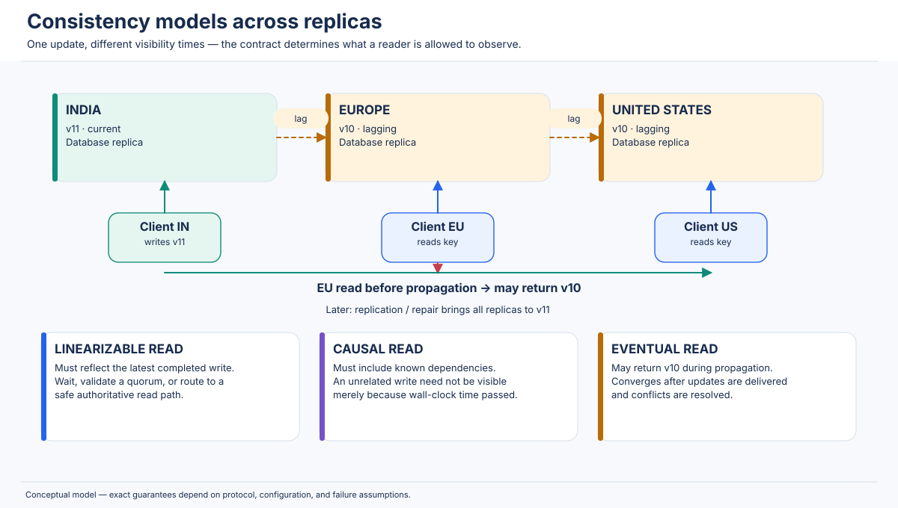

### 4.5 Consistency models vs. transaction isolation

These ideas are related but not interchangeable.

- A **consistency model** usually describes the permitted ordering and visibility of operations on replicated objects or shared state.
- A **transaction isolation level** describes which anomalies may occur among concurrent transactions, often within a database's transactional abstraction.

Examples:

- **Linearizability** is a correctness condition for concurrent operations on an object. Every operation appears to take effect at one point between invocation and response, respecting real-time order.
- **Serializability** says transactions are equivalent to some serial execution. Basic serializability does not necessarily preserve real-time order between non-overlapping transactions.
- **Strict serializability** (also called external consistency in some transaction systems) combines serializability with real-time ordering of transactions.
- **Snapshot isolation** gives transactions a consistent snapshot and typically prevents certain anomalies, but can allow write skew.
- **Read committed** prevents dirty reads but can still permit non-repeatable reads and other anomalies depending on the database.

A single-node SQL database can offer serializable transaction isolation without being a replicated distributed system. Conversely, a replicated key-value store can provide linearizable single-key operations without offering arbitrary multi-key serializable transactions.

### 4.6 Consistency, availability, durability, and reliability

| Property | Question it answers | Example failure or guarantee |
|---|---|---|
| Consistency | Which values and operation orders may clients observe? | A read after a completed write returns the new value under linearizability. |
| Availability | Does a request receive a non-error response within the required time? | A local replica continues serving reads during a network partition. |
| Durability | Does an acknowledged committed update survive the specified failures? | A committed log entry survives a process restart or machine loss. |
| Reliability | Does the service continue to perform correctly over time? | Replication, recovery, monitoring, backups, and tested failover reduce outages and data loss. |

A highly available system can return stale data. A strongly consistent system can reject or delay requests when it cannot safely establish the required order. A durable write acknowledgement does not necessarily imply that every replica can read the write immediately. Reliability is broader than availability: it includes correctness, recoverability, fault containment, and operational practices.

### 4.7 Why different models exist

A global order of operations is valuable, but constructing and enforcing it often requires coordination. Coordination may add network round trips, bottleneck on a leader or quorum, and block progress when a required failure domain is unreachable. For data that is naturally mergeable or whose temporary staleness is acceptable, asynchronous propagation can improve latency and availability.

The central design question is not “Which consistency model is best?” It is:

> **What is the weakest consistency contract that still preserves the application's invariants and user expectations?**

Use strong ordering for invariants such as “a seat can be sold only once” or “a payment cannot be debited twice.” Use causal or session guarantees for user workflows where order matters but a global wall-clock order is unnecessary. Use eventual convergence for data such as replicated catalogs or counters when conflicts can be safely merged and temporary staleness is acceptable.

---

## 5. Linearizability

### 5.1 Introduction

**Linearizability** is a correctness condition for concurrent objects. It says that every completed operation must appear to take effect atomically at some instant between the operation's invocation and its response, and that the resulting sequential order must respect real-time precedence.

For a read/write register, linearizability gives clients the illusion of one up-to-date copy even if the implementation uses many replicas. This is why it is commonly described as **single-copy consistency** or an atomic consistency guarantee.

Two requirements are essential:

1. **Atomic appearance:** each operation behaves as if it happened at one indivisible point. A read cannot observe half of an individual atomic operation.
2. **Real-time order:** if operation A returns before operation B is invoked, A must precede B in the equivalent sequential history.

The core rule is:

> If operation A completes before operation B begins, A must appear before B in the global order.

If two operations overlap in time, linearizability does not require one particular order. It may order either first as long as the sequential specification is obeyed and all real-time constraints are preserved.

#### Example: non-overlapping and overlapping operations

- Client 1 invokes `write(x, 5)` at 10:00:00.000 and receives success at 10:00:00.010.
- Client 2 invokes `read(x)` at 10:00:00.020 and receives `5` at 10:00:00.025.

The write completed before the read began, so the read must include that write (or a later write) under linearizability.

Now consider:

- Client 1 invokes `write(x, 5)` at 10:00:00.000 and receives success at 10:00:00.030.
- Client 2 invokes `read(x)` at 10:00:00.010 and receives `0` at 10:00:00.020.

The operations overlap. A valid linearization can place the read before the write, even though the read returned while the write was still in flight. The result `0` is therefore not automatically a violation.

### 5.2 Linearization points

A **linearization point** is the conceptual instant at which an operation takes effect in the equivalent sequential history. It is not necessarily the instant the client sends the request, the server receives it, or the client receives the response.

Examples of implementation-level linearization points include:

- The point at which a leader commits an entry after the required consensus quorum has replicated it.
- The point at which an atomic compare-and-swap succeeds.
- The commit point of a transaction after a database has established a globally valid serialization order.
- A point in a single-threaded event loop where the command updates the authoritative data structure.

A correct proof identifies a point that lies inside each operation's invocation/response interval and shows that ordering operations by those points yields a legal sequential history. Some distributed algorithms use an abstract point that is easier to reason about than a single physical CPU instruction.

### 5.3 Formal definition

A **history** is a sequence of invocation and response events from concurrent processes. An operation may be written as:

`op = (process, invocation, response, arguments, result)`

For example:

```text
inv(P1, write(x, 7))
res(P1, write(x, 7), OK)
inv(P2, read(x))
res(P2, read(x), 7)
```

Let `A <rt B` mean that operation A's response occurs before operation B's invocation. This is the **real-time precedence** relation.

A history H is linearizable if it can be extended, if necessary, with responses for pending operations and then rearranged into a legal sequential history S such that:

1. S contains the completed operations of H (and any pending operations chosen as completed in the extension).
2. S obeys the sequential specification of the object (for a register, reads return the most recent preceding write in S, or the initial value if no write precedes them).
3. If `A <rt B` in H, A precedes B in S.

An operation's interval begins at invocation and ends at response. Its linearization point must fall within that interval. Operations that overlap may be placed in either order if the sequential object specification permits it.

**Pending operations matter.** A client may time out after sending a write. The write may have committed even though no response reached the client. A later read can reveal that it took effect. Formal linearizability definitions allow a history to be completed by choosing whether pending operations took effect, but application code must separately handle ambiguous outcomes and retries, typically with idempotency keys or operation identifiers.

#### A compact timeline

```text
Time ───────────────────────────────────────────────────────────────>
Client A:  inv write(x,1) ─────────────── res OK
Client B:             inv read(x) ─ res 1
Client C:                                  inv read(x) ─ res 1

            |<------ A and B overlap ------>|  C starts after A ends
```

The first read may be ordered after the write because the operations overlap. Client C's read must be ordered after the completed write because it begins later.

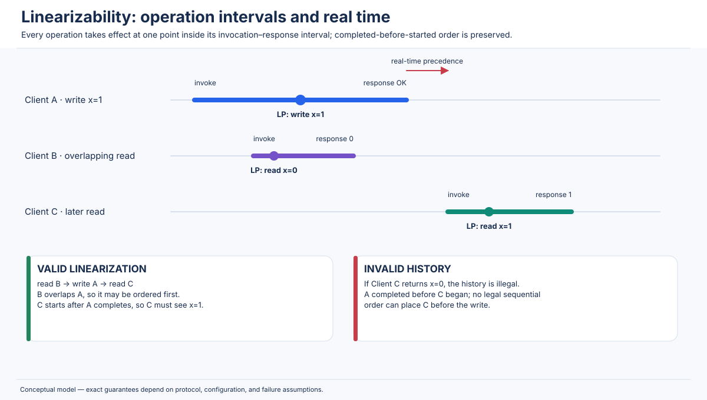

### 5.4 Worked example 1: linearizable read-after-write

Initial value: `profile.name = "Mira"`.

| Event | Time | Client | Operation/result |
|---|---|---|---|
| 1 | 12:00:00.000 | A | Invoke write `name = "Mina"` |
| 2 | 12:00:00.015 | A | Write returns `OK` |
| 3 | 12:00:00.020 | B | Invoke read `name` |
| 4 | 12:00:00.025 | B | Read returns `"Mira"` |

**Verdict: not linearizable.** The write response precedes the read invocation. Therefore the sequential order must place the write before the read. Returning `"Mira"` violates the register specification unless a later write changed the value (none is shown).

A valid implementation can route B's read to the current leader, perform a quorum-confirmed read, or use a read-index/lease mechanism whose safety conditions are satisfied. Merely reading a nearby asynchronously updated follower is insufficient.

### 5.5 Worked example 2: concurrent writes from two clients

Initial value: `x = 0`.

| Event | Time | Client | Operation |
|---|---|---|---|
| 1 | 09:00:00.000 | A | Invoke `write(x, 1)` |
| 2 | 09:00:00.003 | B | Invoke `write(x, 2)` |
| 3 | 09:00:00.010 | B | `write(x, 2)` returns `OK` |
| 4 | 09:00:00.014 | A | `write(x, 1)` returns `OK` |
| 5 | 09:00:00.020 | C | Invoke `read(x)`; returns `1` |

**Verdict: potentially linearizable.** The writes overlap, so the system may order A before B or B before A. Because the read begins after both writes complete, it must reflect the later write in the chosen sequential order. A valid order is `write(2)` then `write(1)` then `read() -> 1`. The fact that B received its response first does not constrain the two overlapping writes' order relative to each other; the response order does imply B's operation completed before A completed, but because A began before B completed, their intervals overlap. A legal linearization must still choose a point for each inside its interval.

### 5.6 Worked example 3: bank account balance

Assume an account starts with `$100`. Two clients attempt to withdraw `$80` concurrently. A naive implementation performs `read(balance)`, checks `balance >= amount`, then writes `balance - amount` without an atomic transaction.

| Time | Client A | Client B | Stored balance |
|---|---|---|---:|
| t0 | Read 100 | | 100 |
| t1 | | Read 100 | 100 |
| t2 | Check 100 >= 80 | | 100 |
| t3 | | Check 100 >= 80 | 100 |
| t4 | Write 20 | | 20 |
| t5 | | Write 20 | 20 |

Both withdrawals may report success while the final balance is `$20`. The system has lost an update and has violated the business invariant that total successful withdrawals cannot exceed the initial funds.

Linearizable individual `GET` and `PUT` operations alone do not make the multi-step read-check-write workflow atomic. The application needs an atomic conditional update or a serializable transaction, for example:

```sql
UPDATE accounts
SET balance = balance - 80
WHERE account_id = 42 AND balance >= 80;
```

The application must check that exactly one row was updated. With appropriate transaction and durability settings, one withdrawal succeeds and the other observes the reduced balance and fails. For multi-account transfers, both debit and credit should be in one atomic transaction or coordinated workflow with explicit failure recovery.

**Important distinction:** linearizability of each operation is not a substitute for transaction isolation across several operations. A transaction-capable system may provide strict serializability, which is the transaction-level analogue that also preserves real-time order.

### 5.7 Worked example 4: e-commerce inventory reservation

A product has one unit remaining. Two customers concurrently attempt to reserve it.

Unsafe code:

```text
if read(stock) > 0:
    write(stock - 1)
    create_order()
```

Both clients can read `1` before either writes. This can create two orders for one unit even if each individual read and write is linearizable, because the workflow is not atomic.

Safer design: use a conditional decrement within a transaction.

```sql
BEGIN;
UPDATE inventory
SET available = available - 1
WHERE sku = 'SKU-7' AND available > 0;
-- Continue only if exactly one row was updated.
INSERT INTO reservations(sku, customer_id, status)
VALUES ('SKU-7', :customer_id, 'HELD');
COMMIT;
```

A serializable or otherwise correctly locked/conditional transaction ensures that only one reservation consumes the final unit. An idempotency key prevents a retry from creating a second reservation after a timeout. A reservation expiry and an order/payment state machine handle abandoned holds.

### 5.8 Implementing linearizability

#### Leader-based replication

A common approach elects one leader for a shard or replicated log. Writes go through that leader, which assigns a log position and replicates the entry to followers. If the protocol commits only after a quorum has accepted the entry, the committed log establishes an order of writes.

A linearizable read cannot simply read an arbitrary follower. It may:

- be served by the leader after the leader establishes it is still authoritative;
- use a quorum-based read protocol or Raft ReadIndex;
- use a carefully bounded leader lease, with clock and lease assumptions enforced;
- read from a follower that has applied a sufficiently recent committed index under a safe protocol.

A leader's local memory is not sufficient evidence that it is still leader. After a partition, an old leader may be isolated while a new leader is elected elsewhere. Epochs/terms and quorum confirmation prevent the old leader from safely committing new operations.

#### Quorum-based coordination

With N replicas, a read quorum R and write quorum W intersect when `R + W > N`. The intersection helps ensure a read contacts at least one replica that participated in a completed write. But an intersection is only a building block: the system must choose the latest valid version, handle concurrent writes, define what “completed” means, and prevent stale leaders or sloppy quorum behavior from invalidating the proof.

#### Consensus protocols

Raft and Paxos allow a group of replicas to agree on an ordered log or value despite failures within their fault assumptions. Consensus is often used to implement a linearizable replicated state machine. A write becomes committed when the protocol's commit condition is satisfied. The application state machine applies committed log entries in the same order on each replica.

Consensus does not make a network partition disappear. A quorum-based group generally cannot safely commit new entries on a minority side. This is the price of preserving one authoritative order.

#### Synchronous replication

“Synchronous” is a broad term. It may mean waiting for a local replica, a majority, or all replicas. Those options have different failure and latency behavior. Waiting for all replicas can make a system unavailable when a single replica is down. Waiting for a quorum can tolerate a minority failure but still needs a protocol that defines the order and prevents divergent commits.

#### Leader leases and limitations

A leader lease lets a leader serve some reads without asking the full quorum on every request. A safe lease requires careful treatment of clock drift, lease expiry, pause-the-world events, process suspension, and network delays. A former leader must not continue serving as authoritative after its lease is no longer valid. Systems may use bounded clock uncertainty, conservative lease windows, fencing tokens, and quorum-backed lease grants.

Never implement a lease with only “sleep for N seconds” and an unsynchronized local clock. A delayed or paused process can resume after its lease should have expired. A **fencing token** (monotonically increasing epoch) lets downstream resources reject commands from stale lease holders.

### 5.9 Real-world systems

- **etcd:** its key-value API documents strict serializability/linearizable behavior for ordinary KV operations by default; linearized operations use Raft coordination. It also offers serializable reads that can be stale relative to quorum. Watch streams have their own revision/order semantics and are not simply interchangeable with a linearizable KV read. See the API guarantees documentation [R7].
- **Consul:** supports consistency modes for reads, including a default mode that favors consistency and options such as stale or consistent reads. The selected mode affects whether a request can be served locally or must coordinate with the leader/quorum. Treat a Consul read mode as an explicit request-level choice, not as a property inferred from the product name. See the Consul consistency documentation [R8].
- **ZooKeeper:** uses a replicated coordination service and provides per-client sequential ordering, atomic updates, and session-related guarantees. Its reads can be served by servers with a view that is not simultaneously identical to every other client's view; the `sync` operation is used when a client needs to ensure it has caught up before a read. Do not describe ZooKeeper as “all reads are always linearizable.” See the programmer guide [R9].
- **Google Spanner:** provides external consistency for transactions. TrueTime supplies bounded clock uncertainty; timestamp assignment and commit-wait ensure that commit timestamps respect real-time order. Spanner's guarantee is transaction-oriented and stronger than single-object linearizability [R10, R11].
- **CockroachDB:** replicates ranges with Raft and uses MVCC timestamps and distributed transaction machinery. Its default SQL transaction isolation is serializable; serializability and strict serializability are distinct concepts, so do not assume every serializable transaction system automatically has real-time ordering for every transaction. Consult the release-specific transaction and consistency documentation [R12].

### 5.10 Advantages, limitations, and when to use it

**Advantages**

- A completed write is immediately part of the history seen by later non-overlapping reads.
- Application reasoning is comparatively simple: clients can treat an object as though it had one current value.
- It prevents stale read-after-write behavior for operations covered by the guarantee.
- It is valuable for coordination primitives such as compare-and-swap, locks, leader election, and unique reservations.

**Limitations**

- A read or write may need a network round trip to a leader or quorum.
- Cross-region coordination adds WAN latency, often dominating application execution time.
- A quorum-based design may reject or block operations on a partitioned minority.
- Hot keys or single leaders can become throughput bottlenecks.
- Linearizable single-key operations do not automatically make multi-key workflows atomic.
- Retries after timeouts still need idempotency because the client may not know whether an operation committed.

Choose linearizability for invariants that cannot tolerate stale observations or duplicate ownership: lock acquisition, unique allocation, a single-seat booking, payment state transitions, and inventory decrements. For analytics, feeds, product descriptions, or non-critical counters, a weaker contract may provide a better user experience and operating cost.

---

## 6. Sequential Consistency

### 6.1 Introduction

**Sequential consistency** requires that the operations of all processes appear in one global sequential order, and that this order preserve the program order of each individual process. The global order must be legal according to the object's sequential specification.

The key difference from linearizability is that **sequential consistency does not require the global order to respect real-time order between different processes**. Two operations can be observed in an order that contradicts their wall-clock completion order, as long as each process's own operation order is preserved.

The concept is strongly associated with Leslie Lamport's work on multiprocessor memory models. The goal is to let programmers reason about shared memory as an interleaving of process operations rather than as arbitrary hardware reordering. In distributed systems, the same idea is useful for replicated shared objects and state-machine histories.

### 6.2 Formal definition

Let P be the set of processes and let `po` be the program-order relation. A history is sequentially consistent if there exists a legal total order S of the operations such that:

1. Every completed operation appears in S (with pending-operation treatment defined by the model).
2. S is legal under the sequential specification of the object.
3. If operation A precedes B in the same process's program order, then A precedes B in S.

Unlike linearizability, S need not preserve `A <rt B` when A and B belong to different processes. Sequential consistency preserves **per-process order**, not one globally observed real-time order.

For example, if client A performs `write(x,1)` and then `read(y)`, the global order must place A's write before A's read. Another process's operation can be interleaved anywhere that does not violate its own program order or the object's specification.

### 6.3 Worked example: two clients and shared variables

Assume variables `x = 0` and `y = 0`.

```text
Process P1:                 Process P2:
1. write(x, 1)              1. write(y, 1)
2. read(y) -> ?             2. read(x) -> ?
```

One legal sequentially consistent global order is:

```text
P1: write(x,1)
P2: write(y,1)
P2: read(x) -> 1
P1: read(y) -> 1
```

Both processes preserve their local program order. The reads return values consistent with the total order. Another valid interleaving is:

```text
P2: write(y,1)
P1: write(x,1)
P1: read(y) -> 1
P2: read(x) -> 1
```

A result where both reads return `0` can also be sequentially consistent if the total order is:

```text
P1: write(x,1)
P1: read(y) -> 0
P2: write(y,1)
P2: read(x) -> 0
```

This particular ordering is legal because P1's read occurs before P2's write in the global sequence, and P2's read occurs after P2's own write but before P1's write would be impossible under the displayed order. A fully valid both-zero order must instead interleave the reads before the other process's writes while preserving each writer's own order, for example:

```text
P1: write(x,1)
P2: write(y,1)
```

cannot make both subsequent reads return zero because both writes precede their own process's reads. Thus, given the exact program above where each process writes first and reads second, both reads returning zero is **not** sequentially consistent. This is an important discipline: construct the total order, do not rely on intuition about “concurrency.”

A valid weak-memory illustration of both reads returning zero uses loads first and stores second:

```text
P1: read(y) -> 0; write(x,1)
P2: read(x) -> 0; write(y,1)
```

The serialization `P1.read(y), P2.read(x), P1.write(x), P2.write(y)` preserves each process's order and makes both reads return zero.

### 6.4 Concurrent updates in a replicated key-value store

Suppose P1 sends `put(k, "A")` and then `get(k)`, while P2 sends `put(k, "B")` and then `get(k)`. The system may choose a total order such as:

`P1.put(A) < P1.get() -> A < P2.put(B) < P2.get() -> B`

or:

`P2.put(B) < P2.get() -> B < P1.put(A) < P1.get() -> A`.

What it cannot do is return a result that cannot be explained by any single legal interleaving respecting each process's order.

### 6.5 A history that is sequentially consistent but not linearizable

Initial value: `x = 0`.

| Event | Wall-clock time | Client | Operation |
|---|---|---|---|
| 1 | 10:00:00.000 | A | `write(x, 1)` invoked |
| 2 | 10:00:00.010 | A | `write(x, 1)` returns |
| 3 | 10:00:00.020 | B | `read(x)` invoked |
| 4 | 10:00:00.030 | B | `read(x)` returns `0` |

This is **not linearizable**, because A's write completed before B's read began. But it may be **sequentially consistent** if the abstract model permits the global sequential history to place B's read before A's write. There is no program-order edge between A and B, so sequential consistency has no cross-process real-time condition to stop that ordering.

This example is the shortest way to remember the distinction: a sequentially consistent system can make a later client appear to “go back in time” relative to another client's completed operation.

### 6.6 Applications and terminology cautions

- **Multiprocessor memory models:** sequential consistency gives a simple conceptual interleaving of loads and stores. Real CPU architectures often expose weaker models for performance, requiring memory barriers or synchronization primitives.
- **Distributed shared memory:** systems can use sequential consistency as a target abstraction for shared variables replicated across machines, though the communication cost may be high.
- **Replicated state machines:** replicas apply an agreed ordered command log. The command order is a sequential execution, but whether clients observe linearizable semantics also depends on when commands are committed and how reads are served.
- **ZooKeeper:** its documented guarantee includes sequential consistency for updates from a client (updates are applied in the order sent by that client), plus atomicity and single-system-image properties. That does not imply that every read across all clients is an instantaneous globally synchronized snapshot [R9].

Do not automatically transfer the meaning of a CPU memory model to a database API. A memory model's “load” and “store” are not necessarily database transactions, and a database may expose transaction isolation, indexes, and multi-key operations that are outside a simple shared-memory register model.

### 6.7 Limitations and comparison with causality

Sequential consistency can require a system to establish a global order, which may involve coordination or an agreed log. It does not, however, demand a global real-time order. A client may receive a value older than a write that another client has already completed.

Causal consistency preserves only orderings implied by causal dependency. Sequential consistency also chooses an order for concurrent operations, but that order need not be the same for every independent causal cluster? The precise sequential-consistency definition requires one global total order, so every observer's operations are explainable by the same sequence. Causal consistency does not require concurrent writes to be placed in one universally agreed order; observers may see independent concurrent writes in different orders.

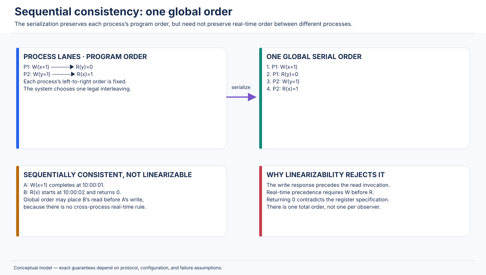

---

## 7. Causal Consistency

### 7.1 Introduction

**Causal consistency** requires that all observers see causally related writes in an order that respects their causal dependency. If operation A can influence operation B, every observer must see A before B. Concurrent writes—writes with no causal relationship—may be observed in different orders by different clients.

Causality matters because real applications frequently create dependent facts:

- A user creates a social post; another user reads it and writes a comment.
- A chat participant sends a message; another participant replies to that message.
- A document collaborator reads a paragraph and edits that paragraph.
- A service reads a configuration version and then emits an event that assumes that configuration.

A replica that shows the reply but not the post has exposed an application state that violates the dependency the author observed.

### 7.2 Happens-before relation

Lamport's **happens-before** relation, written `→`, is a partial order over events. It is commonly defined by:

1. **Program order:** if two events occur in the same process and A occurs before B, then `A → B`.
2. **Message order:** if A sends a message and B receives that message, then `A → B`.
3. **Transitivity:** if `A → B` and `B → C`, then `A → C`.

If neither `A → B` nor `B → A`, the events are concurrent, written `A || B`.

For replicated data, reads can create dependencies. If a process reads a value produced by write A and later issues write B, then A causally precedes B. If B's author learned of A through another chain of messages or reads, transitivity carries that dependency forward.

A causal-consistency guarantee means that if write A happens before write B, every process that observes both must observe A before B. It does not necessarily force all clients to agree on the relative order of concurrent writes.

### 7.3 Types of dependency

- **Read-write dependency:** a client reads a value and then writes based on it. The new write depends on the observed version.
- **Write-read dependency:** a client reads a prior write's result. The read is expected to reflect the write.
- **Write-write dependency:** a client performs write B after write A in the same process or workflow; B must be ordered after A.
- **Transitive dependency:** if A influences B and B influences C, C depends on A even if the process that creates C never directly contacts the process that created A.
- **Concurrent operations:** operations with no happens-before path between them. A causal model may permit different replicas to observe them in different orders.

### 7.4 Three-replica social post example

Replicas: R1 (India), R2 (Europe), R3 (United States).

1. Alice publishes post P on R1.
2. Bob reads P from R1. This read establishes that Bob has observed P.
3. Bob writes comment C, explicitly replying to P.
4. C replicates quickly to R3; P's replication to R3 is delayed.
5. A third user opens R3.

Without causal dependency tracking, the user may see C while P is missing. A causal system must delay C's visibility, deliver P first, or fetch P as a dependency. It must not expose the causally dependent comment as though it existed independently.

| Time | R1 (India) | R2 (Europe) | R3 (US) | Causal fact |
|---|---|---|---|---|
| t0 | Empty | Empty | Empty | Initial state |
| t1 | P exists | Empty | Empty | Alice creates P |
| t2 | P exists | P exists | Empty | P reaches R2 |
| t3 | P, C | P | Empty | Bob reads P, then creates C |
| t4 | P, C | P | C pending | C message reaches R3 before P |
| t5 | P, C | P, C | P then C | R3 releases C only after P is available |

A causal replication layer can carry a dependency such as `C depends_on revision(P)` or a causal context/vector clock. On R3, the apply layer checks whether the dependencies are satisfied. If not, it buffers the operation or retrieves missing history. The application might also store a direct foreign-key relationship from comment to post; that protects referential integrity at the database layer, but the replication protocol still needs to ensure the referenced object becomes visible consistently.

If C arrives before P, a system that exposes C anyway violates the causal visibility contract. It may temporarily keep C in a pending queue. If P never arrives because of a permanent loss, the system must repair, reject, or quarantine the dependent operation rather than silently claim causal convergence.

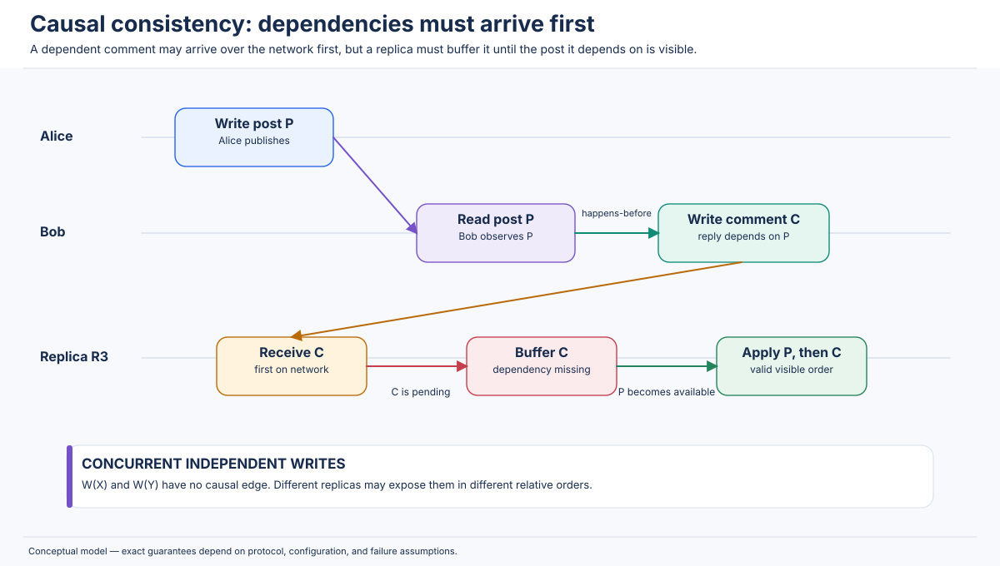

### 7.5 Additional practical examples

**Chat:** Alice sends “Are you free?” and Bob replies “Yes.” A recipient should not see Bob's reply before the question. Unrelated messages in different conversations can be concurrent.

**Collaborative document:** A collaborator sees revision 12 and makes an edit that references text introduced in revision 12. A replica that has only revision 10 must not present the dependent edit without the base content or a conflict representation.

**Banking transfer:** A transfer is a multi-object invariant, not merely a causal dependency. If a debit event is causally followed by a credit event, causal ordering alone does not guarantee atomic all-or-nothing visibility. The system may need a transaction, ledger protocol, or explicit pending state. This is a common trap: causal consistency is not transaction atomicity.

**Event processing:** A service reads configuration revision 8, processes a request, and emits event E labeled with revision 8. Downstream consumers must not process E as though revision 9 had been applied first if E's semantics depend on revision 8. Include the revision/dependency in the event envelope.

### 7.6 Implementation techniques

#### Vector clocks

A vector clock is a map from process/replica identifiers to logical counters. A process increments its own component for a local event and merges vectors on message receive. A vector timestamp can help determine causal relationships:

- `V(a) < V(b)` if every component of V(a) is less than or equal to the corresponding component of V(b), and at least one is strictly less.
- If neither vector dominates the other, the represented events are concurrent (subject to the system's vector-clock conventions).

For a cluster of N participants, a full vector requires O(N) metadata per version. Dynamic membership, compaction, client sessions, and large fan-out can make raw vectors expensive.

#### Version vectors

Version vectors are commonly associated with versions of replicated objects. They help determine whether one version descends from another or whether two versions are concurrent. They are related to vector clocks but are used in storage/version reconciliation contexts. A version vector does not by itself define how concurrent updates are merged.

#### Dependency tracking and causal metadata

Instead of attaching a full causal history, a system may attach compact dependency metadata: a session token, a hybrid logical timestamp, a replica log position, a version vector, or a list of required object revisions. The metadata must be sufficient for the system's actual causal scope.

#### Dependency-aware replication

A replica receives an operation and verifies its causal prerequisites. If dependencies are missing, it can:

1. Buffer the operation until dependencies arrive.
2. Fetch the missing versions from a peer or source of truth.
3. Return a retry/“not yet visible” response to the client.
4. Store the operation as pending but hide it from ordinary reads.

Causal message delivery is often implemented with FIFO channels plus metadata or with a protocol that buffers messages whose dependencies have not been applied.

### 7.7 Applications and trade-offs

Causal consistency is useful for social feeds, messaging, collaborative editing, dependency-aware event streams, and replicated key-value stores where users need a coherent causal view but do not need one total real-time order for all independent updates.

**Advantages:** less global coordination than linearizability; preserves the order users naturally expect; supports multi-region writes more flexibly than a single global leader in some architectures.

**Costs:** causal metadata consumes space and bandwidth; dependencies must be tracked and garbage-collected; a replica may delay a read or write while waiting for missing predecessors; high-fan-out causal chains can be expensive to maintain.

Causal consistency is stronger than bare eventual convergence in the ordering information it preserves, but weaker than linearizability because it does not require all concurrent writes to have one globally observed real-time order.

---

## 8. Eventual Consistency

### 8.1 Introduction

**Eventual consistency** is a convergence guarantee: if no new updates are made to a data item and the system continues to communicate and repair successfully, replicas eventually converge to the same state.

This is often summarized as:

> If updates stop and communication continues to make progress, all non-failed replicas eventually reflect the same resolved state.

The assumptions matter. The system needs eventual message delivery or repair, a convergence-safe conflict policy, recovery of replicas that missed updates, and enough operational capacity to drain replication backlogs. A permanently disconnected node or an update that is silently lost invalidates the premise. “Eventually” is not a time bound; an application should not assume convergence within a fixed number of milliseconds unless the product explicitly documents an SLO or bound.

Eventual consistency exists because waiting for every geographically distant replica before acknowledging every write can be costly. A system can acknowledge locally and propagate asynchronously, improving response latency and allowing writes during some network failures. The temporary cost is replica divergence and possibly conflicting updates.

### 8.2 Three-node replication example

Initial state: `cart:42 = {apples: 1}` on replicas A, B, and C.

At t1, A accepts a write adding one apple. The system responds before B and C receive the update.

| Time | Replica A | Replica B | Replica C | Client observation |
|---|---|---|---|---|
| t0 | `{apples:1}` | `{apples:1}` | `{apples:1}` | All agree |
| t1 | `{apples:2}` | `{apples:1}` | `{apples:1}` | Write acknowledged by A |
| t2 | `{apples:2}` | `{apples:1}` | `{apples:1}` | Read from B returns stale value |
| t3 | `{apples:2}` | `{apples:2}` | `{apples:1}` | B has caught up |
| t4 | `{apples:2}` | `{apples:2}` | `{apples:2}` | Replicas converge |

The stale response at t2 is allowed by an eventual-consistency contract. The system has not necessarily lost the update; it has not propagated it yet.

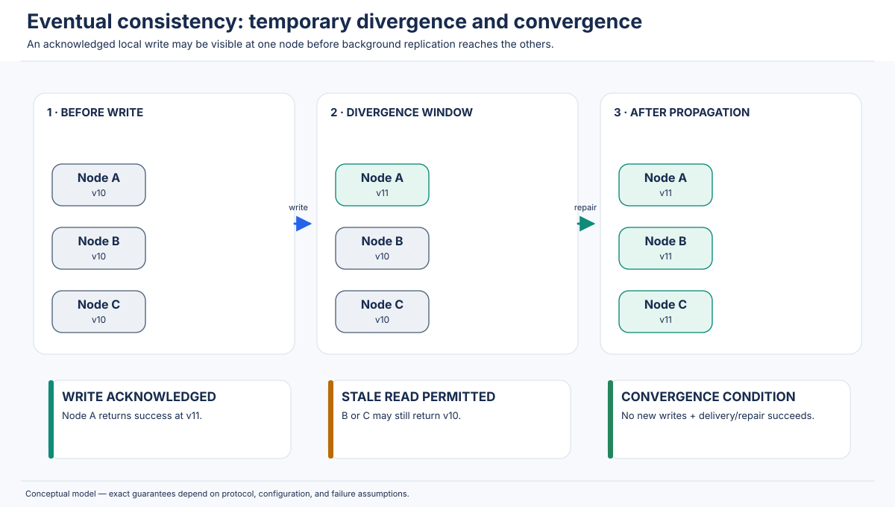

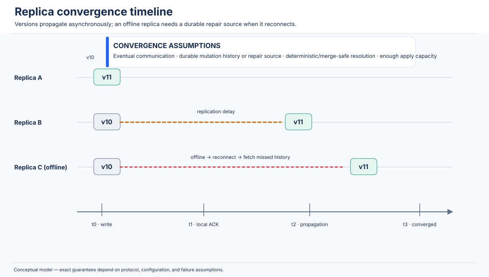

### 8.3 Mechanisms used by eventually consistent systems

- **Write propagation:** a coordinator or accepting replica forwards updates to other replicas, sometimes through a durable replication log or queue.
- **Replication queues:** retain unapplied work. A growing queue indicates replication lag and can turn an intended temporary divergence into a prolonged user-visible problem.
- **Background synchronization:** processes batches of missed changes, log positions, or snapshots.
- **Anti-entropy:** replicas compare state and repair differences periodically or on demand.
- **Read repair:** a read discovers different replica versions and attempts to update stale replicas. Cassandra documents read repair behavior and its interaction with monotonic quorum reads and write atomicity [R14].
- **Hinted handoff:** when a replica is temporarily unavailable, another node may retain a hint that a mutation should later be delivered. Cassandra documents hints as one of several best-effort repair mechanisms, not a replacement for full repair [R15].
- **Merkle trees:** compact hash trees summarize ranges of data. Replicas compare hashes from the root downward to locate differing subranges without transferring every record.
- **Conflict resolution:** when concurrent updates arrive, the system chooses or merges a resolved value according to a deterministic or application-supplied policy.

These mechanisms are not interchangeable. A queue delivers known events; anti-entropy identifies divergence even when an event was missed; read repair opportunistically repairs data on the read path; a Merkle tree is a comparison structure; conflict resolution decides what state should win or how versions should merge.

### 8.4 Conflict resolution

Eventual consistency does **not** mean conflict-free updates. Consider a multi-region profile record. Region A changes `city = "Delhi"` while Region B changes `city = "Pune"` before hearing about the other update. The system needs a policy.

**Last-write-wins (LWW):** compare timestamps or logical versions and retain the winner. This is simple but can discard a meaningful update. If physical clocks are skewed, “latest timestamp” may not mean “latest real-time write.” LWW must specify timestamp source, tie-breaking, and whether timestamps are per cell or per record.

**Version vectors:** preserve concurrent versions so the system can detect that neither descends from the other. An application can ask a user to resolve the conflict or apply domain-specific logic.

**Application-level merge:** combine changes according to semantics. Two users adding different items to a cart can often be merged; two users setting one shipping address need an explicit conflict policy.

**CRDTs (Conflict-free Replicated Data Types):** data types with merge operations designed to converge under concurrent updates, assuming their delivery and metadata conditions. Examples include grow-only sets, observed-remove sets, and carefully defined counters. A CRDT's algebraic properties do not make every application invariant safe; for example, a replicated counter may converge while still allowing an oversell if the invariant is “never allocate more than the global stock.”

### 8.5 Worked conflict: timestamp winner vs. merge

Initial list of notification preferences: `{email:true, sms:true}`.

- Region A disables email.
- Region B disables SMS.
- The updates are concurrent.

If the record is resolved with whole-record LWW, one update may overwrite the other, yielding either `{email:false, sms:true}` or `{email:true, sms:false}`. The intended combined state `{email:false, sms:false}` is lost.

If the system tracks independent fields or uses a merge that combines changed fields, it can converge to `{email:false, sms:false}`. The correct merge depends on domain semantics. For a field where updates mean “replace the canonical address,” combining strings is not valid.

### 8.6 Real-world uses

- **DNS:** cached records expire according to TTLs; changes propagate through authoritative servers and caches rather than synchronizing every cache instantaneously.
- **CDNs:** edge caches are refreshed or invalidated asynchronously; a user may briefly receive an older object version.
- **Distributed caches:** invalidation and replication lag can expose stale values; versioned cache keys and bounded TTLs can limit impact.
- **Social feeds:** likes, counters, and feed materialization may be eventually updated while critical account/authentication operations use stronger semantics.
- **Product catalogs/search indexes:** catalog writes may reach search indexes asynchronously; the user interface can show an item that is not immediately searchable or temporarily show a retired item.
- **Distributed databases:** Dynamo-style systems, Cassandra configurations, and multi-region DynamoDB eventual tables expose varying forms of asynchronous replication and convergence.

Amazon DynamoDB's global tables currently document two modes: multi-Region eventual consistency (MREC), with asynchronous propagation and per-item last-writer-wins reconciliation, and multi-Region strong consistency (MRSC), which synchronously replicates to another region/witness before successful write acknowledgement within supported region sets. Do not assume all DynamoDB global tables have the same mode [R16, R17].

### 8.7 Benefits and trade-offs

**Benefits:** local write latency, high write availability in some architectures, geographic locality, scalable fan-out, and less synchronous coordination.

**Costs:** stale reads, temporary divergence, conflict-resolution complexity, potential loss of concurrent updates under simplistic LWW policies, delayed visibility of deletes, and operational work to repair replicas. Eventual consistency is appropriate when the application can tolerate these behaviors and has an explicit merge/reconciliation story.

---

## 9. Session Guarantees

Session guarantees are especially useful because they improve a single user's experience without requiring every replica in the entire system to maintain one global real-time order. They were formalized for weakly consistent replicated data by Terry and colleagues in the Bayou work [R18].

### 9.1 What is a session?

A **session** is a logical sequence of operations issued by one client or user context. It may span multiple HTTP requests, service instances, devices, or database connections. A session boundary must be defined by the application: it could be a browser login, a mobile application workflow, a server-generated session identifier, or a client-held causal token.

In an asynchronously replicated system, a user's next request might reach a different replica from the one that accepted the previous write. Without session guarantees, a user can update a profile and immediately see the old profile, or read an order as “Shipped” and later see “Processing.” This is confusing even when the system eventually converges.

Session guarantees constrain the visibility/order of operations within a session. They do not necessarily constrain what unrelated users see.

### 9.2 Read-your-writes consistency

**Read-your-writes (RYW)** means that after a session successfully writes a value, later reads in that session reflect that write or a later version. It prevents the user from observing their own successful update disappear from view.

Example: a user changes their profile photo from image A to image B. The upload succeeds. The browser refreshes and a request reaches a lagging replica that still has image A. Without RYW, the user sees the old photo. With RYW, the request is routed to a replica that has applied the acknowledged write, or it waits until a replica reaches the returned version token.

Implementation options:

- **Session version token:** after write, return a token such as `{region: "ap-south", commit_index: 8123}` or a database cluster time. Later reads carry the token; the server waits until the serving replica has reached at least that point.
- **Sticky routing:** route the user's reads to the same primary/replica that accepted the write. This is simple but insufficient if that node fails, traffic moves, or the session changes services.
- **Read from leader:** route RYW reads to the authoritative leader, assuming the leader's read protocol provides the required guarantee.
- **Read-your-write cache:** temporarily retain the updated value in a session cache. This can improve UI behavior but needs invalidation and merge rules.

A write timeout is not necessarily a failed write. Return an operation ID or idempotency token so a retry does not create a duplicate. RYW applies to a write known to have succeeded under the API's acknowledgement contract.

### 9.3 Monotonic reads

**Monotonic reads** means that once a session has observed a version of an item, later reads in that session must not return an older version. The session's observed state moves forward or stays at the same point; it does not move backward.

Example: an order status is first read as `Shipped` (revision 45). A later request is routed to a lagging replica at revision 42, which returns `Processing`. Monotonic reads forbids that regression. The client or gateway records the highest observed version (45) and sends a minimum-version token on future reads. A replica that has only reached 42 must wait, forward the request, or return a retryable response.

Monotonic reads do not guarantee the freshest possible value. A session may repeatedly observe revision 45 even if revision 47 exists elsewhere. The guarantee only rules out going backward relative to what the session has already observed.

### 9.4 Monotonic writes

**Monotonic writes** means that writes issued by one session are applied in the order that the session issued them. If W1 precedes W2 in the session, the system must not make W2 effective before W1.

Example: a user first changes the shipping address, then places an order using the updated address. If the address update and order write are independently routed to replicas and the order is applied first, the order may capture the old address. Monotonic write sequencing can attach W2 to the dependency token produced by W1, or route the operations through a single ordered stream.

Monotonic writes do not automatically make a multi-step workflow atomic. If W1 succeeds and W2 fails, the system may still contain W1. Use a transaction or saga/state machine when all-or-nothing behavior is required.

### 9.5 Writes-follow-reads consistency

**Writes-follow-reads (WFR)** means that a write from a session is ordered after the writes reflected in a preceding read from that session. It preserves a read-to-write causal dependency.

Example: a user reads a shared document at version 12, then writes an edit that assumes a paragraph introduced in version 12. The edit must not be applied to a replica whose state predates the version the user saw. The system should attach the read's causal token to the write and wait for or route to a replica that has incorporated it.

WFR is especially valuable when a client makes decisions based on observed state. It does not prevent an independent concurrent writer from changing the same data; conflict detection or transaction isolation is still needed.

### 9.6 Comparison of the four session guarantees

| Guarantee | Main property | Problem prevented | Example |
|---|---|---|---|
| Read-your-writes | Later reads include the session's successful earlier writes | User sees own update disappear | New profile photo remains visible after refresh |
| Monotonic reads | Later reads are not older than prior observed reads | User moves backward in state | `Shipped` does not regress to `Processing` |
| Monotonic writes | Session writes take effect in issue order | Later dependent write overtakes earlier write | Address update precedes order creation |
| Writes-follow-reads | A write incorporates/comes after the state observed in an earlier read | Write is applied without its read dependency | Edit based on document revision 12 waits for revision 12 |

The guarantees can be combined. A causally consistent session with all four properties gives a user a view consistent with their own actions and dependencies, even though different users may still observe concurrent independent writes differently. MongoDB documents that a causally consistent client session using majority read concern and majority write concern provides all four guarantees; other concern combinations provide fewer guarantees [R19].

### 9.7 Implementation pattern: consistency tokens

A general pattern is:

1. A read returns both data and an opaque consistency token.
2. A write request includes the token for the state on which the write depends.
3. The server validates or waits until the write is ordered after that dependency.
4. The write response returns a token for the resulting version.
5. The client retains the greatest token for future operations.

A token may encode a log index, timestamp, vector clock, cluster time, or causal context. The client should treat it as opaque unless the API explicitly documents its structure. Tokens can be scoped to a partition, shard, database cluster, or session; a token from one scope may not be meaningful in another.

**Version-based pseudocode:**

```text
session.minimum_version = 0

read(key):
    value, version = replica_read(key, minimum=session.minimum_version)
    session.minimum_version = max(session.minimum_version, version)
    return value

write(key, value):
    new_version = write_after(key, value, dependency=session.minimum_version)
    session.minimum_version = max(session.minimum_version, new_version)
```

A real implementation needs timeout handling, replica eligibility rules, token validation, version comparison semantics, and an explicit response when the requested minimum version cannot be served.

### 9.8 Why sticky sessions alone are not enough

Sticky routing can provide a practical approximation of session consistency, but it has important gaps:

- A load balancer may route to another server after a restart or deployment.
- A session may span multiple devices or microservices.
- The selected replica may be behind even though the same node is used.
- A primary may fail and be replaced by a replica that has not applied the user's latest acknowledged write under a weak acknowledgement policy.
- A user can switch regions or network paths.
- Sticky routing does not order two writes that are submitted concurrently by different browser tabs.

Use explicit version/causal tokens or a database session facility when the guarantee is important. Treat stickiness as a routing optimization, not as a complete proof of correctness.

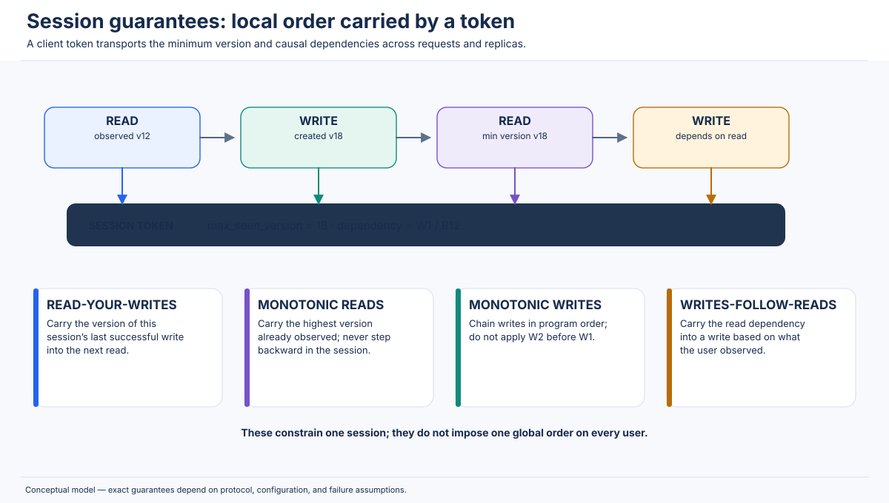

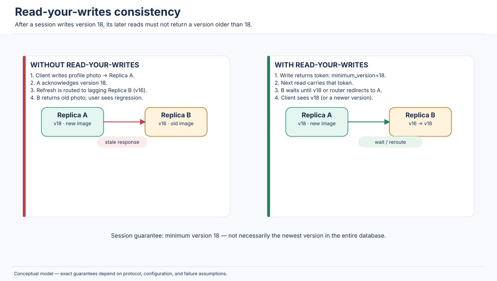

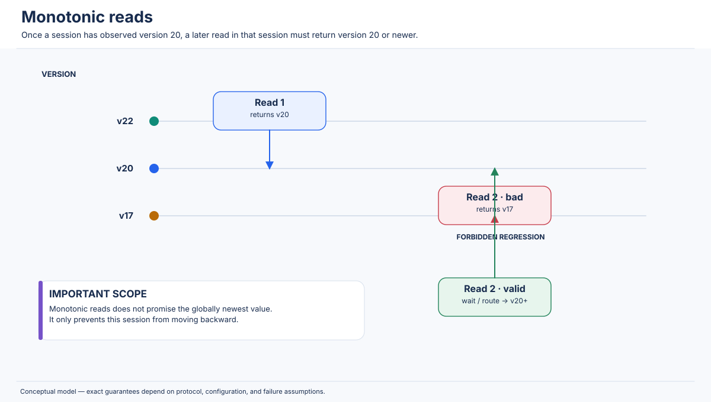

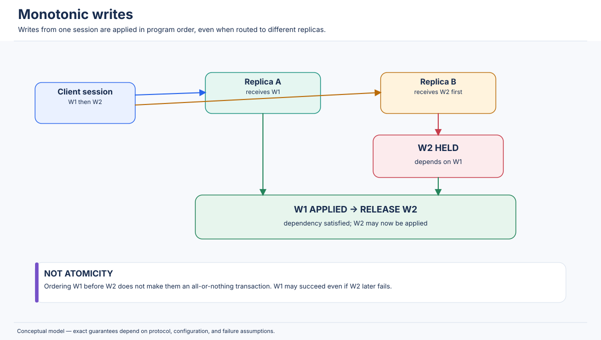

---

## 10. CAP Theorem

### 10.1 Origin and formal meaning

The CAP theorem was popularized by Eric Brewer and formally proved by Seth Gilbert and Nancy Lynch in the asynchronous network model [R2]. It states that a distributed read/write data service cannot simultaneously guarantee all three of the following properties when a network partition occurs:

- **Consistency (C):** in the formal CAP model, atomic consistency, commonly understood as linearizability. A read observes the latest completed write according to a single real-time order.
- **Availability (A):** every request received by a non-failing node must eventually receive a non-error response. A response that simply refuses the operation because a remote replica is unreachable does not satisfy this availability definition.
- **Partition tolerance (P):** the system continues to operate despite a communication failure that divides nodes into groups that cannot exchange messages.

The theorem is about a distributed system that must tolerate partitions. It is not saying that a database permanently chooses exactly two features on a configuration screen. When no partition exists, a system can often provide both a strong consistency guarantee and successful responses. The unavoidable conflict appears when a partition separates nodes that would need to coordinate to preserve one global order.

### 10.2 A precise intuition

Imagine two replicas, A and B, each storing a register `x = 0`. A network partition separates them. A client sends `write(x, 1)` to A and receives success. Then another client sends `read(x)` to B.

If B responds immediately with `0`, the system has violated linearizability: the write completed before the read began. If B waits until it can communicate with A, it may preserve consistency, but it has not responded while the partition remains. If B responds with `1` without receiving the write or another proof that it is current, it is guessing and can be wrong in another legal execution.

This is the core CAP tension: the isolated side cannot distinguish “the other side has no newer write” from “the other side has committed a newer write but messages are delayed.” In an asynchronous model, an arbitrarily long delay can be indistinguishable from a failure.

### 10.3 Why the theorem is often misunderstood

**Misunderstanding 1: “Choose any two of C, A, and P permanently.”**

This is an oversimplification. Partition tolerance is a requirement about how the design behaves when communication fails. In a real multi-node network, partitions are possible whether or not a designer wishes to tolerate them. The important choice during a partition is whether to preserve a strong consistency contract by refusing some operations or to keep serving requests and permit divergence.

**Misunderstanding 2: “CA systems are a practical option for a globally distributed system.”**

A CA design can assume the nodes never become partitioned, or avoid distributing the relevant state across independent failure domains. A single-machine database may be consistent and available under its local failure assumptions, but it does not tolerate a network partition between replicas because it has no replicated partition to continue through. In a distributed system that must tolerate partitions, CA cannot be maintained under the formal model.

**Misunderstanding 3: “CAP consistency means every database integrity constraint.”**

CAP's C is atomic consistency/linearizability, not “the data obeys the application's business rules” and not the consistency letter in ACID. A database might preserve foreign keys and schema constraints while permitting stale reads. Conversely, a linearizable register can still represent an invalid business workflow if an application performs a non-atomic read-check-write sequence.

**Misunderstanding 4: “A is a percentage of uptime.”**

Operational availability is often measured as a percentage over a period. CAP availability is a formal response guarantee for requests received by non-failing nodes during the partition. A service may have excellent measured uptime while rejecting a particular class of operation during a partition.

**Misunderstanding 5: “A CP system is unavailable everywhere.”**

A CP system may continue serving the side of the partition that can form a quorum. It is not necessarily globally down. It sacrifices responses from nodes that cannot safely participate in the authoritative order.

### 10.4 Three-node partition scenario

Assume three replicas, A, B, and C, initially agree on `inventory = 5`. A partition separates A from B and C.

```text
Before partition:      A <──────> B <──────> C
                       all replicas agree

After partition:       A       ||       B <──────> C
                       minority          majority
```

#### CP behavior

A consensus-backed CP design requires a majority quorum of two out of three. B and C can communicate and may elect/retain a leader. They can commit a write after a majority acknowledges it. A is isolated and cannot safely commit a conflicting write or provide a read that claims to be current. Requests routed to A may fail, time out, or be redirected. This preserves a single authoritative history.

| Operation during partition | A (minority) | B/C (majority) |
|---|---|---|
| Linearizable read | Reject, wait, or redirect | Can serve after safe quorum/leader check |
| Write requiring quorum | Cannot commit | Can commit if quorum and leader conditions hold |
| Availability | Reduced on A side | Preserved for supported operations on majority side |
| Consistency | Preserved by refusing unsafe operations | Preserved by consensus order |

#### AP behavior

An AP-style multi-writer design may allow A to accept local writes while B/C accept other writes. A local read can return promptly on each side. The partitions can now diverge. After connectivity returns, the system transfers missed updates and runs a conflict-resolution or merge procedure.

| Operation during partition | A | B/C |
|---|---|---|
| Local read | Responds with A's current view | Responds with B/C's current view |
| Local write | May accept update A1 | May accept independent update B1 |
| Cross-partition freshness | Cannot know remote writes | Cannot know A's writes |
| Recovery | Exchanges updates and resolves conflicts | Exchanges updates and resolves conflicts |

Both sides may have acknowledged writes that cannot coexist under a simple single-value register. The system needs an explicit conflict policy. If it uses LWW, one value may win; if it uses a CRDT, a merge may preserve both; if the domain does not permit a merge, an application or human may need to resolve the conflict.

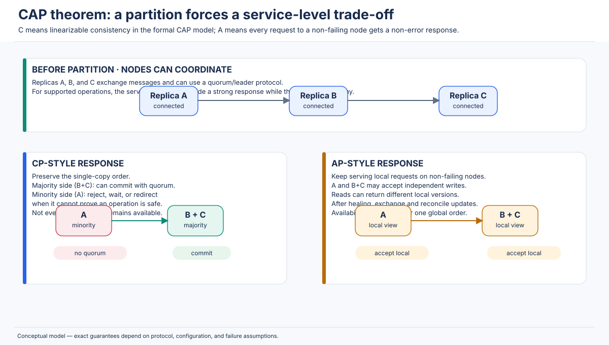

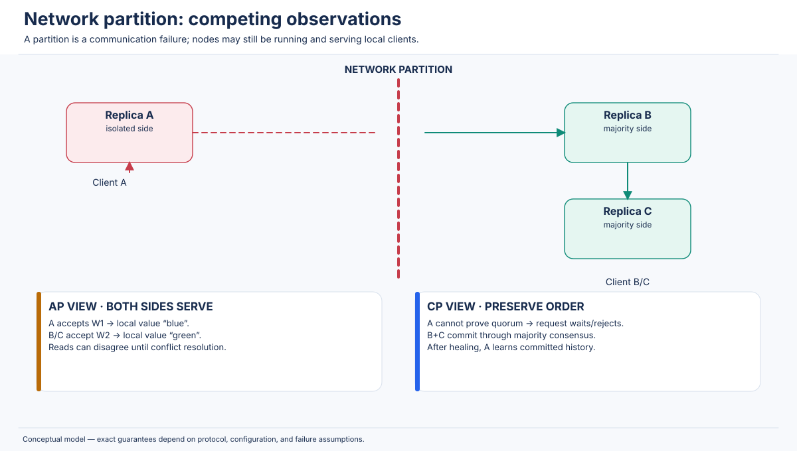

### 10.5 Partition healing and recovery

When the network partition heals, replicas exchange logs or state. A CP consensus group uses its committed log and leader/term rules to bring the minority replica into the current committed history; uncommitted entries may be discarded. An AP or multi-writer system must reconcile versions that were accepted independently. Recovery can involve:

1. Re-establishing connectivity and authenticating replica membership.
2. Discovering the last common log position, version, or Merkle hash.
3. Transferring missing log entries or changed data ranges.
4. Comparing concurrent versions.
5. Applying the documented conflict-resolution rule.
6. Rebuilding derived indexes/caches and verifying invariants.
7. Monitoring backlog until convergence completes.

Healing the network does not automatically mean replicas are immediately equal. Large backlogs can take significant time to drain. The system should expose replication lag and repair status.

### 10.6 CP, AP, and CA comparison

| Property | CP-style behavior | AP-style behavior | CA-style assumption |
|---|---|---|---|
| Consistency during partition | Preserves the specified strong consistency contract by refusing unsafe operations | May return divergent/stale values; convergence is handled later | No guarantee once a partition occurs; partition is assumed away or not tolerated |
| Availability during partition | Not every partition side can serve every operation | A non-failing node can often serve local requests | Not meaningful under a partitioned multi-node model |
| Partition tolerance | The system continues with reduced service on some sides | The system continues with divergent local service | Does not tolerate the partition |
| Read behavior | Requires leader/quorum/freshness proof or fails/waits | May read a local replica's current local state | Depends on the single-site/connected assumption |
| Write behavior | Only a side able to satisfy the commit protocol accepts a strong write | Multiple sides may accept independent writes | Writes assume reliable communication/no replica split |
| Conflict handling | Committed order is authoritative; minority uncommitted entries are reconciled | Must merge or select among divergent accepted updates | Not applicable until partition assumptions fail |
| Illustrative use | Coordination metadata, locks, strongly consistent transaction stores | Availability-oriented multi-writer data and caches | Single-node or tightly coupled non-partitioned assumptions |

This table is an explanatory abstraction. Individual products can expose multiple read/write modes and may behave differently by operation, replica topology, and configuration.

### 10.7 Real-world systems: avoid universal labels

- **MongoDB:** a replica set has one primary for ordinary writes, and majority write concern can require acknowledgement from a majority. Reads from secondaries can be stale. During elections and partitions, primary/secondary selection, read concern, write concern, and read preference determine what a client observes. Read concern `linearizable` is a primary-only option for a uniquely identifying single-document query and is more restrictive than `majority`; it may wait for concurrent writes to reach a majority [R20, R21].
- **Cassandra:** multi-master replication and tunable consistency let applications choose a response threshold such as ONE, QUORUM, LOCAL_QUORUM, or ALL. A ONE/LOCAL_ONE workload is more availability-oriented; quorum settings can provide read/write intersections under assumptions. Lightweight transactions using Paxos provide linearizable compare-and-set semantics for conditional operations [R13, R22].
- **Dynamo-style systems:** designed around availability and scale, using versioned data, quorum-like techniques, hinted handoff, and application-level conflict resolution. The original Dynamo paper describes vector clocks and sibling versions for concurrent updates [R3]. Do not equate every managed Dynamo-family product with that exact paper design.
- **Redis:** ordinary replication is asynchronous by default. `WAIT` can ask for acknowledgements from a number of replicas, but it is not a consensus protocol and does not transform Redis replication into a fully strongly consistent CP system; acknowledged writes can still be lost during failover under some conditions [R23].
- **etcd:** the KV API is designed for coordination and defaults to linearizable/strictly serializable operations via Raft. It offers a serializable read mode that can be stale relative to quorum. Watch ordering and revision semantics are separate from the linearizability of ordinary KV calls [R7].
- **ZooKeeper:** Zab-based replicated state and client/session guarantees are useful for coordination. Its documented guarantees include sequential consistency for updates from a client, atomicity, single-system image, reliability, and timeliness; it does not promise simultaneous identical views for all clients at every instant [R9].
- **CockroachDB:** distributed ranges are replicated with Raft; transactions use MVCC and SQL isolation guarantees. Writes that cannot reach a required quorum cannot safely commit on an isolated minority. Read modes and transaction settings can alter freshness/latency behavior [R12].

### 10.8 Quorums, replication factor, and split-brain prevention

Let:

- N = number of replicas for a data item;
- W = number of replica acknowledgements required for a write;
- R = number of replica responses required for a read.

For simple quorum systems, requiring `R + W > N` ensures every read quorum intersects every successful write quorum. If `N = 3`, `R = 2`, and `W = 2`, any two-member read set and any two-member write set share at least one replica.

A majority quorum is commonly `floor(N/2) + 1` (also written `⌊N/2⌋ + 1`). For N = 3, it is 2. For N = 5, it is 3. A majority intersects every other majority.

A quorum intersection does **not** by itself guarantee linearizability. Consider:

- A replica may have received an uncommitted write.
- A read may contact an intersecting replica but choose an older version incorrectly.
- Two concurrent writes may be assigned conflicting timestamps and resolved by LWW rather than a single agreed order.
- A sloppy quorum may use nodes outside the natural replica set.
- The system may acknowledge a write before the version is durably or safely committed.
- A later leader may not know about an earlier acknowledged write if the commit protocol is incorrect.

Quorum intersection is a set-theoretic property. Linearizability additionally needs a protocol for version ordering, commit, leader epochs, and safe reads.

**Split brain** occurs when two parts of a system both act as authoritative leaders for the same logical data. Consensus protocols prevent two conflicting majorities from independently committing to the same log. Fencing tokens, terms/epochs, and quorum leases prevent a stale leader from performing downstream side effects after losing authority. A load balancer choosing one endpoint is not split-brain prevention; the storage/coordination layer must enforce authority.

---

## 11. PACELC Theorem

### 11.1 Why CAP is not the whole story

CAP captures the consistency/availability conflict during a network partition. Most user requests, however, occur while the network is healthy. Distributed database designers still have to decide whether to wait for remote replicas to maintain stronger consistency or return sooner with a weaker/stale view.

**PACELC** extends CAP reasoning:

> **If** there is a Partition (P), choose between Availability (A) and Consistency (C); **Else** (E), choose between Latency (L) and Consistency (C).

The formulation is associated with Daniel Abadi's analysis of modern distributed database design [R4]. PACELC makes the normal-operation cost visible: even without a partition, stronger ordering may require remote communication and therefore higher latency.

### 11.2 Meaning of the letters

- **P — Partition:** a network partition or communication failure affects the system.
- **A — Availability:** keep responding on a partitioned side, potentially with stale or conflicting data.
- **C — Consistency:** preserve the stronger specified ordering/freshness contract, potentially by refusing or delaying operations.
- **E — Else:** the normal operating case where the relevant replicas can communicate.
- **L — Latency:** favor fast local responses and reduce coordination.
- **C — Consistency:** wait for coordination or a more authoritative version to preserve stronger consistency.

The letters refer to design priorities, not a binary certification. Actual systems can expose several modes, and different data types or operations may make different choices.

### 11.3 The four simplified categories

#### PA/EL — Availability during partitions; latency over consistency otherwise

The architecture accepts local reads and writes on partitioned sides and uses asynchronous propagation. During normal operation, it also favors local responses rather than waiting for every region to acknowledge.

- **Partition behavior:** multiple sides may continue operating; conflicts may be created.
- **Normal behavior:** local write acknowledgement is fast; remote replicas catch up later.
- **Trade-off:** low latency and availability at the cost of stale reads and merge/conflict complexity.
- **Illustrative architecture:** an active-active multi-region key-value service with asynchronous replication and LWW or CRDT merge. The original Dynamo design is a classic availability-oriented reference, but do not assume all Dynamo-family services share identical implementation or semantics [R3].

#### PA/EC — Availability during partitions; consistency over latency otherwise

The architecture may allow each partition to continue serving, but under healthy network conditions it performs extra coordination to keep replicas consistent. This is a less common combination because an AP decision during a partition necessarily allows some divergence, while normal operation can still use synchronous coordination.

- **Partition behavior:** requests can be accepted locally; divergent updates must later be reconciled.
- **Normal behavior:** synchronously coordinate across replicas to provide a stronger current view.
- **Trade-off:** higher normal-operation latency; still needs conflict resolution for partition-time independent writes.
- **Illustrative architecture:** a multi-writer system that locally accepts writes during partitions but synchronizes a global commit path during healthy operation. The design must define how partition-time writes are reconciled with the coordinated state.

#### PC/EL — Consistency during partitions; latency over consistency otherwise

This design refuses unsafe operations on a partitioned side, preserving one authoritative order. Under healthy conditions, it may use local or stale reads for low latency while keeping writes or critical operations coordinated.

- **Partition behavior:** only a leader/quorum side can safely commit; minority-side operations fail or wait.
- **Normal behavior:** read paths may use cached, follower, or bounded-stale snapshots to reduce latency; selected strong reads still coordinate.
- **Trade-off:** strong behavior for critical updates but explicitly weaker/older reads where the application accepts them.
- **Illustrative architecture:** a quorum-backed transactional database with follower reads at an older timestamp for analytics or dashboards.

#### PC/EC — Consistency during partitions and consistency over latency otherwise

This design favors the strongest supported ordering both during failures and under normal operation. It coordinates writes and strong reads, and refuses requests when the system cannot establish the required quorum or leader authority.

- **Partition behavior:** minority-side requests cannot complete as strong operations.
- **Normal behavior:** remote quorum/leader coordination is part of the operation path.
- **Trade-off:** stronger guarantees with potentially higher read/write latency and dependence on a healthy quorum.
- **Illustrative architecture:** a strongly consistent coordination store used for locks, leases, and leader election.

### 11.4 Latency example: local vs. quorum write

Suppose a service in Chennai writes to three replicas: Chennai, Frankfurt, and Virginia. A local write takes 5 ms to apply locally. Inter-region round-trip times are 90 ms to Frankfurt and 230 ms to Virginia.

- An asynchronous local-ack write may respond in roughly the local apply time plus application overhead, while remote replication continues.
- A write requiring an acknowledgement from the nearest remote quorum may add at least one inter-region round trip (depending on topology and protocol).
- A write requiring all three replicas may be dominated by the slowest region and can fail when any required replica is unavailable.

These are illustrative network timings, not product benchmarks. Actual end-to-end latency includes network path asymmetry, queueing, consensus phases, storage flushes, leader placement, contention, and retries.

### 11.5 CAP vs. PACELC

| Dimension | CAP | PACELC |
|---|---|---|
| Main question | What happens when a network partition occurs? | What happens during a partition, and what is prioritized when the network is healthy? |
| Failure case | Availability vs. consistency | P → A or C |
| Normal case | Not described by the theorem's central trade-off | E → L or C |
| Latency | Indirectly affected by coordination | Explicitly represented |
| Useful for | Partition/failure-mode reasoning | Comparing normal read/write paths and geographic placement choices |
| Limitation | Often misread as a permanent “pick two” menu | Simplified categories can hide per-operation and per-data differences |

Synchronous replication increases latency when a client must wait for remote acknowledgements or a quorum. Asynchronous replication can return sooner, but a read from a lagging replica may not include a recently acknowledged remote write. A stale read can still be internally consistent at a particular snapshot timestamp; “stale” means it is older than the state the application might otherwise have observed, not necessarily that the snapshot is malformed.

### 11.6 Real-world design choices

- **Dynamo-style systems:** traditionally prioritize availability and local latency, with asynchronous replication and conflict handling. The exact behavior depends on the particular product and configuration.
- **Cassandra:** offers tunable consistency levels. A workload using ONE may prioritize latency/availability; QUORUM or EACH_QUORUM may incur additional coordination. Local quorum can avoid WAN latency but does not imply global cross-datacenter quorum intersection [R13, R22].
- **Spanner:** by default provides external consistency for transactions. TrueTime and commit-wait make real-time ordering part of the commit path, while MVCC snapshot reads can avoid blocking writes [R10, R11].
- **CockroachDB:** Raft replication and serializable transactions favor strong transactional behavior; stale/follower reads can be explicitly used for latency-sensitive historical snapshots. Placement and leaseholder location affect latency [R12].
- **MongoDB:** read concern, write concern, and read preference let applications trade freshness/durability/latency. Secondary reads can be stale; majority and linearizable read concerns have different semantics [R20, R21].
- **Distributed caches:** commonly favor low latency and local availability. Cache invalidation, TTL, versioning, and read-through rules determine how stale data can become.

Do not permanently label a product “PA/EL” or “PC/EC” without stating which operation, configuration, topology, and failure case are under discussion.

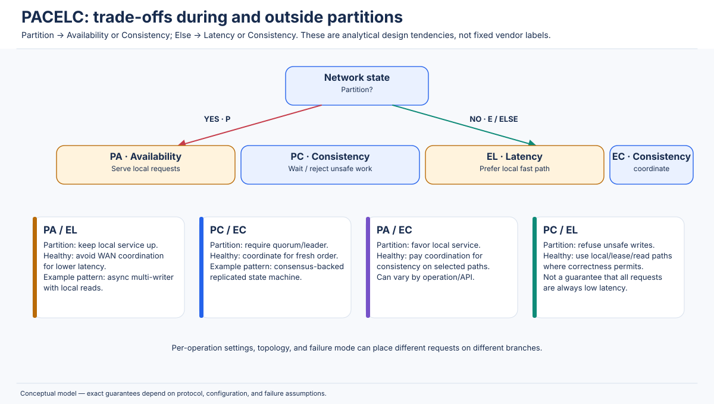

---

## 12. Strong vs. Weak Consistency

### 12.1 Strong consistency

“Strong consistency” is an overloaded phrase in product documentation. In this chapter, use it carefully: a strong real-time read/write contract usually means linearizability; for transactions, strict serializability or external consistency is a stronger transaction-level contract. A product may call a setting “strongly consistent” while defining a specific scope (single key, region, shard, or transaction).

Strong consistency commonly relies on one or more of:

- A single authoritative leader per shard or key range.
- Consensus replication and a quorum commit rule.
- Read-index or quorum validation for reads.
- Synchronous replication to a required set of failure domains.
- MVCC with correctly ordered commit timestamps.
- Atomic conditional operations or serializable transactions for invariants.

Strong consistency does not mean that every byte is synchronously copied to every replica on every request. It means that the system's observable behavior satisfies the documented consistency contract. A follower may lag physically while a read protocol still safely obtains a linearizable answer from the leader or an up-to-date quorum.

### 12.2 Weak consistency

**Weak consistency** is a broad family of contracts that permit observations that stronger models would forbid. It can include eventual consistency, causal consistency, session guarantees, bounded staleness, and application-defined merge behavior. It does not mean “no guarantees.” A weakly consistent system may guarantee causal order or read-your-writes while allowing unrelated replicas to diverge.

Common mechanisms include asynchronous replication, local reads, client-side version tokens, conflict resolution, CRDTs, and background reconciliation.

### 12.3 Intermediate models

The models can be understood as different constraints on histories:

- **Linearizability:** one legal total order that preserves real-time order.
- **Sequential consistency:** one legal total order that preserves each process's program order, but not necessarily cross-process real-time order.
- **Causal consistency:** preserve happens-before dependencies; concurrent operations may be seen in different orders.
- **Session consistency:** preserve selected dependencies within one client's logical session.
- **Eventual consistency:** after updates stop and repair succeeds, replicas converge to a common resolved state.
- **Bounded staleness:** reads may be older than the latest state but only within a documented time/version bound. The bound must be precisely defined; a time bound is not automatically a guarantee that all replicas have the same wall-clock notion of “now.”

### 12.4 Trade-off comparison

| Dimension | Strong (linearizable / strict serializable) | Weak/eventual family |
|---|---|---|
| Read freshness | Reads reflect prior completed writes within the guarantee's scope | Reads may be stale or only causally/session fresh |
| Write coordination | Typically leader/quorum/consensus or equivalent ordering | May acknowledge locally and propagate asynchronously |
| Read latency | May need leader/quorum validation; can be optimized with safe leases or snapshots | Often low for local replica reads |
| Write latency | Often includes coordination and durable commit conditions | Often lower for local acknowledgement |
| Availability during partitions | Strong operations may be rejected on a side unable to prove authority | Local operations may continue, with divergence/conflict risk |
| Scalability | Coordination, hot leaders, and global ordering can limit throughput | Easier geographic write locality; metadata/repair can become expensive |
| Conflict handling | Commit protocol orders writes or aborts conflicts | Must merge, select, retain siblings, or reject conflicts |
| Application complexity | Easier to reason about freshness; multi-step invariants still require transactions | Developers must design for stale reads, versioning, retries, and conflicts |
| Typical use cases | Locks, payments, uniqueness, inventory reservation, coordination | Feeds, catalog propagation, analytics, caches, mergeable counters |

Weaker consistency is not inherently worse engineering. If an application only needs a user's own update to appear in their session, global linearizability may add cost without improving that requirement. If two users can add items to a shopping cart independently, a mergeable design may be more available and useful than a single global leader. The key is to match the contract to the invariant.

### 12.5 Choosing a model: decision framework

Ask these questions in order:

1. **What invariant must never be violated?** “No duplicate payment,” “one owner of a lock,” and “never oversell the last unit” are hard invariants. “The feed is eventually up to date” is not.
2. **What is the unit of atomicity?** A single key, one row, multiple rows, a ledger transaction, or a workflow spanning external services?
3. **Which operations must see which prior operations?** All users, a single session, causally dependent users, or eventually everyone?
4. **Is cross-region write availability required during a partition?** If yes, how will conflicts be merged or compensated?
5. **How stale can a read be?** No stale reads, monotonic reads, a 2-second bound, or “eventually”? The answer should be explicit.
6. **Can the operation be retried safely?** Define idempotency keys, deduplication windows, and unknown outcomes.
7. **What is the latency budget?** Include WAN and quorum round trips, not just database execution time.
8. **How will repair be detected and measured?** Monitor replication lag, pending hints, conflict counts, and convergence time.

### 12.6 Application-by-application recommendations

| Application | Suggested guarantee | Why / what must still be designed |
|---|---|---|
| Banking ledger | Serializable/strictly serializable transactions for ledger invariants; durable commit | Prevent lost updates and invalid balances; use idempotency, double-entry ledger, audit trail, and reconciliation. |
| Payment processing | Atomic state transition plus durable idempotency; strong ordering for payment state | Avoid double charge/capture; external payment gateways require retries, idempotency keys, and compensating workflows. |
| Inventory reservation | Conditional decrement or serializable transaction for final allocation | Catalog count can be stale; reservation requires atomic stock check, hold expiry, and idempotent order creation. |
| Social-media likes | Eventual/CRDT-like counter or deduplicated set; causal for post/comment visibility | Count may lag; one user should not create duplicate likes; dependent comments should not precede posts. |
| Product catalog | Eventual replication to read/search regions, versioned cache/index | Temporary staleness is usually acceptable; product deletion and price changes may need stronger paths. |
| User profile updates | Read-your-writes and possibly monotonic reads | Same user should see their change; global users may tolerate propagation lag. |
| Messaging | Causal or per-conversation ordered delivery; durable message IDs | Replies must follow their context; exactly-once delivery is not automatic, so deduplicate and handle retries. |
| DNS | TTL-based cache consistency and eventual propagation | Different resolvers may serve old records until TTL expiry; use conservative TTLs for planned migrations. |
| Analytics | Eventual ingestion and snapshot-consistent reads | Freshness is traded for throughput; show “data as of” timestamps and handle late events. |
| Collaborative editing | Causal order plus CRDT/OT or conflict-aware merge | Convergence is essential; semantic merge and cursor/document model matter. |
| Shopping cart | Session guarantees plus mergeable per-item updates | Multiple devices can update concurrently; quantity semantics, removals, and duplicate events need explicit policies. |
| Leader election | Linearizable compare-and-swap/lease with fencing tokens | A stale leader must not perform side effects after losing authority. |
| Distributed locks | Linearizable lock state plus fencing token and bounded lease | A lock holder may pause beyond lease; downstream resource must reject stale epochs. |

A hybrid architecture is common. For example, use a strongly consistent inventory reservation service, asynchronous product catalog replication, causal comments, and eventual analytics. Consistency is a property of the operation path and data contract, not necessarily of every service in the application.

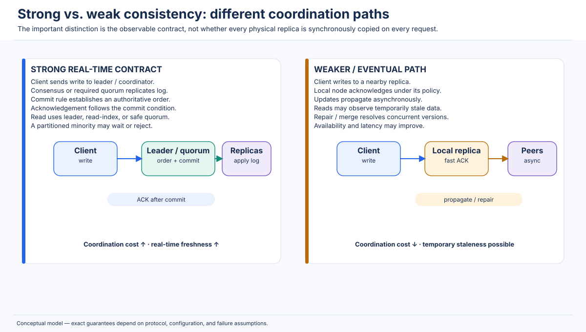

---

## 13. Real-World Database Consistency Mechanisms

This section describes the architectural ideas that matter when choosing or operating a database. Product names are not consistency guarantees. Always specify the database version, topology, read mode, write acknowledgement, transaction isolation, and failure assumptions.

### 13.1 Google Spanner

**Architecture.** Spanner is a globally distributed, multi-version database. Data is split into ranges and synchronously replicated. Replicas are coordinated through Paxos groups; distributed transactions can span multiple groups. It combines replication, MVCC, distributed transaction protocols, and a time API called TrueTime [R10].

**External consistency.** Spanner's default transaction guarantee is external consistency: transactions appear to execute in a serial order, and that order respects real-time ordering of transactions. If transaction T1 completes before T2 begins to commit, T2 receives a later serialization timestamp. Google describes external consistency as stronger than linearizability for database transactions because it applies to transactions containing multiple reads and writes, not only one atomic object operation [R11].

**TrueTime.** TrueTime returns an interval rather than pretending that every machine has a perfectly synchronized point clock. If a timestamp reading is represented as `[earliest, latest]`, the real time is guaranteed to lie within that interval under TrueTime's assumptions. The width of the interval expresses clock uncertainty.

**Commit-wait.** After selecting a commit timestamp `s`, Spanner waits until the earliest possible current time is greater than `s` (`TT.now().earliest > s`) before reporting the transaction committed. This ensures that any transaction starting after the commit response obtains a timestamp that respects the real-time order. The wait is not an arbitrary sleep; it is tied to the uncertainty interval and TrueTime's bounded-clock assumptions [R10, R11].

**MVCC and reads.** Each write creates a new immutable version with a commit timestamp. A snapshot read at timestamp t returns the newest version whose timestamp is at or before t. Strong reads use a timestamp that is current enough to include prior committed writes. Stale reads can intentionally use an earlier timestamp and avoid waiting for the newest state while remaining transactionally consistent at that timestamp.

**Limitations and design notes.** External consistency is not free: synchronous replication, transaction coordination, and commit-wait can add latency. Data placement matters; transactions spanning distant regions incur network costs. For analytics, historical/stale snapshot reads can be useful. Use strong reads and read-write transactions for correctness-critical invariants; use historical reads when the application can state its acceptable staleness explicitly.

### 13.2 CockroachDB

**Architecture.** CockroachDB presents a distributed SQL interface over a distributed key-value layer. Data is split into ranges; each range has replicas managed through Raft. A node can host many ranges and act as a leaseholder for ranges it serves. The range leaseholder coordinates normal reads/writes for that range, while Raft replicates the write log to the range's quorum [R12].

**MVCC.** CockroachDB stores multiple versions of keys, associated with timestamps. Reads at a transaction timestamp see the version appropriate to that snapshot. This supports consistent snapshots and historical reads.

**Hybrid Logical Clocks (HLC).** HLC timestamps combine a physical-time component with a logical counter so a node can order events even when multiple events occur within the same physical clock tick. HLCs help maintain a monotonic logical timeline and support timestamp-based transaction coordination. They are not a magical globally perfect clock; clock offset/uncertainty and transaction protocol rules still matter.

**Transactions.** CockroachDB uses serializable isolation by default and can retry transactions when concurrency conflicts or timestamp pushes require it. Serializable means transactions are equivalent to a serial execution; do not casually equate that term with strict serializability, which additionally preserves real-time order. CockroachDB's architecture and release-specific guarantees should be checked for the exact transaction mode and read path in use [R12].

**Distributed transactions.** When a transaction spans multiple ranges, the transaction coordinator must coordinate intents/records and commit state across the involved ranges. A single-range Raft commit is not the entire story for a multi-range SQL transaction. Applications must handle retryable transaction errors according to the driver/API contract and should keep transaction bodies safe to retry.

**Limitations and design notes.** Range placement and leaseholder location affect latency. Contended keys can cause transaction retries. Follower reads and `AS OF SYSTEM TIME` can serve historical snapshots with lower coordination cost, but are deliberately stale relative to the latest committed state. Do not use a follower read for a workflow that requires the newest write unless the chosen timestamp/freshness semantics provide it.

### 13.3 Apache Cassandra

**Architecture.** Cassandra is a peer-to-peer distributed database. Data is partitioned using a token ring and replicated to multiple nodes according to the keyspace's replication strategy. A coordinator receives a client request and forwards the mutation/read to the relevant replicas. Production multi-datacenter deployments generally use `NetworkTopologyStrategy` so replicas can be spread across racks/failure domains [R13].

**Replication factor.** The replication factor (RF) is the number of replicas for a partition in a keyspace/datacenter configuration. RF = 3 means three copies are targeted for a partition. A replication factor is not the same as the number of nodes in the cluster.

**Tunable consistency levels.** The client chooses response thresholds such as `ONE`, `TWO`, `THREE`, `QUORUM`, `ALL`, `LOCAL_ONE`, `LOCAL_QUORUM`, and `EACH_QUORUM`, subject to the deployment and operation. A write at `QUORUM` requires a quorum of replicas to acknowledge; a read at `QUORUM` contacts a quorum and reconciles versions. With RF=3, QUORUM is 2. The simple intersection condition `R + W > N` explains why a QUORUM write followed by a QUORUM read can observe the write under the standard replica-set assumptions [R13, R22].

**ONE, QUORUM, and ALL.**

- `ONE`: one replica response is enough; low latency, but a read may hit a replica that has not received the latest mutation.
- `QUORUM`: a majority of the relevant replicas must respond; stronger intersection behavior, with higher latency and reduced availability compared with ONE.
- `ALL`: all replicas must respond; it can provide a strong intersection condition for ordinary writes/reads but has the lowest availability when a single replica is down.
- `LOCAL_QUORUM`: a quorum within the local datacenter; avoids cross-datacenter write/read latency but does not by itself ensure a globally intersecting quorum across different datacenters.
- `EACH_QUORUM`: requires a quorum in each datacenter for the supported write path; this improves multi-DC acknowledgement requirements but can make writes unavailable when one DC cannot form a quorum.

Consistency level behavior is operation-specific. A successful acknowledgement threshold is not a blanket promise of linearizability for every possible concurrent workload.

**Conflict resolution.** Cassandra uses timestamps attached to mutations and typically resolves cell-level conflicts with last-write-wins behavior. Timestamp generation and clock discipline matter. LWW can discard an update if the chosen timestamp ordering does not match the business intent. It is not a substitute for compare-and-set when two clients race to claim one resource.

**Repair mechanisms.** Hinted handoff stores missed mutations for temporarily unavailable replicas; read repair reconciles replicas involved in a read; anti-entropy repair compares replica data, commonly using Merkle-tree techniques. These shorten divergence, but operational repair remains necessary and hints are best-effort [R14, R15].

**Lightweight transactions (LWT).** Conditional operations using `IF` clauses use Paxos to provide linearizable compare-and-set behavior. Cassandra documents SERIAL and LOCAL_SERIAL levels for the serial phase of lightweight transactions. They cost more than ordinary writes and should be used where conditional ordering is required, not indiscriminately across every mutation [R22].

**Limitations and design notes.** Quorum configuration, datacenter topology, consistency level, repair cadence, clock behavior, tombstone handling, and LWT usage all influence real behavior. Avoid using `LOCAL_QUORUM` as shorthand for global strong consistency in a multi-region design. Model each region's failure and write-conflict path.

### 13.4 Amazon Dynamo-style systems

**Original Dynamo architecture.** The Dynamo paper describes a highly available key-value store designed for always-on services. It combines consistent hashing, replication, object versioning, quorum-like reads/writes, hinted handoff, anti-entropy, and application-assisted conflict resolution [R3].

**N, R, W.** In a simplified setting, N is the replication factor, R the number of replicas contacted for a read, and W the number required to acknowledge a write. `R + W > N` ensures quorum intersection. Smaller R/W values can reduce latency and improve availability but may allow a read to miss a recently accepted write.

**Sloppy quorum and hinted handoff.** To preserve availability when a natural replica is unavailable, Dynamo can use reachable substitute nodes to accept a write and later hand it to the intended replica. This is called sloppy quorum behavior. It is useful for availability but changes the assumptions behind a simple fixed-set quorum intersection argument. Do not apply `R + W > N` as a proof without checking whether the actual read/write sets are the intended replica sets.

**Version vectors and siblings.** A version vector helps a system distinguish a later version from a concurrent version. If two updates are concurrent, Dynamo can return multiple sibling versions to an application. The application then resolves them (for example, by merging shopping-cart contents) and writes a reconciled value. This is more semantically expressive than blindly discarding one version based on a wall-clock timestamp.

**Application-level merge.** The database cannot infer domain semantics. A shopping cart can often merge item additions, but a single shipping address needs a clear winner or user intervention. The API should expose conflicts in a form the application can handle rather than pretending that an arbitrary timestamp is business truth.

**Managed Dynamo-family caveat.** DynamoDB is not a line-for-line implementation of the original Dynamo paper. Current DynamoDB tables support strongly consistent reads in a region for tables and local secondary indexes, while GSIs and streams are eventually consistent. Global tables have explicit consistency modes: MREC is asynchronous/eventual across regions; MRSC is a synchronous multi-region option with region-set and feature restrictions. MREC uses per-item last-writer-wins conflict resolution and can expose cross-region staleness; MRSC has additional constraints such as replicated-write conflict errors [R16, R17, R24].

### 13.5 MongoDB

**Replica-set architecture.** A replica set has one primary that accepts ordinary writes and one or more secondaries that replicate the primary's oplog asynchronously. An election can select a new primary. Secondary reads may be behind the primary.

**Write concern.** Write concern specifies the acknowledgement condition, for example `{ w: 1 }` or `{ w: "majority" }`. Acknowledgement is not identical to read visibility or disk persistence under every configuration. Journal settings and majority-commit behavior matter; consult the deployment's exact write-concern configuration [R21].

**Read preference.** Read preference determines eligible replica-set members for a read. `primary` routes to the primary; secondary-oriented modes can serve reads from secondaries and may return stale data because replication is asynchronous. Read preference alone does not establish a freshness guarantee [R25].

**Read concern.** Read concern defines the consistency/isolation level of returned data:

- `local`: data on the member, possibly not majority committed and potentially subject to rollback.
- `majority`: data acknowledged by a majority and at the majority commit point, subject to documented durability configuration.
- `linearizable`: for supported primary reads with a uniquely identifying query, reflects successful majority-acknowledged writes completed before the read began; may wait for writes and is more expensive.
- `snapshot`: provides a consistent snapshot in supported contexts, particularly transactions; it is about snapshot isolation, not simply “latest value.”

See the current read concern reference for supported contexts and caveats [R20].

**Causal sessions.** MongoDB supports causally consistent client sessions. With majority read concern and majority write concern, it provides read-your-writes, monotonic reads, monotonic writes, and writes-follow-reads for causally related operations. A session's operations are expected to execute in the supported serial/session usage pattern; concurrent threads sharing one session need careful coordination [R19].

**Limitations and design notes.** Majority acknowledgement, linearizable read concern, snapshot transactions, and causal sessions are different tools. A majority read is not identical to a linearizable read. A secondary read can be stale even if the last write was majority acknowledged. For a critical read-after-write path, choose the appropriate concern/session combination and test failover/election behavior.

### 13.6 Redis

**Replication.** Redis replication is asynchronous by default. A primary processes writes and propagates them to replicas; replicas acknowledge progress asynchronously. Initial synchronization may use a snapshot plus a subsequent command stream, while partial resynchronization can replay missed stream data [R23].

**WAIT.** A client can issue `WAIT` to wait until a specified number of replicas have acknowledged the replication offset. This reduces the probability that a write is lost after a failure, but Redis explicitly warns that `WAIT` does not convert the system into a strongly consistent consensus-based database. Under some failover timing and persistence conditions, acknowledged writes can still be lost [R23].

**Redis Cluster.** Redis Cluster partitions keys among masters and uses asynchronous master-to-replica replication. During failover, an eligible replica may be promoted. The official cluster specification documents windows in which acknowledged writes can be lost, including a primary crash before propagation and different partition cases [R26].

**Persistence and replication are distinct.** RDB snapshots and AOF persistence affect local recovery after process/machine failure. Replication affects copies on other nodes. A write may be replicated but not yet persisted to disk, or persisted on one node but not replicated to another. Evaluate both dimensions.

**Limitations and design notes.** Redis is excellent for low-latency caching, ephemeral coordination patterns with carefully chosen primitives, and high-throughput data structures. Do not use ordinary asynchronous replication as the sole correctness foundation for irreversible financial state. `WAIT`, `min-replicas-to-write`, persistence policy, failover behavior, and idempotent application operations can reduce risk but do not make the system equivalent to a linearizable consensus-backed store.

### 13.7 etcd and ZooKeeper

#### etcd

**Purpose and architecture.** etcd is a distributed key-value store commonly used for configuration, service coordination, and control-plane metadata. It uses Raft to replicate a log and maintain a consistent state machine.

**Guarantees.** The etcd KV API documents strict serializability for KV operations and linearizable operations by default. Linearized requests rely on the Raft consensus path. It exposes a `serializable` read mode that may return stale data relative to quorum for better throughput/latency [R7].

**Watch semantics.** Watches are revision-based event streams. The API documents ordered, unique, reliable (within available history), atomic, resumable, and bookmarkable behavior; watch is not a replacement for a linearizable range read. A client needing a coherent snapshot plus watch should use the documented revision protocol and handle compaction/restart [R7].

**Use cases.** Service discovery metadata, configuration, leader-election records, leases, and distributed coordination. Keep values small and watch/update patterns disciplined; an etcd cluster is not a general-purpose high-volume application database.

#### ZooKeeper

**Purpose and architecture.** ZooKeeper is a coordination service exposing a hierarchical namespace of znodes. Its replicated state is maintained through Zab (ZooKeeper Atomic Broadcast), with leader proposals and quorum acknowledgements. The internal protocol aims for reliable delivery, total order, and causal order [R27].

**Documented client guarantees.** The programmer guide describes sequential consistency for a client's updates, atomicity, single-system-image behavior across servers for a session, reliability of successful updates, and timeliness. It explicitly warns that two clients do not necessarily have identical views at every instant. A client can use `sync()` when it needs to ensure its server has caught up before reading [R9].

**Use cases.** Leader election, barriers, distributed locks, queues, and configuration coordination. Recipes must handle session expiration, ephemeral-node deletion, watch one-shot semantics, reconnects, and fencing of external side effects.

**etcd vs. ZooKeeper.** Both are coordination systems built on consensus/atomic-broadcast concepts, but their APIs and exact read/watch/session semantics differ. Do not assume a watch callback means the same thing as a linearizable read or that a session surviving a reconnect implies an external lock holder is still valid.

### 13.8 Quick comparison matrix

| System | Core replication/coordination | Useful consistency choices/guarantees | Important caveat |
|---|---|---|---|
| Spanner | Synchronous replication, Paxos groups, MVCC, TrueTime | External consistency for transactions; strong and stale snapshot reads | Global coordination and placement affect latency; TrueTime assumptions matter |
| CockroachDB | Range-based Raft, MVCC, HLC, distributed SQL transactions | Serializable transactions by default; historical/follower reads where configured | Serializable is not automatically synonymous with strict serializability; retries and contention matter |
| Cassandra | Peer-to-peer, token ring, replicated partitions, repair | Tunable CLs; LWT/Paxos for linearizable conditional updates | Ordinary CLs and timestamp LWW are not universal linearizability guarantees |
| Dynamo-style | Consistent hashing, quorum-like replication, version vectors, repair | Availability-focused, eventual convergence, application conflict resolution | Sloppy quorum and siblings complicate simple quorum proofs |
| MongoDB | Primary/secondary replica sets, oplog | Read/write concern, read preference, causal sessions, linearizable reads for a restricted query scope | Secondaries can be stale; `majority` is not the same as `linearizable` |
| Redis | Primary/replica async replication; Cluster failover | Low-latency commands; optional replica acknowledgements via WAIT | WAIT is not consensus; acknowledged writes can be lost during failover |
| etcd | Raft-replicated KV | Strictly serializable KV calls by default; stale serializable read option | Watch stream semantics are separate; quorum needed for linearized writes |
| ZooKeeper | Zab atomic broadcast and majority quorum | Ordered updates, atomicity, session guarantees | Client views are not instantaneously identical; use sync/barriers appropriately |
| Consul | Raft for server state, gossip for agent membership/state | `consistent`, `default`, `stale` read modes | Default and DNS behavior can be weaker than a fully quorum-validated read [R8] |

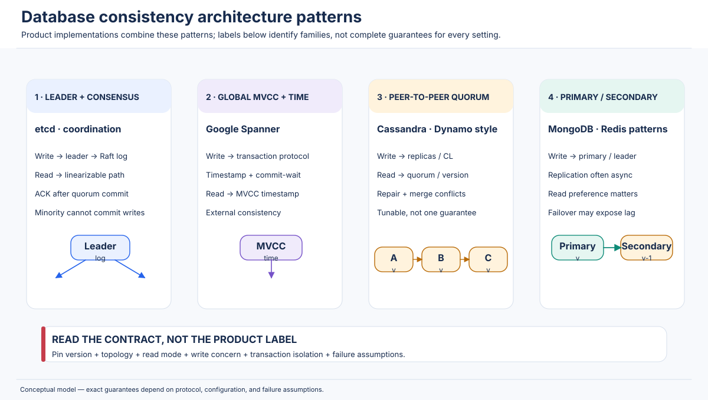

---

## 14. Practical Distributed-System Scenarios

Each scenario below starts from a business requirement, identifies the consistency contract, walks through the failure, and proposes an implementation. The important engineering habit is to define the invariant before selecting a database setting.

### 14.1 Two users updating the same bank account

**Architecture:** account service, distributed SQL database, two application instances, regional replicas.

**Problem:** two withdrawals or a deposit and withdrawal overlap. A read followed by a separate update can lose changes or allow an overdraft.

**Required guarantee:** atomic conditional update or serializable transaction for the account invariant; durable commit; idempotent request handling. A linearizable single-key API can help, but the multi-step business operation must be atomic.

**Walk-through:** both requests read balance 100; both attempt to withdraw 80. A naive implementation lets both pass the check and writes 20 twice. A conditional `UPDATE ... WHERE balance >= amount` executed atomically lets one update succeed and the other affect zero rows. If transferring between accounts, use a transaction that debits and credits both accounts.

**What can go wrong:** client timeout after commit; retry creates a second debit; two services use stale cache values; transaction retries execute a non-idempotent external side effect twice.

**Solution:** use transaction ID/idempotency key, a ledger with immutable entries, transactionally enforce non-negative balance, publish external events through a transactional outbox, and reconcile gateway/bank settlement. Do not call an external payment provider inside a retryable DB transaction without idempotency.

**Trade-off:** stronger transactional coordination adds latency and may reduce write availability when a quorum is unavailable. This is normally appropriate for financial invariants.

### 14.2 Two customers purchase the last available product

**Architecture:** inventory table replicated across regions, checkout service, reservation table, payment workflow.

**Problem:** two customers read `available = 1` from different replicas and both attempt to buy it.

**Required guarantee:** atomic conditional reservation on the authoritative inventory scope. Eventual catalog counts are fine for display, but final allocation cannot rely on a stale read.

**Walk-through:** each checkout submits a transaction that conditionally decrements availability only when it is positive and creates a hold. Exactly one transaction should win. The loser receives an out-of-stock response. A hold expires if payment is not completed.

**What can go wrong:** a delayed replication update causes oversell; retries create duplicate holds; payment succeeds after hold expiry; a region becomes isolated while two active writers allocate the same stock.

**Solution:** place a strongly coordinated reservation key in one region or partition; alternatively allocate inventory quotas to regions ahead of time, so each region can safely sell only its local quota. Use idempotency IDs, hold state transitions, expiry processing, and a reconciliation path.

**Trade-off:** global serialization gives correctness but can add WAN latency. Pre-allocated regional quotas improve local availability at the cost of capacity fragmentation and rebalancing complexity.

### 14.3 User updates a profile and immediately reads it

**Architecture:** profile service, primary database, asynchronous read replicas, CDN/cache.

**Problem:** update succeeds on the primary; immediate GET hits a lagging replica or stale CDN entry.

**Required guarantee:** read-your-writes for the initiating user; global linearizability is usually unnecessary.

**Walk-through:** the write returns a version token. The next read carries the token. The router sends the read to a replica that has applied at least that version, waits, or uses the primary. The cache key may include the profile version to avoid an old cached object being reused.

**What can go wrong:** sticky session breaks after failover; cache invalidation is delayed; a retry submits the profile update twice; an old image URL remains cached.

**Solution:** include a monotonic version/ETag in the response, route or wait based on it, use versioned object URLs, and define cache invalidation. Keep the RYW token in the user's session context.

**Trade-off:** small extra routing/version metadata cost; avoids the need for global coordination.

### 14.4 Social-media post and comment replication

**Architecture:** post service and comment service, multi-region replicas, feed materialization pipeline.

**Problem:** a comment is created after its author has read the post, but the comment reaches a replica before the post.

**Required guarantee:** causal consistency for post/comment visibility; eventual consistency can be acceptable for feed counts and ranking.

**Walk-through:** the post's ID/revision is attached as a dependency to the comment. A replica that receives the comment first stores it as pending and does not show it until the post is available.

**What can go wrong:** deleted post leaves orphan comments; feed index updates out of order; user sees a reply without context; multiple replicas create duplicate comments on retry.

**Solution:** idempotent comment IDs, foreign-key or dependency metadata, causal queue ordering, tombstone semantics for deletion, and a reconciliation job for permanently missing parents.

**Trade-off:** a small visibility delay for comments during replication lag. Independent likes/counts may still be eventually consistent.

### 14.5 Shopping cart updated from multiple devices

**Architecture:** cart service, mobile/web clients, per-user cart records across regions.

**Problem:** phone adds two units while laptop removes one; concurrent edits arrive in different orders.

**Required guarantee:** session guarantees plus explicit merge semantics. Strict global order is not necessarily needed.

**Walk-through:** each operation carries an operation ID and causal/version context. An add operation can be modeled as a unique item-add event or a CRDT counter if that matches the desired quantity semantics. A removal must define whether it removes one observed item, sets quantity to zero, or wins over concurrent additions.

**What can go wrong:** duplicate add after retry; LWW discards one device's change; an observed-remove set cannot remove an item added concurrently unless its semantics are specified; inventory availability is confused with cart quantity.

**Solution:** define cart merge algebra, retain operation IDs, use per-item version/causal metadata, and revalidate inventory at checkout with a strong reservation transaction.

**Trade-off:** more metadata and conflict logic, but the cart stays responsive across devices. Checkout remains the stronger consistency boundary.

### 14.6 Distributed inventory synchronization

**Architecture:** regional inventory databases, warehouse management systems, event stream, catalog cache.

**Problem:** warehouses ship, receive, damage, and reserve stock concurrently. Regional counts briefly diverge.

**Required guarantee:** strong per-warehouse allocation constraints; causal/eventual replication for descriptive counts and dashboards.

**Walk-through:** the source warehouse owns a stock ledger. Every movement is a unique event. A reservation is a conditional allocation against the warehouse's available balance. Events replicate to regional aggregates. A dashboard may be a few seconds behind but should display an as-of timestamp.

**What can go wrong:** duplicate event processing, out-of-order shipment/return events, negative local stock due to concurrent decrements, stale aggregate used for final promise.

**Solution:** immutable event IDs, partition by warehouse/SKU, ordered or versioned processing, deduplication, transactional inventory ledger, and periodic reconciliation against physical counts.

**Trade-off:** aggregate views are eventually consistent; allocation is strongly guarded at the owning inventory partition.

### 14.7 Multi-region database replication

**Architecture:** users in Asia, Europe, and North America with replicas in each region.

**Problem:** a write in one region is not yet visible in another; active-active writers may conflict.

**Required guarantee:** decide per operation. For global uniqueness or payment status, use a strongly coordinated authority/transaction. For profile/feed/catalog data, causal/session or eventual consistency may suffice.

**Walk-through:** measure RTT between regions, choose leader/placement, select replication factor and acknowledgement policy, and specify how remote reads behave. If writes are active-active, determine whether two writes to the same item can commute or require conflict resolution.

**What can go wrong:** hidden replication backlog, cross-region quorum unavailable after regional outage, clock-based conflict anomalies, failover to a replica that lacks an acknowledged update, user traffic routed to a stale region.

**Solution:** partition by business ownership, use regional write ownership where possible, enforce tokens/epochs, define bounded staleness for reads, run chaos tests, and publish replication-lag metrics.

**Trade-off:** synchronous global consistency increases latency; asynchronous replication improves local response but weakens freshness.

### 14.8 Network partition between database replicas

**Architecture:** three-node consensus group A/B/C with majority two.

**Problem:** A is isolated; B and C remain connected.

**Required guarantee:** choose a contract before the incident. For coordination data, preserve linearizability and reject A-side writes. For mergeable preferences, accept local writes and reconcile later.

**Walk-through:** CP group allows B/C to commit after quorum; A cannot commit. When healing occurs, A catches up from the committed log. An AP group can accept writes on both sides but must reconcile sibling versions.

**What can go wrong:** application retries indefinitely, read-only endpoints are mistakenly treated as fresh, operators manually force a stale node into the cluster, two leaders are allowed to affect an external resource.

**Solution:** distinguish retryable unavailability from business rejection, use epochs/fencing, ensure safe rejoin/repair, and alert on partition duration and replica divergence.

**Trade-off:** CP preserves a single truth at the cost of minority-side availability; AP retains local response at the cost of conflict/reconciliation.

### 14.9 Leader failure during a write

**Architecture:** three/five-node Raft group, leader L, followers F1/F2, client issuing a write.

**Problem:** leader crashes after receiving the write but before the client receives a response.

**Required guarantee:** committed log entries remain in the new leader's history; an uncommitted proposal may be absent. Client must treat timeout as an unknown outcome, not automatically as a failure.

**Walk-through:** if the entry reached a quorum and was committed, the new leader includes it and later reads reflect it. If it did not reach the commit condition, the new leader may overwrite/discard it. Client retries with the same idempotency key and checks the operation result.

**What can go wrong:** duplicate business action after retry; stale old leader continues side effects; application assumes HTTP timeout means no commit.

**Solution:** stable operation IDs, deduplication table in the same transaction as the mutation, leader terms/epochs, and downstream fencing. Use documented linearizable read/transaction APIs to resolve operation status.

**Trade-off:** quorum commit and leader election can temporarily pause writes. This is necessary for safe ordering.

### 14.10 Concurrent updates to a distributed key-value store

**Architecture:** two replicas accept writes to key K; updates can be concurrent.

**Problem:** Writer A sets `K = "blue"`; Writer B sets `K = "green"` while disconnected.

**Required guarantee:** choose by domain semantics: linearizable single-writer register, causal versions with conflict surfaced, LWW register, or CRDT/mergeable type.

**Walk-through:** with LWW, one timestamp wins. With version vectors, the store detects two sibling versions. With a set CRDT, independent additions can merge. With a compare-and-set protocol, one writer succeeds and the other receives a conflict.

**What can go wrong:** wall-clock skew chooses surprising LWW winner; one update silently disappears; application fails to handle siblings; a non-commutative update is incorrectly treated as mergeable.

**Solution:** document the data type's merge semantics, use conditional writes for exclusive claims, retain causal metadata where needed, and add conflict metrics and tests.

**Trade-off:** a single-writer/consensus design simplifies the value history but may reduce availability. Multi-writer designs scale geographic writes but require semantic conflict handling.

---

## 15. Practical Engineering Implementations

The following examples use Python 3.10+ and only the standard library. They are deliberately small teaching models. They do **not** implement network fault detection, durable storage, authentication, distributed consensus, crash recovery, or production-grade concurrency control. They illustrate one concept at a time; passing these examples does not prove a distributed protocol correct.

### 15.1 Simulating a replicated key-value store

**Model:** three independent in-memory replicas. A local write changes one replica; an explicit `replicate()` call copies the update to the others.

```python
from dataclasses import dataclass, field
from typing import Any

@dataclass
class Replica:
    name: str
    data: dict[str, Any] = field(default_factory=dict)
    version: int = 0

    def write(self, key: str, value: Any) -> int:
        self.version += 1
        self.data[key] = value
        return self.version

    def read(self, key: str) -> Any:
        return self.data.get(key)

class ReplicatedKV:
    def __init__(self, names: tuple[str, ...]) -> None:
        if len(names) < 2:
            raise ValueError("Use at least two replicas")
        self.replicas = {name: Replica(name) for name in names}

    def write_local(self, replica_name: str, key: str, value: Any) -> int:
        return self.replicas[replica_name].write(key, value)

    def replicate_key(self, source: str, key: str) -> None:
        src = self.replicas[source]
        value = src.read(key)
        for name, replica in self.replicas.items():
            if name != source:
                replica.data[key] = value
                replica.version = max(replica.version, src.version)

    def dump(self, key: str) -> None:
        for replica in self.replicas.values():
            print(replica.name, "=>", replica.read(key), "version", replica.version)

if __name__ == "__main__":
    db = ReplicatedKV(("India", "Europe", "US"))
    for node in db.replicas.values():
        node.data["stock:SKU-7"] = 10
    db.write_local("India", "stock:SKU-7", 9)
    db.dump("stock:SKU-7")
    print("--- after propagation ---")
    db.replicate_key("India", "stock:SKU-7")
    db.dump("stock:SKU-7")
```

**Expected behavior:** before propagation, India shows 9 while Europe and US show 10; after propagation all show 9.

**Important functions:** `write_local` changes one replica; `replicate_key` models message delivery; `dump` exposes divergence.

**Simplifications and edge cases:** the single integer `version` is global only by convention; concurrent writes from two regions are not safely ordered. A real system needs per-key versions, a merge policy, durable logs, membership, retries, and a concurrency protocol. This example intentionally demonstrates divergence rather than solving conflict resolution.

### 15.2 Simulating a stale read

**Model:** an acknowledged local write has not reached the replica selected for a read.

```python
replicas = {
    "India": {"profile:7": {"city": "Delhi"}},
    "Europe": {"profile:7": {"city": "Delhi"}},
}

# The write is acknowledged by the India replica.
replicas["India"]["profile:7"] = {"city": "Chennai"}

# A read routed to Europe is stale because replication is delayed.
print("India:", replicas["India"]["profile:7"])
print("Europe:", replicas["Europe"]["profile:7"])

# Simulate delivery of the replication message.
replicas["Europe"]["profile:7"] = replicas["India"]["profile:7"].copy()
print("Europe after replication:", replicas["Europe"]["profile:7"])
```

**Sample output:**

```text
India: {'city': 'Chennai'}
Europe: {'city': 'Delhi'}
Europe after replication: {'city': 'Chennai'}
```

**Underlying model:** eventual consistency. The read is stale but not necessarily erroneous under the selected contract.

**Production considerations:** distinguish cache staleness from replica lag; expose version/timestamp metadata; decide whether a client can tolerate the old value; do not use a stale inventory read for final allocation.

### 15.3 Small linearizable-register history checker

This checker asks whether a finite history of **completed single-register reads and writes** can be rearranged into a legal sequential history while preserving real-time precedence. It uses backtracking, so it is exponential in the number of operations and is intended only for small examples.

```python
from typing import Any

# Each operation has: id, client, kind ('write' or 'read'), value/result,
# invocation time, and response time. All times must be comparable numbers.

def is_linearizable(history: list[dict[str, Any]], initial: Any) -> bool:
    n = len(history)
    predecessors = [set() for _ in range(n)]

    for i, op_i in enumerate(history):
        if op_i["invoke"] >= op_i["respond"]:
            raise ValueError("Each operation must have invoke < respond")
        for j, op_j in enumerate(history):
            if i != j and op_j["respond"] < op_i["invoke"]:
                predecessors[i].add(j)

    def search(done: frozenset[int], current: Any) -> bool:
        if len(done) == n:
            return True

        for i, op in enumerate(history):
            if i in done or not predecessors[i].issubset(done):
                continue

            if op["kind"] == "write":
                next_value = op["value"]
            elif op["kind"] == "read":
                if op["result"] != current:
                    continue
                next_value = current
            else:
                raise ValueError("Unknown operation kind")

            if search(done | {i}, next_value):
                return True
        return False

    return search(frozenset(), initial)

if __name__ == "__main__":
    history = [
        {"id": "W1", "client": "A", "kind": "write", "value": 1,
         "invoke": 1, "respond": 2},
        {"id": "R1", "client": "B", "kind": "read", "result": 1,
         "invoke": 3, "respond": 4},
    ]
    print(is_linearizable(history, initial=0))  # True

    stale_history = [
        {"id": "W1", "client": "A", "kind": "write", "value": 1,
         "invoke": 1, "respond": 2},
        {"id": "R1", "client": "B", "kind": "read", "result": 0,
         "invoke": 3, "respond": 4},
    ]
    print(is_linearizable(stale_history, initial=0))  # False
```

**How it works:** if operation j responds before operation i is invoked, j is a predecessor of i. The recursive search chooses any operation whose predecessors are already placed. A write changes the register state; a read is legal only if it returns the current state.

**Expected output:**

```text
True
False
```

**Edge cases:** this example ignores pending operations, multiple keys, compare-and-swap, transactions, and operation-specific sequential specifications. It uses strict `<` for response-before-invocation; if timestamps can tie, use a well-defined event sequence or interval relation. A real checker must model the exact object API. Linearizability checkers such as Porcupine/Knossos use more scalable state exploration and carefully defined histories.

### 15.4 Sequential consistency example/checker

This checker uses the same register specification but preserves only each client's program order, not cross-client real-time precedence.

```python
from typing import Any


def is_sequentially_consistent(history: list[dict[str, Any]], initial: Any) -> bool:
    n = len(history)
    predecessors = [set() for _ in range(n)]

    # Preserve the order in which each client's operations were issued.
    by_client: dict[str, list[int]] = {}
    for i, op in enumerate(history):
        by_client.setdefault(op["client"], []).append(i)

    for indices in by_client.values():
        for earlier, later in zip(indices, indices[1:]):
            predecessors[later].add(earlier)

    def search(done: frozenset[int], current: Any) -> bool:
        if len(done) == n:
            return True
        for i, op in enumerate(history):
            if i in done or not predecessors[i].issubset(done):
                continue
            if op["kind"] == "write":
                next_value = op["value"]
            elif op["kind"] == "read":
                if op["result"] != current:
                    continue
                next_value = current
            else:
                raise ValueError("Unknown operation kind")
            if search(done | {i}, next_value):
                return True
        return False

    return search(frozenset(), initial)

if __name__ == "__main__":
    # A's write completes before B's read begins, but B sees the old value.
    history = [
        {"client": "A", "kind": "write", "value": 1,
         "invoke": 1, "respond": 2},
        {"client": "B", "kind": "read", "result": 0,
         "invoke": 3, "respond": 4},
    ]
    print("Sequentially consistent:", is_sequentially_consistent(history, 0))

    # For this exact history, the write response precedes the read invocation.
    # Therefore a linearizable register cannot return the initial value 0.
    print("Linearizable:", False)
```

**Sample output:**

```text
Sequentially consistent: True
Linearizable: False
```

The sequential history can put B's read before A's write because there is no per-client order edge between them. The same history fails linearizability because the write response precedes the read invocation.

**Simplification:** this is a single-register model. For a multi-object history, the checker must maintain the state of all objects and their operation specifications. A process's list order here is the program order; do not sort by wall-clock time for sequential consistency.

### 15.5 Causal dependency tracking with vector clocks

```python
from dataclasses import dataclass, field

@dataclass
class VectorClock:
    values: dict[str, int] = field(default_factory=dict)

    def tick(self, process: str) -> None:
        self.values[process] = self.values.get(process, 0) + 1

    def merge(self, other: "VectorClock") -> None:
        for process, counter in other.values.items():
            self.values[process] = max(self.values.get(process, 0), counter)

    def happens_before(self, other: "VectorClock") -> bool:
        keys = self.values.keys() | other.values.keys()
        le_all = all(self.values.get(k, 0) <= other.values.get(k, 0) for k in keys)
        lt_one = any(self.values.get(k, 0) < other.values.get(k, 0) for k in keys)
        return le_all and lt_one

    def concurrent_with(self, other: "VectorClock") -> bool:
        return not self.happens_before(other) and not other.happens_before(self)

if __name__ == "__main__":
    alice = VectorClock()
    alice.tick("A")          # A publishes a post.
    post_version = VectorClock(dict(alice.values))

    bob = VectorClock()
    bob.merge(post_version)   # Bob reads the post.
    bob.tick("B")             # Bob writes a dependent comment.
    comment_version = VectorClock(dict(bob.values))

    print("Post:", post_version.values)
    print("Comment:", comment_version.values)
    print("Post before comment:", post_version.happens_before(comment_version))

    region_c = VectorClock()
    region_c.merge(comment_version)
    print("C has post dependency:", post_version.happens_before(region_c))
```

**Sample output:**

```text
Post: {'A': 1}
Comment: {'A': 1, 'B': 1}
Post before comment: True
C has post dependency: True
```

**How it works:** Bob merges the post's vector into his local clock before incrementing his own component for the comment. The comment's vector therefore dominates the post's vector. Replica C can inspect the comment's dependency metadata before exposing it.

**Edge cases:** vector-clock membership must be managed as nodes join/leave. This teaching version assumes a fixed small set of process identifiers and does not implement causal garbage collection, dotted version vectors, or dependency buffering. Vector clocks compare event histories; they do not automatically merge business values.

### 15.6 Eventual-consistency propagation simulation

```python
from collections import deque

replicas = {"A": {"x": 0}, "B": {"x": 0}, "C": {"x": 0}}
messages: deque[tuple[str, str, str, int]] = deque()
version = 0


def write(node: str, key: str, value: int) -> None:
    global version
    version += 1
    replicas[node][key] = value
    for target in replicas:
        if target != node:
            messages.append((node, target, key, value))
    print(f"write v{version} at {node}: {key}={value}")


def read(node: str, key: str) -> int:
    value = replicas[node][key]
    print(f"read at {node}: {key}={value}")
    return value


def deliver_one() -> None:
    source, target, key, value = messages.popleft()
    replicas[target][key] = value
    print(f"replicate {key}={value}: {source} -> {target}")

if __name__ == "__main__":
    write("A", "x", 1)
    read("B", "x")          # Stale: still 0.
    while messages:
        deliver_one()
    print("final:", replicas)
```

**Sample behavior:** B reads 0 before the queue is delivered; after delivery, all replicas have 1.

**Simplifications:** messages have no duplicates, loss, reorder, or failure; there is one writer; there is no version/conflict policy. A production system must also handle a replica reconnecting after a long outage and a write arriving twice.

### 15.7 Replica convergence with deterministic version selection

The following example models a simple per-key LWW register using a totally ordered `(timestamp, writer_id)` pair. It is not a recommendation to use wall-clock timestamps for all business data.

```python
from dataclasses import dataclass

@dataclass(frozen=True)
class VersionedValue:
    timestamp: int
    writer_id: str
    value: str

    @property
    def order(self) -> tuple[int, str]:
        return (self.timestamp, self.writer_id)


def merge(a: VersionedValue, b: VersionedValue) -> VersionedValue:
    return a if a.order >= b.order else b

replicas = {
    "A": VersionedValue(10, "A", "blue"),
    "B": VersionedValue(11, "B", "green"),
    "C": VersionedValue(10, "A", "blue"),
}

# Anti-entropy exchange: each replica learns all candidates and computes the same winner.
winner = replicas["A"]
for candidate in replicas.values():
    winner = merge(winner, candidate)

for name in replicas:
    replicas[name] = winner

print({name: item.value for name, item in replicas.items()})
```

**Sample output:**

```text
{'A': 'green', 'B': 'green', 'C': 'green'}
```

**Why this converges:** `max` over a total order is deterministic, associative, commutative, and idempotent. All replicas given the same candidates choose the same result.

**What it does not solve:** it may discard a concurrent update. The logical timestamp needs a tie-breaker and a trustworthy generation policy; a clock-skewed timestamp can select an unintended winner. Deletes need tombstones so an old value cannot resurrect. A set/cart often needs a mergeable data type instead of LWW.

### 15.8 Read-your-writes implementation with version tokens

```python
from dataclasses import dataclass

@dataclass
class Replica:
    name: str
    value: str
    version: int

class Session:
    def __init__(self) -> None:
        self.minimum_version = 0

    def write(self, primary: Replica, value: str) -> None:
        primary.version += 1
        primary.value = value
        self.minimum_version = max(self.minimum_version, primary.version)

    def read(self, replicas: list[Replica]) -> str:
        eligible = [r for r in replicas if r.version >= self.minimum_version]
        if not eligible:
            raise RuntimeError("No replica has reached the session's minimum version")
        chosen = max(eligible, key=lambda r: r.version)
        self.minimum_version = max(self.minimum_version, chosen.version)
        return chosen.value

if __name__ == "__main__":
    primary = Replica("primary", "old", 4)
    lagging = Replica("secondary", "old", 4)
    session = Session()
    session.write(primary, "new")
    try:
        print(session.read([lagging]))
    except RuntimeError as exc:
        print(exc)
    print(session.read([primary, lagging]))
```

**Sample output:**

```text
No replica has reached the session's minimum version
new
```

**Production considerations:** the version must be comparable within its scope (for example, one key-range log index). A multi-shard token may need a vector of positions. A token must be authenticated or treated as opaque to prevent clients from demanding arbitrary resource-intensive wait positions. The code chooses the highest eligible replica but has no network timeout or cancellation.

### 15.9 Monotonic reads implementation

```python
from dataclasses import dataclass

@dataclass
class ReadResult:
    replica: str
    version: int
    value: str

class MonotonicReadSession:
    def __init__(self) -> None:
        self.highest_seen_version = 0

    def read(self, results: list[ReadResult]) -> ReadResult:
        eligible = [r for r in results if r.version >= self.highest_seen_version]
        if not eligible:
            raise RuntimeError("All candidate replicas are older than the session view")
        result = max(eligible, key=lambda r: r.version)
        self.highest_seen_version = result.version
        return result

if __name__ == "__main__":
    session = MonotonicReadSession()
    first = session.read([
        ReadResult("R1", 8, "Shipped"),
        ReadResult("R2", 6, "Processing"),
    ])
    print(first)
    try:
        session.read([ReadResult("R2", 6, "Processing")])
    except RuntimeError as exc:
        print(exc)
    print(session.read([ReadResult("R1", 9, "Delivered")]))
```

**Sample output:** the first read returns `Shipped` at version 8; the second request refuses to return version 6; the final read advances to `Delivered` at version 9.

**Simplification:** a scalar version is sufficient only when the versions belong to a common ordered history. With independent shards, use a partitioned token or a causal metadata format. The rule prevents regression; it does not guarantee the freshest state.

### 15.10 Monotonic writes implementation

```python
from dataclasses import dataclass, field

@dataclass
class OrderedReplica:
    values: dict[str, str] = field(default_factory=dict)
    last_sequence_by_session: dict[str, int] = field(default_factory=dict)

    def apply(self, session_id: str, sequence: int, key: str, value: str) -> bool:
        last = self.last_sequence_by_session.get(session_id, 0)
        if sequence != last + 1:
            return False  # Hold/retry until the missing predecessor is applied.
        self.values[key] = value
        self.last_sequence_by_session[session_id] = sequence
        return True

if __name__ == "__main__":
    replica = OrderedReplica()
    print(replica.apply("user-42", 2, "order", "placed"))
    print(replica.apply("user-42", 1, "address", "Chennai"))
    print(replica.apply("user-42", 2, "order", "placed"))
    print(replica.values)
```

**Sample output:**

```text
False
True
True
{'address': 'Chennai', 'order': 'placed'}
```

**Simplification:** this example requires an exact next sequence number per session. A real protocol needs deduplication, durable sequence state, gap recovery, out-of-order buffers, session expiry, and a rule for concurrent requests from two tabs. It provides ordering, not an atomic two-write transaction.

### 15.11 Quorum read/write calculations

```python
from itertools import combinations


def quorum_size(n: int) -> int:
    if n <= 0:
        raise ValueError("N must be positive")
    return n // 2 + 1


def read_write_intersect(n: int, r: int, w: int) -> bool:
    if not (1 <= r <= n and 1 <= w <= n):
        raise ValueError("R and W must be between 1 and N")
    return r + w > n


def verify_all_intersections(n: int, r: int, w: int) -> bool:
    nodes = range(n)
    read_sets = list(combinations(nodes, r))
    write_sets = list(combinations(nodes, w))
    return all(set(rs) & set(ws) for rs in read_sets for ws in write_sets)

if __name__ == "__main__":
    n, r, w = 3, 2, 2
    print("majority:", quorum_size(n))
    print("R + W > N:", read_write_intersect(n, r, w))
    print("all combinations intersect:", verify_all_intersections(n, r, w))
    print("R=1, W=1 intersects:", read_write_intersect(3, 1, 1))
```

**Sample output:**

```text
majority: 2
R + W > N: True
all combinations intersect: True
R=1, W=1 intersects: False
```

**Interpretation:** with N=3, R=2, W=2, any two-member read set intersects any two-member write set. This does not prove linearizability; the system still needs correct version selection, commit semantics, and conflict ordering. The subset verifier assumes fixed membership and ordinary quorums, not sloppy quorum or per-datacenter quorum scopes.

### 15.12 CAP partition simulation

```python
class PartitionedCluster:
    def __init__(self) -> None:
        self.values = {"A": 0, "B": 0, "C": 0}
        self.connected = {"A": {"A"}, "B": {"B", "C"}, "C": {"B", "C"}}

    def cp_write(self, node: str, value: int) -> bool:
        reachable = self.connected[node]
        if len(reachable) < 2:
            return False  # No majority quorum.
        for replica in reachable:
            self.values[replica] = value
        return True

    def ap_write(self, node: str, value: int) -> None:
        self.values[node] = value  # Accept locally during partition.

    def heal_with_lww(self) -> None:
        # Teaching simplification: choose the greatest value as a deterministic winner.
        # Production LWW should compare explicit versions/timestamps, not numeric values.
        winner = max(self.values.values())
        for node in self.values:
            self.values[node] = winner

if __name__ == "__main__":
    cluster = PartitionedCluster()
    print("CP write at A:", cluster.cp_write("A", 1))
    print("CP write at B:", cluster.cp_write("B", 1))
    print("CP state:", cluster.values)

    cluster = PartitionedCluster()
    cluster.ap_write("A", 2)
    cluster.ap_write("B", 3)
    print("AP divergent state:", cluster.values)
    cluster.heal_with_lww()
    print("after simplistic convergence:", cluster.values)
```

**Sample behavior:** a CP write on the isolated minority A fails; a B-side write succeeds with B/C. AP accepts divergent values on A and B, then the simplified merge makes them equal.

**Simplifications:** the AP merge is intentionally not a real timestamp LWW policy; it uses the numeric maximum solely to keep the example deterministic. A real CP model needs Raft/Paxos and terms/epochs. A real AP model needs version metadata and a domain-defined merge. CAP is a formal impossibility result, not a three-line algorithm.

### 15.13 PACELC latency simulation

```python
from dataclasses import dataclass

@dataclass
class Network:
    local_ms: float = 4.0
    nearest_remote_rtt_ms: float = 80.0
    far_remote_rtt_ms: float = 220.0


def estimate_write_latency(network: Network, mode: str, partitioned: bool) -> float | None:
    if partitioned:
        if mode.startswith("PC"):
            return None  # Strong write cannot be safely completed in this partition.
        return network.local_ms  # PA-style local acceptance.

    if mode.endswith("EL"):
        return network.local_ms  # Local acknowledgement, async replication.
    if mode.endswith("EC"):
        return network.local_ms + network.nearest_remote_rtt_ms
    raise ValueError("Use PA/EL, PA/EC, PC/EL, or PC/EC")

if __name__ == "__main__":
    net = Network()
    for mode in ("PA/EL", "PA/EC", "PC/EL", "PC/EC"):
        healthy = estimate_write_latency(net, mode, partitioned=False)
        partition = estimate_write_latency(net, mode, partitioned=True)
        print(mode, "healthy:", healthy, "ms; partition:", partition)
```

**Interpretation:** the sample models only a local-ack path and one remote round trip. It shows how a PC policy can reject an unsafe partition-time write and how EC can add coordination latency in a healthy network.

**Edge cases:** real quorum latency depends on the fastest required quorum, not necessarily “local + nearest remote”; leader location, parallel messages, disk flush, queueing, and contention matter. The categories are analytical shorthand, not product benchmark data.

### 15.14 Timestamp-based conflict resolution

```python
from dataclasses import dataclass

@dataclass(frozen=True)
class Update:
    key: str
    value: str
    timestamp_ms: int
    writer_id: str


def lww(a: Update, b: Update) -> Update:
    # Writer ID is a deterministic tie-breaker when timestamps are equal.
    return max((a, b), key=lambda u: (u.timestamp_ms, u.writer_id))

if __name__ == "__main__":
    india = Update("city", "Chennai", 1_000, "india")
    europe = Update("city", "Berlin", 1_005, "europe")
    winner = lww(india, europe)
    print("winner:", winner.value, "from", winner.writer_id)
```

**Sample output:** `winner: Berlin from europe`.

**Underlying model:** deterministic last-writer-wins register.

**Limitations:** this code assumes timestamps are comparable and meaningful. Clock skew can make a later real-world write lose. A timestamp tie-breaker provides deterministic convergence, not domain correctness. For important updates, prefer conditional writes, logical versions, vector-clock conflict detection, or application-level merge.

### 15.15 Version-vector conflict detection

```python
from dataclasses import dataclass, field

@dataclass
class VersionVector:
    counters: dict[str, int] = field(default_factory=dict)

    def compare(self, other: "VersionVector") -> str:
        keys = self.counters.keys() | other.counters.keys()
        self_le = all(self.counters.get(k, 0) <= other.counters.get(k, 0) for k in keys)
        other_le = all(other.counters.get(k, 0) <= self.counters.get(k, 0) for k in keys)
        if self_le and other_le:
            return "equal"
        if self_le:
            return "before"
        if other_le:
            return "after"
        return "concurrent"

if __name__ == "__main__":
    version_a = VersionVector({"A": 3, "B": 1})
    later_a = VersionVector({"A": 4, "B": 1})
    concurrent_b = VersionVector({"A": 2, "B": 2})
    print(version_a.compare(later_a))
    print(version_a.compare(concurrent_b))
```

**Sample output:**

```text
before
concurrent
```

**Interpretation:** `later_a` includes all causal history in `version_a` plus a new A event. `concurrent_b` has one component advanced independently, so neither vector dominates the other.

**Simplification:** this comparison detects causal ordering but does not merge values or manage vector compaction. A production system must define node identity, counter persistence, replica reincarnation, metadata limits, and the conflict-resolution API.

### 15.16 Application-level consistency token

An application can expose a consistency token without exposing internal replica details. This example uses a token containing a required log index and simulates a gateway waiting for a replica that has applied that index.

```python
from dataclasses import dataclass

@dataclass(frozen=True)
class ConsistencyToken:
    partition: str
    minimum_index: int

@dataclass
class ReadReplica:
    name: str
    partition: str
    applied_index: int
    value: str


def serve_read(replica: ReadReplica, token: ConsistencyToken) -> str:
    if replica.partition != token.partition:
        raise ValueError("Token belongs to a different partition")
    if replica.applied_index < token.minimum_index:
        raise RuntimeError("Replica is behind the required consistency point")
    return replica.value

if __name__ == "__main__":
    token = ConsistencyToken(partition="user-7", minimum_index=120)
    secondary = ReadReplica("secondary", "user-7", 117, "old profile")
    primary = ReadReplica("primary", "user-7", 121, "new profile")

    for replica in (secondary, primary):
        try:
            print(replica.name, serve_read(replica, token))
        except RuntimeError as exc:
            print(replica.name, exc)
```

**Sample output:**

```text
secondary Replica is behind the required consistency point
primary new profile
```

**Production considerations:** tokens should be opaque, integrity-protected, scoped to the correct partition/tenant, and bounded to avoid indefinite waits. The API needs a retryable status or timeout behavior. A single integer is not enough when the write spans independent partitions; use a transaction commit timestamp or a compound token. Do not let clients invent arbitrary indexes and force servers to wait forever.

---

## 16. Mathematical Concepts and Formulas

This section collects the notation used throughout the chapter. These formulas are useful only when their assumptions match the protocol being analyzed.

### 16.1 Linearizability: operation intervals and real-time precedence

Represent an operation A by an invocation event `inv(A)` and response event `res(A)`. Its interval is:


The invocation/response interval is:

\[
I(A) = [\operatorname{inv}(A), \operatorname{res}(A)]
\]

For non-overlapping operations, real-time precedence is:

\[
A <_{rt} B \iff \operatorname{res}(A) < \operatorname{inv}(B)
\]

A legal linearization is a total order `S` such that:

1. every operation in the completed history is represented (with a permitted completion of pending operations);
2. `S` obeys the object's sequential specification;
3. `A <rt B` implies `A <S B`.

**Numerical example:** A write is invoked at 10 ms and returns at 18 ms. A read is invoked at 25 ms and returns at 30 ms. Since 18 < 25, the write must precede the read in the linearization. A read that returns the old value is illegal unless a later legal write explains it.

If the read is invoked at 15 ms and returns at 22 ms, the two intervals overlap. The linearization may place the read before or after the write, depending on its result and the rest of the history.

**Use:** operation-history checking, API design, concurrency testing, and reasoning about leader/quorum read algorithms.

### 16.2 Sequential consistency: program-order constraints

Let `po` denote program order within a process. A sequentially consistent history has a legal total order S satisfying:

\[
A <_{po} B \implies A <_{S} B
\]

There is no required implication from cross-process real-time precedence to S. That missing implication is exactly what distinguishes sequential consistency from linearizability.

**Numerical example:** P1 issues operations A then B; P2 issues C then D. A legal total order may be `C, A, B, D` or `A, C, D, B`, as long as A is before B and C is before D and returned values satisfy the sequential specification.

**Use:** memory-model reasoning, replicated state histories, and explaining why a single interleaving can be weaker than a real-time consistent order.

### 16.3 Causal consistency: happens-before and vector clocks

Happens-before, `→`, is the transitive closure of local process order and message send/receive order. If neither `A → B` nor `B → A`, the events are concurrent.

A vector clock V has one component per tracked process. Define:

\[
V(a) < V(b) \iff \left(\forall i, V(a)_i \le V(b)_i\right)
\land \left(\exists j, V(a)_j < V(b)_j\right)
\]

If `V(a) < V(b)`, event a causally precedes b. If neither vector dominates the other, the events are concurrent under the vector-clock model.

**Numerical example:** `V(a) = (2,1,0)` and `V(b) = (3,1,0)`. Since each component of a is no greater than b and one is smaller, a happened before b. For `V(c) = (2,2,0)`, neither `(2,1,0) < (2,2,0)`? It does, because c has B's component larger and no component smaller, so a is before c. But `(3,1,0)` and `(2,2,0)` are concurrent because the first is larger in A's component and smaller in B's component.

**Metadata cost:** a full vector of N counters needs O(N) counters per timestamp/version. A 1000-member dynamic cluster makes raw full vectors expensive; systems use compact causal contexts, dotted version vectors, epochs, or service-specific metadata.

**Use:** detecting causal dependencies and concurrent versions; it does not determine a domain-specific merge by itself.

### 16.4 Eventual consistency: convergence condition

Let `S_i(t)` be the state held by replica i at time t. An informal quiescent convergence condition is:

`If writes stop at t0 and repair/delivery continues, then ∃T ≥ t0 such that for all healthy replicas i,j and t ≥ T: S_i(t) = S_j(t) = S*.`

The shared state S* is a **resolved state**. It may be the latest timestamp winner, a merged CRDT state, or an application-chosen resolution. The model does not say which value must win unless a conflict-resolution policy is specified.

A simple replication-lag measurement is:

`lag = apply_time_at_replica - commit_time_at_origin`

This is an operational metric, not a universal semantic definition. In multi-region systems, clock skew can affect wall-clock lag measurements; log positions or hybrid timestamps may be more reliable.

**Assumptions:** updates are not permanently lost; replicas eventually communicate; repair can discover missed data; conflicts converge deterministically or are resolved; and the system has enough capacity to process the backlog.

**Use:** stating a convergence goal, monitoring lag, and reasoning about anti-entropy. There is no finite convergence-time guarantee unless the product specifies one.

### 16.5 Quorum systems

Definitions:

- `N`: number of replicas assigned to the data item (replication factor in the simplified model).
- `R`: minimum number of replica responses required by a read.
- `W`: minimum number of replica acknowledgements required by a write.
- `Q`: majority quorum size, commonly `floor(N / 2) + 1`.

The basic read/write intersection condition is:

\[
R + W > N
\]

The minimum guaranteed intersection size is at least:

\[
|ReadSet \cap WriteSet| \ge R + W - N
\]

When `R + W > N`, this lower bound is at least one.

**Example 1:** N=3, R=2, W=2. Since 2+2>3, any read quorum intersects any write quorum by at least one replica. Q = floor(3/2)+1 = 2.

**Example 2:** N=5, R=3, W=3. Since 3+3>5, the intersection is at least one. Q=3.

**Example 3:** N=5, R=2, W=2. Since 2+2=4 is not greater than 5, disjoint read and write sets are possible. A read can miss a completed write.

To ensure any two write quorums intersect, one common condition is:

\[
W_1 + W_2 > N
\]

For symmetric write quorums:

\[
2W > N
\]

**Majority example:** for N=3, Q=2; for N=5, Q=3; for N=7, Q=4. A majority intersects every other majority, which is why majority-based consensus can prevent two independent majorities from committing conflicting values in the same epoch/log position.

**Assumptions and limitations:**

- The read and write sets are subsets of the same fixed replica set.
- The system counts only the replicas specified by the protocol; sloppy quorum may select substitutes.
- Acknowledgement means the replica has durably or safely recorded the relevant version under the protocol's failure assumptions.
- Reads select a sufficiently new version using a correct version/commit protocol.
- Concurrent writes are serialized, rejected, or reconciled according to a defined rule.
- Membership changes use a safe joint-consensus/reconfiguration mechanism.

**Why intersection alone does not guarantee linearizability:** the intersecting replica may contain an uncommitted or obsolete version; the read may choose the wrong version; two writes may conflict; or the acknowledgement may not mean that the write is part of the authoritative history. Linearizability requires the protocol to define a single legal order and safe read behavior, not just a shared member in two sets.

**Use:** estimating quorum availability/latency and understanding tunable consistency. It is a necessary ingredient for some protocols, not a complete proof.

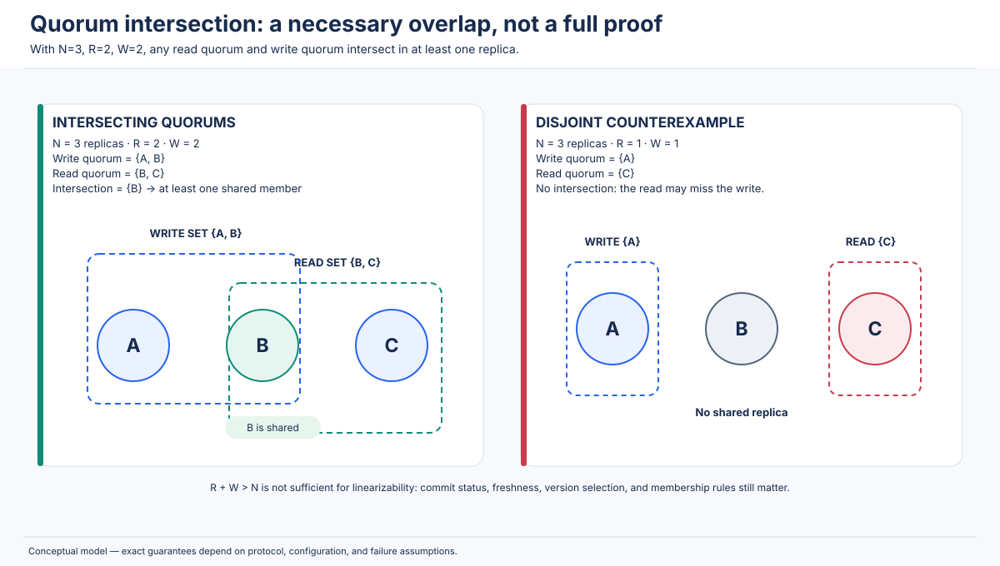

### 16.6 CAP: formal property sketch

The CAP impossibility is usually stated in an asynchronous message-passing model with possible partitions. Under a partition, if a write completes on one side and a subsequent read is sent to the other side, a service cannot both:

- always return a response from each non-failing node (availability), and
- return a value consistent with the completed write in a linearizable single-copy history (consistency).

The impossibility is not a formula like `C + A + P = 2`; it is a statement about incompatible guarantees under the failure model. Partition tolerance describes the environment and required behavior, not a numerical term to add.

### 16.7 PACELC notation

The shorthand is:

\[
P \rightarrow (A \;\text{or}\; C), \qquad E \rightarrow (L \;\text{or}\; C)
\]

where P means partition, E means no partition/else, A availability, L latency, and C consistency. Thus PA/EL means availability is favored during a partition and latency over consistency in normal operation. PC/EC means consistency is favored in both cases. This is an analytical classification, not a product's immutable identity.

### 16.8 Coordination and latency

An approximate operation latency model is:

\[
T_{operation} \approx T_{local} + T_{coordination} + T_{durable} + T_{queueing}
\]

For a cross-region quorum write, `T_coordination` may include one or more WAN round trips. Parallel fan-out usually waits for the required quorum rather than every replica, but the effective latency is determined by the slowest response needed to satisfy the quorum and by the protocol phases.

**Numerical example:** local work = 4 ms, required remote round trip = 80 ms, durable commit = 5 ms, queueing = 3 ms. An illustrative coordinated write is about 92 ms. A local asynchronous acknowledgement may be about 12 ms before remote propagation completes. These are only arithmetic examples; actual systems have multiple protocol phases and variable network/storage latency.

**Use:** architecture estimates, placement decisions, and explaining why multi-region strong writes cost more than local asynchronous writes. Do not use this approximation as a benchmark.

### 16.9 Consistency and transaction ordering

The relationship among common transaction guarantees can be summarized:

- **Serializability:** committed transactions are equivalent to some serial order.
- **Strict serializability:** serializability plus real-time order of non-overlapping transactions.
- **Linearizability:** a similar real-time ordering condition for operations on concurrent objects; a single-operation transaction can often be modeled as a linearizable object operation.
- **External consistency:** commonly used by distributed databases for a transaction guarantee that combines serial execution with externally observable real-time order.

No single numeric formula captures these properties. The right test is whether every observed history can be mapped to a legal serial specification while preserving the required order constraints.

### 16.10 Strong vs. weak consistency: no universal scalar score

It is tempting to assign “consistency strength” a single number. In practice, guarantees are partially ordered and scope-dependent. A system can provide RYW for one session, monotonic reads for a client, stale snapshots for analytics, and linearizable conditional updates for selected keys. Document the guarantee as a tuple:

`(operation scope, ordering rule, freshness bound, failure behavior, acknowledgement rule)`

For example: “single-key conditional writes are linearizable within a region; secondary reads may be stale; session reads carry a minimum commit token; writes require a majority acknowledgement.” This statement is more useful than simply saying “the database is strongly consistent.”

---


## 17. Interview Questions and Answers

The answers are deliberately phrased as interview explanations: state the guarantee, distinguish what it does not promise, then connect it to an implementation or scenario. A strong interview answer should state assumptions instead of assigning a universal CP/AP label to a database.

### 17.1 Beginner questions

**1. What is consistency in a distributed system?**

Consistency is the contract that defines which values and operation orders clients are allowed to observe when data is replicated or shared. It can require real-time ordering, per-process ordering, causal ordering, session-local guarantees, or eventual convergence. The word alone is not precise enough; state the model and its scope.

**2. What is a replica?**

A replica is a physical copy or representation of the same logical data stored on another process or machine. Replicas improve availability, durability, read scalability, and geographic locality. They can temporarily diverge when updates have not propagated or when concurrent writes are accepted.

**3. Why do distributed databases replicate data?**

They replicate to survive machine/zone failures, serve reads close to users, scale read load, and improve recovery. Replication adds coordination and repair work: the database must define how writes are acknowledged, how followers catch up, and what reads may return while replicas differ.

**4. What is a stale read?**

A stale read returns a value that does not include a write that the application expected to be visible. For example, a read from a lagging follower may return an old profile immediately after the primary acknowledged an update. Whether that violates correctness depends on the requested consistency guarantee.

**5. What is linearizability?**

Linearizability requires every operation to appear to take effect atomically at some point between invocation and response, with a total order that respects real-time precedence. If a write finishes before a read starts, that read must reflect the write or a later one. Overlapping operations may be ordered either way if the sequential specification is satisfied.

**6. What is a linearization point?**

It is the conceptual instant within an operation's invocation/response interval at which the operation takes effect in the equivalent sequential history. A consensus-backed store might associate it with commitment of a log entry; an atomic compare-and-swap has a successful atomic step. A proof must show the point lies inside the operation and that ordering by the points is legal.

**7. What is sequential consistency?**

Sequential consistency says all operations can be arranged into one legal global sequential order that preserves each process's program order. It does not require preserving real-time order between different processes, so a read may be allowed to return an older value even after another client's write completed.

**8. What is causal consistency?**

Causal consistency requires all causally related writes to be seen in an order that respects their dependencies. If a comment is created after its author reads a post, every observer that sees the comment must see the post first. Concurrent independent writes may be observed in different orders.

**9. What is eventual consistency?**

Eventual consistency says that if updates stop and communication/repair continues successfully, replicas eventually converge to the same resolved state. It does not promise immediate freshness or a fixed convergence deadline. It also does not define how conflicts are resolved unless the system specifies a policy.

**10. What is a write conflict?**

A write conflict arises when concurrent updates affect the same logical data and there is no unambiguous order or merge. The system may serialize one write, abort one, retain multiple versions, choose a timestamp winner, or merge them with application logic. Choosing LWW is a policy, not proof that the chosen value matches business intent.

**11. What is a client session in consistency discussions?**

A session is a logical sequence of operations associated with one client/user context. Session guarantees constrain how that session observes its own writes and dependencies even if its requests reach different replicas. The application must define how sessions cross devices, service instances, and reconnects.

**12. What is read-your-writes consistency?**

After a successful write in a session, later reads in that session reflect the write or a later version. It prevents a user from refreshing a profile and seeing the pre-update value. It can be implemented with version tokens, leader routing, or causal session metadata without requiring global linearizability for all users.

**13. What are monotonic reads?**

Once a session has read a version, later reads cannot return a version older than the one already observed. If an order was seen as “Shipped,” the session should not later see “Processing.” It does not require seeing the newest global state—only no regression relative to the session's own view.

**14. What is a quorum?**

A quorum is a subset of replicas large enough to satisfy a protocol's voting or acknowledgement rule. Majority quorums intersect each other. For a simple read/write quorum system, `R + W > N` ensures every read set intersects every write set, assuming fixed membership and ordinary quorums.

**15. What does the CAP theorem say?**

During a network partition, a distributed read/write service cannot guarantee both linearizable consistency and availability as formally defined for every non-failing node. A system must refuse or delay some operations to preserve strong consistency, or answer on separated sides and permit divergence. CAP does not mean permanently selecting two menu options.

### 17.2 Intermediate questions

**16. What is the difference between linearizability and sequential consistency?**

Both require a legal global sequential order. Linearizability additionally preserves real-time precedence across processes: if A finishes before B begins, A must be before B. Sequential consistency preserves only per-process program order, so cross-client observations can contradict wall-clock order.

**17. How does causal consistency differ from eventual consistency?**

Eventual consistency is primarily a convergence condition after updates stop. Causal consistency adds a visibility-order rule: causally dependent writes must appear in order at every observer. A system can be eventually consistent and still temporarily show a comment before its post; a causal system must prevent that observation.

**18. How does causal consistency differ from sequential consistency?**

Sequential consistency chooses one global total order that preserves every process's program order, including an ordering of concurrent operations. Causal consistency preserves only the partial order implied by causality; concurrent writes need not have one globally agreed relative order. Causal consistency can therefore permit more concurrency.

**19. Does a session guarantee make the entire database strongly consistent?**

No. RYW and monotonic reads constrain one session's observations. Another user may still read a stale replica, and concurrent independent updates may be visible in different orders. Session guarantees are deliberately narrower than global linearizability.

**20. What are writes-follow-reads?**

Writes-follow-reads ensures that a session's later write is ordered after the updates reflected in its earlier read. If a user reads document version 12 and edits content introduced in that version, the edit cannot be applied as if it were based on version 10. The client must carry the read's dependency token into the write.

**21. How are monotonic writes different from read-your-writes?**

RYW constrains later reads to include the session's earlier writes. Monotonic writes constrains the order in which the session's writes are applied. A system can preserve write order but still route the following read to a stale replica; conversely, a read may be directed to a current replica while two writes are applied in the wrong order.

**22. What is the difference between consistency models and transaction isolation levels?**

Consistency models describe permitted observations/orderings of operations on shared or replicated state. Transaction isolation describes anomalies allowed among concurrent transactions. They overlap conceptually but are not interchangeable: a linearizable key-value operation is not a multi-row transaction, and serializability alone does not necessarily require real-time order.

**23. Is serializability the same as linearizability?**

No. Serializability says transactions are equivalent to some serial order. Linearizability requires operations to take effect within their invocation/response intervals and respects real-time order. Strict serializability combines serializability with real-time ordering for transactions. A single-operation transaction can often be treated as an object operation, but the general guarantees have different scopes.

**24. What is strict serializability?**

Strict serializability requires a serial transaction order and also preserves real-time precedence between non-overlapping transactions. If T1 completes before T2 begins, T1 must precede T2 in the serial order. It is also called external consistency in some distributed database designs.

**25. What does availability mean in CAP?**

Formal CAP availability requires every request received by a non-failing node to eventually receive a non-error response. It is not simply an annual uptime percentage. A service that responds “cannot serve this request because the required quorum is unavailable” is not available for that request under the formal definition.

**26. What does partition tolerance mean?**

It means the system is designed to continue operating despite network communication failures that split nodes into groups. A partition is not necessarily a crashed node; each side may be running and serving clients but unable to exchange messages with the other side.

**27. What is the difference between CP and AP behavior?**

A CP-style system preserves its strong consistency contract by refusing operations on nodes that cannot establish the authoritative order. An AP-style system continues to answer local requests on partitioned sides and permits divergent state that must later be reconciled. Both terms are shorthand; actual products expose per-operation behavior.

**28. Why is CAP not literally “choose any two”?**

The impossibility is specifically about the conflict between consistency and availability during partitions. Partition tolerance is a requirement imposed by the network failure model. When the network is healthy, a system can often be both consistent and available. The theorem also defines C and A more narrowly than colloquial product marketing.

**29. Explain `R + W > N`.**

N is the number of replicas, R the number that must respond to a read, and W the number that must acknowledge a write. If R+W>N, every possible read set and write set of those sizes overlap by at least one replica. The overlap helps a read discover a replica that participated in the write, assuming the protocol handles versions and commit correctly.

**30. Why doesn't quorum intersection alone guarantee linearizability?**

An intersecting replica may contain an uncommitted version, the read may select the wrong version, concurrent writes may not be globally ordered, or acknowledgements may not mean durable commit. Linearizability additionally requires a valid commit/ordering protocol and safe read path. Quorum intersection is a mathematical ingredient, not the whole algorithm.

**31. What does PACELC add to CAP?**

PACELC describes the healthy-network case: if there is no partition, a system still trades latency against consistency. Strong cross-region coordination can add WAN round trips; asynchronous local acknowledgement can be fast but expose stale reads. CAP alone does not make this normal-operation trade-off explicit.

**32. Why can synchronous replication increase latency?**

The client waits for required replicas or a quorum to receive/commit the operation. If a required replica is in another region, the operation includes WAN delay and possibly disk/consensus phases. The latency is often determined by the slowest response needed to satisfy the quorum, not by the average replica latency.

**33. Does eventual consistency automatically resolve conflicts?**

No. It says replicas converge after updates stop and repair succeeds. If two clients write different values concurrently, the system still needs LWW, version-vector siblings, a CRDT merge, application logic, or an explicit conflict response. A bad merge can converge perfectly to the wrong business result.

**34. What is MVCC and how does it relate to consistency?**

Multi-version concurrency control stores multiple versions of a value, usually associated with timestamps or transaction IDs. A read at a snapshot timestamp can see a consistent historical state without blocking writers. MVCC enables snapshot reads, but it does not automatically guarantee that the chosen snapshot is the newest or linearizable.

**35. What is a leader lease, and what can go wrong?**

A leader lease lets a leader assume it remains authoritative for a bounded interval and may serve reads without a quorum check on each request. Safety depends on clock assumptions, pauses, lease grant rules, and conservative expiry. A paused former leader can resume after its lease should have expired; use epochs/fencing tokens so downstream systems reject stale leaders.

### 17.3 Advanced questions

**36. Why does linearizability usually require coordination in a replicated system?**

A node cannot know whether another partitioned or delayed node has accepted a newer completed write without communicating or relying on a safe authority/lease/quorum protocol. If it answers independently, it may violate real-time order. Consensus or quorum coordination provides evidence of the committed order; the cost is latency and possible unavailability on a minority partition.

**37. Can an eventually consistent database provide read-your-writes?**

Yes. Eventual global convergence and session-local guarantees are compatible. The client can carry a version token from the write, and the server routes to or waits for a replica at least that new. Other sessions may still read older data. MongoDB's causal sessions are an example of explicit session semantics, although their guarantee depends on the selected read/write concerns [R19].

**38. For N=3, R=2, W=2, what guarantee do you get?**

The read and write quorums intersect because 2+2>3. Under fixed membership and correct version/commit handling, a read quorum includes at least one replica that participated in the write quorum. This supports read-after-write visibility. It does not alone guarantee linearizability for concurrent writes or a transaction across multiple keys.

**39. Why can sloppy quorum invalidate the simple quorum argument?**

The formula assumes read and write sets are subsets of the same fixed N natural replicas. Sloppy quorum may store a write on substitute nodes when a natural replica is unavailable. The later read may not contact a node that intersects the actual write set. Hinted handoff and version reconciliation are then needed; do not reuse the fixed-set proof without adapting it.

**40. How do vector clocks detect concurrent writes?**

Each process increments its own vector component and merges vectors received from dependencies. If vector V1 is component-wise less than or equal to V2 with one strict component, V1 causally precedes V2. If neither dominates the other, the versions are concurrent. The store can then retain siblings or invoke a merge policy.

**41. Are vector clocks and version vectors identical?**

They are closely related logical metadata structures. Vector clocks track causal order among events; version vectors are often attached to replicated object versions to detect whether one version descends from another or whether updates are concurrent. Implementations vary in compaction and replica identity, so use the system's documented semantics rather than relying on names alone.

**42. How does Spanner use TrueTime?**

TrueTime returns a bounded uncertainty interval for the current time rather than a single assumed-perfect timestamp. Spanner uses it to assign transaction timestamps that respect real-time order. After choosing a commit timestamp, it performs commit-wait until the earliest possible current time is later than that timestamp, preserving external consistency [R10, R11].

**43. What is commit-wait?**

Commit-wait is the delay after choosing a commit timestamp and before reporting a transaction committed, until the clock uncertainty interval proves that the timestamp is in the past. It ensures that a later transaction starting after the response gets a timestamp that respects the earlier commit. It is tied to TrueTime's uncertainty bounds, not an arbitrary fixed timeout.

**44. What is a Hybrid Logical Clock?**

An HLC combines a physical clock component with a logical counter. When physical time does not advance or a remote timestamp is ahead, the logical counter preserves a monotonic ordering relation. HLCs are useful for timestamping distributed events and MVCC versions, but they do not create perfect global time or remove the need for transaction/consensus protocols.

**45. How does Cassandra's tunable consistency work?**

The client selects a consistency level for each operation, such as ONE, QUORUM, LOCAL_QUORUM, ALL, or EACH_QUORUM. With an appropriate read/write intersection, later quorum reads can observe writes. Multi-datacenter LOCAL_QUORUM scopes the quorum locally; it should not be mistaken for a global cross-region quorum. Ordinary writes use timestamp-based conflict resolution, while conditional LWT operations use Paxos for linearizable compare-and-set [R13, R22].

**46. What are Cassandra lightweight transactions?**

LWTs are conditional operations (`IF` conditions) implemented with Paxos. They serialize competing compare-and-set operations and provide linearizable consistency for the LWT operation. They cost more than ordinary mutations, so use them where conditional correctness is needed, not as a universal replacement for regular high-throughput writes [R22].

**47. In MongoDB, what is the difference between majority and linearizable read concern?**

`majority` returns data committed by a majority at the majority commit point. `linearizable` is more restrictive: for supported primary reads on a uniquely identifying query, it reflects majority-acknowledged writes completed before the read began and may wait for concurrent writes to propagate. Majority durability and real-time freshness are related but not identical [R20].

**48. How does MongoDB provide causal consistency?**

A causally consistent client session carries causal ordering metadata. With majority read concern and majority write concern, MongoDB documents all four session guarantees: read-your-writes, monotonic reads, monotonic writes, and writes-follow-reads. Other combinations provide fewer guarantees; read/write concern choices must be aligned with the requirement [R19].

**49. What is the difference between etcd linearizable and serializable reads?**

A linearizable KV read is coordinated with the Raft-backed authoritative state and respects real-time ordering. An etcd serializable read can be served locally and may be stale relative to the quorum state. This trades freshness/coordination for latency and throughput; the application should use the mode that matches the operation [R7].

**50. Does ZooKeeper provide linearizable reads to every client?**

Do not assume so. ZooKeeper documents ordered updates, atomicity, single-system-image/session guarantees, and timeliness, but reads can be served by a server with an older view while updates propagate. Its documentation discusses using `sync()` to ensure a server has caught up before a read when a client needs that property [R9].

**51. Does Redis WAIT guarantee strong consistency?**

No. WAIT can wait until a specified number of replicas acknowledge a replication offset, which reduces the risk of losing a write. Redis documents that this does not turn asynchronous replication into a consensus-based strongly consistent system; failover and persistence timing can still lose acknowledged writes [R23].

**52. What is the danger of last-write-wins?**

LWW can silently discard a semantically important concurrent update. Physical clock skew can also make the timestamp ordering disagree with actual user intent. LWW is reasonable for some replaceable fields when deterministic last-update semantics are acceptable, but counters, sets, carts, and financial records often need different merge or transaction semantics.

**53. Can a follower safely serve a linearizable read?**

Yes, but not merely because it is a follower. It needs a protocol that proves it has applied a state at least as recent as the required linearization point—for example, a leader-issued read index, a quorum check, a lease with safe assumptions, or a barrier. Otherwise, a lagging follower can return stale data.

**54. Can read-your-writes guarantee monotonic reads?**

Not by itself. RYW ensures later reads include the session's own successful writes. A session may read a newer update from another user and then be routed to a replica that is behind that observed version. Monotonic reads requires retaining the maximum observed version, including versions not produced by the session itself.

**55. Do linearizable single-key operations guarantee a correct multi-key business invariant?**

No. A workflow that reads two keys, checks a condition, and writes both can interleave with another workflow even if each individual operation is linearizable. Use a transaction with an isolation level that protects the invariant, a single atomic object operation, or a coordination protocol that covers all affected keys.

### 17.4 Scenario-based questions

**56. Two customers try to buy the last product. What would you do?**

Use an atomic conditional decrement or serializable transaction around the stock check and reservation insert. The displayed product count can be eventually consistent, but final allocation must be strongly guarded. Add idempotency keys and expiring holds to handle retries and abandoned checkouts. Interview trap: saying “use a cache lock” without discussing lock fencing, transaction atomicity, or failure after payment.

**57. Two users withdraw money from the same account concurrently. How do you prevent overdraft?**

Use an atomic update with a balance predicate or a serializable transaction that checks and updates the account balance. Store an immutable ledger entry in the same transaction and use request IDs to deduplicate retries. If a transfer touches two accounts, both sides should be part of one atomic transaction or a carefully designed saga. Interview trap: assuming linearizable GET and PUT make a read-check-write workflow atomic.

**58. A user changes their profile and immediately sees the old data. What guarantee is missing?**

Read-your-writes. Return a commit/version token, route the next read to a replica that has applied it, or read from the authoritative leader. Also invalidate or version cache keys. Interview trap: escalating the entire system to global linearizability when a session guarantee is sufficient.

**59. A reply appears before its social-media post. How do you fix it?**

Track the causal dependency from the reply to the post. A replica should buffer the reply until the post is available or fetch the missing parent. Keep comment IDs idempotent and define deletion/tombstone behavior. Interview trap: assuming eventual consistency alone preserves causal visibility.

**60. A shopping cart is edited on two devices. What consistency model would you choose?**

Usually session guarantees plus mergeable per-item semantics. Use operation IDs and causal metadata; define how concurrent add, remove, and quantity updates combine. Revalidate inventory at checkout with a stronger reservation transaction. Interview trap: using LWW for the whole cart and silently discarding one device's changes.

**61. How would you design a multi-region banking ledger?**

Keep the ledger's correctness boundary on a strongly coordinated transactional path, with explicit durability and idempotency. Place data/leader roles to manage latency, use multi-region replication for resilience, and accept that some writes may pause during a partition. Analytics and statements can use immutable snapshots or asynchronous projections. Interview trap: calling an AP multi-master database “strong enough” without proving debit/credit invariants.

**62. A three-node cluster splits into one node and two nodes. What happens in a CP design?**

The two-node majority can continue to commit through consensus if the leader/quorum conditions hold. The isolated minority cannot safely commit new strong writes and should reject, wait, or redirect. Once connectivity returns, it catches up from the authoritative log. Interview trap: claiming all three nodes continue writing consistently.

**63. Both sides of an AP cluster accept different values for the same key. How do you recover?**

Exchange versions or logs and resolve the conflict using a defined policy: LWW, version-vector siblings plus application resolution, or a CRDT merge. Then verify convergence and business invariants. Interview trap: saying “the replicas sync after the partition” without saying what happens to the two conflicting updates.

**64. A leader crashes after receiving a write, but before the client receives success. What should the client do?**

Treat the outcome as unknown. The write may have committed if a quorum accepted it, or it may be uncommitted and discarded. Retry using the same idempotency key, then read/check the operation record. The new leader's committed log determines the authoritative state. Interview trap: assuming timeout means rollback.

**65. A user sees an order as Shipped, then Processing after navigation. Which guarantee prevents this?**

Monotonic reads. The session records the highest observed version and does not accept an older replica result. RYW may also matter if the user initiated the status change, but monotonic reads covers versions learned from other actors as well. Interview trap: claiming monotonic reads always delivers the globally latest status.

**66. How do you implement a safe distributed lock?**

Use a linearizable lock/lease service for ownership and issue a monotonically increasing fencing token each time ownership changes. The downstream resource checks the token and rejects writes from an older holder. A process may pause past lease expiry and resume; a lease alone cannot stop that stale process from sending a delayed request. Interview trap: relying only on a TTL or local wall clock.

**67. A CDN serves an old product price after an update. Is this a consistency failure?**

It is a stale-cache observation. Whether it violates the contract depends on the product-price requirement. Use versioned cache keys, invalidation, short TTLs, or a read-through authoritative path for checkout. The catalog page may be eventually updated, but the final purchase must validate the current price and inventory atomically. Interview trap: treating cache invalidation as a distributed transaction without a failure plan.

**68. DNS resolvers show different answers after a record change. Why?**

DNS records are cached according to TTLs and caches expire at different times. The system is designed for distributed caching and eventual propagation, not instantaneous global linearizability. Lower TTLs before a planned migration, wait for old TTLs to expire, and account for resolver-specific caching behavior. Interview trap: expecting a DNS update to synchronously invalidate all caches.

**69. An analytics dashboard is a few seconds behind. Is that acceptable?**

Often yes. Analytics commonly uses asynchronous ingestion, stream processing, and materialized views. The dashboard should expose an “as of” timestamp and tolerate late events/reprocessing. It is not acceptable if the dashboard is used as the final source for a safety-critical allocation or ledger invariant. Interview trap: choosing strong global consistency for data whose business requirement is approximate freshness.

**70. A region must continue selling inventory during a WAN partition. What design can help?**

Pre-allocate regional stock quotas so each region can sell only its owned allocation during isolation. Each region uses a local atomic decrement against its quota; global replenishment is asynchronous. This avoids double allocation if quota ownership is exclusive, but may strand stock in one region while another is sold out. Interview trap: letting every region sell the entire globally replicated stock count.

**71. Would `LOCAL_QUORUM` in Cassandra guarantee global consistency across two datacenters?**

No. LOCAL_QUORUM requires a quorum within the local datacenter. A write in DC1 and read in DC2 can involve disjoint local replica sets. Cross-DC guarantees need a carefully chosen consistency level/replication strategy and possibly EACH_QUORUM or a stronger protocol such as LWT, depending on the operation. Interview trap: assuming “quorum” always means a global majority.

**72. Two regions concurrently increment a value. Is LWW safe?**

Not if the intended semantic is to preserve both increments. LWW chooses one version and can lose one increment. Use an atomic counter service, a PN-counter CRDT, or unique increment events with deduplication and aggregation. Interview trap: confusing a convergent last-value register with a mergeable counter.

**73. A delete is followed by an old value reappearing. What happened?**

A stale replica may still contain the old value and later replicate it after the delete. Distributed stores use tombstones or versioned deletion markers so the delete participates in reconciliation. Tombstones must be retained long enough for all replicas/repair processes to observe them; premature garbage collection can resurrect deleted data. Interview trap: treating absence as an ordinary value without version metadata.

**74. A mobile user edits a document while offline and reconnects later. What should the system do?**

The offline edit is a concurrent or causally based branch relative to remote changes. Attach a base revision and operation ID; on reconnect, compare version vectors or use a CRDT/OT merge if the document model supports it. If updates cannot be merged safely, surface a conflict. Interview trap: overwriting the server's newer document using a last-saved timestamp.

**75. A payment API client times out and retries. How do you avoid charging twice?**

Use an idempotency key scoped to the customer/operation and persist the key with the payment state transition. The retry returns the previously recorded result rather than creating another charge. Use transactional state transitions, durable event/outbox handling, and reconciliation with the payment provider. Linearizability helps order state changes but does not alone make an external payment exactly-once. Interview trap: promising exactly-once delivery instead of implementing deduplication and idempotent effects.

---


## 18. Common Mistakes and Production Best Practices

The following are recurring design and interview errors. Each entry explains why the mistake is attractive, what can fail, how it appears in production, and how to prevent it.

### 18.1 Treating consistency as one universal property

- **Why it happens:** product pages and discussions use “strong,” “eventual,” or “consistent” without naming scope or operation semantics.
- **What goes wrong:** teams assume a secondary read is fresh, or assume a strong single-key write protects a multi-key workflow.
- **How to recognize it:** requirements say “the database must be consistent” without specifying read/write ordering, transaction scope, staleness, or partition behavior.
- **Prevention:** define a consistency contract per operation family: scope, ordering rule, freshness bound, acknowledgement rule, and behavior under failure.

### 18.2 Confusing linearizability with serializability

- **Why it happens:** both concepts use a sequential order, and both are often called “strong.”
- **What goes wrong:** transactions may be serializable but not preserve real-time order across clients; a workflow assumes that one completed transaction must be observed before a later transaction on disjoint data.
- **How to recognize it:** the design says “serializable means linearizable” or uses strict real-time assumptions without testing them.
- **Prevention:** use the terms precisely. Ask whether non-overlapping transactions must preserve wall-clock completion order. If yes, require strict serializability/external consistency or add an explicit causal/session mechanism.

### 18.3 Confusing sequential consistency with linearizability

- **Why it happens:** both are global sequential-order models.
- **What goes wrong:** a client sees an old value after another client completed a write, and the team incorrectly believes sequential consistency forbids it.
- **How to recognize it:** the system's proof preserves each process order but has no real-time precedence rule.
- **Prevention:** add invocation/response intervals to the reasoning. Test the case where A's response occurs before B's invocation.

### 18.4 Assuming eventual consistency means immediate convergence

- **Why it happens:** the word “eventual” sounds like a small delay rather than an unbounded convergence condition.
- **What goes wrong:** user-facing code assumes a replica will catch up within a few milliseconds; queues grow and old values remain visible much longer.
- **How to recognize it:** there is no replication-lag metric, convergence SLO, or repair process.
- **Prevention:** measure lag, expose as-of timestamps, alert on queue growth, test disconnected-node recovery, and define what happens when convergence is delayed indefinitely.

### 18.5 Assuming eventual consistency automatically resolves conflicts

- **Why it happens:** convergence is confused with semantic correctness.
- **What goes wrong:** one concurrent update is silently discarded by LWW, or replicas converge to a value that violates a business invariant.
- **How to recognize it:** no conflict policy is documented for two writers modifying the same record.
- **Prevention:** choose LWW only when replacement semantics are acceptable; otherwise use version vectors, CRDTs, conditional writes, or application resolution. Test concurrent updates deliberately.

### 18.6 Assuming quorum intersection always guarantees strong consistency

- **Why it happens:** `R + W > N` is easy to memorize and is frequently presented as a complete “strong consistency formula.”
- **What goes wrong:** an intersecting replica may have an uncommitted/stale version; sloppy quorums or multi-DC local quorums may violate the assumptions; concurrent writes may be resolved by LWW.
- **How to recognize it:** the design quotes the formula but cannot explain version selection, commit, leader epochs, or replica-set membership.
- **Prevention:** state the fixed membership and acknowledgement assumptions, explain how a read selects the latest committed version, and identify the protocol that orders concurrent writes.

### 18.7 Misinterpreting CAP as a permanent choice of two properties

- **Why it happens:** the triangle shorthand is easier to remember than the formal failure condition.
- **What goes wrong:** teams call a service “CA” because it is normally available and consistent, while ignoring partition behavior; they may also assume a CP system is globally offline during a partition.
- **How to recognize it:** diagrams label an entire product CP/AP without identifying operation/configuration, or discuss “choosing two” with no partition scenario.
- **Prevention:** walk through an actual partition, name the sides, and state which requests respond, fail, or return potentially stale data. Treat CAP C as linearizability, not ACID consistency.

### 18.8 Ignoring PACELC latency trade-offs

- **Why it happens:** the CAP discussion focuses on rare failures and overlooks ordinary WAN latency.
- **What goes wrong:** a global write path is designed as if remote coordination were free; p95/p99 latency and throughput fail under geographic load.
- **How to recognize it:** performance estimates include database CPU but omit WAN round trips, quorum fan-out, or durable commit.
- **Prevention:** model local and remote latencies, place leaders/leaseholders near write traffic, use stale snapshots for read-only workloads where acceptable, and state consistency requirements separately for writes and reads.

### 18.9 Treating every database configuration as identical

- **Why it happens:** product-level summaries flatten many operation modes into one label.
- **What goes wrong:** MongoDB secondary reads are assumed fresh; Cassandra LOCAL_QUORUM is assumed global; DynamoDB MREC and MRSC are assumed equivalent; Redis WAIT is treated as consensus.
- **How to recognize it:** architecture documents name a vendor but omit version, replication factor, read/write concern, and region layout.
- **Prevention:** record exact configuration and API operation semantics in the architecture decision record. Re-check official docs during upgrades.

### 18.10 Ignoring stale reads and cache layers

- **Why it happens:** developers consider database consistency but overlook CDN, application, browser, and local caches.
- **What goes wrong:** database read is fresh but the browser shows an old profile; checkout uses a cached price; a stale cache resurrects deleted content.
- **How to recognize it:** the data source's commit time is recent but clients report old values; cache invalidation is best-effort and unversioned.
- **Prevention:** version cache keys, use ETags/conditional requests, apply TTLs appropriate to the data, invalidate on writes, and revalidate critical values at the final transaction boundary.

### 18.11 Ignoring cross-region coordination cost

- **Why it happens:** developers test in one region and extrapolate local latency to a global deployment.
- **What goes wrong:** synchronous writes require WAN round trips; regional partitions interrupt global quorum; remote leader placement increases tail latency.
- **How to recognize it:** only average latency is measured in a single region; no region-failure load test exists.
- **Prevention:** measure inter-region RTT, choose replication/placement based on data ownership, load-test cross-region quorum, and design explicit regional failover behavior.

### 18.12 Assuming read-your-writes requires global linearizability

- **Why it happens:** the desired symptom (“I should see my change”) is described as “the database must be strongly consistent.”
- **What goes wrong:** the team pays global coordination cost for a requirement limited to one user session.
- **How to recognize it:** no other user needs to see the write immediately, but every read is routed through a global leader.
- **Prevention:** return a session version token, use causal sessions, or route reads based on minimum commit position. Escalate only the operations that need global linearizability.

### 18.13 Choosing strong consistency for every application path

- **Why it happens:** strong consistency sounds universally safer.
- **What goes wrong:** analytics, feed, catalog, and cache workloads inherit unnecessary latency and reduce availability under partitions.
- **How to recognize it:** every endpoint uses the strongest read concern regardless of user-visible requirements.
- **Prevention:** classify data by invariant. Keep final allocation/payment paths strong; use causal/session/eventual paths for mergeable or delay-tolerant data. Expose freshness so users understand lag.

### 18.14 Choosing eventual consistency without conflict design

- **Why it happens:** the team optimizes write latency/availability first and postpones merge semantics.
- **What goes wrong:** duplicated records, lost cart changes, resurrection after deletes, negative balances, or irreconcilable concurrent state.
- **How to recognize it:** conflict resolution exists only as a generic “latest update wins” rule.
- **Prevention:** define data-type semantics, operation IDs, tombstones, conflict visibility, and a reconciliation runbook before enabling multi-writer writes.

### 18.15 Production checklist

Before approving a replicated data path, answer these questions:

- What is the consistency model for reads and writes, and what is its scope?
- What does a successful acknowledgement mean: local memory, local disk, quorum, all replicas, or external provider confirmation?
- Can a read be stale? How stale, and how is staleness measured?
- What happens if a request times out after the operation may have committed?
- Are retries idempotent? Where are operation IDs persisted?
- Can two regions write the same logical record? If yes, what is the merge/conflict policy?
- Are delete tombstones retained long enough to prevent resurrection?
- What happens when a leader loses quorum or a lease expires?
- Are fencing tokens checked by downstream systems?
- Are multi-key invariants protected by transactions or a coordination protocol?
- What does the system do on each side of a network partition?
- How are lagging replicas repaired and monitored?
- Are cache/CDN consistency semantics included in end-to-end tests?
- Has the exact production configuration been tested under failover, clock skew, delayed messages, and process pauses?
- Are the relevant database/version documentation and operational playbooks pinned in the architecture record?

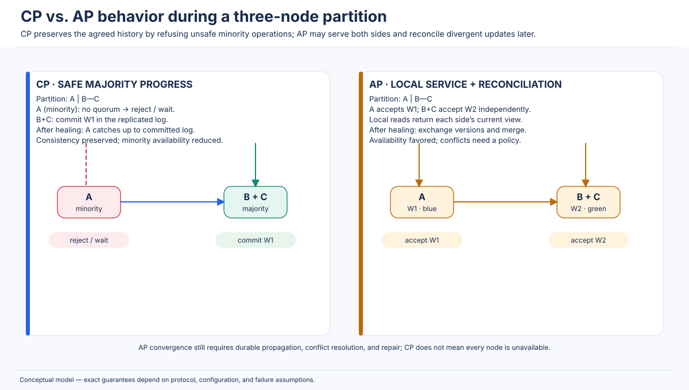

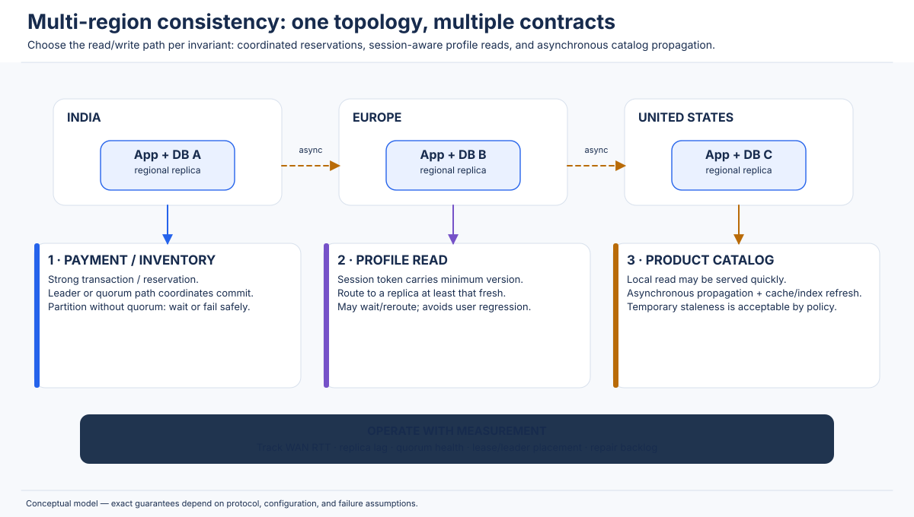

---

## 19. Chapter Summary

Consistency models define which observations are allowed when data is copied across machines. Replication improves fault tolerance, read scalability, and geographic locality, but it introduces propagation delay, stale reads, concurrent writes, and conflict resolution.

- **Linearizability** provides an atomic single-copy illusion and preserves real-time order. It commonly requires coordination and may reduce availability on a partitioned minority.
- **Sequential consistency** requires one legal global order that preserves each process's program order, but it does not preserve cross-process real-time order.
- **Causal consistency** preserves happens-before dependencies while allowing concurrent independent writes to be seen in different orders.
- **Eventual consistency** guarantees convergence only under quiescence and successful communication/repair assumptions; it does not define conflict semantics by itself.
- **Session guarantees**—read-your-writes, monotonic reads, monotonic writes, and writes-follow-reads—provide useful user-level consistency without global linearizability.
- **CAP** formalizes the consistency/availability conflict during network partitions; **PACELC** adds the normal-operation latency/consistency trade-off.
- **Quorum intersection** is useful but not a full proof of linearizability. Commit rules, version selection, membership, and safe read protocols matter.
- **Real databases** combine multiple techniques and expose different guarantees for different APIs and configurations. A product should never be assigned one universal consistency label without qualification.
- **Strong vs. weak consistency** is an application design decision. The right model is the weakest one that preserves the required invariants and user experience.

---

## 20. Key Takeaways

1. State the consistency model; do not say only “consistent.”
2. A completed write followed by a later read is the simplest linearizability test.
3. Overlapping operations may be ordered either way; non-overlapping operations may not be reordered under linearizability.
4. Sequential consistency preserves per-process order, not cross-process real time.
5. Causal consistency protects dependency order; it does not provide transaction atomicity.
6. Eventual consistency needs a conflict-resolution and repair strategy to converge safely.
7. Session guarantees can solve user-visible regressions with less coordination than global strong consistency.
8. CAP matters during partitions; PACELC matters even when the network is healthy.
9. `R + W > N` establishes a quorum intersection only under the model's membership and protocol assumptions.
10. Acknowledgement, durability, visibility, and freshness are different properties.
11. Use a transaction for multi-key invariants; do not assume linearizable individual operations make a workflow atomic.
12. Use idempotency keys for uncertain outcomes and fencing tokens for stale lock/lease holders.
13. Include caches, indexes, events, and materialized views in end-to-end consistency reasoning.
14. Monitor replication lag, pending repair, conflict counts, and quorum health.
15. Choose consistency per data and operation path, not per company or database brand.

---

## 21. Glossary

| Term | Meaning |
|---|---|
| **Acknowledgement** | A response indicating that an operation met the configured success condition; it does not automatically mean every replica has the update. |
| **Anti-entropy** | Background comparison and repair of replica differences. |
| **Availability (CAP)** | Formal guarantee that every request received by a non-failing node eventually receives a non-error response. |
| **Causal consistency** | Guarantee that causally related writes are observed in dependency order. |
| **Causal metadata** | Version/dependency information carried with operations to preserve causal order. |
| **Conflict** | Concurrent updates that require ordering, selection, or merging. |
| **Consensus** | Agreement protocol that lets a group of replicas decide on ordered values/log entries despite failures within its assumptions. |
| **CRDT** | Conflict-free replicated data type whose operations/state merge according to convergence-safe algebraic rules. |
| **Eventual consistency** | Convergence guarantee after updates stop and communication/repair succeeds. |
| **External consistency** | Transaction-level guarantee that serial order respects externally observable real-time order. |
| **Fencing token** | Monotonically increasing epoch/number used to reject operations from stale lock/lease holders. |
| **Happens-before** | Partial causal order induced by process order and message send/receive, plus transitivity. |
| **Hinted handoff** | Temporary storage of updates intended for an unavailable replica, delivered when it returns. |
| **HLC** | Hybrid Logical Clock combining physical and logical components to order distributed events. |
| **Linearizability** | Atomic operation history with a total order preserving real-time precedence. |
| **Linearization point** | Conceptual instant during an operation at which it takes effect in the sequential history. |
| **LWW** | Last-write-wins conflict policy selecting one version by timestamp/order. |
| **Majority quorum** | A group with more than half of the voting/replica members. |
| **Merkle tree** | Hash tree used to compare large data ranges efficiently and locate differences. |
| **Monotonic reads** | Session guarantee that later reads do not return versions older than ones already observed. |
| **Monotonic writes** | Session guarantee that writes from one session are applied in issue order. |
| **MVCC** | Multi-version concurrency control; stores multiple versions and lets reads select a snapshot. |
| **PACELC** | Framework: if Partition, trade Availability vs. Consistency; Else, trade Latency vs. Consistency. |
| **Partition** | Communication failure that divides nodes into groups unable to exchange messages. |
| **Quorum** | Required set of replica/voter responses for a protocol operation. |
| **Read repair** | Repair of stale replicas discovered while serving a read. |
| **Read-your-writes** | Session guarantee that subsequent reads reflect the session's earlier successful writes. |
| **Replica** | A physical copy/representation of logical data on a separate process or machine. |
| **Replication lag** | Delay between an update's origin/commit and its application at another replica. |
| **Sequential consistency** | One legal global sequential order that preserves each process's program order. |
| **Session** | Logical client context grouping operations whose observations may be constrained together. |
| **Sloppy quorum** | Availability-oriented quorum behavior that may use substitute nodes instead of the natural replica set. |
| **Stale read** | Read that omits an update that is newer than the returned state under the relevant comparison. |
| **Strict serializability** | Serializability plus real-time ordering of non-overlapping transactions. |
| **Tombstone** | Versioned deletion marker used to propagate deletes and prevent stale values from reappearing. |
| **TrueTime** | Google's distributed time API returning an uncertainty interval, used by Spanner for timestamp ordering. |
| **Vector clock** | Per-process logical counters used to reason about causal ordering and concurrency. |
| **Version vector** | Causal metadata associated with object versions to determine ancestry/concurrency. |
| **Writes-follow-reads** | Session guarantee that a write is ordered after the updates reflected in a preceding read. |

---

## 22. Further Reading and References

The references below prioritize original research, official database documentation, and foundational books. Product documentation changes over time; consult the documentation for the deployed release before relying on a setting or guarantee.

### Foundational theory and research

- **[R1]** Maurice P. Herlihy and Jeannette M. Wing, “Linearizability: A Correctness Condition for Concurrent Objects,” *ACM Transactions on Programming Languages and Systems*, 1990. Original definition of linearizability and the linearization-point intuition. [PDF](https://www.cs.cmu.edu/~wing/publications/HerlihyWing90.pdf)
- **[R2]** Seth Gilbert and Nancy Lynch, “Brewer's Conjecture and the Feasibility of Consistent, Available, Partition-Tolerant Web Services,” *ACM SIGACT News*, 2002. Formal CAP result. [PDF](https://www.cs.princeton.edu/courses/archive/spr22/cos418/papers/cap.pdf)
- **[R3]** Giuseppe DeCandia et al., “Dynamo: Amazon's Highly Available Key-value Store,” *SOSP*, 2007. Consistent hashing, version vectors, quorum-like replication, hinted handoff, and conflict resolution. [PDF](https://www.cs.princeton.edu/courses/archive/fall15/cos518/papers/dynamo.pdf)
- **[R4]** Daniel J. Abadi, “Consistency Tradeoffs in Modern Distributed Database System Design,” *IEEE Computer*, 2012. Introduces PACELC as a way to include normal-operation latency/consistency trade-offs. [PDF](https://www.cs.umd.edu/~abadi/papers/abadi-pacelc.pdf)
- **[R5]** Leslie Lamport, “How to Make a Multiprocessor Computer That Correctly Executes Multiprocess Programs,” *IEEE Transactions on Computers*, 1979. Foundational sequential-consistency formulation. [Lamport publications index](https://lamport.azurewebsites.net/pubs/pubs.html)
- **[R6]** Mustaque Ahamad, Gil Neiger, James E. Burns, Prince Kohli, and Phil Hutto, “Causal Memory: Definitions, Implementation, and Programming,” *Distributed Computing*, 1995. Foundational causal-memory work. [Bibliographic record / DOI](https://doi.org/10.1007/BF01784241)
- **[R18]** Douglas B. Terry, Alan J. Demers, Karin Petersen, Mike J. Spreitzer, Marvin M. Theimer, and Brent B. Welch, “Session Guarantees for Weakly Consistent Replicated Data,” 1994. Defines read-your-writes, monotonic reads, writes-follow-reads, and monotonic writes. [PDF](https://classes.cs.uchicago.edu/archive/2026/spring/23380-1/papers/terry_sessionguarantees.pdf)
- **[R28]** “Causal consistency algorithms for partially replicated and fully replicated systems,” *Future Generation Computer Systems*, 2018. Discussion of causal consistency metadata and partial replication. [Article](https://www.sciencedirect.com/science/article/pii/S0167739X17308166)

### Books and broad surveys

- Martin Kleppmann, *Designing Data-Intensive Applications*, O'Reilly Media, 2017. Especially chapters on replication, partitioning, transactions, and consistency. [Publisher page](https://www.oreilly.com/library/view/designing-data-intensive-applications/9781491903063/)
- Andrew S. Tanenbaum and Maarten van Steen, *Distributed Systems: Principles and Paradigms*. Broad treatment of distributed shared memory, consistency models, replication, and fault tolerance. [Publisher information](https://www.pearson.com/en-us/subject-catalog/p/distributed-systems-principles-and-paradigms/P200000003295)
- Vijay K. Garg, *Principles of Distributed Systems*. Useful formal background for ordering, causality, and distributed algorithms.

### Google Spanner

- **[R10]** James C. Corbett et al., “Spanner: Google's Globally-Distributed Database,” *OSDI*, 2012. [Google Research publication](https://research.google/pubs/spanner-googles-globally-distributed-database-2/)
- **[R11]** Google Cloud, “Spanner: TrueTime and external consistency,” plus transaction semantics. [TrueTime and external consistency](https://docs.cloud.google.com/spanner/docs/true-time-external-consistency) · [Transactions overview](https://docs.cloud.google.com/spanner/docs/transactions)

### CockroachDB

- **[R12]** Cockroach Labs, developer and architecture documentation. [Developer basics and transaction retries](https://www.cockroachlabs.com/docs/stable/developer-basics.html) · [Replication layer](https://www.cockroachlabs.com/glossary/distributed-db/replication-layer/) · [HLC timestamps](https://www.cockroachlabs.com/glossary/distributed-db/hybrid-logical-clock-hlc-timestamps/) · [Serializable vs. Read Committed](https://www.cockroachlabs.com/blog/232-read-committed-no-more-anomaly-tables/)

### Apache Cassandra

- **[R13]** Apache Cassandra, “Dynamo Architecture” and replication strategy. [Documentation](https://cassandra.apache.org/doc/latest/cassandra/architecture/dynamo.html)
- **[R14]** Apache Cassandra, “Read repair.” [Documentation](https://cassandra.apache.org/doc/stable/cassandra/managing/operating/read_repair.html)
- **[R15]** Apache Cassandra, “Hints / Hinted Handoff.” [Documentation](https://cassandra.apache.org/doc/stable/cassandra/managing/operating/hints.html)
- **[R22]** Apache Cassandra, “Guarantees,” including LWT/Paxos behavior. [Documentation](https://cassandra.apache.org/doc/latest/cassandra/architecture/guarantees.html)

### DynamoDB

- **[R16]** Amazon DynamoDB, “How DynamoDB global tables work,” including MREC and MRSC semantics. [Documentation](https://docs.aws.amazon.com/amazondynamodb/latest/developerguide/V2globaltables_HowItWorks.html)
- **[R17]** Amazon DynamoDB, “Global tables.” [Documentation](https://docs.aws.amazon.com/amazondynamodb/latest/developerguide/GlobalTables.html)
- **[R24]** Amazon DynamoDB, “Read consistency.” Covers regional strongly consistent reads, eventually consistent reads, GSIs/streams, and global table behavior. [Documentation](https://docs.aws.amazon.com/amazondynamodb/latest/developerguide/HowItWorks.ReadConsistency.html)

### MongoDB

- **[R19]** MongoDB Manual, “Causal consistency and read/write concerns.” [Documentation](https://www.mongodb.com/docs/manual/core/causal-consistency-read-write-concerns/)
- **[R20]** MongoDB Manual, “Read concern.” [Documentation](https://www.mongodb.com/docs/manual/reference/read-concern/)
- **[R21]** MongoDB Manual, “Write concern.” [Documentation](https://www.mongodb.com/docs/manual/reference/write-concern/)
- **[R25]** MongoDB Manual, “Read preference.” [Documentation](https://www.mongodb.com/docs/manual/core/read-preference/)

### Redis

- **[R23]** Redis documentation, “Replication.” [Documentation](https://redis.io/docs/latest/manual/replication/)
- **[R26]** Redis documentation, “Redis Cluster specification.” [Documentation](https://redis.io/docs/latest/operate/oss_and_stack/reference/cluster-spec/)

### Coordination systems

- **[R7]** etcd, “KV API guarantees.” [Documentation](https://etcd.io/docs/v3.5/learning/api_guarantees/)
- **[R8]** HashiCorp Consul, “Consistency modes.” [Documentation](https://developer.hashicorp.com/consul/api-docs/features/consistency)
- **[R9]** Apache ZooKeeper, “Programmer's Guide.” [Documentation](https://zookeeper.apache.org/doc/current/zookeeperProgrammers.html)
- **[R27]** Apache ZooKeeper, “Internals.” Describes atomic broadcast, reliable delivery, total order, causal order, and quorum behavior. [Documentation](https://zookeeper.apache.org/doc/current/zookeeperInternals)

---

*End of Chapter 4 — Consistency Models in Distributed Systems.*
