# Chapter 5: Consensus and Coordination in Distributed Systems

> **Scope:** This chapter is a standalone technical reference for agreement, replicated state machines, distributed commit, leader election, locks, leases, fencing, and coordination services. It deliberately distinguishes formal protocol guarantees from operational assumptions and teaching examples from production implementations.
>
> **Phase 1 deliverable:** Markdown only. SVG placeholders and precise specifications are included; no SVG files or embedded image assets are generated in this phase.

## Learning objectives

After studying this chapter, you should be able to:

1. State the safety and liveness properties of consensus and explain why they are different.
2. Explain the FLP impossibility result and the assumptions under which practical systems make progress.
3. Trace 2PC and 3PC, including their durable states, recovery paths, and failure windows.
4. Explain Paxos ballots, promises, accepted values, quorum intersection, and Multi-Paxos log replication.
5. Implement and reason about Raft elections, log replication, commitment, recovery, and membership changes.
6. Compare Zab and Viewstamped Replication with Paxos and Raft.
7. Distinguish crash faults from Byzantine faults and explain PBFT's quorum rules.
8. Evaluate Bully and Ring election algorithms and understand why production systems use quorum-backed leadership.
9. Design distributed locks, leases, and fencing-token checks without assuming that a timed-out client has stopped running.
10. Explain how ZooKeeper, etcd, and Consul expose coordination primitives to applications.
11. Recognize the coordination patterns used by databases, message brokers, schedulers, and infrastructure platforms.

## Prerequisites

You should be comfortable with processes and threads, RPCs, TCP/IP, timeouts, failure detection, transactions, write-ahead logs, replication, state machines, and basic probability. Familiarity with SQL isolation levels and operating-system locks is helpful. This chapter introduces the distributed-systems concepts that are not normally present in a single-machine mutex or local database transaction.

## Table of contents

- [1. Introduction to consensus and coordination](#1-introduction-to-consensus-and-coordination)
- [2. FLP impossibility result](#2-flp-impossibility-result)
- [3. Two-Phase Commit (2PC)](#3-two-phase-commit-2pc)
- [4. Three-Phase Commit (3PC)](#4-three-phase-commit-3pc)
- [5. Paxos consensus algorithm](#5-paxos-consensus-algorithm)
- [6. Multi-Paxos](#6-multi-paxos)
- [7. Raft consensus algorithm](#7-raft-consensus-algorithm)
- [8. Paxos vs. Raft](#8-paxos-vs-raft)
- [9. Zab: ZooKeeper Atomic Broadcast](#9-zab-zookeeper-atomic-broadcast)
- [10. Viewstamped Replication](#10-viewstamped-replication)
- [11. Byzantine fault tolerance](#11-byzantine-fault-tolerance)
- [12. Practical Byzantine Fault Tolerance (PBFT)](#12-practical-byzantine-fault-tolerance-pbft)
- [13. Leader election algorithms](#13-leader-election-algorithms)
- [14. Bully algorithm](#14-bully-algorithm)
- [15. Ring election algorithm](#15-ring-election-algorithm)
- [16. Distributed locks](#16-distributed-locks)
- [17. Fencing tokens](#17-fencing-tokens)
- [18. Leases](#18-leases)
- [19. Coordination services](#19-coordination-services)
- [20. Apache ZooKeeper](#20-apache-zookeeper)
- [21. etcd](#21-etcd)
- [22. Consul](#22-consul)
- [23. Distributed transactions vs. consensus](#23-distributed-transactions-vs-consensus)
- [24. Real-world architecture case studies](#24-real-world-architecture-case-studies)
- [25. Practical engineering implementations](#25-practical-engineering-implementations)
- [26. Mathematical reference](#26-mathematical-reference)
- [27. Comprehensive protocol comparisons](#27-comprehensive-protocol-comparisons)
- [28. Interview questions and answers](#28-interview-questions-and-answers)
- [29. Common mistakes and production best practices](#29-common-mistakes-and-production-best-practices)
- [30. Chapter summary](#30-chapter-summary)
- [31. Key takeaways](#31-key-takeaways)
- [32. Glossary](#32-glossary)
- [33. Further reading and references](#33-further-reading-and-references)

---

# 1. Introduction to consensus and coordination

## 1.1 The coordination problem

A distributed system consists of independent processes running on different machines. Each process has its own memory, local clock, storage, scheduler, and view of the network. There is no instruction that atomically updates every machine's memory. Machines communicate by exchanging messages, and a message can be delayed, duplicated by an application retry, reordered relative to other messages, or lost when a connection fails. A machine can stop without warning, and a network partition can make two healthy groups unable to communicate.

**Distributed coordination** is the set of mechanisms that lets these independent processes make compatible decisions about shared state or shared resources. Examples include selecting one primary for a database shard, deciding whether a bank transfer committed, assigning a job to one worker, publishing a configuration version, and agreeing on the next entry in a replicated log.

Coordination is hard because a node cannot directly distinguish a failed peer from a slow peer. A missing heartbeat is evidence of unreachability, not a mathematical proof of a crash. Likewise, a client that has timed out cannot conclude that its request was not executed: the server may have committed the request while the reply was lost.

Typical sources of uncertainty are:

- **Message delay:** A packet may be delayed by congestion, scheduling, retransmission, or a slow receiver.
- **Node crash:** A process or machine stops and may later restart with durable state intact.
- **Network partition:** Communication between groups is interrupted even though each group can continue executing locally.
- **Partial failure:** Some components fail while others keep running; there is no single global failure signal.
- **Concurrency:** Multiple clients can propose conflicting operations at nearly the same time.
- **Clock uncertainty:** Wall clocks can drift or jump; monotonic clocks on different hosts are not automatically synchronized.
- **Recovery:** A restarted node must discover which decisions were durable and which operations were committed.

Consensus is a fundamental building block because many higher-level services need one agreed ordering or decision. It is not the whole application: it does not by itself define SQL isolation, business validation, exactly-once side effects, or a user-facing recovery policy.

## 1.2 Consensus and its properties

The basic consensus problem has a set of processes, each with an input value. They exchange messages and eventually decide a value. A correct protocol must satisfy its properties for every execution allowed by its failure and timing model.

### Agreement

No two correct processes decide different values. For a single-decree consensus instance, if one correct process decides `x`, no correct process may decide `y != x`.

### Validity

A decision must be justified by the proposed inputs. The precise validity condition varies by protocol. A common condition is: a decided value must have been proposed by some process. Stronger formulations may require that if all correct processes propose the same value, that value is the one decided.

### Termination

Every correct process eventually decides, under the model's assumptions. Termination is a liveness property: it says that something good eventually happens. In asynchronous models with crash failures, deterministic protocols cannot guarantee termination in every possible execution (the FLP result).

### Integrity

A process decides at most once, and a decided value is not later changed. Integrity is often listed separately from agreement and validity. Some texts use the term *non-triviality* for the condition that a protocol does not always choose a fixed constant irrespective of inputs.

### Safety and liveness

- **Safety:** Nothing bad happens. Examples: two replicas never commit conflicting values at one log position; a transaction is not both committed and aborted; a stale lock owner cannot overwrite newer data when the resource checks fencing tokens.
- **Liveness:** Something good eventually happens. Examples: an available quorum eventually elects a leader; a transaction eventually reaches a terminal decision; a waiting lock client eventually acquires the lock.

A protocol may preserve safety while temporarily losing liveness. During a partition, a majority-quorum consensus group can continue while a minority waits. The minority's inability to make progress is intentional: letting both sides accept conflicting writes would destroy safety. **Do not weaken agreement or commit invariants merely to make every partition appear writable.**

### Fault tolerance and availability

Fault tolerance is the ability to continue satisfying specified guarantees despite a defined set of failures. Availability is about whether requests receive responses within a specified time. They are related but not identical. A service can be available for reads while refusing writes that need a quorum; it can be reachable but unable to make a safe decision; and it can be highly available for one operation class but not another.

For a crash-fault consensus group with `N = 2f + 1` voters and majority quorum `f + 1`, the group can usually continue making decisions after up to `f` crash/unreachable voters, assuming the remaining voters can communicate and storage is sound. It cannot make progress when fewer than a quorum can participate. This formula is not a universal fault formula for Byzantine protocols or arbitrary quorum systems.

## 1.3 Consensus compared with related concepts

| Concept | Main question | What it does not automatically provide |
|---|---|---|
| Consensus | Which one value/decision is chosen? | Application transaction semantics or a full database |
| Replication | How are copies of data maintained? | A safe ordering rule unless one is specified |
| Leader election | Which process currently has authority to coordinate? | Log agreement or fencing of an old leader by itself |
| Distributed transaction | Do changes across participants commit atomically? | A replicated consensus log unless combined with one |
| Atomic broadcast | Can all correct recipients deliver the same messages in the same order? | Business-level transaction isolation |
| 2PC | Can participants atomically commit or abort one transaction? | Non-blocking progress under coordinator failure |
| Distributed lock | Can clients coordinate exclusive access to a resource? | Protection from stale clients unless the resource validates ownership/fencing |
| Coordination service | Can applications store and watch shared metadata and use coordination primitives? | Automatic correctness of application code using those primitives |

Consensus and atomic broadcast are closely related: in standard crash-failure models, a sequence of consensus instances can implement a total-order broadcast log, and atomic broadcast can be used to solve consensus by broadcasting proposals and deciding the first delivered value. The exact equivalence depends on the model and delivery properties.

Consensus is not the same as 2PC. Consensus chooses one value despite failures among replicas. Atomic commit asks whether all transaction participants can commit their local work. A coordinator can use replicated consensus to make its own decision durable, but each participant still needs a correct prepare/commit protocol and recovery rules.

## 1.4 Replicated state machines (RSMs)

A **replicated state machine** is a collection of replicas that execute the same deterministic state machine over the same ordered command sequence. Let the state at index `i` be `S_i`, the command be `c_i`, and the deterministic transition function be `δ`. Then:

\[
S_{i+1} = \delta(S_i, c_i)
\]

If all replicas begin with equivalent state and apply the same commands in the same order, they compute equivalent state. Consensus is used to establish a single committed command order, commonly represented as a replicated log.

Determinism matters. If an application transition reads local wall-clock time, random numbers, or machine-local filesystem state independently on each replica, replicas can diverge. Such values must be supplied as replicated command data, generated deterministically, or otherwise coordinated. External side effects need additional handling because a replicated command may be re-executed after recovery.

### Bank-account example with three replicas

Assume three replicas `R1`, `R2`, and `R3` each maintain account `A = ₹50,000`. The leader is `R1`. A client sends `Withdraw(A, ₹5,000)`.

1. `R1` validates the request format and appends command `Withdraw(A, 5000)` at log index 18 in term 7.
2. `R1` sends the entry to `R2` and `R3`.
3. `R2` durably appends it and acknowledges. `R3` is temporarily unavailable.
4. `R1` plus `R2` form a majority of the three-member group. The leader can mark the entry committed once the protocol's commit rule is satisfied.
5. Replicas apply committed entries in index order. The deterministic transition computes the new balance as ₹45,000.
6. `R1` replies to the client only after the chosen service semantics say the operation is committed/applied.
7. If `R3` later restarts with a log ending at index 17, it receives the missing entry and the leader's commit index. It applies index 18 and reaches ₹45,000.

The leader must not treat a mere local append as a replicated commit. The client may time out after commit but before receiving the response; retry handling therefore needs a stable request ID or idempotency key so that the same logical withdrawal is not applied twice.

```mermaid
sequenceDiagram
    participant C as Client
    participant L as R1 Leader
    participant F as R2 Follower
    participant X as R3 Follower
    C->>L: Withdraw(A, 5000)
    L->>L: Append entry (index 18, term 7)
    L->>F: AppendEntries(index 18)
    L-->>X: AppendEntries(index 18)
    F-->>L: Success
    Note over L,F: Majority of 3; entry becomes committed
    L->>L: Apply command; balance = 45,000
    L-->>C: Success
    X->>L: Rejoin / request missing log
    L-->>X: Entry 18 + commit index
    X->>X: Apply entry 18
```

A replica crash does not erase durable entries. Recovery must compare logs and commit metadata using the protocol, not blindly copy whichever node has the largest file. A longer log can contain uncommitted suffixes and is not necessarily authoritative.

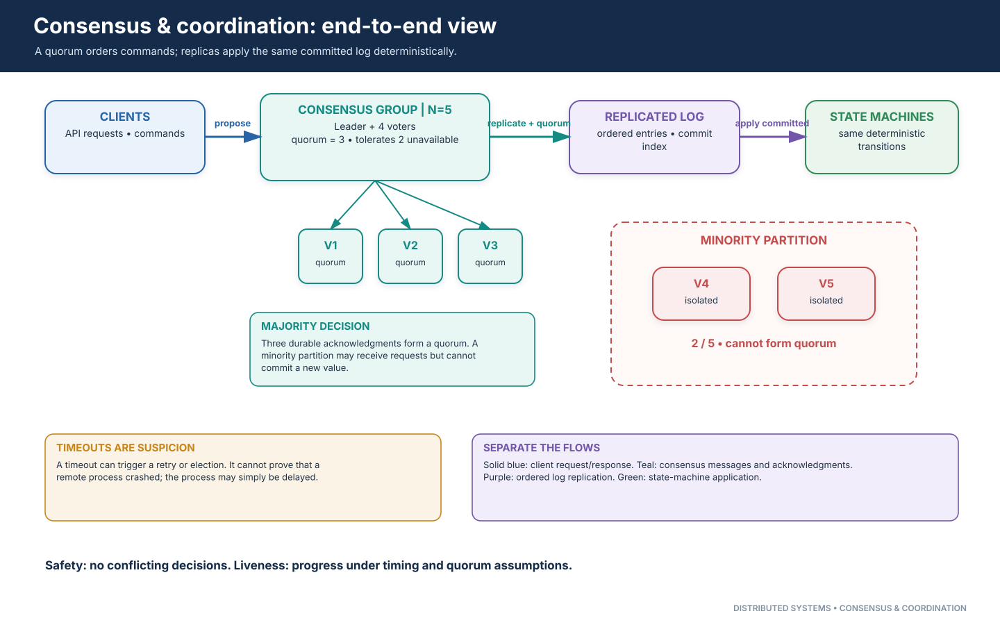

**Diagram specification:** Create a 16:9 overview with five layers: clients, coordination/consensus group, replicated log, deterministic state-machine replicas, and durable storage. Show clients proposing operations to a leader; the leader exchanging messages with followers; a majority quorum returning acknowledgments; a committed log index flowing to state-machine application. Add a separate minority partition that can receive messages but cannot commit. Label `N=5`, quorum `3`, and tolerate at most `2` unavailable crash-fault voters in the simple majority configuration. Distinguish message paths, data replication, and client response paths with a legend. Annotate that a timeout is suspicion, not proof of failure.

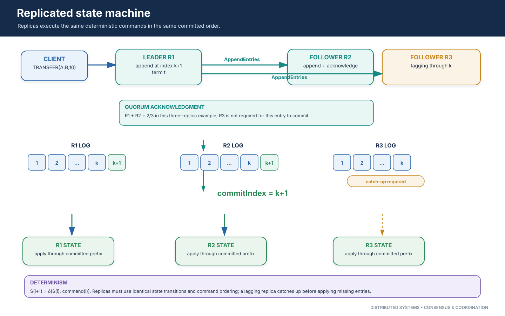

**Diagram specification:** Draw three replicas with identical state-machine boxes and local logs. A common ordered log contains entries `1..k`; entry `k+1` is shown as committed by a quorum. Include a command path from client to leader, leader-to-follower AppendEntries arrows, follower acknowledgments, a `commitIndex=k+1` marker, and state-machine apply arrows. Show one lagging follower with only entries through `k`, then a catch-up arrow. Include the equation `S(i+1)=δ(S(i), command(i))` and a note that commands and transition execution must be deterministic.

---

# 2. FLP impossibility result

## 2.1 Model and historical context

FLP refers to Michael J. Fischer, Nancy A. Lynch, and Michael S. Paterson. Their result was presented at PODS 1983 and published in the *Journal of the ACM* in 1985 as *Impossibility of Distributed Consensus with One Faulty Process*. The paper studies deterministic consensus in an asynchronous message-passing system with crash failures.

An asynchronous model does not provide a known upper bound on message delivery time or process-step duration. A process may take arbitrarily long between steps. The model does not provide a perfect failure detector. A process that has not heard from another process cannot know whether it crashed or is merely delayed. The FLP result uses crash-stop behavior: a faulty process may halt, but it does not send arbitrary malicious messages.

## 2.2 The result: what it says and does not say

The central result is that **no deterministic consensus protocol can guarantee termination in every admissible execution of a fully asynchronous message-passing system if even one process may crash**, while preserving the required agreement and validity properties.

It does **not** say that:

- Consensus can never complete in an asynchronous network.
- Paxos or Raft are incorrect.
- A majority cannot safely choose a value.
- A system must always stop when one node crashes.
- Randomized protocols or protocols with timing assumptions are impossible.
- Consensus is impossible in practical networks.

It says that, with no timing bound and an allowed crash, an adversarial schedule can keep a deterministic protocol from deciding forever. A protocol can be safe in every execution and terminate in many or most executions, but cannot promise termination for all executions of that model.

## 2.3 Valency and proof intuition

FLP uses **valency** to reason about what decisions remain possible from a global configuration.

- A configuration is the combined local states of all processes plus messages currently in transit.
- A configuration is `0-valent` if every admissible continuation leads to decision `0`.
- It is `1-valent` if every admissible continuation leads to decision `1`.
- It is **bivalent** if continuations can still lead to either decision.
- An event is a process step, such as receiving a message and taking a transition.

The proof intuition is:

1. If initial inputs include both `0` and `1`, validity and agreement imply that the protocol cannot simply decide an arbitrary fixed value in all cases. Under the proof's assumptions, there is an initial bivalent configuration.
2. From a bivalent configuration, consider an event that would make progress toward a decision. The adversary can delay that event or another message.
3. The proof shows that one can choose a next enabled event while remaining in a bivalent configuration. The indistinguishability argument is central: a process cannot tell whether a message is late or the sender has crashed.
4. Repeating this scheduling choice constructs an execution that remains bivalent indefinitely, never reaching a decision.
5. Such an execution can include a process that takes no further steps—equivalent to a crash—so the protocol cannot guarantee termination with one possible crash.

This is not a claim that a real network adversary must deliberately delay a message forever. It is a statement about what the model permits, and therefore what a deterministic algorithm can guarantee without additional assumptions.

### A simple indistinguishability picture

Suppose process `P` has not received a message from `Q`. Two executions look identical to `P`:

- `E1`: `Q` crashed before sending the message.
- `E2`: `Q` is healthy but the message is delayed.

If `P` decides as if `Q` crashed, it may violate safety in an execution where `Q`'s message later arrives and supports a conflicting decision. If `P` waits forever to be certain, it may violate termination when `Q` actually crashed. No timeout solves this logically in a fully asynchronous model because there is no maximum legitimate delay.

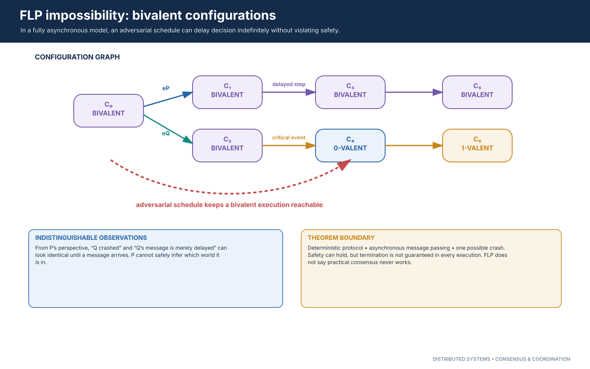

**Diagram specification:** Show configurations as circles: an initial bivalent node branching to events `eP` and `eQ`; successors are annotated as bivalent or univalent. Highlight an adversarial path that repeatedly chooses a delayed or carefully scheduled event and stays bivalent. Include two parallel timelines from `P`'s perspective: one where `Q` crashed and one where `Q`'s message is delayed; until delivery, local observations are identical. Label the proof boundary: deterministic protocol, asynchronous message passing, at least one possible crash, safety preserved, termination not guaranteed.

## 2.4 Engineering workarounds

Real systems obtain useful liveness by operating under assumptions stronger than pure asynchrony:

- **Timeouts:** Suspect an unresponsive leader and begin a new election after a configurable interval. A timeout is a policy trigger, not proof of a crash.
- **Partial synchrony:** Assume that after some unknown stabilization time, message and processing delays are bounded by some finite bound. Before stabilization, progress may be poor; afterward, protocols can make progress.
- **Failure detectors:** Provide imperfect suspicion information. A detector may make mistakes during slowdowns but eventually become accurate enough under its assumptions.
- **Randomization:** Random choices can avoid an adversarial schedule with probability 1 in some models. This changes the deterministic-protocol premise.
- **Leader stabilization and backoff:** Reduce proposer contention so a stable leader can make repeated decisions.
- **Operational timing assumptions:** Configure election timeouts above typical network and scheduler delays, while monitoring the impact of long pauses and overloaded hosts.

### Practical systems and timing assumptions

Paxos and Raft are designed to preserve safety despite arbitrary message delay and crash/recovery behavior within their model, but useful liveness requires eventual communication among a quorum and a period in which one leader/proposer can make progress. PBFT preserves safety with Byzantine faults and provides liveness under partial synchrony after the network becomes sufficiently timely. ZooKeeper's Zab and its leader-election/recovery behavior also rely on a functioning quorum and practical timing/failure-detection assumptions. etcd uses Raft and requires a majority of voting members for writes. CockroachDB uses per-range Raft groups; transactions across ranges add their own distributed transaction protocol.

**Timeout rule:** A timeout should cause a node to *suspect* or *campaign*, not to unilaterally overwrite state. Quorum rules, terms/epochs, durable protocol state, and fencing at downstream resources are what prevent an old leader from safely acting as the current leader.

---

# 3. Two-Phase Commit (2PC)

## 3.1 Purpose and roles

A distributed transaction changes data at multiple participants but must appear atomic: either every participant commits, or every participant aborts. A common example is a transfer that debits one database and credits another. A local ACID transaction protects one resource manager; it does not atomically coordinate independent databases.

In classic 2PC:

- **Coordinator / transaction manager:** Drives the protocol and records the global decision.
- **Participants / resource managers:** Execute local work, prepare to commit, and later follow the global decision.
- **PREPARE:** Asks a participant to make its local work durable and promise it can commit later.
- **Vote:** `YES` means the participant is prepared; `NO` means it cannot commit.
- **COMMIT / ABORT:** The global decision sent by the coordinator.
- **Stable log:** Durable records needed to recover after process or machine restart.

2PC is an atomic-commit protocol, not a consensus protocol. Its classic form has a distinguished coordinator and can block when the coordinator fails after participants have prepared but before they learn the decision.

## 3.2 Protocol phases

### Phase 1 — Prepare / voting

1. The coordinator creates a transaction ID and records a start/prepare record.
2. It sends `PREPARE(txid)` to every participant.
3. Each participant executes or validates its local portion, checks constraints, acquires/retains required locks, and writes a durable `PREPARED(txid)` record.
4. A participant that can commit replies `YES`. It must be able to honor a later `COMMIT` after a crash; this is why the prepared record and recovery data must be durable.
5. If a participant cannot prepare, it records/returns `NO` and the global transaction must abort.

A YES vote is a promise: the participant has reached a state from which it can commit if instructed. It cannot later decide to abort unilaterally merely because the coordinator is slow.

### Phase 2 — decision

1. The coordinator waits for votes.
2. If every participant votes YES, the coordinator records a durable global `COMMIT` decision.
3. Otherwise, or if the protocol's timeout/abort policy requires it before a commit decision is logged, the coordinator records `ABORT`.
4. The coordinator sends the decision to all participants.
5. Each participant commits or rolls back its local transaction, records completion, releases resources, and acknowledges.
6. The coordinator retains enough log information to answer recovery inquiries and can forget the transaction only after protocol-specific completion/garbage-collection conditions are met.

```mermaid
sequenceDiagram
    participant C as Coordinator
    participant P1 as Database 1
    participant P2 as Database 2
    C->>P1: PREPARE(tx)
    C->>P2: PREPARE(tx)
    P1->>P1: Persist PREPARED; retain locks
    P2->>P2: Persist PREPARED; retain locks
    P1-->>C: YES
    P2-->>C: YES
    C->>C: Persist COMMIT
    C-->>P1: COMMIT(tx)
    C-->>P2: COMMIT(tx)
    P1->>P1: Commit; release locks
    P2->>P2: Commit; release locks
    P1-->>C: ACK
    P2-->>C: ACK
```

## 3.3 Worked banking example

Initial balances:

- Database 1: Account A = ₹80,000.
- Database 2: Account B = ₹25,000.
- Transfer: ₹10,000 from A to B.

The coordinator begins transaction `T-9001`. Database 1 tentatively changes A to ₹70,000; Database 2 tentatively changes B to ₹35,000. Neither change is visible as a committed change to other transactions while the participants are prepared, according to their isolation implementation. Each participant writes its durable prepared state and votes YES. The coordinator records COMMIT and broadcasts it. Both participants commit. Final balances: A = ₹70,000, B = ₹35,000; total remains ₹105,000.

If Database 2 detects that B is frozen or the credit violates a constraint, it votes NO. The coordinator records ABORT and notifies Database 1 and Database 2. Database 1 rolls back its tentative debit; the final balances remain A = ₹80,000 and B = ₹25,000.

## 3.4 Failure analysis

| Failure point | Durable knowledge after recovery | Expected behavior / blocking |
|---|---|---|
| Coordinator crashes before sending PREPARE | No participant was asked to prepare; coordinator may have only a start record | Participants have no prepared work; coordinator recovery can abort or restart according to its log |
| Coordinator crashes after sending PREPARE, before votes | Some participants may be active, some may be prepared; coordinator has no decision | Participants that prepared may be in doubt. They must not guess; they can wait for coordinator recovery or a protocol-specific termination procedure |
| Coordinator crashes after receiving YES votes, before logging decision | Participants are prepared; coordinator has no durable global decision | Classic 2PC can block; recovery sees no decision record and must use the protocol's prescribed abort/termination rules, not infer commit from YES votes alone |
| Coordinator crashes after durably logging COMMIT | The global outcome is COMMIT | Recovery retransmits COMMIT until participants acknowledge; participants that have not heard the decision remain prepared temporarily |
| Coordinator crashes after sending COMMIT to only some participants | Durable global decision is COMMIT | Participants that received it commit; others remain in doubt until coordinator recovery/retransmission; atomicity is preserved by the durable decision, but progress can be delayed |
| Participant crashes before voting | It may have no prepared record or may have incomplete local work | On restart it consults local log and coordinator; no YES promise exists unless PREPARED was durably recorded |
| Participant crashes after voting YES | PREPARED record exists | It recovers as prepared, retains/reconstructs locks as required, and asks the coordinator or waits for the decision; this is a classic blocking state |
| Participant crashes after receiving COMMIT | Commit decision may be present in local log/WAL | Recovery replays commit idempotently and then acknowledges; it must not roll back a committed transaction |
| Network partition during processing | Different participants may have different message histories | Missing votes or decisions cause waiting/retry. A participant cannot treat a network timeout as a NO vote or local abort after YES |
| ACK is lost | Participant may already be complete; coordinator has incomplete acknowledgment set | Coordinator resends the decision; participant handles duplicate decision messages idempotently |

### Why participants cannot decide alone

A prepared participant knows only that it voted YES. Another participant may have voted NO, or the coordinator may have durably committed and the COMMIT message may be delayed. If it unilaterally aborts while the durable global decision is COMMIT, atomicity is violated. If it unilaterally commits without knowing that all participants voted YES, atomicity is also violated. That uncertainty is the essence of 2PC blocking.

## 3.5 Blocking and operational costs

Prepared participants can retain locks and other resources while waiting for a coordinator decision. Long outages can create in-doubt transactions, hold row/table locks, increase deadlocks, consume connection slots, prevent cleanup, and affect unrelated traffic. The coordinator's log is therefore critical infrastructure, not disposable process memory.

2PC offers clear atomicity semantics and broad support through transaction managers and database features such as XA-style prepare/commit. Costs include extra network round trips, durable writes, coordinator dependency, long lock duration, recovery complexity, and reduced progress during partitions.

## 3.6 Simplified Python teaching implementation

This example models durable state with dictionaries. A production implementation must replace them with transactional storage/WAL, handle duplicate messages, authenticate participants, persist the participant set and decision, and define coordinator recovery and termination procedures.

```python
from dataclasses import dataclass, field
from enum import Enum
from typing import Dict, Iterable

class State(str, Enum):
    ACTIVE = "ACTIVE"
    PREPARED = "PREPARED"
    COMMITTED = "COMMITTED"
    ABORTED = "ABORTED"

@dataclass
class Participant:
    name: str
    state: Dict[str, State] = field(default_factory=dict)
    # Teaching stand-in for a durable log. Replace with a WAL in production.
    log: list[tuple[str, str]] = field(default_factory=list)
    can_prepare: bool = True

    def prepare(self, txid: str) -> bool:
        if self.state.get(txid) in (State.PREPARED, State.COMMITTED):
            return True  # idempotent retry
        if not self.can_prepare:
            self.state[txid] = State.ABORTED
            self.log.append((txid, "ABORTED"))
            return False
        self.state[txid] = State.PREPARED
        self.log.append((txid, "PREPARED"))
        return True

    def decide(self, txid: str, commit: bool) -> None:
        current = self.state.get(txid)
        if current == State.COMMITTED and commit:
            return
        if current == State.ABORTED and not commit:
            return
        if current != State.PREPARED:
            raise RuntimeError(f"{self.name}: decision without PREPARED state")
        self.state[txid] = State.COMMITTED if commit else State.ABORTED
        self.log.append((txid, self.state[txid].value))

@dataclass
class Coordinator:
    log: Dict[str, str] = field(default_factory=dict)

    def execute(self, txid: str, participants: Iterable[Participant]) -> bool:
        ps = list(participants)
        self.log[txid] = "PREPARING"  # persist before sending PREPARE in real code
        votes = [p.prepare(txid) for p in ps]
        decision = "COMMIT" if all(votes) else "ABORT"
        self.log[txid] = decision  # durable decision must precede decision messages
        for p in ps:
            if p.state.get(txid) == State.PREPARED:
                p.decide(txid, decision == "COMMIT")
        return decision == "COMMIT"

if __name__ == "__main__":
    a = Participant("DB-1")
    b = Participant("DB-2")
    coordinator = Coordinator()
    print(coordinator.execute("T-9001", [a, b]))
    print(a.state["T-9001"], b.state["T-9001"])
    # Demonstrate a NO vote.
    c = Participant("DB-3", can_prepare=False)
    print(coordinator.execute("T-9002", [a, c]))
```

Sample output for the first transaction is `True`, followed by `COMMITTED COMMITTED`. The second transaction returns `False`; the participant that prepared receives ABORT. This code does not simulate crashes or real persistence; it illustrates state transitions only.

## 3.7 Recovery checklist

- Write `PREPARED` before sending YES.
- Write the coordinator's global decision before broadcasting it.
- Make decision handling idempotent.
- Keep transaction identifiers stable across retries.
- Persist participant membership and coordinator epoch/identity.
- Define how participants discover the authoritative coordinator after failover.
- Monitor the age and count of in-doubt transactions.
- Provide an operator-safe recovery procedure; never manually guess a decision from one participant's state.

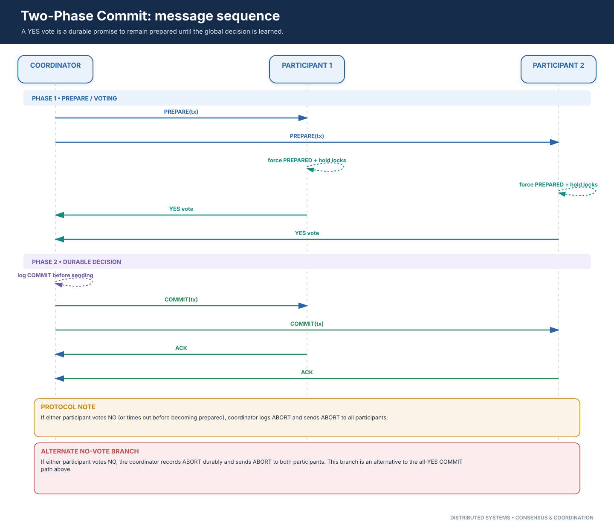

**Diagram specification:** Use one coordinator lifeline and two participant lifelines. Show `PREPARE`, local durable `PREPARED`, `YES/NO` votes, durable coordinator decision, `COMMIT/ABORT`, local completion, and ACK. Mark the prepare and decision phases with shaded bands. Show the all-YES path and a NO-vote branch that leads to ABORT. Add a note that YES requires durable prepared state and that the decision must be logged before it is sent.

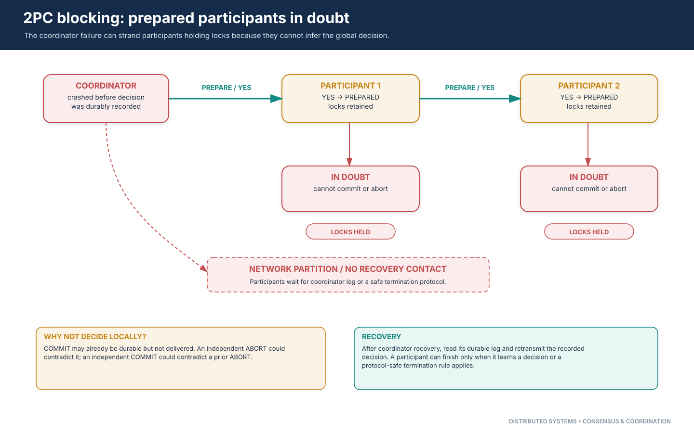

**Diagram specification:** Draw a coordinator and two participants. Both participants vote YES and enter PREPARED while retaining locks. The coordinator crashes before recording or communicating a decision. Mark each participant as `IN DOUBT`, with an hourglass/wait state and held-resource indicator. Show a partition preventing recovery contact. Include alternative recovery once the coordinator's durable log is available. Annotate why neither participant can independently commit or abort.

---

# 4. Three-Phase Commit (3PC)

## 4.1 Motivation and model

Three-Phase Commit adds an intermediate `PRE-COMMIT` state between voting and final commit. The intent is to avoid the classic 2PC situation in which a participant cannot distinguish a coordinator that failed before deciding from one that decided COMMIT but failed before notifying it.

The extra phase can make the protocol non-blocking under a bounded-delay, bounded-processing, crash-failure model with appropriate assumptions about timeouts, failure detection, and network partitions. It is **not** a universal solution under arbitrary asynchrony. In an unbounded-delay system, a timeout cannot distinguish a failed coordinator from a slow one. During partitions, independent groups can make incompatible assumptions unless the model prevents the problematic partition behavior or uses additional quorum mechanisms.

## 4.2 Three phases

1. **CanCommit:** The coordinator asks each participant whether it can commit. Participants vote YES or NO. A NO or timeout leads to abort under the protocol's rules.
2. **PreCommit:** If all vote YES, the coordinator sends PRE-COMMIT. Participants enter a prepared-to-commit state and acknowledge. This phase is evidence that the protocol passed the voting stage.
3. **DoCommit:** The coordinator sends COMMIT; participants commit and release resources.

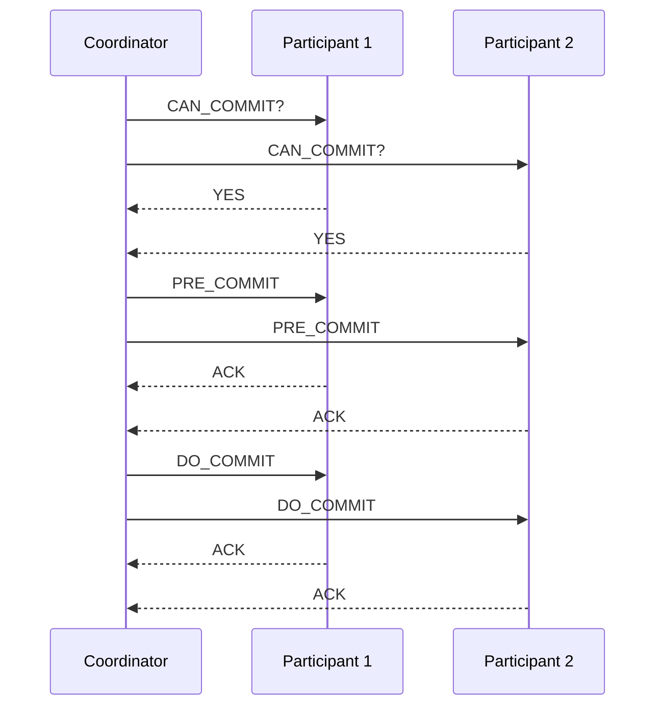

## 4.3 Failure handling and assumptions

A recovery coordinator gathers the states of reachable participants and uses a state-based decision table. In common presentations, a participant that learns a peer reached PRE-COMMIT has evidence that all participants voted YES and may progress toward commit after the protocol's required timeout conditions. If no participant reached PRE-COMMIT, abort is safe. The exact recovery transitions depend on the chosen 3PC variant; do not improvise from a generic timeout table.

The classic non-blocking argument assumes a network that does not arbitrarily partition the participants into groups that can each make progress under contradictory views, plus known upper bounds for communication and processing in the relevant period. If those assumptions fail, 3PC can be unsafe or block. 3PC also adds messages, state, and implementation complexity. Modern databases more often combine replicated transaction metadata and consensus with carefully designed transaction protocols rather than deploy classical 3PC as a universal drop-in replacement for 2PC.

## 4.4 2PC versus 3PC

| Property | 2PC | 3PC |
|---|---|---|
| Main phases | Prepare, decision | CanCommit, PreCommit, DoCommit |
| Intermediate state | Prepared / in-doubt | Pre-committed, intended to separate uncertainty states |
| Coordinator failure | Can block prepared participants | May recover progress under stronger timing/partition assumptions |
| Network timing | Safety does not require known delay bound; liveness can block | Bounded delay and failure-detection assumptions are central to classic non-blocking argument |
| Partition behavior | Participants may wait for coordinator/decision | Must not assume arbitrary partitions are harmless; contradictory local progress is a risk |
| Complexity | Lower | Higher |
| Practical use | Widely supported by transaction managers and databases | Much less common as a general production commit mechanism |

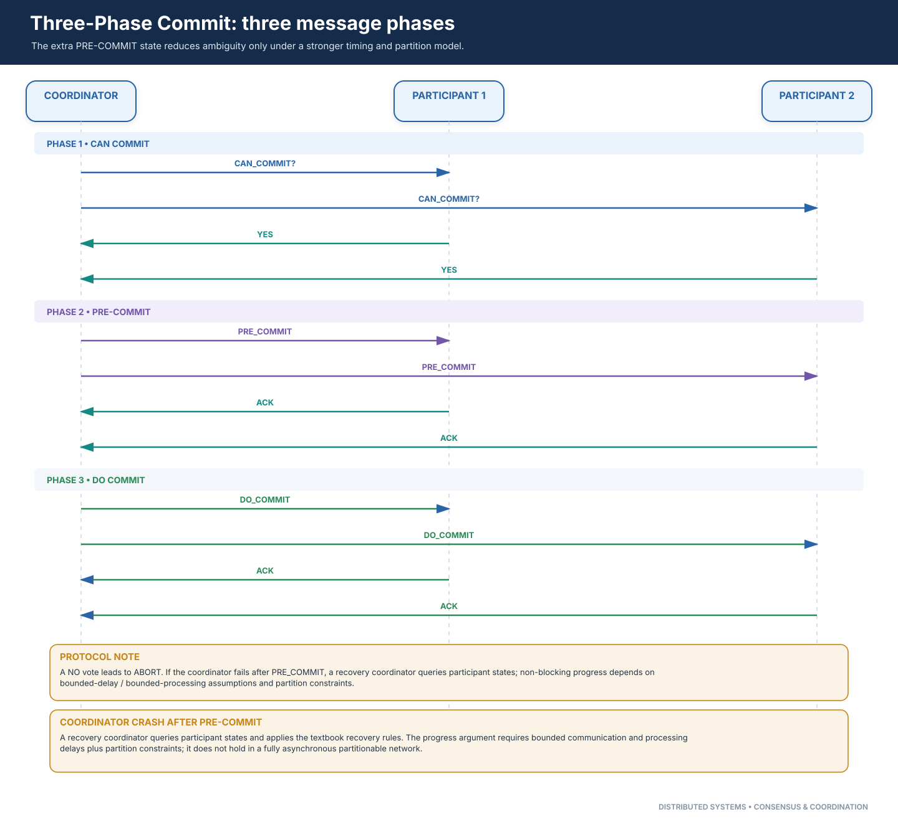

**Diagram specification:** Draw coordinator and at least two participants. Display three distinct phase bands: CAN_COMMIT/YES-NO, PRE_COMMIT/ACK, and DO_COMMIT/ACK. Include a NO branch to ABORT. Show a coordinator crash after PRE_COMMIT and a recovery coordinator querying participant states. Label the timing and partition assumptions required by the textbook non-blocking argument; explicitly note that the diagram is not a guarantee under a fully asynchronous partitionable network.

---

# 5. Paxos consensus algorithm

## 5.1 Roles and vocabulary

Paxos is a crash-fault consensus family introduced by Leslie Lamport. Basic (single-decree) Paxos chooses one value. A **proposer** suggests values, **acceptors** vote by accepting numbered proposals, and **learners** discover which value has been chosen. Roles are logical; one server may perform more than one role.

A **proposal** is a pair `(n, v)` where `n` is a unique, totally ordered proposal number (ballot) and `v` is a value. A value is **chosen** when a quorum of acceptors accepts it. A learner can infer that it was chosen after receiving enough accepted notifications or querying acceptors, depending on the implementation.

The standard majority construction uses `N=2f+1` acceptors and quorum `f+1`. Any two majorities intersect. For example:

| Acceptors | Majority | Crash failures tolerated while preserving quorum |
|---:|---:|---:|
| 3 | 2 | 1 |
| 5 | 3 | 2 |
| 7 | 4 | 3 |

A system with 5 acceptors can make progress with any 3 reachable acceptors. Two different majorities cannot be disjoint, so a later successful phase 1 must encounter at least one acceptor that knows about any previously chosen value.

## 5.2 Phase 1 — Prepare and Promise

1. A proposer chooses a unique ballot `n`, commonly composed of a counter and proposer ID.
2. It sends `PREPARE(n)` to acceptors.
3. An acceptor that has not promised a ballot greater than `n` records a promise not to accept proposals with lower ballots, then responds with its highest accepted `(n_a, v_a)` if one exists.
4. If an acceptor has already promised a higher ballot, it rejects or reports the higher ballot.
5. The proposer proceeds only after responses from a Phase-1 quorum.

Promises must be durable across restart. If acceptor A promised ballot 12, then restarts and forgets that promise, it could later accept ballot 10 and invalidate the ordering assumptions of Paxos.

## 5.3 Phase 2 — Accept and Accepted

After a Phase-1 quorum replies, the proposer selects the value from the response with the highest accepted ballot, if any. If none of the responses reports an accepted proposal, it may select its own value. It sends `ACCEPT(n, v)` to acceptors. An acceptor accepts it if it has not promised a ballot greater than `n`, and records the accepted proposal durably. When a quorum accepts `(n,v)`, `v` is chosen.

The value-selection rule is the core safety mechanism. A proposer must not simply use its preferred value if an earlier accepted proposal is reported by the Phase-1 quorum.

## 5.4 Five-acceptor example

Let acceptors be `A1..A5`, with quorum 3. Proposer `P1` uses ballot 11 and proposes `X`.

| Step | Message / event | A1 | A2 | A3 | A4 | A5 |
|---|---|---|---|---|---|---|
| 0 | Initial state | — | — | — | — | — |
| 1 | `PREPARE(11)` to all | promise 11 | promise 11 | promise 11 | promise 11 | promise 11 |
| 2 | Promise responses | none accepted | none accepted | none accepted | none accepted | none accepted |
| 3 | `ACCEPT(11,X)` | accepts X | accepts X | accepts X | accepts X | delayed |
| 4 | Learner observes 3 accepts | chosen X | chosen X | chosen X | accepts X | — |

Now proposer `P2` uses ballot 12. It sends `PREPARE(12)` and receives replies from `A2`, `A3`, and `A5`. The first two report accepted `(11,X)`; `A5` reports none. Because ballot 11 is the highest accepted proposal in the quorum, `P2` must propose `X`, not `Y`. A Phase-2 quorum accepting `(12,X)` preserves the decision.

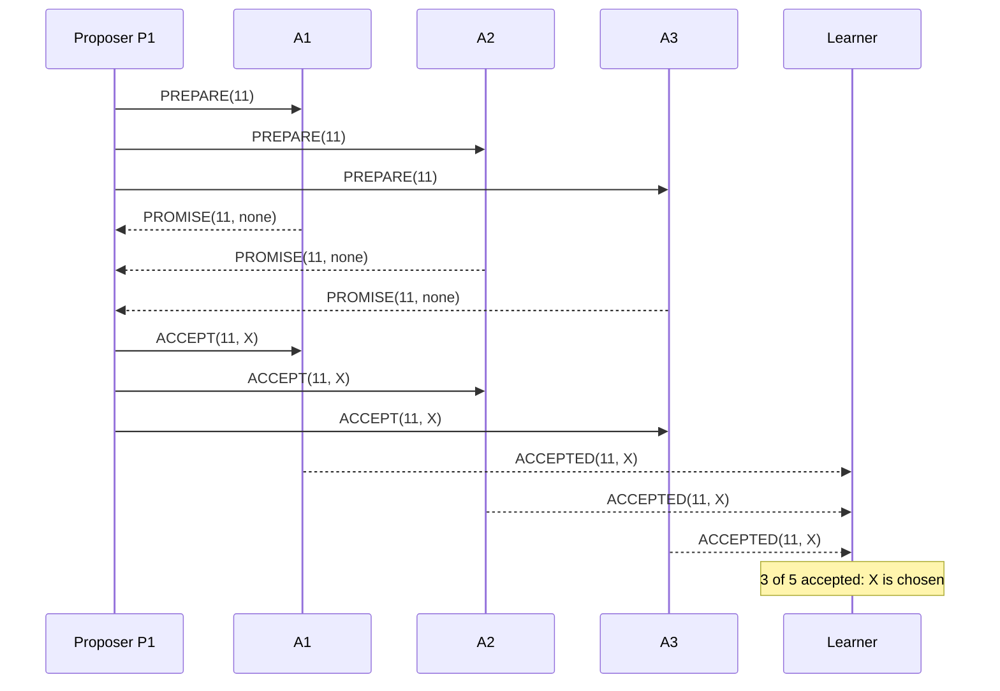

### Competing proposers

Suppose `P1` proposes ballot 11 and `P2` proposes ballot 12. If A1 and A2 promise 11 while A3, A4, and A5 promise 12, both proposers may fail to collect the quorum they need. A proposer can retry with a higher ballot, but repeated preemption can delay progress. Once one proposer stabilizes and obtains a quorum, it can complete Phase 1 and Phase 2. Ballot numbers order proposals; they do not themselves elect a permanent leader.

## 5.5 Safety argument

Assume value `v` is chosen by Phase-2 quorum `Q2` at ballot `n`. Any later successful Phase 1 quorum `Q1` intersects `Q2`. The intersecting acceptor reports an accepted proposal to the later proposer (subject to durable state and the protocol's rules). The proposer selects the highest-numbered accepted value among its Phase-1 responses. The Paxos invariant proves that this highest accepted value must be `v` or another proposal carrying the same value. Therefore future chosen proposals cannot conflict with `v`.

The proof depends on unique ballot ordering, durable promises and accepted state, quorum intersection, and the value-selection rule. Leaving out any one of these can make an implementation unsafe.

## 5.6 Liveness limitations

Paxos safety is robust to arbitrary delays, but basic Paxos does not guarantee quick progress when proposers continually preempt each other. Network partitions can prevent any proposer from reaching a quorum. Practical systems use a stable leader, backoff, randomized retry delays, and operational health monitoring to reduce contention. A stable leader is an optimization and liveness aid, not a reason to discard the safety rules.

## 5.7 Variants

- **Single-Decree Paxos:** Chooses one value.
- **Multi-Paxos:** Uses a stable leader/ballot to replicate a sequence of values; after leadership establishment, many entries can be decided with Phase 2 without repeating full Phase 1 for every entry.
- **Fast Paxos:** Allows proposals to be sent more directly to acceptors in fast rounds, reducing latency in favorable executions but requiring stronger quorum-intersection conditions and careful collision recovery.
- **Flexible Paxos:** Generalizes quorum requirements. Safety requires Phase-1 quorums to intersect with relevant Phase-2 quorums; it does not require every quorum of every phase to be a majority. This enables workload-specific trade-offs.
- **Cheap Paxos:** Uses a small active set with additional spare acceptors that can be brought in when active acceptors fail, reducing steady-state cost under its assumptions.
- **Generalized Paxos:** Allows some commands that commute to be ordered without forcing one total order among them, while resolving conflicts when commands are not commutative.

Variants change quorum geometry, latency, or the set of orderings allowed. They must be compared using their exact failure and quorum assumptions, not by name alone.

## 5.8 Multi-Paxos replicated log

For a log, each slot is a separate consensus instance (or an equivalent optimized representation). A leader establishes a ballot and recovers prior accepted state. It then proposes commands for slots `1,2,3,...`. Each command is chosen only when a Phase-2 quorum accepts it. The state machine applies chosen entries in slot order. A new leader must discover and preserve values already chosen or accepted in a way required by the recovery protocol; it cannot simply start a new log from its local preference.

Example: leader L has ballot 30. It proposes `Deposit(A,100)` in slot 21, `Withdraw(B,50)` in slot 22, and `Transfer(A,B,20)` in slot 23. A quorum accepts each slot. If L fails, a new leader performs recovery and continues from the highest safe prefix, preserving chosen entries and resolving any accepted-but-not-chosen slots under Paxos rules.

## 5.9 Paxos teaching pseudocode

```python
class Acceptor:
    def __init__(self):
        self.promised = None       # highest promised ballot
        self.accepted = None       # (ballot, value)

    def prepare(self, ballot):
        if self.promised is None or ballot >= self.promised:
            self.promised = ballot  # MUST be durable before reply
            return {"ok": True, "accepted": self.accepted}
        return {"ok": False, "promised": self.promised}

    def accept(self, ballot, value):
        if self.promised is None or ballot >= self.promised:
            self.promised = ballot
            self.accepted = (ballot, value)  # MUST be durable before ACK
            return True
        return False


def choose_value(promise_replies, own_value):
    accepted = [r["accepted"] for r in promise_replies
                if r["accepted"] is not None]
    if not accepted:
        return own_value
    return max(accepted, key=lambda proposal: proposal[0])[1]
```

This snippet omits ballots' uniqueness generation, asynchronous RPC, durable storage, concurrent requests, learner dissemination, retransmission, and membership reconfiguration. It is not a complete Paxos implementation. It demonstrates why the acceptor stores a promise and accepted pair, and why the proposer chooses the value attached to the highest accepted ballot.

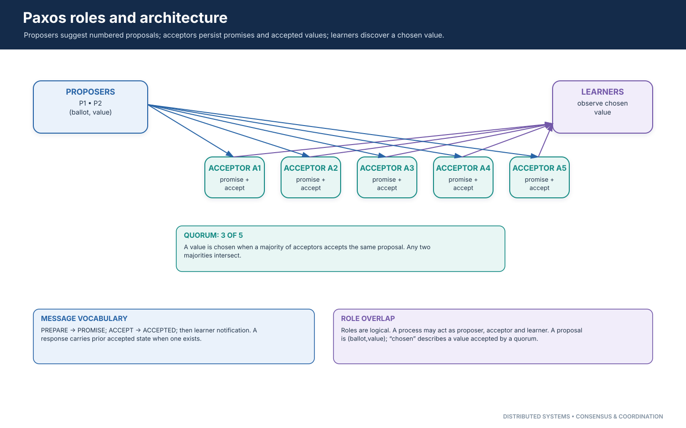

**Diagram specification:** Show proposers, a five-acceptor quorum, and learners. Use separate arrows for PREPARE, PROMISE, ACCEPT, ACCEPTED, and learner notification. Label a quorum of 3/5. Show that an acceptor may also act as a learner in an implementation. Distinguish a proposal `(ballot,value)` from a chosen value.

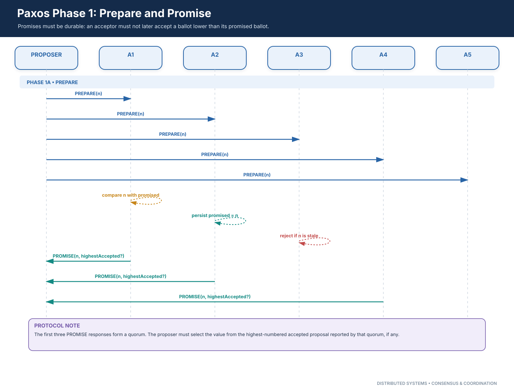

**Diagram specification:** Sequence diagram with proposer and five acceptors. Show `PREPARE(n)`, acceptor comparison with `promised`, persistence of the new promise, rejection of lower ballots, and `PROMISE(n, highestAccepted?)` responses. Highlight the first quorum of three responses and the highest accepted ballot carried in those responses.

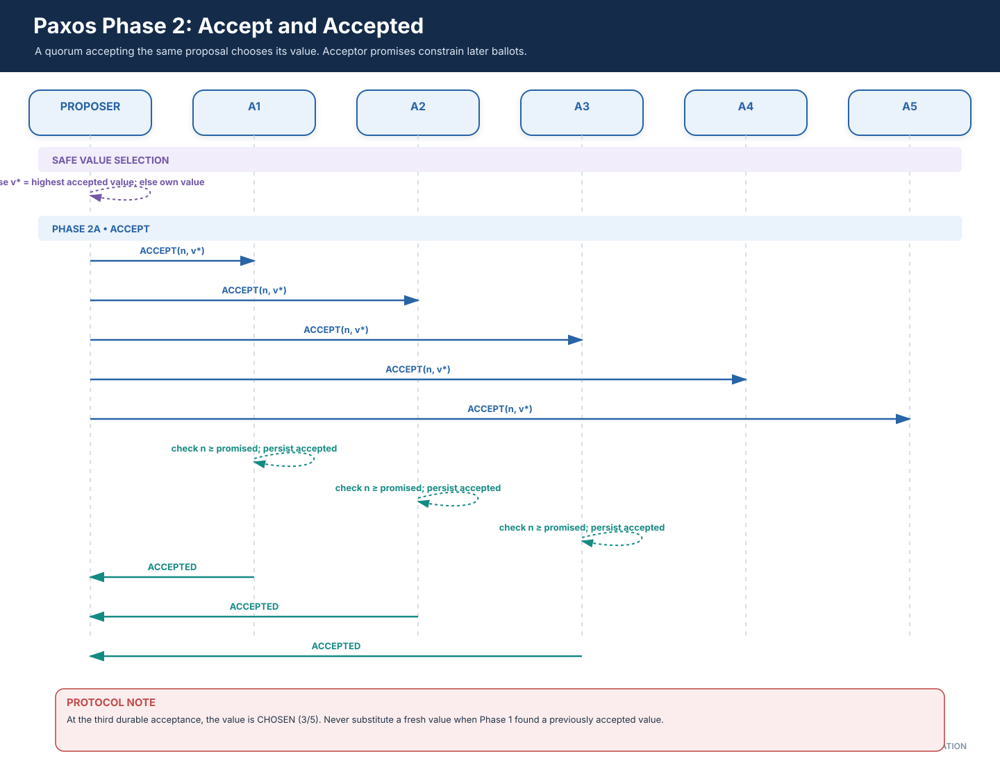

**Diagram specification:** Show proposer selecting value `v*` from the highest accepted proposal returned in Phase 1, otherwise using its own value. Draw `ACCEPT(n,v*)` to acceptors, checks against promised ballot, durable acceptance, and `ACCEPTED` responses. Mark the instant the third acceptor accepts as the chosen point. Include a warning callout: never choose a fresh value if Phase 1 found a previously accepted value.

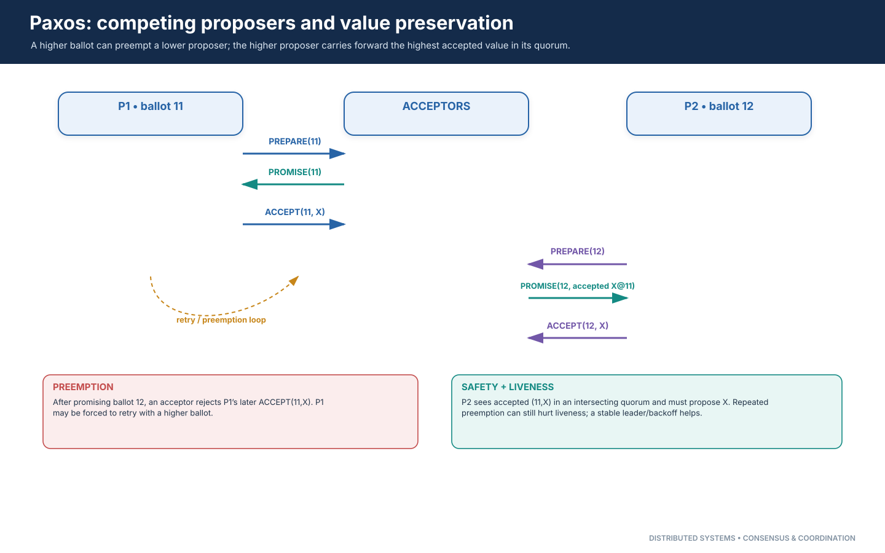

**Diagram specification:** Show P1 using ballot 11 and P2 using ballot 12. Some acceptors promise 11, later promise 12, and reject P1's accept request after promising 12. Show P2 receiving an intersecting quorum containing an accepted `(11,X)` response, then carrying X forward under ballot 12. Add a second possible repeated-preemption loop to illustrate liveness contention.

---
# 6. Multi-Paxos

Multi-Paxos is a practical way to use Paxos repeatedly for a replicated command log. The key optimization is to amortize Phase 1. A node that wins a sufficiently stable leadership ballot performs Phase 1 for the log (or for a range of slots), recovers accepted values, and then proposes new entries using Phase 2. Each slot still follows the safety rules; “one leader” does not mean the leader can commit entries without a quorum.

## 6.1 Stable leadership and ballots

A leader uses a ballot that is greater than ballots it knows about. It sends prepare requests to a Phase-1 quorum, learns the highest accepted proposal per slot, and constructs a safe log. Thereafter, it sends accept requests for new entries. Acceptors reject messages with stale ballots. A higher ballot can preempt the leader, forcing a new Phase 1 and recovery.

## 6.2 Example: three commands

Assume five acceptors and quorum three. Leader `L` establishes ballot `(epoch=8, node=L)` with A1, A2, and A3. It proposes:

| Slot | Command | Quorum result |
|---:|---|---|
| 1 | `CreateAccount(AC-1)` | A1, A2, A3 accept; chosen |
| 2 | `Deposit(AC-1, 500)` | A1, A2, A4 accept; chosen |
| 3 | `Withdraw(AC-1, 100)` | A1, A3 accept; A4 delayed; not yet chosen |

If L crashes, a new leader's Phase 1 quorum must intersect the quorum that accepted slots 1 and 2. It will discover and preserve the accepted/chosen values according to Paxos recovery rules. Slot 3 may be accepted by only two acceptors; it is not yet chosen. The new leader's recovery procedure determines a safe value for that slot before moving forward. It cannot infer that slot 3 is committed merely because it appears in L's local disk.

## 6.3 Phase 1 reuse and implementation details

Implementations differ in how they represent ballots, prepare ranges, holes, and recovery. Common concerns include:

- **Slot watermarks:** Track the lowest and highest slots that may require recovery, and the chosen/trimmed prefix.
- **Holes:** A leader may have accepted slot 30 while slot 29 is unresolved. The application cannot apply slot 30 before the preceding slot is safely resolved.
- **Snapshots:** Compact an applied prefix while preserving enough metadata to prove the snapshot's log position and configuration.
- **Membership:** Changing acceptors changes the quorum system and requires a safe reconfiguration protocol.
- **Durability:** Promise and accepted state must survive restart before acknowledgments are sent.
- **Leader changes:** A new leader must recover accepted state using a quorum; it cannot treat a larger local log as authoritative without protocol evidence.

Multi-Paxos often has message cost comparable to one leader-to-quorum replication round per entry in the steady state, plus local persistence and client messaging. WAN latency and disk durability may dominate. No universal comparison with Raft is meaningful without specifying batching, quorum layout, storage, and implementation.

---

# 7. Raft consensus algorithm

## 7.1 Motivation and architecture

Raft is a consensus algorithm for managing a replicated log. Diego Ongaro and John Ousterhout designed it with understandability as an explicit goal. Raft separates leader election, log replication, and safety into distinct parts. It is equivalent in outcome to Multi-Paxos for replicated-log purposes, while choosing a strong leader: log entries flow from leader to followers during normal operation.

Each server is in one of three roles:

- **Follower:** Responds to RPCs, accepts log entries from a leader, and grants votes when the rules allow.
- **Candidate:** Increments its term, votes for itself, and requests votes from peers.
- **Leader:** Handles client proposals, appends entries, replicates them, tracks follower progress, and periodically sends heartbeats.

A Raft group of `N=2f+1` voting servers needs a majority of `f+1` to elect a leader and commit new entries. Learners/non-voting replicas may receive log data but do not contribute to the voting quorum.

## 7.2 Terms and elections

A **term** is a monotonically increasing logical epoch. Each server stores its current term and, for each term, at most one vote. A server that receives an RPC with a higher term updates its term, reverts to follower, and clears stale leadership assumptions. Term numbers prevent old leaders and candidates from being treated as current.

A leader sends periodic heartbeats, often empty `AppendEntries` RPCs. A follower that does not hear from a valid leader before its randomized election timeout becomes a candidate:

1. Increment `currentTerm`.
2. Vote for itself and persist `currentTerm` and `votedFor`.
3. Send `RequestVote` to all other voters.
4. Receive votes; if it obtains a majority in the current term, become leader.
5. Send initial heartbeats to establish authority.
6. If it sees a higher term, step down. If it loses the election or times out, start another election with a new term.

Randomized election timeouts reduce the probability that all followers start elections simultaneously. They do not make split votes impossible; a candidate that fails to obtain a majority retries after a new randomized timeout.

### Five-node election example

Nodes are A, B, C, D, E. A is leader in term 10. A crashes. B's timeout expires first. B increments to term 11, votes for itself, and requests votes. C and D grant votes; B has 3/5 including itself and becomes leader. E's delayed election request from term 10 is stale. B sends heartbeats in term 11; followers reset their timers. If C and D cannot reach B but can reach each other and E, they may elect a different leader only if a majority in the configuration is available; A's isolated process cannot safely act as leader merely because its local timer has not expired.

```mermaid
sequenceDiagram
    participant A as A (old leader)
    participant B as B (candidate)
    participant C as C
    participant D as D
    participant E as E
    Note over A,E: Term 10; A stops
    B->>B: Election timeout; term = 11; self-vote
    B->>C: RequestVote(term=11)
    B->>D: RequestVote(term=11)
    B->>E: RequestVote(term=11)
    C-->>B: voteGranted=true
    D-->>B: voteGranted=true
    E-->>B: voteGranted=true
    Note over B: 4/5 votes; becomes leader
    B-->>C: AppendEntries heartbeat(term=11)
    B-->>D: AppendEntries heartbeat(term=11)
    B-->>E: AppendEntries heartbeat(term=11)
```

## 7.3 RequestVote RPC and up-to-date logs

Request fields:

- `term`: Candidate's current term.
- `candidateId`: Candidate identity.
- `lastLogIndex`: Index of candidate's last log entry.
- `lastLogTerm`: Term of that entry.

Response fields:

- `term`: Responder's current term.
- `voteGranted`: Whether it voted for the candidate.

A voter grants its vote only if the request term is current or newer, it has not voted for another candidate in that term (or already voted for this candidate), and the candidate's log is at least as up-to-date as its own. The comparison is lexicographic: larger `lastLogTerm` is more up-to-date; if terms tie, larger `lastLogIndex` is more up-to-date. This prevents a candidate with an outdated log from winning over a voter that has a newer committed history, under Raft's Leader Completeness argument.

## 7.4 Log structure and AppendEntries

Each entry contains at least an index, term, and command. A log index starts at 1 in the simplified model. The `term` records the leader term in which the entry was created. The leader tracks a `nextIndex` and `matchIndex` for each follower:

- `nextIndex[f]`: The next log index to send to follower `f`.
- `matchIndex[f]`: Highest index known to be replicated on `f`.
- `commitIndex`: Highest log index known committed.
- `lastApplied`: Highest index applied to the local state machine.

AppendEntries fields:

- `term`: Leader's current term.
- `leaderId`: Leader identity.
- `prevLogIndex`, `prevLogTerm`: Log position that must match before new entries can be appended.
- `entries`: Entries to append; empty for heartbeat.
- `leaderCommit`: Leader's commit index.

A follower first rejects stale terms. It then checks that it contains `prevLogIndex` with `prevLogTerm`. If not, it replies failure. If there is a conflicting entry at an index, the follower deletes that conflicting suffix and appends the leader's entries. It never deletes a committed entry; the protocol's leader and election rules ensure a legitimate leader cannot conflict with committed history. On success it advances its local commit index to at most the last new entry and `leaderCommit`.

### Five-node replication example

Leader L has log:

| Index | Term | Command |
|---:|---:|---|
| 1 | 4 | `Set(x,1)` |
| 2 | 4 | `Set(y,2)` |
| 3 | 5 | `Add(x,3)` |

It sends entries to F1, F2, F3, F4. After F1 and F2 acknowledge index 3, L plus F1 plus F2 are three of five. L can advance `commitIndex` to 3 if the current-term rule is satisfied (entry 3 is term 5, the leader's current term in this example). L applies entries 1–3 and sends `leaderCommit=3`; followers apply when they learn this commit index.

Illustrative state:

| Node | Before replication | After successful replication |
|---|---|---|
| L (leader) | `[1:t4, 2:t4, 3:t5]` | `[1:t4, 2:t4, 3:t5]`, commit 3 |
| F1 | `[1:t4, 2:t4]` | `[1:t4, 2:t4, 3:t5]`, commit 3 |
| F2 | `[1:t4]` | `[1:t4, 2:t4, 3:t5]`, commit 3 |
| F3 | `[1:t4, 2:t4]` | may still be catching up; commit learned later |
| F4 | unavailable | unchanged until recovery |

## 7.5 Conflicting log example

Suppose follower F has entries `(1,t1,A), (2,t2,B), (3,t2,C)`, while the new leader has `(1,t1,A), (2,t3,D)`. The leader sends AppendEntries with `prevLogIndex=1`, `prevLogTerm=t1`, and entries `(2,t3,D)`. F finds a conflict at index 2 (term 2 versus term 3), deletes the conflicting suffix starting at index 2, and appends D. This is safe only because the protocol's election and commitment rules ensure the new leader contains all committed entries. The follower does not decide which value is correct based on command semantics; the protocol's term/index consistency establishes the authoritative log.

## 7.6 Raft safety properties

1. **Election Safety:** At most one leader can be elected in a given term. A voter grants at most one vote per term; two majorities intersect, so two candidates cannot both obtain distinct majorities.
2. **Leader Append-Only:** A leader never overwrites or deletes entries in its own log; it only appends. This reduces log repair complexity.
3. **Log Matching:** If two logs contain an entry with the same index and term, all preceding entries are identical. AppendEntries' predecessor check and conflict repair enforce this.
4. **Leader Completeness:** If an entry is committed in a term, every leader elected in a later term contains that entry. The up-to-date log voting rule and quorum intersection are central.
5. **State Machine Safety:** If a server applies a log entry at a given index, no other server applies a different command at that index.

Without Election Safety, two leaders could accept conflicting commands in one term. Without Log Matching, replicas could apply different prefixes. Without Leader Completeness, a new leader might discard committed work. Without State Machine Safety, the replicated state machine would diverge even if each local log looked plausible.

## 7.7 Commitment and the current-term restriction

A leader advances `commitIndex` to index `N` when a majority has replicated `N` **and** the entry at `N` is from the leader's current term. Once a current-term entry is committed, preceding entries become committed as part of the prefix.

Why the restriction? A previous-term entry replicated on a majority may still be vulnerable if a later-term candidate with a sufficiently up-to-date log wins under the rules. Raft's proof uses a current-term entry to establish the needed Leader Completeness condition. A leader can indirectly commit prior-term entries by committing a later current-term entry that follows them; it must not simply count replicas of an old-term entry and declare it committed.

Example: leader in term 8 has index 5 from term 7 replicated on 3/5. It cannot commit index 5 solely from that count. It appends index 6 in term 8. After index 6 is replicated on a majority, index 6 is committed; the entire prefix through 6, including index 5, is committed.

## 7.8 Leader crash and recovery

- **Before replication:** An entry only on the old leader is uncommitted. It can be overwritten by a later legitimate leader.
- **After partial replication below quorum:** The entry is uncommitted and may or may not survive, depending on which candidate is elected and which logs are present.
- **After quorum replication but before commitment is known:** The current-term rule and future election rules determine whether it is committed; an implementation must not equate an ACK count with every possible commitment condition.
- **After commitment:** The entry is protected by Leader Completeness and must not be lost in a valid execution within the model.
- **After commit but before client response:** The operation may have taken effect even though the client timed out. Use request IDs/deduplication to make retries safe.

## 7.9 Membership changes with joint consensus

Changing the voting set is dangerous because old and new majorities may not intersect. For example, changing from `{A,B,C}` to `{D,E,F}` by instantly replacing the configuration could allow one leader under the old configuration and another under the new configuration.

Raft's joint-consensus approach uses an intermediate configuration `C_old,new`. Decisions during the joint phase require majorities of both the old and new configurations. The transition is:

1. Add new servers as learners or non-voters and let them catch up.
2. Propose joint configuration containing old and new voter sets.
3. Commit the joint configuration under the required overlapping-quorum rule.
4. Operate while both majorities are required.
5. Propose and commit the new configuration alone.
6. Remove old members after the new configuration is safely established.

For a 3-to-5 transition, old voters `{A,B,C}` and new voters `{A,B,C,D,E}` overlap. During joint consensus, a decision needs a majority of `{A,B,C}` (2) and a majority of `{A,B,C,D,E}` (3). This prevents a decision from being accepted solely by a quorum that is disjoint from the previous configuration's quorum.

## 7.10 Core protocol versus optimizations

- **Batching:** Put multiple commands in one AppendEntries round trip. Reduces per-command overhead but may increase latency for small requests.
- **Pipelining:** Send later batches before earlier acknowledgments return, bounded by flow control.
- **Snapshotting/log compaction:** Replace a long applied prefix with a snapshot and metadata `(lastIncludedIndex,lastIncludedTerm)`.
- **InstallSnapshot:** Transfer a snapshot to a lagging follower that no longer has the required log prefix.
- **Pre-vote:** Ask peers whether a future election is likely to succeed before incrementing term; reduces disruptive term inflation after partitions.
- **Check-quorum:** A leader periodically verifies that it can contact a quorum and steps down when it cannot, preventing stale leader behavior within the Raft group.
- **Leadership transfer:** Coordinate an orderly handoff to a caught-up follower.
- **ReadIndex:** Obtain a quorum-confirmed read index for linearizable reads without appending a no-op for each read, subject to the implementation's rules.
- **Lease-based reads:** Use a time-bounded leadership assumption to serve reads without a quorum round trip. These require careful clock/lease safety assumptions and are an implementation optimization, not a free property of Raft.

## 7.11 Raft state and carefully separated pseudocode

Persistent state on each server:

```text
currentTerm : integer
votedFor    : server ID or null
log         : sequence of (term, command)
```

Volatile state on all servers:

```text
commitIndex : integer
lastApplied : integer
```

Volatile leader state:

```text
nextIndex[peer]  : integer
matchIndex[peer] : integer
```

RequestVote handler:

```python
def request_vote(server, req):
    if req.term < server.current_term:
        return {"term": server.current_term, "voteGranted": False}
    if req.term > server.current_term:
        server.current_term = req.term
        server.voted_for = None
        server.role = "follower"
        persist(server.current_term, server.voted_for)

    local_last = (server.log[-1].term, len(server.log)) if server.log else (0, 0)
    candidate_last = (req.lastLogTerm, req.lastLogIndex)
    up_to_date = candidate_last >= local_last
    can_vote = server.voted_for in (None, req.candidateId)
    grant = can_vote and up_to_date
    if grant:
        server.voted_for = req.candidateId
        persist(server.current_term, server.voted_for)
        reset_election_timer()
    return {"term": server.current_term, "voteGranted": grant}
```

AppendEntries handler (conceptual):

```python
def append_entries(server, req):
    if req.term < server.current_term:
        return {"term": server.current_term, "success": False}
    if req.term > server.current_term:
        server.current_term = req.term
        server.voted_for = None
    server.role = "follower"
    persist(server.current_term, server.voted_for)
    reset_election_timer()

    if req.prevLogIndex > 0:
        if len(server.log) < req.prevLogIndex:
            return {"term": server.current_term, "success": False}
        if server.log[req.prevLogIndex - 1].term != req.prevLogTerm:
            return {"term": server.current_term, "success": False}

    for offset, entry in enumerate(req.entries):
        index = req.prevLogIndex + 1 + offset
        if index <= len(server.log):
            if server.log[index - 1].term != entry.term:
                if index <= server.commit_index:
                    raise AssertionError("protocol violation: conflict with committed entry")
                del server.log[index - 1:]
                server.log.append(entry)
        else:
            server.log.append(entry)
    persist_log(server.log)
    server.commit_index = max(
        server.commit_index,
        min(req.leaderCommit, len(server.log))
    )
    apply_committed_entries(server)
    return {"term": server.current_term, "success": True}
```

Leader commit advancement (conceptual):

```python
def advance_commit_index(leader, voters):
    for n in range(len(leader.log), leader.commit_index, -1):
        if leader.log[n - 1].term != leader.current_term:
            continue
        replicated = 1  # leader itself
        for peer in voters:
            if peer != leader.id and leader.match_index[peer] >= n:
                replicated += 1
        if replicated >= len(voters) // 2 + 1:
            leader.commit_index = n
            break
```

These snippets omit concurrency, RPC retries, snapshot boundary handling, log index compaction, configuration changes, membership epochs, disk failure, and subtle conflict-hint optimizations. In a real implementation, every state transition that must survive a crash must be persisted before a response that relies on it is sent.

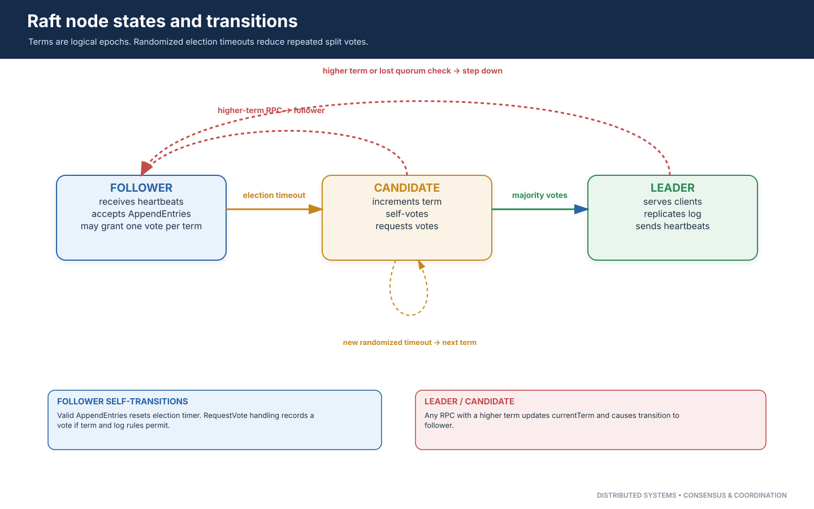

**Diagram specification:** State machine with follower, candidate, and leader. Annotate follower→candidate on election timeout, candidate→leader on current-term majority, candidate→follower on higher-term RPC, leader→follower on higher term or quorum-loss check, and candidate→candidate when a new election begins. Add self-transitions for valid AppendEntries and vote handling. Label term increments and randomized timers.

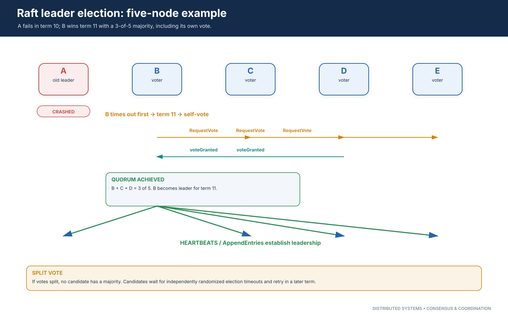

**Diagram specification:** Five nodes A–E, initial leader A in term 10, A crashes, B times out first, becomes candidate in term 11, self-votes, sends RequestVote to C/D/E, receives at least two peer votes, reaches 3/5 quorum, becomes leader, and broadcasts heartbeats. Include a side branch showing a split vote and randomized retry.

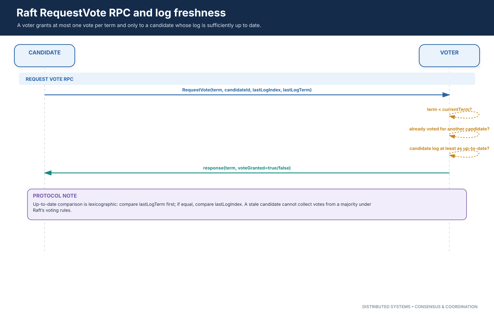

**Diagram specification:** Sequence diagram for RequestVote fields `term`, `candidateId`, `lastLogIndex`, `lastLogTerm` and response `term`, `voteGranted`. Include voter decision diamonds for stale term, already-voted, and up-to-date log checks. Show lexicographic log comparison by lastLogTerm then lastLogIndex.

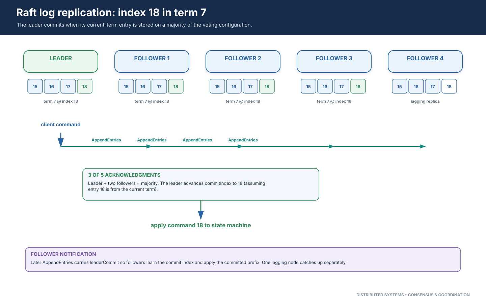

**Diagram specification:** Five-node leader/follower group. Show client command, leader append at index 18 in term 7, AppendEntries sent to four followers, two successful follower acknowledgments plus leader itself forming 3/5, commitIndex advance, apply to state machine, and subsequent follower commit notification. Display per-node log indices and identify one lagging node.

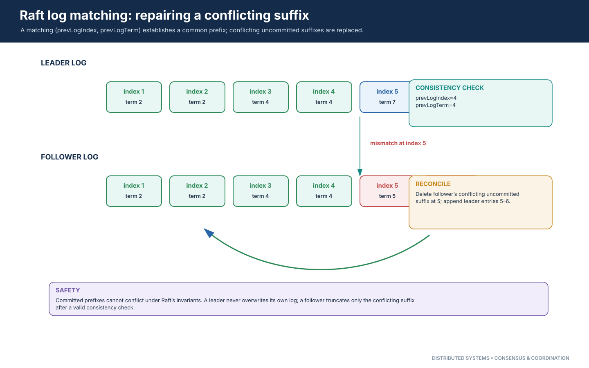

**Diagram specification:** Two logs with a common prefix through index 4. At index 5, show term mismatch and divergent suffixes. An AppendEntries with matching `(prevLogIndex,prevLogTerm)` causes the follower to delete its conflicting uncommitted suffix and append the leader's suffix. Mark that committed prefixes cannot conflict under Raft's safety invariants.

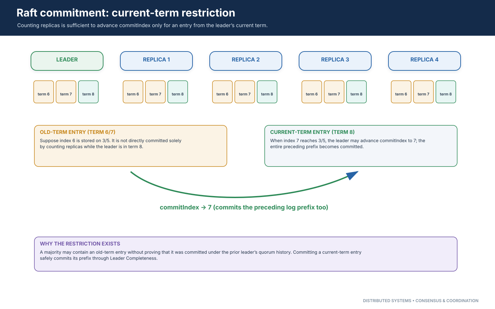

**Diagram specification:** A five-replica log with entries from terms 6, 7, and 8. Show an old-term entry replicated on 3/5 but not directly committed solely by count. Then show a current-term term-8 entry reaching 3/5; commitIndex jumps to that index and commits the entire preceding prefix. Include the current-term restriction note.

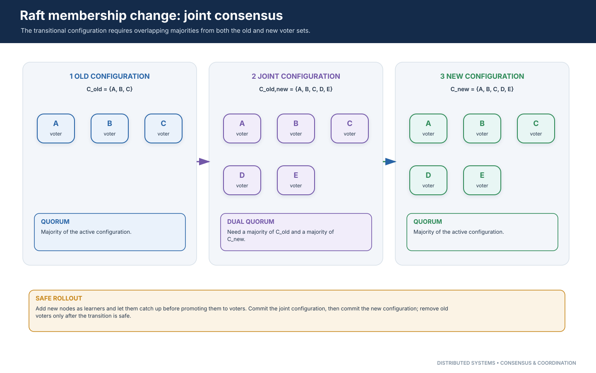

**Diagram specification:** Three panels for `C_old={A,B,C}`, joint `C_old,new={A,B,C,D,E}`, and `C_new={A,B,C,D,E}`. Draw old and new quorum boundaries and highlight that the joint stage requires a majority of each configuration. Add learner catch-up before voter promotion and removal only after the new configuration is committed.

---
# 8. Paxos vs. Raft

Paxos and Raft both provide crash-fault consensus for replicated state machines, but they organize the protocol differently.

| Dimension | Paxos / Multi-Paxos | Raft |
|---|---|---|
| Design style | Quorum-based protocol centered on ballots, promises, and accepted values | Decomposes consensus into leader election, log replication, and safety |
| Roles | Proposers, acceptors, learners; roles may be co-located | Follower, candidate, leader |
| Leadership | Stable leader is a common optimization in Multi-Paxos; basic Paxos permits multiple proposers | Strong leader in normal operation; entries flow leader-to-followers |
| Epoch concept | Ballot/proposal number | Term |
| Per-decision protocol | Phase 1 then Phase 2; Phase 1 often amortized in Multi-Paxos | Election plus AppendEntries replication and commitment |
| Safety core | Quorum intersection, durable promises, highest-accepted-value rule | Terms, voting rule, log matching, leader completeness, current-term commit rule |
| Recovery | New leader/proposer gathers accepted state through Phase 1 | Candidate must have up-to-date log; new leader reconciles follower suffixes |
| Membership | Requires a safe reconfiguration scheme; variants differ | Joint consensus in the original Raft design, or a proven alternative |
| Understandability | Compact core but subtle proof and implementation details | Explicitly designed to be easier to teach and implement |
| Performance | Depends on variant, batching, stable leader, quorum and storage | Depends on implementation, batching, pipeline, reads, quorum and storage |

Raft is often easier to learn because it presents a strong leader, explicit roles, randomized election timeouts, and a unified log model. Paxos remains foundational because its quorum logic is general and has inspired a large family of protocols and production systems. Neither is universally faster or more fault-tolerant. Compare a particular implementation and workload: number and placement of voters, disk fsync policy, batch size, read consistency, WAN RTT, snapshot behavior, and failover objective.

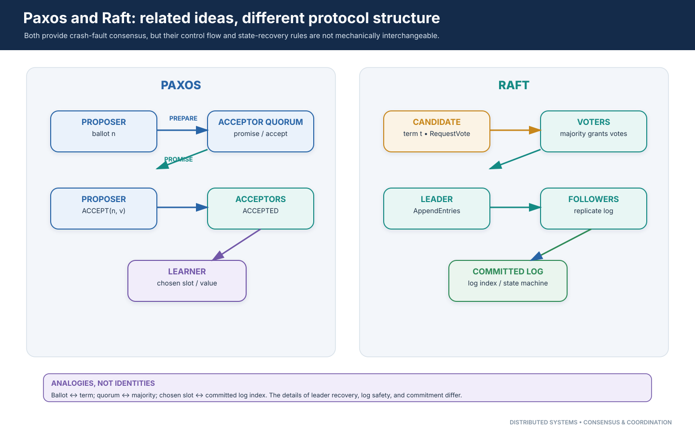

**Diagram specification:** Two-column comparison. Left: Paxos proposer sends PREPARE/PROMISE then ACCEPT/ACCEPTED to an acceptor quorum, with learner notification. Right: Raft candidate wins a term-based election, then a strong leader sends AppendEntries to followers and commits on a majority. Label analogous concepts (ballot↔term, quorum↔majority, chosen slot↔committed log index) while warning that they are not mechanically identical states.

---

# 9. Zab: ZooKeeper Atomic Broadcast

## 9.1 Purpose and relationship to ZooKeeper

Zab is the atomic-broadcast protocol used by Apache ZooKeeper to replicate state updates. ZooKeeper is a coordination service; Zab is its replication and ordering protocol. It is not accurate to use the names interchangeably. ZooKeeper presents a hierarchical data model and operations such as create, delete, get, set, watches, and sessions. Zab coordinates which leader is authoritative, brings followers to a compatible history, and broadcasts updates in a safe order.

The common architecture has one leader and followers in an ensemble. Updates are proposed by the leader, acknowledged by a quorum, and committed in a total order. Observers can receive updates without participating in quorum voting, depending on the deployment configuration.

## 9.2 Epochs and zxids

A ZooKeeper transaction identifier, `zxid`, encodes an epoch/leader-generation component and a counter/order component. Conceptually, higher epochs distinguish newer leadership histories; within an epoch, a counter orders transactions. The exact wire representation is implementation-defined, but the conceptual purpose is to establish a monotonically ordered transaction history.

## 9.3 Protocol phases

The classic Zab descriptions divide recovery and normal operation into:

1. **Discovery:** Participants exchange epoch and history information. A new leader establishes a newer epoch and selects a history consistent with the protocol's safety rules.
2. **Synchronization:** The new leader brings followers to a compatible history. It establishes which previous transactions are committed and ensures that followers start broadcast from a safe prefix.
3. **Broadcast:** The leader proposes new transactions. Followers append proposals and return ACKs. After a quorum acknowledges, the leader commits the transaction and informs followers in order.

The phase names are a helpful conceptual model. Production ZooKeeper versions have implementation details and optimizations that should be checked against the relevant version's documentation and source code.

### Normal broadcast example

1. Client sends a write to a ZooKeeper server.
2. A follower forwards/coordinates the write with the leader.
3. Leader assigns a zxid and broadcasts a proposal.
4. Followers persist the proposal and ACK.
5. Once a quorum has acknowledged, the proposal can be committed.
6. Followers learn the commit and apply the update in the same order.

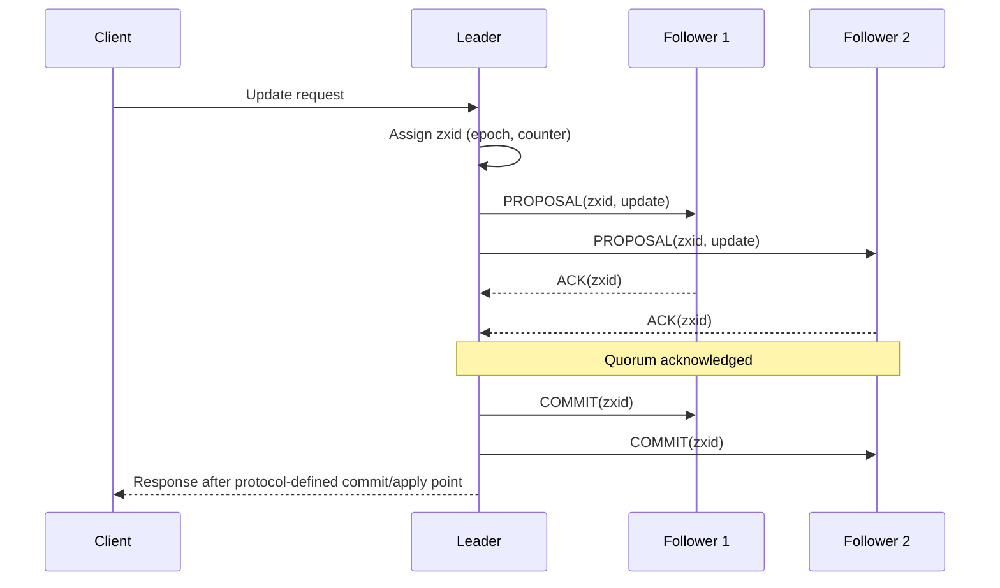

## 9.4 Recovery and safety

If a leader fails, the ensemble elects a new leader and performs discovery/synchronization before accepting ordinary broadcasts under the new epoch. A new leader must not simply choose the log with the largest byte size. It uses protocol metadata and quorum history to preserve transactions that may already have been committed. Followers synchronize to the selected history; only after the recovery phase is complete does normal broadcast resume.

ZooKeeper clients must also understand session semantics and watches. Watches are notifications that a change may have occurred; they are not durable event streams. A client should re-read state after a watch fires and re-register watches as appropriate. A session expiration removes that client's ephemeral znodes.

## 9.5 Zab vs. Raft vs. Paxos

| Dimension | Zab | Raft | Paxos / Multi-Paxos |
|---|---|---|---|
| Main system context | ZooKeeper's atomic broadcast and coordination state | General replicated-log consensus | General consensus family; Multi-Paxos for replicated logs |
| Leader | Primary-style leader | Strong elected leader | Stable leader common in Multi-Paxos; proposers are more general in basic Paxos |
| Epoch/order | Epoch plus zxid transaction order | Term plus log index | Ballot plus slot/instance |
| Normal replication | Leader proposals, follower ACKs, ordered commit | AppendEntries, follower success, commitIndex | Phase-2 accept requests and chosen slots |
| Recovery emphasis | Discovery and synchronization before broadcast | Election, log consistency repair, snapshots | Phase 1 gathers accepted state and establishes safe proposals |
| Intended use | ZooKeeper internal state replication | General-purpose replicated state machines | Broad consensus foundation and variants |

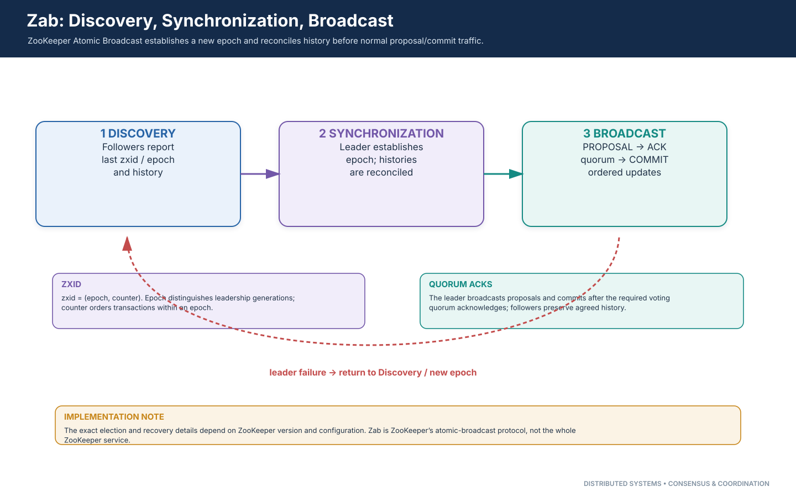

**Diagram specification:** Three horizontal bands: Discovery, Synchronization, Broadcast. Show followers reporting last zxid/epoch and history to a candidate leader; leader establishes a new epoch; follower histories are reconciled; then normal proposal/ACK/commit loop begins. Label `zxid=(epoch,counter)` and quorum acknowledgments. Include a crash arrow from Broadcast back to Discovery and a note that the exact election mechanism is version/configuration specific.

---

# 10. Viewstamped Replication

## 10.1 Overview

Viewstamped Replication (VR), developed by Brian Oki and Barbara Liskov, is a primary-backup replication protocol for state machines. It uses a sequence of **views**, each with a primary and backups. The primary orders client operations and replicates them. If the primary fails, replicas execute a view change and select a new primary while retaining committed history. The revised protocol, *Viewstamped Replication Revisited*, describes a streamlined crash-fault protocol, recovery, and reconfiguration.

## 10.2 Normal operation

The primary receives a client request, assigns an operation number, and sends a PREPARE message containing the view, operation number, and request/log information to backups. Backups validate ordering, record the request, and acknowledge. Once the protocol's quorum has accepted the operation, the primary advances the commit number and informs replicas. The state machine applies operations in order; replies are returned to clients with request IDs so retries can be deduplicated.

```mermaid
sequenceDiagram
    participant C as Client
    participant P as Primary
    participant B1 as Backup 1
    participant B2 as Backup 2
    C->>P: Request(clientId, requestNo, op)
    P->>B1: PREPARE(view, opNo, op)
    P->>B2: PREPARE(view, opNo, op)
    B1-->>P: PREPARE-OK
    B2-->>P: PREPARE-OK
    Note over P,B2: Quorum accepted; advance commit number
    P->>B1: COMMIT(commitNo)
    P->>B2: COMMIT(commitNo)
    P-->>C: Reply(result)
```

## 10.3 Views, view changes, and recovery

A view number identifies a leadership epoch. If the primary is suspected failed, backups initiate a view change. The protocol collects view-change reports, selects a new primary according to the configured deterministic rotation, and ensures the new primary has the log and commit information needed to preserve completed operations. A recovering replica obtains a current state/log from the group before joining normal service.

The core invariant is that a new view's primary must preserve every operation that may already be committed. This is achieved through intersecting quorums and view-change evidence, not by choosing an arbitrary replica.

## 10.4 VR compared with Paxos, Raft, and Zab

| Dimension | Viewstamped Replication | Paxos | Raft | Zab |
|---|---|---|---|---|
| Style | Primary-backup with views | Quorum-based acceptors/ballots | Strong leader and term-based log | Leader-based atomic broadcast |
| Ordering | Primary assigns operation numbers | Slots chosen by Paxos instances | Leader assigns log indices | Leader assigns zxids |
| Recovery | View-change reports and log reconciliation | Phase-1 recovery of accepted values | Up-to-date election rule and AppendEntries repair | Discovery and synchronization |
| Fault model | Crash failures in standard VR | Crash failures in classic Paxos | Crash failures | Crash failures |
| Main contribution/context | Replicated services and primary-copy recovery | General consensus formulation | Understandable replicated-log consensus | ZooKeeper update ordering and recovery |

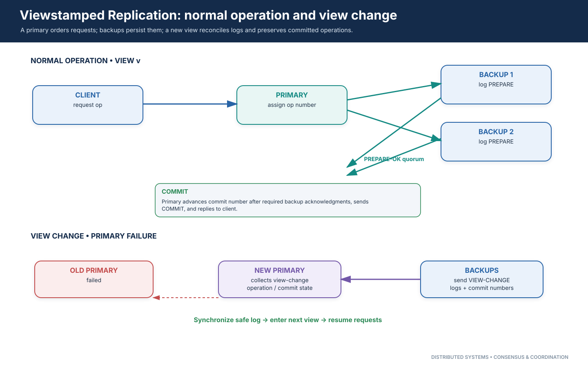

**Diagram specification:** Draw primary plus two backups in view `v`. Show client request, primary-assigned operation number, PREPARE to backups, quorum PREPARE-OK, commit number advancement, COMMIT notification, and client reply. A lower panel shows primary failure, view-change messages carrying last operation/commit numbers, a new primary, synchronization, and the next view. Highlight that the new primary retains all possibly committed operations.

---

# 11. Byzantine fault tolerance

## 11.1 Failure models

A crash-fault model assumes a node either follows the protocol or stops. A Byzantine node may behave arbitrarily: lie, omit messages, send inconsistent messages to different peers, replay old messages, corrupt state, or collude with other faulty nodes. Byzantine faults can result from compromised credentials, malicious operators, software bugs, memory corruption, or faulty implementations.

Crash-fault protocols such as common Paxos and Raft implementations do not automatically protect against arbitrary Byzantine behavior. A compromised leader may send different logs to different followers; a crash-only follower would not intentionally equivocate, but a Byzantine replica can.

## 11.2 Byzantine Generals intuition

Imagine several generals coordinating whether to attack. They need to agree despite some traitors sending conflicting orders. A loyal general must not accept one order while another loyal general accepts the opposite order. The problem captures agreement in the presence of arbitrary faults, not merely silent crashes. Authenticated channels or digital signatures can help identify who sent a message, but authentication alone does not make a malicious sender truthful.

## 11.3 Quorum bound

For the standard practical Byzantine state-machine replication setting:

\[
N \geq 3f + 1
\]

where `N` is the number of replicas and `f` is the maximum Byzantine replicas tolerated. The classic PBFT normal-case quorum uses `2f+1` matching messages/replicas at important stages. Examples:

| Byzantine faults `f` | Minimum replicas `N=3f+1` | Typical commit certificate size `2f+1` |
|---:|---:|---:|
| 1 | 4 | 3 |
| 2 | 7 | 5 |
| 3 | 10 | 7 |

The bound follows from intersection reasoning. A quorum of `2f+1` among `3f+1` replicas intersects another such quorum in at least `f+1` replicas. Since at most `f` are Byzantine, at least one replica in the intersection is honest. In a typical PBFT argument, the honest intersection member will not support conflicting prepared/committed histories, under the protocol's authentication and locking rules.

This is a protocol-family result under specific assumptions. It is not a formula for every BFT design, proof-of-work blockchain, or permissionless system.

## 11.4 Authentication and messages

Replicas authenticate messages with MACs, signatures, or authenticated channels. Messages typically include view number, sequence number, digest of the request, and sender identity. A digest helps bind a message to a specific request. Replicas must reject stale, malformed, or inconsistent messages. A Byzantine fault model includes attackers that may replay valid-looking old messages, so protocol epochs and request identifiers are critical.

---

# 12. Practical Byzantine Fault Tolerance (PBFT)

## 12.1 Overview and assumptions

Practical Byzantine Fault Tolerance (PBFT), by Miguel Castro and Barbara Liskov, is a replicated state-machine protocol designed to tolerate Byzantine faults with practical performance. The classic protocol uses `N=3f+1` replicas, a primary and backups, authenticated messages, and partial synchrony for liveness. Safety is maintained despite asynchronous delays within the model; liveness is expected after the network becomes sufficiently timely and view changes can complete.

## 12.2 Normal-case phases

1. **Client request:** Client sends an operation with a unique timestamp/request ID to the primary.
2. **Pre-Prepare:** Primary assigns sequence number `n` in view `v`, computes request digest `d`, and sends `PRE-PREPARE(v,n,d,request)` to backups.
3. **Prepare:** Backups validate the pre-prepare and broadcast `PREPARE(v,n,d,i)` to other replicas. A replica becomes *prepared* after collecting the matching pre-prepare and the required matching prepare messages from distinct replicas (classically `2f` prepares in addition to the primary's pre-prepare, yielding a `2f+1`-replica prepared certificate).
4. **Commit:** Replicas broadcast `COMMIT(v,n,d,i)`. A replica commits locally after collecting the required matching commit messages from `2f+1` distinct replicas, with the protocol's local prepared conditions satisfied.
5. **Execute and reply:** The operation executes in sequence order and replicas reply to the client. The client accepts a response after `f+1` matching replies, ensuring at least one reply comes from a correct replica.

Implementations may encode the exact threshold and message accounting differently; when implementing PBFT, use the exact paper/specification, not a simplified drawing alone.

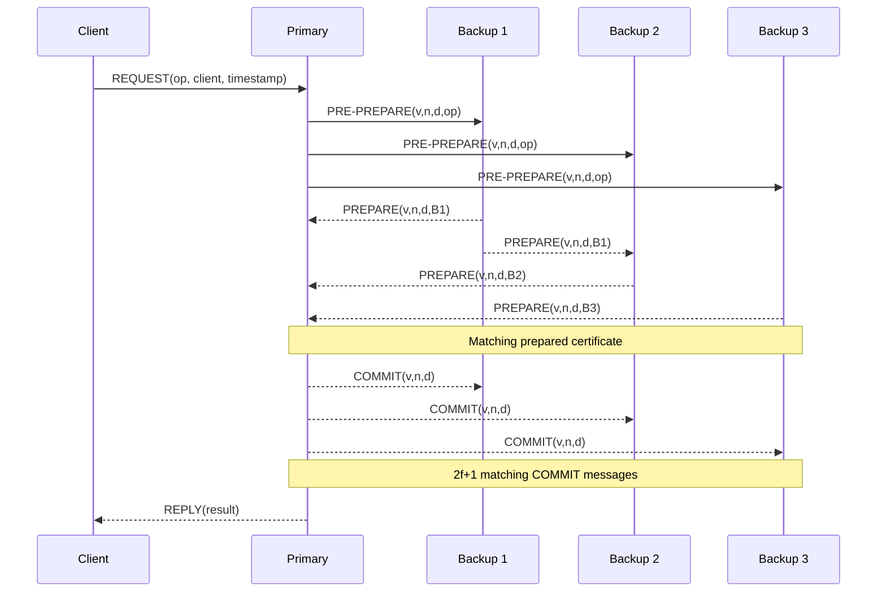

## 12.3 View changes and recovery

A backup that suspects the primary is faulty sends a view-change message for a higher view, carrying evidence about prepared operations and checkpoints. Replicas collect enough view-change messages to authorize a new primary. The new primary sends a `NEW-VIEW` message with the selected pre-prepares/recovery information. Correct replicas verify that the new view preserves operations that may have become committed.

**Checkpoints** summarize application state at a sequence number. A checkpoint becomes stable after enough matching checkpoint messages are collected. Stable checkpoints allow old request/prepare/commit messages to be garbage-collected. Replica recovery must install a valid checkpoint and replay a safe suffix; simply copying a peer's latest disk image is not sufficient.

## 12.4 Complexity and practical trade-offs

The basic all-to-all prepare and commit broadcasts have `O(N^2)` message transmissions per operation in the straightforward implementation. Cryptographic authentication, signature verification, request digests, view changes, and network bandwidth are significant costs. Optimizations include batching many requests, MAC vectors, threshold cryptography in some designs, separating clients from replica communication, and more scalable BFT protocols with different assumptions and structures.

PBFT-style mechanisms are used in some permissioned replicated ledgers and security-sensitive services. Not every blockchain uses PBFT; proof-of-work, proof-of-stake, and committee-based consensus have different assumptions and rules.

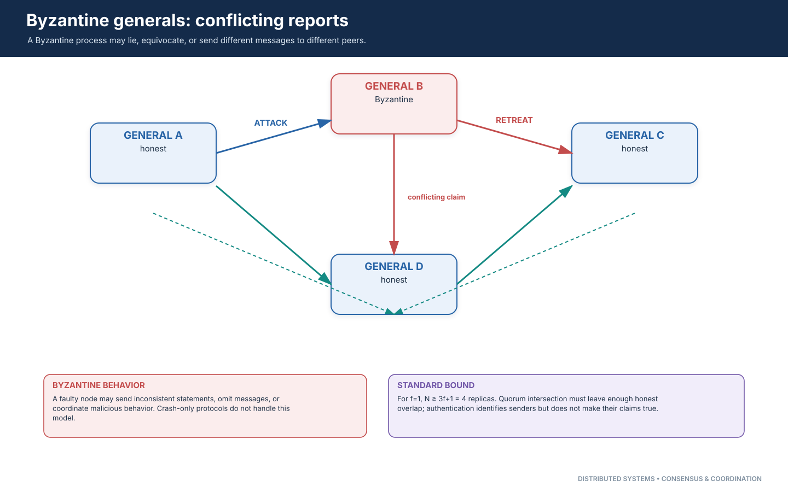

**Diagram specification:** Four generals/nodes, one Byzantine node sending `ATTACK` to one recipient and `RETREAT` to another, while the remaining three exchange authenticated reports. Use distinct colors or line styles for honest and Byzantine behavior. Illustrate conflicting statements without implying that signatures prove correctness. Add the `N=3f+1` bound for `f=1` and mark the required quorum intersection.

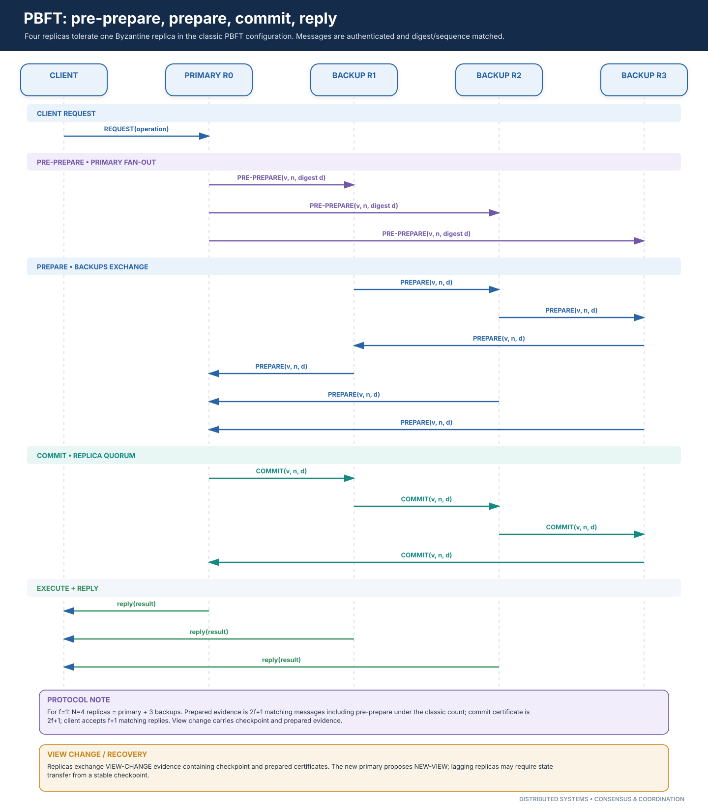

**Diagram specification:** Four replicas for `f=1` plus one client. Show the client's request; primary pre-prepare with view `v`, sequence `n`, digest `d`; backups' all-to-all PREPARE; prepared certificate; all-to-all COMMIT; local execution; and client reply after `f+1` matching replies. Include threshold notes: `N=3f+1`, prepared evidence `2f+1` total including pre-prepare under the classic counting convention, commit certificate `2f+1`, client reply `f+1`. Add a lower view-change panel showing `VIEW-CHANGE` evidence, `NEW-VIEW`, and checkpoint/state transfer.

---

# 13. Leader election algorithms

A **leader** is a process that has authority to coordinate a task for a particular scope and epoch. Leader-based designs simplify ordering because clients can submit writes to one current authority. Examples include a database primary, one scheduler controller, or one metadata-service leader.

Do not confuse:

- **Failure detection:** Suspecting that a peer is unavailable.
- **Leader election:** Choosing a process to act as leader under a protocol's rules.
- **Consensus:** Agreeing on a value/order despite faults.
- **Distributed lock:** Granting access to a resource under ownership and expiration rules.

A leader-election algorithm that only uses IDs and timeouts can be unsafe during a network partition. Production systems typically bind leadership to terms/epochs and quorum-backed metadata, and downstream writes must reject stale authority when necessary.

### Production leader election patterns

- **Raft:** Candidates increment a persistent term, request votes, and need a majority. Voters grant at most one vote per term and enforce the up-to-date-log rule. The leader replicates entries and steps down on a higher term.
- **Paxos/Multi-Paxos:** A proposer establishes a ballot by collecting promises from a quorum. A stable proposer commonly acts as leader, and higher ballots preempt lower ones. Phase-1 recovery preserves accepted values.
- **ZooKeeper:** Applications commonly use ephemeral sequential znodes. The lowest sequence owns leadership; followers watch their immediate predecessor. Session expiration removes the owner's ephemeral node.
- **etcd:** The Election API campaigns with an attached lease and returns a leader key/revision. A client can compare that key/revision in transactions before mutating etcd metadata.
- **Consul:** Sessions and KV acquire/release operations can implement application leadership; the server-side Raft group replicates catalog/KV state, while gossip disseminates membership/failure information.

In all cases, a leadership record should include an epoch/generation, and any external resource that can be corrupted by a stale leader should validate a fencing token or equivalent conditional version.

---

# 14. Bully algorithm

## 14.1 Assumptions and operation

The Bully algorithm is a classical teaching algorithm for a known set of processes with unique numeric IDs. The process with the highest ID among currently reachable, non-failed processes becomes coordinator. It assumes processes can address one another and that a process can eventually determine whether another is responsive. These assumptions are stronger than what can be guaranteed in a fully asynchronous network.

Algorithm:

1. Process `Pi` suspects the coordinator has failed.
2. It sends `ELECTION` to all processes with IDs greater than `i`.
3. If no higher process responds, `Pi` declares itself coordinator and broadcasts `COORDINATOR`.
4. If any higher process replies `OK`, `Pi` stops its own election and waits for a coordinator announcement.
5. A higher process that has received ELECTION starts its own election.
6. The highest active process eventually wins and informs the others.

### Five-process example

Processes are P1–P5, with P5 coordinator. P5 crashes. P2 detects the failure and sends ELECTION to P3, P4, P5. P3 and P4 reply OK; P5 does not. P3 and P4 start elections. P4 sends to P5 and gets no response, so P4 becomes coordinator and broadcasts `COORDINATOR(4)`. All lower processes record P4 as coordinator.

```python
def bully_election(process_id: int, alive_ids: list[int]) -> int:
    """Teaching model: returns highest reachable process ID."""
    if process_id not in alive_ids:
        raise ValueError("initiator must be alive")
    higher = [pid for pid in alive_ids if pid > process_id]
    # In a real message protocol, any response from a higher ID causes
    # that process to run its own election. This model computes the result.
    return max([process_id, *higher])

print(bully_election(2, [1, 2, 3, 4]))  # 4
```

The code computes the final winner; it does not simulate messages, timeouts, concurrent elections, partitions, or stale coordinator announcements.

## 14.2 Complexity and limitations

One election initiated by process `i` sends `N-i-1` election messages and may trigger replies/announcements. A worst-case cascade from a low-ID initiator can produce `O(N^2)` messages. Advantages: straightforward and high-ID winner selection in its assumptions. Disadvantages: needs a known membership list, can create many messages, assumes reliable enough failure detection, and can elect different leaders in partitioned groups. A delayed old COORDINATOR message can also confuse a naïve implementation unless epochs are included.

---

# 15. Ring election algorithm

## 15.1 Operation

Processes form a logical ring. A process that suspects the leader failed sends an election message containing its ID (or a set of candidate IDs) to its successor. Each process forwards the message, adding its ID or comparing the candidate. When the message returns to the initiator, the highest active ID is selected. A coordinator announcement circulates the ring so every process records the winner.

### Example

Ring order: P1 → P2 → P3 → P4 → P5 → P1. P3 starts election. The message traverses P4, P5, P1, P2, then returns. If every process is alive, the maximum ID is P5. P5 is announced as coordinator. If P4 is down, the ring implementation needs a successor-discovery or skip-over-failed-node mechanism; the simplest textbook algorithm assumes a functioning logical successor path.

```python
def ring_election(ring_order: list[int], alive: set[int], initiator: int) -> int:
    """Teaching simulation of one complete logical-ring election."""
    if initiator not in alive or initiator not in ring_order:
        raise ValueError("initiator must be alive and in ring")
    start = ring_order.index(initiator)
    visited = []
    for step in range(1, len(ring_order) + 1):
        pid = ring_order[(start + step) % len(ring_order)]
        if pid in alive:
            visited.append(pid)
        if pid == initiator:
            break
    candidates = [initiator, *visited]
    return max(candidates)

print(ring_election([1, 2, 3, 4, 5], {1, 2, 3, 4, 5}, 3))  # 5
```

This simulation assumes the message can traverse the ring and that failure skipping has already been solved. A basic ring election typically needs `O(N)` election transmissions plus `O(N)` coordinator announcement transmissions, for `O(N)` total in the simple one-election case. Some variants forward candidate sets or run multiple simultaneous elections, changing the message count.

## 15.2 Bully vs. Ring

| Property | Bully | Ring |
|---|---|---|
| Topology | Direct messages to higher IDs | Logical ring traversal |
| Winner | Highest active ID | Highest active ID included in election circulation |
| Message pattern | Cascading elections and responses | Circulating election and coordinator messages |
| Textbook message complexity | Worst-case `O(N^2)` | `O(N)` for a simple complete ring pass and announcement |
| Dependencies | Known process IDs and reachability | Ring successor path and failure skipping |
| Main limitation | Message burst and partition sensitivity | Ring disruption and slower serial traversal |

These algorithms are useful for understanding election concepts, not as substitutes for robust consensus protocols in unreliable networks.

---

# 16. Distributed locks

## 16.1 Why a local mutex is insufficient

A local mutex coordinates threads sharing one process's memory. Two machines have separate memory and can each believe they own the same resource. A distributed lock is a coordination primitive that grants one client temporary or durable ownership of a named resource, usually through a database or coordination service.

Use cases include preventing two schedulers from executing one singleton job, serializing inventory allocation, choosing one maintenance worker, or controlling a shared file-processing pipeline. A lock does not automatically make the protected application operation atomic. The resource itself must enforce the ownership protocol.

## 16.2 Desired properties

- **Mutual exclusion:** At most one valid owner at a time, under clearly defined semantics.
- **Deadlock freedom:** A failed holder should not block forever; leases/expiration help.
- **Fault tolerance:** The lock service continues through the failures it is designed to tolerate.
- **Ownership:** A client can prove it owns the lock token/key.
- **Reentrancy:** Same owner can reacquire safely if the API supports it; not universal.
- **Fairness:** Waiters are served in a defined order; not guaranteed by every service.
- **Recovery:** Ownership is released or recovered after client/session failure.

Mutual exclusion, ownership, and recoverability are core requirements; fairness and reentrancy are policy choices. A timeout-based API may improve liveness but does not by itself prevent a paused stale client from writing later.

## 16.3 Database-based locks

A database can coordinate locks with transactional row locks, unique constraints, or a lock table. Example table:

```sql
CREATE TABLE distributed_lock (
    lock_name   TEXT PRIMARY KEY,
    owner_id    TEXT NOT NULL,
    expires_at  TIMESTAMPTZ NOT NULL,
    fence_token BIGINT NOT NULL
);
```

Acquisition must be atomic, for example through `INSERT ... ON CONFLICT` with a conditional update that succeeds only when the row is expired or owned by the caller. The transaction isolation level and database clock semantics matter. Do not implement acquisition as a separate `SELECT` followed by `UPDATE` without a transaction/conditional predicate: two contenders can both observe the lock as free.

Release should include `WHERE lock_name=? AND owner_id=?` or an unguessable ownership token so one client cannot release another client's lock. Expiration should be evaluated by an authoritative database clock or transaction mechanism. Even then, fencing is needed if the old owner may continue operating outside the database.

## 16.4 Redis-based locks

A common single-instance Redis acquisition command is:

```text
SET resource_name unique_random_token NX PX 30000
```

`NX` means create only if the key does not exist; `PX` attaches a millisecond TTL. The random token distinguishes the owner. Release must compare-and-delete atomically, typically using a Lua script:

```lua
if redis.call("get", KEYS[1]) == ARGV[1] then
  return redis.call("del", KEYS[1])
else
  return 0
end
```

A plain `DEL` is unsafe: the lock may expire and be acquired by another client before the old client runs `DEL`, causing it to delete the new owner's lock. TTL limits deadlock duration, but it can expire while a client is paused or partitioned. Redis asynchronous replication/failover creates additional subtleties: a lock acknowledged by one primary may not yet have replicated when failover occurs. Application safety requirements should determine whether a single Redis lock is adequate, whether a quorum algorithm is justified, and—most importantly—whether the resource checks a fencing token. Lock algorithms should not be treated as stronger than their persistence/failover assumptions.

## 16.5 ZooKeeper-based locks

A common ZooKeeper recipe uses ephemeral sequential znodes:

1. Client creates an ephemeral sequential child under `/locks/resource/`.
2. It lists children and sorts sequence numbers.
3. The client with the smallest sequence is owner.
4. A waiting client watches only its immediate predecessor, not the entire directory.
5. When predecessor disappears, the waiter rechecks the children and may acquire.
6. If the session expires, ZooKeeper removes the ephemeral node.

Watching only the predecessor reduces the herd effect. Watches are one-shot notifications; the client must re-read the children list after notification. Session expiration—not merely a broken TCP connection—causes ephemeral ownership to disappear.

## 16.6 etcd-based locks

etcd's concurrency API offers `Lock` associated with a lease. The successful caller receives a lock key that exists while ownership remains. The caller can use an etcd transaction to compare lock ownership and conditionally update etcd keys. Lock release deletes the ownership key; lease expiry also releases it. For writes to an external system, the external system must still validate fencing/revision information; an etcd key comparison only protects the etcd transaction itself.

## 16.7 Consul sessions

Consul sessions tie key ownership to a session and health/TTL behavior. A lock operation associates a key with a session; session invalidation or expiration can release it. Consul has a configurable lock-delay behavior to give a possibly paused former holder time to stop before another client acquires, but lock delay is not a substitute for resource-side fencing. Consul's lock API and its consistency modes should be reviewed for the exact server version and failure model.

## 16.8 Failure scenarios

1. **Client crashes while holding lock:** Lease/session eventually expires and lock is released. Until then, waiters may block.
2. **Client pauses for long GC/suspension:** Lease can expire while client is merely paused.
3. **Network partition:** The client may lose contact with lock service but continue accessing another resource.
4. **Lock expires while old client runs:** The service grants ownership to B while A still believes it has work to finish.
5. **New client writes:** B updates the resource.
6. **Old client resumes:** A sends an old write. If resource checks only “I once held the lock,” it may accept a stale write and corrupt state.

This is why lock ownership and resource protection must be designed together. A lock service can revoke its own metadata but cannot forcibly stop a remote process or retract a message already in flight.

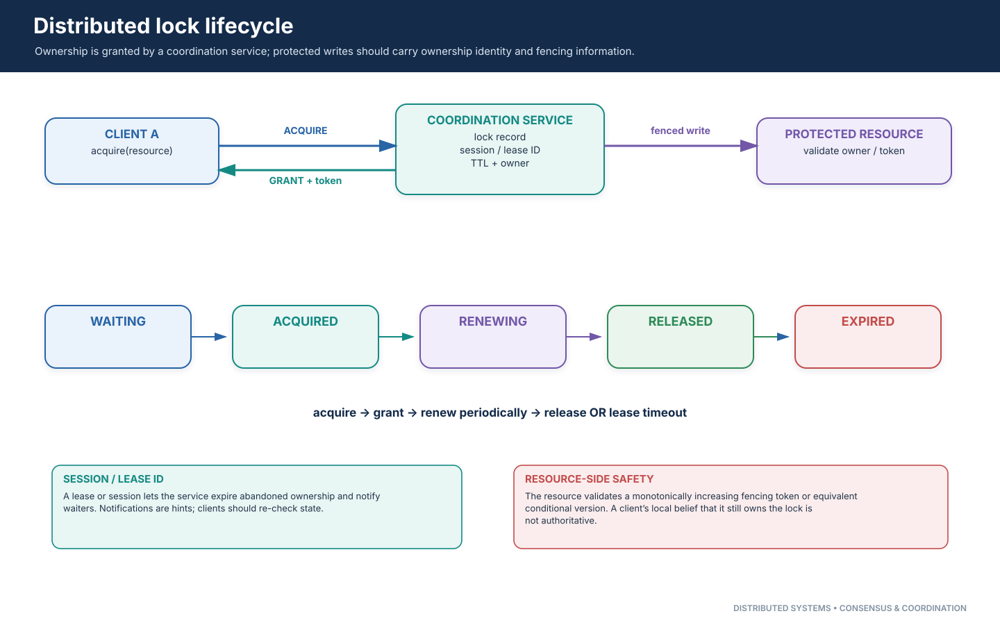

**Diagram specification:** Show clients A, B, and a coordination service. Include states `WAITING`, `ACQUIRED`, `RENEWING`, `RELEASED`, and `EXPIRED`; arrows for acquire, grant, renew, release, and lease timeout. Add a separate protected resource that accepts writes only with valid ownership/fencing data. Annotate session/lease identity, expiry, and notification behavior.

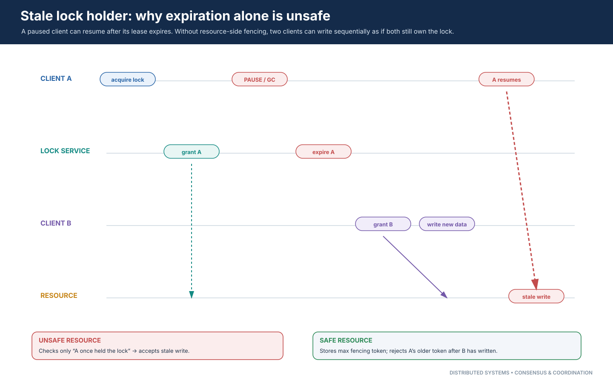

**Diagram specification:** Two client timelines and one lock service/resource. A acquires lock, pauses, and misses renewal; lock service expires A's ownership and grants B. B writes new data. A resumes and sends a stale write. The unsafe resource accepts both when it checks only a local lock belief. The safe alternative marks the stale write as rejected by a higher fencing token. Show the order of events explicitly.

---

# 17. Fencing tokens

## 17.1 Why a lock is not enough

A **fencing token** is a monotonically increasing number (or version) issued on each successful ownership grant. The protected resource remembers the greatest token it has accepted and rejects operations carrying a lower token. The lock service prevents ordinary concurrent acquisition; the fencing token protects the resource from stale owners whose lease expired while they were paused or partitioned.

## 17.2 Worked sequence

1. A acquires the lock and receives token 41.
2. A pauses for a long garbage-collection event.
3. Its lease expires at the lock service.
4. B acquires the lock and receives token 42.
5. B writes to the storage system with token 42; the resource stores `max_token=42`.
6. A resumes and attempts a write with token 41.
7. The resource compares `41 < 42` and rejects A.

The resource must enforce the comparison atomically with the write. Merely logging the token in the application does not provide protection.

## 17.3 Database implementation

A resource row can store a `last_fence_token`:

```sql
CREATE TABLE protected_resource (
    resource_id TEXT PRIMARY KEY,
    payload JSONB NOT NULL,
    last_fence_token BIGINT NOT NULL DEFAULT 0
);

-- Apply a write only if its token is newer than the last accepted token.
UPDATE protected_resource
SET payload = :new_payload,
    last_fence_token = :token
WHERE resource_id = :id
  AND last_fence_token < :token;
```

Check that exactly one row was updated. For multiple writes by the same owner, the resource may need to accept equal tokens while requiring monotonic request sequence numbers or idempotency keys; the strict `<` example intentionally accepts only a strictly newer token and is a teaching simplification. A better schema may atomically store both the fence token and owner-scoped operation sequence to allow several valid writes from one lease while rejecting older owners.

Token generation must be linearizable or otherwise guarantee globally monotonic ownership generations for that resource. A database sequence inside a transaction, an etcd revision/lease key, or a coordination service's monotonic sequence can be used if its semantics are appropriate. Do not generate fencing tokens from unsynchronized wall-clock timestamps or process-local counters.

```python
class FencedResource:
    def __init__(self):
        self.last_token = 0
        self.value = None

    def write(self, token: int, value: str) -> bool:
        if token <= self.last_token:
            return False
        # Token check and mutation must be one atomic resource operation.
        self.last_token = token
        self.value = value
        return True

resource = FencedResource()
assert resource.write(42, "from B") is True
assert resource.write(41, "stale write from A") is False
```

## 17.4 Limitations and design rules

- Tokens must never move backward after recovery or restore.
- The resource must validate tokens atomically and persist its high-water mark.
- Tokens must be scoped to the protected resource or a compatible ownership domain.
- A token is not authentication; pair it with authenticated identities and authorization.
- A resource that cannot validate token order (for example, a legacy external API) cannot fully benefit from fencing unless an adapter/transactional gateway performs the check.
- Fencing prevents stale writes only after the resource has observed the higher token. If A's stale write reaches the resource before B's higher-token write, the resource may accept it; applications may need sequencing, lease-aware gateways, or additional protocol constraints. Fencing ensures that once token 42 has been observed, token 41 cannot subsequently overwrite it.

Locks and fencing are complementary: locks reduce contention and express ownership; fencing protects the data plane against stale owners.

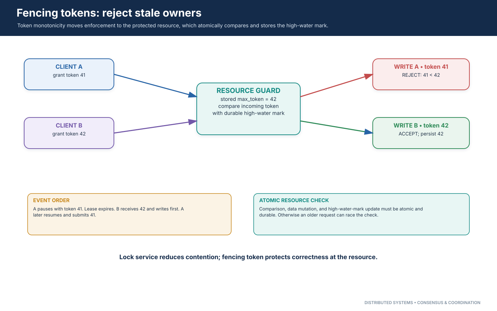

**Diagram specification:** Two timelines: A receives token 41 and pauses; B receives token 42 after A's lease expires; B writes, advancing resource high-water mark to 42; A later sends token 41 and is rejected. Include a comparison box in the resource: incoming token vs. stored maximum token. Emphasize that the comparison and data mutation are atomic and the high-water mark is durable.

---

# 18. Leases

## 18.1 Definition and lifecycle

A **lease** is a time-bounded grant of ownership or authority. It has a holder, an identifier, an expiry condition, and a renewal mechanism. A coordination service may grant a lease for 30 seconds and require the client to renew periodically. If renewal stops, the service expires the lease and removes or invalidates associated keys/ownership.

Lifecycle:

1. Client requests a lease.
2. Service records the lease and expiration/TTL.
3. Client receives the lease ID and becomes holder.
4. Client periodically renews/keeps alive.
5. If renewal succeeds, ownership continues.
6. If renewal fails or the TTL expires, the service revokes lease-associated resources.
7. Another client may acquire ownership.

## 18.2 Leases versus locks

A lock expresses exclusivity; a lease adds time-bounded expiration to help recover from dead clients. A lock without expiration can remain forever after a crash unless an operator releases it. A lease can expire automatically but introduces timing assumptions and stale-client hazards. In practical distributed coordination, locks are often lease-backed, and fencing tokens are used to protect external resources.

| Concern | Lock | Lease |
|---|---|---|
| Core meaning | Exclusive ownership/serialization | Time-bounded grant |
| Expiration | Optional | Inherent |
| Crash recovery | Requires release/recovery policy | Expiration can release automatically |
| Clock assumptions | Depends on implementation | Depends on service's TTL/heartbeat model; client clock should not be trusted alone |
| Stale client | Still possible | Still possible after expiry/pause |
| Fencing | Often needed for external writes | Often needed for external writes |

## 18.3 Clock and timeout problems

- **Clock skew:** Two machines' wall clocks differ.
- **Clock drift:** Clocks progress at slightly different rates.
- **Network delay:** Renewal may be delayed even though the client is healthy.
- **Scheduler pause:** The client may not run during a long pause.
- **Delayed expiration observation:** Client may not immediately learn that the service revoked its lease.
- **False suspicion:** An overloaded service may expire a lease whose owner is actually alive.

A client should treat loss of renewal/authority as immediate loss of permission for new protected operations. But a process may be paused after checking the lease and resume later. Therefore the downstream resource needs fencing or a transactional condition, not merely a local Boolean `is_leader`.

## 18.4 Renewal interval

A common engineering heuristic is to renew well before expiry, leaving a margin for RTT variance and scheduler stalls. If TTL is `T`, a client might renew every `T/3` or `T/2`; this is not a correctness theorem. The right interval depends on service behavior, expected pause/RTT distributions, retry budget, and the maximum safe stale-operation window. Monitor renewal failures, remaining TTL, and clock uncertainty.

## 18.5 Simplified lease manager

```python
from dataclasses import dataclass
import time

@dataclass
class Lease:
    lease_id: str
    owner: str
    expires_at: float
    token: int

class LeaseManager:
    def __init__(self):
        self.current: Lease | None = None
        self.next_token = 1

    def grant(self, owner: str, ttl_seconds: float) -> Lease | None:
        now = time.monotonic()
        if self.current and self.current.expires_at > now:
            return None
        lease = Lease(str(self.next_token), owner,
                      now + ttl_seconds, self.next_token)
        self.next_token += 1
        self.current = lease
        return lease

    def renew(self, lease_id: str, ttl_seconds: float) -> bool:
        now = time.monotonic()
        if not self.current or self.current.lease_id != lease_id:
            return False
        if self.current.expires_at <= now:
            self.current = None
            return False
        self.current.expires_at = now + ttl_seconds
        return True

    def valid(self, lease_id: str) -> bool:
        return bool(self.current
                    and self.current.lease_id == lease_id
                    and self.current.expires_at > time.monotonic())
```

This single-process demonstration uses a monotonic clock because wall-clock jumps should not affect elapsed-duration calculations on one machine. It is not a distributed lease service: state is in memory, there is no consensus, no concurrent transaction handling, and a second process has no shared authority. Production leases require replicated durable state and service-defined TTL semantics.

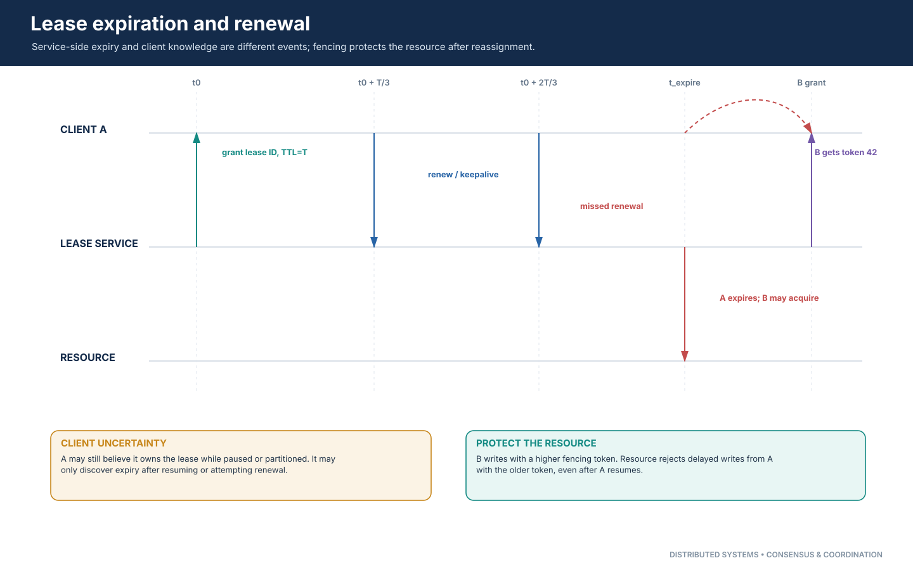

**Diagram specification:** Timeline with client, lease service, and resource. Show grant at `t0` with TTL `T`, renewals at `t0+T/3` and `t0+2T/3`, one missed renewal, expiration at service time, new grant to B, and A's delayed attempt. Label the difference between service-side expiration and client knowledge. Include fencing token advancement as the protection for the resource.

---
# 19. Coordination services

## 19.1 What a coordination service provides

A **coordination service** maintains a small amount of highly consistent metadata for many application processes. It can expose primitives for leader election, membership, locks, leases, configuration, service registration, and watches. The service is often logically centralized but physically replicated across several machines using consensus or atomic broadcast.

Examples of metadata are:

- `/services/payment/instances/i-17` → address, port, health metadata.
- `/config/rate-limit` → configuration version and value.
- `/jobs/reconcile/leader` → current scheduler owner/lease.
- `/clusters/worker-membership/w-22` → ephemeral membership record.

A coordination service should not normally be used as a high-volume application database. It is optimized for correctness and availability of small metadata updates, not large blobs or high-throughput event streaming. Watches reduce polling but are generally hints to re-read current state, not a replacement for a durable event log.

## 19.2 Why coordination services use consensus

If a coordination service replicated its metadata without a single agreed ordering, two replicas could grant the same lock, elect different leaders, or return incompatible configuration versions. Consensus/atomic broadcast gives the service one ordered history of updates. The service then exposes a simpler API so applications do not need to implement their own consensus protocol.

The application still has responsibilities: validate lock ownership, handle session/lease loss, re-read after watch notifications, use idempotency keys, and fence external side effects.

---

# 20. Apache ZooKeeper

## 20.1 Architecture

ZooKeeper is a distributed coordination service. An **ensemble** is a group of ZooKeeper servers. One server is the leader for writes; followers participate in the quorum protocol and serve reads according to ZooKeeper's consistency semantics. Observers can receive replicated state without voting in the quorum. ZooKeeper uses Zab to order and replicate updates.

A majority of voting servers is required for quorum progress. A three-voter ensemble can tolerate one unavailable voter; a five-voter ensemble can tolerate two, assuming independent failures and network connectivity among the remaining quorum. Adding observers does not increase the voting quorum.

## 20.2 Data model and znodes

ZooKeeper exposes a hierarchical namespace similar to a filesystem. Each node is a **znode**, which can contain data and child znodes. Znode data is intended for coordination metadata and is commonly small.

Common node types:

- **Persistent:** Remains until explicitly deleted.
- **Ephemeral:** Exists while the creating client session is active; removed when that session expires. Ephemeral znodes cannot have children.
- **Sequential:** ZooKeeper appends a monotonically increasing sequence suffix among children of a parent.
- **Ephemeral sequential:** Combines session-bound lifetime with sequence ordering; commonly used for locks and leader election.

A znode has metadata such as version counters and timestamps. Version checks support conditional updates (optimistic concurrency). ACLs control access. A session has an ID and timeout; a temporary disconnection does not necessarily mean the session has expired.

## 20.3 Operations and watches

Typical operations include `create`, `delete`, `exists`, `getData`, `setData`, `getChildren`, and synchronous/asynchronous variants. Operations that mutate the replicated namespace are ordered by Zab. Watches are one-shot notifications associated with reads/exists/children operations. When a watch fires, the client re-reads and re-registers as needed. A watch tells the client that relevant state changed; it should not be treated as a complete durable change history.

## 20.4 Guarantees and consistency

ZooKeeper provides ordered updates and atomic znode operations, plus session and ephemeral-node semantics. Clients must account for the fact that reads may be served by followers and can be stale relative to a write that has not yet synchronized to that server. ZooKeeper offers ordering guarantees such as sequential consistency for updates and per-client ordering; applications requiring a specific freshness boundary should use the appropriate synchronization/read pattern from the versioned API documentation.

## 20.5 Leader election and lock recipe

For a lock on `/locks/report`:

1. Ensure `/locks/report` exists as a persistent parent.
2. Create `/locks/report/lock-` as an ephemeral sequential node.
3. List children and sort by sequence suffix.
4. If this client created the smallest child, it owns the lock.
5. Otherwise, watch the immediately preceding child.
6. On notification, re-list and re-evaluate; watches are one-shot.
7. Delete the client's znode to release, or let session expiration clean it up.

For leader election, contenders create ephemeral sequential children under an election path. The smallest sequence is leader; others watch their predecessor. A newly elected leader should publish an epoch/token and protected resources should validate it.

### Python client sketch

Using the Python `kazoo` client (installation: `pip install kazoo`):

```python
from kazoo.client import KazooClient
from kazoo.recipe.lock import Lock

zk = KazooClient(hosts="127.0.0.1:2181")
zk.start(timeout=10)
try:
    lock = Lock(zk, "/locks/inventory", identifier="worker-7")
    with lock:
        # Keep the critical section short.
        # Use a fencing/version check at the protected resource as well.
        print("owns ZooKeeper lock")
finally:
    zk.stop()
    zk.close()
```

This is an API usage sketch, not a complete deployment. Production systems need ACLs, session/connection monitoring, bounded critical sections, retry logic, and resource-side protection against stale workers.

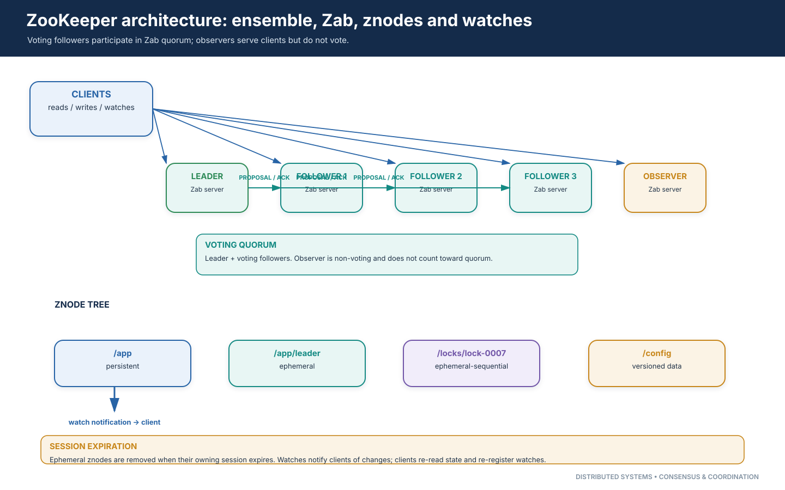

**Diagram specification:** Draw a five-server ensemble with one leader, three followers, and optionally one observer. Show clients connected to different servers; follower reads; write forwarding to leader; Zab proposal/ACK/commit messages through the voting quorum. Add a hierarchical znode tree with persistent, ephemeral, sequential, and ephemeral-sequential examples. Show watches returning notifications to clients, and a session expiration deleting an ephemeral znode. Distinguish voting followers from non-voting observers.

---

# 21. etcd

## 21.1 Architecture and consistency

etcd is a distributed key-value store commonly used to store configuration and cluster metadata. It uses Raft to replicate its state among voting members. Its API includes key-value operations, transactions, watches, leases, locks, and leader elections. etcd is used by Kubernetes for cluster state and coordination.

The key-value API maintains revisions and MVCC history. Each committed mutation advances the store revision. A key's metadata includes create revision, modification revision, version, value, and lease ID. Historical versions can be watched/read within the retained revision window; compaction removes older history.

## 21.2 Transactions and comparisons

An etcd transaction has a set of comparisons and two operation lists: `success` and `failure`. This supports compare-and-swap and atomic conditional updates. A typical lock-protected write compares the lock key's create revision or value, then writes data only if the ownership comparison succeeds. The transaction runs atomically in etcd.

Conceptual command:

```text
IF CREATE_REVISION(/locks/job) == my_lock_revision
THEN PUT /jobs/job-17/status = "running"
ELSE GET /jobs/job-17/status
```

A successful comparison protects metadata in etcd. It does not protect an independent external database or file store unless that resource also checks fencing/ownership data.

## 21.3 Watches, leases, locks, and elections

- **Watch:** Subscribe to changes at or after a revision. Applications should track revisions and handle compaction by obtaining a fresh snapshot and resuming from a new revision.
- **Lease:** Grant a TTL-bound lease; keys attached to it are removed when the lease expires or is revoked.
- **Lock:** Acquire a named lock attached to a lease; the successful response returns a key that exists while the caller owns the lock.
- **Election:** Campaign for leadership associated with a lease. The returned leader key includes a creation revision that can be checked in transactions.

## 21.4 Linearizable and serializable reads

A linearizable read reflects a single global order consistent with real-time ordering of completed operations, requiring coordination with the leader/quorum according to etcd's implementation. Serializable reads may be served without the same linearizability guarantee and can be stale. Choose the mode based on the correctness requirement: configuration decisions and lock ownership checks generally need a strong read/transaction; telemetry dashboards may tolerate staleness.

## 21.5 Python example sketch

Using `etcd3`-compatible client APIs (exact method naming varies by client package/version; verify the installed client's documentation):

```python
# pip install etcd3
import etcd3

client = etcd3.client(host="127.0.0.1", port=2379)
lease = client.lease(ttl=30)
lock = client.lock("jobs/reconcile", lease=lease)

try:
    acquired = lock.acquire(blocking=True, timeout=10)
    if not acquired:
        raise TimeoutError("could not acquire lock")
    # Use a transaction that compares the ownership key/revision
    # before mutating etcd metadata. For external stores, enforce a fence.
    client.put("jobs/reconcile/owner", "worker-7", lease=lease)
finally:
    try:
        lock.release()
    except Exception:
        pass
    lease.revoke()
```

This sketch omits TLS/authentication, keepalive supervision, compare-and-swap details, and handling of client library API differences. A production worker must stop protected work as soon as it loses lease ownership and must fence writes at the destination.

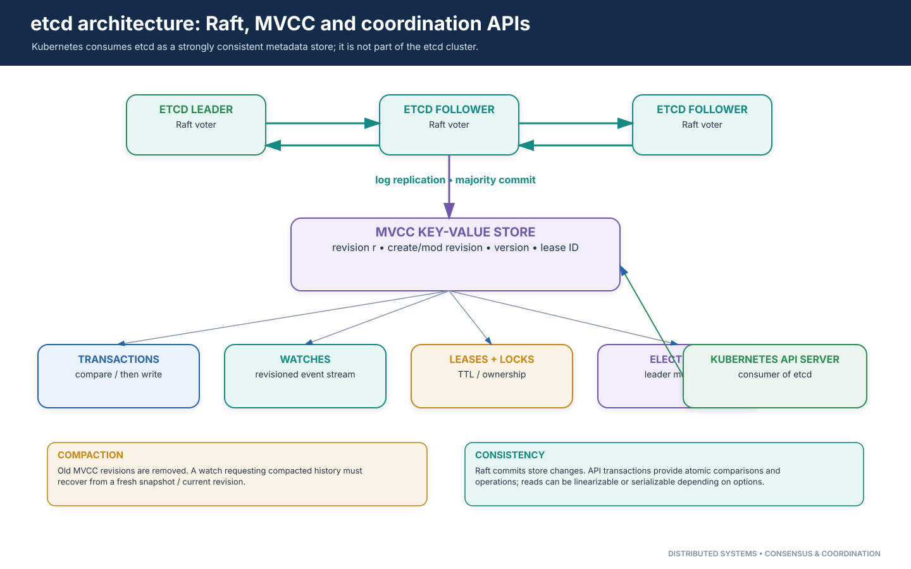

**Diagram specification:** Three etcd voting members with a Raft leader and followers; show proposal/log replication and majority commit. Below the cluster draw the MVCC key-value store with revisions, transaction comparisons, watches, leases, and election/lock APIs. Connect Kubernetes API server clients to etcd, but label Kubernetes as a consumer of etcd rather than part of etcd. Include compaction trimming old revision history and a watch re-establishing from a new snapshot after compaction.

---

# 22. Consul

## 22.1 Architecture

Consul combines a service catalog, health checking, service discovery, key-value storage, sessions, and coordination primitives. Consul agents run on client and server nodes. Server nodes maintain authoritative catalog/state and use Raft for consensus. Consul also uses gossip (Serf) for membership and failure-detection information at LAN and WAN scopes. Gossip and Raft have different jobs: gossip spreads membership/failure information; Raft commits authoritative server state.

## 22.2 Service discovery and health

Applications register services with an agent, which reports service and health information to the Consul catalog. Clients query for healthy instances through DNS or HTTP APIs. Health status is a signal, not a guarantee that an instance will remain healthy after discovery; callers still need timeouts, retries, circuit breakers, and load balancing.

## 22.3 Sessions and locks

A Consul session can be associated with a key through a lock operation. Session invalidation/expiration can release ownership; lock delay can defer another acquisition for a configured interval (commonly defaulting to 15 seconds, configurable from 0 to 60 seconds in the documented session model). This delay is a mitigation that gives a possibly paused former holder time to notice invalidation; it is not bulletproof fencing. Use sessions for coordination metadata and combine with resource-side fences for protected writes. Do not treat local agent state or a stale read as authoritative lock ownership.

## 22.4 Consistency modes

Consul provides consistency options that trade freshness for latency/availability. Default reads are generally routed through the leader, but leader-lease behavior can permit an occasionally stale result around an election window; stronger consistent reads provide the fresher authoritative path at additional latency. Stale reads can be served more locally with greater risk of old information. The exact semantics and defaults are version- and API-specific; consult the current Consul consistency documentation. Gossip membership information is not equivalent to a linearizable committed key-value update.

## 22.5 CLI examples

```bash
# Register a service through a local agent (example service definition)
consul services register payment-api.json

# Query catalog entries
consul catalog services

# Read/write a KV value
consul kv put config/payment/timeout 250ms
consul kv get config/payment/timeout

# Inspect members known to the local gossip pool
consul members
```

A practical registration includes service name, address, port, and health check. Production deployments need ACLs, TLS, service intentions/network policy as applicable, anti-entropy behavior, server quorum sizing, and explicit read consistency choices.

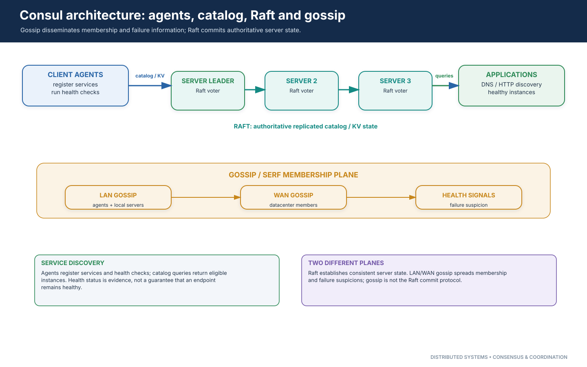

**Diagram specification:** Show client agents registering services and performing health checks; service catalog and KV requests flow to Consul servers. Three or five servers run Raft; one is leader. Draw LAN gossip among agents/servers and WAN gossip between datacenters as a separate plane. Label gossip as membership/failure dissemination and Raft as authoritative replicated-state consensus. Show service-discovery query paths and consistency choices.

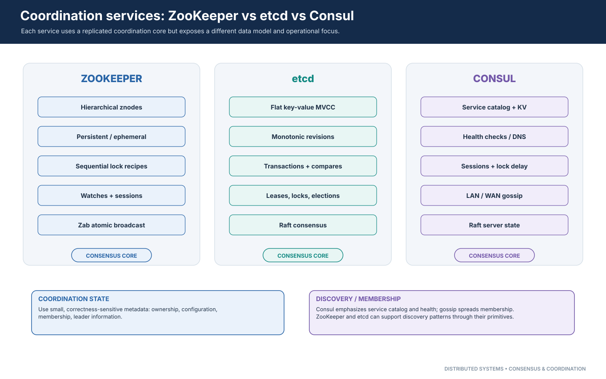

**Diagram specification:** Three columns for ZooKeeper, etcd, and Consul. ZooKeeper: hierarchical znodes, sessions, ephemeral-sequential nodes, watches, Zab. etcd: flat key-value/MVCC revisions, Raft, leases, transactions, watches, elections. Consul: catalog and health checks, Raft servers, sessions/KV, LAN/WAN gossip. Draw intended data paths and explicitly separate consensus from service discovery/membership.

## 22.6 ZooKeeper vs. etcd vs. Consul

| Feature | ZooKeeper | etcd | Consul |
|---|---|---|---|
| Replication protocol | Zab | Raft | Raft for server state; gossip for membership dissemination |
| Data model | Hierarchical znodes | Key-value with MVCC revisions | KV plus service catalog and health model |
| Leader election | Recipes using ephemeral sequential znodes | Native election API | Sessions/leadership APIs and server Raft leader |
| Locks | Recipes using ephemeral sequential nodes | Lease-backed lock API | Session-associated lock API |
| Lease/session model | Client sessions and ephemeral znodes | TTL leases attached to keys | Sessions with health/TTL behavior and lock delay |
| Watches | One-shot watches; re-read/re-register | Revisioned watch stream | Blocking queries and watches depending on API |
| Service discovery | Coordination primitives can implement it; not the primary catalog product | Can store discovery metadata; not a full health catalog by itself | Built-in service catalog and health checks |
| Membership | Ensemble membership and znode-based application membership | etcd member API plus application metadata | Gossip-based agent/server membership and catalog registration |
| Typical use | Coordination, metadata, locks, group services | Strongly consistent cluster metadata and coordination | Service discovery, health, KV, and coordination |

Choose ZooKeeper where an ecosystem already relies on its mature hierarchical/session recipes; etcd for strongly consistent key-value metadata, revisioned watches, and lease/transaction APIs; Consul where service discovery and health catalog are first-class requirements. These are not universal recommendations: operational expertise, scale, deployment topology, latency, client language support, security, and migration cost matter.

---

# 23. Distributed transactions vs. consensus

## 23.1 The fundamental distinction

Consensus chooses a value or a sequence of values among replicas. Atomic commit decides whether a distributed transaction commits at every participant or aborts at every participant. They solve related but different problems:

| Question | Consensus | Atomic commit |
|---|---|---|
| Participants | Replicas of a logical state machine | Resource managers holding pieces of one transaction |
| Decision | One agreed value/order | Commit or abort |
| Main challenge | Conflicting proposals and replica failures | Atomicity across local transaction participants |
| Typical mechanism | Paxos/Raft/Zab/VR/PBFT | 2PC or a specialized distributed transaction protocol |
| Recovery data | Terms/ballots, log, snapshots, accepted/chosen state | Transaction ID, participant set, prepare state, global decision |

2PC is not equivalent to Paxos. A 2PC coordinator can fail while participants are prepared and block. Paxos can replicate the coordinator's decision log, but a participant still needs to prepare and later apply that decision. Conversely, a consensus log replicating commands among three replicas does not automatically guarantee that ten independent storage systems atomically applied a business transaction.

## 23.2 How databases combine them

A distributed database may replicate each data range/shard using Raft or Paxos and separately run a transaction protocol across multiple ranges. Consensus orders local range changes and makes metadata durable; the transaction layer provides atomicity/serializability across ranges. A database may use intent records, transaction status records, timestamp ordering, commit-wait, or a consensus-backed transaction record rather than plain textbook 2PC.

### Case examples

- **Google Spanner:** Uses Paxos groups for replication and distributed transaction mechanisms; TrueTime exposes clock uncertainty and helps provide externally consistent transactions. TrueTime is not simply “all clocks are synchronized exactly”; it exposes uncertainty bounds and the system waits as required to preserve ordering.
- **CockroachDB:** Replicates key ranges using Raft and uses a distributed transaction protocol for transactions spanning ranges. Its architecture documentation describes a layered SQL/KV/range design. Details evolve by release; consult version-matched architecture docs.
- **TiDB:** Separates SQL compute, storage (TiKV), and placement/metadata services (PD); TiKV uses Raft groups for replicated key ranges, while the transaction layer provides distributed transactional semantics. Check current TiDB/TiKV documentation before relying on implementation details.
- **PostgreSQL distributed extensions:** May use PostgreSQL prepared transactions and external transaction managers or shard-level coordinators. Capabilities and failure behavior depend on the extension; do not generalize all extensions as one protocol.

A useful mental model is: **consensus replicates decisions/logs; transaction coordination defines which multi-participant changes are one atomic unit; concurrency control defines how concurrent transactions interact.**

---

# 24. Real-world architecture case studies

The following case studies separate publicly documented mechanisms from simplified teaching models. Product internals vary by release and configuration; descriptions are intentionally scoped to stable architectural concepts.

## 24.1 Google Spanner

- **Problem:** Globally distributed SQL storage with synchronous replication and externally consistent transactions.
- **Architecture:** Data is divided into partitions/placements served by replicated groups; clients may access data across regions.
- **Coordination:** Paxos groups replicate data; transaction coordination spans participants. TrueTime returns a time interval with uncertainty rather than a perfect timestamp.
- **Failure/recovery:** A group can elect/operate through a leader change if a quorum is available; transaction recovery is governed by transaction metadata and commit protocol.
- **Guarantees/trade-offs:** Strong consistency and external consistency are achieved with replication, transaction coordination, and clock-uncertainty handling. WAN distance and commit-wait can add latency.
- **Lesson:** Global consistency requires explicit time and transaction semantics; a distributed SQL interface alone does not make cross-region writes cheap.
- **Evidence:** [Spanner research paper](https://research.google/pubs/spanner-googles-globally-distributed-database-2/).

## 24.2 CockroachDB

- **Problem:** Horizontally scalable SQL with survivability across node/rack/region failures.
- **Architecture:** A logical key-value space is split into ranges; each range is synchronously replicated by a Raft group.
- **Coordination:** Raft commits mutations within ranges; multi-range SQL transactions use the database's distributed transaction protocol.
- **Failure/recovery:** Range leaders are elected; replicas catch up through replicated logs and snapshots. Transaction retries may be required under serializable isolation.
- **Trade-offs:** Strong consistency and resilience require quorum communication; cross-range work can touch multiple Raft groups.
- **Lesson:** Consensus and transactions are separate layers that cooperate.
- **Evidence:** [CockroachDB architecture/design documentation](https://github.com/cockroachdb/cockroach/blob/master/docs/design.md) and [developer transaction guidance](https://www.cockroachlabs.com/docs/stable/developer-basics.html).

## 24.3 etcd and Kubernetes

- **Problem:** Store authoritative cluster metadata and coordinate control-plane decisions.
- **Architecture:** etcd is a Raft-replicated key-value store. Kubernetes API server uses it for persistent cluster state.
- **Coordination:** Transactions, compare operations, revisioned watches, leases, locks, and elections support controller coordination.
- **Failure/recovery:** A majority of etcd voters is needed for writes. Losing quorum makes writes unavailable; restoring a consistent quorum is preferred over inventing a new history.
- **Trade-offs:** Small metadata is a good fit; very high-volume application payloads are not.
- **Lesson:** A control plane should store desired state and watch revisions rather than rely on best-effort local caches as the source of truth.
- **Evidence:** [etcd API guarantees](https://etcd.io/docs/v3.5/learning/api_guarantees/) and [etcd concurrency API](https://etcd.io/docs/v3.6/dev-guide/api_concurrency_reference_v3/).

## 24.4 Apache ZooKeeper

- **Problem:** Provide coordination primitives to distributed applications.
- **Architecture:** Ensemble of servers with leader/followers and optional observers; hierarchical znodes, sessions, and watches.
- **Coordination:** Zab orders state updates; ephemeral and sequential znodes support membership, leader election, and locks.
- **Failure/recovery:** Quorum elects a leader; discovery/synchronization recovers a safe history before normal updates resume; ephemeral nodes disappear when sessions expire.
- **Trade-offs:** Very useful for small coordination metadata, but watches are not an event log and session semantics require careful client handling.
- **Lesson:** Recipes must handle watch re-registration, session expiration, and herd effects.
- **Evidence:** [ZooKeeper Programmer's Guide](https://zookeeper.apache.org/doc/r3.1.2/zookeeperProgrammers.html) and [Zab protocol study](https://zdq0394.github.io/papers/zab.pdf).

## 24.5 Consul

- **Problem:** Service discovery, health checking, KV metadata, and coordination across datacenters.
- **Architecture:** Client/server agents, server Raft group, service catalog, and LAN/WAN gossip.
- **Coordination:** Raft commits authoritative server state; gossip spreads membership/failure information; sessions support lock-style coordination.
- **Failure/recovery:** Server quorum is required for authoritative writes. Catalog queries can use consistency modes that trade freshness for latency.
- **Trade-offs:** Integrated discovery and health model is convenient, but catalog freshness and gossip membership must not be mistaken for linearizable writes.
- **Lesson:** Membership dissemination and replicated authority are distinct communication planes.
- **Evidence:** [Consul concepts](https://developer.hashicorp.com/consul/docs/concept) and [consistency modes](https://docs.hashicorp.com/consul/docs/concept/consistency).

## 24.6 Apache Kafka

- **Problem:** Replicate partition logs for durable, scalable event streaming.
- **Architecture:** Each topic partition has a leader replica and followers; the in-sync replica set (ISR) represents replicas sufficiently caught up to be eligible under the configured policy.
- **Coordination:** Leader/controller coordination manages partition leadership; writes are acknowledged according to producer `acks`, ISR, and minimum ISR settings. Modern Kafka deployments use KRaft metadata quorum (Raft-based) rather than ZooKeeper for cluster metadata in current architecture; older deployments used ZooKeeper. Data partition replication and metadata quorum are related but distinct.
- **Failure/recovery:** Controller detects broker loss and elects eligible replicas. Unclean leader election policy changes the data-loss/availability trade-off when no ISR replica is available.
- **Trade-offs:** ISR acknowledgement can avoid waiting for a slow out-of-sync replica but requires careful `min.insync.replicas` and producer settings.
- **Lesson:** “Acknowledged” and “committed” depend on the precise broker configuration and semantics.
- **Evidence:** [Kafka design documentation](https://kafka.apache.org/40/design/design/).

## 24.7 MongoDB replica sets

- **Problem:** Replicate a database primary's operation history and provide automated failover.
- **Architecture:** One primary accepts writes; secondaries replicate the oplog; voting members participate in elections.
- **Coordination:** Replica-set election protocol selects the primary; write concern controls acknowledgment/durability semantics.
- **Failure/recovery:** A partitioned primary that cannot communicate with a voting majority steps down; a majority partition can elect another primary. Elections temporarily stop writes.
- **Trade-offs:** Write concern, journaling, replication lag, priority, and placement affect durability and failover behavior.
- **Lesson:** Replica-set leader election is not a general replacement for distributed transactions across unrelated resource managers.
- **Evidence:** [MongoDB replica-set elections](https://www.mongodb.com/docs/v7.0/core/replica-set-elections/).

## 24.8 Redis Sentinel

- **Problem:** Monitor Redis primary/replica deployments and coordinate failover.
- **Architecture:** Sentinel processes monitor instances, agree on subjective/objective down status, elect a Sentinel leader for failover, and promote a replica.
- **Coordination:** Sentinel uses majority authorization for failover; its monitoring timeout is suspicion, not proof of crash.
- **Failure/recovery:** Failover may be delayed if a majority of Sentinels is unavailable. Client reconnection and discovery are part of the application path.
- **Trade-offs:** Sentinel is not a strongly consistent database transaction system; replication is typically asynchronous and acknowledged writes may have loss windows.
- **Lesson:** Monitoring, failover authorization, replication durability, and client routing are separate concerns.
- **Evidence:** [Redis Sentinel documentation](https://redis.io/docs/latest/management/sentinel/).

## 24.9 Redis Cluster

- **Problem:** Partition Redis key space across multiple primaries with replica failover.
- **Architecture:** Hash slots map keys to primaries; each primary may have replicas. Cluster nodes exchange gossip-like cluster bus messages and use epochs/votes during failover.
- **Coordination:** Replicas of a failed master attempt elections; other masters vote to authorize promotion based on epochs and failover rules.
- **Failure/recovery:** A promoted replica may have replication lag; asynchronous replication means acknowledged writes can be lost in certain failure sequences.
- **Trade-offs:** Sharding increases scale but multi-key operations have slot constraints and failover has availability/data-loss trade-offs.
- **Lesson:** Partition ownership and replication authority are not the same as a single globally serializable transaction manager.
- **Evidence:** [Redis Cluster specification](https://redis.io/docs/latest/operate/oss_and_stack/reference/cluster-spec/).

## 24.10 Permissioned blockchain with PBFT-style consensus

- **Problem:** Multiple organizations need an agreed ledger without trusting one operator to be honest.
- **Architecture:** Validator replicas execute deterministic transactions and order blocks or batches.
- **Coordination:** A BFT protocol or a related committee protocol establishes an agreed order under a threshold of Byzantine faults.
- **Failure/recovery:** View changes replace faulty leaders; checkpoints/snapshots bound state transfer; membership and key rotation need governance rules.
- **Trade-offs:** Communication grows quickly in basic PBFT; large validator sets often use optimized or different protocols.
- **Lesson:** A blockchain's exact security model depends on membership, cryptography, incentive design, consensus rules, and network assumptions. Not every blockchain is PBFT.

## 24.11 Distributed banking transfer

- **Problem:** Debit an account in one database and credit another without losing or duplicating money.
- **Architecture:** A transaction manager coordinates participants; each participant has a durable transaction log. In a database with replicated shards, each shard may also use a consensus group.
- **Coordination:** Classic XA-style 2PC or a database-specific atomic commit protocol; consensus can replicate coordinator metadata.
- **Failure/recovery:** Prepared participants ask for the durable global decision after coordinator recovery. Idempotency keys prevent client retries from applying a second transfer.
- **Trade-offs:** Atomicity can reduce availability during coordinator or network failures; reconciliation and audit trails remain essential.
- **Lesson:** “Exactly once” is an end-to-end effect built from atomic state changes, durable identities, idempotency, and recovery—not a guarantee produced by one RPC.

## 24.12 Distributed job scheduler

- **Problem:** Multiple workers and scheduler replicas must ensure only one worker owns a singleton job at a time and avoid stale workers writing results after losing ownership.
- **Architecture:** Coordination service stores a lease and monotonically increasing fencing token; workers acquire ownership before running.
- **Coordination:** etcd lease/lock, ZooKeeper ephemeral sequential lock, or Consul session; external storage checks the token.
- **Failure/recovery:** A crashed worker's lease expires. A paused worker may resume later, but its stale token is rejected by the resource after a newer token has been observed.
- **Trade-offs:** Lease TTL controls recovery speed; too short causes false expiration under pauses; too long delays failover.
- **Lesson:** Use idempotent job IDs, checkpoint progress, fencing tokens, and an explicit policy for duplicate execution.

---
# 25. Practical engineering implementations

This section consolidates the algorithmic patterns into a small teaching lab. The snippets are intentionally simplified. They are useful for understanding state transitions, message flow, and invariants; they are **not production-ready consensus or transaction software**. Production code needs durable storage, transport authentication, bounded retries, concurrent state-machine serialization, snapshots, metrics, membership change, backpressure, formal or model-based testing, and carefully reviewed recovery logic.

## 25.1 Environment and test setup

Core examples use Python 3.10+ and the standard library. Optional integrations:

```bash
python -m venv .venv
source .venv/bin/activate
python -m pip install --upgrade pip
pip install kazoo etcd3 redis requests
```

The `etcd3` package/API and server version should be checked for compatibility before use; Python clients differ in method names. Redis examples assume a Redis server reachable by the client. ZooKeeper examples assume a ZooKeeper ensemble. The Consul examples use its CLI/HTTP API. Do not expose coordination endpoints publicly without authentication, TLS, ACLs, and network restrictions.

## 25.2 Consensus and quorum fundamentals

### 1. Basic consensus simulation

The following in-memory model accepts a value once a majority of nodes report the same proposal. It deliberately models a single decision only and assumes honest nodes and a reliable caller; it is not a consensus protocol under arbitrary message delays or crashes.

```python
from collections import Counter

def teaching_consensus(proposals: list[str], node_count: int) -> str:
    if not proposals:
        raise ValueError("at least one proposal is required")
    quorum = node_count // 2 + 1
    counts = Counter(proposals)
    value, votes = counts.most_common(1)[0]
    if votes < quorum:
        raise RuntimeError("no value reached a quorum")
    return value

print(teaching_consensus(["blue", "blue", "blue", "red", "red"], 5))
# blue
```

**Why it is limited:** It lets clients submit arbitrary vote lists and has no persistent promises, ballots, leader epochs, or message scheduler. It illustrates only the concept of counting a majority, not the safety proof of Paxos or Raft.

### 2. Majority quorum calculator

```python
def quorum_size(n: int) -> int:
    if n < 1:
        raise ValueError("cluster must contain at least one voter")
    return n // 2 + 1

def crash_tolerance(n: int) -> int:
    return n - quorum_size(n)

for n in (3, 5, 7):
    print(n, quorum_size(n), crash_tolerance(n))
# 3 2 1
# 5 3 2
# 7 4 3
```

The result assumes a fixed membership set and majority quorums. Dynamic membership and non-majority quorum systems require their own intersection analysis.

## 25.3 Transaction commit implementations

### 3–4. 2PC coordinator and participant

The `Coordinator` and `Participant` classes in [Section 3.6](#36-simplified-python-teaching-implementation) implement the core prepare/vote/decision state transitions. The coordinator records the decision before sending it; the participant persists PREPARED before returning YES. In a real implementation, the participant's local business writes and PREPARED record must be part of a recoverable local transaction.

### 5. 2PC recovery simulation

A coordinator that restarts must consult its durable decision record. If a decision exists, it retransmits it. If it only has a `PREPARING` record, it must run its defined termination/recovery procedure; the example below illustrates the distinction rather than defining a complete distributed termination protocol.

```python
def recover_coordinator(txid: str, durable_log: dict[str, str], participants):
    decision = durable_log.get(txid)
    if decision in ("COMMIT", "ABORT"):
        for p in participants:
            if p.state.get(txid) == State.PREPARED:
                p.decide(txid, decision == "COMMIT")
        return decision
    if decision == "PREPARING":
        # In classic 2PC this can be in-doubt. Do not infer COMMIT from YES votes.
        return "IN_DOUBT: consult coordinator recovery/termination policy"
    return "NO_KNOWN_TRANSACTION"
```

A production recovery path also handles a lost decision, coordinator identity/epoch, participant discovery, duplicate messages, and heuristic outcomes only under a separately documented administrative policy.

### 6. 3PC state-machine sketch

```python
from enum import Enum

class ThreePCState(str, Enum):
    INIT = "INIT"
    WAIT = "WAIT"
    PRECOMMIT = "PRECOMMIT"
    COMMITTED = "COMMITTED"
    ABORTED = "ABORTED"

class ThreePCParticipant:
    def __init__(self):
        self.state = ThreePCState.INIT

    def can_commit(self, local_ready: bool) -> str:
        self.state = ThreePCState.WAIT if local_ready else ThreePCState.ABORTED
        return "YES" if local_ready else "NO"

    def precommit(self):
        if self.state != ThreePCState.WAIT:
            raise RuntimeError("PRECOMMIT is invalid before YES")
        self.state = ThreePCState.PRECOMMIT

    def do_commit(self):
        if self.state != ThreePCState.PRECOMMIT:
            raise RuntimeError("DO_COMMIT requires PRECOMMIT")
        self.state = ThreePCState.COMMITTED
```

This is only a local transition model. Recovery decisions in 3PC depend on the exact variant and synchrony assumptions; a generic timeout must not be treated as a safe proof of global state.

## 25.4 Paxos implementations

### 7–9. Proposer, acceptor, and prepare/accept flow

The `Acceptor` and `choose_value` example in [Section 5.9](#59-paxos-teaching-pseudocode) provides the core durable state and value-selection rule. A compact proposer driver is:

```python
def run_basic_paxos(acceptors, ballot, proposed_value):
    quorum = len(acceptors) // 2 + 1
    promises = []
    for acceptor in acceptors:
        reply = acceptor.prepare(ballot)
        if reply["ok"]:
            promises.append(reply)
        if len(promises) == quorum:
            break
    if len(promises) < quorum:
        return None
    value = choose_value(promises, proposed_value)
    accepted = sum(a.accept(ballot, value) for a in acceptors)
    return value if accepted >= quorum else None
```

A real proposer does not stop at a simple Python loop; it uses asynchronous RPC, unique ballots, a retry policy, and a quorum proof associated with the exact configuration. The above code is a synchronous teaching harness.

### 10. Multi-Paxos replicated-log concept

```python
class MultiPaxosLeader:
    def __init__(self, ballot: int, acceptors):
        self.ballot = ballot
        self.acceptors = acceptors
        self.next_slot = 1
        self.chosen = {}

    def propose(self, command: str) -> bool:
        slot = self.next_slot
        # Assumes Phase 1 already completed and this ballot is active.
        accepted = sum(
            a.accept_slot(self.ballot, slot, command)
            for a in self.acceptors
        )
        if accepted >= len(self.acceptors) // 2 + 1:
            self.chosen[slot] = command
            self.next_slot += 1
            return True
        return False
```

This assumes `accept_slot` checks the promised ballot and stores per-slot accepted state durably. It omits leader recovery, slot holes, snapshots, and membership changes; those are essential, not optional, in a real log service.

## 25.5 Raft teaching components

### 11. Raft node state machine

```python
class RaftNode:
    FOLLOWER, CANDIDATE, LEADER = "follower", "candidate", "leader"

    def __init__(self, node_id):
        self.id = node_id
        self.role = self.FOLLOWER
        self.current_term = 0
        self.voted_for = None
        self.log = []
        self.commit_index = 0
        self.last_applied = 0

    def on_higher_term(self, term):
        if term > self.current_term:
            self.current_term = term
            self.voted_for = None
            self.role = self.FOLLOWER
            # Persist term and vote before replying to the triggering RPC.

    def start_election(self):
        self.current_term += 1
        self.role = self.CANDIDATE
        self.voted_for = self.id
        # Persist before sending RequestVote.
        return self.current_term

    def become_leader(self):
        if self.role != self.CANDIDATE:
            raise RuntimeError("only a candidate can become leader")
        self.role = self.LEADER
```

### 12–15. Leader election, RequestVote, AppendEntries, and replication

Use the `request_vote`, `append_entries`, and `advance_commit_index` pseudocode in [Section 7.11](#711-raft-state-and-carefully-separated-pseudocode). The core RequestVote implementation checks term, one-vote-per-term, and log freshness. The AppendEntries handler checks the predecessor pair and repairs conflicting uncommitted suffixes. The leader tracks `nextIndex`/`matchIndex` and advances `commitIndex` only for a majority-replicated current-term entry.

Leader-election outline:

```text
on election timeout:
    if not leader contact in current timer interval:
        currentTerm += 1
        role = CANDIDATE
        votedFor = self
        persist(currentTerm, votedFor)
        send RequestVote(currentTerm, self, lastLogIndex, lastLogTerm)

on vote responses:
    if response.term > currentTerm: become follower
    else if response.voteGranted and response.term == currentTerm:
        count distinct voters
        if count >= majority: become leader; initialize nextIndex/matchIndex; send heartbeat
```

### 16. Raft commitment calculation

`advance_commit_index` in Section 7.11 loops from the largest index down and counts the leader plus followers whose `matchIndex` is at least that index. It skips entries from previous terms. This current-term condition is a safety requirement, not a performance optimization.

### 17. Membership transition illustration

```python
def joint_quorum(old_votes: int, old_n: int,
                 new_votes: int, new_n: int) -> bool:
    old_majority = old_n // 2 + 1
    new_majority = new_n // 2 + 1
    return old_votes >= old_majority and new_votes >= new_majority

# Example: old={A,B,C}, new={A,B,C,D,E}
print(joint_quorum(old_votes=2, old_n=3, new_votes=3, new_n=5))
# True
```

This computes the joint-quorum threshold only; it does not implement Raft's configuration log entries, leader transfer, or catch-up process.

## 25.6 Leader-election simulations

### 18. Bully algorithm

The `bully_election` function in [Section 14](#14-bully-algorithm) returns the highest live process ID. In a message-level simulation, record `ELECTION` sends to higher IDs, `OK` responses, cascading elections, and one `COORDINATOR` announcement. Add an epoch to every message to prevent old announcements being mistaken for current leadership.

### 19. Ring algorithm

The `ring_election` function in [Section 15](#15-ring-election-algorithm) models a complete traversal. A production-like simulation must define successor repair when processes are unreachable and must avoid a token circulating forever after membership changes.

## 25.7 Locks, fencing, leases, and service integrations

### 20. Basic distributed lock model

```python
class TeachingLock:
    def __init__(self):
        self.owner = None
        self.token = 0

    def acquire(self, client_id):
        if self.owner is not None:
            return None
        self.token += 1
        self.owner = client_id
        return self.token

    def release(self, client_id, token):
        if self.owner == client_id and self.token == token:
            self.owner = None
            return True
        return False
```

This is a single-process state machine, not a distributed lock. In a distributed deployment, use a linearizable service or transactional database operation and validate a fencing token at the destination.

### 21. Redis acquisition and safe release

```python
import secrets
import redis

r = redis.Redis(host="localhost", port=6379, decode_responses=True)
lock_key = "locks:invoice:42"
token = secrets.token_urlsafe(24)
acquired = r.set(lock_key, token, nx=True, px=30_000)

release_script = r.register_script("""
if redis.call('GET', KEYS[1]) == ARGV[1] then
  return redis.call('DEL', KEYS[1])
end
return 0
""")
if acquired:
    try:
        # Protected code must also use fencing/resource-side validation.
        print("lock acquired")
    finally:
        release_script(keys=[lock_key], args=[token])
```

The random token makes release owner-specific; it is not a fencing token. Use a reliable monotonic generation at the resource boundary if stale-owner writes are possible. Redis replication/failover and persistence settings must match the safety requirement.

### 22. Fencing token generation and validation

The `FencedResource` example in [Section 17.3](#173-database-implementation) demonstrates the resource-side high-water-mark check. In a database-backed system, allocate the token using a serialized/linearizable transaction, persist it, and pass it to every protected write. Do not use `time.time_ns()` as a universal ordering primitive.

### 23. Lease renewal and expiration

The `LeaseManager` example in [Section 18.5](#185-simplified-lease-manager) illustrates grant, renew, and expiry. For a distributed lease, move state to a consensus-backed service; renew through keepalive RPCs, and stop protected actions when lease validity becomes uncertain.

### 24. ZooKeeper lock

The Kazoo `Lock` context-manager example in [Section 20.5](#205-leader-election-and-lock-recipe) demonstrates acquisition/release through an ephemeral sequential recipe. Production use should monitor session state and fence external writes.

### 25. etcd lease and election

The etcd concurrency sketch in [Section 21.5](#215-python-example-sketch) shows lease-associated lock ownership. For an election, use the official `Election` API's `campaign`, `leader`, `observe`, `proclaim`, and `resign` methods and guard writes by comparing the returned leader key/revision in an etcd transaction. See the [etcd concurrency API reference](https://etcd.io/docs/v3.6/dev-guide/api_concurrency_reference_v3/).

### 26. Consul service discovery

Using the Consul CLI and HTTP API (example):

```bash
# Register a service with a health check via a JSON definition.
consul services register payment-api.json

# Discover service instances.
curl -s http://127.0.0.1:8500/v1/health/service/payment-api?passing=true
```

Example `payment-api.json`:

```json
{
  "service": {
    "name": "payment-api",
    "id": "payment-api-1",
    "address": "10.0.2.15",
    "port": 8080,
    "checks": [{
      "http": "http://10.0.2.15:8080/health",
      "interval": "10s",
      "timeout": "2s"
    }]
  }
}
```

This is a simple local-agent registration example. Real deployments use ACL tokens, TLS, namespace/partition controls where applicable, service intentions, and health semantics suited to the application. Discovery results can become stale immediately after a query; clients still need failure handling.

### 27. PBFT message-phase simulation

```python
from collections import Counter

def pbft_phase_demo(n: int, f: int, prepare_digests: list[str],
                    commit_digests: list[str]) -> bool:
    if n < 3 * f + 1:
        raise ValueError("PBFT replica count must satisfy N >= 3f + 1")
    quorum = 2 * f + 1
    prep = Counter(prepare_digests)
    comm = Counter(commit_digests)
    prepared_digest = next((d for d, c in prep.items() if c >= quorum), None)
    if prepared_digest is None:
        return False
    return comm[prepared_digest] >= quorum

print(pbft_phase_demo(4, 1, ["h", "h", "h"], ["h", "h", "h"]))
# True
```

This counts messages by digest only. It omits unique sender validation, view/sequence checks, pre-prepare verification, cryptographic authentication, prepared-certificate rules, view changes, and client reply semantics. Do not deploy it.

## 25.8 Production engineering checklist

- Persist terms, ballots, votes, promises, accepted values, and log entries before acknowledging messages that rely on them.
- Make RPC handlers idempotent and include request/transaction IDs.
- Authenticate peer identities and protect secrets; do not rely on a sender-provided node ID.
- Serialize updates to protocol state or use a proven concurrency design.
- Include membership/configuration epoch in quorum and authorization decisions.
- Keep application state-machine execution deterministic and isolate external side effects.
- Implement snapshot creation, transfer, validation, and compaction before logs grow without bound.
- Add backpressure, batch sizing, retry jitter, and bounded queues.
- Test crash/restart at every persistence boundary, message loss, duplication, reordering, delay, partition, disk-full, and clock pause.
- Use a model checker or deterministic simulation for non-trivial protocol changes.
- Monitor leader changes, term inflation, quorum latency, follower lag, commit-index stalls, in-doubt transactions, expired leases, and stale-token rejections.
- Document what the system guarantees during minority partitions and after permanent data loss.

---

# 26. Mathematical reference

## 26.1 Majority quorum and crash tolerance

For `N` voters, majority quorum:

\[
Q = \left\lfloor \frac{N}{2} \right\rfloor + 1
\]

Under fixed membership and majority voting, the maximum number of unavailable voters while retaining a quorum is:

\[
f = N-Q = \left\lfloor \frac{N-1}{2} \right\rfloor
\]

Examples: `N=3 → Q=2, f=1`; `N=5 → Q=3, f=2`; `N=7 → Q=4, f=3`.

The minimum intersection size of two quorums of size `Q` in an `N`-member set is:

\[
|Q_1 \cap Q_2| \geq 2Q-N
\]

For a strict majority this is at least 1. Intersection is the mathematical reason two quorums cannot independently decide contradictory values in classic crash-fault protocols, provided the protocol state at intersecting members is durable and obeys its rules.

For asymmetric quorum sizes, a sufficient intersection condition is:

\[
Q_1 + Q_2 > N
\]

Flexible Paxos uses a cross-phase intersection requirement rather than requiring all same-phase quorums to intersect. The exact quorum families and recovery rules must be specified.

## 26.2 Consensus properties

Let `decide_i(v)` mean process `i` decides value `v`.

- Agreement: `decide_i(v) ∧ decide_j(w) ⇒ v=w` for all correct `i,j`.
- Integrity: each process decides at most once.
- Validity (common form): `decide_i(v) ⇒ v` was proposed by some process.
- Termination: every correct process eventually decides under the model's liveness assumptions.

Agreement, integrity, and validity are safety constraints; termination is liveness. A protocol can preserve safety while waiting indefinitely for a quorum.

## 26.3 Paxos

- Proposal order: ballots are totally ordered and unique, e.g. `(counter, proposerId)`.
- Chosen value: a value is chosen when accepted by a Phase-2 quorum.
- Majority case: `Q=floor(N/2)+1`.
- Quorum intersection: `2Q-N ≥ 1` for majority quorums.
- Value preservation: later Phase-1 proposer selects the value of the highest-numbered accepted proposal reported by its Phase-1 quorum, if any.

No standalone arithmetic formula replaces the value-preservation rule. A proposer that ignores accepted-value responses can violate safety even if it collects a majority.

## 26.4 Raft

- Election majority: `Q=floor(N/2)+1`.
- Election safety: at most one leader per term under one-vote-per-term and intersecting majority rules.
- Log matching: same `(index,term)` implies identical prefix through that index.
- Commit advancement: `commitIndex` can advance to `N` when a majority have `matchIndex≥N` and `log[N].term=currentTerm`.
- State application: `lastApplied ≤ commitIndex ≤ lastLogIndex` (in the simple non-snapshot representation).

These are protocol invariants, not performance equations. Snapshotting changes how indices are represented but not the logical prefix property.

## 26.5 2PC and 3PC

For a coordinator with participant set `P`:

\[
\text{COMMIT} \iff \forall p \in P,\; vote_p = YES
\]

Otherwise the decision is ABORT under the classic protocol. A participant may vote YES only after it has durably entered a state from which it can commit if instructed.

3PC adds a pre-commit stage. There is no universal fault-count formula that makes all textbook 3PC variants non-blocking under arbitrary partitions; progress claims depend on bounded communication/processing and the allowed partition model.

## 26.6 PBFT

Replica count:

\[
N \ge 3f+1
\]

A common PBFT quorum size is:

\[
Q_{BFT}=2f+1
\]

Two such quorums intersect in at least:

\[
2(2f+1)-(3f+1)=f+1
\]

At least one member of this intersection is honest if at most `f` replicas are Byzantine. Classic PBFT's prepared, committed, and client-reply conditions use different message evidence; do not collapse them into one generic quorum count.

Straightforward all-to-all PBFT phases have `O(N^2)` message transmissions per request. Batching `B` requests amortizes per-message overhead, but the exact latency/throughput trade-off depends on the implementation.

## 26.7 Election and replication message complexity

These are asymptotic teaching estimates, not exact wire-byte counts:

| Algorithm | Typical message complexity | Notes |
|---|---:|---|
| Bully | Worst-case `O(N^2)` | Cascading election messages/responses and announcement |
| Ring | `O(N)` | One traversal plus coordinator announcement in a simple ring |
| Basic Paxos | `O(N)` per successful two-phase attempt | Requests and responses to a quorum; retries/preemption add traffic |
| Multi-Paxos steady state | `O(N)` per log entry | One leader replication round to peers plus acknowledgments; Phase 1 amortized |
| Raft steady state | `O(N)` per batch | AppendEntries to followers and replies; heartbeats and retries are additional |
| PBFT basic | `O(N^2)` | All-to-all prepare/commit-style communication |

For Raft, a leader generally sends to `N-1` followers and receives up to `N-1` replies per batch, so a simple unbatched count is about `2(N-1)` point-to-point transmissions, excluding client/heartbeat messages. For Paxos, counting messages depends on whether RPCs are unicast or multicast and whether the proposer contacts all acceptors or only a quorum.

## 26.8 Lease and lock timing

Let `T` be lease TTL and `R` renewal interval. A safety-minded client chooses `R < T` with margin for network delay and process pauses. A heuristic such as `R=T/3` is operational guidance, not a correctness formula. Correctness depends on service-side expiration and the downstream resource's enforcement of a higher fencing token.

Monotonic fencing:

\[
F_{new} > F_{old}
\]

The resource accepts a request only if its token is newer than the stored high-water mark (or satisfies an equivalent owner-token/sequence rule). The check and write must be atomic.

---
# 27. Comprehensive protocol comparisons

## 27.1 Paxos vs. Multi-Paxos vs. Raft

| Property | Basic Paxos | Multi-Paxos | Raft |
|---|---|---|---|
| Decision scope | One value/slot | Sequence of values/slots | Replicated log |
| Leader | Not required as a permanent role | Stable leader is typical | Required for normal writes |
| Steady-state round | Phase 1 + Phase 2 | Phase 2 after leader establishment | AppendEntries replication |
| Safety basis | Ballots, promises, quorums, highest accepted value | Same Paxos invariants plus slot recovery | Terms, voting freshness, log matching, Leader Completeness |
| Recovery | New Phase 1 discovers accepted state | Leader recovers per-slot accepted values and holes | Election rule plus AppendEntries conflict repair |
| Membership | Variant-specific reconfiguration | Variant-specific reconfiguration | Joint consensus in original specification |
| Main teaching challenge | Why values are preserved | Safe log recovery/slot management | Current-term commitment and configuration changes |

## 27.2 Raft vs. Zab vs. Viewstamped Replication

| Property | Raft | Zab | Viewstamped Replication |
|---|---|---|---|
| Primary purpose | General replicated log | ZooKeeper's atomic broadcast | Primary-backup replicated state machine |
| Leadership epoch | Term | Epoch embedded in zxid/leader generation | View number |
| Normal data flow | Leader AppendEntries | Leader proposal/ACK/commit | Primary PREPARE / backup ACK |
| Recovery | Election and log repair | Discovery and synchronization | View change and log reconciliation |
| Membership | Joint consensus in original design | ZooKeeper ensemble reconfiguration rules | VR reconfiguration protocol |
| Typical application | Consensus library/database range | ZooKeeper service state | Replicated service/primary-copy system |

## 27.3 Crash fault tolerance vs. Byzantine fault tolerance

| Dimension | Crash fault tolerance (CFT) | Byzantine fault tolerance (BFT) |
|---|---|---|
| Faulty process behavior | Stops or is unreachable | Arbitrary, malicious, inconsistent, or corrupted behavior |
| Typical protocols | Paxos, Raft, Zab, crash-fault VR | PBFT and other BFT protocols |
| Common replica bound | `N=2f+1` for majority quorum | `N=3f+1` for classical partially synchronous BFT replication |
| Quorum size | `f+1` majority | Common PBFT certificate `2f+1` |
| Trust assumptions | Correct processes follow protocol | At most `f` Byzantine; messages authenticated and protocol verified |
| Cost | Lower message/cryptographic overhead | Higher communication and verification costs |

## 27.4 Paxos/Raft vs. PBFT

Paxos/Raft address crash faults; PBFT addresses arbitrary Byzantine behavior. A compromised node can equivocate, which is outside the classic CFT fault model. BFT normally needs more replicas and authenticated messages. A three-node Raft cluster tolerating one crash is not equivalent to a four-replica PBFT cluster tolerating one Byzantine fault.

## 27.5 2PC vs. 3PC vs. consensus

| Property | 2PC | 3PC | Consensus |
|---|---|---|---|
| Main outcome | Commit/abort across transaction participants | Commit/abort with extra intermediate phase | Choose one value/order among replicas |
| Main roles | Coordinator and resource participants | Coordinator, participants, possible recovery coordinator | Proposers/acceptors/learners or leader/followers |
| Safety core | Durable prepare and durable global decision | State/phase constraints under timing assumptions | Quorum/epoch/ballot invariants |
| Blocking | Can block with prepared participants | Aims to reduce blocking under stronger assumptions | Can stop in minority partition; safety preserved |
| Timing model | Safety independent of known network bound; progress can block | Classic non-blocking result requires bounded-delay assumptions | Safety tolerates asynchrony; liveness needs eventual synchrony/quorum availability |

## 27.6 Bully vs. Ring vs. Raft elections

| Property | Bully | Ring | Raft |
|---|---|---|---|
| Selection | Highest live ID | Highest ID seen around ring | Any candidate with majority and sufficiently up-to-date log |
| Topology | Direct peer messages | Logical ring | Quorum RPC to all voters |
| Election epoch | Often absent in textbook version | Often absent in textbook version | Persistent term |
| Safety under partition | Not guaranteed by simple algorithm | Not guaranteed by simple algorithm | Majority intersection and term/vote rules prevent two valid leaders in one term |
| Log freshness | Not considered | Not considered | Explicit RequestVote freshness rule |
| Production role | Educational baseline | Educational baseline | Consensus protocol component |

## 27.7 Locks vs. leases vs. fencing tokens

| Mechanism | Provides | Does not provide alone |
|---|---|---|
| Lock | Exclusive ownership/coordination | Forced termination of stale holder |
| Lease | Time-bounded ownership and automatic expiration | Proof that an expired holder has stopped executing |
| Fencing token | Resource-side rejection of older owners | Lock acquisition/fairness by itself |

## 27.8 ZooKeeper vs. etcd vs. Consul

The table in [Section 22.6](#226-zookeeper-vs-etcd-vs-consul) summarizes data models, replication protocols, locks, leases, watches, and service discovery. The key architectural distinction is that ZooKeeper and etcd are coordination/metadata systems with different APIs and replication protocols, while Consul adds a first-class service catalog and health model alongside Raft-backed server state and gossip membership. Product versions and API semantics evolve; use version-specific official docs when designing a new deployment.

---

# 28. Interview questions and answers

The answers below are designed for oral interviews: define the concept, state the assumptions, walk through the mechanism, and identify its failure boundary. Each includes a follow-up prompt and a common incorrect answer to avoid.

## 28.1 Beginner questions (1–20)

### 1. What is consensus?

Consensus is the problem of getting distributed processes to decide one compatible value despite concurrent proposals and specified failures. A protocol must define agreement, validity, integrity, and termination assumptions. Paxos and Raft solve crash-fault consensus; PBFT-style protocols handle Byzantine behavior under stronger replica/authentication assumptions.

**Follow-up:** How is consensus used to replicate a state machine? **Pitfall:** Saying consensus means “all nodes have identical data at every instant”; replicas can lag while preserving one committed order.

### 2. What is leader election?

Leader election selects one process to coordinate a scope such as a shard, partition, or scheduler. Production election needs epochs/terms and a quorum or another safe authority mechanism. A timeout only triggers suspicion; it does not prove that the previous leader is dead.

**Follow-up:** How can a stale leader be prevented from writing? **Pitfall:** Treating leader election and consensus as synonyms.

### 3. What is a replicated state machine?

It is a set of replicas executing the same deterministic transition function over the same committed command sequence. Consensus chooses the command order; each replica applies entries in order. Determinism and request deduplication are essential for equivalent state and safe retries.

**Follow-up:** Why can reading local wall-clock time inside a transition be unsafe? **Pitfall:** Assuming replication automatically creates deterministic execution.

### 4. What is the FLP impossibility result?

FLP proves that deterministic consensus cannot guarantee termination in every fully asynchronous execution if even one process may crash, while preserving safety. It does not say consensus never succeeds; practical protocols use eventual synchrony, quorums, failure suspicion, or randomization to obtain progress in executions that meet their assumptions.

**Follow-up:** What is a bivalent configuration? **Pitfall:** Saying FLP proves Paxos/Raft impossible.

### 5. What is a quorum?

A quorum is a set of participants large enough to authorize an operation under a protocol's quorum rules. In a fixed majority system, `Q=floor(N/2)+1`. Two majorities intersect, which supports safety when participants persist and obey their protocol state.

**Follow-up:** How many crash failures can a 5-voter majority group tolerate? Two. **Pitfall:** Assuming every quorum system uses a simple majority.

### 6. What is 2PC?

Two-Phase Commit is an atomic-commit protocol with a coordinator and participants. Participants first prepare and vote YES/NO; if all vote YES, the coordinator durably records COMMIT and tells participants to commit. Otherwise it records ABORT. Participants that vote YES must retain enough state to honor the later decision.

**Follow-up:** Why is YES a durable promise? **Pitfall:** Calling 2PC a consensus algorithm.

### 7. Why can 2PC block?

After voting YES, a participant may not know whether the coordinator committed or aborted. If the coordinator fails before the participant receives a durable decision, the participant cannot safely guess and may hold locks while waiting for recovery. This is the in-doubt prepared state.

**Follow-up:** What changes if the coordinator's COMMIT was durably logged? **Pitfall:** Saying a participant can always abort after a timeout.

### 8. What is 3PC?

Three-Phase Commit adds a PRE-COMMIT stage between voting and final commit. It is designed to separate states so a recovery coordinator can sometimes infer a safe action after failure. Its classic non-blocking argument relies on stronger synchrony and partition assumptions than arbitrary asynchronous networks provide.

**Follow-up:** Why is 3PC not a universal fix for partitions? **Pitfall:** Saying it guarantees progress with any network failure.

### 9. What is Paxos?

Paxos is a family of consensus protocols. Basic Paxos uses numbered proposals, acceptor promises, and two phases: Prepare/Promise and Accept/Accepted. A value is chosen when a quorum accepts it. A later proposer preserves a previously accepted value by selecting the highest-numbered accepted proposal reported by its Phase-1 quorum.

**Follow-up:** What is the difference between accepted and chosen? **Pitfall:** Saying one acceptor's acceptance means the value is chosen.

### 10. What is Raft?

Raft is a leader-based replicated-log consensus algorithm. It has follower, candidate, and leader states; terms; RequestVote and AppendEntries RPCs; majority replication; and a commit index. It was designed to be easier to understand by separating election, replication, and safety.

**Follow-up:** What is the current-term commitment restriction? **Pitfall:** Saying Raft commits an entry whenever it appears on a majority, regardless of term.

### 11. What is a distributed lock?

A distributed lock coordinates exclusive ownership of a named resource across machines. It can be implemented with database transactions, Redis, ZooKeeper, etcd, or Consul. A lock service grants ownership metadata but cannot forcibly stop a stale process from executing.

**Follow-up:** Why do long-running jobs need fencing? **Pitfall:** Equating a local mutex with a distributed lock.

### 12. What is a lease?

A lease is time-bounded ownership that expires unless renewed. It helps recover from crashed clients because the coordination service can release associated resources after TTL expiration. A paused client can resume after expiry, so the protected resource still needs stale-owner protection.

**Follow-up:** What is the difference between session loss and a temporary disconnect in ZooKeeper? **Pitfall:** Assuming the client can trust its own clock to know lease validity.

### 13. What is a fencing token?

A fencing token is a monotonically increasing ownership generation. The protected resource stores the highest accepted token and rejects older tokens. It protects against stale lock holders after a newer owner has written with a higher token.

**Follow-up:** Why must the token comparison and write be atomic? **Pitfall:** Saying the lock service's token is enough if the resource ignores it.

### 14. What is the difference between crash and Byzantine failures?

A crash-fault process stops or becomes unreachable but does not intentionally send contradictory protocol messages. A Byzantine process may lie, equivocate, replay, corrupt state, or collude. CFT protocols like Raft/Paxos do not automatically tolerate Byzantine behavior.

**Follow-up:** Does message authentication make a Byzantine node honest? No; it only identifies the sender. **Pitfall:** Calling a slow server Byzantine.

### 15. What is atomic broadcast?

Atomic broadcast is a group communication abstraction in which correct processes deliver the same messages in the same total order, with specified validity and integrity properties. It is closely related to consensus and can implement replicated state-machine command ordering.

**Follow-up:** How does it differ from ordinary broadcast? **Pitfall:** Assuming TCP multicast provides total-order delivery across independent receivers.

### 16. What is Raft's commit index?

`commitIndex` is the highest log index known committed. The leader advances it when a majority has replicated a current-term entry at that index; preceding entries become committed as part of the prefix. Followers learn the leader's commit index through AppendEntries.

**Follow-up:** How does `lastApplied` relate to `commitIndex`? **Pitfall:** Applying uncommitted entries to the state machine.

### 17. What is a term in Raft?

A term is a monotonically increasing logical epoch. It orders elections and leadership authority. A server that observes a higher term updates its term and becomes a follower; each server grants at most one vote per term.

**Follow-up:** Why persist term and vote? **Pitfall:** Treating a term as a wall-clock timestamp.

### 18. What is a ZooKeeper znode?

A znode is an element in ZooKeeper's hierarchical namespace. It can store small data and child znodes, with metadata such as version and ACLs. Persistent, ephemeral, sequential, and ephemeral-sequential variants support configuration and coordination recipes.

**Follow-up:** What happens to an ephemeral znode when its owning session expires? **Pitfall:** Saying every TCP disconnect immediately deletes it.

### 19. What is etcd?

etcd is a distributed key-value store commonly used for consistent cluster metadata. It uses Raft and exposes MVCC revisions, transactions, watches, leases, locks, and election APIs. A majority of voting members is needed for progress on authoritative writes.

**Follow-up:** What happens when watch history is compacted? **Pitfall:** Treating a watch as a permanent event log.

### 20. What is Consul?

Consul is a service networking/coordination platform with service catalog, health checks, KV, sessions, and service discovery. Server state is replicated with Raft; gossip (Serf) spreads membership and failure information. Its read consistency modes trade freshness and latency.

**Follow-up:** What is gossip used for versus Raft? **Pitfall:** Saying gossip consensus commits the service catalog.

## 28.2 Intermediate questions (21–50)

### 21. Walk through why 2PC blocks after a coordinator crash.

Participants that voted YES have durably prepared and may hold locks. If the coordinator crashes before participants learn the global decision, one participant cannot distinguish “coordinator has not decided” from “coordinator committed but the message is delayed.” It must consult the coordinator's recovered log or a protocol-specific termination procedure.

**Follow-up:** What if the decision log says COMMIT? **Pitfall:** Assuming the coordinator can reconstruct a decision from one participant's vote.

### 22. What exactly does a participant promise when it votes YES?

It promises that its local work and recovery metadata are durable enough to commit if the coordinator later decides COMMIT. It retains required locks/resources and will not independently abort just because the coordinator is unavailable. A YES vote must follow a durable prepared record.

**Follow-up:** What if the participant crashes after YES? **Pitfall:** Treating YES as “I prefer to commit” rather than a protocol obligation.

### 23. Why must the coordinator log its decision before sending COMMIT?

If the coordinator sends COMMIT and then crashes before recording it, recovery might see no decision and choose a conflicting outcome. Logging first makes the decision durable and allows retransmission after restart. Participants process duplicate decisions idempotently.

**Follow-up:** What is the role of ACKs? **Pitfall:** Assuming the coordinator can discard all transaction state after sending the first COMMIT.

### 24. What happens if a COMMIT message is lost in 2PC?

The participant remains prepared and in doubt while the coordinator's durable decision is COMMIT. The coordinator retransmits the decision after retry or recovery. Participant state transitions are idempotent so duplicate COMMIT messages do not double-apply work.

**Follow-up:** Does a lost ACK undo the commit? No. **Pitfall:** Confusing message acknowledgment with commit decision.

### 25. How does 3PC improve on 2PC?

PRE-COMMIT provides an intermediate state that gives a recovery coordinator additional evidence about whether the protocol passed unanimous voting. Under bounded-delay/processing and partition constraints, the recovery rules can avoid the classic prepared-participant wait. Under arbitrary asynchronous partitions, those assumptions fail and textbook non-blocking claims do not hold.

**Follow-up:** What is the danger of allowing two partitioned groups to make independent decisions? **Pitfall:** Calling 3PC partition-proof.

### 26. What assumptions does classic 3PC need?

It needs a synchrony model with known bounds on communication and processing and a failure-detection/partition model that prevents contradictory progress. Timeouts are meaningful only relative to these bounds. If delay is unbounded, a slow process can look failed and the state-based inference may be unsafe.

**Follow-up:** How does partial synchrony differ from full synchrony? **Pitfall:** Saying NTP makes the network synchronous.

### 27. Explain Paxos Phase 1.

The proposer sends PREPARE with a new unique ballot. Acceptors promise not to accept lower ballots and return any accepted proposal. The proposer waits for a Phase-1 quorum and selects the value attached to the highest accepted ballot in those replies, if one exists. Promises and accepted values must be durable.

**Follow-up:** Why return accepted state? **Pitfall:** Saying Phase 1 is just leader election.

### 28. Explain Paxos Phase 2.

The proposer sends ACCEPT(ballot,value), where the value obeys the Phase-1 selection rule. An acceptor accepts only if it has not promised a higher ballot and persists the accepted pair. A value is chosen when a Phase-2 quorum accepts it.

**Follow-up:** Can acceptors accept two different values at different ballots? They may accept proposals, but two different values cannot both be chosen when the safety invariant is followed. **Pitfall:** Confusing “accepted somewhere” with “chosen.”

### 29. What is the difference between accepted and chosen in Paxos?

An acceptor's local accepted record is evidence that it accepted one proposal. A value is chosen only when a Phase-2 quorum has accepted it. Because a proposer may fail after only one or two acceptances, the value may be accepted but not yet chosen.

**Follow-up:** What must a new proposer do if it sees that accepted record? **Pitfall:** Treating one acceptor's disk as global truth.

### 30. Why does Paxos need quorum intersection?

A later proposer must learn about previously chosen values. If every Phase-1 quorum intersects every relevant Phase-2 quorum, it cannot form a new safe proposal without encountering evidence from an acceptor that participated in the earlier choice. Majority quorums are a simple way to guarantee intersection.

**Follow-up:** What intersection condition does Flexible Paxos use? **Pitfall:** Thinking intersection itself is enough without durable acceptor rules and value selection.

### 31. How do competing Paxos proposers affect liveness?

They can repeatedly supersede one another's ballots. An acceptor that promised a higher ballot rejects an older proposer's accept request, so neither proposer may complete a quorum. A stable leader, randomized backoff, or election mechanism reduces contention.

**Follow-up:** Does a higher ballot make a proposer automatically correct? No; it still must recover values safely. **Pitfall:** Treating ballot order as proof of successful consensus.

### 32. How does Multi-Paxos work?

A leader runs Phase 1 to establish a ballot and recover accepted state, then uses Phase 2 for successive log slots. This amortizes the prepare phase while retaining quorum acceptance for each entry. Leader changes require safe recovery of accepted slots, including holes and partially accepted suffixes.

**Follow-up:** Why must a new leader not simply copy the longest local log? **Pitfall:** Assuming the steady-state optimization eliminates Paxos safety rules.

### 33. How does Raft elect a leader?

A follower times out, increments its term, votes for itself, persists its term/vote, and sends RequestVote with its last log term/index. A node grants at most one vote in the term and only to an up-to-date candidate. A majority elects the leader; randomized timeout reduces split-vote frequency.

**Follow-up:** What does a node do on a higher term? **Pitfall:** Assuming a candidate wins merely by receiving the first response.

### 34. Why does Raft check whether a candidate's log is up to date?

Without this rule, a candidate missing committed entries could win and overwrite committed history. Raft compares last log term first and index second. A candidate whose last entry has a lower term is less up-to-date; if terms tie, the longer log wins.

**Follow-up:** How does this support Leader Completeness? **Pitfall:** Saying the longest log always wins; term order comes first.

### 35. Explain AppendEntries consistency checking.

The leader sends `prevLogIndex` and `prevLogTerm` alongside entries. The follower accepts the new entries only if its log contains that exact predecessor pair. If the pair is missing or conflicts, the follower rejects and the leader backs up `nextIndex`. On retry, the follower deletes only the conflicting uncommitted suffix and appends the leader's entries.

**Follow-up:** Why can a follower delete entries? **Pitfall:** Saying followers can rewrite committed history.

### 36. What is the Raft Log Matching property?

If two logs contain an entry at the same index and term, their entire prefixes through that index are identical. It follows from the leader's predecessor check and log-repair process. It ensures replicas cannot apply different prefixes for a shared index/term.

**Follow-up:** How does it differ from merely comparing log length? **Pitfall:** Assuming same index alone implies same entry.

### 37. Why can't a Raft leader commit an old-term entry merely by counting replicas?

An old-term entry replicated on a majority may not by itself establish the Leader Completeness condition in Raft's proof. The leader directly advances commitment based on a majority only for an entry from its current term. When a later current-term entry is committed, all preceding entries become committed as a prefix.

**Follow-up:** Can a current-term entry indirectly commit earlier entries? Yes. **Pitfall:** Calling the restriction a performance heuristic.

### 38. What is joint consensus?

Joint consensus transitions membership through a configuration containing both old and new voter sets. During that phase, a decision needs a majority of both configurations. This overlap prevents old-configuration and new-configuration quorums from independently authorizing conflicting histories while membership changes.

**Follow-up:** Why catch up a new voter before promotion? **Pitfall:** Adding a node to the voter set before it has a usable log.

### 39. Explain Raft Leader Completeness.

If an entry is committed in one term, every leader elected in a later term contains that entry. The property follows from quorum intersection and the RequestVote up-to-date rule together with Raft's commitment rule. It is the reason committed entries survive leader changes.

**Follow-up:** What breaks if log freshness is removed? **Pitfall:** Attributing Leader Completeness to heartbeats alone.

### 40. What happens to an uncommitted entry after a leader changes?

It may remain if the new leader's log includes it, or it may be overwritten during conflict repair if it is not part of the safe committed prefix. Clients must not assume a locally appended entry is durable/committed. A retry should use a stable request ID because the old leader may have committed just before losing contact.

**Follow-up:** How do you make a retry safe? **Pitfall:** Treating a timeout as an abort.

### 41. What is Zab?

Zab is ZooKeeper's atomic-broadcast replication protocol. It coordinates leader selection, history synchronization, and ordered broadcast of updates. ZooKeeper is the coordination service API; Zab is the protocol that replicates its state.

**Follow-up:** What are Discovery, Synchronization, and Broadcast? **Pitfall:** Saying Zab is the same thing as ZooKeeper's znode API.

### 42. What is Viewstamped Replication?

VR is a primary-backup replicated-state-machine protocol using numbered views. The primary assigns operation numbers and replicates requests to backups; view changes select a new primary and preserve committed operations. Recovery and reconfiguration ensure a returning replica catches up safely.

**Follow-up:** What information is important in a view-change message? **Pitfall:** Assuming the new primary can choose its own latest log without collecting reports.

### 43. How does Bully election work?

A process sends ELECTION messages to all higher-ID processes. Any higher process that replies takes over its own election. If no higher process responds, the initiator declares itself leader and broadcasts COORDINATOR. The highest active process eventually wins under the algorithm's reachability assumptions.

**Follow-up:** What is the worst-case message complexity? `O(N^2)`. **Pitfall:** Ignoring partitions and stale coordinator messages.

### 44. How does Ring election work?

An election message circulates through a logical ring, carrying candidate IDs or a candidate set. The maximum live ID is selected when the message completes a circuit; a coordinator announcement then circulates. A practical system must repair or skip failed successors.

**Follow-up:** What is the simple message complexity? `O(N)` per traversal plus announcement. **Pitfall:** Assuming a ring remains connected after node failure without repair.

### 45. Why do locks need fencing tokens?

A lease can expire while its old holder is paused, and a new holder can acquire the lock. The old holder can later resume and issue stale writes. A monotonically increasing fencing token lets the protected resource reject writes from older ownership generations.

**Follow-up:** Where must token validation happen? At the resource that performs the write. **Pitfall:** Checking the token only in the worker process.

### 46. Why is Redis lock release a compare-and-delete operation?

The lock key may expire and be acquired by a new client before the old client releases. A plain DEL would remove the new client's lock. The release script checks that the stored random token matches the old client's token and deletes only when it does.

**Follow-up:** Is the random token a fencing token? No; it identifies the lock owner for safe release. **Pitfall:** Treating TTL as complete stale-writer protection.

### 47. Why should ZooKeeper lock waiters watch only their predecessor?

If every waiter watches the lock parent, one release notifies all waiters and creates a herd of clients that all re-read and contend. Watching only the immediate predecessor wakes the next likely owner and limits unnecessary traffic. The client must re-list after a one-shot watch fires.

**Follow-up:** What happens on session expiration? **Pitfall:** Treating a watch as durable event history.

### 48. How do etcd leases work?

A lease has a TTL and can be kept alive. Keys attached to the lease are deleted when it expires or is revoked. etcd's lock API associates lock ownership with a lease; the returned key can be used in transactions to condition updates on ownership.

**Follow-up:** Does this protect an external database automatically? No. **Pitfall:** Treating an etcd lease as a universal lock on all downstream resources.

### 49. How do Consul gossip and Raft work together?

Gossip disseminates membership and failure information among agents and servers. Raft replicates authoritative server state such as the catalog/KV metadata. Gossip is efficient for membership; Raft gives ordered committed updates. They are separate communication planes.

**Follow-up:** Can a gossip suspicion be used as proof that a write is committed? **Pitfall:** Calling gossip a consensus protocol for all Consul state.

### 50. What is a linearizable read?

A linearizable read appears to occur at one instant between invocation and response and respects real-time ordering of completed operations. It often requires a quorum/leader check or a safe lease/read-index mechanism. A stale/serializable local read can be cheaper but may not reflect the latest completed write.

**Follow-up:** Which read mode is appropriate for ownership checks? **Pitfall:** Treating “serializable” and “linearizable” as interchangeable in every product API.

## 28.3 Advanced questions (51–80)

### 51. Explain FLP using bivalent configurations.

A configuration is bivalent if both decisions remain possible. FLP shows that an execution can be scheduled so the system moves from one bivalent configuration to another indefinitely, while delaying steps that would make the configuration univalent. Because a process cannot distinguish a crashed peer from a delayed message, a deterministic algorithm cannot guarantee that every allowed run decides.

**Follow-up:** Why is the proof not a safety impossibility? **Pitfall:** Saying every run will fail to terminate.

### 52. What is partial synchrony?

Partial synchrony assumes that timing bounds hold eventually, or that bounds exist but are initially unknown. Before the system stabilizes, delays/timeouts can be arbitrary; afterward, messages/process steps are timely enough for progress. Raft/Paxos implementations rely on eventual communication and leader stability for liveness; PBFT's liveness is usually stated under partial synchrony.

**Follow-up:** What does the unknown stabilization time mean operationally? **Pitfall:** Calling a best-effort timeout a hard timing guarantee.

### 53. What is a failure detector?

A failure detector outputs suspicions about process availability. In an asynchronous system it cannot be both perfectly accurate and perfectly complete in all executions with crashes and unbounded delays. Practical detectors are eventually accurate under assumptions and help trigger elections, but quorum rules preserve safety when suspicions are wrong.

**Follow-up:** What if a healthy node is falsely suspected? **Pitfall:** Allowing suspicion to directly authorize conflicting writes.

### 54. Explain the relationship between consensus and atomic broadcast.

Consensus chooses a value at one decision position; atomic broadcast delivers a sequence of messages in the same total order to correct processes. Repeated consensus instances can implement an ordered log. Conversely, with suitable validity/order properties, total-order broadcast can decide the first delivered proposal. The equivalence is model-dependent and does not mean the APIs are identical.

**Follow-up:** Why does a state machine need total order? **Pitfall:** Assuming reliable delivery alone ensures identical execution order.

### 55. Why does Paxos preserve a chosen value?

If value X was chosen, some Phase-2 quorum accepted X. A later Phase-1 quorum intersects it. The intersecting acceptor reports accepted state; the proposer selects the highest accepted proposal among the quorum responses. The Paxos induction argument shows that any later chosen proposal must carry X. This depends on durable promises/accepted records and correct quorum selection.

**Follow-up:** What if an acceptor forgets a promise after reboot? **Pitfall:** Claiming quorum intersection alone does all the work.

### 56. Which Paxos state must be durable?

At minimum, an acceptor must persist its highest promised ballot and highest accepted `(ballot,value)` before replying with PROMISE/ACCEPTED. If it forgets those records after crash, it can accept a stale proposal or fail to report evidence needed by a later proposer. Disk write ordering and corruption handling are part of correctness.

**Follow-up:** Why persist before acknowledgment? **Pitfall:** Assuming RAM state is enough because TCP acknowledged the message.

### 57. How does Multi-Paxos recover slot holes?

A new leader performs Phase 1 over a quorum and collects accepted information by slot. It preserves the highest accepted value per slot according to Paxos rules. Slots with no accepted value can be filled with a safe no-op or new command after recovery; the state machine must apply only a contiguous chosen prefix. Snapshots summarize an applied prefix but must retain index/ballot/configuration metadata.

**Follow-up:** Can a higher local last slot prove the whole log is chosen? **Pitfall:** Treating accepted as committed.

### 58. What is Flexible Paxos's quorum condition?

Flexible Paxos relaxes majority quorum requirements by requiring Phase-1 quorums to intersect with Phase-2 quorums from prior rounds. It does not require every Phase-1 quorum to intersect every other Phase-1 quorum or every Phase-2 quorum to intersect every other Phase-2 quorum. Quorum families must still satisfy the exact safety conditions for the protocol's recovery behavior.

**Follow-up:** How can a smaller Phase-2 quorum improve steady-state latency? **Pitfall:** Saying any arbitrary quorum sizes are safe.

### 59. What does Fast Paxos optimize?

Fast Paxos aims to let proposers' values reach acceptors with fewer communication steps in favorable collision-free cases. It needs stronger quorum intersection to resolve concurrent proposals safely. If proposals collide, recovery may require additional rounds and more complex value resolution.

**Follow-up:** Does Fast Paxos always have lower latency? **Pitfall:** Ignoring collision probability and quorum size.

### 60. Compare Fast Paxos and Multi-Paxos.

Multi-Paxos stabilizes one leader and amortizes Phase 1, making the leader a normal steady-state ordering point. Fast Paxos can bypass the leader on a fast path but uses more demanding quorum conditions and collision recovery. The right choice depends on latency, workload contention, network topology, and implementation maturity.

**Follow-up:** Why can direct proposals collide? **Pitfall:** Calling Fast Paxos a leaderless drop-in without altered quorums.

### 61. Why does Raft's current-term commit rule matter?

It closes a subtle safety gap in the Leader Completeness proof. A prior-term entry replicated on a majority does not necessarily imply that every possible later leader contains it under Raft's election rules. Committing a current-term entry establishes the safe prefix; earlier entries become committed as part of it.

**Follow-up:** What is a common counterexample if the restriction is removed? **Pitfall:** Counting replicas and ignoring entry term.

### 62. How does ReadIndex support linearizable reads in Raft?

A leader obtains a quorum-confirmed read index, commonly by confirming current leadership with a quorum/heartbeat round, then waits until its state machine has applied through that index before serving the read. This ensures the read is not served by an isolated stale leader and that the applied state includes all entries committed before the read's linearization point.

**Follow-up:** Why must `lastApplied` reach read index? **Pitfall:** Reading from local state immediately after sending heartbeats.

### 63. What are lease-based read risks?

A lease read skips some quorum confirmation by relying on the leader's authority for a time interval. Safety depends on carefully bounded clock drift, clock monotonicity, and a lease protocol that prevents overlapping authority. Paused leaders and delayed renewals can violate assumptions if the implementation does not account for uncertainty. Lease reads are optional optimizations, not the generic definition of Raft.

**Follow-up:** Why are monotonic clocks and bounded uncertainty relevant? **Pitfall:** Treating NTP-adjusted wall clock as exact.

### 64. Explain Leader Completeness in more detail.

Suppose a current-term entry becomes committed by a majority. Any future election quorum intersects that committing majority. The election restriction prevents a candidate without the sufficiently up-to-date log from receiving enough votes. The formal proof reasons about terms and the log matching property to show the candidate that wins must contain the committed entry.

**Follow-up:** Which two rules interact? The commit rule and up-to-date voting rule. **Pitfall:** Attributing the property to quorum intersection alone.

### 65. Why is joint consensus needed for membership changes?

If a group changes from three old voters to three disjoint new voters, a majority in each configuration could be disjoint and authorize conflicting leaders. Joint consensus requires overlapping majorities from the old and new configurations during transition. It keeps authority anchored to both membership views until the new configuration is committed.

**Follow-up:** Why add a node as learner first? **Pitfall:** Changing voter membership in one step without an overlap proof.

### 66. How can consensus replicate a 2PC coordinator?

The transaction manager can replicate its transaction log/decision record using Raft or Paxos. A quorum can preserve the coordinator's durable COMMIT/ABORT decision through leader failure. Participants still prepare locally and must discover/apply the replicated decision. Consensus reduces the coordinator's single-machine durability problem but does not eliminate participant in-doubt states or all transaction protocol complexity.

**Follow-up:** Does it make classic 2PC non-blocking under every partition? **Pitfall:** Claiming replicated coordinator means no participant ever waits.

### 67. Why is atomic commit harder than consensus?

Consensus replicas vote on one replicated value and can often decide with a quorum. Atomic commit must ensure all distinct resource managers that performed local work obey the same global outcome. If a participant has prepared and cannot learn the decision, it may have to wait. The participant set, local locks, and all-or-nothing outcome create obligations absent from a single consensus decision.

**Follow-up:** What is presumed abort/commit? **Pitfall:** Treating a two-phase transaction as just a log replication round.

### 68. How do distributed databases combine consensus and transactions?

They often shard the key space into replicated ranges. Consensus replicates each range's state/log; a transaction layer coordinates reads/writes across ranges, handles intents or transaction records, and enforces isolation/serializability. A multi-range transaction can use a specialized commit protocol, timestamps, and retries. The details are system-specific.

**Follow-up:** Why is one Raft group not enough for a cross-shard transfer? **Pitfall:** Assuming consensus at each shard automatically creates cross-shard atomicity.

### 69. What role does TrueTime play in Spanner?

TrueTime exposes an interval `[earliest,latest]` containing the current time, with uncertainty bounds. Spanner uses those bounds and commit-wait to ensure timestamp order respects external real-time order for externally consistent transactions. It does not assume every machine has an exact shared clock.

**Follow-up:** Why does commit-wait add latency? **Pitfall:** Describing TrueTime as zero-skew global time.

### 70. Why does PBFT need `3f+1` replicas?

In the classical partially synchronous BFT setting, quorums must intersect in at least one honest replica despite up to `f` Byzantine replicas. With `N=3f+1`, a quorum of `2f+1` intersects another in at least `f+1`, which guarantees at least one honest member in the intersection. This supports the safety argument under authenticated messages and protocol rules.

**Follow-up:** How many replicas for `f=2`? Seven. **Pitfall:** Using the CFT formula `2f+1` for PBFT.

### 71. What is a PBFT prepared certificate?

A replica is prepared for a request/sequence/view when it has a valid pre-prepare and enough matching prepare messages from distinct replicas. In classic PBFT this means the primary's pre-prepare plus the required `2f` matching backup prepares (commonly described as a `2f+1` matching replica set including the primary). The certificate is evidence used by commit and view-change rules.

**Follow-up:** Why are sender identities and message digests checked? **Pitfall:** Counting duplicate messages from one Byzantine sender as multiple votes.

### 72. Why does a PBFT client wait for `f+1` replies?

At most `f` replicas can be Byzantine, so among `f+1` matching replies at least one must come from a correct replica. The client uses matching result/request information to accept the result under PBFT's client protocol. Exact reply handling includes timestamps/request IDs to prevent replay and duplicate execution.

**Follow-up:** Why not accept one reply? **Pitfall:** Assuming all replicas are trusted because they are authenticated.

### 73. How does PBFT view change work?

Replicas suspect a faulty primary and send view-change messages for a higher view, including evidence about prepared requests and stable checkpoints. A new primary collects enough valid view-change evidence and produces a NEW-VIEW message with pre-prepares chosen to preserve any operation that may already be committed. Replicas validate the evidence before accepting work in the new view.

**Follow-up:** Why carry prepared certificates? **Pitfall:** Starting a new view with an empty log.

### 74. Why do PBFT systems use checkpoints?

Checkpoints summarize the application state at a sequence number. A checkpoint becomes stable when enough replicas report the same digest. It permits garbage collection of older protocol messages and bounds recovery/transfer work. A joining or recovering replica installs a valid checkpoint and then replays the safe suffix.

**Follow-up:** What happens if replicas disagree on checkpoint digest? **Pitfall:** Truncating history based on one node's local snapshot.

### 75. Compare CFT and BFT quorum sizes.

Majority CFT commonly uses `N=2f+1`, quorum `f+1`, tolerating `f` crash failures. Classical PBFT uses `N=3f+1` and `2f+1`-sized certificates to tolerate `f` Byzantine faults. The BFT bound is higher because a faulty process may equivocate rather than merely disappear.

**Follow-up:** Do all BFT algorithms use identical thresholds? **Pitfall:** Treating these formulas as a universal property of every consensus protocol.

### 76. What do digital signatures accomplish in BFT?

They authenticate message origin and integrity, and can provide transferable proof of what a node sent. They do not guarantee the sender is honest or that its statement is true. PBFT implementations often use MACs for efficient point-to-point authentication and signatures for client requests or evidence, depending on the design.

**Follow-up:** Can a malicious node sign two conflicting messages? Yes. **Pitfall:** Saying signatures prevent equivocation by themselves.

### 77. How do leases interact with paused clients?

A paused client may miss renewal, lose its lease, and later resume. The coordination service can have granted ownership to another client in the meantime. The old client can still execute unless the application stops it or the resource rejects stale operations. A lease is a service-side ownership deadline, not a remote process kill mechanism.

**Follow-up:** What is the resource-side defense? **Pitfall:** Trusting a cached `is_owner=true` flag.

### 78. What are the exact limits of fencing tokens?

Fencing rejects older generations after the resource has observed a newer token. It does not prevent a stale request with token 41 from arriving before token 42 has reached the resource. Therefore systems may need serialized token issuance, guarded writes, operation sequencing, and idempotency. Token comparison must be atomic with mutation and the maximum token must survive restart.

**Follow-up:** How would you protect an object store that has no conditional token write? **Pitfall:** Claiming fencing is magic even when the destination cannot validate it.

### 79. How do you make external side effects safe under retry?

Use an idempotency key or operation ID; record the outcome durably; make the side-effect destination conditionally apply the operation once; and use an outbox/inbox or reconciliation workflow when crossing systems. A consensus log can order the intent, but it cannot atomically commit a remote email, payment rail, or third-party API unless that system participates in a suitable protocol.

**Follow-up:** Why isn't exactly-once RPC a realistic end-to-end claim? **Pitfall:** Assuming a successful TCP write means a business operation occurred exactly once.

### 80. Explain consistency versus availability during a partition.

A quorum-based strongly consistent write service may reject writes in a minority partition because it cannot safely choose one global order. A system designed for availability may accept concurrent writes and reconcile later, with weaker consistency/conflict semantics. The correct choice depends on the data invariant: a bank balance or unique leader usually favors preserving safety; a cache or analytics counter may tolerate stale/merged state.

**Follow-up:** Is CAP a complete architecture decision framework? **Pitfall:** Saying every partition forces all reads and writes to stop.

## 28.4 Scenario-based questions (81–100)

### 81. A Raft leader crashes before replicating a client command. What happens?

The entry may exist only in the old leader's local log and is uncommitted. A new leader can be elected by the majority; the old entry may be overwritten during log reconciliation if it is not part of the safe prefix. The client should retry with the same request ID so that a previously committed execution is not duplicated.

**Follow-up:** What must the server tell the client before acknowledging success? **Pitfall:** Calling local append a commit.

### 82. A Raft leader crashes after sending an entry to only one follower.

With a three-node cluster, leader plus one follower might form a majority if the leader's append was durable and the protocol's commit conditions are satisfied. If the leader plus follower did not reach a quorum, the entry is uncommitted. The new leader's election and AppendEntries rules determine whether it survives. Always distinguish “replicated to one follower” from “committed.”

**Follow-up:** How does the answer change for five nodes? **Pitfall:** Using the word majority without counting the full configuration.

### 83. A Raft leader commits an entry but crashes before replying to the client.

The entry remains committed in the replicated log. A new leader contains it by Leader Completeness and applies it. The client sees a timeout and may retry; the service must deduplicate with client ID/request sequence or an idempotency key and return the stored result.

**Follow-up:** How do you handle a client that retries through a different leader? **Pitfall:** Assuming no response means no commit.

### 84. Two Raft followers start elections at nearly the same time.

They increment terms and request votes. Because each voter grants at most one vote per term, votes may split. Neither candidate reaches a majority; followers time out and retry after randomized delays. One eventually wins a majority. A higher-term request causes a node to step down.

**Follow-up:** Why randomize timeouts? **Pitfall:** Assuming simultaneous election is impossible.

### 85. A 2PC participant crashes before voting.

On restart it checks its local transaction log. If no durable PREPARED record exists, it has not promised to commit. It consults the coordinator or transaction recovery manager for the transaction outcome and safely cleans up incomplete local work according to its log. The coordinator cannot count an absent vote as YES.

**Follow-up:** What if prepare work was written but the YES response was lost? **Pitfall:** Inferring vote from network delivery alone.

### 86. The 2PC coordinator crashes after receiving all YES votes.

Participants are prepared and may hold locks. If the coordinator has not durably recorded COMMIT, classic 2PC can leave them in doubt; after restart they need the coordinator's log/termination protocol. If it has recorded COMMIT, recovery retransmits COMMIT. The fact that all YES votes arrived in volatile memory is not enough.

**Follow-up:** What exact log record decides the outcome? **Pitfall:** Assuming the coordinator's memory state survives a crash.

### 87. A network partition creates two apparent Raft leaders.

A minority-side old leader may initially believe it is still leader, but it cannot commit new entries without a majority. The majority side can elect a new leader in a higher term. When the old leader sees the higher term, it steps down and reconciles its uncommitted suffix. Client-facing services should avoid acknowledging writes from a leader that cannot establish quorum authority.

**Follow-up:** How does check-quorum help? **Pitfall:** Saying split-brain can never be observed locally; a stale process can temporarily think it leads.

### 88. A stale lock holder resumes after lease expiration.

The coordination service may have granted the lock to another client. The old holder's local belief is stale. The protected resource compares the incoming fencing token with its persisted high-water mark and rejects older tokens after the newer owner's write. The old worker should also stop when it detects lost lease authority.

**Follow-up:** What if old write arrives before the new token? **Pitfall:** Claiming the token rejects it before the resource has learned the higher generation.

### 89. A distributed job executes twice after a worker timeout.

A scheduler may reassign the job when the first worker stops heartbeating, while the first worker is still running or its final response was lost. Use an idempotent job ID, durable progress/checkpoint state, a lease and fencing token, and an idempotent output commit. For non-idempotent external actions, use an outbox/inbox or reconciliation workflow.

**Follow-up:** Is exactly-once execution the right guarantee? **Pitfall:** Assuming a lock alone eliminates duplicate effects.

### 90. A Raft follower has conflicting log entries with an old leader.

The new leader sends AppendEntries with a predecessor index/term. The follower rejects until it finds a matching prefix; then it truncates the conflicting uncommitted suffix and appends the leader's entries. The new leader's election safety guarantees it contains committed entries, so repair does not discard committed history.

**Follow-up:** How does conflict optimization speed up backup? **Pitfall:** Deleting an arbitrary suffix without the predecessor check.

### 91. A Byzantine node sends different values to different replicas.

Correct replicas authenticate the sender, verify view/sequence/digest, and collect matching protocol certificates. Conflicting signed messages can be evidence of equivocation but must be processed under the BFT view-change and safety rules. A replica does not accept a request based on one sender's assertion; quorum evidence is needed.

**Follow-up:** What does a signature prove? **Pitfall:** Assuming authenticated messages are truthful.

### 92. A coordination service loses quorum.

Strongly consistent writes and coordination decisions stop until a quorum is restored. Existing clients may continue using cached metadata, but they must not treat it as fresh authority for new exclusive writes. Restore a consistent quorum from valid durable state; do not create an independent cluster from a minority without an explicit disaster-recovery procedure.

**Follow-up:** Which operations might still be served? **Pitfall:** Claiming every local read is linearizable during no quorum.

### 93. A cluster changes membership from three nodes to five.

Bring new nodes in as learners/non-voters and catch them up. Commit the joint configuration requiring majorities of both old and new sets. Then commit the new configuration. Remove old voters only after the new configuration is safely active. Monitor snapshot/replication lag and ensure placement maintains failure-domain diversity.

**Follow-up:** Why can't you just update a config file on each node? **Pitfall:** Ignoring overlap of voting quorums.

### 94. A leader commits an entry but the acknowledgment to the client is lost.

The operation is committed even though the client cannot know that. It retries with the same stable operation ID. The state machine detects that ID and returns the original result rather than executing the operation twice. This is a classic distinction between server-side commit and client-side knowledge.

**Follow-up:** Where should deduplication state be stored? **Pitfall:** Generating a new request ID for every retry.

### 95. A ZooKeeper client loses TCP connectivity but its session has not expired.

Ephemeral znodes remain until the session expires, not merely because one connection attempt failed. The client library may reconnect and preserve the session. If the session truly expires, ephemeral znodes are deleted. Applications should handle session-state callbacks and verify ownership after reconnecting.

**Follow-up:** Why re-read after watch notifications? **Pitfall:** Treating socket loss as immediate session expiration.

### 96. An etcd watch falls behind and its revision is compacted.

The watch cannot replay history that has been compacted. The client obtains a fresh snapshot/current state, records its revision, and resumes watching from that revision. Consumers must be able to rebuild from state and tolerate duplicate or interrupted notifications.

**Follow-up:** Why store last processed revision? **Pitfall:** Treating watches as unbounded retention.

### 97. A Consul client receives stale service discovery data.

The client may have used a stale read mode or local agent state. It should choose an appropriate consistency mode for the operation and handle endpoint failures with retries, health checks, and connection timeouts. Even a fresh result can become stale immediately after return, so discovery is not a guarantee of future reachability.

**Follow-up:** What is the difference between catalog truth and gossip membership? **Pitfall:** Assuming a health check prevents every request failure.

### 98. Most Redis Sentinel processes are unavailable.

Sentinels may suspect the primary is down but cannot obtain the majority authorization required to perform failover. The service can remain without a promoted primary until enough Sentinels can coordinate. This intentionally avoids minority partitions independently promoting different primaries.

**Follow-up:** Does this make Redis replication synchronous? No. **Pitfall:** Confusing failover quorum with data replication durability.

### 99. Kafka has no in-sync replica available after leader failure.

With unclean leader election disabled, the partition can remain unavailable until an eligible ISR replica returns; this protects committed-data consistency. Enabling unclean election may restore availability by promoting an out-of-sync replica, but can lose previously acknowledged data. Producer `acks`, `min.insync.replicas`, replication factor, and election policy determine the exact trade-off.

**Follow-up:** Why does acks=all not mean every assigned replica? **Pitfall:** Treating `acks=all` as a guarantee independent of ISR size/configuration.

### 100. A banking transfer times out after the debit service returns success but before the credit response arrives.

The client cannot infer whether the distributed transaction committed. The transaction manager should query/recover by stable transaction ID; participants consult durable transaction state. If committed, the system ensures both debit and credit are complete; if aborted, both are rolled back. A client retry reuses the same idempotency key and returns the prior outcome. Reconciliation and audit logs detect operational anomalies.

**Follow-up:** How does consensus help the transaction manager? **Pitfall:** Issuing a second transfer with a new transaction ID because the first response was lost.

---
# 29. Common mistakes and production best practices

This section turns common conceptual errors into review checks. For each mistake, ask why the assumption is tempting, what failure it creates, how to detect it, and what control prevents it.

## 29.1 Confusing consensus with replication

- **Why it happens:** Both involve multiple copies of data.
- **What can go wrong:** Replicas may accept conflicting updates or apply commands in different orders.
- **Detection:** Compare committed indices/versions and audit whether writes have a defined quorum/ordering rule.
- **Prevention:** Specify the replication protocol, quorum, commit point, and state-machine apply order separately from storage copying.

## 29.2 Treating leader election as consensus

- **Why it happens:** Both choose a leader-like authority.
- **What can go wrong:** Two partitioned groups may each believe they elected a leader and mutate shared state.
- **Detection:** Look for duplicate leadership epochs or overlapping writes from separate leaders.
- **Prevention:** Use quorum-backed terms/epochs, durable voting rules, and resource-side fencing.

## 29.3 Assuming a timeout proves a crash

- **Why it happens:** Operators observe timeouts as practical failure signals.
- **What can go wrong:** A slow but healthy leader is replaced; stale clients continue work after losing authority.
- **Detection:** Correlate timeout spikes with CPU pauses, GC, disk stalls, packet loss, and network saturation.
- **Prevention:** Treat timeouts as suspicion; combine them with protocol epochs/quorums and fencing. Tune timers to measured tail latency, not average latency.

## 29.4 Assuming 2PC is non-blocking

- **Why it happens:** The two phases look complete once votes are collected.
- **What can go wrong:** Prepared participants wait indefinitely while locks and resources remain held.
- **Detection:** Monitor prepared transaction age, in-doubt count, retained locks, and coordinator log/availability.
- **Prevention:** Durable coordinator decisions, recovery tooling, transaction timeouts, operator runbooks, and—where needed—a different commit architecture. A timeout alone cannot safely erase a prepared promise.

## 29.5 Assuming 3PC handles arbitrary partitions

- **Why it happens:** Its name suggests an extra phase always solves the 2PC problem.
- **What can go wrong:** Partitioned groups can make conflicting state-based inferences under assumptions the protocol does not satisfy.
- **Detection:** Review the exact timing/network assumptions and test partitions, long pauses, and delayed messages.
- **Prevention:** Use 3PC only with its stated synchrony/failure assumptions; prefer consensus-backed metadata or a proven distributed transaction architecture when those assumptions cannot be enforced.

## 29.6 Misunderstanding FLP

- **Why it happens:** “Impossibility” is often summarized without the model.
- **What can go wrong:** Engineers either dismiss consensus as impossible or overpromise termination under arbitrary delay.
- **Detection:** Inspect claims such as “always terminates even with any partition” and ask which timing model supports them.
- **Prevention:** State safety separately from liveness, identify crash/Byzantine assumptions, and document eventual synchrony/quorum requirements.

## 29.7 Ignoring quorum intersection

- **Why it happens:** A majority count may seem like a voting convenience rather than a safety proof.
- **What can go wrong:** Membership or read/write quorum changes can create disjoint authoritative groups.
- **Detection:** Calculate the minimum intersection for every old/new and read/write quorum pair.
- **Prevention:** Prove cross-phase/configuration intersection; use joint consensus or a protocol-specific reconfiguration method.

## 29.8 Forgetting durable Paxos promises

- **Why it happens:** In-memory state appears sufficient during normal operation.
- **What can go wrong:** A rebooted acceptor accepts a lower ballot or hides previously accepted state, invalidating the safety proof.
- **Detection:** Crash/restart acceptors between every message and persistence boundary; test WAL replay and disk corruption.
- **Prevention:** Persist promise and accepted state before sending corresponding acknowledgments; validate and recover durable metadata.

## 29.9 Incorrect Raft commitment logic

- **Why it happens:** Implementers count follower acknowledgments and overlook the current-term condition.
- **What can go wrong:** An old-term entry may be marked committed in an execution where the Raft safety proof does not justify it.
- **Detection:** Model-test terms with divergent suffixes and leader changes; inspect the code path that advances `commitIndex`.
- **Prevention:** Advance directly by majority only for a current-term entry; let a committed current-term entry commit its prefix.

## 29.10 Allowing stale leaders to write

- **Why it happens:** A process may retain `is_leader=true` after a partition or long pause.
- **What can go wrong:** An obsolete leader overwrites state after a new leader is active.
- **Detection:** Audit write requests for term/epoch/fence data and alert on stale generations.
- **Prevention:** Require quorum-backed leadership and have the resource reject stale fencing tokens/epochs; do not trust a local Boolean.

## 29.11 Ignoring membership-change safety

- **Why it happens:** Reconfiguration is treated as a deployment/ops setting rather than a consensus operation.
- **What can go wrong:** Old and new disjoint groups each form a majority and accept conflicting histories.
- **Detection:** Review configuration transitions, voter count, learners, and quorum intersection at every stage.
- **Prevention:** Use joint consensus or the implementation's proven reconfiguration algorithm; catch up new replicas before voting.

## 29.12 Treating CFT as BFT

- **Why it happens:** Both protocols are described as fault tolerant.
- **What can go wrong:** A compromised node equivocates or sends malicious logs that a crash-only algorithm does not handle.
- **Detection:** Threat-model malicious insiders, key compromise, replay, and conflicting signed messages.
- **Prevention:** Use BFT protocols if arbitrary faults are in scope, authenticate messages, protect keys, and validate protocol certificates.

## 29.13 Using distributed locks without fencing

- **Why it happens:** The lock API returns “acquired,” creating confidence that the critical section is exclusive.
- **What can go wrong:** A paused client resumes after expiration and performs a stale write.
- **Detection:** Log ownership generation with every protected mutation; look for writes from older generations.
- **Prevention:** Generate monotonic fencing tokens and validate them atomically at the destination. Add idempotency and resource-level conditional updates.

## 29.14 Assuming lock expiration stops a paused process

- **Why it happens:** Service-side expiration is mistaken for remote cancellation.
- **What can go wrong:** Two workers concurrently execute code despite only one current lease owner.
- **Detection:** Test forced process suspension/resume and network isolation rather than only process kill.
- **Prevention:** Make the worker stop on lease-loss signals, but rely on fencing at the resource for correctness.

## 29.15 Ignoring clock uncertainty for leases

- **Why it happens:** Engineers assume all host clocks are synchronized well enough.
- **What can go wrong:** A client believes a lease is valid after the service has expired it, or renewal races with expiry.
- **Detection:** Monitor clock offset/uncertainty, renewal RTT, scheduler pauses, and expiration events.
- **Prevention:** Use service-defined TTLs, monotonic local time for durations, conservative renewal margins, and fencing. Do not compare unrelated wall clocks as an authority proof.

## 29.16 Ignoring recovery state

- **Why it happens:** Happy-path RPC flow gets most implementation attention.
- **What can go wrong:** A restarted participant forgets a prepared transaction; an acceptor forgets a promise; a follower applies an uncommitted entry.
- **Detection:** Fault-inject crashes before and after every disk write and message send.
- **Prevention:** Write explicit durable-state tables and recovery procedures before implementation; test log replay and idempotency.

## 29.17 Using a coordination service as a general-purpose database

- **Why it happens:** The service is already available and strongly consistent.
- **What can go wrong:** Large/high-frequency payloads overload the quorum path, watches become noisy, and compaction/session behavior complicates application data storage.
- **Detection:** Monitor key size, write rate, revision growth, compaction pressure, quorum latency, and watch backlog.
- **Prevention:** Store small metadata and ownership/configuration state; put application payloads and event streams in systems designed for them.

## 29.18 Treating consensus protocols as interchangeable

- **Why it happens:** Paxos, Raft, Zab, VR, and PBFT all replicate state.
- **What can go wrong:** A protocol-specific commit, recovery, membership, or fault assumption is imported incorrectly into another algorithm.
- **Detection:** Review design docs for exact message/state invariants and protocol-version references.
- **Prevention:** Implement a complete protocol specification, not a blend of pseudocode fragments. Use known libraries where possible; verify persistence and reconfiguration behavior.

## 29.19 Production-grade recommendations

1. **Write down the failure model.** Distinguish process crash, host loss, disk corruption, packet loss, partition, long pause, and malicious behavior.
2. **Define the commit point.** Specify exactly when a client may be told success and what durable evidence exists at that point.
3. **Make retries safe.** Use stable request IDs, idempotent handlers, and deduplication state in the replicated state machine or transaction log.
4. **Persist before acknowledging.** Durable protocol state must be written before a promise, vote, acceptance, or commit acknowledgment that depends on it.
5. **Protect the data plane.** Use epochs/fencing at the resource that can be corrupted by a stale owner.
6. **Keep the control plane small.** Store metadata, leases, leader identity, and configuration in the coordination service; keep large payloads elsewhere.
7. **Treat watches as notifications.** Re-read authoritative state and resume from a revision/version.
8. **Plan for no quorum.** Explain which reads remain available and which writes must stop; document safe restore procedures.
9. **Spread failure domains.** Place voters across independent hosts/racks/zones when the latency and operational model allows it.
10. **Practice reconfiguration.** Test node addition/removal and restore from snapshot while the cluster is under load.
11. **Observe tail latency.** Election timeouts should account for p99/p999 network, scheduling, disk, and GC delays.
12. **Test deterministically.** Inject delayed, duplicated, lost, and reordered messages; crash before/after fsync; pause/resume clients; simulate partitions and disk-full.
13. **Use formal methods where warranted.** Model-check complex protocol changes, especially around leadership transfer, reconfiguration, and commit rules.
14. **Version your guarantees.** Link every runbook and claim to the deployed protocol/library/server version.
15. **Separate availability from correctness.** Report degraded modes honestly; don't label a service healthy simply because its port accepts TCP connections.

---

# 30. Chapter summary

Distributed consensus is the foundation for establishing one safe value or command order among replicas. Replicated state machines use that order to maintain deterministic application state. FLP shows why deterministic termination cannot be guaranteed in every fully asynchronous execution with a possible crash, while safety can remain intact. Real systems obtain progress under practical timing assumptions and quorum availability.

2PC coordinates atomic commit across resource managers but can block when prepared participants do not learn the decision. 3PC adds an intermediate state and can reduce blocking under stronger timing/partition assumptions. Paxos uses ballots, promises, accepted values, and intersecting quorums; Multi-Paxos amortizes Phase 1 to maintain a log. Raft packages leadership, elections, replication, recovery, and joint membership changes into an understandable replicated-log protocol. Zab and Viewstamped Replication use leader-based ordering and recovery in their respective service designs. PBFT extends replication to Byzantine fault assumptions with larger quorums and authentication.

Bully and Ring teach leader-election patterns but are not robust substitutes for quorum consensus. Distributed locks coordinate ownership, leases provide expiration, and fencing tokens prevent old holders from overwriting newer state after the resource has observed a newer token. ZooKeeper, etcd, and Consul encapsulate coordination primitives and their own replication/failure semantics. Finally, production databases combine consensus with transaction coordination and concurrency control rather than treating one protocol as a complete database solution.

---

# 31. Key takeaways

- A timeout is a suspicion, not proof of failure.
- Safety and liveness are separate properties; a safe service may stop writes without quorum.
- Majority quorums work because they intersect, but the exact quorum families must be proven for the protocol and configuration.
- 2PC's prepared state is durable and can block; a participant cannot guess the global decision.
- 3PC's non-blocking claims depend on synchrony and partition assumptions.
- Paxos value preservation depends on durable promises, accepted state, quorum intersection, and selecting the highest accepted proposal.
- Multi-Paxos reuses Phase 1 but still needs safe recovery of each log slot.
- Raft's current-term commitment rule and log-up-to-date voting rule are central safety mechanisms.
- Membership changes are consensus operations, not just configuration edits.
- Zab is ZooKeeper's atomic-broadcast protocol; ZooKeeper is the service API.
- PBFT's `3f+1` model is for Byzantine faults, not ordinary crash faults.
- Leader election is not enough unless stale leaders are fenced from protected resources.
- A lease expiring does not kill a paused process.
- Fencing tokens must be validated atomically by the resource and persisted across restart.
- ZooKeeper watches, etcd watches, and Consul watches/queries have different semantics; none should be assumed to be an infinite durable event stream.
- Consensus replicates order/decisions; distributed transactions provide atomicity across participants; concurrency control defines interactions among transactions.

---

# 32. Glossary

| Term | Definition |
|---|---|
| Acceptor | Paxos process that promises and accepts proposals |
| Accepted proposal | A proposal an acceptor has recorded; not necessarily chosen |
| Atomic commit | Protocol ensuring all transaction participants commit or all abort |
| Atomic broadcast | Total-order message delivery to correct group members |
| Ballot | Unique ordered proposal/leadership number in Paxos |
| Bivalent | Configuration from which either decision remains possible |
| Byzantine fault | Arbitrary or malicious behavior by a faulty process |
| Candidate | Raft server seeking election as leader |
| Checkpoint | Snapshot plus metadata summarizing an applied log prefix |
| Chosen value | Paxos value accepted by a quorum |
| Commit index | Raft highest known committed log index |
| Coordinator | 2PC process that drives transaction phases and records the global outcome |
| Crash fault | Process halts or becomes unavailable without arbitrary malicious behavior |
| Epoch | Logical generation used to distinguish leadership/configuration periods |
| Ephemeral znode | ZooKeeper znode removed when its creating session expires |
| Fencing token | Monotonic generation used by a resource to reject stale owners |
| FLP | Fischer–Lynch–Paterson impossibility result for deterministic asynchronous consensus with one possible crash |
| Follower | Raft server that receives leader RPCs and participates in elections |
| Heartbeat | Periodic message indicating current leader contact/liveness |
| Integrity | A process decides at most once |
| Joint consensus | Raft membership transition requiring quorums of old and new configurations |
| Leader | Current coordinator/replication authority for a scope and epoch |
| Leader Completeness | Raft property that later leaders contain committed entries |
| Lease | Time-bounded grant of ownership or authority |
| Linearizability | Consistency model where each operation appears to take effect at one instant respecting real-time order |
| Log Matching | Raft property linking same index/term entries to identical prefixes |
| Liveness | Property that desired progress eventually occurs under stated assumptions |
| Learner | Paxos role that discovers chosen values |
| Majority quorum | More than half of the voters |
| MVCC | Multi-version concurrency control; retaining multiple versions of key/value state |
| Omission failure | A process/network fails to send or deliver an expected message |
| Partial synchrony | Model where timing bounds eventually hold or exist but are initially unknown |
| Participant | Resource manager taking part in a distributed transaction |
| Prepared state | Durable local state in which a participant promises it can commit later |
| Proposal | Paxos pair of ballot and value |
| Proposer | Paxos role that proposes values |
| Quorum | A set of members sufficient under protocol rules to authorize a step |
| Raft term | Monotonically increasing logical election epoch |
| Replicated state machine | Deterministic state machines applying the same committed ordered commands |
| Safety | Nothing bad happens; conflicting decisions or state transitions are prevented |
| Session | ZooKeeper/Consul client ownership context with lifecycle/expiration semantics |
| Split-brain | Situation in which multiple components believe they have authority over the same resource |
| State machine | Application state plus deterministic transition function |
| Termination | Every correct process eventually decides, under the liveness model |
| Term (Zab/Raft) | Epoch/generation identifier used to order leadership |
| Transaction ID | Stable identifier for one logical distributed transaction |
| View | Viewstamped Replication epoch with a designated primary |
| Watch | Notification mechanism that tells a client relevant metadata may have changed |
| zxid | ZooKeeper transaction identifier that captures epoch/order information |

---

# 33. Further reading and references

The following sources are primary research papers or official product documentation. Product documentation is versioned; consult the page matching the deployed server/client version before implementing protocol details.

## 33.1 Foundational research papers

1. **Fischer, Lynch, Paterson (1985).** *Impossibility of Distributed Consensus with One Faulty Process.* Journal of the ACM 32(2), 374–382. [ACM DOI](https://doi.org/10.1145/3149.214121) · [MIT record](https://dspace.mit.edu/entities/publication/287e7d14-a6f3-4ab4-b21a-a98ea86c1212) · [Accessible PDF copy](https://www.cs.cornell.edu/courses/cs614/2004sp/papers/FLP85.pdf).
2. **Lamport (2001).** *Paxos Made Simple.* ACM SIGACT News 32(4), 51–58. [Microsoft Research record](https://www.microsoft.com/en-us/research/publication/paxos-made-simple/) · [Author's publication list](https://lamport.azurewebsites.net/pubs/pubs.html).
3. **Lamport (1998/2001).** *The Part-Time Parliament* / Paxos foundational work. Consult Lamport's publications list for the original publication and related protocol notes: [Lamport publications](https://lamport.azurewebsites.net/pubs/pubs.html).
4. **Ongaro and Ousterhout (2014).** *In Search of an Understandable Consensus Algorithm.* USENIX ATC. [USENIX paper page](https://www.usenix.org/conference/atc14/technical-sessions/presentation/ongaro) · [Extended PDF](https://raft.github.io/raft.pdf).
5. **Oki and Liskov (1988).** *Viewstamped Replication: A New Primary Copy Method to Support Highly-Available Distributed Systems.* PODC. [ACM DOI](https://doi.org/10.1145/62546.62549) · [Paper PDF](https://www.cs.princeton.edu/courses/archive/fall11/cos518/papers/viewstamped.pdf).
6. **Liskov and Cowling (2012).** *Viewstamped Replication Revisited.* MIT CSAIL Technical Report. [MIT record](https://dspace.mit.edu/entities/publication/80846d94-fcd3-40e6-87fb-8d91fe99a5d1).
7. **Castro and Liskov (1999).** *Practical Byzantine Fault Tolerance.* OSDI. [Paper PDF](https://www.scs.stanford.edu/~zyedidia/docs/papers/pbft.pdf).
8. **Skeen (1981).** *Nonblocking Commit Protocols.* SIGMOD. [ACM DOI](https://doi.org/10.1145/582318.582339).
9. **Howard, Malkhi, Spiegelman (2017).** *Flexible Paxos: Quorum Intersection Revisited.* OPODIS. [Dagstuhl open-access paper](https://drops.dagstuhl.de/entities/document/10.4230/LIPIcs.OPODIS.2016.25) · [arXiv](https://arxiv.org/abs/1608.06696).
10. **Burrows (2006).** *The Chubby Lock Service for Loosely-Coupled Distributed Systems.* OSDI. [USENIX paper page](https://www.usenix.org/conference/osdi-06/chubby-lock-service-loosely-coupled-distributed-systems) · [HTML paper](https://www.usenix.org/legacy/event/osdi06/tech/full_papers/burrows/burrows_html/).
11. **Corbett et al. (2012).** *Spanner: Google's Globally-Distributed Database.* OSDI. [Google Research publication](https://research.google/pubs/spanner-googles-globally-distributed-database-2/).
12. **ZooKeeper Zab research.** *ZooKeeper's Atomic Broadcast Protocol: Theory and Practice.* [Paper PDF](https://zdq0394.github.io/papers/zab.pdf). For the ZooKeeper system paper and implementation history, consult the Apache project bibliography and documentation.

## 33.2 Official documentation

13. **Apache ZooKeeper.** [Programmer's Guide](https://zookeeper.apache.org/doc/r3.1.2/zookeeperProgrammers.html) — znodes, sessions, watches, operations, and ephemeral nodes. The linked page is an older version; verify semantics and APIs against the version deployed.
14. **etcd.** [API guarantees](https://etcd.io/docs/v3.5/learning/api_guarantees/) — KV, watch, and lease semantics.
15. **etcd.** [Concurrency API reference](https://etcd.io/docs/v3.6/dev-guide/api_concurrency_reference_v3/) — locks and elections.
16. **etcd.** [Documentation versions](https://etcd.io/docs/) — select the relevant release.
17. **HashiCorp Consul.** [Concepts](https://developer.hashicorp.com/consul/docs/concept) — architecture, agents, consistency, and gossip.
18. **HashiCorp Consul.** [Consistency modes](https://docs.hashicorp.com/consul/docs/concept/consistency) — read freshness trade-offs.
19. **HashiCorp Consul.** [Sessions and distributed locks](https://developer.hashicorp.com/consul/docs/automate/session) — sessions, TTL, lock delay, and KV integration.
20. **HashiCorp Consul.** [Session HTTP API](https://developer.hashicorp.com/consul/api-docs/session).
21. **Apache Kafka.** [Design documentation](https://kafka.apache.org/40/design/design/) — replication, ISR, acknowledgments, and leader/controller behavior.
22. **MongoDB.** [Replica set elections](https://www.mongodb.com/docs/v7.0/core/replica-set-elections/) — voting, heartbeats, primary selection, and partition behavior.
23. **Redis.** [Sentinel documentation](https://redis.io/docs/latest/management/sentinel/) — monitoring, failover, and quorum authorization.
24. **Redis.** [Cluster specification](https://redis.io/docs/latest/operate/oss_and_stack/reference/cluster-spec/) — hash slots, replication, and failover.
25. **PostgreSQL.** [Two-phase transactions](https://www.postgresql.org/docs/current/two-phase.html) — prepared transaction support and commands.
26. **CockroachDB.** [Architecture/design documentation](https://github.com/cockroachdb/cockroach/blob/master/docs/design.md) — ranges, Raft, and distributed transactions; note that the design page may lag current implementation.
27. **CockroachDB.** [Developer transaction basics](https://www.cockroachlabs.com/docs/stable/developer-basics.html) — transaction behavior and retries.

## 33.3 Suggested study order

1. Read FLP, then Paxos Made Simple and the Raft paper.
2. Implement a single-decree Paxos acceptor/proposer simulator; inject crashes between persistence and response.
3. Implement Raft election and log-replication state machines; model leader changes and conflicting suffixes.
4. Study 2PC recovery and the prepared/in-doubt state before evaluating 3PC.
5. Read Zab and Viewstamped Replication to compare leader-based recovery designs.
6. Read PBFT only after the crash-failure model and quorum-intersection arguments are comfortable.
7. Build lock recipes with leases, then add resource-side fencing and forced pause/resume tests.
8. Explore ZooKeeper, etcd, and Consul by running a local cluster and observing session/lease/watch behavior during restart and partition tests.

---

## SVG placeholder registry for Phase 2

The following three specifications complete the placeholder plan where the diagram was introduced conceptually but not inserted inline above.

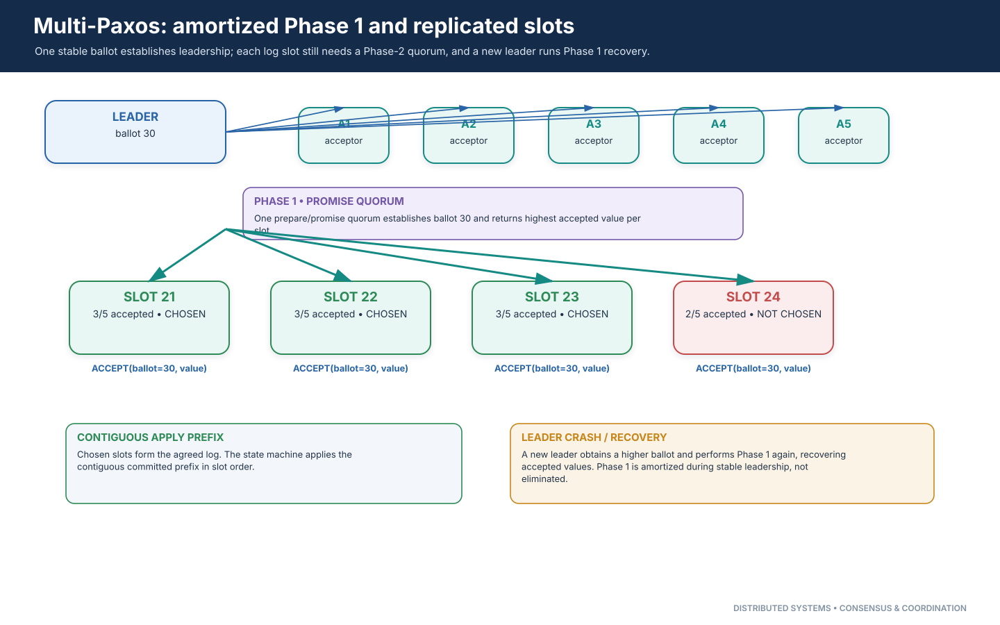

**Diagram specification:** Draw a Multi-Paxos leader with ballot 30 and five acceptors. Show one Phase-1 prepare/promise quorum that establishes leadership and returns any accepted values. Then show slots 21, 22, and 23 proposed through Phase 2, each with a majority accepted certificate. Include a slot with only two acceptances (not chosen), and a leader crash followed by a new leader performing Phase 1 to recover accepted state. Label `slot`, `ballot`, `accepted`, `chosen`, and a contiguous apply prefix; show that Phase 1 is amortized, not removed from recovery.

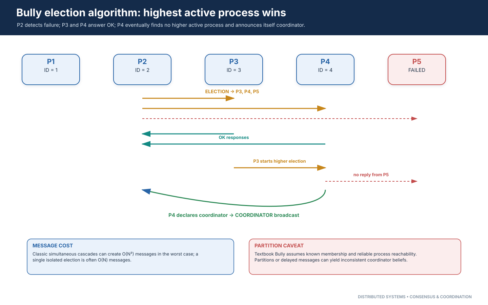

**Diagram specification:** Five process columns P1–P5 ordered by ID. Mark P5 as failed. P2 initiates and sends ELECTION to P3/P4/P5; P3/P4 return OK. P3 and P4 start their own elections; P4 sends to P5 and receives no response, declares itself coordinator, and broadcasts COORDINATOR to all reachable processes. Include a message-count annotation and a side note that partitions can create inconsistent beliefs in the textbook algorithm.

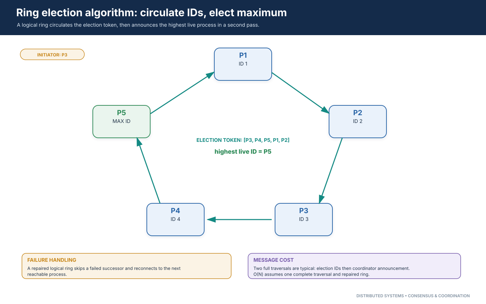

**Diagram specification:** Circular five-node ring P1→P2→P3→P4→P5→P1. P3 initiates; an election token passes successors while collecting IDs. Highlight P5 as the maximum and show a second coordinator-announcement circuit. Include a failed-node variant with successor skipping, and label that simple `O(N)` message complexity assumes one complete traversal and a repaired logical ring.

---

**End of Chapter 5 — Phase 1 Markdown documentation.** SVG generation is intentionally deferred until an explicit Phase 2 request.
