# Chapter 6: Replication in Distributed Systems

> **Purpose.** This chapter explains how distributed systems maintain multiple copies of data, how updates move among those copies, how failures are handled, and how replication architectures trade consistency, availability, latency, durability, storage, and operational complexity.
>
> **Scope note.** Replication terms are not universal product contracts. “Synchronous,” “quorum,” “primary,” “repair,” and “committed” can mean different things in different implementations. Always identify the exact acknowledgment stage, replica membership, storage engine, product version, and failure model.

## Learning Objectives

By the end of this chapter, you should be able to:

1. Distinguish replication from sharding and explain how systems combine them.
2. Trace a write through a leader, replication log, followers, acknowledgments, and commit decision.
3. Compare single-leader, multi-leader, leaderless, chain, and state-machine replication.
4. Distinguish synchronous, asynchronous, and semi-synchronous acknowledgment policies.
5. Diagnose replication lag, stale reads, read-your-writes violations, and causal anomalies.
6. Calculate quorum intersections and explain why intersection alone does not imply linearizability.
7. Explain sloppy quorums, hinted handoff, read repair, anti-entropy, and Merkle-tree repair.
8. Compare LWW, version vectors, CRDTs, and operational transformation.
9. Design safe failover and explain split-brain prevention using quorum, epochs, and fencing.
10. Explain state-machine and chain replication, including their ordering requirements.
11. Describe PostgreSQL, MySQL, MongoDB, Cassandra, Redis, Kafka, and Dynamo-style replication accurately.
12. Build small teaching simulations and state what they omit.

## Prerequisites

Readers should know basic networking, database transactions, concurrency, logs, consistency models, Python, and consensus concepts such as terms/epochs, leader election, and majority quorums. Replication is not itself consensus: some replication schemes operate without consensus, while a strongly coordinated replicated state machine generally needs an agreement protocol to establish a safe command order.

## Detailed Table of Contents

1. [Title and Introduction](#chapter-6-replication-in-distributed-systems)
2. [Learning Objectives](#learning-objectives)
3. [Prerequisites](#prerequisites)
4. [Detailed Table of Contents](#detailed-table-of-contents)
5. [Introduction to Replication](#5-introduction-to-replication)
6. [Replication Fundamentals and Terminology](#6-replication-fundamentals-and-terminology)
7. [Single-Leader Replication](#7-single-leader-replication)
8. [Multi-Leader Replication](#8-multi-leader-replication)
9. [Leaderless Replication](#9-leaderless-replication)
10. [Synchronous vs. Asynchronous Replication](#10-synchronous-vs-asynchronous-replication)
11. [Replication Lag and Its Anomalies](#11-replication-lag-and-its-anomalies)
12. [Quorum Replication](#12-quorum-replication)
13. [Sloppy Quorums and Hinted Handoff](#13-sloppy-quorums-and-hinted-handoff)
14. [Read Repair](#14-read-repair)
15. [Anti-Entropy and Merkle Trees](#15-anti-entropy-and-merkle-trees)
16. [Conflict Resolution](#16-conflict-resolution)
17. [Last-Write-Wins](#17-last-write-wins-lww)
18. [Version Vectors](#18-version-vectors)
19. [Conflict-Free Replicated Data Types (CRDTs)](#19-conflict-free-replicated-data-types-crdts)
20. [Operational Transformation](#20-operational-transformation-ot)
21. [Failover and Split-Brain](#21-failover-and-split-brain)
22. [State Machine Replication](#22-state-machine-replication-smr)
23. [Chain Replication](#23-chain-replication)
24. [Replication Strategies Comparison](#24-replication-strategies-comparison)
25. [Real-World Database Replication Mechanisms](#25-real-world-database-replication-mechanisms)
26. [Practical Engineering Implementations](#26-practical-engineering-implementations)
27. [Mathematical Concepts and Formulas](#27-mathematical-concepts-and-formulas)
28. [Comprehensive Comparison Tables](#28-comprehensive-comparison-tables)
29. [Interview Questions and Answers](#29-interview-questions-and-detailed-answers)
30. [Common Mistakes and Production Best Practices](#30-common-mistakes-and-production-best-practices)
31. [Chapter Summary](#31-chapter-summary)
32. [Key Takeaways](#32-key-takeaways)
33. [Glossary](#33-glossary)
34. [Further Reading and References](#34-further-reading-and-references)

---

# 5. Introduction to Replication

## 5.1 What Is Replication?

**Replication** is the process of maintaining multiple copies of the same logical data on different storage processes, machines, availability zones, or geographic regions. Each copy is a **replica**. A replication protocol defines which node or coordinator may accept an update, how updates are identified and transmitted, when an update is considered committed, which versions reads may return, and how replicas recover after missing messages or downtime.

Replication has two separate concerns:

- **Placement:** which nodes hold a copy of a key, partition, database, log, or object.
- **Synchronization:** how updates accepted by one replica become visible at other replicas under a stated consistency contract.

Three copies do not, by themselves, tell an application whether a successful write reached one, two, or all three machines. Nor do they tell the application whether a read from a secondary is current. The acknowledgment rule and read rule matter as much as the replica count.

## 5.2 Why Replicate Data?

1. **Availability:** another copy may serve requests when one machine fails. This depends on placement, quorum/leader rules, and whether the surviving nodes are authorized to serve the requested operation.
2. **Durability and resilience:** independent copies reduce the risk that one disk or machine failure destroys every copy. Replication is not a substitute for backups; accidental deletion, corruption, ransomware, or logically incorrect updates can propagate to all replicas.
3. **Read scalability:** followers can serve selected read traffic and reduce leader load, at the cost of potentially stale reads.
4. **Geographic locality:** a nearby replica can lower read latency. Cross-region writes may still travel to a remote leader or quorum.
5. **Fault tolerance:** multiple copies allow survival of a bounded number of failures under the protocol's assumptions.
6. **Disaster recovery:** a remote replica can reduce recovery time and data loss after a site outage. Actual recovery point depends on what was replicated and acknowledged before failure.

## 5.3 Core Trade-Offs

| Dimension | What replication changes | Engineering question |
|---|---|---|
| Consistency | Replicas may temporarily or permanently disagree | Which version may a read return? |
| Availability | A surviving subset may or may not be allowed to serve | What can proceed during a partition? |
| Latency | Coordination and geographic propagation add round trips | Where is the write authority or required quorum? |
| Storage | Each replica stores some or all data | What replication factor and placement are affordable? |
| Bandwidth | Logs, snapshots, repair, and heartbeats consume network | Can the network sustain peak write rate and catch-up? |
| Write coordination | Leaders, quorum acknowledgments, or merge protocols order updates | What is the commit/acknowledgment point? |
| Operations | Failover, repair, lag, rebalancing, and recovery must be managed | Who detects and repairs divergence? |

## 5.4 Three-Region E-Commerce Example

Assume inventory for SKU `CAM-42` is replicated in India, Europe, and the United States. The initial stock is 12, and India is the leader in a single-leader design.

| Time | India (leader) | Europe (follower) | US (follower) | Event |
|---|---:|---:|---:|---|
| 10:00:00.000 | 12 | 12 | 12 | Replicas agree |
| 10:00:00.100 | 11 | 12 | 12 | India reserves one unit |
| 10:00:00.130 | 11 | 12 | 12 | Leader commits locally and acknowledges asynchronously |
| 10:00:00.180 | 11 | 11 | 12 | Europe applies the log record |
| 10:00:00.240 | 11 | 11 | 11 | US applies the log record |

A European user reading at 10:00:00.150 from the European follower may still see 12. The read is stale relative to the leader's acknowledged update. Once replication catches up, the follower returns 11.

Different operations tolerate different behavior:

- A product detail page displaying approximate stock may tolerate a brief stale count if checkout performs an authoritative reservation.
- Checkout must not use a stale display count as a reservation. It needs an atomic conditional decrement, transaction, or another single-authority reservation mechanism.
- Read-after-write can route the user's next read to the leader or return a replication-position token and wait until the selected replica has applied at least that position.
- Synchronous/quorum acknowledgment can require replicas to persist or commit before success, but the exact guarantee depends on the configured stage.

## 5.5 Replication vs. Sharding vs. Partitioning

**Replication copies the same logical data. Sharding distributes different subsets of data across nodes. Partitioning divides a dataset into manageable logical or physical units; it may occur within one database or across a cluster.**

| Technique | What is distributed? | Example | Main purpose |
|---|---|---|---|
| Replication | Copies of the same shard/database/log | Three copies of customer partition 7 | Availability, durability, read scale |
| Sharding | Different records or key ranges | Customers A–F on shard 1; G–M on shard 2 | Capacity and write scale |
| Partitioning | A table/dataset split into logical or physical parts | Orders partitioned by month | Manageability, pruning, parallelism |
| Sharding + replication | Each shard has its own replica group | Shard 1: A/B/C; shard 2: D/E/F | Scale plus fault tolerance |

A common architecture hashes a partition key to select a shard and then replicates that shard across three failure domains. Each shard may have its own leader, replica set, or quorum protocol. Replication does not eliminate the need to scale writes across shards; sharding does not automatically provide redundant copies.

## 5.6 Replica Placement and Failure Domains

A replica group is useful only if its members do not share every failure mode. Three virtual machines on one physical host are not equivalent to three independent copies across separate hosts. Plan for:

- **Host failure:** disk, power, memory, kernel, or machine failure.
- **Rack/zone failure:** network switch, power circuit, or availability-zone outage.
- **Region failure:** broad network, power, or cloud-region incident.
- **Administrative failure:** bad deployment, credentials compromise, or destructive command.
- **Correlated failure:** a common software bug or incorrect configuration affecting every copy.

For zone resilience, place replicas across zones. For regional disaster recovery, maintain remote copies and quantify cross-region lag and recovery objectives. Replicas are online copies; backups should be isolated, versioned, and tested by restoration.

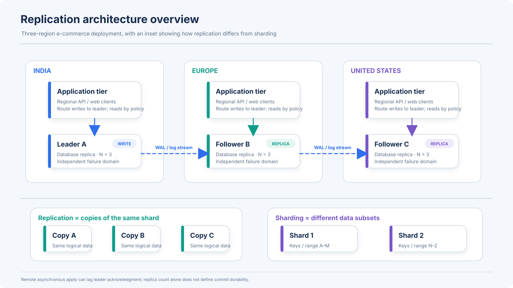

**Diagram specification — replication architecture overview.** Draw an e-commerce topology across India, Europe, and US. Each region contains an application tier and database node; show India as leader and the other two as followers. Add an inset where two logical shards each have three copies to contrast replication with sharding. Use solid arrows for client writes to the leader, dashed arrows for log replication, and read arrows from followers. Label `N=3`, independent failure domains, and the point where asynchronous leader acknowledgment precedes remote apply. Annotate that follower reads may be stale and that replica count alone does not specify commit durability.

---

# 6. Replication Fundamentals and Terminology

## 6.1 Nodes, Roles, and Groups

- **Primary / leader / source:** node currently authorized to accept writes in a leader-based protocol. The terms overlap but are not perfectly interchangeable across products.
- **Secondary / follower / replica:** node receiving and applying updates from another node. Some products allow secondary reads; others let replicas coordinate writes without a permanent leader.
- **Replica set / replication group:** nodes maintaining copies of a database or shard and coordinating membership, logs, elections, and acknowledgments.
- **Coordinator:** node accepting a client operation and coordinating requests to relevant replicas. In a leaderless database it need not be a permanent leader.
- **Replication factor (`N`):** intended number of copies for each data item or partition. It may vary by keyspace or region.

## 6.2 Logs and Positions

Many systems represent changes as an ordered stream rather than repeatedly comparing complete database files.

- **Write-ahead log (WAL):** sequential log written before associated data pages are considered durable under the database's recovery protocol. WAL supports crash recovery and can be streamed to standbys.
- **Transaction log / binary log / operation log:** product-specific append-only history. MySQL's binary log records events/transactions; MongoDB's oplog records replicated operations; Kafka stores records in a replicated partition log.
- **Log sequence number (LSN):** ordered position in a log. It is meaningful within the log/timeline and system context that defines it, not necessarily a universal timestamp.
- **Replication offset:** position in a byte or record stream. Redis combines replication IDs and offsets to identify compatible histories and missing stream ranges.
- **Commit index / commit position:** protocol-defined point through which entries are committed under protocol rules. In Raft, receiving a record is not enough; commitment depends on the consensus rule.
- **High-water mark:** product-specific boundary for records safe or eligible for visibility. Kafka's high watermark is related to replication and consumer visibility, not simply the largest offset received by any replica.
- **Applied position:** progress through which a replica has applied changes to local state. It may lag behind receive or flush position.

## 6.3 Replication Lifecycle Vocabulary

- **Replication record:** encoded mutation, transaction, log entry, or state change sent to replicas.
- **Acknowledgment:** message that a replica reached a specified stage: received, written to local log, flushed to stable storage, or applied.
- **Replication lag:** gap between source progress and replica receive/apply/commit progress. It can be measured by time, LSN/offset, or queued bytes/records.
- **Promotion:** changing a replica's role so it can accept authoritative writes.
- **Catch-up:** transferring and applying missing records until a replica reaches a required position.
- **Divergence:** replicas hold different histories or values due to concurrent writes, split-brain, incomplete recovery, or non-determinism.
- **Resynchronization:** restoring a replica from a snapshot/base copy and applying subsequent log records.

## 6.4 Physical, Logical, Statement, Row, Log, and Snapshot Replication

| Mechanism | What is copied? | Advantages | Limitations / examples |
|---|---|---|---|
| Physical | Database pages/blocks or physical WAL changes | Close byte-level copy; useful for hot standby/recovery | Often tied to storage layout/version; PostgreSQL physical streaming |
| Logical | Logical row changes or database objects identified by keys/schema | Selective table/row replication; useful for migrations and integration | Schema/DDL management and subscriber conflicts require care; PostgreSQL publications/subscriptions |
| Statement-based | SQL statements/events | Compact for some workloads | Non-deterministic statements, triggers, time functions, and execution differences can diverge; MySQL SBR |
| Row-based | Actual changed row images/events | More deterministic for many data changes | Can generate more log data; row images and schema evolution matter; MySQL RBR |
| Log-based | Ordered change stream | Efficient incremental shipping and replay | Requires log retention, compatible history, ordering, and gap detection |
| Snapshot-based | Full or partial point-in-time copy | Establishes base for new replica/recovery | Expensive at scale; must coordinate snapshot boundary with later changes |
| CDC | Changes extracted from logs/database mechanisms | Feeds search, analytics, caches, event pipelines | Delivery semantics, schema evolution, duplicates, and offsets become application concerns |

## 6.5 Generic Write Lifecycle

1. Client sends transaction `T` to leader.
2. Leader validates constraints and transaction semantics.
3. Leader creates log records representing `T`.
4. Log is appended; local durability depends on flush policy.
5. Leader streams record to followers.
6. A follower receives and validates the record, appends it locally, and may flush it.
7. Follower applies the record to its local state, immediately or later.
8. Follower acknowledges the stage it reached.
9. Leader applies its commit rule: local commit, one remote acknowledgment, majority, all configured synchronous standbys, or consensus commit index.
10. Leader responds to client.
11. Other replicas continue applying records and update progress positions.

The **critical distinction is what the acknowledgment means**. “Received by replica” is not the same as “flushed to stable storage,” “committed by quorum,” or “visible to reads.”

---

# 7. Single-Leader Replication

## 7.1 Model and Responsibilities

In **single-leader replication**, one replica is the current write authority for a replication group. Clients send writes to the leader. Followers receive an ordered change stream and maintain copies. A leader provides a serialization point for accepted writes, but this alone does not mean all transactions are serializable or all reads are linearizable.

| Participant | Responsibilities |
|---|---|
| Client | Sends writes to authoritative endpoint; chooses read consistency/routing policy |
| Leader | Validates writes, orders log records, determines acknowledgment policy, streams updates |
| Follower | Receives, stores, applies, and reports progress for leader's log |
| Coordinator/control plane | Tracks membership and health, handles election/failover, configures routing |

## 7.2 Architecture and Message Flow

```text
Client --WRITE(T)--> Leader
                      | validate transaction
                      | append WAL/log record LSN=120
                      | flush local log (policy-dependent)
                      +---- REPLICATE(120) ----> Follower A
                      |                           append / flush / apply
                      |<--- ACK(120, flushed) -----+
                      +---- REPLICATE(120) ----> Follower B
                                                  append / flush / apply
                      |<--- ACK(120, applied) -----+
                      | evaluate configured commit rule
Client <-- SUCCESS ---+
```

For a single leader, writes are typically ordered by the leader's log. Followers apply the stream in its defined order. The client acknowledgment could happen:

- after local commit only (common asynchronous mode);
- after a specified follower has received or persisted the record (some semi-synchronous modes);
- after a quorum/majority has committed it (consensus-backed replication); or
- after all configured synchronous replicas acknowledge a selected stage.

These are not equivalent. If a leader acknowledges after local persistence but before any follower receives the write, failover to a lagging follower may lose an acknowledged update.

## 7.3 Write Path

1. **Routing:** a client driver, proxy, or service-discovery layer sends the write to the leader.
2. **Validation:** the leader checks authorization, constraints, transaction conflicts, and schema.
3. **Log append:** changes are encoded into WAL/transaction log records.
4. **Local persistence:** records may be buffered, written, or flushed according to durability settings.
5. **Propagation:** log entries are shipped in order to followers.
6. **Follower processing:** each follower appends, flushes, and/or applies entries.
7. **Commit/ack:** leader checks configured acknowledgment rule.
8. **Response:** leader returns result and ideally a position/version token useful for session read-your-writes.

## 7.4 Read Path

**Leader read.** A read from the leader avoids follower apply lag, but may still be constrained by transaction isolation and snapshot semantics. To provide a linearizable read, a system must ensure the node is still authoritative and its read reflects the latest completed writes under the protocol (for example, through a consensus read index, a safe lease, or quorum confirmation).

**Follower read.** A follower can serve low-latency local reads but may not have applied the latest write. If a client must read its own last write, route to the leader or wait until the follower's applied LSN/offset is at least the token returned by the write.

Example: the leader is at LSN 500 and a follower has applied through LSN 492. That follower may miss records 493–500. The difference is eight log positions, not necessarily eight transactions: an LSN may denote byte/log position.

## 7.5 Advantages

- One write authority simplifies conflict detection and ordering.
- Followers can efficiently consume a clear source order.
- Read traffic can be distributed to followers where stale reads are acceptable.
- Leader-based architectures integrate naturally with WAL shipping and consensus-backed failover.
- Application logic has fewer multi-writer merge cases than in multi-leader designs.

## 7.6 Limitations

- The leader can become a write throughput bottleneck for one replication group.
- Leader failure interrupts writes until a safe replacement is elected or promoted.
- A lagging follower may be ineligible for promotion if it lacks committed history.
- Cross-region writes can incur high latency if the leader is remote or synchronous remote acknowledgment is required.
- Poorly designed failover can create split-brain.
- Read scaling is bounded by follower hardware and the application's lag tolerance.

## 7.7 Practical Examples

- **PostgreSQL physical streaming replication:** primary streams WAL to standby servers. Streaming is asynchronous by default; synchronous replication can be configured with specific commit-wait behavior. Standbys replay WAL and may be promoted. Replication slots can preserve needed WAL but may cause disk growth when consumers stop advancing.
- **MySQL source/replica replication:** source writes binary-log events; replicas fetch and apply them. Async is standard; semi-sync is separately configured. GTIDs simplify positioning and topology changes, but do not turn async replication into consensus.
- **MongoDB replica sets:** one primary accepts writes and secondaries asynchronously apply oplog entries. Write concern controls acknowledgment; read preference controls where reads go; read concern controls visibility guarantees.
- **Redis base replication:** primary sends a command stream to replicas. It is asynchronous; replication IDs and offsets support partial resynchronization. Sentinel or Cluster adds separate failover/partition-management layers.
- **Kafka partitions:** each partition has a leader broker and follower replicas. Producers write to the leader; followers fetch the log. ISR membership and acknowledgments define durability/availability behavior. Kafka is a replicated append-only log, not a general-purpose primary/secondary database.

## 7.8 Python Simulation

```python
from dataclasses import dataclass, field

@dataclass
class Replica:
    name: str
    data: dict = field(default_factory=dict)
    applied_lsn: int = 0

    def apply(self, lsn, key, value):
        if lsn <= self.applied_lsn:
            return  # idempotent replay in this toy example
        if lsn != self.applied_lsn + 1:
            raise ValueError("log gap: fetch missing records first")
        self.data[key] = value
        self.applied_lsn = lsn

class SingleLeaderGroup:
    def __init__(self, leader, followers):
        self.leader, self.followers = leader, followers
        self.lsn, self.log = 0, []

    def write(self, key, value, replicate_to=0):
        self.lsn += 1
        record = (self.lsn, key, value)
        self.log.append(record)
        self.leader.apply(*record)
        for follower in self.followers[:replicate_to]:
            follower.apply(*record)
        return self.lsn

    def catch_up(self, follower):
        for record in self.log:
            if record[0] > follower.applied_lsn:
                follower.apply(*record)

leader, eu, us = Replica("India"), Replica("Europe"), Replica("US")
group = SingleLeaderGroup(leader, [eu, us])
group.write("stock", 11)  # asynchronous acknowledgment
print(leader.data.get("stock"), eu.data.get("stock"))
group.catch_up(eu)
print(eu.data.get("stock"), eu.applied_lsn)
```

Expected output:

```text
11 None
11 1
```

The model has integer values, one leader, a toy LSN, and a complete in-memory log. It omits transactions, durable storage, log truncation, leader epochs, concurrent clients, network faults/reordering, membership changes, and consensus. `replicate_to` is not a real quorum or durability policy.

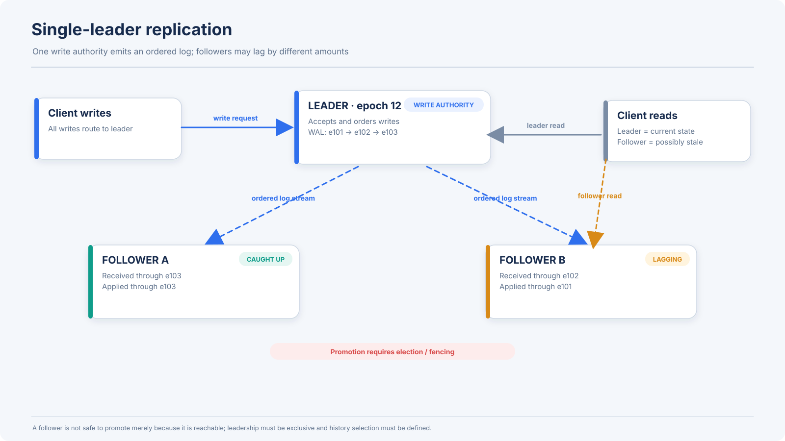

**Diagram specification — single-leader topology.** Show one leader at the top and two followers below. Client writes point only to leader. Leader emits ordered log entries `e101`, `e102`, `e103`; follower A is applied through `e103`, follower B through `e101`. Show read arrows to leader and followers, marking follower reads “may be stale.” Label single-writer authority and safe fencing/election on leader change.

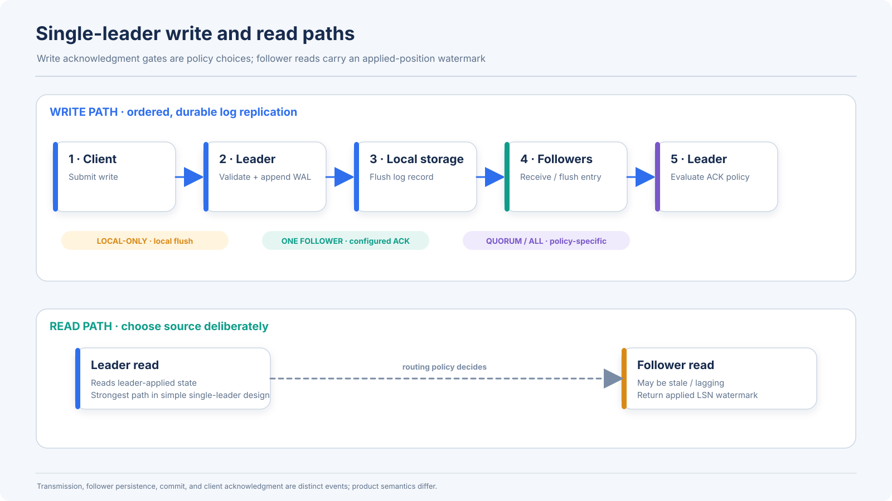

**Diagram specification — write/read paths.** Number client write, leader validation, WAL append, local flush, follower replication, follower append/flush, ACK, leader acknowledgment policy, client success. Show alternative local-only, one-follower, and quorum/all-standby gates as mutually exclusive example policies. Show leader-read and follower-read paths; follower response includes an applied-position watermark.

---

# 8. Multi-Leader Replication

## 8.1 Model and Motivation

In **multi-leader replication**, more than one node can accept writes for the same replicated dataset. Each leader propagates updates to other leaders and/or replicas. This can reduce write latency for geographically distributed clients and permit local writes during some disconnections, but it creates concurrent histories that must be merged or rejected.

A three-region topology might have India Leader A, Europe Leader B, and US Leader C. All three accept writes locally. An India update travels to Europe and the US; a simultaneous Europe update may travel in the opposite direction.

## 8.2 Message Flow

```text
Client IN -> Leader A --local commit--> A's log
                         | async replicate
                         +--------------------> Leader B
                         +--------------------> Leader C

Client EU -> Leader B --local commit--> B's log
                         +---- may conflict with A's update
```

The protocol must answer: what uniquely identifies an update? How is causality distinguished from concurrency? Is a conflict detected before acknowledgment or after propagation? Are multiple versions retained, does one win, or does the application merge? How are loops and duplicate delivery prevented? What happens if regions are partitioned for hours?

## 8.3 Worked Conflict Scenario

Customer profile starts with `shipping_city="Delhi"` and version `(A:7,B:4)`. During a partition, India leader A changes the city to `Mumbai`; Europe leader B changes it to `Berlin`. Both accept and acknowledge locally. After the partition heals, neither write has causally observed the other, so they are concurrent.

| Event | India A | Europe B | Meaning |
|---|---|---|---|
| Initial | Delhi | Delhi | Same version |
| A writes | Mumbai | Delhi | A has local update |
| B writes | Mumbai | Berlin | B has concurrent local update |
| Exchange | Receives Berlin | Receives Mumbai | Conflict detected |
| Resolution | Agreed merged/resolved state | Same state propagated | Deterministic convergence required |

Choosing the largest wall-clock timestamp is one option, but may lose a user's change due to clock skew. Better semantics might preserve two addresses, merge independent fields, or prompt the user.

## 8.4 Conflict Resolution Strategies

- **Last-write-wins (LWW):** choose the update with highest timestamp and deterministic tie-breaker. Simple, but skewed clocks can discard valid updates.
- **Version vectors:** compare causal histories. A dominating vector is causally later; incomparable vectors indicate concurrency.
- **Application merge:** combine fields or domain intent; e.g., union tags, retain multiple addresses, or show a conflict UI.
- **CRDT:** use a data type with a mathematically safe merge. CRDTs do not make arbitrary business invariants safe automatically.
- **Manual resolution:** retain both versions and require a user/operator decision, appropriate when silent loss is unacceptable.

## 8.5 Clock Skew

If India's clock is 800 ms ahead and Europe's is accurate, an earlier India write may receive a later timestamp and win LWW even if Europe's edit happened later in real time. Wall-clock timestamps are not causal proofs. Logical clocks, hybrid logical clocks, vector clocks, or server-assigned sequencing offer different ordering metadata with their own assumptions and costs.

## 8.6 Advantages, Limitations, and Use Cases

**Advantages:** local write latency, local availability during some disconnections, geographic write distribution, and offline-first workflows.

**Limitations:** concurrent-write conflicts, replication loops, duplicate/out-of-order messages, schema/business merge complexity, and more difficult consistency contracts. It is usually a poor fit for globally unique scarce resources (such as the final unit of inventory) unless a separate reservation/ownership protocol coordinates them.

Good fits include offline-first mobile edits, multi-site content management, regionally writable preferences, and collaborative metadata where merge semantics are explicit.

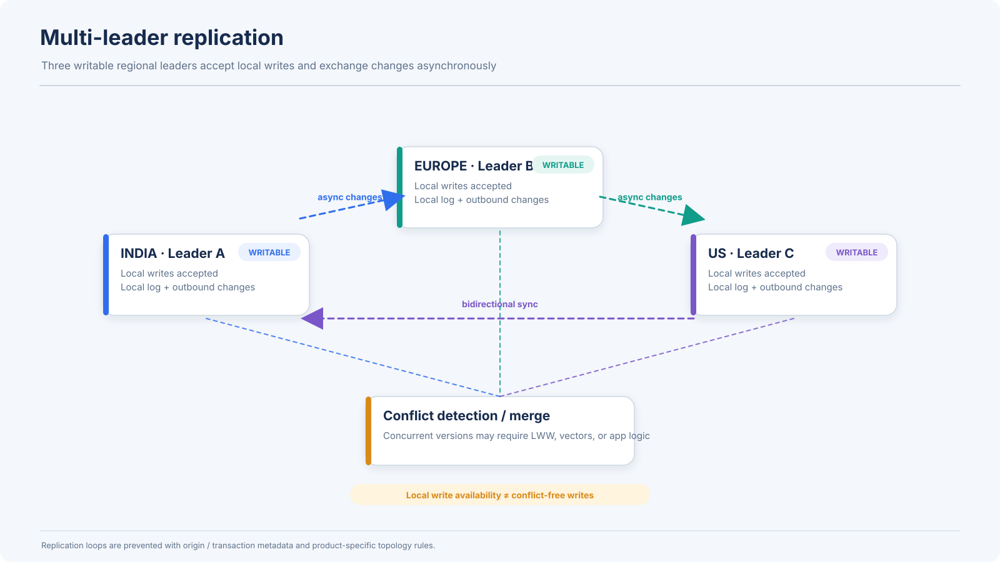

**Diagram specification — multi-leader topology.** Draw India, Europe, and US, each with a writable leader. Show local clients writing locally and bidirectional/asynchronous replication arrows among leaders. Label local commit points, streams, version metadata, and conflict-detection boundaries. Include one independent field update and one concurrent same-field update. Distinguish local acknowledgment from global convergence.

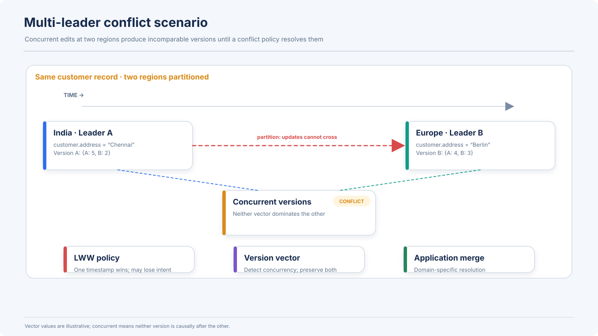

**Diagram specification — concurrent conflict.** Timeline with India Leader A and Europe Leader B. Both start from V0; A writes `city=Mumbai`, B writes `city=Berlin` before seeing A. Show local acknowledgments, delayed exchange, incomparable vector metadata, and resolution lanes for LWW, application merge, or manual conflict. Label concurrency versus mere packet reordering.

---

# 9. Leaderless Replication

## 9.1 Model and Motivation

In **leaderless replication**, a key's replicas can accept writes without routing every write through one permanent leader. A client may contact a coordinator, which fans a write out to the replica set and waits for configured acknowledgments. The coordinator is usually a request handler, not a durable single primary for the key.

The original Amazon Dynamo design combined consistent hashing, replication, object versioning, quorum-like reads/writes, sloppy quorums, hinted handoff, and decentralized synchronization to favor availability for selected services. Cassandra draws on Dynamo-style partitioning, multi-master replication, tunable consistency, gossip membership, and local persistence; it is not a line-by-line copy of Dynamo. See [Dynamo paper](https://www.amazon.science/publications/dynamo-amazons-highly-available-key-value-store) and [Cassandra Dynamo architecture](https://cassandra.apache.org/doc/latest/cassandra/architecture/dynamo.html).

## 9.2 Components

- **Client:** issues a key-based read/write.
- **Coordinator:** routes requests to natural replicas and collects responses.
- **Natural replicas:** nodes assigned to store the key by partitioning/placement algorithm.
- **Replication factor `N`:** intended copy count.
- **Read quorum `R`:** replica responses required for a read.
- **Write quorum `W`:** replica acknowledgments required for a write.
- **Version metadata:** timestamps, vector clocks, mutation timestamps, or other comparison metadata.

## 9.3 Write Path

1. Client sends write for key K to a coordinator.
2. Coordinator calculates natural replicas.
3. Coordinator sends mutation to replicas, often in parallel.
4. Replicas validate/store according to local durability policy.
5. Coordinator waits for at least W acknowledgments, subject to timeout/failure policy.
6. It returns success once configured consistency requirement is met.
7. Other replicas may receive the write later via retry, hints, or repair.

Success does not necessarily mean every replica has the same value; it means the configured write condition was met.

## 9.4 Read Path and Reconciliation

1. Coordinator sends read requests to multiple replicas.
2. It collects at least R responses (or follows product-specific rules).
3. It compares versions and metadata.
4. If one version causally dominates, it may return it and repair stale copies.
5. If versions are concurrent, it may return siblings, merge deterministically, use LWW, or invoke application resolution.
6. Repair messages may be sent to stale replicas.

A read quorum is not automatically “the newest response.” Correct version comparison and reconciliation semantics matter.

## 9.5 Advantages and Limitations

Advantages include no permanent single leader per key, flexible coordination, availability under some replica failures, and flexible placement. Limitations include concurrent versions, reconciliation overhead, network fan-out, metadata, stale data, quorum tuning, and complex recovery.

## 9.6 Systems

- **Amazon Dynamo (2007 paper):** leaderless key-value store with object versioning, quorum-like replication, sloppy quorum, hinted handoff, and decentralized synchronization.
- **Cassandra:** peer-to-peer system with per-request coordinators, replication factor, consistency levels, hints, read repair, and anti-entropy repair. Nodes own token ranges; gossip supports membership/failure detection.
- **Riak:** historically exposed Dynamo-inspired replication and sibling/version behavior; check current support and maintenance status before selecting it for a new deployment.
- **ScyllaDB:** Cassandra-compatible distributed architecture and consistency concepts, with implementation details varying by version/features.

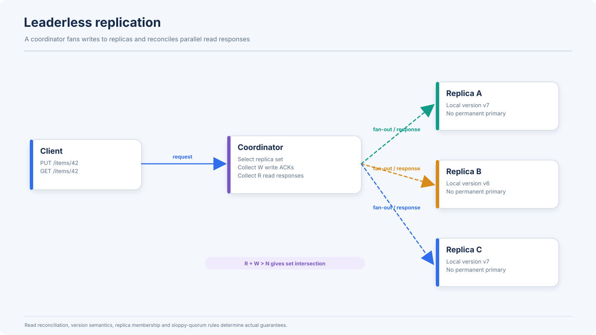

**Diagram specification — leaderless flow.** Draw client and coordinator connected to replicas A/B/C with N=3. Write `PUT(K,V2)` fans out; B and C acknowledge first (W=2), client responds while A is delayed. Read fans out, obtains V1/V2, compares metadata, returns selected/merged version, and repairs stale A. Label coordinator as per-request, not permanent leader.

---

# 10. Synchronous vs. Asynchronous Replication

## 10.1 What Does “Synchronous” Mean?

The word **synchronous** is overloaded. A product may call a mode synchronous because commit waits for a remote acknowledgment, but that acknowledgment may mean “received into memory,” “written to the OS,” “flushed to durable storage,” “applied,” or “committed.” These are different guarantees.

A precise design must identify:

- which event the leader waits for;
- how many replicas must report it;
- whether the client response waits for remote persistence or application;
- what happens on timeout/unavailability;
- whether writes can be acknowledged while some replicas are behind;
- which failure combinations the acknowledgment protects against.

## 10.2 Synchronous Workflow

A typical remote-flush policy is:

1. Client sends a write.
2. Leader appends a WAL/log entry.
3. Leader transmits it to synchronous followers.
4. Followers append and flush the required record to stable storage.
5. Followers acknowledge the configured stage.
6. Leader waits for the required set/count of acknowledgments.
7. Leader commits or returns success according to database semantics.

This reduces the risk that an acknowledged update exists only on the failed leader. Latency rises because the critical path includes remote round trips and durable I/O. If the required synchronous replica cannot respond, writes may block or fail, depending on policy.

## 10.3 Asynchronous Workflow

In asynchronous replication the leader can acknowledge after local commit without waiting for followers. Propagation continues in the background.

Example: primary commits at `12:00:00.000`, acknowledges at `.002`, and fails at `.050`. A follower has applied through `.030` and is missing a transaction committed at `.040`. If promoted, the new primary may not contain the acknowledged transaction. The potential loss window depends on unreplicated history and promotion policy.

Async replication commonly improves write latency and can let the leader proceed while followers are slow, but introduces lag and potential non-zero RPO.

## 10.4 Semi-Synchronous Replication

A semi-synchronous policy waits for a limited acknowledgment, often at least one replica, while other replicas remain asynchronous. The acknowledgment stage is product-specific. MySQL 8.4 semi-synchronous replication waits until at least one replica acknowledges receiving and logging the transaction events; that is not the same as waiting for replica apply or a consensus commit index. [MySQL 8.4 replication](https://dev.mysql.com/doc/refman/8.4/en/replication.html)

If no replica responds, the system may wait up to a timeout and follow configured fallback behavior. The timeout/fallback policy belongs in the RPO analysis.

## 10.5 Comparison

| Property | Synchronous (specified remote stage) | Asynchronous | Semi-synchronous |
|---|---|---|---|
| Client acknowledgment | Waits for configured remote acknowledgment(s) | Usually local commit only | Waits for limited remote acknowledgment |
| Replica acknowledgment | Required before success | Not required before success | Required from configured subset |
| Write latency | Higher; includes network and remote work | Lower; local critical path | Often between the two |
| Durability | Stronger against leader-only loss if remote stage is durable | Acknowledged write may be absent on followers | Stronger than async for stated stage |
| Data-loss risk | Depends on stage, quorum, and failure assumptions | Non-zero with lagging promotion | Reduced, not eliminated in every failure mode |
| Availability | Writes may block/fail if required replicas are unavailable | Often continues with leader | May block or fall back depending on config |
| Cross-region suitability | Costly if global RTT is required | Common for DR/read-locality copies | Useful when a limited remote acknowledgment is enough |

## 10.6 Workload Recommendations

| Workload | Likely policy | Reasoning / caveat |
|---|---|---|
| Financial ledger | Consensus/strongly coordinated or synchronous quorum commit | Acknowledged transactions should survive the defined failure set |
| Payment state | Durable transaction plus idempotency/outbox | Replication does not make an external payment API atomic |
| Inventory reservation | Strong conditional update within an authority/transaction domain | A stale stock display must not authorize overselling |
| Product catalog | Often asynchronous cross-region replicas | Checkout can revalidate price and availability |
| Analytics | Async log/CDC pipeline | Throughput and isolation often dominate immediate freshness |
| User profile | Async plus read-your-writes routing | User needs own edit immediately, not necessarily global sync |
| Multi-region application | Local reads + async replicas, or regional authorities with conflict rules | Global synchronous commit can add WAN latency |
| Disaster recovery | Async remote standby with measured lag, or sync for strict RPO | Define RPO/RTO; replication is not backup |

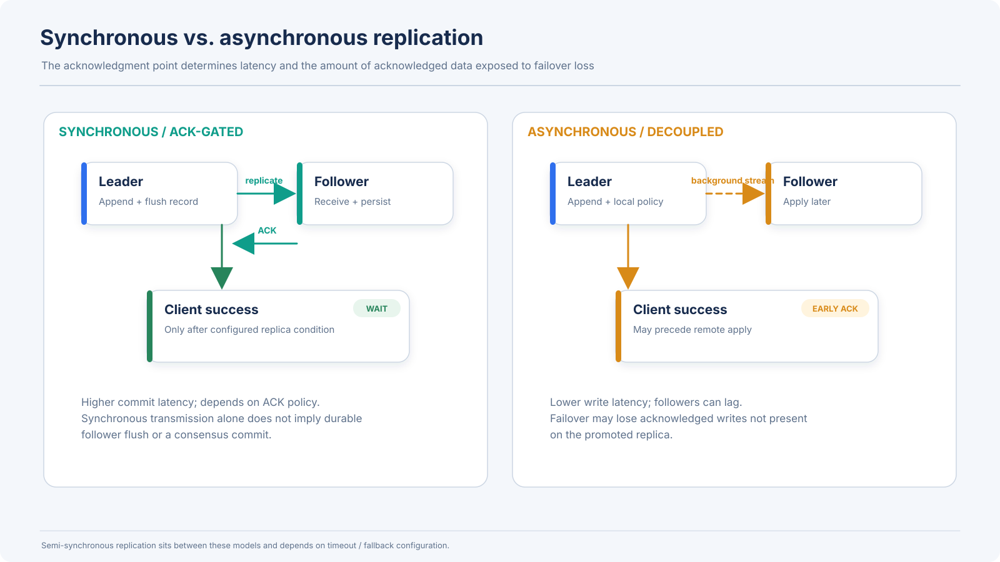

**Diagram specification — synchronous versus asynchronous.** Two sequence diagrams with client, leader, follower. Synchronous: leader appends, sends record, follower flushes, ACK returns, then client receives success. Asynchronous: leader appends/commits and responds immediately; replication continues later. Place a failure marker after client success but before follower apply in the async panel. Call out receive, flush, apply, and commit as distinct stages.

---

# 11. Replication Lag and Its Anomalies

## 11.1 Definition and Measurement

**Replication lag** is the delay or progress gap between an upstream node's generated/committed changes and a downstream replica's received, persisted, applied, or committed changes. There is no single universal lag metric.

Useful measurements include:

- **Time lag:** estimated seconds behind an upstream timestamp; vulnerable to clock skew, timestamp meaning, and idle workloads.
- **Log-position lag:** upstream LSN/offset minus replica received/applied position. Units may be bytes, records, or logical positions.
- **Queue depth:** pending bytes/records or queued apply tasks.
- **Apply throughput:** how quickly the replica consumes incoming log entries.
- **Oldest unapplied transaction age:** often more useful than a raw offset gap for user-facing freshness.

A follower may have received data but not applied it. A standby may have flushed WAL but not replayed it. Monitor receive, flush, and replay/apply separately where exposed.

## 11.2 Causes

- Network RTT, packet loss, congestion, retransmissions, or cross-region bandwidth limits.
- Primary write rate exceeding follower network or apply capacity.
- Large transactions requiring lengthy transfer/replay.
- Slow storage or fsync bottlenecks.
- CPU saturation, lock contention, or long-running transactions on the replica.
- DDL/schema changes or batch operations that serialize apply.
- Replica resources shared with reporting queries.
- Log retention gaps forcing full resynchronization.
- Uneven hardware or placement.

## 11.3 Read-After-Write Violation

| Time | User action | Leader | Follower |
|---|---|---|---|
| t0 | Profile image is `/old.png` | old | old |
| t1 | User uploads `/new.png` | new | old |
| t2 | Write succeeds | new | old |
| t3 | Refresh routed to follower | new | old |

The user sees the old image after success. Mitigations include leader routing, routing to a caught-up replica, or a write-position token that the follower must reach before serving the read.

## 11.4 Monotonic Read Violation

A user reads order status `Shipped` from replica version 12. The next request lands on a lagging replica at version 10 and returns `Processing`. Each replica may have a valid prefix of history, but the session moves backward. Sticky routing helps only if the selected replica never rolls back or gets replaced by an older one. A robust design carries a minimum version/causal token and waits or routes until the selected replica meets it.

## 11.5 Write-Ordering / Write-Follow-Read Problem

A user changes an address and then submits an order using that address. If the address write remains pending on one replica and the order is routed/applied elsewhere, the order service may use the old address. Preserve same-session write order and propagate dependency tokens; use a transaction if both changes must commit atomically.

## 11.6 Causal Predecessor Arrives Late

A post `P` is published; a user reads it and creates comment `C`. If a replica receives C before P, it must not expose a comment that appears to reference a nonexistent post. Causal replication can delay C until P is present, or the application can represent an unresolved reference explicitly.

## 11.7 Cross-Replica Inconsistent Reads

A client reads key K from replica A and sees V8, then reads from B and sees V7. This can occur with async replication or independent writers. Use a minimum-version token or route session reads through the leader. Random load balancing across replicas without freshness policy can amplify this anomaly.

## 11.8 Mitigations

- **Read-your-writes routing:** send post-write reads to authority or a replica known to have applied the write.
- **Sticky sessions:** reduce replica switching, but are not a consistency guarantee; failover/load balancing can still move the user.
- **Leader reads:** appropriate when freshest leader-visible state is required and leader reads are safe.
- **Consistency tokens:** return an applied position/version and require subsequent reads to meet it.
- **Catch-up barriers:** wait until a selected replica reaches a required position.
- **Backpressure:** throttle upstream writes if lag threatens recovery or data safety.
- **Repair and monitoring:** distinguish transient lag from permanent divergence and alert on age/backlog.
- **Synchronous replication:** use only when RPO/consistency justify latency and availability cost.

Illustrative token:

```json
{
  "replica_group": "orders-eu",
  "leader_epoch": 42,
  "commit_position": 918273,
  "minimum_read_position": 918273
}
```

A real token must be authenticated and scoped to the relevant cluster/timeline/history. An LSN from one timeline must not be compared blindly with an unrelated one.

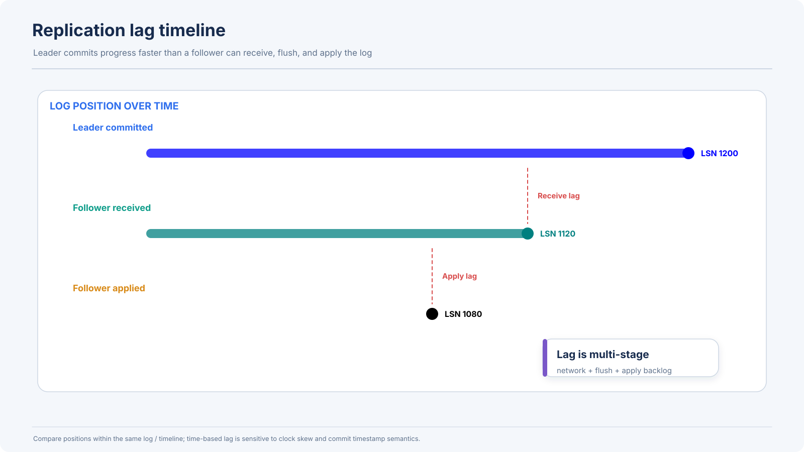

**Diagram specification — replication lag timeline.** Plot leader log position and three follower progress lines. Leader committed position is 1200; follower A received 1200 but applied 1190; B applied 1175; C is caught up at 1200. Show backlog shrinking when apply rate exceeds write rate. Separate network delay from apply delay and label time lag as an estimate.

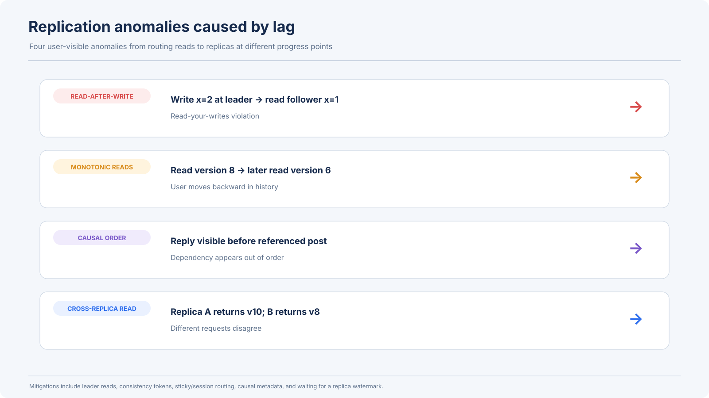

**Diagram specification — replication anomalies.** Four lanes: read-after-write, non-monotonic read, write-dependency ordering, causal predecessor delay. Route client requests to replicas with different applied versions. Label user-visible anomalies and prevention: leader/token routing, minimum-version token, session write sequence, dependency-aware delivery.

---

# 12. Quorum Replication

## 12.1 Definition and Intersection

A **quorum** is a set of replicas large enough to satisfy a protocol's acknowledgment/agreement threshold. In a simplified read/write quorum system with N replicas, a common sufficient condition for read/write set intersection is:

\[
R + W > N
\]

`N` is replica count, `R` is read responses required, and `W` is write acknowledgments required. If read and write choose subsets from the same fixed set of N replicas, every possible read set and write set intersect.

## 12.2 Numerical Examples

| N | R | W | `R + W > N`? | Minimum intersection | Unavailable replicas tolerated by simple threshold |
|---:|---:|---:|---|---:|---|
| 3 | 2 | 2 | Yes (4 > 3) | 1 | 1 for read; 1 for write |
| 5 | 3 | 3 | Yes (6 > 5) | 1 | 2 for each |
| 7 | 4 | 4 | Yes (8 > 7) | 1 | 3 for each |

For N=3, read set `{A,B}` and write set `{B,C}` intersect at B. This is a set fact, not proof that B has the newest value or operations have a single real-time order.

The minimum possible intersection is:

\[
|Q_R\cap Q_W|\ge R+W-N
\]

## 12.3 Majority and Failure Tolerance

For odd N, majority is `floor(N/2)+1`. It can tolerate up to `floor((N-1)/2)` crash failures while retaining a majority, assuming correct membership and the protocol's failure model. N=3 tolerates one unavailable voter; N=5 tolerates two. A two-node side of a three-node consensus group cannot safely elect/commit if the third node is unreachable and the rule requires a majority.

## 12.4 Why Quorum Intersection Is Not Linearizability

`R+W>N` assumes the same fixed membership set. Real systems may define quorums over voting members, data-bearing replicas, a local data center, or a placement group. Reads may collect more responses than they return; writes may be hinted to fallback nodes; concurrent writes may not have a global order; version selection and repair policy affect the read result; membership can change.

**Quorum intersection alone does not guarantee linearizability.** It does not establish operation order, replica freshness, or that the intersecting replica preserves a completed write. Linearizability needs an ordering/commit protocol and safe read behavior, such as consensus terms/commit indexes and read barriers.

## 12.5 Worked N=3, R=2, W=2

Initially `x=1` on A, B, C. A write `x=2` reaches A and B and gets two acknowledgments; C remains stale. A later read queries B and C. It sees versions 2 and 1. If version metadata guarantees 2 supersedes 1, coordinator can return 2 and repair C. The intersection proves at least one write-set member participates in each read set; it does not itself define how to choose the correct value.

## 12.6 Quorum Variants

- **Weighted quorum:** replicas have weights; quorum thresholds use weight rather than count. Intersection must be proven for the chosen scheme.
- **Dynamic quorum:** membership or threshold changes under a protocol. Safe reconfiguration must preserve intersection; changing N/R/W casually is unsafe.
- **Sloppy quorum:** fallback nodes can count even though they are not natural replicas. This improves availability but changes the simple natural-set intersection argument.
- **Strict quorum:** acknowledgments come from the key's natural replica set.

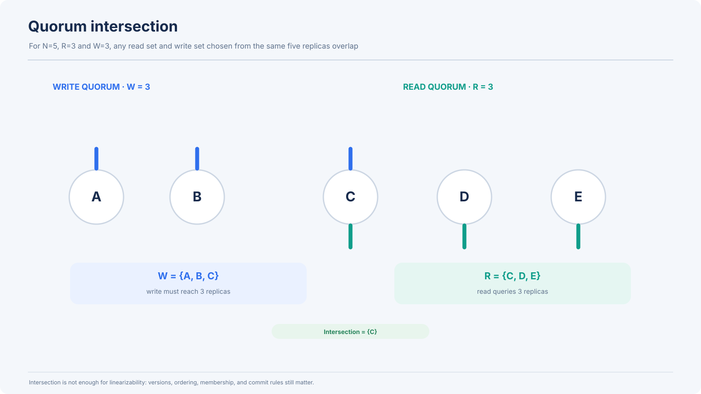

**Diagram specification — quorum intersection.** Show three replica circles A/B/C. Shade write quorum `{A,B}` and read quorum `{B,C}`; B is visibly shared. Add five-replica inset with R=3/W=3. Display `R+W>N`; annotate that intersection alone does not establish linearizability, ordering, or freshness.

---

# 13. Sloppy Quorums and Hinted Handoff

## 13.1 Sloppy Quorum

A strict quorum sends requests to the key's natural replica set and counts acknowledgments from that set. A **sloppy quorum** may use reachable substitute nodes when natural replicas are unavailable.

Example: natural replicas are A, B, C with N=3; C is down. Coordinator asks A, B, and fallback D to store an update. A and D acknowledge. This may satisfy an availability target even though only one natural replica has the data. It is not the same intersection guarantee as a strict quorum over `{A,B,C}`.

## 13.2 Hinted Handoff Workflow

1. A write is destined for natural replica C.
2. C cannot be reached.
3. Fallback D accepts the mutation with a hint naming C as intended owner.
4. Coordinator returns success if configured policy is met.
5. C recovers.
6. D delivers the hinted mutation to C.
7. C applies it using its version/conflict rules.
8. D removes or marks the hint complete according to implementation.

Hints can expire, be lost, or fail to cover every missed mutation. Hinted handoff is a convergence aid, not a replacement for full repair. Cassandra describes hints as best-effort and recommends repair to discover missed data reliably: [Cassandra hints](https://cassandra.apache.org/doc/stable/cassandra/managing/operating/hints.html), [Cassandra repair](https://cassandra.apache.org/doc/stable/cassandra/managing/operating/repair.html).

## 13.3 Advantages and Limitations

| Advantage | Limitation |
|---|---|
| Accept writes when natural replicas are unavailable | Fallback placement is temporary, not equivalent to natural placement |
| Reduces divergence after recovery | Hints can expire or be incomplete |
| Improves availability for selected workloads | Ownership/repair reasoning becomes more complex |
| Incremental recovery | Does not guarantee every missed write is delivered |

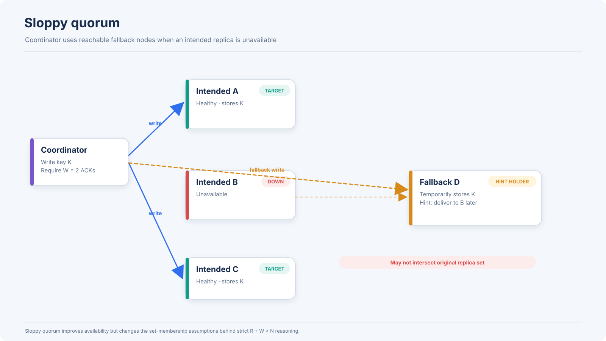

**Diagram specification — sloppy quorum.** Show natural replica set A/B/C for K; C is unavailable. Coordinator sends to A, B, and fallback D. Mark D “temporary copy / hint for C.” Contrast strict quorum (natural members only) with sloppy quorum (substitute node accepted). Note that original natural-set intersection assumptions no longer apply directly.

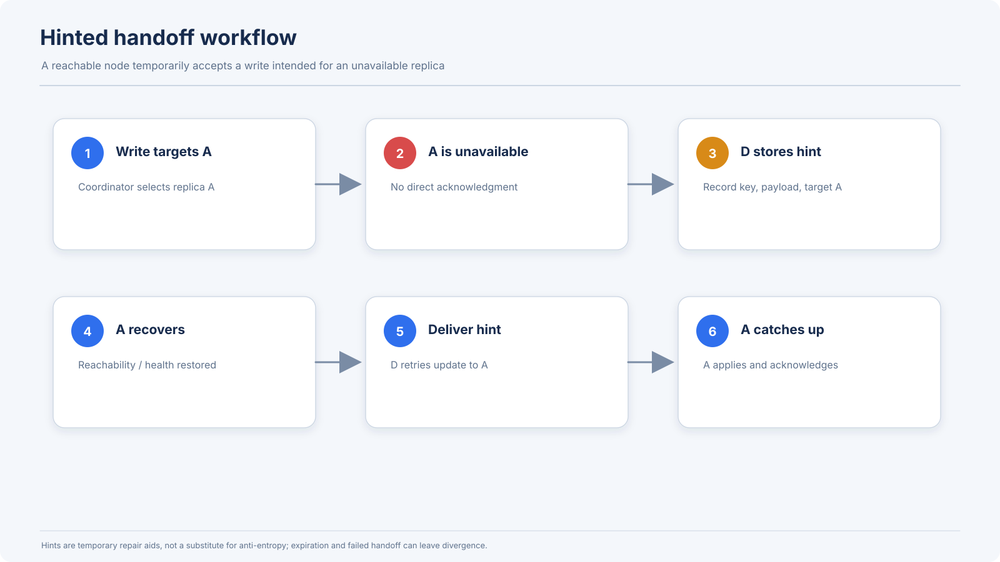

**Diagram specification — hinted handoff workflow.** Sequence diagram with coordinator, C unavailable, fallback D, and C after recovery. Number: mutation intended for C; failure; store mutation plus hint at D; client success; C recovers; D delivers hint; C applies; D clears hint. Add expiry/failure branch and note anti-entropy remains required.

---

# 14. Read Repair

## 14.1 Definition and Workflow

**Read repair** detects divergence as part of serving a read and attempts to align stale replicas. A coordinator queries several replicas, compares returned versions/digests, selects or merges the result according to database semantics, and sends repair mutations to stale replicas.

1. Client requests `GET(K)`.
2. Coordinator queries A, B, C.
3. Responses include values and version metadata.
4. Coordinator sees A has V8 while B/C have V7.
5. It selects/merges according to reconciliation semantics.
6. It returns the result and may send repair to stale replicas.

## 14.2 Product-Specific Terminology

Read repair may be foreground/blocking or background/asynchronous. Cassandra 5.0 documentation describes foreground repair for replicas involved in a read at the requested consistency level; the read waits until up-to-date data is constructed. Behavior and terminology have changed across Cassandra versions, so do not project 5.0 semantics onto every historical version. [Cassandra 5.0 read repair](https://cassandra.apache.org/doc/stable/cassandra/managing/operating/read_repair.html)

Read repair is not full anti-entropy repair: it only examines keys/partitions involved in reads. Cold keys may never be repaired by read repair alone.

## 14.3 Types and Considerations

- **Foreground/blocking:** read waits for repair/reconciliation work.
- **Background:** read can return while repair is scheduled separately.
- **Partial:** only read participants/keys are compared.
- **Full/incremental repair:** operator/scheduler compares token ranges; commonly grouped under anti-entropy, not ordinary read repair.

Costs include read latency, write amplification, tombstone handling, incomplete coverage, concurrent writes during repair, and the need for valid version-comparison semantics.

## 14.4 Example

| Replica | Value | Version | Interpretation |
|---|---|---:|---|
| A | `email=a@example.com` | 8 | Newest known version |
| B | `email=old@example.com` | 7 | Stale |
| C | `email=old@example.com` | 7 | Stale |

If V8 causally supersedes V7, the coordinator can return V8 and repair B/C. If metadata indicates concurrency, choosing the numerically largest label is valid only if that label's ordering semantics guarantee dominance.

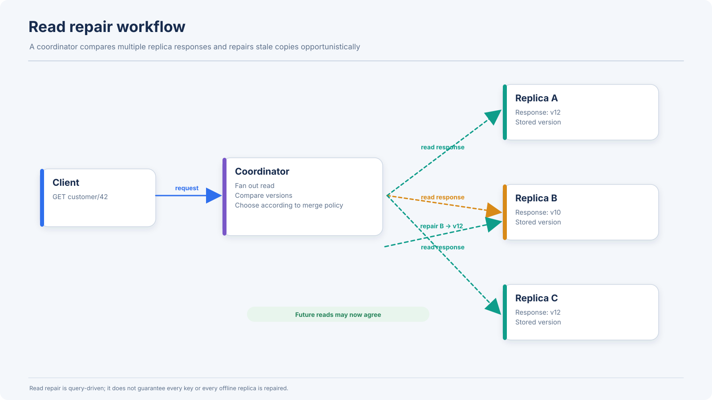

**Diagram specification — read repair.** Client/coordinator fan-out to A/B/C; responses V8/V7/V7 with metadata; coordinator compares and returns V8; repair messages go to B/C. Show foreground (response waits) and background (response returns before repair) as alternatives, labeled implementation-dependent.

---

# 15. Anti-Entropy and Merkle Trees

## 15.1 Anti-Entropy

**Anti-entropy** is background synchronization that compares replicas and transfers missing/different data. It is essential when writes, hints, or reads fail to reach every replica.

| Mechanism | Trigger | Scope | Purpose |
|---|---|---|---|
| Log replication | New log record | Continuous stream | Propagate updates in order |
| Hinted handoff | Replica missed a write | Specific hinted mutations | Deliver missed writes after recovery |
| Read repair | Read discovers divergence | Keys in that read | Opportunistically fix observed divergence |
| Anti-entropy repair | Scheduled/manual comparison | Broad key/token ranges | Find missed data even if never read |
| Snapshot/base copy | Replica creation or unrecoverable log gap | Large dataset range | Establish a new baseline before replay |

Cassandra states hints and read repair are best-effort; anti-entropy repair compares common token ranges using Merkle trees and streams mismatched data. Its repair docs distinguish full and incremental repair and recommend operational repair practices: [Cassandra repair](https://cassandra.apache.org/doc/stable/cassandra/managing/operating/repair.html).

## 15.2 Merkle Tree Fundamentals

A **Merkle tree** is a hierarchy of hashes. Leaves summarize data blocks/ranges; each internal node hashes the concatenation of its children's hashes; the root summarizes the entire range.

\[
H_{parent}=Hash(H_{left}\;||\;H_{right})
\]

`||` means concatenation. If roots match, the canonicalized range is overwhelmingly likely to match under the hash assumptions. If roots differ, compare children recursively until divergent leaves/ranges are found.

## 15.3 Numerical 16-Key Example

Split 16 keys into four buckets of four. Suppose Replica A and B differ in:

- Bucket 1: `k03` has different values.
- Bucket 3: `k11` is present only on A.
- Bucket 4: `k16` is present only on B.

The leaf hash is computed from deterministic serialization of ordered key/value rows. A conceptual tree is:

```text
                    Root
                 /        \\
             H(1,2)      H(3,4)
             /   \\        /   \\
           H1     H2    H3     H4
```

If `H1_A != H1_B`, `H2_A = H2_B`, `H3_A != H3_B`, and `H4_A != H4_B`, the protocol descends into buckets 1, 3, and 4 and transfers only their divergent data. This four-leaf teaching example is not the exact Cassandra tree implementation.

## 15.4 Complexity and Limitations

A balanced binary tree with M leaves has depth `O(log M)`. If few ranges differ, hierarchical comparison can localize them without transferring the entire dataset. Hash construction may still cost O(M) unless incrementally maintained. Tree building, canonical serialization, tombstone treatment, partitioning, and network transfer add overhead.

Both replicas must hash the same logical ranges and canonical representation. Schema mismatch, token-range disagreement, inconsistent tombstone handling, or nondeterministic serialization makes comparison unreliable. Cryptographic collision probability is treated as negligible with a suitable hash, not mathematically zero.

## 15.5 Applications

Cassandra anti-entropy repair, Dynamo-inspired stores, distributed object storage, content-addressed systems, backup verification, and partitioned dataset synchronization. Not every system uses Merkle trees; repair scheduling and tree structure are product-specific.

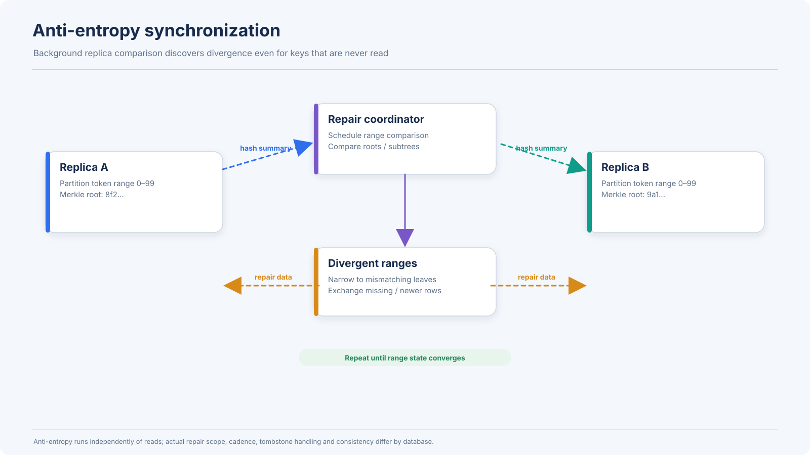

**Diagram specification — anti-entropy synchronization.** Show replicas A/B holding the same token range. Each computes a Merkle tree; roots differ. Comparison descends only into mismatching subtrees, then streams differing key ranges. Label continuous log replication versus periodic anti-entropy repair, plus scheduler and throttling controls.

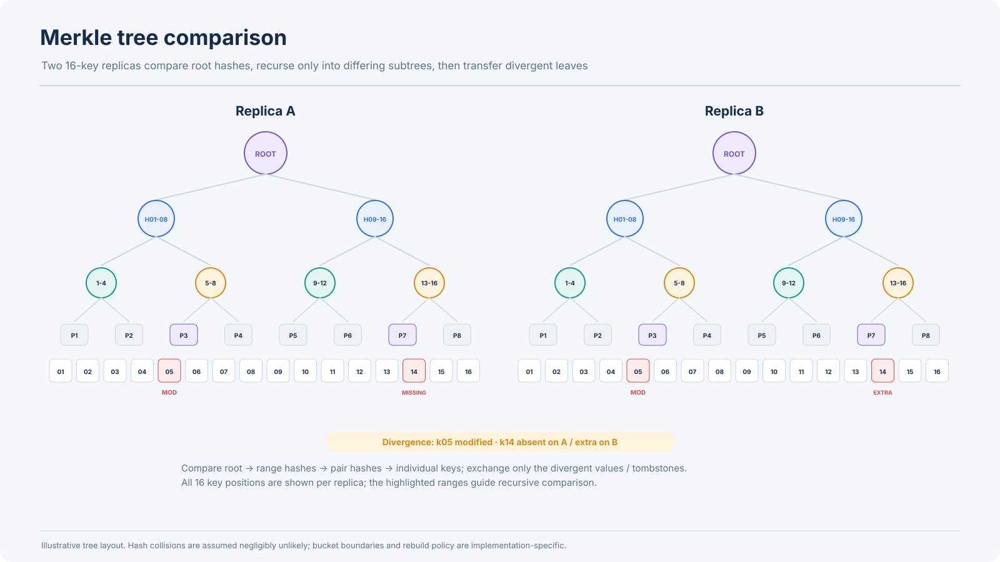

**Diagram specification — Merkle comparison.** Show two trees for 16 keys/four buckets. Equal hashes in matching branches; differing hashes for buckets containing `k03`, missing `k11`, and extra `k16`. Highlight recursive traversal from root to mismatched leaves. Add parent hash equation and final record exchange/convergence.

# 16. Conflict Resolution

Replication transports state; it does not, by itself, decide which concurrent update is correct. A conflict exists when two or more replicas have accepted updates that cannot all be applied in the same order-independent way under the application's data semantics. A database may detect concurrency, overwrite one value, retain multiple siblings, merge values, or ask application code to decide.

## 16.1 Why conflicts occur

Common causes include:

- **Concurrent writes:** two clients read the same old version and independently write successors.
- **Multi-leader operation:** different leaders accept writes before hearing about one another's changes.
- **Partition or disconnection:** replicas continue accepting writes while communication is unavailable.
- **Offline clients:** changes created offline arrive after newer online changes.
- **Delayed or reordered delivery:** messages arrive in a different order from the order in which updates were created.
- **Duplicate delivery:** retry mechanisms may deliver the same logical operation more than once unless it is idempotent or deduplicated.
- **Independent fields:** two edits to different fields may be safely merged even when whole-record last-write-wins would discard one.

A conflict policy has at least three separate jobs: detect whether versions are concurrent, represent the alternatives and their causal context, and select or merge a result consistent with business semantics.

# 17. Last-Write-Wins (LWW)

## 17.1 LWW register and conflict semantics

An LWW register stores a value with an ordering tag, commonly `(timestamp, tie_breaker)`. On receiving two versions, it chooses the version with the greatest tag. A deterministic tie-breaker (for example, stable replica ID) is needed if timestamps tie.

Suppose two replicas start with `address = "Old"`:

| Event | Replica A | Replica B |
|---|---|---|
| Initial | Old, tag (100, A) | Old, tag (100, A) |
| Local update | "Pune", tag (110, A) | "Delhi", tag (108, B) |
| Replication delayed | still Pune | still Delhi |
| Reconcile | compares (110,A) and (108,B) | compares the same pair |
| Final | Pune | Pune |

This is deterministic, but it is not necessarily semantically correct. update can be lost even if it represented a more important business action. Wall clocks can be skewed, adjusted, or have different precision. A later physical timestamp does not prove that the corresponding operation happened later in real time. A database may use hybrid/logical timestamps or a specific server-side conflict rule, but that still does not make LWW a semantic merge.

Use LWW for values where “one deterministic winner” is acceptable, such as a best-effort display preference. Avoid using it as the only protection for balances, inventory decrements, or append-only facts. Some products use LWW at a narrower scope (for example, per cell or column); verify exact product semantics.

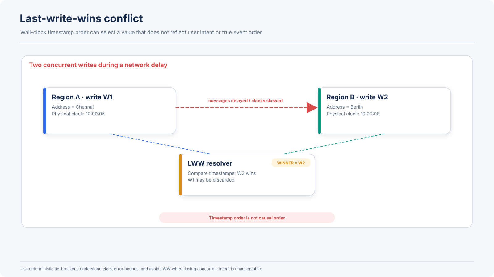

**Diagram specification — LWW conflict.** Two region replicas begin at version v7. Region A writes “Pune” with tag (110,A); Region B writes “Delhi” with tag (108,B) before either receives the other update. Arrows show delayed bidirectional replication, both replicas compare tags, and both converge to “Pune”. Add a warning callout: deterministic winner is not necessarily the business-correct winner; skewed clocks can choose an unintuitive result.

# 18. Version Vectors

## 18.1 Causal metadata and comparison

A version vector records a counter for each replica that has contributed to a version. A vector such as `{A: 3, B: 1, C: 0}` describes causal progress known to the replica. For vectors x and y:

- x is **before** y when every component of x is less than or equal to the corresponding component of y and at least one is strictly smaller.
- x is **after** y when y is before x.
- x and y are **concurrent** when neither dominates the other.

Example:

| Version | Vector | Relationship |
|---|---|---|
| v1 | `{A:1,B:0,C:0}` | ancestor of v2 and v3 |
| v2 | `{A:2,B:0,C:0}` | concurrent with v3 |
| v3 | `{A:1,B:1,C:0}` | concurrent with v2 |
| merged context | `{A:2,B:1,C:0}` | dominates both v2 and v3 once the merge is recorded |

Version vectors are not timestamps. They capture causal knowledge and can identify concurrency, but metadata grows with replica identities and membership changes require careful handling. A version vector also does not decide how application values should be merged. The system may preserve siblings for a client-side resolver, apply a CRDT merge, or invoke domain-specific code.

```python
from enum import Enum

class Relation(Enum):
    BEFORE = "before"
    AFTER = "after"
    EQUAL = "equal"
    CONCURRENT = "concurrent"

def compare_vectors(a: dict[str, int], b: dict[str, int]) -> Relation:
    keys = set(a) | set(b)
    a_le_b = all(a.get(k, 0) <= b.get(k, 0) for k in keys)
    b_le_a = all(b.get(k, 0) <= a.get(k, 0) for k in keys)
    if a_le_b and b_le_a:
        return Relation.EQUAL
    if a_le_b:
        return Relation.BEFORE
    if b_le_a:
        return Relation.AFTER
    return Relation.CONCURRENT

v2 = {"A": 2, "B": 0, "C": 0}
v3 = {"A": 1, "B": 1, "C": 0}
print(compare_vectors(v2, v3).value)  # concurrent
```

This teaching function assumes missing components are zero and uses a fixed identity namespace. Production systems must handle replica reincarnation, compacted identities, vector metadata growth, and the distinction between a replica ID and a process instance.

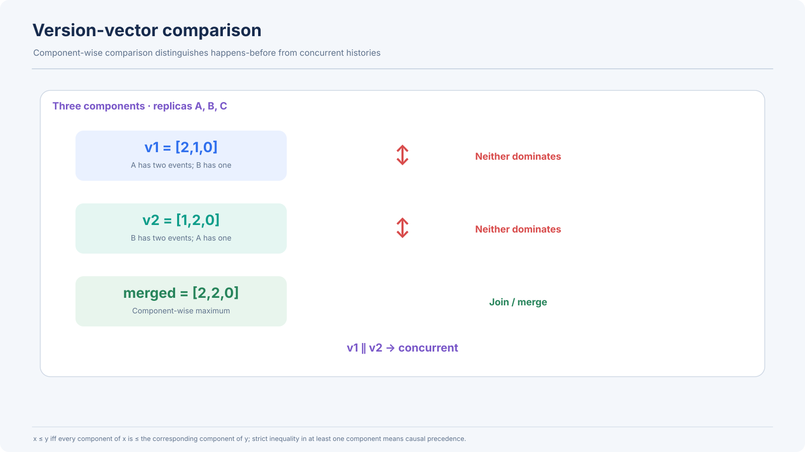

**Diagram specification — version-vector comparison.** Show three vector cards v1 `{A:1,B:0,C:0}`, v2 `{A:2,B:0,C:0}`, v3 `{A:1,B:1,C:0}`. Draw a causal edge v1→v2 and v1→v3; place v2 and v3 side by side with a “concurrent” label. Show the merge context `{A:2,B:1,C:0}` above both. Annotate component-wise comparison and “vector detects concurrency; application still chooses merge semantics”.

# 19. Conflict-Free Replicated Data Types (CRDTs)

A CRDT is a data type designed so that replicas can accept operations or state updates independently and still converge when they exchange the required information, under the CRDT's stated delivery and identity assumptions. CRDTs are not a generic switch that makes arbitrary business data conflict-free: the data type's semantics determine which concurrent outcomes are legal.

## 19.1 Convergence properties

Strong eventual consistency is commonly described by three properties: (1) replicas that have received the same updates eventually reach equivalent state; (2) updates are eventually delivered; and (3) replicas process updates according to the CRDT's required rules. The algebraic properties make message order and duplication manageable.

For a state-based CRDT, a merge operation is typically:

- **Commutative:** `merge(a,b) = merge(b,a)`.
- **Associative:** `merge(merge(a,b),c) = merge(a,merge(b,c))`.
- **Idempotent:** `merge(a,a) = a`.

The state space forms a join-semilattice with a partial order and a least upper bound (join). Each update moves state monotonically upward in that order. The merge computes the least upper bound of states.

An operation-based CRDT instead disseminates operations. It normally relies on operations being delivered at least once and on a causal or otherwise suitable delivery guarantee; concurrent operations must commute, or the protocol must provide stronger ordering. Do not assume all operation-based CRDTs tolerate arbitrary message reordering or duplicate delivery.

## 19.2 State-based and operation-based CRDTs

| Property | State-based (CvRDT) | Operation-based (CmRDT) |
|---|---|---|
| Disseminated item | State or state delta | Operation |
| Merge | Join/merge function | Apply delivered operation |
| Delivery | Can tolerate reorder/duplication when merge is a valid join | Depends on operation commutativity and delivery assumptions |
| Network cost | May send larger state; delta-state can reduce this | Often small operations |
| Main challenge | State size and merge design | Reliable, correctly ordered dissemination |

## 19.3 G-Counter

A grow-only counter stores one non-decreasing component per replica. A replica increments only its own component; merge takes the component-wise maximum; the visible count is the sum.

```python
class GCounter:
    def __init__(self, replica_ids):
        self.counts = {r: 0 for r in replica_ids}

    def increment(self, replica_id, amount=1):
        if amount < 0:
            raise ValueError("G-Counter increments must be non-negative")
        self.counts[replica_id] += amount

    def merge(self, other):
        for replica_id, value in other.counts.items():
            self.counts[replica_id] = max(self.counts.get(replica_id, 0), value)

    def value(self):
        return sum(self.counts.values())

a = GCounter(["A", "B"]); b = GCounter(["A", "B"])
a.increment("A", 2); b.increment("B", 3)
a.merge(b); b.merge(a)
print(a.value(), b.value())  # 5 5
```

This assumes each replica's component has a single writer and replica identity is stable. If two independent processes both write the same component, max-merging can lose increments. Real deployments need unique actor identities or an allocation scheme.

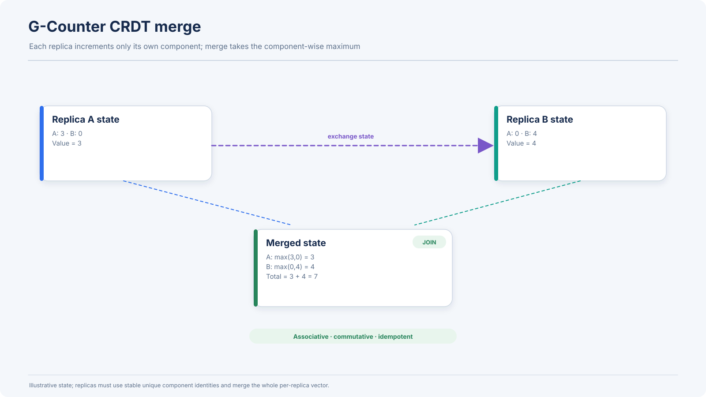

**Diagram specification — G-Counter merge.** Show replica A state `[A:2,B:0]`, replica B state `[A:0,B:3]`; arrows exchange states; both apply component-wise max to reach `[A:2,B:3]`, visible value 5. Label the single-writer-per-component assumption and sum operation.

## 19.4 PN-Counter

A PN-Counter composes two grow-only counters: P for increments and N for decrements. Its value is `sum(P) - sum(N)`. Each replica increments its own P or N component and merge takes component-wise maxima for both maps.

```python
class PNCounter:
    def __init__(self, replica_ids):
        self.p = {r: 0 for r in replica_ids}
        self.n = {r: 0 for r in replica_ids}

    def increment(self, replica_id, amount=1):
        if amount < 0: raise ValueError("amount must be non-negative")
        self.p[replica_id] += amount

    def decrement(self, replica_id, amount=1):
        if amount < 0: raise ValueError("amount must be non-negative")
        self.n[replica_id] += amount

    def merge(self, other):
        for r in set(self.p) | set(other.p):
            self.p[r] = max(self.p.get(r, 0), other.p.get(r, 0))
            self.n[r] = max(self.n.get(r, 0), other.n.get(r, 0))

    def value(self):
        return sum(self.p.values()) - sum(self.n.values())

x = PNCounter(["A", "B"]); y = PNCounter(["A", "B"])
x.increment("A", 5); y.decrement("B", 2)
x.merge(y); print(x.value())  # 3
```

A PN-Counter does not inherently enforce a non-negative business balance. Two offline clients can decrement below zero. If overdraft prevention is required, a coordination or escrow/rights-allocation design is needed.

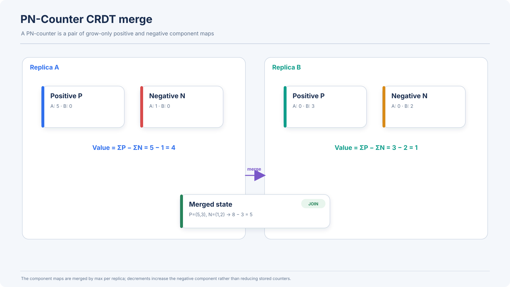

**Diagram specification — PN-Counter merge.** Show P and N component vectors on two replicas. Replica A adds 5 to P[A]; B adds 2 to N[B]. Exchange and component-wise max produce P sum 5, N sum 2, value 3. Include note that this merge does not enforce business invariants such as non-negative balance.

## 19.5 G-Set and 2P-Set

A grow-only set (G-Set) supports add and union-based merge. It cannot remove an element.

```python
class GSet:
    def __init__(self, items=()): self.items = set(items)
    def add(self, item): self.items.add(item)
    def merge(self, other): self.items |= other.items

a = GSet(["tea"]); b = GSet(["coffee"]); a.merge(b)
print(sorted(a.items))  # ['coffee', 'tea']
```

A two-phase set (2P-Set) has an add set and a remove set. An element is present when it is in `adds` but not in `removes`. Merge unions both sets. Once removed, an element cannot be re-added because the tombstone remains in the remove set.

```python
class TwoPSet:
    def __init__(self): self.adds, self.removes = set(), set()
    def add(self, item): self.adds.add(item)
    def remove(self, item):
        if item in self.adds: self.removes.add(item)
    def contains(self, item): return item in self.adds and item not in self.removes
    def merge(self, other):
        self.adds |= other.adds
        self.removes |= other.removes

x = TwoPSet(); x.add("task-7"); x.remove("task-7")
print(x.contains("task-7"))  # False
```

The 2P-Set's permanent tombstone is simple but means re-add semantics are impossible without a new identity or a different CRDT.

## 19.6 Observed-Remove Set (OR-Set)

An OR-Set attaches unique tags to additions. A remove operation removes only the tags it has observed. A concurrent add with a new tag survives. This is a useful semantic distinction: an unseen concurrent add is not accidentally erased by a remove that could not have observed it.

```python
class ORSet:
    def __init__(self):
        self.adds = {}       # element -> set of unique tags
        self.removed = set() # observed tags removed
        self._next = 0       # teaching-only tag generator

    def add(self, element, replica="local"):
        self._next += 1
        tag = (replica, self._next)
        self.adds.setdefault(element, set()).add(tag)
        return tag

    def remove(self, element):
        self.removed |= self.adds.get(element, set())

    def contains(self, element):
        return bool(self.adds.get(element, set()) - self.removed)

    def merge(self, other):
        for element, tags in other.adds.items():
            self.adds.setdefault(element, set()).update(tags)
        self.removed |= other.removed

x, y = ORSet(), ORSet()
x.add("blue", "A"); y.merge(x)
y.remove("blue")
x.add("blue", "A")  # a new concurrent tag not seen by y's remove
x.merge(y); y.merge(x)
print(x.contains("blue"), y.contains("blue"))  # True True
```

This sketch omits production-grade globally unique tag generation, causal context compaction, and careful delta dissemination. A real OR-Set's remove operation records the observed tags at its replica; replicas must not reuse tags.

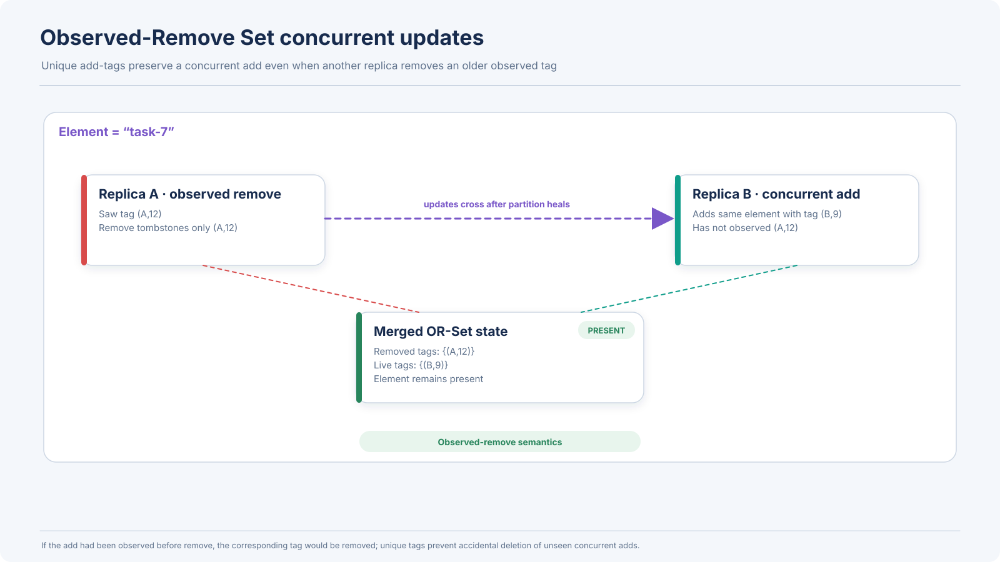

**Diagram specification — OR-Set concurrent add/remove.** Two replicas begin with element `blue` tagged `t1`. B removes the tag it observed; while disconnected, A performs a new add tagged `t2`. Exchange causal state: tombstone removes `t1`, but `t2` remains live. Both replicas converge to `blue` present. Contrast this with a remove that observes both tags, which would remove both.

## 19.7 LWW-Register and replicated maps

An LWW-Register keeps one value plus a deterministic ordering tag and merges by maximum tag. It is easy to implement but inherits the timestamp and lost-update limitations described in Section 17.1. A replicated map composes registers, counters, sets, or nested CRDTs per field. Field-level composition can preserve independent edits to different fields, but it does not automatically preserve cross-field invariants. For example, `quantity` and `price` fields converging independently is not equivalent to an atomic transaction over both fields.

```python
class LWWRegister:
    def __init__(self, value=None, tag=(0, "")):
        self.value, self.tag = value, tag
    def assign(self, value, timestamp, replica_id):
        candidate = (timestamp, replica_id)
        if candidate > self.tag:
            self.value, self.tag = value, candidate
    def merge(self, other):
        if other.tag > self.tag:
            self.value, self.tag = other.value, other.tag

left = LWWRegister("old")
right = LWWRegister("old")
left.assign("A", 10, "east"); right.assign("B", 11, "west")
left.merge(right); right.merge(left)
print(left.value, right.value)  # B B
```

A proper LWW-register specification must define timestamp source, tie-breaking, and behavior for duplicate tags. The code uses tuple comparison and assumes replica IDs are stable. Hybrid logical clocks can improve ordering behavior but cannot infer business intent.

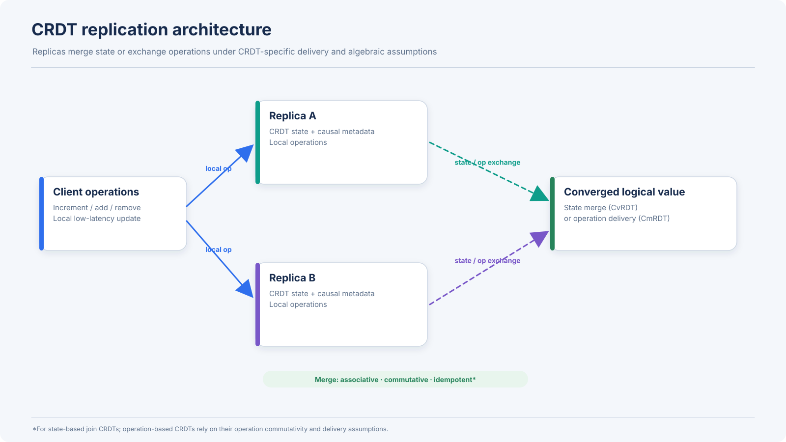

**Diagram specification — CRDT architecture.** Show three replicas accepting local operations independently; local CRDT states generate state deltas or operations; asynchronous network delivers them; merge/application functions are labeled with their assumptions; all replicas converge to equivalent state. Split the picture into state-based and operation-based dissemination lanes and annotate commutativity, associativity, idempotence, and delivery assumptions.

## 19.8 Choosing CRDTs and their limitations

Good fits include aggregate counters, unique tags, shared checklists, presence/observed membership, and offline edits with well-defined merge semantics. Poor fits include operations requiring global uniqueness, strict inventory reservation without preallocated rights, bank balances with overdraft constraints, and arbitrary relational transactions.

Common costs include metadata growth, tombstones, causal contexts, compaction/garbage collection, actor identity management, and network traffic. A CRDT gives convergent semantics for its type; it does not guarantee every application invariant. Define those invariants before selecting a CRDT.

# 20. Operational Transformation (OT)

Operational Transformation is a family of techniques for making concurrent edits to a shared document converge by transforming an incoming operation against operations that have already been applied. Unlike a CRDT, OT generally relies on a transformation algorithm and a well-defined operation history or control protocol. Different OT algorithms have different correctness conditions; one small example is not a universal OT implementation.

## 20.1 Basic operations and insertion example

Let a document be a string with zero-based positions. `Insert(p, c)` inserts character `c` before the character currently at position p. Start with `HELLO`:

- User A inserts `X` at position 1: local result `HXELLO`.
- User B inserts `Y` at position 3: local result `HEYLLO`.

Suppose A's operation is ordered first by the collaboration server. B's insertion position must be transformed against A's insertion. Because A inserted before B's original position, B's position shifts by one: `Insert(3,Y)` becomes `Insert(4,Y)`. Applying both in that order produces `HXELYLO`.

If B were ordered first, A's insertion at position 1 is unchanged because B inserted after that position. Applying B then A also produces `HXELYLO`. A stable tie-breaker is needed for two insertions at the same position.

```python
def apply_insert(text, pos, char):
    if not 0 <= pos <= len(text):
        raise IndexError("insert position out of range")
    return text[:pos] + char + text[pos:]

def transform_insert_after_insert(incoming_pos, prior_pos):
    # Prior operation is already applied. This assumes distinct positions.
    return incoming_pos + 1 if prior_pos <= incoming_pos else incoming_pos

base = "HELLO"
a_pos, b_pos = 1, 3
text = apply_insert(base, a_pos, "X")
b_transformed = transform_insert_after_insert(b_pos, a_pos)
print(apply_insert(text, b_transformed, "Y"))  # HXELYLO
```

For same-position inserts, define a deterministic ordering (for example, operation ID) and transform accordingly. Deletes, overlapping ranges, Unicode indexing, cursor positions, rich-text attributes, and undo require additional rules.

## 20.2 Concurrent delete and insert

Suppose the base text is `ABCDE`. A deletes `B` at index 1; B inserts `X` at index 3 (before `D` in the base document). If delete is applied first, the text becomes `ACDE` and the insertion shifts left to index 2, producing `ACXDE`. If insertion is applied first, the text becomes `ABCXDE`; the deletion still targets `B` at index 1, also producing `ACXDE`. This example assumes character-index operations and that the delete target is identified consistently.

## 20.3 Transformation properties

- **TP1 (convergence condition):** transforming two concurrent operations so that either application order reaches the same document state.
- **TP2 (path consistency condition):** in algorithms that need it, transforming along different paths through a concurrent operation set must yield equivalent operations/results. Exact statement and necessity depend on algorithm and concurrency-control model.
- **Inclusion transformation:** adjusts an incoming operation to include effects of operations already applied.
- **Exclusion transformation:** adjusts an operation relative to effects it should not include, used in some OT formulations.

OT is more than shifting indexes. A production protocol must define server ordering, operation context/version, transformation matrix or algorithm, duplicate handling, reconnect behavior, and correctness for every operation pair.

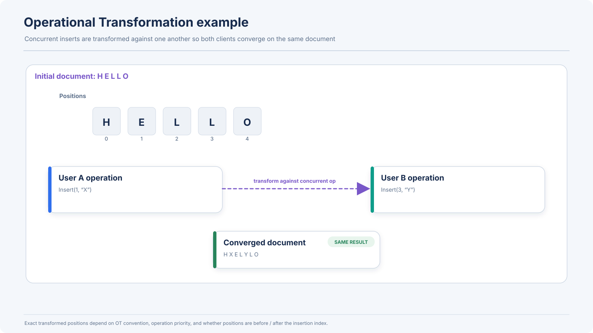

**Diagram specification — OT concurrent editing.** Show base document `HELLO`, two clients issuing `Insert(1,X)` and `Insert(3,Y)`, a server ordering A before B, transformation of B to `Insert(4,Y)`, and both clients converging to `HXELYLO`. Add a second lane for delete/insert with positions adjusted after the prior operation. Annotate the deterministic same-position tie-break requirement.

## 20.4 OT vs. CRDT

| Dimension | Operational Transformation | CRDT |
|---|---|---|
| Core idea | Transform operations against concurrent history | Design data type and merge/operation semantics to converge |
| Typical coordination | Often server sequencer or explicit operation context | Can allow local updates and later merge |
| Metadata | Operation context and history often required | Tags, causal context, tombstones, or per-replica state |
| Convergence | Correct transformation/control algorithm | Algebraic merge or commutative operation assumptions |
| Offline work | Possible, but reconnect transformation can be complex | Often natural for supported data types |
| Trade-off | Complex transform/history logic | Data-model and metadata complexity |

Collaborative editing products are examples of OT/CRDT-style problem domains, but do not infer a particular product's private algorithm from its user-visible behavior. Public research and engineering papers describe families of designs; implementations may be hybrids.

# 21. Failover and Split-Brain

Failover is the controlled transition from a failed or unavailable primary to an eligible replacement. It is not merely “choose the node that responds fastest.” Correct failover must preserve a single authoritative write history, account for replica freshness, prevent the old primary from continuing to accept writes, and make the new topology discoverable to clients.

## 21.1 Failure detection is suspicion, not proof

A node can stop responding because it crashed, but also because of a slow process, overloaded disk, garbage collection pause, packet loss, asymmetric routing, DNS failure, or a network partition. A timeout therefore means “suspect unavailable,” not “known dead.” Short timeouts improve failover speed but increase false suspicions; long timeouts reduce false positives but extend outage time.

A health check is only one signal. Robust systems combine heartbeats, quorum decisions, lease/term state, process health, and storage/replication status. The exact algorithm depends on the database and its failure model.

## 21.2 Typical failover workflow

1. The primary becomes unreachable or is declared unhealthy.
2. Remaining members exchange heartbeats or votes and determine the eligible membership view.
3. The system elects/promotes one replica under its safety rules.
4. The candidate's log/data is checked against the commit/replication metadata required by the protocol.
5. The new primary receives a new term/epoch or equivalent authority.
6. A routing layer, service discovery mechanism, or client topology refresh directs new writes to it.
7. The old primary is fenced or must rejoin and prove it is no longer authoritative.
8. The old node catches up from the new authoritative history, possibly through log replay or a full resynchronization.

Promotion policy must define what happens if no sufficiently current replica exists. Choosing an older replica may improve recovery time but can lose acknowledged writes if the old primary had acknowledged writes before replicating them.

## 21.3 RPO and RTO

- **Recovery Point Objective (RPO):** maximum acceptable amount of data loss measured in time or equivalent business units.
- **Recovery Time Objective (RTO):** target time to restore service after disruption.

Example: asynchronous replication ships a transaction every 200 ms. If the primary fails just after acknowledging a write but before that record reaches the standby, promoting the standby may lose that write. A 200 ms replication interval does not guarantee RPO=200 ms: queue backlogs and throughput bursts can make lag much larger. Synchronous acknowledgment can reduce this risk, but only if the configured acknowledgment means the required replicas have durably persisted the relevant log record and failover promotes an eligible node with that record.

Illustrative comparison:

| Design | Failure point | Possible result |
|---|---|---|
| Async | primary acknowledges before standby receives record | acknowledged write may be lost on promotion |
| Sync-to-one-standby | client ack waits for one standby to flush record | lower loss risk for that failure model; standby/commit semantics matter |
| Quorum/consensus commit | write acknowledged after replicated log reaches commit rule | committed prefix is protected under protocol assumptions |

“Zero RPO” is a system-level claim requiring a precise failure model, durable storage assumptions, safe election, and fencing; a setting named synchronous is not sufficient evidence on its own.

## 21.4 Split-brain

Split-brain occurs when two or more nodes or partitions independently believe they have write authority. Each may accept locally valid writes, creating divergent histories. When communication returns, the system must reconcile incompatible state; some writes may be lost or require manual resolution. More dangerously, external side effects (payments, emails, actuator commands) may have occurred twice.

Three-node example:

```text
Before partition:       A (primary) ---- B (follower) ---- C (follower)
Partition:              {A}             |             {B, C}
Naive failover:          A accepts W1                 B promoted; accepts W2
After healing:           A has W1                     B has W2
```

If B and C form a majority and the protocol forbids A from continuing to write without a quorum, the single-node side cannot safely commit new writes. If a naive health checker promotes B while A is only network-isolated, both sides can write.

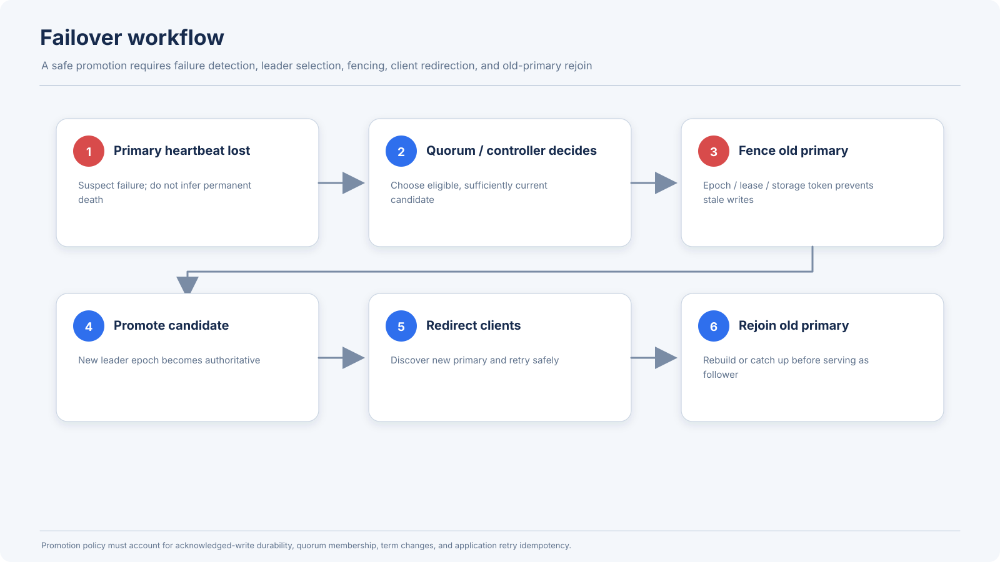

**Diagram specification — failover workflow.** Show primary P and followers S1/S2. Mark heartbeat timeout as suspicion, election/vote stage, candidate freshness check, promotion to a new term, client routing refresh, old-primary fencing, and rejoin/catch-up. Include a branch where no eligible replica is current enough and writes remain unavailable rather than silently promoting stale state.

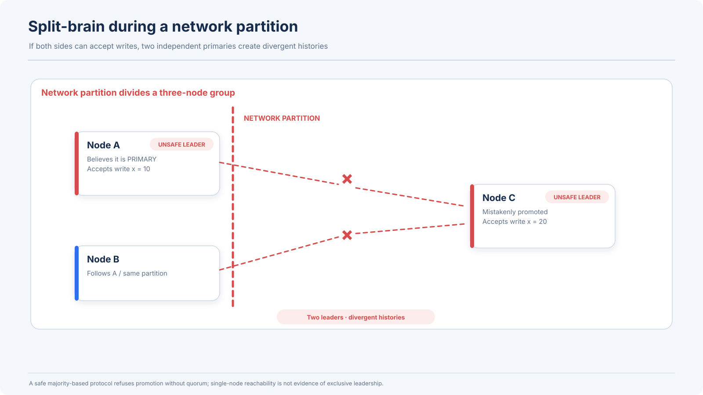

**Diagram specification — split brain.** Draw three nodes with P as former primary and S1/S2 as followers. A network cut isolates P from S1/S2. The majority side elects S1; show an unsafe design where P still accepts W1 and S1 accepts W2. When the partition heals, mark divergent logs and conflict reconciliation. Beside it, show the safe quorum rule preventing P from committing without a majority.

## 21.5 Prevention: quorum, epochs, leases, and fencing

- **Quorum-based leadership:** only a partition that can obtain the required majority may elect/retain the leader. This prevents two disjoint majorities in a fixed membership from both making progress.
- **Term/epoch numbers:** every new leadership term increases a monotonic generation. Messages and writes from an older term can be rejected.
- **Fencing tokens:** a coordinator issues monotonically increasing tokens; the protected resource remembers the highest accepted token and rejects commands carrying a lower token. This is stronger than relying on a client to stop using an expired lease.
- **Leases:** a node may act as leader only until a bounded expiry, under assumptions about clock drift, pause behavior, and lease renewal. A lease alone is unsafe if an old holder can continue issuing operations that the resource does not fence.
- **STONITH (Shoot The Other Node In The Head):** an out-of-band mechanism powers off or isolates a node believed to be faulty. It is used in some cluster managers, but must itself be reliable and correctly integrated.
- **Single-writer enforcement:** storage, gateways, or downstream services validate the current epoch/token rather than trusting a process's local belief.

Fencing example:

```python
class ProtectedStore:
    def __init__(self):
        self.highest_token = 0
        self.value = None

    def write(self, token: int, value: str):
        if token < self.highest_token:
            raise PermissionError("stale lease holder fenced")
        self.highest_token = token
        self.value = value

store = ProtectedStore()
store.write(41, "writer from term 41")
store.write(42, "new leader")
try:
    store.write(41, "delayed stale writer")
except PermissionError as exc:
    print(exc)
```

The token issuer must guarantee monotonic, non-reused tokens, and the protected resource must atomically validate token and apply the write. Merely adding a token to application logs without enforcing it at the resource does not fence anything.

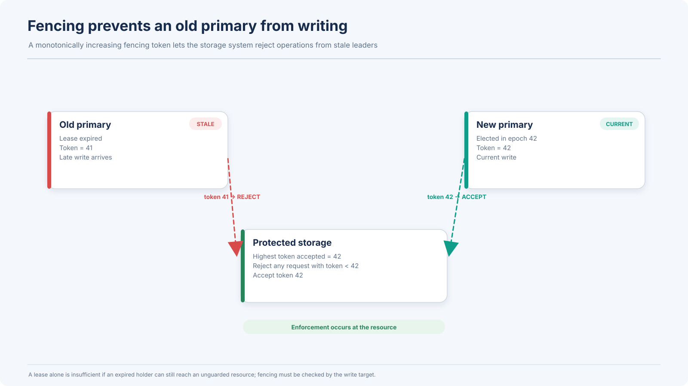

**Diagram specification — fencing old primary.** Timeline with old leader holding token 41, partition and failover, new leader receiving token 42, then delayed request from old leader arriving at storage. Storage rejects 41 because highest accepted token is 42; request with 42 succeeds. Show validation and mutation as one atomic resource-side step.

## 21.6 Recovery and rejoining

A former primary should not simply resume serving writes from its old local state. It must identify the authoritative history, discard or reconcile divergent uncommitted tail entries according to the database protocol, and replay missing committed entries. Systems may use log shipping, incremental catch-up, snapshot plus log replay, or full reinitialization. The recovery process should verify identity, timeline/term, replication position, and data integrity before the node rejoins service.

Operational runbooks should cover split-brain detection, authoritative-side selection, backup/restore, transaction reconciliation, client retry idempotency, and validation of downstream side effects. For strong-correctness systems, preventing two write authorities is preferable to attempting an after-the-fact merge.

# 22. State Machine Replication (SMR)

State machine replication builds a fault-tolerant service by running deterministic state machines on multiple nodes and ensuring they execute the same commands in the same order. A consensus or total-order broadcast protocol orders commands; the state machine itself deterministically applies them.

## 22.1 Model

Let the state at step i be `s_i`, command be `c_i`, and deterministic transition function be `δ`. Each correct replica applies:

\[
s_{i+1} = \delta(s_i, c_i)
\]

If replicas start from equivalent state and apply the same committed command sequence, they reach equivalent state. Replication therefore requires agreement on the ordered committed log, not merely copying arbitrary memory snapshots.

## 22.2 Workflow

1. Client submits a command (for example, `Deposit(account, 10)`).
2. A consensus protocol chooses a position in the replicated log.
3. Replicas persist/replicate the log entry according to protocol rules.
4. Once committed, replicas apply the command in log order.
5. The service returns the result after the protocol's response condition is satisfied.
6. A snapshot may compact old log entries; a recovering replica loads a snapshot and replays the suffix.

A Raft-style design separates leader proposal, log replication, commit-index advancement, and state-machine application. The precise commit rule is protocol-specific. Consensus and state machine execution are related but distinct layers.

## 22.3 Determinism requirements

All replicas must produce the same state transition for the same prior state and command. Uncontrolled wall-clock reads, random numbers, local filesystem order, process-specific IDs, locale-dependent parsing, and external API calls can violate determinism. If a value is nondeterministic, make it part of the ordered command (for example, leader proposes a generated ID or timestamp) so every replica applies the same value.

Do not execute non-idempotent external side effects independently on every replica. Instead, record an intent/transactional outbox entry in replicated state and have a designated effect executor perform the action with an idempotency key. Snapshots must include every part of state required to resume deterministic execution.

## 22.4 Simplified executable state-machine example

```python
from dataclasses import dataclass

@dataclass(frozen=True)
class Command:
    op: str
    account: str
    amount: int

class AccountMachine:
    def __init__(self):
        self.balances = {}

    def apply(self, command: Command):
        balance = self.balances.get(command.account, 0)
        if command.op == "deposit":
            if command.amount <= 0: raise ValueError("amount must be positive")
            self.balances[command.account] = balance + command.amount
        elif command.op == "withdraw":
            if command.amount <= 0 or balance < command.amount:
                raise ValueError("invalid or insufficient withdrawal")
            self.balances[command.account] = balance - command.amount
        else:
            raise ValueError(f"unknown operation: {command.op}")

log = [Command("deposit", "acct-1", 100),
       Command("withdraw", "acct-1", 25)]
replicas = [AccountMachine(), AccountMachine(), AccountMachine()]
for command in log:                 # assume consensus already ordered this log
    for replica in replicas:
        replica.apply(command)
print([r.balances for r in replicas])
# [{'acct-1': 75}, {'acct-1': 75}, {'acct-1': 75}]
```

This example simulates only deterministic replay; it does not implement consensus, durable storage, quorum membership, leader election, or crash recovery. It assumes every replica applies the same valid command sequence exactly once and in the same order.

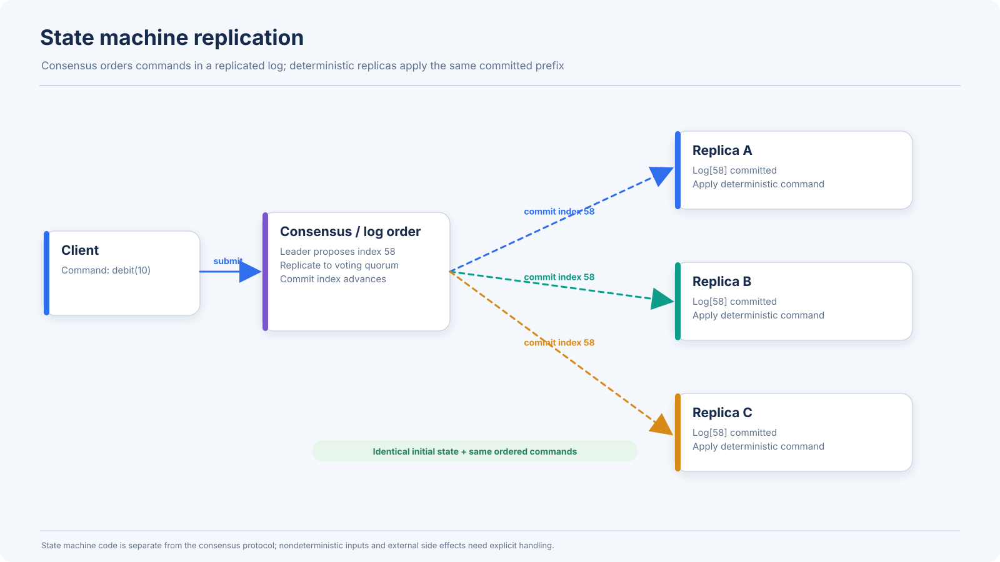

**Diagram specification — state machine replication.** Show client commands entering a consensus/ordered-log layer; three replicas persist the same log entries, advance a commit index, and apply commands to deterministic state machines. Show an identical state output at all replicas. Distinguish consensus ordering from command execution and include a snapshot + suffix-replay recovery path.

## 22.5 Applications

State machine replication underlies coordination services, replicated metadata, configuration stores, consensus-backed databases, and replicated service state. Raft and Paxos are consensus families often used to order the log. ZooKeeper's Zab and etcd's Raft-based implementation are related examples, though product architectures and API guarantees should be read from their own documentation.

# 23. Chain Replication

Chain replication is a primary/follower-style replication protocol arranged as an ordered chain. A write enters at the head, is propagated along the chain, and is acknowledged at the tail. Reads are served by the tail. The original chain-replication work formalizes ordering and reconfiguration assumptions; this is not simply “a leader forwards data to any followers.”

## 23.1 Architecture and write path

For a three-node chain:

```text
Writes: Client -> Head H -> Middle M -> Tail T -> ACK to client
Reads:  Client --------------------------> Tail T
```

1. The client sends an update to H.
2. H applies/records the update and forwards it to M.
3. M applies/records the update and forwards it to T.
4. T applies/records it and acknowledges completion.
5. Only after the tail's acknowledgment does the client treat the update as complete under this simple model.

Because the tail has processed the update before acknowledging, subsequent reads served by the tail observe the acknowledged update, assuming the chain is correctly configured and the tail read does not race with a partially completed request. A write acknowledgment at the head would not provide the same guarantee because downstream nodes might not yet have received the update.

## 23.2 Reads, ordering, and performance

The tail is the serialization point for completed updates in the simple protocol. Serving reads at an earlier node can expose a state that omits a write already acknowledged by the tail. Tail-only reads simplify the read guarantee but concentrate read traffic at one node. Writes traverse every link, so latency grows with chain length and network hops; pipelining can still support throughput when multiple updates are in flight and ordering is preserved.

## 23.3 Failure and reconfiguration

- **Head failure:** choose a successor as new head only after a safe reconfiguration establishes which updates reached which nodes.
- **Middle failure:** the chain must be shortened or repaired while preserving the order of updates already accepted.
- **Tail failure:** select a new tail after ensuring it has every update that the old tail had acknowledged.
- **Node recovery:** a recovered node must receive the correct state/log suffix before rejoining the chain.

Chain reconfiguration is a protocol, not a DNS change. The system needs membership metadata, safe boundary state, and a way to prevent clients from sending requests into an obsolete topology. The original paper's update propagation and reconfiguration rules are important reading for correctness details.

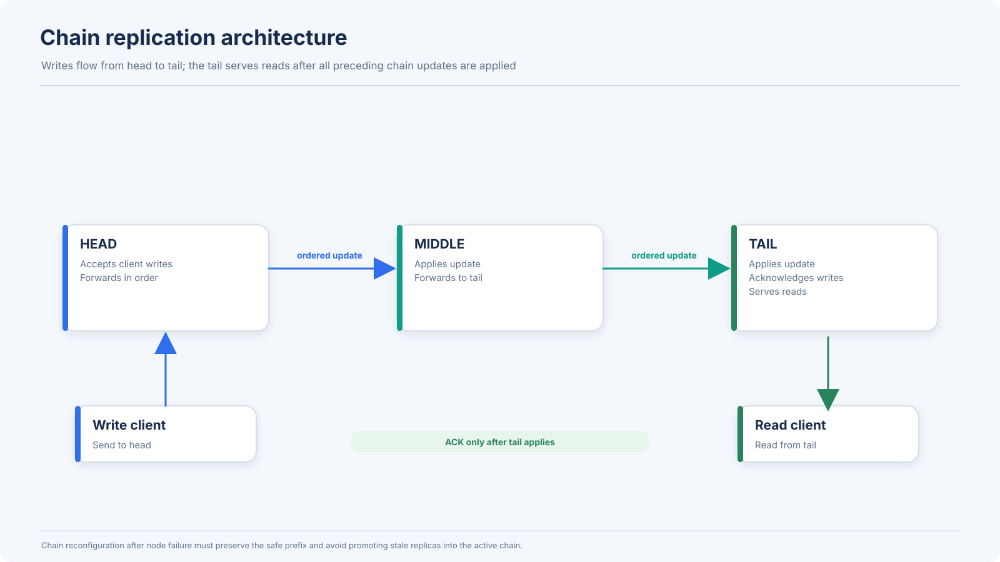

**Diagram specification — chain architecture.** Draw H→M→T with distinct write-forward arrows, and clients' read requests directed only to T. Label each node's local state, chain membership order, and “tail acknowledgment completes write” rule. Add a small legend contrasting chain order with a star-shaped primary-to-all-followers topology.

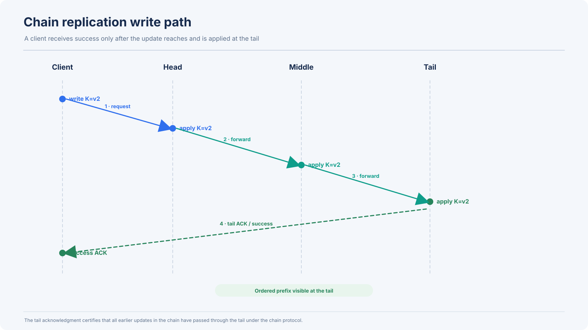

**Diagram specification — chain write timeline.** Vertical sequence diagram with Client, Head, Middle, Tail. Show update request, local apply/persist at each hop, forwarding in order, tail acknowledgment returning to client. Mark that a client success response occurs after the tail has processed the update. Show a read issued after success going to the tail and returning the new value.

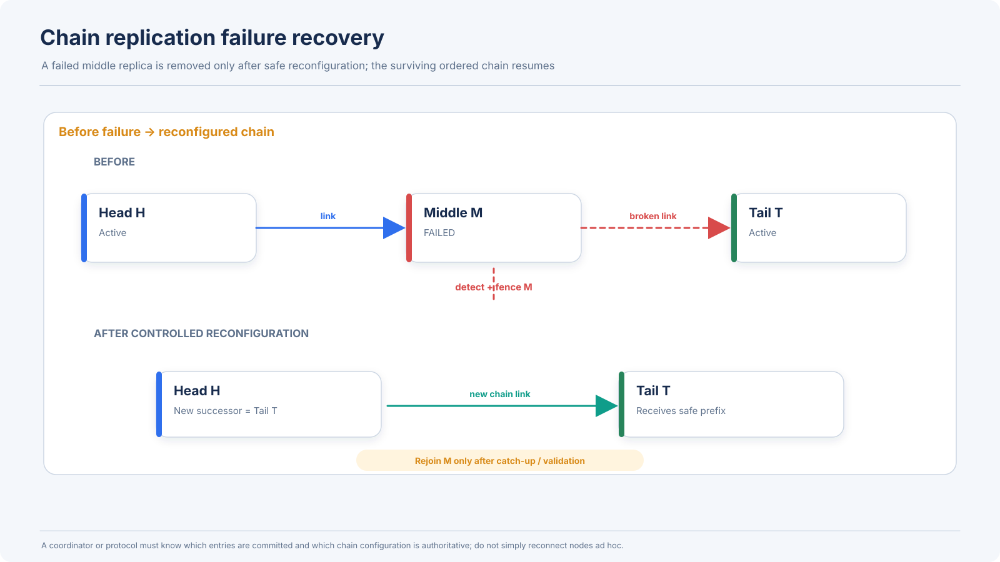

**Diagram specification — chain failure recovery.** Show H→M→T with M failing. Mark the chain paused/reconfiguration state, verify which prefix/updates T has processed, establish a safe new chain H→T, increment membership epoch, then resume writes. Add a parallel branch for tail failure where a replacement tail is selected only after it catches up through the old tail's acknowledged prefix.

## 23.4 Chain replication vs. leader-based and state-machine replication

| Dimension | Single-leader replication | Chain replication | State machine replication |
|---|---|---|---|
| Command ingress | Leader | Head | Often leader/proposer |
| Update path | Leader to followers (topology varies) | Ordered head→...→tail | Ordered replicated log |
| Write success point | Configured commit/ack policy | Tail processes update | Consensus commit rule + apply/response policy |
| Read path | Leader or selected followers | Tail in classic design | Depends on service/API |
| Main idea | Central write authority | Ordered propagation through chain | Same deterministic command order at replicas |
| Main complexity | Leader election and replication policy | Safe chain reconfiguration | Consensus, deterministic execution, snapshots |

A system can combine concepts. For example, a consensus group can manage membership or log order, while application data replication uses another topology. Do not treat the labels as mutually exclusive product categories.

# 24. Replication Strategies Comparison

The word “replication” describes a family of protocols. A useful design comparison must ask who can accept writes, how replicas learn about updates, what event constitutes success, where reads go, and how a failed node safely rejoins.

| Strategy | Writable nodes | Write route | Read route | Conflict/order model | Typical strengths | Main costs |
|---|---:|---|---|---|---|---|
| Single-leader | One per replication group | Client→leader→followers | Leader and/or followers | Leader orders writes; follower lag possible | Simple writes and conflict avoidance | Leader bottleneck, failover, cross-region write RTT |
| Multi-leader | Multiple leaders | Local leader then cross-leader replication | Local/selected replicas | Concurrent updates need conflict handling | Local writes in multiple regions, disconnected operation | Conflict complexity and divergent state |
| Leaderless | Any eligible coordinator/replica path | Coordinator fans out to replicas | Coordinator gathers R responses | Quorum/version reconciliation | Flexible placement and availability | Read repair, conflict semantics, stale versions |
| Chain replication | Head accepts writes | Head→ordered chain→tail ack | Classic design reads at tail | Chain order, tail-completed writes | Clear write order and read path | Tail/read concentration, reconfiguration complexity |
| State machine replication | Usually proposal leader, all replicas execute | Consensus orders replicated command log | Often any safe replica/API policy | Same committed log order + deterministic execution | Strong replicated service state | Consensus latency and deterministic state constraints |

A common architecture combines sharding with replication: each shard owns a subset of keys and has its own replica group. The shard count controls data distribution; the replication factor controls copies per shard. A shard may itself use a leader-based or leaderless replication protocol.

## 24.1 How to choose

- Choose **single-leader** when write conflict simplicity and ordered updates matter, and the leader's throughput/region placement are acceptable.
- Choose **multi-leader** when independent regions must accept local writes during WAN disconnection and the domain has a meaningful merge rule.
- Choose **leaderless** when quorum-based access and replica-level availability are valuable, and the application can tolerate/reconcile concurrent versions.
- Choose **chain replication** when its ordered propagation and tail-read model match a storage service's workload and reconfiguration complexity is manageable.
- Choose **state machine replication** for coordination/state services that need replicas to execute one agreed command history.

No topology is universally “most available” or “most consistent.” Guarantees depend on the failure model, durability configuration, replica membership, acknowledgment rule, read path, and conflict policy.

# 25. Real-World Database Replication Mechanisms

The following are implementation-oriented summaries, not claims that every version or deployment has identical behavior. Always verify the exact major/minor version, configuration, storage engine, topology, and failover manager used in production.

## 25.1 PostgreSQL

PostgreSQL physical streaming replication ships WAL records from a primary to standby servers. The standby replays WAL to reproduce the primary's physical database state. Streaming replication is asynchronous by default; synchronous replication can be configured so the primary waits for a configured standby acknowledgment policy.

Important concepts:

- **WAL:** write-ahead log records changes needed for crash recovery and replication.
- **LSN:** log sequence number identifying a position in the WAL stream. Comparing a primary's and standby's receive/write/flush/replay LSNs helps distinguish network receipt, durable flush, and application progress.
- **Streaming:** WAL records are sent continuously rather than waiting for completed WAL segments to be archived.
- **Standby:** replays the WAL stream; hot standby can serve read-only queries, subject to replay lag and conflicts with recovery.
- **Replication slot:** retains WAL required by a consumer/standby. A stalled slot can cause unbounded WAL retention and fill disk if not monitored.
- **Timeline:** after promotion, PostgreSQL creates a new WAL timeline. Timeline history helps determine which branch of WAL history a node follows.
- **Logical replication:** publishes logical row changes through publications/subscriptions; it is not the same as physical WAL replay and has different DDL, sequence, identity, and conflict considerations.

Synchronous replication has configurable acknowledgment levels. Depending on the `synchronous_commit` mode, acknowledgment can mean waiting for remote receipt, remote write, remote flush, or remote application. These have different durability and visibility implications. In particular, remote flush is not the same as remote replay. A deployment must choose based on whether it values a durable remote WAL copy or immediate query visibility on the standby.

Read replicas can lag; a load balancer that routes every read to any standby can violate read-your-writes. Solutions include reading from primary after a write, routing until a required LSN has replayed, or attaching a consistency token. Promotion and orchestration need to select an eligible standby and fence the old primary; PostgreSQL streaming replication itself is not a complete HA control plane.

Logical replication is useful for selective table-level replication, migrations, and integration, but subscribers may differ in schema and sequences, and built-in logical replication is not a universal multi-master conflict-resolution system.

Official references: [PostgreSQL warm standby and streaming replication](https://www.postgresql.org/docs/current/warm-standby.html), [synchronous replication](https://www.postgresql.org/docs/current/warm-standby.html#SYNCHRONOUS-REPLICATION), [monitoring statistics](https://www.postgresql.org/docs/current/monitoring-stats.html), and [logical replication](https://www.postgresql.org/docs/current/logical-replication.html).

## 25.2 MySQL

MySQL source/replica replication commonly uses the binary log (binlog) on the source. A replica connects, retrieves binlog events through its receiver/I/O thread, writes them to relay logs, and applies them through its applier thread(s). Replication coordinates progress with file/position coordinates or Global Transaction Identifiers (GTIDs), depending on configuration.

- **Statement-based replication:** records SQL statements. It can be compact, but nondeterministic statements, implicit ordering, and environment differences require care.
- **Row-based replication:** records row changes and is generally more deterministic for data changes, but may produce larger logs.
- **Mixed mode:** chooses statement or row format under MySQL's rules.
- **GTID:** gives transactions identifiers and helps replicas track executed transactions and support auto-positioning/failover workflows.
- **Parallel appliers:** can improve throughput but must preserve relevant transaction dependencies and commit order according to configuration.
- **Semi-synchronous replication:** a source waits for at least one configured replica to acknowledge receipt of the transaction's events. The acknowledgement stage and timeout/fallback behavior must not be confused with remote transaction application or remote durable commit in every failure mode.

Traditional asynchronous replication can lose recently acknowledged source transactions if the source fails before replicas receive them and a less-current replica is promoted. Semi-sync reduces the window under its stated behavior but is not a full consensus protocol. Failover tooling still needs to choose the correct replica, handle errant transactions, and fence the old source.

Official references: [MySQL replication](https://dev.mysql.com/doc/refman/8.4/en/replication.html), [binary log formats](https://dev.mysql.com/doc/refman/8.4/en/binary-log-formats.html), [GTID concepts](https://dev.mysql.com/doc/refman/8.4/en/replication-gtids-concepts.html), and [semisynchronous replication](https://dev.mysql.com/doc/refman/8.4/en/replication-semisync.html).

## 25.3 MongoDB replica sets

A MongoDB replica set has one primary and a set of secondaries. The primary accepts writes and records them in the oplog, a capped collection of replication operations. Secondaries copy and apply oplog entries. Elections use heartbeats and voting; a primary steps down or loses authority under membership/election rules, and an eligible secondary may be elected.

Important controls are separate:

- **Write concern** controls the acknowledgment condition for writes (for example, `w: 1` versus `w: "majority"`, with journaling and timeout options affecting durability semantics).
- **Read concern** controls the consistency/isolation properties of read results, such as `local`, `majority`, or other supported levels.
- **Read preference** controls which replica members may serve reads; reading from secondaries can return stale data.
- **Causal consistency sessions** can preserve causal relationships across supported operations when used with appropriate read/write concerns. They do not make every arbitrary read from every secondary linearizable.

Initial sync clones data and then catches up through the oplog. If a secondary falls behind beyond available oplog history, it may need a full initial sync. During failover, writes not replicated to the elected primary may be rolled back or otherwise subject to documented rollback behavior, depending on write concern and topology. Majority write concern is often chosen when the application needs stronger acknowledgment guarantees, but it should be interpreted using the specific deployment and journal/durability settings.

Official references: [replica set replication](https://www.mongodb.com/docs/manual/replication/), [replica set elections](https://www.mongodb.com/docs/manual/core/replica-set-elections/), [oplog](https://www.mongodb.com/docs/manual/core/replica-set-oplog/), [write concern](https://www.mongodb.com/docs/manual/reference/write-concern/), [read concern](https://www.mongodb.com/docs/manual/reference/read-concern/), and [read preference](https://www.mongodb.com/docs/manual/core/read-preference/).

## 25.4 Apache Cassandra

Cassandra uses a peer-to-peer architecture with no permanent global primary for ordinary keyspace writes. A coordinator routes a request to the replicas responsible for the partition, collects acknowledgments, and applies the requested consistency level. Replication factor and consistency level determine how many replica responses are required for a given operation.

Important mechanisms:

- **Replication strategy:** determines replica placement across racks/datacenters. `NetworkTopologyStrategy` is commonly used for multi-datacenter awareness.
- **Consistency levels:** `ONE`, `QUORUM`, `ALL`, `LOCAL_QUORUM`, and other levels define response thresholds. Read/write behavior is not captured by a single global CP/AP label.
- **Hints:** when a replica is unavailable, another node may store a hint and later forward it. Hinted handoff is best effort and bounded by settings; it is not a substitute for repair.
- **Read repair:** reconciliation during reads can repair stale replicas. Behavior and options have changed by Cassandra version; Cassandra 5.0 documentation describes blocking read repair behavior and its interaction with monotonic quorum reads.
- **Anti-entropy repair:** `nodetool repair` compares replica ranges using Merkle-tree-based mechanisms and streams differences. Periodic repair is operationally important because hints/read repair cannot guarantee every missed update is repaired.
- **Tombstones:** deletes are represented as tombstones and must be retained long enough to prevent old values from being resurrected. Compaction and `gc_grace_seconds` interact with repair cadence; unsafe settings can cause deleted data to reappear.
- **Timestamp conflict resolution:** Cassandra commonly uses timestamp-based last-write-wins at cell level. Clock discipline and application timestamp strategy therefore matter.

Quorum arithmetic such as `R+W> N` is useful only under its assumptions about the same replica set, strict quorums, version selection, and conflict rules. Cassandra's tunable consistency levels and multi-datacenter topology introduce additional nuance. `LOCAL_QUORUM` may improve local latency but should not be interpreted as cross-datacenter linearizability.

Official references: [Cassandra architecture](https://cassandra.apache.org/doc/latest/cassandra/architecture/), [Dynamo-style data replication](https://cassandra.apache.org/doc/latest/cassandra/architecture/dynamo.html), [hinted handoff](https://cassandra.apache.org/doc/latest/cassandra/managing/operating/hints.html), [repair](https://cassandra.apache.org/doc/latest/cassandra/managing/operating/repair.html), and [read repair](https://cassandra.apache.org/doc/latest/cassandra/managing/operating/read_repair.html).

## 25.5 Redis

Redis replication is primary/replica and is asynchronous by default. Replicas stream commands/data from the primary. Redis replication uses a replication ID and offset to identify the history position. When a replica reconnects, it may request partial resynchronization if the primary still retains the required backlog and the replication history matches; otherwise a full synchronization is required.

- **Full sync:** the primary creates or sends a snapshot (RDB-based transfer in common configurations) and streams subsequent writes so the replica catches up.
- **Partial resync:** the replica asks for missing bytes/commands from a known replication ID and offset if retained in the backlog.
- **Replication backlog:** bounded buffer used to support partial synchronization; sizing it for the write rate and expected disconnection duration improves the probability of partial resync.
- **WAIT:** asks Redis to wait for acknowledgments from a number of replicas for preceding writes on that connection. It can reduce risk but does not turn Redis replication into a consensus protocol or guarantee that an acknowledged write can never be lost on failover.
- **Sentinel/Cluster:** provide monitoring, promotion, and routing/topology behavior around replication. They have their own quorum/election and partition semantics.

A client that writes to the primary and immediately reads from a replica can see stale data. Critical read-after-write flows should use the primary or a deliberately designed acknowledgment/routing policy. Redis persistence (RDB/AOF) and replication are separate mechanisms: having a replica does not mean its data is durably fsynced under every configuration.

Official references: [Redis replication](https://redis.io/docs/latest/operate/oss_and_stack/management/replication/), [WAIT](https://redis.io/docs/latest/commands/wait/), [Sentinel](https://redis.io/docs/latest/operate/oss_and_stack/management/sentinel/), and [Cluster specification](https://redis.io/docs/latest/operate/oss_and_stack/reference/cluster-spec/).

## 25.6 Apache Kafka

Kafka replication is per topic-partition. Each partition has a leader and follower replicas. Producers write to the leader; followers fetch the leader's log. The **in-sync replica set (ISR)** tracks replicas sufficiently caught up according to Kafka's rules. With `acks=all`, the producer waits for the relevant ISR acknowledgment condition; `min.insync.replicas` can reject writes when too few ISR members remain.

- **High watermark (HW):** boundary up to which records are considered committed/visible to consumers under Kafka's replication model. Followers and consumers use the high watermark to distinguish replicated/committed data from the leader's unreplicated tail.
- **Leader election:** a new leader is selected from eligible replicas. Unclean leader election may choose an out-of-sync replica, improving availability but risking loss of records that existed only on the former leader.
- **Producer idempotence/transactions:** address duplicate/retry and transactional semantics within Kafka's guarantees; they are not equivalent to database-wide multi-object transactions across arbitrary systems.
- **Replica lag:** a follower can fall out of the ISR if it does not keep up; the exact rules and configuration are version-sensitive.
- **Log truncation/recovery:** after leadership changes, replicas reconcile their log with the elected leader's authoritative history.

Kafka's replication model should not be described as a generic multi-master database or as every follower being immediately readable. Its guarantees are partition-scoped and tied to producer acknowledgment settings, ISR state, topic replication factor, and broker configuration.

Official references: [Kafka design](https://kafka.apache.org/documentation/#design), [topic configuration](https://kafka.apache.org/documentation/#topicconfigs), [broker configuration](https://kafka.apache.org/documentation/#brokerconfigs), and [producer configs](https://kafka.apache.org/documentation/#producerconfigs).

## 25.7 Dynamo and Dynamo-style systems

The original Dynamo paper describes a highly available key-value storage design built from techniques including consistent hashing, replication, object versioning, quorum-like request coordination, sloppy quorums, hinted handoff, and background reconciliation. It used version vectors to preserve causality and expose concurrent versions to application-level conflict resolution where necessary.

“Dynamo-style” describes a family of design choices, not one product API. Apache Cassandra is inspired by Dynamo but has its own data model, coordination and repair behavior. Amazon DynamoDB is a managed service with documented API and consistency options; do not infer every detail of the original 2007 Dynamo paper applies unchanged to DynamoDB internals. Use the original paper for the research design and the service's current documentation for its actual guarantees.

Reference: DeCandia et al., [Dynamo: Amazon's Highly Available Key-value Store](https://www.allthingsdistributed.com/files/amazon-dynamo-sosp2007.pdf); [DynamoDB read consistency](https://docs.aws.amazon.com/amazondynamodb/latest/developerguide/HowItWorks.ReadConsistency.html).

## 25.8 Database-level comparison

| System | Typical replication shape | Main replication artifact | Ack / read controls | Recovery/repair focus |
|---|---|---|---|---|
| PostgreSQL | Primary/standby | WAL + LSN | synchronous_commit, synchronous_standby_names, standby reads | WAL replay, slots, timeline, promotion, backup/restore |
| MySQL | Source/replica | Binlog + GTID/position | async or semi-sync; replica read routing | relay logs, applier catch-up, GTID auto-position, failover tooling |
| MongoDB | Replica set | Oplog | write concern, read concern, read preference | elections, initial sync, oplog catch-up, rollback handling |
| Cassandra | Peer-to-peer | Mutations, hints, SSTables/commitlog and repair metadata | consistency levels and RF | hints, read repair, anti-entropy repair, compaction/tombstones |
| Redis | Primary/replica | Replication stream + ID/offset | async replication, WAIT; persistence separately | backlog partial resync or full sync; Sentinel/Cluster failover |
| Kafka | Per-partition leader/followers | Partition log | acks, ISR, min.insync.replicas | leader election, ISR catch-up, log reconciliation |

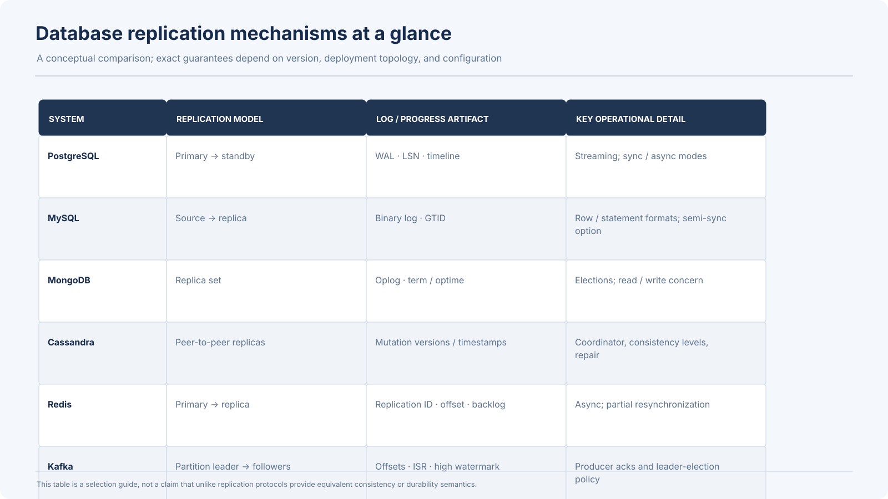

**Diagram specification — database replication comparison.** Create six labeled lanes for PostgreSQL, MySQL, MongoDB, Cassandra, Redis, and Kafka. Each lane shows its control topology, primary replication artifact (WAL/LSN, binlog/GTID, oplog, peer mutations+hints, stream ID+offset, partition log), write acknowledgment point, read behavior, and catch-up/repair mechanism. Use callouts for “async by default” where applicable and avoid a universal CP/AP label. Add a footer that settings and version change exact guarantees.

# 26. Practical Engineering Implementations

The following programs are small teaching models. They use in-memory Python objects to make message flow and state changes visible; they do not provide durable storage, real network transport, membership management, crash-safe commits, authentication, or a production consensus implementation. Run snippets independently unless a section explicitly says otherwise. Python 3.10+ is sufficient; no third-party package is required.

## 26.1 Implementation coverage map

| Requested lab | Implementation location |
|---|---|
| 1. Single-leader replication | Section 7.8 |
| 2. Multi-leader replication | Section 26.2 |
| 3. Leaderless replication | Section 26.3 |
| 4. Synchronous replication | Section 26.4 |
| 5. Asynchronous replication | Section 26.5 |
| 6. Semi-synchronous replication | Section 26.6 |
| 7. Replication lag simulation | Section 26.7 |
| 8. Stale-read simulation | Section 26.8 |
| 9. Read-your-writes routing | Section 26.9 |
| 10. Quorum calculation | Sections 12.2 and 26.10 |
| 11. Strict quorum | Section 26.11 |
| 12. Sloppy quorum | Section 26.12 |
| 13. Hinted handoff | Section 26.13 |
| 14. Read repair | Section 26.14 |
| 15. Anti-entropy synchronization | Section 26.15 |
| 16. Merkle-tree construction | Section 26.16 |
| 17. Merkle-tree comparison | Section 26.17 |
| 18. LWW conflict resolution | Section 17.1 and 26.18 |
| 19. Version-vector conflict detection | Section 18.1 |
| 20. G-Counter | Section 19.3 |
| 21. PN-Counter | Section 19.4 |
| 22. G-Set | Section 19.5 |
| 23. 2P-Set | Section 19.5 |
| 24. OR-Set | Section 19.6 |
| 25. LWW-Register | Section 19.7 |
| 26. OT text transformation | Section 20.1 |
| 27. Failover simulation | Section 26.19 |
| 28. Split-brain simulation | Section 26.20 |
| 29. Fencing-token protection | Section 21.5 |
| 30. State machine replication | Section 22.4 |
| 31. Chain replication | Section 26.21 |

The cross-references are intentional: each lab has a full runnable code example at the cited location rather than an abbreviated pseudocode duplicate.

## 26.2 Multi-leader replication and conflict detection

Each region accepts local writes and tags them with a local revision. The simplified resolver retains concurrent versions rather than silently overwriting them. It illustrates detection, not a universal domain merge policy.

```python
from dataclasses import dataclass

@dataclass(frozen=True)
class Version:
    value: str
    clock: dict[str, int]

def happens_before(a: dict[str, int], b: dict[str, int]) -> bool:
    keys = set(a) | set(b)
    return all(a.get(k, 0) <= b.get(k, 0) for k in keys) and any(
        a.get(k, 0) < b.get(k, 0) for k in keys
    )

def reconcile(existing: list[Version], incoming: Version) -> list[Version]:
    # `existing` is assumed to contain only mutually non-dominated siblings.
    # Ignore incoming if an existing sibling is equal to or causally after it.
    if any(v.clock == incoming.clock or happens_before(incoming.clock, v.clock)
           for v in existing):
        return existing
    # Otherwise remove ancestors dominated by incoming and retain concurrent siblings.
    survivors = [v for v in existing if not happens_before(v.clock, incoming.clock)]
    return survivors + [incoming]

# India and Europe independently update a customer's preferred language.
india = Version("English", {"IN": 4, "EU": 1})
europe = Version("French", {"IN": 3, "EU": 2})
siblings = reconcile([india], europe)
print([v.value for v in siblings])  # both concurrent values are visible
```

In a real multi-leader database, each write needs a causal context and replica identity discipline; retaining siblings also requires an application resolver or a CRDT. A scalar version per region is not sufficient if multiple processes write under the same identity.

## 26.3 Leaderless parallel write/read with quorums

A coordinator sends a versioned value to all replicas, waits for W acknowledgments, then reads from R replicas and chooses a version using an explicit policy. This toy uses monotonically increasing logical versions supplied by one test harness; it does not safely resolve arbitrary concurrent writes.

```python
class Replica:
    def __init__(self, name): self.name, self.record = name, (0, None)
    def write(self, version, value):
        if version > self.record[0]: self.record = (version, value)
        return True
    def read(self): return self.record

nodes = [Replica("A"), Replica("B"), Replica("C")]
N, W, R = 3, 2, 2
acks = sum(node.write(7, "sku-1=available") for node in nodes)
assert acks >= W
responses = [node.read() for node in nodes[:R]]
latest = max(responses, key=lambda item: item[0])
print("write acks:", acks, "read:", latest)
```

The example is useful for quorum intuition only. Real leaderless systems may keep multiple concurrent siblings, use timestamps/version vectors, and apply read repair. A numeric `max(version)` is safe only if version generation and conflict semantics support it.

## 26.4 Synchronous replication policy

```python
def synchronous_write(value, followers, required_acks):
    persisted = [f.persist(value) for f in followers]
    acks = sum(persisted)
    if acks < required_acks:
        raise TimeoutError(f"required {required_acks} durable replica acks; got {acks}")
    return "committed under this toy policy"

class DiskReplica:
    def __init__(self, online=True): self.online, self.log = online, []
    def persist(self, value):
        if not self.online: return False
        self.log.append(value)  # pretend append is durable
        return True

followers = [DiskReplica(), DiskReplica(online=False)]
print(synchronous_write("order-42", followers, required_acks=1))
```

The toy explicitly treats a successful `persist` call as durable. Production systems must distinguish memory receipt, OS write, fsync, quorum commit, and state-machine apply. A timeout is an ambiguous outcome: the write may have persisted on some replicas even though the caller did not receive success.

## 26.5 Asynchronous replication queue

```python
from collections import deque

primary = {"stock": 12}
replica = {"stock": 12}
replication_queue = deque()

def primary_write(key, value):
    primary[key] = value
    replication_queue.append((key, value))  # return before remote apply

def apply_one_replication_record():
    if replication_queue:
        key, value = replication_queue.popleft()
        replica[key] = value

primary_write("stock", 11)
print("immediate replica read:", replica["stock"])  # 12, stale
apply_one_replication_record()
print("after propagation:", replica["stock"])       # 11
```

A real replication queue needs persistence, retry policy, ordering, backpressure, duplicate handling, monitoring, and restart recovery. If the source fails after acknowledgment but before durable propagation, the acknowledged write can be absent from the promoted replica.

## 26.6 Semi-synchronous acknowledgment model

This simplified policy waits for one remote receipt acknowledgment, while other replicas can remain asynchronous. It deliberately models *receipt*, not guaranteed remote apply.

```python
def semi_sync_write(event, replicas, timeout_fallback=False):
    # Send to all configured replicas, then evaluate the required acknowledgment rule.
    acknowledgments = [replica.receive(event) for replica in replicas]
    if any(acknowledgments): return "acknowledged after one remote receipt"
    if timeout_fallback: return "timed out; fell back to async policy"
    raise TimeoutError("no semi-sync replica acknowledged")

class ReceiptReplica:
    def __init__(self, online=True): self.online, self.received = online, []
    def receive(self, event):
        if self.online: self.received.append(event); return True
        return False

print(semi_sync_write("txn-9", [ReceiptReplica(), ReceiptReplica(False)]))
```

The first unused helper class above is intentionally not part of the run path; use `ReceiptReplica` in the example. Product-specific semi-sync modes define whether the acknowledgment follows receipt, write, flush, or another stage and what happens after timeout. Never generalize this model as “the replica committed the transaction.”

## 26.7 Replication lag simulation

```python
from collections import deque

source_log = deque()
source_lsn = standby_lsn = 0

def commit_on_primary(record):
    global source_lsn
    source_lsn += 1
    source_log.append((source_lsn, record))
    return source_lsn

def standby_apply_one():
    global standby_lsn
    if source_log:
        lsn, record = source_log.popleft()
        standby_lsn = lsn
        return record

for item in ["insert A", "update B", "delete C"]: commit_on_primary(item)
print("lag in records:", source_lsn - standby_lsn)  # 3
standby_apply_one()
print("lag after one apply:", source_lsn - standby_lsn)  # 2
```

This uses a contiguous single-source log and measures record-count lag. Production systems should monitor byte/LSN distance, time since last replay, queue depth, and apply throughput; a record count alone ignores record size and transaction cost.

## 26.8 Stale read simulation

```python
leader = {"profile_version": 5}
follower = {"profile_version": 4}
leader["profile_version"] = 6  # write commits at leader
print("leader read:", leader["profile_version"])
print("follower read:", follower["profile_version"])  # stale version 4
```

A follower read is stale because the follower has not applied the latest write. The fix depends on the contract: read from leader, wait for follower catch-up to a token, or use a consistency level/transaction API that provides the required visibility.

## 26.9 Read-your-writes using a consistency token

```python
class VersionedReplica:
    def __init__(self, version=0, value=None): self.version, self.value = version, value
    def read_at_least(self, token):
        if self.version < token: raise TimeoutError("replica has not caught up")
        return self.value

leader = VersionedReplica(0, "old")
replica = VersionedReplica(0, "old")
leader.version, leader.value = 12, "new profile image"
write_token = leader.version  # returned to client after write acknowledgment

try:
    print(replica.read_at_least(write_token))
except TimeoutError:
    print("route to leader or wait for replica catch-up")
```

The token is a teaching abstraction for an LSN, commit timestamp, cluster time, or session token. It must be scoped to the relevant replication history/partition; a version token from one unrelated shard cannot be compared blindly to another.

## 26.10 Quorum arithmetic

```python
def quorum_summary(n, r, w):
    if not (1 <= r <= n and 1 <= w <= n):
        raise ValueError("R and W must be between 1 and N")
    return {
        "read_write_intersection": r + w > n,
        "read_quorum": r,
        "write_quorum": w,
        "minimum_intersection_size": max(0, r + w - n),
    }

for params in [(3, 2, 2), (5, 3, 3), (5, 1, 5), (5, 4, 2)]:
    print(params, quorum_summary(*params))
```

The minimum intersection size follows from set arithmetic when both quorums are subsets of the same N-member replica set. It does not prove that the read returns the newest value or that writes are totally ordered. Quorum membership, versions, epochs, and conflict rules still matter.

## 26.11 Strict quorum availability simulation

```python
def strict_write(replicas, value, w):
    acks = 0
    for replica in replicas:
        if replica["online"]:
            replica["value"] = value
            acks += 1
    return acks >= w

nodes = [
    {"id": "A", "online": True, "value": "v1"},
    {"id": "B", "online": True, "value": "v1"},
    {"id": "C", "online": False, "value": "v1"},
]
print(strict_write(nodes, "v2", w=2))  # True
print(strict_write(nodes, "v3", w=3))  # False
```

This simulation equates an online replica with a valid acknowledgment and overwrites values without versions. Production quorums require durable responses, membership rules, and conflict-aware version selection.

## 26.12 Sloppy quorum simulation

```python
def sloppy_write(intended, fallback, value, w):
    acknowledgers, hints = [], []
    for node in intended:
        if node["online"]:
            node["value"] = value
            acknowledgers.append(node["id"])
        else:
            temp = next((x for x in fallback if x["online"]), None)
            if temp:
                temp["temporary"].append((node["id"], value))
                hints.append((temp["id"], node["id"]))
                acknowledgers.append(temp["id"])
    return len(acknowledgers) >= w, hints

intended = [
    {"id": "A", "online": True, "value": "v1"},
    {"id": "B", "online": False, "value": "v1"},
    {"id": "C", "online": True, "value": "v1"},
]
fallback = [{"id": "D", "online": True, "temporary": []}]
print(sloppy_write(intended, fallback, "v2", w=3))
```

The fallback D is not one of the original owners. The write may reach its acknowledgment threshold without intersecting a later strict read quorum over A/B/C. Handoff and repair are required to restore intended placement.

## 26.13 Hinted handoff

```python
class HintStore:
    def __init__(self): self.hints = []
    def save(self, target, key, value, created_at):
        self.hints.append({"target": target, "key": key, "value": value, "at": created_at})
    def deliver(self, target, replicas):
        node = replicas[target]
        pending = [h for h in self.hints if h["target"] == target]
        for hint in pending: node[hint["key"]] = hint["value"]
        self.hints = [h for h in self.hints if h["target"] != target]
        return len(pending)

replicas = {"A": {}, "B": {}}
hints = HintStore()
# A is down; B temporarily records a hint for A.
hints.save("A", "order-7", "paid", created_at=100)
print(hints.deliver("A", replicas))
print(replicas["A"])  # {'order-7': 'paid'}
```

The toy never expires hints. Production handoff needs a bounded window, retry/backoff, rate limits, idempotent application, and anti-entropy for missed/expired hints.

## 26.14 Read repair

```python
def read_repair(replicas):
    # Each record is (version, value). Use this only when versions totally order values.
    winner = max((r["record"] for r in replicas), key=lambda x: x[0])
    for replica in replicas:
        if replica["record"][0] < winner[0]:
            replica["record"] = winner
    return winner

nodes = [
    {"id": "A", "record": (8, "gold")},
    {"id": "B", "record": (7, "silver")},
    {"id": "C", "record": (8, "gold")},
]
print(read_repair(nodes))
print([n["record"] for n in nodes])
```

This assumes a total version order and that the greatest version is the right value. With concurrent siblings or CRDT data, repair must use the corresponding merge function, not numeric maximum.

## 26.15 Anti-entropy synchronization

```python
def anti_entropy(a: dict, b: dict):
    # Teaching-only full map reconciliation for immutable/versioned values.
    merged = dict(a)
    for key, candidate in b.items():
        current = merged.get(key)
        if current is None or candidate[0] > current[0]:
            merged[key] = candidate
    a.clear(); a.update(merged)
    b.clear(); b.update(merged)

left = {"x": (2, "new"), "y": (1, "same")}
right = {"x": (1, "old"), "z": (4, "extra")}
anti_entropy(left, right)
print(left == right, left)
```

This scans all keys and uses LWW-like version tuples. Real anti-entropy schedules ranges, compares digests/Merkle trees, accounts for tombstones, and streams missing data with bounded resource use.

## 26.16 Merkle-tree construction

```python
import hashlib

def digest(data: bytes) -> str:
    return hashlib.sha256(data).hexdigest()

def merkle_root(items: dict[str, str]) -> str:
    leaves = [digest((k + "=" + items[k]).encode()) for k in sorted(items)]
    if not leaves: return digest(b"")
    while len(leaves) > 1:
        if len(leaves) % 2: leaves.append(leaves[-1])
        leaves = [digest((leaves[i] + leaves[i + 1]).encode())
                  for i in range(0, len(leaves), 2)]
    return leaves[0]

print(merkle_root({"a": "1", "b": "2", "c": "3"}))
```

This is a deterministic binary Merkle root for a sorted mapping. It duplicates an odd final leaf; other tree designs may use different conventions. Consistent serialization and ordering on both replicas are essential.

## 26.17 Merkle-tree range comparison

```python
import hashlib

def digest(data: bytes) -> str:
    return hashlib.sha256(data).hexdigest()

def leaf_hash(items, keys):
    payload = "|".join(f"{k}={items[k]}" for k in sorted(keys) if k in items)
    return digest(payload.encode())

def compare_buckets(a, b, buckets):
    mismatches = []
    for bucket_name, keys in buckets.items():
        if leaf_hash(a, keys) != leaf_hash(b, keys):
            mismatches.append(bucket_name)
    return mismatches

buckets = {
    "range-1": ["k1", "k2"],
    "range-2": ["k3", "k4"],
    "range-3": ["k5", "k6"],
    "range-4": ["k7", "k8"],
}
a = {f"k{i}": str(i) for i in range(1, 9)}
b = dict(a); b["k5"] = "changed"; del b["k8"]
print(compare_buckets(a, b, buckets))  # ['range-3', 'range-4']
```

This compares bucket roots rather than implementing recursive node descent. A full implementation stores internal nodes and recursively descends only into child pairs whose hashes differ.

## 26.18 LWW conflict resolution

```python
def lww_merge(v1, v2):
    # A version is (logical_timestamp, stable_replica_id, value).
    return max(v1, v2, key=lambda v: (v[0], v[1]))

v_a = (105, "IN", "address=Pune")
v_b = (109, "EU", "address=Paris")
print(lww_merge(v_a, v_b))
```

The tie-break is deterministic, not necessarily semantically meaningful. Use logical/HLC timestamps or server-issued versions where appropriate, and do not infer causal order from raw wall clocks.

## 26.19 Failover simulation

```python
class Node:
    def __init__(self, name, term, log_index, online=True):
        self.name, self.term, self.log_index, self.online = name, term, log_index, online
        self.leader = False

nodes = [Node("A", 4, 120), Node("B", 4, 120), Node("C", 4, 117)]
nodes[0].online = False  # A fails
eligible = [n for n in nodes if n.online and n.log_index == 120]
if not eligible:
    print("no sufficiently current candidate; do not promote")
else:
    new = eligible[0]
    new.term += 1
    new.leader = True
    print("promoted", new.name, "term", new.term)
```

The exact log eligibility rule is intentionally simplified. A production consensus protocol defines voting and commit-index rules; a replica should not be promoted solely because its index happens to look largest.

## 26.20 Split-brain simulation

```python
# Unsafe design: two isolated partitions each appoint a leader without quorum.
partition_left = {"A": {"leader": True, "writes": ["W1"]}}
partition_right = {"B": {"leader": True, "writes": ["W2"]}}
print("left history:", partition_left["A"]["writes"])
print("right history:", partition_right["B"]["writes"])
print("divergent histories require reconciliation")

# Safer rule for a fixed three-voter group: require 2 votes.
def may_lead(votes, total_members):
    return votes >= total_members // 2 + 1
print(may_lead(1, 3), may_lead(2, 3))  # False True
```

This is an illustration, not a consensus protocol. Real elections require persistent terms, vote rules, log freshness, membership changes, and a mechanism that prevents the minority leader from committing writes.

## 26.21 Chain replication simulation

```python
class ChainNode:
    def __init__(self, name): self.name, self.state = name, {}
    def apply(self, key, value): self.state[key] = value

head, middle, tail = ChainNode("H"), ChainNode("M"), ChainNode("T")
chain = [head, middle, tail]

def chain_write(key, value):
    for node in chain: node.apply(key, value)  # ordered forwarding, simplified
    return "ACK from tail"

def chain_read(key):
    return tail.state.get(key)

print(chain_write("inventory:42", 0))
print(chain_read("inventory:42"))
```

The synchronous loop hides network failure and durable storage. A production chain must handle message loss/retry, duplicate operation IDs, pipeline ordering, tail failure, reconfiguration epochs, and proof that the replacement tail contains every acknowledged update.

## 26.22 Testing and production checklist

For every simulation, test at least: duplicate delivery, message loss, reordering, node restart, partial write acknowledgment, stale replica, concurrent update, clock skew (if timestamps are used), membership change, and disk-full/backpressure. Add property-based tests for CRDT laws (commutativity, associativity, idempotence) and deterministic replay tests for state machines. A simulation validates the teaching model's intended behavior only; it does not establish protocol safety under all schedules.

# 27. Mathematical Concepts and Formulas

This section collects useful estimates. Every equation depends on assumptions; formulas are decision aids, not substitutes for a protocol's documented semantics.

## 27.1 Replication factor and copy count

For a shard with replication factor N, the nominal number of full copies is N. If there are S shards of equal replication factor N, nominal stored copies are S×N. If average logical data size is D and replication is full-copy, raw replica storage is approximately:

\[
Storage_{raw} \approx N \times D
\]

Example: 2 TB logical data at replication factor 3 requires roughly 6 TB of raw data capacity before indexes, WAL/commitlogs, compaction headroom, snapshots, backups, and filesystem overhead. Erasure coding, compression, and partial replication change this estimate.

## 27.2 Independent replica availability (simplified)

If each replica independently has availability p and a read succeeds when at least R of N replicas respond, the probability of read quorum availability is:

\[
P(read\ quorum) = \sum_{k=R}^{N} \binom{N}{k}p^k(1-p)^{N-k}
\]

For N=3, R=2, p=0.99:

\[
P = 3(0.99)^2(0.01) + (0.99)^3 \approx 0.999702
\]

The model assumes independent failures and equal p. Real replicas share power, racks, switches, regions, software defects, operators, and traffic, so correlated failures can dominate. Use failure-domain placement and empirical outage data rather than trusting an independence model.

For a strict fixed-membership majority, one can tolerate:

\[
f = \left\lfloor \frac{N-1}{2} \right\rfloor
\]

crash failures while retaining a majority, assuming N voters, crash-fault model, and quorum intersection. For N=5, f=2. This is not Byzantine fault tolerance: arbitrary malicious or equivocating nodes require stronger protocols and different replica counts (often `3f+1` under classic Byzantine assumptions).

## 27.3 Quorum intersection

For N replicas, read quorum R and write quorum W selected from the same fixed replica set:

\[
R + W > N
\]

ensures any selected read quorum and write quorum have at least one common member. A lower bound on their intersection size is:

\[
|Q_R \cap Q_W| \ge R + W - N
\]

Example: N=5, R=3, W=3 gives at least one common replica. This does not ensure the read selects the newest concurrent or committed value; it assumes the overlapping member retains a relevant version and the read reconciles versions correctly. Sloppy quorums may use fallback nodes outside the intended set, so the simple set argument may not hold.

## 27.4 Replication lag

If a standby has received/replayed log position L_s and the source has generated position L_p, position lag is:

\[
Lag_{bytes} = L_p - L_s
\]

For a sustained incoming log rate λ bytes/s and apply rate μ bytes/s, backlog changes approximately as:

\[
\frac{dB}{dt} = \lambda - \mu
\]

If λ≥μ for a sustained interval, backlog does not drain. If λ<μ and both rates are roughly constant, catch-up time for backlog B is:

\[
T_{catchup} \approx \frac{B}{\mu-\lambda}
\]

Example: backlog 900 MB, standby apply capacity 120 MB/s, new incoming stream 90 MB/s gives `900/(120-90)=30 s`. This assumes stable rates, no large transactions or pauses, and no additional recovery bottlenecks. If λ=130 MB/s and μ=120 MB/s, catch-up never completes while load remains unchanged.

A time-lag estimate is often derived from commit timestamps, but clock skew and timestamp creation semantics can mislead. Prefer native LSN/offset/replay metrics and validate what stage each metric measures.

## 27.5 Replication bandwidth

If a source produces change volume C bytes/s and protocol overhead ratio h, approximate required outbound bandwidth is:

\[
BW \approx C(1+h)
\]

For C=40 MB/s and h=0.15, approximate 46 MB/s, excluding retransmission bursts, TLS framing, snapshot transfer, compression differences, and other traffic. Cross-region throughput must account for peak rates and catch-up traffic after disconnection.

## 27.6 Write propagation and acknowledgment latency

For a synchronous primary/follower path, client acknowledgment latency is roughly the time to the slowest replica required by the policy plus local processing:

\[
T_{ack} \approx T_{local} + T_{network,required} + T_{remote	ext{-}persist} + T_{coordination}
\]

For a quorum, it is governed by the W-th fastest successful response (not necessarily the slowest of all N). Asynchronous replication can acknowledge near local commit time, with remote propagation continuing afterwards. These estimates omit queueing, retries, consensus rounds, storage tails, and transaction lock duration.

## 27.7 CRDT algebra

A state-based merge `⊔` should satisfy:

\[
a \sqcup b = b \sqcup a \quad \text{(commutative)}
\]
\[
(a \sqcup b) \sqcup c = a \sqcup (b \sqcup c) \quad \text{(associative)}
\]
\[
a \sqcup a = a \quad \text{(idempotent)}
\]

These properties make state exchange robust to order, grouping, and duplicate delivery, provided the merge is a valid least-upper-bound operation over the chosen partial order. A monotonic update moves state upward; replicas that have incorporated the same updates converge to the same join.

Example for G-Counter: state A=`(2,0)`, B=`(0,3)` and merge is component-wise maximum `(2,3)`. The visible count is 5. PN-Counter subtracts summed decrement components from summed increment components. CRDT correctness is about the data type's abstract semantics; it does not automatically provide a global invariant such as “stock must never be negative.”

## 27.8 Merkle tree size and depth

For a balanced binary Merkle tree with M leaves, height is approximately:

\[
H = \lceil \log_2 M \rceil
\]

For M=16 leaves, H=4 edges from root to leaf. A full root computation hashes all leaves/internal nodes (O(M)); when trees are already maintained, comparing a sparse set of divergent ranges can descend only into mismatching branches. If a fraction d of leaves differs, transfer work depends on divergence distribution, bucket granularity, metadata, and whether hash trees can be reused. Merkle trees reduce data comparison/transfer; they do not make hashing free.

The chance of an accidental collision depends on the hash function and digest size. With a cryptographic 256-bit hash, collision probability is treated as negligible for normal engineering use, not literally impossible. Security-sensitive designs should also ensure data serialization and tree membership are authenticated as needed.

## 27.9 Chain replication latency and throughput

For a chain of m nodes, a simple serialized write's end-to-end latency is approximately the sum of link and node processing times:

\[
T_{write} \approx \sum_{i=1}^{m-1} (T_{network,i}+T_{apply,i}) + T_{tail\ ack}
\]

With pipelining and independent stages, throughput can approach the capacity of the slowest stage, not the sum of all stage capacities. A slower link or node becomes the bottleneck. These estimates ignore reconfiguration, retries, persistence, and queueing.

# 28. Comprehensive Comparison Tables

## 28.1 Single-leader, multi-leader, and leaderless

| Dimension | Single leader | Multi-leader | Leaderless |
|---|---|---|---|
| Writable replicas | One per group | Multiple | Any eligible coordinator/replica path |
| Write routing | To leader | To nearby/assigned leader | Coordinator fans out to replicas |
| Ordering | Leader order | Per-leader order; cross-leader conflicts | Version/quorum reconciliation |
| Conflicts | Usually serialized at leader | Expected under concurrent writes | Possible under concurrent writes |
| Read strategy | Leader or followers | Local or any replica | R responses and reconciliation |
| WAN behavior | Writes may cross WAN | Local writes can be fast | Coordinator and quorum placement matter |
| Main availability risk | Leader/quorum loss | Conflict and replication management | Insufficient reachable quorum/versions |
| Typical use | Primary database | Multi-region collaborative data | Dynamo-style key-value workloads |

## 28.2 Synchronous, asynchronous, semi-synchronous

| Dimension | Synchronous | Asynchronous | Semi-synchronous |
|---|---|---|---|
| Client acknowledgment | Waits for configured remote condition | Usually local commit only | Waits for a limited remote acknowledgment |
| Remote apply | May or may not be required, by configuration | Happens later | Often not equivalent to apply |
| Latency | Higher; tail of required path | Lower | Between the two, policy-dependent |
| Failover loss risk | Lower if remote durable commit + safe promotion | Higher under lag | Reduced but not eliminated in every failure model |
| Availability | Can block if required replicas unavailable | Can continue with source available | May time out/fallback according to implementation |
| Best fit | Strict data-loss constraints | Read scaling, DR with accepted RPO | Middle-ground policies |

## 28.3 Physical vs. logical replication

| Dimension | Physical | Logical |
|---|---|---|
| Replicated unit | Storage/WAL-level changes | Logical row/operation changes |
| Granularity | Often whole database cluster or physical instance | Tables, publications, selected logical entities |
| Schema | Physical compatibility/cluster-version constraints | Subscriber schema must be compatible by configuration |
| Use cases | Hot standby, physical HA, full copy | Selective replication, migration, integration |
| Trade-off | Efficient full-state reproduction, less selective | Flexible but may omit DDL/sequences or require extra handling |

## 28.4 Strict quorum vs. sloppy quorum

| Dimension | Strict quorum | Sloppy quorum |
|---|---|---|
| Participants | Intended replica set | May include fallback nodes |
| Availability | May fail when intended members unavailable | Can accept writes through substitutes |
| Intersection math | R+W>N applies under set assumptions | Simple original-set intersection may fail |
| Recovery | Replica catches up through normal replication/repair | Hints/handoff plus repair restore placement |
| Trade-off | More predictable placement, less partition availability | Higher write availability, temporary placement divergence |

## 28.5 Repair mechanisms

| Mechanism | Trigger | What it does | Typical blind spot |
|---|---|---|---|
| Read repair | Read touches divergent replicas | Reconciles versions encountered by that read | Keys/ranges never read may remain divergent |
| Hinted handoff | Replica unavailable at write time | Stores and later forwards missed update | Hints can expire or be lost; bounded best-effort |
| Anti-entropy repair | Scheduled/on-demand comparison | Compares replica ranges and transfers differences | Costly; scheduling and tombstone safety matter |
| Log catch-up | Replica reconnects with compatible log history | Replays missing entries from a position | Log history may have been truncated; snapshot may be needed |
| Full resync | Replica too far behind or divergent | Rebuilds from authoritative snapshot/stream | High network/storage cost |

## 28.6 Conflict-resolution techniques

| Technique | Detects concurrency? | Typical behavior | Main risk/cost |
|---|---|---|---|
| LWW | Often collapses by tag; may not preserve siblings | Select greatest timestamp/tag | Lost updates; clock assumptions |
| Version vectors | Yes, by partial-order comparison | Preserve concurrent versions | Metadata and resolver complexity |
| CRDT | Encoded in data type/merge semantics | Deterministic convergence | Type semantics/metadata may not fit invariant |
| OT | Transforms operations against history | Rewrites positions/operations | Algorithm and history/control complexity |
| Application merge | Depends on app | Domain-aware resolution | Requires business rules and conflict UX |

## 28.7 Leader-based vs. SMR vs. chain

| Dimension | Leader-based replication | SMR | Chain replication |
|---|---|---|---|
| Primary goal | Copy leader writes to followers | All replicas execute same ordered commands | Ordered propagation and tail-read consistency |
| Write order | Leader's log/transaction order | Consensus-selected order | Chain position/order |
| Commit condition | Configured replication/commit rule | Consensus commit rule | Tail processing/ack in classic design |
| Reads | Leader/follower policy | Service-specific | Tail in classic design |
| Failure complexity | Leader election/fencing | Consensus membership/log safety | Safe chain reconfiguration |

## 28.8 Failover, recovery, and synchronization

| Term | Meaning | Example |
|---|---|---|
| Failover | Switch service authority to another node | Promote a standby |
| Recovery | Restore a failed or stale node to healthy service | Restart and replay WAL |
| Synchronization | Bring replica state/log position into agreement | Apply missing log entries or repair range |
| Re-seeding | Rebuild a replica from snapshot/full copy | Initial sync after oplog window expires |
| Reconciliation | Resolve divergent updates or versions | Merge concurrent siblings |

## 28.9 Database family comparison

| System | Replication scope | Typical topology/artifact | Common operational concern |
|---|---|---|---|
| PostgreSQL | Database cluster/physical standby; logical publications | WAL, LSN, physical/logical streams | Standby lag, slots retaining WAL, promotion timeline |
| MySQL | Instance/schema/table filtering depending on config | Binlog, relay log, GTID | Source failover, errant transactions, semi-sync semantics |
| MongoDB | Replica set | Primary/secondaries, oplog | Elections, read preferences, oplog window and rollback |
| Cassandra | Partition replicas across nodes/DCs | Peer-to-peer, hints, repair | Repair cadence, tombstones, consistency level choice |
| Redis | Dataset replication | Primary/replica, replication ID/offset | Async loss window, backlog sizing, full resync |
| Kafka | Per-partition log replicas | Leader/follower, ISR, HW | ISR shrinkage, acks, unclean leader election |

## 28.10 Strongly coordinated vs. eventually convergent replication

| Dimension | Strongly coordinated | Eventually convergent |
|---|---|---|
| Write completion | Waits for a defined commit/coordination rule | May acknowledge before all replicas apply |
| Read freshness | Can provide strong reads if the read protocol is designed for it | May return stale/intermediate state |
| Partition behavior | May reject/block operations lacking quorum | May accept local writes and reconcile later |
| Conflicts | Often prevented/ordered by coordination | Must be resolved, merged, or exposed |
| Latency | Coordination and WAN RTT can dominate | Local operations can be faster |
| Application complexity | Easier invariants, more availability/latency constraints | Requires tolerance/merge logic and user-visible stale state strategy |

## 28.11 Choosing a strategy by data shape

| Data/workload | Candidate strategy | Reason and caveat |
|---|---|---|
| Account ledger | Single leader/consensus-backed transaction log | Ordered, invariant-preserving writes; durability and idempotency still needed |
| Product images/catalog descriptions | Async replicas/CDN caches | Stale propagation is often acceptable; invalidate/cache-version carefully |
| Region-local preferences | Multi-leader or CRDT register/set | Resolve by field semantics; LWW may lose meaningful updates |
| Online/offline checklist | OR-Set or another CRDT | Concurrent add/remove semantics can be explicitly defined |
| Coordination metadata/locks | Consensus-backed state machine | Stale leaders must be fenced; lock expiry alone is not enough |
| Event log | Kafka partition replication | Partition leader and ISR determine committed visibility |


# 29. Interview Questions and Detailed Answers

The answers below are deliberately framed around protocol assumptions. In an interview, state the model first, then describe its behavior under normal operation, failure, and recovery. Avoid answering with a product label alone.

## 29.1 Beginner questions (1–20)

### 1. What is replication?
Replication stores multiple copies of the same logical data on different machines or failure domains. Copies may be updated by a leader, by multiple leaders, or through a leaderless protocol. The important design question is not only how copies are made, but when a write is considered successful and how divergence is detected/reconciled.

### 2. Why do distributed systems replicate data?
Replication improves availability, durability against individual failures, read capacity, and geographic locality. It also creates costs: extra storage, network bandwidth, write coordination, stale-read possibilities, and operational complexity. Replication alone does not guarantee that a recent write survives every failure.

### 3. What is a replica?
A replica is a node or storage copy that holds all or part of a replicated data set. A replica may be a leader, follower, coordinator, or one of several peers. It may be current, lagging, unavailable, or divergent; “replica” does not mean “identical at every instant.”

### 4. What is replication factor?
Replication factor N is the configured number of copies for a data item or partition, subject to placement and system semantics. A replication factor of three usually means three replicas across selected nodes or failure domains. It does not mean three independent copies if all three share one rack, power source, or region.

### 5. What is leader-follower replication?
A leader accepts writes and orders them; followers receive the leader's log or change stream and apply it. Reads may go to the leader or followers. Follower reads can be stale until they apply the required log position.

### 6. What is the difference between a primary and a secondary?
They are common database terms for the write authority and its replicas. “Leader/follower” is often preferred in distributed-systems literature. Exact product semantics differ: a secondary may be readable, vote in elections, or be configured only for durability.

### 7. What is replication lag?
Replication lag is the gap between a source's generated/committed update position and a replica's received, persisted, or applied position. It can be measured in bytes/LSNs/offsets, queued events, or estimated time. Always identify which stage the metric represents.

### 8. What is synchronous replication?
A write waits for a defined remote acknowledgment before the system reports success. The acknowledgment may mean received, written, flushed to durable storage, or applied, depending on the implementation. “Synchronous” without an acknowledgment-stage definition is ambiguous.

### 9. What is asynchronous replication?
The source can acknowledge a write before followers have applied it. This reduces write latency and dependence on remote nodes, but followers can be stale and a failover may lose recently acknowledged writes that never reached the promoted node.

### 10. What is semi-synchronous replication?
The source waits for a limited number of remote acknowledgments, but not necessarily for all replicas to apply the write. MySQL semi-sync is a product-specific protocol whose acknowledgment stage and timeout/fallback behavior must be checked. It is not automatically equivalent to consensus commit.

### 11. What is a quorum?
A quorum is a set of members large enough to satisfy a protocol's decision threshold, often a majority or configured read/write response count. Quorums help systems make progress while retaining intersections needed for safety. Different protocols use quorums for different purposes; do not assume every quorum implies the same guarantee.

### 12. What does R+W>N mean?
For N replicas, read set size R, and write set size W, the condition ensures that every read quorum intersects every write quorum if both are chosen from the same fixed replica set. This is a set-intersection statement. It does not alone guarantee linearizability or ensure the read chooses the newest version.

### 13. What is failover?
Failover moves service responsibility from a failed/unavailable node to an eligible replacement. Safe failover requires selecting a replica with appropriate history, establishing new authority, routing clients, and fencing the old primary. A fast promotion of a stale replica can lose data.

### 14. What is split-brain?
Split-brain occurs when multiple nodes or network partitions believe they can accept authoritative writes. They create divergent histories, which may be difficult or impossible to merge without losing business updates. Quorum-based leadership, epochs, and resource-side fencing are common protections.

### 15. What is a write-ahead log?
A WAL records changes before the corresponding data pages are considered safely persisted, enabling crash recovery and often replication. Replicas can replay log records to reproduce state. The exact durability point depends on flush/fsync and commit configuration.

### 16. What is a log sequence number?
An LSN identifies a position in a log stream, often measured as a byte position or logical sequence. Comparing source and replica positions helps determine replication progress. It is meaningful only within the correct log identity/timeline and should not be compared across unrelated histories without metadata.

### 17. What is physical replication?
Physical replication transfers storage-level changes or WAL needed to reproduce a database instance's physical state. It is commonly used for hot standbys and high availability. It tends to replicate a broader physical data set rather than selected logical rows.

### 18. What is logical replication?
Logical replication transmits data changes at a logical level, such as row inserts/updates/deletes. It supports selective replication and integration/migrations. DDL, sequences, schema compatibility, and conflict behavior may require separate handling.

### 19. What is read repair?
Read repair is a mechanism that detects divergent replica versions during a read and sends corrections to stale replicas. It improves convergence for data that is read. It does not guarantee that cold data is repaired; scheduled anti-entropy repair may still be needed.

### 20. What is hinted handoff?
When an intended replica is unavailable, another node temporarily stores a hint saying which replica missed an update. When the target returns, the hint is delivered. Hints are typically bounded/best-effort and do not replace full repair.

## 29.2 Intermediate questions (21–45)

### 21. Single-leader vs. multi-leader replication?
Single-leader replication routes writes through one authority per group, which simplifies ordering and conflict handling. Multi-leader replication allows independent regions to accept writes, improving local availability/latency but requiring explicit conflict resolution. Multi-leader is suitable only when the data model can tolerate or resolve concurrent changes.

### 22. Multi-leader vs. leaderless replication?
Multi-leader has multiple named write authorities that replicate to one another. Leaderless designs coordinate each read/write across a replica set, often using a coordinator and quorum acknowledgments without a permanent primary for every key. Both can expose concurrent versions, but their routing and reconciliation protocols differ.

### 23. Why can a follower read be stale?
The follower may not have received, persisted, or applied the latest log entries when the read arrives. The request can also race with an in-flight replication message or be routed to a follower with a backlog. A strong read needs an explicit protocol, not merely “read from a replica.”

### 24. How can an application provide read-your-writes without global linearizability?
After a write, return a version/commit token and require subsequent reads in that session to reach a replica that has applied at least that token, or route those reads to the leader. This gives the user's session a minimum freshness guarantee without necessarily ordering every user's operations globally. Token scope and shard/partition identity must be clear.

### 25. What is a replication log offset?
It identifies how far a node has progressed in a replicated log or stream. Kafka offsets are per partition; Redis uses replication IDs and offsets for sync; database LSNs are log positions. An offset must be interpreted with the relevant log identity and commit/high-watermark rules.

### 26. What is the difference between read repair and anti-entropy?
Read repair reconciles replicas encountered by client reads, so it is demand-driven and can add latency to those reads. Anti-entropy periodically compares replica ranges, often through hashes/Merkle trees, and repairs divergences even if users never read the data. They complement each other.

### 27. What is a Merkle tree and why use it?
A Merkle tree hashes leaf records/ranges and recursively hashes child hashes. Comparing roots quickly tells replicas whether a range differs; recursive descent localizes divergent leaves. It reduces data exchange, but building and maintaining hashes still costs CPU and I/O.

### 28. What is a sloppy quorum?
A sloppy quorum permits temporary writes to substitute nodes when intended replicas are unavailable. It improves availability but may no longer intersect later quorums over the original replica set. Hinted handoff and repair are needed to restore intended placement and convergence.

### 29. What is the difference between a strict quorum and a sloppy quorum?
A strict quorum obtains responses from the designated replica set. A sloppy quorum can count temporary fallback nodes. Therefore, the simple `R+W>N` intersection proof over intended replicas may not apply to sloppy quorum responses.

### 30. What is last-write-wins?
LWW chooses the value with the greatest ordering tag, often a timestamp plus tie-breaker. It is deterministic when all replicas use the same comparator, but can discard a concurrent update and may be affected by clock skew. It is appropriate only when its overwrite semantics match the application's intent.

### 31. How do version vectors detect concurrent writes?
Each replica contributes a counter to a vector. Component-wise comparison determines whether one vector causally dominates another; if neither dominates, the versions are concurrent. Version vectors reveal concurrency but do not decide how to merge application values.

### 32. What is a CRDT?
A CRDT is a data type whose state/operation semantics guarantee convergence under specified replication and delivery assumptions. State-based CRDTs merge with algebraic joins; operation-based CRDTs require suitable operation delivery and commutativity. CRDTs do not automatically enforce arbitrary business invariants.

### 33. What is the difference between G-Counter and PN-Counter?
A G-Counter only increases and stores per-replica components; merge takes component-wise max and the visible value is their sum. A PN-Counter has positive and negative component maps, so decrement is represented by increasing a negative component. Neither automatically provides overdraft protection or an upper bound.

### 34. What is an OR-Set?
An observed-remove set tags additions uniquely. A remove deletes only the tags observed by the removing replica, so a concurrent unseen add can survive. This gives precise concurrent add/remove semantics at the cost of tag/causal metadata.

### 35. What is Operational Transformation?
OT transforms concurrent editing operations relative to operations already applied, adjusting positions or ranges so clients converge. It is common in collaborative editing research and systems. Correctness depends on the transformation algorithm and control protocol, not only on shifting indexes.

### 36. OT vs. CRDT?
OT transforms operations against a shared history; CRDTs design types/merge rules so replicas converge under defined delivery assumptions. OT often uses server sequencing and transformation context; CRDTs can support independent local updates but may carry substantial metadata. Both have multiple variants and are not interchangeable labels.

### 37. What is a tombstone?
A tombstone is a marker representing deletion so replicas that still hold an older value do not resurrect it during later synchronization. Tombstones must be retained long enough for missed replicas to learn the deletion. Premature garbage collection can resurrect deleted data.

### 38. What is the role of a replication slot in PostgreSQL?
A physical or logical replication slot retains WAL needed by a consumer so that the required log history is not removed too early. This protects catch-up but can retain large volumes of WAL if the consumer stalls. Monitoring slot lag and disk capacity is essential.

### 39. How do MongoDB replica sets replicate writes?
The primary records writes in its oplog; secondaries replicate and apply oplog entries. Elections determine a new primary when necessary. Write concern, read concern, and read preference are distinct controls that determine acknowledgment, read guarantees, and eligible read nodes.

### 40. How does Kafka replication differ from database replication?
Kafka replicates partition logs with a leader and followers, ISR membership, and high-watermark visibility. It is optimized for ordered event streams per partition, not arbitrary relational row updates and cross-table transactions. Producer acks, min ISR, and unclean leader election influence loss/availability behavior.

### 41. What is the difference between a WAL and a changelog/binlog?
A WAL often records physical or storage-engine-oriented changes needed for crash recovery, while a binlog/changelog may represent logical transactions or row changes for replication and downstream consumers. The exact distinction depends on the database. Do not assume a logical event stream can replay a physical database state.

### 42. What is partial resynchronization in Redis?
A replica identifies its replication history with a replication ID and offset. If the primary still has the necessary backlog and the history matches, it sends the missing suffix; otherwise the replica needs a full synchronization. Backlog sizing should reflect write rate and expected disconnect duration.

### 43. Why is replication factor not the same as fault tolerance?
Fault tolerance depends on placement across independent failure domains, the acknowledgment policy, membership/quorum rules, and whether remaining replicas have the required history. Three replicas in one rack can all fail from one rack event. A replica count alone says little about correlated risks.

### 44. What is a high watermark in Kafka?
It marks the log position up to which records are considered committed/visible under Kafka's replication rules. Consumers do not treat a leader's unreplicated tail as committed data. It is distinct from the leader's current log end offset.

### 45. What is the difference between a full sync and incremental catch-up?
Incremental catch-up replays a missing log suffix from a known shared history. Full sync rebuilds a replica from a snapshot or baseline and then applies subsequent changes. Incremental sync is cheaper but impossible if the necessary log history has been truncated or histories diverged incompatibly.

## 29.3 Advanced questions (46–75)

### 46. Why does strong replication often require coordination?
To make a write globally visible in a single, real-time order, replicas must agree on which write is authoritative before a conflicting operation can safely complete. A system can do this with a leader, consensus, or a quorum protocol with appropriate ordering and read rules. Without coordination, partitions may accept incompatible writes or readers may observe stale versions.

### 47. Does R+W>N guarantee linearizability?
No. It guarantees set intersection under a fixed replica-set assumption. Linearizability additionally needs well-defined write ordering, version/commit semantics, fresh read selection, and safe handling of concurrency and failures. Sloppy quorums and changing membership further complicate the set proof.

### 48. Can eventual consistency provide read-your-writes?
Yes. Eventual consistency is a broad convergence guarantee and does not forbid session-level guarantees. A client can carry a version token, route to the leader, or wait for a replica to catch up. The cost is extra routing/waiting or state; the whole system need not be globally linearizable.

### 49. Why can LWW lose updates?
Two concurrent values may be reduced to one winner even though both represent meaningful independent changes. If timestamp ordering is skewed, the selected “latest” value may not be the real latest action. The resolver sees a total tag order, not necessarily business causality or intent.

### 50. How can a system use physical clocks safely for conflict resolution?
It must account for clock skew, drift, adjustment, and ties. Bounded clock uncertainty, logical clocks, hybrid logical clocks, or server-issued generations can reduce ambiguity, but they do not automatically encode domain semantics. For critical conflicts, preserve concurrency or use an application-level merge/transaction.

### 51. What is the difference between a version vector and a Lamport timestamp?
A Lamport timestamp provides a scalar order consistent with causality but cannot distinguish all concurrent events: concurrent events can have ordered scalar values. A version vector tracks per-replica causal components and can identify concurrency when neither vector dominates. Version vectors cost more metadata.

### 52. Why do state-based CRDT merge functions need idempotence?
State can be transmitted more than once due to retries or anti-entropy exchange. If merging a duplicate state changes the result again, duplicate delivery can corrupt the value. Idempotence makes repeated joins harmless; commutativity and associativity handle order and grouping.

### 53. What assumptions do operation-based CRDTs need?
They generally need reliable delivery (or deduplication), and concurrent operations must commute or be delivered under an order that preserves correctness. Some designs require causal delivery. A generic unordered message bus with arbitrary duplicates is not sufficient without protocol adaptations.

### 54. Why doesn't a PN-Counter prevent a bank balance from becoming negative?
The data type merges increments and decrements, but independent replicas can each approve a decrement based on stale local state. The counter has no global check that total balance remains non-negative. Use coordination, escrow/rights allocation, reservations, or a ledger transaction that preserves the invariant.

### 55. What is escrow/rights allocation in distributed systems?
The system partitions a limited resource into rights that can be consumed locally without violating a global bound. For inventory 10, a coordinator could allocate 4 units to region A and 6 to B; each can sell only its rights while disconnected. Rights transfer requires coordination, but local operations can remain safe within the assigned quota.

### 56. Why can read repair be insufficient?
It only touches records/ranges encountered by reads and may not fix cold data. It may also be partial, asynchronous, or limited by the database's reconciliation policy. Periodic anti-entropy repair detects differences independently of access patterns.

### 57. How do tombstones prevent data resurrection?
A delete marker carries enough version/order information to supersede older values. If a stale replica later rejoins, it receives the tombstone rather than interpreting absence as permission to restore its old value. Removing tombstones before every replica has had a chance to learn the deletion can resurrect data.

### 58. Why can hinted handoff not replace anti-entropy repair?
Hints are best-effort and often expire after a configured window; a node can be down longer or a hint store can fail. Other divergence sources (missed messages, operator error, corruption, old data) may not have a retained hint. Anti-entropy compares actual replica state and repairs broader divergence.

### 59. How does a Merkle tree reduce repair traffic?
Replicas compare root hashes first. Equal roots mean the range is consistent with high confidence; different roots trigger recursive child comparisons to isolate divergent subranges. Only those records/ranges need transfer, rather than sending the entire dataset.

### 60. What happens if two replicas build Merkle trees using different partition boundaries?
Their hashes are not comparable because each hash summarizes a different key range. They must first agree on token/range boundaries, canonical key ordering, serialization, and tombstone rules. Consistent hashing and schema metadata are part of repair correctness.

### 61. What is a replication loop and how can it happen?
In multi-leader or bidirectional setups, a change received from one peer may be re-emitted as a new local change and sent back to the origin, potentially circulating indefinitely. Systems prevent this with origin/transaction IDs, log positions, replication metadata, and loop-detection rules. Operational topology must be tested before enabling bidirectional flows.

### 62. Why can retrying a write create duplicates?
A client may time out after the server committed the write but before the response reached the client. Retrying a non-idempotent command (such as “charge 100” or “increment stock counter”) can apply it twice. Use idempotency keys, deduplication records, or commands designed to be idempotent.

### 63. How do idempotency keys interact with replication?
The key and result must be stored atomically with the business operation in the authoritative transactional boundary. If the deduplication record is not replicated/durable with the operation, failover can forget it and accept a duplicate. Retention windows must cover the maximum client retry period and business replay horizon.

### 64. What is an errant transaction in a replicated database?
It is a transaction present in one replica's history but not in the authoritative history selected after failover or topology change. It may arise from writes on a former primary or misconfigured replication. Recovery requires identifying the divergence and reconciling or discarding it under a controlled procedure.

### 65. What is a replication slot retention hazard?
A slot prevents the source from discarding WAL needed by a subscriber. If the subscriber stops consuming, retained WAL can grow until disk exhaustion. Monitor retained bytes, slot activity, consumer progress, and define safe cleanup/alerting procedures.

### 66. How does a database choose a replica to promote?
The policy must consider log freshness/commit position, voting membership, failure domain, durability, and whether the candidate can obtain a safe election quorum. “Highest observed LSN” alone may be insufficient without timeline/term context and commit rules. The safest system promotes only a candidate allowed by its replication/consensus protocol.

### 67. What is fencing and why is it stronger than lease expiry alone?
A lease expiry is a time-based belief that a former holder should stop. A paused or partitioned former holder might resume and issue delayed operations. A fencing token is checked atomically by the protected resource, which rejects commands from an older token even if the old process still believes it is leader.

### 68. Why is deterministic execution essential for state machine replication?
Replicas apply the same ordered commands to equivalent state. If execution depends on local randomness, local wall-clock time, iteration order, or external service results, replicas can diverge despite identical logs. Nondeterministic inputs must be captured in the ordered command or otherwise coordinated.

### 69. Why should replicated state machines avoid direct external side effects?
Every replica may execute the same committed command, so sending an email or charging a card from every replica could duplicate the effect. Store an intent in replicated state and have a designated executor perform it once using a durable idempotency key/outbox pattern. The effect executor itself needs retry-safe semantics.

### 70. How does a snapshot help state machine replication?
A snapshot records the state after a committed log index, allowing a recovering replica to load that state and replay only the suffix. The snapshot must correspond to a known log index and include all relevant state/metadata. Incorrect snapshot/log pairing can skip or double-apply commands.

### 71. Why does chain replication acknowledge at the tail?
The tail has processed all updates forwarded through the ordered chain before the acknowledgment. Acknowledging earlier can expose a success response before the tail—and therefore the classic tail-read path—has observed the update. This relies on safe chain membership and failure-reconfiguration rules.

### 72. Is chain replication a consensus algorithm?
No, chain replication is a replication protocol with a particular update path and reconfiguration model. It may rely on a separate membership or coordination mechanism to change the chain safely. Consensus and chain replication solve related but distinct problems.

### 73. What is the difference between replication and sharding?
Replication creates multiple copies of the same logical data; sharding/partitioning splits a data set into different subsets. A system commonly shards first and replicates each shard for availability. Replicating a shard does not increase the number of distinct keys that shard can own, though followers may serve reads.

### 74. How can cross-region replication affect latency?
Synchronous remote acknowledgment adds at least the relevant network round trip plus remote persistence/coordination time. Asynchronous replication keeps local write latency lower but may expose stale reads and nonzero failover RPO. Regional placement, quorum geography, and read routing are architectural decisions.

### 75. What is the difference between replication durability and backup?
Replication copies recent state to another live system and may quickly copy accidental deletes, corruption, or logical errors. Backup preserves recoverable historical states or points in time and can protect against operator error and destructive changes. Production systems need both replication and tested backups.

## 29.4 Scenario-based questions (76–100)

### 76. Two users update the same customer record in two regions. What do you do?
First determine whether the edits affect the same logical field and whether they are concurrent. Use causal/version metadata to detect concurrency; merge independent fields when safe, preserve multiple siblings for manual/domain resolution when necessary, or use a single-writer/transaction path for invariant-sensitive fields. LWW is acceptable only if overwriting one value is an explicit product decision.

**Follow-up:** What if one update is a legal-name change and the other is a marketing nickname? A field-level merge can preserve both because they are separate attributes; whole-record LWW would unnecessarily discard one.

### 77. Two customers try to buy the last unit of a product from different regions.
A stale replicated counter is unsafe because both regions can observe stock=1 and decrement locally. Use a coordinated reservation/conditional transaction, a single authoritative inventory partition, or escrow rights partitioned across regions. A CRDT counter alone cannot enforce “stock never below zero.”

**Trap:** Do not claim that R+W>N automatically serializes two concurrent decrements.

### 78. A primary acknowledges a write and crashes immediately. What can happen?
With asynchronous replication, the write may not have reached the promoted replica and may be lost. With synchronous replication, the answer depends on what was acknowledged (received, flushed, applied), which node is promoted, and the election/commit rule. Explain the failure model and the configured RPO instead of answering simply “sync means no data loss.”

### 79. One replica is unavailable during a quorum write. Can the write succeed?
For N=3 and W=2, two available intended replicas can satisfy a strict quorum; for W=3 it cannot. A sloppy quorum may use a fallback node, but then the write may not have the same intersection with the intended replica set. Clarify the configured consistency level and later repair/handoff behavior.

### 80. A user updates their profile, receives success, and then sees the old profile picture. Why?
The next read likely hit a lagging follower or cache. Route that session to the leader or carry the write's version token and wait until the chosen replica has applied it. Cache keys/versioning must also be updated; database read-your-writes alone does not invalidate a stale CDN/browser cache.

### 81. A social post appears in one region before its comment appears in another, but the comment is visible there first. How do you prevent this?
The comment causally depends on the post. Propagate causal metadata and delay exposing the comment until the post/dependency is present, or use a data model/API that materializes the parent dependency before the child. Eventual convergence alone does not forbid temporary causal-order violations.

### 82. A network partition separates a primary from two followers. Should both sides accept writes?
A quorum-based single-leader/consensus system should permit writes only on the side that can establish valid leadership/commit quorum. The isolated former primary must be prevented from committing and later fenced. A multi-leader/AP design might accept writes on both sides, but then must represent and resolve concurrency explicitly.

### 83. The old primary comes back after failover and still believes it is primary. What protects the system?
A term/epoch change and resource-side fencing token should make old requests invalid. The former primary must rejoin as a follower, discard/reconcile its divergent suffix, and catch up from the authoritative history. Do not rely solely on process shutdown or client routing to stop stale writes.

### 84. A Kafka leader fails while one follower is behind. Which replica should lead?
Prefer an eligible in-sync replica under the configured election policy. Choosing an out-of-sync replica through unclean election may improve availability but can lose records that were not replicated to it. Examine replication factor, ISR size, `acks`, `min.insync.replicas`, and unclean leader election settings.

### 85. A PostgreSQL standby is hours behind and a replication slot retains WAL. What is the risk?
The slot may retain large WAL segments, filling the primary's disk if the standby stops consuming. Monitor slot retained bytes and replay lag, size storage/headroom, alert, and define when to drop/recreate a slot or re-seed a standby. Do not delete required WAL blindly; that can force full reinitialization.

### 86. A MongoDB read from a secondary returns an older document after a successful write. Is that a bug?
Not necessarily. Secondary read preference can serve stale data because secondaries apply oplog entries asynchronously. Use an appropriate read concern/read preference or a causal session for the required guarantee; choose majority write concern when that acknowledgment is needed. Explain which combination the application expects.

### 87. A Cassandra hint expires before a node recovers. Is the missing write repaired automatically?
Not necessarily. Hinted handoff is bounded/best-effort. Anti-entropy repair is needed to compare the intended replica ranges and restore missed data; read repair may fix the item if a later read contacts divergent replicas, but cold partitions can remain inconsistent until repair.

### 88. A key is never read, and one replica missed an update months ago. Which mechanism finds it?
Scheduled anti-entropy repair, often based on range comparison/Merkle trees, can find cold-data divergence. Read repair only triggers when a read contacts the divergent replicas. Hinted handoff may no longer have a valid hint.

### 89. A tombstone is garbage-collected while a replica is still offline. What can happen?
The stale replica may later return with the old value and, without the deletion marker, the system can interpret it as live data and resurrect it. Repair cadence and tombstone retention settings must account for maximum replica outage and operational recovery assumptions.

### 90. A shared shopping-cart counter is implemented as a PN-Counter. Can it enforce a maximum quantity?
Not by itself. PN-Counter merges increments/decrements but does not atomically test a maximum across disconnected replicas. Use a reservation/rights allocation protocol, coordinated conditional update, or application rule that accepts temporary overage and reconciles it.

### 91. Two offline users add and remove the same item from a shared checklist. Which CRDT might help?
An OR-Set can preserve a concurrent add that a remove did not observe: removes delete observed add-tags, while a new concurrent tag remains live. Confirm that this is the intended UX; if remove-wins semantics are required, choose a different CRDT definition.

### 92. Two users insert characters at exactly the same document position under OT. What is required?
The system needs a deterministic tie-break, such as operation IDs or server sequence order, and a transformation rule that every client applies identically. A naive “shift if prior position is less than or equal” without stable ordering can diverge or produce client-dependent results.

### 93. A Redis replica reconnects but cannot partially resynchronize. Why?
The primary may no longer retain the requested offset in its replication backlog, the replication ID/history may not match, or the replica may be too far behind. Redis then performs a full synchronization. Increasing backlog can improve partial-resync probability but costs memory.

### 94. Why might a full replica sync overload a primary?
A full snapshot consumes CPU, disk I/O, memory, network bandwidth, and can compete with normal traffic. Multiple simultaneous full syncs can amplify the load. Stagger resyncs, size buffers/backlogs, provision bandwidth, and monitor snapshot/transfer impact.

### 95. How do you estimate if a follower can ever catch up?
Compare its apply throughput μ to the incoming change rate λ. If μ≤λ for sustained periods, backlog will not drain. If μ>λ, approximate catch-up time as backlog/(μ−λ), then validate with actual queueing, transaction sizes, and tail-latency metrics.

### 96. A global product catalog can tolerate a few seconds of stale reads. Which replication design is reasonable?
Asynchronous regional replicas or CDN/cache replication may be suitable if writes have an authoritative path and cache/replica invalidation is designed. Product price, availability, and legal terms may require stronger guarantees than descriptions or images; split the data by business invariant instead of giving the whole catalog one consistency level.

### 97. A payment client times out and retries; the charge is processed twice. How would you prevent it?
Use an idempotency key with the payment intent, persist the key and outcome atomically, and return the stored result for duplicate retries. Replicate the deduplication record consistently with the payment state. Downstream payment processors should also receive stable idempotency identifiers where supported.

### 98. Network RTT doubles during cross-region synchronous replication. What happens?
The write acknowledgment path typically becomes slower because it waits for the required remote responses. Queueing can amplify this and increase tail latency. Consider placing quorum members closer, keeping a local synchronous quorum plus async DR, or relaxing the consistency/RPO requirement where the business permits.

### 99. Two Merkle roots differ, but each replica reports the same item count. What does that tell you?
Count equality does not imply equal contents: a changed value or different key can preserve the count. Descend into mismatching subtrees/ranges and compare key/value versions. Also verify canonical serialization, range boundaries, and tombstone semantics.

### 100. Why are backups still necessary if the database has three replicas?
Replication propagates logical mistakes, accidental deletes, and corruption to all copies. Backups preserve historical recovery points and can protect against destructive changes or operator errors. Test restores regularly and align retention with RPO/RTO and compliance needs.

### Follow-up prompts and common interviewer traps

Use these prompts to deepen each answer. A strong answer should state assumptions before choosing a protocol.

| Q# | Follow-up prompt | Common trap to avoid |
|---:|---|---|
| 1 | What event makes a write successful in your chosen protocol? | Saying replication means every copy is instantly identical |
| 2 | Which of availability, durability, read scale, or locality is the primary driver? | Claiming replication removes the need for backups |
| 3 | Can this replica vote, serve reads, or be promoted? | Assuming every replica has every capability |
| 4 | Are replicas placed in independent failure domains? | Equating N copies with N independent fault domains |
| 5 | What happens when the leader fails during a write? | Ignoring election, fencing, and ambiguous outcomes |
| 6 | Is a secondary allowed to serve stale reads? | Treating primary/secondary names as complete consistency guarantees |
| 7 | Is lag measured at receipt, flush, apply, or commit? | Reporting one lag metric without defining its stage |
| 8 | What exactly does the remote acknowledgment confirm? | Equating remote receipt with durable commit |
| 9 | What is the failover RPO under the measured maximum lag? | Calling async replication lossless |
| 10 | What does the implementation do when no replica acknowledges in time? | Treating semi-sync as consensus or all-replica commit |
| 11 | Is this quorum for read/write intersection, leader election, or consensus commit? | Using “quorum” as if every protocol's quorum meant the same thing |
| 12 | What version/commit rule makes the intersecting response useful? | Concluding R+W>N proves linearizability |
| 13 | How many independent failures can the layout survive? | Ignoring correlated rack/zone/region failures |
| 14 | How is the former primary prevented from accepting writes? | Relying on DNS or process timeout alone |
| 15 | Does the log record physical changes or logical operations? | Assuming every WAL/binlog is interchangeable |
| 16 | Can this position be compared across a new timeline or log ID? | Comparing offsets from unrelated histories |
| 17 | What objects/DDL are included in the physical stream? | Assuming selective table replication |
| 18 | What handles schema changes and sequence state on the subscriber? | Assuming logical replication copies everything automatically |
| 19 | What repairs data that no client reads? | Claiming read repair guarantees full convergence |
| 20 | What happens if the target stays offline beyond the hint window? | Treating hints as durable permanent repair |
| 21 | Where do conflicts appear, and who resolves them? | Assuming multi-leader means conflict-free writes |
| 22 | Does the coordinator have a permanent leader for each key? | Treating multi-leader and leaderless as synonyms |
| 23 | Can the stale response violate a session guarantee? | Calling every replica read strongly consistent |
| 24 | How is the token scoped across multiple shards? | Treating a local session token as a global ordering token |
| 25 | What log identity makes this offset meaningful? | Comparing a naked number with no partition/history context |
| 26 | Does repair block the foreground read or run in the background? | Assuming product terminology is universal across versions |
| 27 | What canonical serialization is hashed? | Assuming equal item counts imply equal data |
| 28 | Which node is the fallback, and how does the write return home? | Applying strict quorum intersection math to fallback nodes |
| 29 | Does each quorum use the intended replica set? | Ignoring placement changes and sloppy quorum semantics |
| 30 | What happens when timestamps tie or clocks skew? | Assuming greatest timestamp means latest real-world action |
| 31 | How does the vector encode replica incarnation/restart? | Treating a version vector as a wall-clock timestamp |
| 32 | What delivery assumptions does this CRDT require? | Claiming CRDTs solve arbitrary transactional invariants |
| 33 | Can the counter go below zero or exceed a cap? | Assuming PN-Counter enforces business limits |
| 34 | Does remove-wins or add-wins match the user experience? | Ignoring concurrent add/remove semantics |
| 35 | What is the operation context and server/client ordering? | Describing OT as a simple index shift |
| 36 | Which CRDT algebra or OT transformation property ensures convergence? | Calling both approaches equivalent because both converge |
| 37 | How long must tombstones be retained relative to node outage? | Garbage-collecting deletion metadata before all replicas learn it |
| 38 | What is the retained-WAL disk-growth alert threshold? | Assuming a replication slot is free to leave inactive |
| 39 | What do write concern, read concern, and read preference control separately? | Treating them as one consistency setting |
| 40 | How does `min.insync.replicas` interact with producer `acks`? | Looking only at topic replication factor |
| 41 | Can the logical stream reproduce the physical database state? | Equating logical CDC with physical crash-recovery logs |
| 42 | How large is the backlog relative to the write rate and outage window? | Assuming every reconnect can be partial |
| 43 | Are the replicas failure-independent and eligible for promotion? | Treating replication factor as a complete durability number |
| 44 | Does the high watermark match the leader's log end offset? | Treating unreplicated tail records as committed |
| 45 | When is a full sync required, and how is it throttled? | Assuming incremental catch-up is always possible |
| 46 | What coordination is required for real-time write order? | Claiming strong global order appears without any coordination cost |
| 47 | Can the read quorum return a concurrent sibling or old version? | Confusing intersection with commit ordering and freshness |
| 48 | What session token or routing rule provides the guarantee? | Equating eventual consistency with “no guarantees at all” |
| 49 | Which business update is lost under this winner rule? | Assuming deterministic resolution is semantically correct |
| 50 | What bounded clock uncertainty or logical ordering is available? | Assuming NTP synchronization eliminates clock skew |
| 51 | Can two concurrent events have ordered Lamport timestamps? | Claiming a scalar Lamport clock detects concurrency |
| 52 | What breaks if the same state is merged twice? | Forgetting idempotence under retry/duplicate delivery |
| 53 | Does the transport preserve causal order or deduplicate? | Assuming operation-based CRDTs tolerate arbitrary delivery |
| 54 | What coordination prevents overspend/overdraft? | Using a convergent counter to enforce a global invariant |
| 55 | How are rights allocated, spent, and transferred during a partition? | Letting multiple regions spend the same unallocated rights |
| 56 | Which keys will never be read and therefore never repaired? | Relying only on opportunistic repair |
| 57 | What if a stale replica returns after deletion metadata was removed? | Forgetting tombstone retention and resurrection |
| 58 | How are missed writes found after hints expire? | Treating hinted handoff as an anti-entropy protocol |
| 59 | How many subtrees must be descended for sparse divergence? | Saying Merkle trees make hashing and comparison free |
| 60 | How do replicas agree on range boundaries and serialization? | Comparing hashes built over different data partitions |
| 61 | How does the origin ID prevent an update loop? | Ignoring echo suppression in bidirectional replication |
| 62 | Did the first request commit despite client timeout? | Assuming timeout means the operation did not happen |
| 63 | Is deduplication state atomic with the payment/order update? | Storing the idempotency key in an unrelated system |
| 64 | Which history is authoritative after promotion? | Merging an old-primary tail without inspecting commit status |
| 65 | What alert fires before retained WAL fills disk? | Monitoring replica uptime but not slot backlog |
| 66 | What commit index/term makes a candidate safe to promote? | Promoting the node with the highest numeric LSN without history context |
| 67 | Does the storage resource itself reject stale tokens? | Treating lease expiry as a fence |
| 68 | Which nondeterministic inputs are captured in the log? | Calling an arbitrary stateful application a deterministic state machine |
| 69 | How are external effects made idempotent and exactly-once-like? | Triggering the same charge/email on every replica |
| 70 | Does the snapshot correspond to a known committed index? | Loading a snapshot and replaying an overlapping log range |
| 71 | What does the tail know that the head may not yet know? | Acknowledging a write before the tail has applied it |
| 72 | Who coordinates membership change and chain repair? | Assuming chain replication itself defines every election detail |
| 73 | What is a shard replica group versus a distinct shard? | Expecting replication to distribute unique-key write ownership |
| 74 | How many WAN round trips sit on the critical acknowledgment path? | Ignoring tail latency and region placement |
| 75 | Can the system restore to a point before corruption/deletion? | Treating live copies as historical backups |
| 76 | Are the fields semantically independent, or does one update invalidate the other? | Using whole-record LWW when field-level merge is required |
| 77 | What atomic operation actually reserves the final item? | Trusting a cached stock count as a reservation |
| 78 | Was the acknowledged record flushed on an eligible failover candidate? | Giving a yes/no answer without specifying the ack stage |
| 79 | Are responses from intended owners or fallback nodes? | Counting any three acknowledgments as the same quorum |
| 80 | Does the stale layer sit in the DB replica, app cache, or CDN? | Assuming database consistency fixes every cache layer |
| 81 | How is the parent post's causal dependency carried with the reply? | Assuming eventual convergence preserves causal visibility |
| 82 | Which partition can form a valid majority and why? | Letting both sides accept writes in a single-leader model |
| 83 | Is fencing enforced atomically by the downstream resource? | Believing that the old process stopping is guaranteed by timeout |
| 84 | What is the current ISR and is unclean election enabled? | Promoting any live follower without considering lost tail records |
| 85 | What is the replication slot's retained WAL volume and growth rate? | Dropping a slot without understanding the standby re-seed consequence |
| 86 | Which combination of read concern, write concern, and read preference is used? | Calling secondary reads a MongoDB consistency bug by default |
| 87 | When does anti-entropy repair run and what is its coverage? | Assuming the expired hint will be recreated automatically |
| 88 | Which scheduled process checks cold partitions? | Assuming read-triggered repair visits every key |
| 89 | What maximum outage is assumed by tombstone grace settings? | Removing tombstones while replicas may still hold old values |
| 90 | What protocol enforces the maximum quantity across disconnected users? | Treating PN-Counter convergence as a stock reservation guarantee |
| 91 | Is the intended remove policy observed-remove, remove-wins, or add-wins? | Selecting a CRDT by name without matching its semantics to UX |
| 92 | How are equal-position operations deterministically ordered? | Applying different tie-break orders at different clients |
| 93 | Is the replication ID compatible and is the requested offset still in backlog? | Assuming any reconnect will use partial resync |
| 94 | How many full syncs can occur concurrently without saturating resources? | Ignoring snapshot CPU, disk, memory, and network cost |
| 95 | Is the apply rate greater than the incoming change rate? | Estimating catch-up as backlog/apply-rate while new writes continue |
| 96 | Which fields can be stale and which require an authoritative checkout? | Giving catalog description and inventory count the same consistency policy |
| 97 | Is the idempotency record committed with the charge and retained long enough? | Deduplicating only in memory or in a separate non-atomic store |
| 98 | Can a local quorum plus asynchronous DR meet the business RPO? | Automatically forcing all writes across a continent without measuring impact |
| 99 | Which subtree/key range differs, despite identical counts? | Comparing only row counts or root labels rather than hashes/records |
| 100 | Have restore drills proved the backup is usable? | Assuming replica count is a recovery strategy |

# 30. Common Mistakes and Production Best Practices

## 30.1 Common mistakes

| Mistake | Why it happens | What can go wrong / how to detect | Prevention |
|---|---|---|---|
| Confusing replication with sharding | Both distribute data across nodes | Teams expect replicas to increase unique-key write capacity; inspect shard/partition ownership separately | Draw the data-placement model and state which keys each node owns versus copies |
| Assuming all replicas are synchronized | Diagrams often show identical copies | Stale reads, inconsistent UI, or a failover missing recent writes; monitor receive/flush/apply lag | Define commit and read semantics; expose lag and replication positions |
| Equating replication with durability | Multiple live copies feel like a backup | Accidental delete/corruption propagates; test point-in-time restore | Maintain independent backups and regularly test restores |
| Using async replication for critical state without an RPO | Async writes are fast and simple | A promoted standby can omit acknowledged transactions; measure worst-case lag and failover outcomes | Define RPO, choose safe acknowledgment/election policy, and document residual risk |
| Treating sync as “all replicas have applied it” | Product terms are overloaded | Reads on a standby can still be behind even after remote WAL flush | Check whether ack means receive, write, flush, apply, or commit |
| Treating R+W>N as linearizability | Set intersection appears conclusive | Concurrent versions or stale quorum member returns older data | Specify version ordering, commit visibility, strict membership, and read reconciliation |
| Ignoring sloppy quorum semantics | It improves availability | Fallback node ack does not intersect original replica set | Track intended/fallback placements, use hints, and run repair |
| Relying only on hinted handoff | Hints appear to cover outages | Hint expiry or loss leaves long-term divergence | Schedule anti-entropy repair and monitor hint age/volume |
| Relying only on read repair | Reads seem to fix stale replicas | Cold keys remain divergent | Run periodic full/range repair with safe throttling |
| Garbage-collecting tombstones too early | Tombstone storage is costly | Old values resurrect when stale nodes rejoin | Set retention/repair windows using max outage and repair cadence |
| Using wall-clock LWW for important business state | Easy deterministic merge | Clock skew discards a meaningful update | Prefer causal versioning or domain-specific merge/transactions |
| Assuming CRDTs enforce every invariant | “Conflict-free” sounds universally safe | Negative stock, overspending, duplicate scarce resource | Define invariant and check whether the CRDT state space enforces it; use coordination/escrow if needed |
| Treating OT and CRDT as synonyms | Both support collaborative editing | Incorrect assumptions about offline behavior or metadata | Specify the algorithm, operation model, causality, and delivery requirements |
| Promoting the most responsive node | Fast timeout-based runbook | Old primary still writes; stale node becomes authoritative | Quorum election, epoch/term checks, freshness constraints, and fencing |
| Using leases without resource-side fencing | Expiry seems sufficient | Paused former leader sends delayed operations after lease expiry | Validate monotonic fencing token atomically at protected resource |
| Letting every SMR replica trigger external effects | Each state machine applies command | Duplicate payment/email/notification | Record intent in deterministic state; one idempotent effect executor processes it |
| Treating chain replication as consensus | Both produce ordered replication | Unsafe membership changes or elections | Document the coordination mechanism used to reconfigure the chain |
| Ignoring WAL/replication slot backlog | Replica appears healthy until disk fills | Primary disk exhaustion when consumer stalls | Alert on retained bytes and lag; define slot cleanup/re-seed process |
| Ignoring Kafka ISR and unclean election settings | Topic replication factor looks sufficient | Data loss or write unavailability depending on election/ack configuration | Tune `acks`, `min.insync.replicas`, ISR policy, and unclean election intentionally |
| Retrying non-idempotent commands blindly | Timeouts look like failures | Duplicate charges or repeated inventory updates | Use transactionally stored idempotency keys and dedupe downstream effects |

## 30.2 Production design checklist

### Data and workload semantics

- Classify fields by invariant: ledger/balance, inventory/availability, profile preferences, catalog content, event history, and cache metadata need not share one policy.
- Decide whether concurrent updates must be prevented, preserved for resolution, merged, or allowed to overwrite.
- Define whether a read may be stale, how stale, and whether read-your-writes/monotonic reads are required.
- Define retry behavior and idempotency semantics for every externally visible write.

### Replica topology and placement

- Place replicas across independent failure domains (host, rack, availability zone, region) according to the threat model.
- Define replica membership, replication factor, and rebalancing/replacement behavior.
- Make the shard key and replica placement explicit; estimate hot-key and hot-partition risk.
- Account for snapshots, WAL/commitlog, compaction, repair traffic, backups, and catch-up headroom.

### Acknowledgment and read contracts

- Specify the exact event at which a write is acknowledged: accepted, log-appended, remote-received, remote-flushed, committed, or applied.
- Specify which nodes may serve reads and how session/read-after-write requirements are preserved.
- Treat timeout as an unknown outcome, not proof that no write occurred.
- Return a version/commit token when clients need session freshness; scope it to the relevant shard/history.

### Repair and operations

- Monitor log/offset position, bytes lag, apply lag, queue depth, oldest hint, repair age, tombstone backlog, and catch-up throughput.
- Schedule repair with bandwidth/CPU limits so it does not overwhelm foreground traffic.
- Alert on disk growth caused by replication slots, WAL backlog, relay logs, Redis backlog/full sync, and retained tombstones.
- Maintain a runbook for node replacement, full sync, promotion, rollback/errant transaction handling, and rejoin.
- Test the entire failure path—including routing, fencing, retries, and downstream side effects—not only the database election.

### Safety and recovery

- Use quorum/consensus or an equivalent documented mechanism for exclusive leadership.
- Enforce fencing at the protected resource, not only in the client process.
- Define the authoritative history after failover and ensure old leaders cannot append conflicting history.
- Define RPO and RTO per workload, measure actual failover time, and practice disaster recovery.
- Keep independent, immutable/offline backups and perform restore drills.

### Observability

At minimum, expose:

- Primary/leader identity, term/epoch, current membership, and voter/ISR/quorum health.
- Source and replica log positions (received, flushed, applied/replayed, committed/high-watermark as applicable).
- Lag in bytes/events and estimated catch-up time.
- Write acknowledgment latency percentiles and timeout/ambiguous-outcome count.
- Replica availability and failure-domain distribution.
- Hints, repair backlog, tombstone volume, snapshot/full-sync progress, and disk retention.
- Failover count, election duration, rollback/errant transaction count, and fencing rejection count.

A single “replication lag = 0” metric is insufficient if it reports receive position but the application needs replay/apply position. Document metric meaning alongside every dashboard.

# 31. Chapter Summary

Replication maintains multiple copies of logical data to improve availability, durability, locality, and read capacity. It introduces a synchronization problem: copies can lag, accept concurrent updates, or diverge during failures. A complete design therefore specifies topology, write authority, update transport, acknowledgment point, read policy, conflict semantics, repair protocol, failure detection, failover, and recovery.

Single-leader replication simplifies write ordering but makes leader placement and failover critical. Multi-leader replication supports local writes in several regions but needs conflict detection and domain-aware merge rules. Leaderless replication distributes coordination across a replica set and uses read/write thresholds, version reconciliation, and repair. Synchronous and asynchronous describe acknowledgment timing, not one universal guarantee; semi-synchronous is product-specific.

Replication lag creates stale reads and session anomalies. Read-your-writes tokens and leader routing can protect a session without globally coordinating every operation. Quorum intersection provides useful set arithmetic, but not by itself linearizability. Sloppy quorums trade placement guarantees for availability and rely on handoff/repair.

Read repair, hinted handoff, anti-entropy, and Merkle trees serve different purposes. LWW is deterministic but can discard updates; version vectors preserve evidence of concurrency; CRDTs define convergent semantics for selected data types; OT transforms concurrent operations for shared editing. None is a universal solution for arbitrary invariants.

Failover requires safe authority transfer, freshness, routing, and fencing. State machine replication requires the same committed command order and deterministic execution. Chain replication orders updates through a head-to-tail path and classically serves reads from the tail. Real products such as PostgreSQL, MySQL, MongoDB, Cassandra, Redis, and Kafka implement distinct protocols whose exact guarantees depend on version and configuration.

# 32. Key Takeaways

1. Replication copies data; sharding divides data. Systems often combine them.
2. A replica is not necessarily current, readable, or eligible for promotion.
3. Always define the acknowledgment stage and read-visibility rule.
4. Asynchronous replication improves write latency but exposes lag and failover-loss risk.
5. A synchronous label is meaningful only when its remote durability/apply semantics are known.
6. Multi-leader and leaderless designs need explicit conflict/version semantics.
7. `R + W > N` proves an intersection only under fixed-set assumptions; it does not alone prove linearizability.
8. Sloppy quorum can acknowledge through fallback nodes outside the intended set.
9. Hinted handoff is temporary/best-effort; anti-entropy is needed for long-term divergence detection.
10. Merkle trees localize differing ranges but require consistent range partitioning and serialization.
11. LWW provides deterministic selection, not necessarily correct business semantics.
12. Version vectors detect causal concurrency; application logic still resolves it.
13. CRDTs converge only for their designed data type and assumptions; they do not enforce arbitrary global constraints.
14. OT requires a correct transformation and operation-ordering protocol.
15. A timeout is an unknown outcome: the operation may have committed.
16. Failover must fence the former primary and select an eligible history.
17. A lease without resource-side fencing can leave stale writers dangerous.
18. State machine replication depends on an agreed log order and deterministic transitions.
19. Chain replication acknowledges at the tail in its classic form.
20. Replication is not backup; maintain and test independent backups.

# 33. Glossary

| Term | Definition |
|---|---|
| Anti-entropy | Background process comparing replica ranges and repairing divergence |
| Acknowledgment | Response indicating a configured stage of write processing has completed |
| Availability zone | Infrastructure failure domain within a region |
| Binlog | MySQL binary log used for transaction history/replication |
| Causal context | Metadata describing which updates an operation has observed |
| Chain replication | Ordered head-to-tail update propagation with tail acknowledgment in the classic protocol |
| Commit index | Log position known committed under a replicated-log protocol |
| Coordinator | Node that routes/collects responses for a distributed operation |
| CRDT | Conflict-free replicated data type with convergent semantics under defined assumptions |
| Delta-state | A compact state change disseminated by some state-based CRDTs |
| Durability | Property that acknowledged/committed data survives specified failures |
| Epoch / term | Monotonically increasing generation used to distinguish leadership histories |
| Eventual consistency | Convergence guarantee after updates stop and communication/reconciliation succeeds |
| Failover | Transition of service authority to a replacement node |
| Fencing token | Monotonic token checked by a protected resource to reject stale writers |
| Follower | Replica that receives and applies updates from an authority/leader |
| Full synchronization | Rebuilding a replica from a snapshot/baseline plus subsequent updates |
| G-Counter | Grow-only CRDT counter with per-replica components |
| GTID | MySQL Global Transaction Identifier used to identify replicated transactions |
| High watermark | Log position up to which data is committed/visible under a protocol, notably Kafka |
| Hinted handoff | Temporary storage and later delivery of updates missed by an unavailable replica |
| Hybrid logical clock | Timestamp combining physical time and logical counters to improve ordering metadata |
| Idempotency key | Stable request identifier used to prevent duplicate logical effects on retry |
| ISR | Kafka in-sync replica set |
| LSN | Log sequence number identifying a position in a log stream |
| LWW | Last-write-wins conflict policy selecting the maximum ordering tag |
| Merkle tree | Hash tree used to compare data ranges efficiently |
| Multi-leader | Replication with multiple nodes accepting writes independently |
| Oplog | MongoDB operation log replicated from primary to secondaries |
| OR-Set | Observed-remove set CRDT using unique add tags |
| OT | Operational Transformation, a family of concurrent-operation transformation algorithms |
| PN-Counter | CRDT counter combining positive and negative grow-only components |
| Primary | Node with write authority in a primary/secondary topology |
| Quorum | Set or response count sufficient for a protocol decision |
| RPO | Recovery Point Objective; acceptable data-loss window/amount |
| RTO | Recovery Time Objective; target service restoration time |
| Read repair | Reconciliation of replicas encountered during a read |
| Replica | Node/copy that stores replicated data |
| Replication factor | Number of configured copies per logical item/partition |
| Replication lag | Difference between source and replica progress |
| Replication slot | PostgreSQL mechanism retaining WAL required by a consumer |
| R/W/N | Read quorum, write quorum, and total replica count |
| Shard | One partition of a larger logical dataset |
| Sloppy quorum | Quorum behavior permitting fallback nodes outside intended replica placement |
| Snapshot | Consistent saved state used for backup or replica initialization/recovery |
| Split-brain | Condition in which multiple nodes/partitions accept conflicting write authority |
| State machine replication | Replicas applying the same agreed command order to deterministic state machines |
| Standby | Database replica ready to serve reads and/or be promoted |
| Synchronous replication | Replication policy that waits for a defined remote acknowledgment before success |
| Tombstone | Deletion marker used to prevent stale values from reappearing |
| Version vector | Per-replica counters used to compare causal histories |
| WAL | Write-ahead log |

# 34. Further Reading and References

Prefer the current official manual for product behavior and the original paper for the academic protocol model. Database documentation is versioned; select the page matching the deployed release before using a setting in production.

## Foundational books and papers

1. Martin Kleppmann, *Designing Data-Intensive Applications*, O'Reilly, 2017. Chapters on replication, partitioning, transactions, and distributed systems.
2. Giuseppe DeCandia et al., [Dynamo: Amazon's Highly Available Key-value Store](https://www.allthingsdistributed.com/files/amazon-dynamo-sosp2007.pdf), SOSP 2007.
3. Robbert van Renesse and Fred B. Schneider et al., [Chain Replication for Supporting High Throughput and Availability](https://www.cs.cornell.edu/fbs/publications/ChainReplicOSDI.html), OSDI 2004.
4. Marc Shapiro, Nuno Preguiça, Carlos Baquero, and Marek Zawirski, [A Comprehensive Study of Convergent and Commutative Replicated Data Types](https://inria.hal.science/inria-00555588/document), INRIA Research Report 7506, 2011.
5. Marc Shapiro et al., [Conflict-Free Replicated Data Types](https://hal.inria.fr/inria-00609399/document), SSS 2011.
6. C. A. Ellis and S. J. Gibbs, [Concurrency Control in Groupware Systems](https://dl.acm.org/doi/10.1145/67544.66963), SIGMOD 1989.
7. Chengzheng Sun et al., research on Operational Transformation and collaborative editing; see [Google Scholar query](https://scholar.google.com/scholar?q=operational+transformation+collaborative+editing+convergence).
8. Leslie Lamport, [Time, Clocks, and the Ordering of Events in a Distributed System](https://lamport.azurewebsites.net/pubs/time-clocks.pdf), Communications of the ACM, 1978.
9. Leslie Lamport, [The Part-Time Parliament](https://lamport.azurewebsites.net/pubs/lamport-paxos.pdf), ACM Transactions on Computer Systems, 1998.
10. Diego Ongaro and John Ousterhout, [In Search of an Understandable Consensus Algorithm (Raft)](https://raft.github.io/raft.pdf), USENIX ATC 2014.

## Official database and platform documentation

11. PostgreSQL, [Warm Standby / Streaming Replication](https://www.postgresql.org/docs/current/warm-standby.html).
12. PostgreSQL, [Synchronous Replication](https://www.postgresql.org/docs/current/warm-standby.html#SYNCHRONOUS-REPLICATION).
13. PostgreSQL, [Logical Replication](https://www.postgresql.org/docs/current/logical-replication.html).
14. MySQL 8.4, [Replication](https://dev.mysql.com/doc/refman/8.4/en/replication.html).
15. MySQL 8.4, [Semisynchronous Replication](https://dev.mysql.com/doc/refman/8.4/en/replication-semisync.html).
16. MongoDB, [Replica Set Replication](https://www.mongodb.com/docs/manual/replication/).
17. MongoDB, [Replica Set Elections](https://www.mongodb.com/docs/manual/core/replica-set-elections/).
18. MongoDB, [Oplog](https://www.mongodb.com/docs/manual/core/replica-set-oplog/).
19. Apache Cassandra, [Architecture](https://cassandra.apache.org/doc/latest/cassandra/architecture/).
20. Apache Cassandra, [Hints](https://cassandra.apache.org/doc/latest/cassandra/managing/operating/hints.html).
21. Apache Cassandra, [Repair](https://cassandra.apache.org/doc/latest/cassandra/managing/operating/repair.html).
22. Apache Cassandra, [Read Repair](https://cassandra.apache.org/doc/latest/cassandra/managing/operating/read_repair.html).
23. Redis, [Replication](https://redis.io/docs/latest/operate/oss_and_stack/management/replication/).
24. Redis, [WAIT Command](https://redis.io/docs/latest/commands/wait/).
25. Redis, [Sentinel](https://redis.io/docs/latest/operate/oss_and_stack/management/sentinel/).
26. Apache Kafka, [Design: Replication](https://kafka.apache.org/documentation/#design).
27. Apache Kafka, [Topic Configuration](https://kafka.apache.org/documentation/#topicconfigs).
28. Amazon DynamoDB, [Read Consistency](https://docs.aws.amazon.com/amazondynamodb/latest/developerguide/HowItWorks.ReadConsistency.html).

## Study guidance

Read the Dynamo paper for the original availability-oriented design, then compare it with Cassandra's current documentation instead of assuming identical behavior. Read the chain replication paper for the protocol's ordering and reconfiguration rules. Read CRDT papers for the lattice/algebraic foundations and OT papers for transformation properties. Finally, inspect the exact official manual for the database version you deploy; product defaults and terminology evolve.

---

**End of Chapter 6 — Replication in Distributed Systems.** Phase 1 intentionally ends with named SVG placeholders and detailed generation briefs. No SVG assets have been generated in this document-creation phase.
