# Chapter 7: Partitioning (Sharding)

> **A production-oriented guide to distributing data, routing requests, controlling skew, and evolving a sharded database safely.**
>
> **Scope:** This chapter focuses on architectural reasoning, real-world database behavior, numerical examples, operational trade-offs, and system-design practice. Code is intentionally limited; the difficult part of sharding is usually choosing and operating the data model, not writing a hash function.

---

## Learning objectives

After studying this chapter, you should be able to:

1. Explain why a database is partitioned and distinguish partitioning from replication.
2. Select a range, hash, directory, consistent-hash, or rendezvous-hash strategy for a workload.
3. Choose a partition key by balancing locality, cardinality, write distribution, and query patterns.
4. Predict and diagnose hot keys, hot partitions, and data or workload skew.
5. Explain how a sharded database routes single-shard and multi-shard requests.
6. Compare local and global secondary indexes and identify their write and read costs.
7. Plan a low-downtime migration with snapshots, change capture, validation, cutover, and rollback.
8. Describe how representative systems—including Dynamo/DynamoDB, Cassandra, MongoDB, Vitess, Citus, and Spanner—organize and move data.
9. Estimate shard counts, storage headroom, data movement, and scatter-gather overhead using explicit assumptions.
10. Discuss sharding decisions clearly in system-design interviews.

## Prerequisites

You should be comfortable with relational tables and indexes, key-value data models, replication, availability, consistency, network latency, load balancing, and basic distributed-systems failure modes. Familiarity with replication and consensus is useful, but the chapter explains the concepts needed to reason about placement and routing.

## Table of contents

- [1. Introduction to partitioning and sharding](#1-introduction-to-partitioning-and-sharding)
- [2. Partitioning strategies](#2-partitioning-strategies)
  - [2.1 Range-based partitioning](#21-range-based-partitioning)
  - [2.2 Hash-based partitioning](#22-hash-based-partitioning)
  - [2.3 Directory-based partitioning](#23-directory-based-partitioning)
  - [2.4 Strategy comparison](#24-comparing-partitioning-strategies)
- [3. Consistent hashing](#3-consistent-hashing)
- [4. Virtual nodes](#4-virtual-nodes-vnodes)
- [5. Rendezvous hashing](#5-rendezvous-hashing-highest-random-weight-hashing)
- [6. Hot spots and data skew](#6-hot-spots-and-data-skew)
- [7. Rebalancing strategies and safe migration](#7-rebalancing-strategies)
- [8. Secondary indexes in sharded databases](#8-secondary-indexes-in-sharded-databases)
- [9. Request routing and service discovery](#9-request-routing-and-service-discovery)
- [10. Scatter-gather queries and cross-shard operations](#10-scatter-gather-queries-and-cross-shard-operations)
- [11. Real-world sharding architecture case studies](#11-real-world-sharding-architecture-case-studies)
- [12. Choosing a partition key](#12-choosing-a-partition-key)
- [13. Operational monitoring and production troubleshooting](#13-operational-monitoring-and-production-troubleshooting)
- [14. Architecture design exercises](#14-architecture-design-exercises)
- [15. Quantitative reasoning and worked examples](#15-quantitative-reasoning-and-worked-examples)
- [16. Important conceptual distinctions](#16-important-conceptual-distinctions)
- [17. Interview preparation: 100 questions and answers](#17-interview-preparation)
- [18. Common design mistakes](#18-common-design-mistakes)
- [19. Final summary and revision notes](#19-final-summary-and-revision-notes)
- [20. Further reading and references](#20-further-reading-and-references)

---

# 1. Introduction to Partitioning and Sharding

## 1.1 What partitioning means

**Partitioning** is the act of dividing a logical dataset into smaller subsets called *partitions*. Each partition owns a disjoint portion of the records or key space according to a placement rule. A query can then read or modify the partition that owns the relevant data rather than forcing one machine to hold and process the entire dataset.

**Sharding** usually means horizontal partitioning across multiple independent database servers or storage nodes. In day-to-day engineering conversation, *partition* and *shard* are often used interchangeably. A useful distinction is:

- A **partition** is a logical subdivision of a table, collection, or key space. It may be stored on one machine or distributed by a database engine.
- A **shard** is commonly a partition whose data is assigned to a separate database node or a group of nodes. The term emphasizes horizontal distribution across machines.
- A database may use internal partitions without exposing a sharded architecture to applications. Conversely, an application may implement sharding itself by selecting among independent database instances.

**Horizontal partitioning** divides rows: every partition has the same logical columns but a different subset of records. **Vertical partitioning** divides columns or responsibilities: for example, frequently accessed profile fields may be stored separately from large, rarely accessed audit payloads. Vertical partitioning can reduce row width and isolate workloads, but it is not the same as distributing rows by a shard key.

## 1.2 Why one database eventually becomes a bottleneck

A single database can scale substantially through indexing, query optimization, larger machines, memory, faster storage, and read replicas. These measures are valuable and should normally be exhausted before introducing sharding. Eventually, however, a single write authority or storage node may hit one or more ceilings:

- **Storage capacity:** the working set and indexes no longer fit practical disk capacity or backup/restore windows become unacceptable.
- **CPU:** query execution, index maintenance, compression, compaction, and transaction processing compete for finite cores.
- **Memory:** a larger working set causes cache misses and more random disk reads; connection and sort memory also become constrained.
- **Disk I/O:** write-ahead logging, random reads, checkpoints, compaction, and background maintenance compete for bandwidth and IOPS.
- **Network:** the server's network interface or cross-zone traffic becomes a bottleneck, especially with large result sets or replication.
- **Write serialization:** many transactions update the same indexes, rows, or lock domains; adding read replicas does not remove the primary's write limit.
- **Connection and concurrency limits:** too many clients can exhaust connection slots, memory, scheduler time, or lock resources.
- **Operational limits:** maintenance, failover, restore, and schema changes become harder as one database becomes extremely large.

Partitioning changes the capacity model. Instead of scaling one machine vertically, the system distributes independent subsets of data and work across multiple machines. In an ideal workload, adding shards adds aggregate storage and throughput. In reality, coordination, network hops, uneven data, cross-shard operations, and rebalancing reduce linear scalability.

## 1.3 Vocabulary and relationships

| Term | Meaning | Architectural question |
|---|---|---|
| Partition | Logical subset of a dataset | Which keys belong here? |
| Shard | A partition placed on a database node or shard group | Which machine owns it? |
| Replica | Another copy of the same data | Which copy serves reads or survives failure? |
| Node | A server/process participating in storage or routing | What role does it perform? |
| Cluster | Nodes managed as one logical service | How is membership and health coordinated? |
| Partition key | Value or tuple used to select a partition | Does it match access patterns? |
| Shard key | Application/database term for the placement key | Is it stable, selective, and well distributed? |
| Partition map | Metadata mapping key ranges/tokens/IDs to partitions | How does a request locate data? |
| Coordinator | Component planning or coordinating distributed work | How are sub-requests executed and combined? |
| Router | Component that selects the destination shard | Is routing client-side or proxy-side? |

A shard may itself be replicated. For example, a logical shard can be a three-replica group with one leader and two followers. **Partitioning determines which records belong to a shard; replication determines how many copies of those records exist and where they are placed.** These solve different problems and are usually combined.

## 1.4 Partitioning is not replication

Suppose a table has 90 million rows.

- With **three-way replication but no partitioning**, all three database replicas contain the same 90 million rows. Replication improves redundancy and may improve read capacity, but it does not split the primary write workload into three independent key ranges.
- With **three-way partitioning but no replication**, each of three nodes stores roughly 30 million distinct rows. Aggregate storage and write capacity increase, but a node loss can make its unique portion unavailable.
- With **three shards, each replicated three times**, there are three disjoint data subsets, each with three copies. This combines horizontal scale and fault tolerance, at the cost of more storage and replication traffic.

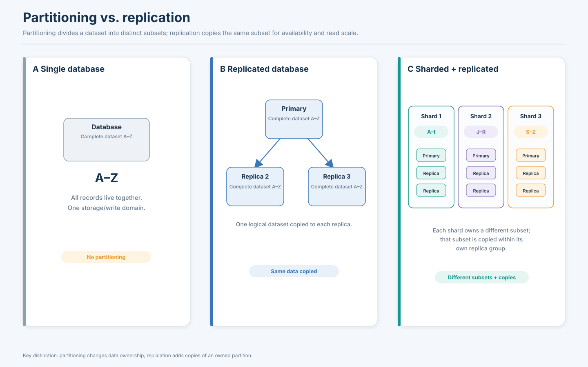

**Diagram specification — `partitioning-vs-replication.svg`**

- **Purpose:** Make the difference between data subdivision and data copying unmistakable.
- **Layout:** Three side-by-side panels: (A) one database, (B) replicated cluster, (C) sharded-and-replicated cluster.
- **Components:** Client, database nodes, logical dataset labels `A…Z`, and arrows for requests/replication.
- **Panel A:** One node contains the complete dataset.
- **Panel B:** Three nodes each contain the same complete dataset; label them `Replica 1`, `Replica 2`, `Replica 3`.
- **Panel C:** Three shard groups contain disjoint subsets (`A–I`, `J–R`, `S–Z`), and each subset is copied to its own replica set.
- **Labels:** `Partitioning = different subsets`, `Replication = same subset copied`.
- **Learning outcome:** Replicas do not automatically create independent write ownership for different keys; sharding does.

## 1.5 Social platform with 500 million users: worked scenario

Assume a platform has 500 million user profiles. For capacity planning, use deliberately simplified assumptions:

- Average logical profile payload: 2 KB.
- Secondary indexes and database metadata: 1.5 times payload size.
- Three physical copies for durability.
- Average sustained write load: 20,000 profile mutations/second, with peaks at 3 times that rate.
- Average point-read load: 400,000 requests/second, with bursts and celebrity-level skew.

Logical profile payload is:

\[
500{,}000{,}000 \times 2\text{ KB} = 1{,}000{,}000{,}000\text{ KB} \approx 1\text{ PB (decimal)}
\]

Including indexes/metadata at the assumed 1.5 multiplier gives approximately 1.5 PB logical storage. Three copies imply roughly 4.5 PB before compression, snapshots, temporary migration copies, and free-space reserve. Actual storage depends heavily on row format, index count, compression, retention, and replication policy; this estimate is for sizing intuition, not a vendor quote.

If 100 shards each sustain 5,000 simple reads/second in the target workload, their aggregate nominal read capacity is 500,000 reads/second. That is not a guarantee: a single popular key, expensive query, uneven shard size, or cross-shard request can saturate an individual shard long before aggregate capacity is reached.

A natural first design is to hash `user_id` into a partition space. A request for `/users/987654` uses the shard map or hash rule to find the owner, then chooses a replica appropriate to the read consistency requirement. Growth from 10 to 100 physical shards should not be implemented as an unplanned change to `hash(id) % physical_node_count`; that can remap most keys. The system should separate a stable logical partitioning scheme from physical placement so ownership can be moved gradually.

Sharding introduces new problems: routing metadata, scatter-gather queries, cross-shard transactions, hot keys, uneven tenants, online migration, index design, shard-level observability, backup/restore coordination, and failure handling. A sharded system is a distributed system, not merely a database connection string with an integer modulo operation.

---

# 2. Partitioning Strategies

No single partitioning strategy is universally best. Select a strategy by considering the distribution of keys, the frequency and shape of queries, growth and migration requirements, and how much placement metadata the system can operate reliably.

## 2.1 Range-based partitioning

Range partitioning assigns contiguous portions of an ordered key space to partitions. A partition map might contain:

| Partition | Key interval | Current owner |
|---|---|---|
| P0 | `(-∞, 1,000,000)` | Shard A |
| P1 | `[1,000,000, 2,000,000)` | Shard B |
| P2 | `[2,000,000, 3,000,000)` | Shard C |

The half-open interval convention—lower bound inclusive, upper bound exclusive—avoids overlap at boundaries. A query for keys from 1,500,000 through 1,600,000 can be routed to P1 only if the range boundaries and predicate align with the key. A query from 900,000 through 2,100,000 touches P0, P1, and P2.

### Strengths

- Efficient range scans and ordered pagination on the partition key.
- Natural locality for time windows, account histories, and adjacent identifiers.
- Partition pruning: the router can skip ranges that cannot match the predicate.
- Straightforward range split and merge operations when key boundaries are known.
- Useful for storage engines whose sorted files or B-trees are naturally range-oriented.

### Weaknesses and hot ranges

Range partitioning can create a **hot tail**. If order IDs or timestamps increase monotonically, all new records enter the highest range. Shard C may receive almost all writes while Shard A and B mostly serve historical reads. Balanced storage does not imply balanced traffic.

A range may also become large because of skewed values. If a tenant owns 35% of all records, simply cutting the key space into equal numeric ranges may not balance bytes or requests. A range split based on data size alone can still leave one hot key or tenant concentrated.

### Numerical order example

Suppose order IDs 1–3,000,000 are divided into three ranges, each with one million identifiers. A query for IDs 1,500,000–1,600,000 routes to Shard 2. However, if IDs are allocated sequentially, all current inserts go into the range containing the newest IDs—perhaps Shard 3. The read path is well targeted; the write path is skewed.

Mitigations include partitioning by a composite key such as `(region, order_id)`, adding a hash prefix or bucket, pre-splitting future ranges, distributing timestamps across logical buckets, or using a database's automatic split/load-balancing capability. Each changes query locality or application complexity. A hash prefix spreads writes, but a global time-ordered query may need to query multiple buckets.

### Where range partitioning appears

- **Google Cloud Bigtable and Apache HBase:** ordered row-key spaces are divided into ranges/regions, so row-key design controls locality and hotspot risk.
- **MongoDB ranged sharding:** shard-key ranges are divided into chunks and mapped to shards; `mongos` can target ranges when the shard-key predicate is supplied. [MongoDB sharding docs](https://www.mongodb.com/docs/manual/sharding/)
- **Relational table partitioning:** range partitions are frequently used for time-based retention, archival, and partition pruning. A local table partition is not automatically the same as a separately operated database shard.

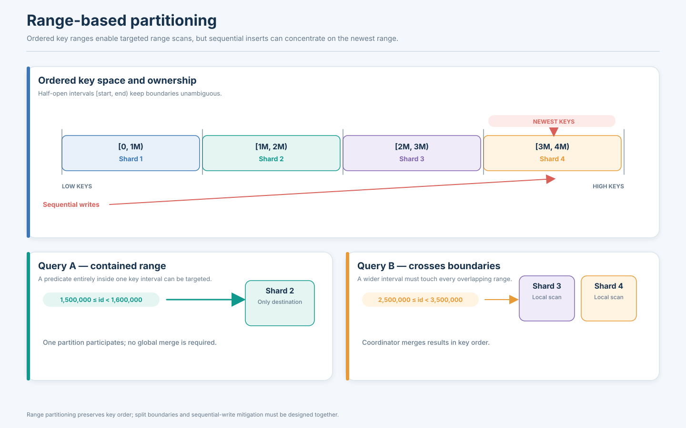

**Diagram specification — `range-based-partitioning.svg`**

- Draw an ordered horizontal key axis from low to high values, split into four half-open intervals.
- Map each interval to a separate shard/node using a compact ownership table.
- Show a point lookup and a range query entirely inside one interval with a single destination arrow.
- Show a second range query crossing two boundaries, branching to three partitions and merging ordered results.
- Add a highlighted `newest keys` region receiving sequential inserts; annotate `possible hot tail`.
- Labels must show interval boundaries and whether endpoints are inclusive/exclusive.
- Learning outcome: range scans are efficient when locality matches predicates, but monotonic writes can concentrate load.

## 2.2 Hash-based partitioning

Hash partitioning computes a deterministic hash of a partition-key value and maps the result to a partition. A simple teaching model is:

\[
partition(k) = hash(k)\bmod N
\]

where `N` is the number of logical partitions. A good, well-distributed hash makes nearby input values map to unrelated positions, which can spread sequential IDs more evenly. Production systems must use a stable, well-defined hash algorithm; language-runtime hash functions are often unsuitable because they may be salted or change across versions/processes.

### Numerical example: 12 million users, four shards

Assume `hash(user_id)` produces values uniformly distributed over a large integer space. Under modulo 4, each remainder maps to one of four logical shards. Expected record count is:

\[
E[records\ per\ shard] = \frac{12{,}000{,}000}{4}=3{,}000{,}000
\]

This is an expectation, not an exact placement guarantee. The actual distribution depends on the hash function, key population, and partitioning implementation.

Now increase `N` from 4 to 5. The expression `hash(key) % 5` is not a small adjustment to the old mapping. Most keys change remainder and therefore destination. A naive resize can require moving a large fraction of the dataset, creating heavy network, disk, and replication load.

### Strengths and weaknesses

Hash partitioning is useful when point access by a high-cardinality key dominates and range ordering is not essential. It resists monotonic-key concentration because sequential keys are spread across the hash space. It also makes it easier to create partitions of roughly similar key counts when keys and requests are reasonably uniform.

It makes key-range queries less local: `created_at BETWEEN ...` or `id BETWEEN ...` may touch many/all shards unless a suitable secondary index or additional partition dimension exists. Hashing does not solve skew caused by a hot key: all requests for one `celebrity_user_id` still target the same partition unless the data or reads are intentionally replicated or split.

### Modulo hashing versus database hash partitioning

The modulo equation is a conceptual illustration. Products add their own token spaces, partition catalogs, range assignment, replica placement, and migration mechanisms. Examples:

- **PostgreSQL declarative hash partitioning** uses hash partition bounds for table partitions within one PostgreSQL database deployment; it is not by itself a distributed multi-server sharding layer.
- **Cassandra** hashes a partition key into a token and assigns token ranges across a ring of nodes.
- **MongoDB hashed sharding** hashes the shard-key field and distributes ranges of hashed values across chunks; queries on the hashed key can be routed, but original-value range queries lose useful locality.
- **Dynamo-style designs** use a hash space and distributed ownership metadata rather than just `hash(key) % node_count`.

### Composite keys

A composite partition key can combine business locality and spreading. For example, `(tenant_id, bucket)` can keep tenant data in a known logical group while dividing a large tenant across buckets. The choice depends on whether queries usually know the complete composite key. If they know only `tenant_id`, they may still need to fan out across all buckets for that tenant.

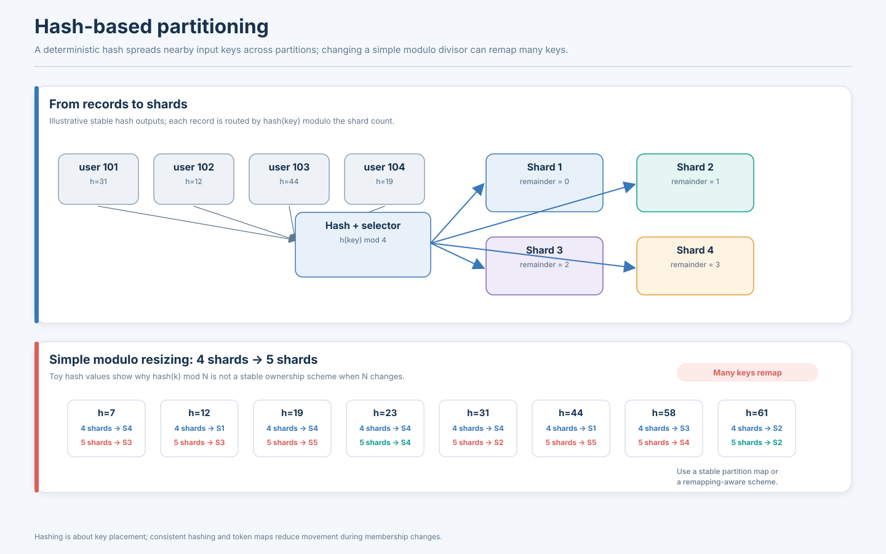

**Diagram specification — `hash-based-partitioning.svg`**

- Left-to-right flow: records with IDs enter a stable hash function; output hashes enter a partition selector; four shards receive separate records.
- Include sample records whose IDs are sequential but whose hash outputs are scattered.
- Add a lower panel comparing `hash(k) mod 4` with `hash(k) mod 5`; highlight that many keys change destination when `N` changes.
- Explicitly label this modulo panel as a simplified mapping, not a universal database rebalancing algorithm.
- Learning outcome: hashing improves key distribution but disrupts ordered scans and naive modulo resizing remaps many keys.

## 2.3 Directory-based partitioning

Directory-based partitioning stores an explicit mapping from tenant, key, range, or logical partition ID to a physical shard. The request path asks a directory—or consults a cached copy of its metadata—to find the owner.

Example tenant map:

| Tenant | Owner |
|---|---|
| Tenant A | Shard 1 |
| Tenant B | Shard 3 |
| Tenant C | Shard 2 |
| Tenant D | Shard 1 |

For Tenant C, the application extracts the tenant ID, resolves `Tenant C → Shard 2`, and routes the SQL request to Shard 2. If Tenant C becomes too large, a control plane can migrate it to Shard 5 and update ownership metadata.

### Why use a directory?

A directory supports explicit placement decisions that are difficult to encode with a pure hash function. It can assign large tenants dedicated shards, place regulated or latency-sensitive customers in a region, direct premium tenants to higher-capacity hardware, and move selected customers without changing the entire hash space.

### Costs and failure modes

- **Availability:** if the directory is unavailable and clients cannot safely use cached mappings, new routing decisions may fail.
- **Consistency:** stale caches can send writes to an old owner after migration.
- **Metadata scale:** a per-key directory can become huge; a per-tenant or per-range directory is more compact.
- **Control-plane contention:** frequent ownership updates can create a bottleneck.
- **Split brain during migration:** source and destination must not both accept authoritative writes unless the protocol explicitly handles dual ownership.

Directory metadata should be versioned. A request can include a routing epoch; the shard checks whether the epoch is current and rejects or forwards stale writes. The client refreshes the mapping and retries with an idempotency key where appropriate. Ownership changes must be coordinated with the data migration protocol; changing a directory row alone does not move the underlying records.

### Product patterns

- **Vitess:** topology metadata, keyspaces, shards, serving graphs, and Vindexes jointly support routing; the Primary Vindex maps values to keyspace IDs and plays a central role in shard assignment. It is more sophisticated than a single tenant lookup table. [Vitess Vindexes](https://vitess.io/docs/reference/vindexes/)
- **Citus:** distributed metadata tracks shard placement and colocation; it distributes rows by a distribution column and maps hash ranges to shard placements. [Citus data modeling](https://learn.microsoft.com/en-us/postgresql/citus/data-modeling?view=citus-14)
- **Custom SaaS systems:** tenant-to-database maps are common where customers have different sizes, residency needs, or service tiers.

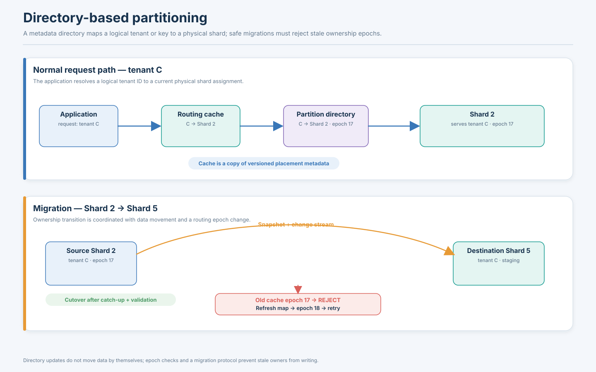

**Diagram specification — `directory-based-partitioning.svg`**

- Show Application → Routing Cache → Partition Directory → Shard 2 for a request with `tenant_id=C`.
- Include a metadata record `C: Shard 2, epoch 17` and a cached copy of the same version.
- In a second state, show migration to Shard 5 and epoch 18; the old cached epoch 17 is rejected, followed by refresh and retry.
- Include Source Shard 2, Destination Shard 5, snapshot/change stream, and an explicit `cutover` point.
- Learning outcome: the directory controls placement metadata; safe ownership change must be tied to migration and stale-route rejection.

## 2.4 Comparing partitioning strategies

| Property | Range | Hash | Directory |
|---|---|---|---|
| Distribution | Contiguous key intervals | Hash-space buckets/tokens | Explicit key/range-to-owner map |
| Range queries | Strong when query follows key order | Usually weak across original key order | Depends on mapped key/range layout |
| Point lookup | Efficient when key range known | Efficient with stable hash/token map | Efficient with lookup/cached mapping |
| Hot-spot risk | High for skewed or monotonic ranges | Lower for sequential keys; hot key remains hot | Can isolate hot tenants/keys explicitly |
| Rebalancing | Split/merge/move ranges | Token movement or remapping | Update mapping plus move data |
| Metadata | Boundaries and owners | Hash algorithm, token/partition map | Potentially explicit mappings |
| Best fit | Time/range scans and ordered locality | High-cardinality point access | Tenant placement, special capacity, custom policy |
| Main danger | Hot tail or uneven ranges | Scatter-gather and hot keys | Directory consistency and control-plane dependency |

Real systems combine these approaches. Examples include directory mapping tenants to logical keyspaces, with hash partitioning inside each tenant; geographic ranges containing hash-distributed partitions; and hash prefixes followed by time ranges for large event datasets.

---

# 3. Consistent Hashing

## 3.1 Why consistent hashing exists

With modulo placement, changing the number of nodes changes the divisor. If a cache has 4 nodes and expands to 5, `hash(key) % 4` and `hash(key) % 5` differ for most keys. The cluster may need to repopulate most cache entries or migrate much of a stored dataset.

**Consistent hashing** maps both nodes and data keys into the same circular hash space. A key is assigned to the first node encountered moving clockwise from the key's position. Each node owns the interval after its predecessor up to its own position (depending on the convention used).

A ring can be represented numerically from 0 to `2^m - 1`, with the end wrapping to zero. Node positions are derived from node identities; key positions from key values. The same hash function and canonical encoding must be used consistently by all clients.

## 3.2 Four-node numerical example

Assume a ring with values from 0 to 99 and four node positions:

| Node | Ring position |
|---|---:|
| A | 10 |
| B | 35 |
| C | 60 |
| D | 85 |

Assume eight keys hash to these positions:

| Key | Position | Clockwise owner |
|---|---:|---|
| k1 | 4 | A |
| k2 | 18 | B |
| k3 | 30 | B |
| k4 | 42 | C |
| k5 | 55 | C |
| k6 | 68 | D |
| k7 | 78 | D |
| k8 | 92 | A (wrap-around) |

Now add node E at position 50. Under clockwise-successor ownership, keys from the previous node's interval that now encounter E first move to E. In this example, k4 at 42 and k5 at 55? Carefully apply the ring rule: E at 50 owns `(previous node position 35, 50]`; therefore k4 at 42 moves from C to E, while k5 at 55 remains with C. Only keys in E's newly acquired interval move. When removing E, keys in that interval move to the next clockwise node (C).

This is the central property: adding or removing one node generally changes ownership for a limited part of the ring rather than forcing all keys to be remapped.

## 3.3 How much data moves?

With `N` equally placed nodes and a uniform hash space, each owns approximately `1/N` of the ring. Adding one new equally weighted node should acquire about `1/(N+1)` of the ring, so roughly that fraction of keys moves from existing nodes to the new node. With 4 nodes, adding a fifth ideally moves about 20% of keys, not 100%. The exact fraction varies due to finite positions, nonuniform hash distributions, and replication policy.

By contrast, naive modulo hashing often remaps approximately `1 - 1/N_new` of keys under a change to a new node count, subject to the key distribution and particular old/new counts. For 4 to 5 nodes, a common expectation is about 80% remapped. This is an illustrative contrast, not a universal exact percentage for every pair of moduli.

## 3.4 Limitations

Basic consistent hashing with one ring position per physical node can be uneven. Randomly chosen node positions create unequal arc lengths. The number of keys is also finite, and the traffic distribution may be very different from the key distribution. Consistent hashing reduces remapping; it does not automatically guarantee equal storage, throughput, or latency.

Production systems add virtual nodes, weighted placement, replication, load-aware movement, topology constraints, and ownership metadata. Those mechanisms are as important as the ring itself.

### Real-world context

The original Amazon Dynamo design used consistent hashing to partition and replicate data, alongside versioning, quorum-like operations, and hinted handoff/anti-entropy techniques. Do not equate the 2007 Dynamo paper's architecture with every internal detail of today's managed DynamoDB service. [Dynamo paper, Amazon Science](https://www.amazon.science/publications/dynamo-amazons-highly-available-key-value-store)

Cassandra uses a token-based ring architecture; its partitioner maps partition keys to tokens and token ranges are assigned to nodes. Modern deployments commonly use virtual nodes. [Cassandra topology operations](https://cassandra.apache.org/doc/latest/cassandra/managing/operating/topo_changes.html)

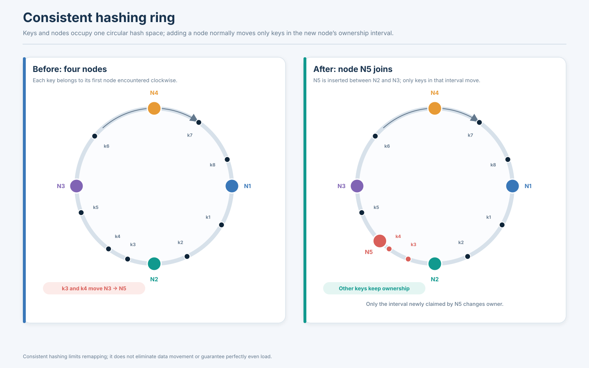

**Diagram specification — `consistent-hashing-ring.svg`**

- Circular ring labeled from `0` to `2^m−1`, with clockwise direction.
- Place physical nodes A, B, C, and D at four distinct positions; place keys k1–k8 at separate points.
- Draw ownership arcs and clockwise arrows from representative keys to their successor nodes.
- Add a second ring with node E inserted; color the newly acquired interval and keys that move to E.
- Add a final small panel showing E removed and the affected interval returning to C.
- Include a note that consistent hashing reduces remapping but basic placement can still be imbalanced.
- Learning outcome: a membership change affects a bounded ring interval rather than the entire key set.

---

# 4. Virtual Nodes (VNodes)

A **virtual node** is a logical position or token range on the hash ring. One physical machine can own many virtual positions. Instead of assigning each physical node one point, the placement algorithm assigns each node multiple points—often through deterministic hashes of `(node_id, vnode_index)`.

## 4.1 Why virtual nodes improve balance

With one token per physical node, a node may receive a very large ring interval by chance. With many independently distributed token positions, each physical node owns many smaller intervals. Aggregated across the ring, these intervals tend to produce a more balanced share of key space.

Imagine four nodes each owning one position. If node A happens to own 45% of the ring, it may carry a disproportionate data share. With 64 virtual positions per node, A owns 64 smaller intervals spread around the ring; the total is more likely to approach its intended share.

Virtual nodes also simplify rebalancing. When a physical node is added, it can receive a subset of token ranges rather than one contiguous region. When a node leaves, its many ranges can be reassigned to multiple surviving nodes, spreading recovery traffic and data ownership.

## 4.2 A simple balance illustration

Assume 400,000 keys and four equal-capacity nodes.

- **One position per node:** one possible ring outcome could distribute 160k, 120k, 80k, and 40k keys. The expected share is 100k, but random ring geometry can be highly uneven.
- **64 positions per node:** each physical node owns 64 smaller intervals. A sample outcome might be 101k, 98k, 102k, and 99k keys. This is much closer to equal but still not a guarantee.

The numbers are illustrative. Real balance is also influenced by partition sizes, replication factor, topology, workload intensity, and whether the node has equal hardware capacity.

## 4.3 More vnodes are not free

Every virtual token/range introduces metadata and operational work. Very high vnode counts can increase token metadata, repair/streaming task counts, scheduling overhead, and complexity of diagnosing ownership. They do not fix a single partition that is itself very hot. If a tenant or partition key dominates traffic, splitting that key at the data-model level may be necessary.

Heterogeneous machines should receive weighted capacity. A server with twice the disk and CPU capacity should generally own more data/traffic than a smaller server. Equal token counts do not imply equal resource utilization when capacity differs.

## 4.4 Cassandra example

Cassandra's vnode model lets a node own multiple token ranges. When topology changes, data streams to nodes that become responsible for ranges. Operations such as bootstrap, decommission, removal, replacement, cleanup, and repair must be understood separately; a token ownership change is not equivalent to instant data movement. See the [Cassandra topology operations guide](https://cassandra.apache.org/doc/latest/cassandra/managing/operating/topo_changes.html).

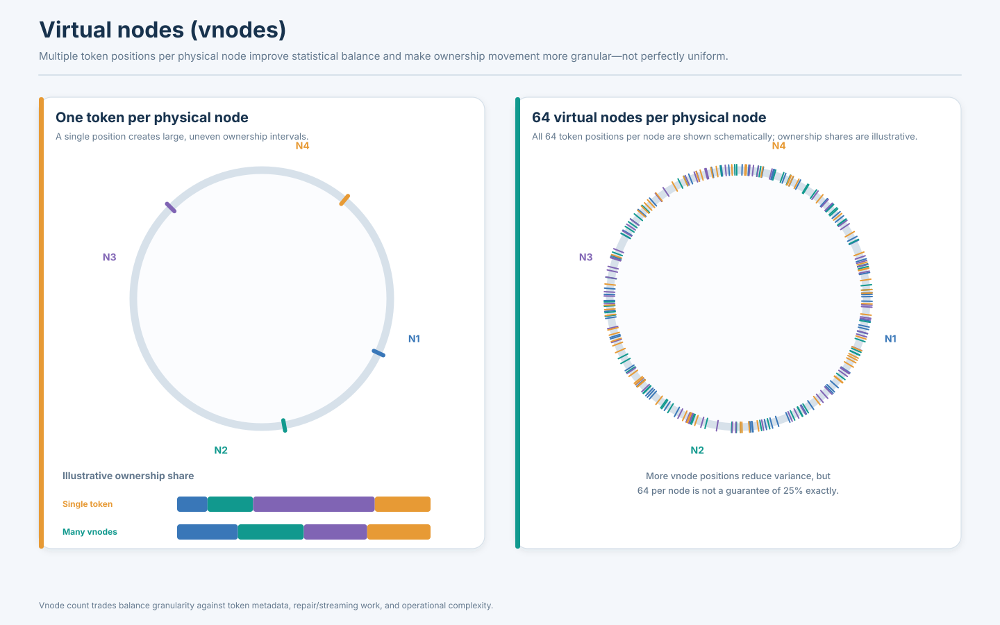

**Diagram specification — `virtual-nodes-distribution.svg`**

- Two equal-sized ring panels with identical four physical nodes and a shared color legend.
- Panel A: one token position per node; visibly unequal arcs (for teaching illustration) and corresponding uneven key counts.
- Panel B: many token marks per physical node, interleaved around the ring; each node owns many short arcs.
- Add a legend distinguishing physical machine from virtual token positions.
- Add a side callout: `More vnodes → finer-grained ownership and usually better balance; not a guarantee of equal load`.
- Learning outcome: vnodes reduce placement variance and allow fine-grained movement, but do not erase workload skew.

---

# 5. Rendezvous Hashing (Highest Random Weight Hashing)

Rendezvous hashing assigns a key to the node that obtains the highest deterministic score when the key is combined with each candidate node ID. For key `k` and node set `N`, compute:

\[
owner(k)=\arg\max_{n\in N} H(k\parallel n)
\]

where `H` is a stable hash or scoring function and `||` means concatenation/structured combination. Because every client evaluates the same key/node pairs with the same function and node set, they independently select the same owner.

## 5.1 Worked example

For key `product:42`, assume these illustrative scores:

| Candidate node | Score |
|---|---:|
| Node A | 0.31 |
| Node B | 0.92 |
| Node C | 0.57 |

Node B wins because it has the highest score. If node D is added and scores are:

| Candidate node | New score |
|---|---:|
| Node A | 0.31 |
| Node B | 0.92 |
| Node C | 0.57 |
| Node D | 0.44 |

Ownership remains with B. If D had scored 0.97, only this key would move to D. In a well-behaved score construction, adding a node causes keys to move only when the new node beats their previous winner. Removing a node moves keys previously owned by it to their next-highest-scoring candidates.

## 5.2 Properties and trade-offs

- **Deterministic:** same key and node set produce the same winner.
- **Minimal disruption:** adding a node only steals keys for which it becomes the highest scorer.
- **No explicit ring required:** implementations score the candidate nodes directly.
- **Simple membership semantics:** a key can be assigned consistently across caches or routers if membership snapshots match.
- **Computation:** scoring all `N` nodes for a key costs O(N) work per lookup unless results are cached or optimized.
- **Large clusters:** O(N) can become expensive at very large node counts or request rates.
- **Weighting:** capacity-aware variants can incorporate node weights, but the exact scoring method matters; do not improvise weights in a way that breaks deterministic ordering.

Rendezvous hashing is useful for distributed cache placement, request assignment, endpoint selection, and some partition-routing layers. It may be less suitable as a direct database data-placement strategy when the database needs ordered ranges, explicit replicas, topology-aware placement, or incremental movement of large partitions. It is not a drop-in substitute for every consistent-hashing ring implementation.

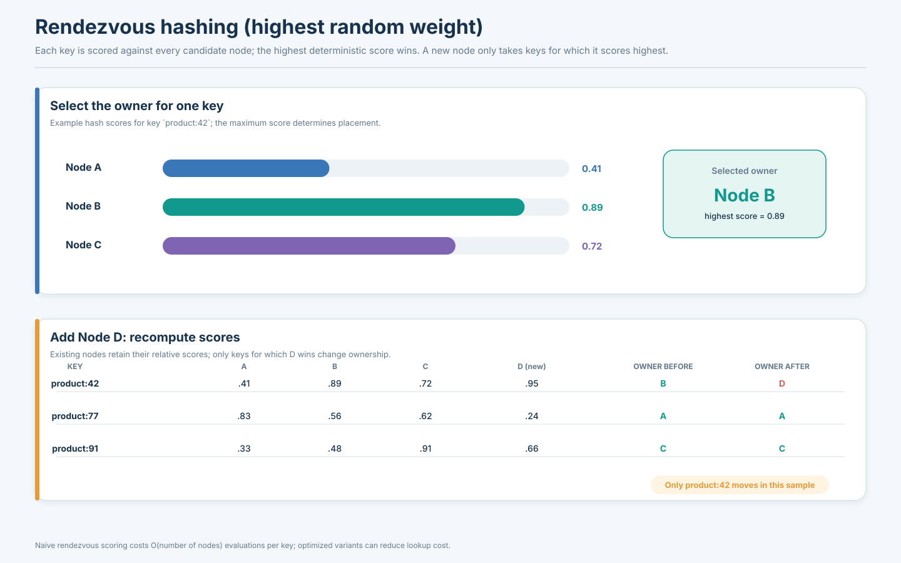

**Diagram specification — `rendezvous-hashing.svg`**

- Show one key `tenant:acme` entering a scoring block.
- Draw arrows from the scoring block to Node A, B, and C score cards; highlight the maximum score and Node B as owner.
- In a second panel add Node D, show four scores, and highlight whether ownership remains or moves based on D's score.
- Include the equation `owner(k)=arg max H(k || node)` and a note `O(N) candidate scoring per uncached decision`.
- Learning outcome: the owner is the node with highest deterministic key-node score; membership changes generally move only keys won by the entering/leaving node.

---

# 6. Hot Spots and Data Skew

A partitioning scheme can distribute records almost perfectly and still fail to distribute work. The distinction between **data skew** and **workload skew** is essential:

- **Data skew** means partitions contain very different amounts of data.
- **Workload skew** means partitions receive different request rates, transaction costs, or resource demand.
- A **hot key** is one key or a small set of keys receiving disproportionate traffic.
- A **hot partition** is a partition whose aggregate resource demand is unusually high. It may contain one hot key, many moderately popular keys, or a complex query pattern.

A shard with 10% of total rows can receive 70% of writes. Conversely, a shard holding 50% of cold historical data may receive little traffic. Equal row counts are not a useful substitute for measuring CPU, disk, network, and latency per partition.

## 6.1 Celebrity-user hot key

Imagine a celebrity account with 100 million followers. A post may be requested millions of times in a short period. A hash of `user_id` distributes different users evenly, but all requests for that celebrity's profile or post still map to the same logical partition. The system has a hot key even though the overall user distribution is uniform.

Adding more database nodes does not split an indivisible key automatically. If one row is the point of serialization, a new shard does not help unless the read workload is replicated, cached, materialized, or partitioned into independently fetchable pieces.

### Mitigation choices

| Technique | How it helps | Costs and failure modes | Good fit |
|---|---|---|---|
| Read-through cache | Serves repeated reads from memory close to callers | Invalidation, expiry, stampedes, stale reads | Read-heavy hot objects |
| Request coalescing | Combines concurrent cache misses into one backend fetch | Needs bounded in-flight work and timeout handling | Bursty identical reads |
| Replicate hot records | Places copies in multiple locations/partitions | Write fan-out and replica freshness | Mostly immutable or low-write data |
| Key salting/bucketing | Splits one logical key into several physical keys | Reads must query/merge buckets; writes need a stable bucket rule | High-rate append data for one entity |
| Fan-out on write | Precompute a user's feed/inbox when a post arrives | Write amplification; celebrity posts can be expensive | Bounded, personalized feed workloads |
| Fan-out on read | Store a post once and assemble it when followers read | Read-time aggregation and cache requirements | Many low-volume users plus rare high-follower accounts |
| Dedicated partition | Isolates a large tenant or celebrity workload | Capacity reservation and operational overhead | A small known set of massive customers |
| Adaptive splitting | Creates additional physical partitions for a busy range | Cannot split an indivisible hot record; metadata and migration complexity | Range or workload hotspots that can be subdivided |

**Key salting example:** Store events for one very active account under keys `(account_id, bucket_id)`, where `bucket_id` is one of 32 deterministic buckets. Writes spread across 32 partitions. A query for all events for that account must read 32 buckets and merge them. This is a deliberate trade: write scale improves at the cost of read fan-out and ordering complexity.

**Fan-out on write vs fan-out on read:** Social feeds often use a hybrid. Ordinary accounts can use fan-out on write because each post is delivered to a manageable number of followers. Celebrity posts may use fan-out on read or a separate cached path because writing a feed entry to 100 million followers for each post is prohibitive.

## 6.2 Data and tenant skew

Consider a SaaS system with 10,000 tenants. An average-based calculation may assume each tenant contributes 0.01% of data. In practice, one enterprise tenant may account for 40% of writes and 30% of stored bytes. A tenant-ID hash may spread tenants across nodes, but cannot split the largest tenant if every row for that tenant must be colocated.

Other sources of skew include:

- A few products receiving most marketplace views.
- Recent events being much hotter than historical events.
- One region generating the majority of traffic during local business hours.
- A small set of customers running expensive reports.
- A status field with low cardinality (`status='ACTIVE'`) used as a leading partition key.
- A timestamp or monotonically increasing ID directing writes to a range's newest boundary.

## 6.3 Measuring skew

Useful per-shard signals include:

| Metric | What it reveals | Interpretation |
|---|---|---|
| Requests/second | Traffic volume | Compare max, median, and p95 shard rate |
| CPU and runnable queue | Compute saturation | High CPU on one shard suggests skew or a costly query |
| Disk IOPS/throughput | Storage pressure | Can reveal write amplification or index pressure |
| P50/P95/P99 latency | User-visible behavior | One shard may dominate tail latency |
| Queue depth | Backlog | Rising queue with stable arrival rate signals saturation |
| Storage and index bytes | Data skew | Bytes matter more than row count |
| Read/write mix | Workload type | Read-heavy and write-heavy shards need different remedies |
| Hot-key frequency | Key concentration | Top-key metrics help identify indivisible hot objects |
| Cache hit ratio | Cache effectiveness | A low hit ratio may increase backend load |
| Replication lag | Replica health | Hot writes may delay followers or CDC consumers |
| Migration throughput/lag | Rebalance impact | A migration can consume resources or fall behind |
| Errors/timeouts by shard | Localized failure | Correlate with routing and ownership changes |

Use distributions, not only averages. A cluster average CPU of 45% may hide one shard at 98% and nine shards at 39%. Useful alert ratios include `max_shard_qps / median_shard_qps`, `max_shard_bytes / median_shard_bytes`, and p99 latency by shard.

## 6.4 Mitigation decision process

1. Determine whether the skew is in data size, request rate, CPU cost, writes, or a specific key.
2. Identify whether the hot object can be split without changing application semantics.
3. If reads dominate, test cache, replication, request coalescing, or precomputed views.
4. If writes dominate, consider buckets/salts, append logs, dedicated capacity, or redesigning the aggregate boundary.
5. If a tenant dominates, isolate or subdivide it while preserving query locality.
6. Measure the new cross-partition read/merge cost; do not optimize writes while accidentally making every read a cluster-wide query.
7. Add guardrails: per-tenant quotas, admission control, rate limits, and workload isolation.

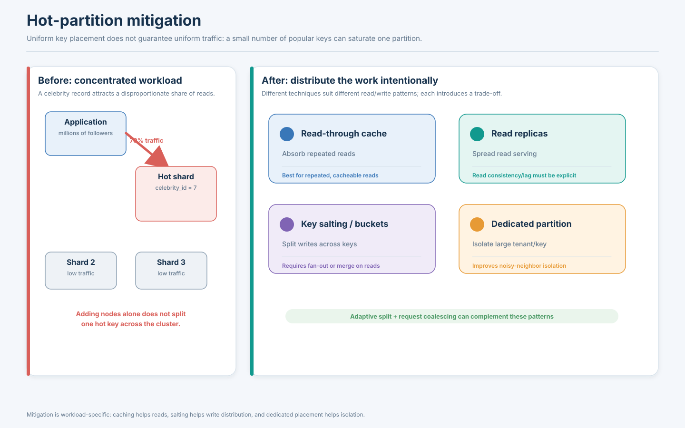

**Diagram specification — `hot-partition-mitigation.svg`**

- Top panel: four shard boxes with traffic arrows; Shard 2 receives a visibly disproportionate number of arrows and is marked `HOT`.
- Bottom panel: four remedy lanes—(1) cache/read replicas for hot reads, (2) 16 salted buckets for append writes, (3) dedicated tenant shard, and (4) fan-out/coalescing layer.
- Show traffic paths before and after each remedy, with callouts for trade-offs (`staleness`, `merge reads`, `write amplification`, `extra capacity`).
- Include a separate note that adding nodes without splitting or replicating the hot key does not remove a single-key bottleneck.
- Learning outcome: choose a mitigation based on whether the problem is a hot read, hot write, or oversized tenant.

---

# 7. Rebalancing Strategies

**Rebalancing** changes which physical nodes own partitions so that capacity and workload are distributed appropriately. **Resharding** changes the partitioning scheme itself—for example, changing the shard key, hash space, number of logical partitions, or range boundaries. A system may rebalance without changing the logical partition map, or reshard and rebalance as one operation.

Rebalancing is triggered by node addition/removal, hardware replacement, failures, data growth, tenant growth, workload shifts, zone changes, and maintenance. It is a data-movement operation, not an instantaneous metadata edit.

## 7.1 Main rebalancing approaches

### A. Fixed number of logical partitions

Create many logical partitions up front—say 1,024 or 4,096—and assign several to each physical node. The application routes to a logical partition ID; a placement map tells it which node owns that partition. When a node is added, move selected logical partitions to it.

**Benefits:** fine-grained movement, stable logical IDs, easier capacity distribution, and less need to change the key-to-partition calculation.

**Limitations:** partition count is a design choice; very small partitions increase metadata and scheduling overhead; moving a partition still requires safe copying and cutover. If the logical partition count is too small, future scale may be constrained. If too large, many tiny partitions can complicate management.

A rough initial partition-count heuristic is to create several logical partitions per expected physical node so that a node can donate or receive small units. The optimal count is product-specific and should be validated against metadata, compaction, and migration costs rather than selected from a universal rule.

### B. Dynamic partitioning

The system detects partitions that exceed size or load thresholds and splits them; small or underutilized adjacent partitions may be merged. The split key is selected from actual data distribution, not necessarily halfway through the numeric key space. A split can reduce a range bottleneck if the hot traffic spans multiple keys. It does not help if all requests target one indivisible key.

Dynamic splitting needs partition-map updates, split-point selection, migration or file ownership changes, and routing refresh. If split/merge decisions react too quickly to noisy workload changes, the system can oscillate.

### C. Proportional partitioning

Assign more logical partitions or token ranges to high-capacity machines and fewer to smaller machines. Capacity weights may reflect CPU, storage, network, or measured throughput. A heterogeneous fleet should not be balanced solely by equal partition count.

### D. Consistent-hash/token movement

Move selected token ranges or vnode-owned segments to a new node. Neighbors may stream the data; replicas must be placed according to the replication policy. Token movement can preserve most key assignments but may still generate heavy disk and network traffic. It can temporarily increase load on both source and destination.

## 7.2 Safe online migration: Tenant C from Shard 2 to Shard 5

Assume a SaaS tenant must move while the application remains online. A safe migration is a state machine with explicit ownership, progress, and rollback boundaries.

### Step 1 — Plan and reserve capacity

- Confirm Shard 5 has CPU, storage, index, connection, and replication headroom.
- Identify all tenant-owned tables, secondary indexes, blobs, background jobs, caches, and event consumers.
- Decide the consistency model and maximum acceptable cutover pause.
- Assign a unique migration ID and ownership epoch.
- Define rollback conditions and who can authorize cutover.

### Step 2 — Take a consistent snapshot

Copy the tenant's initial data at a well-defined snapshot point `S0`. A snapshot must represent a consistent database state. Copying tables independently without a shared snapshot can create broken references or miss transactions spanning tables.

### Step 3 — Capture concurrent writes

Writes continue on Shard 2 while the snapshot is copied. Capture changes after `S0` through write-ahead-log CDC, database change streams, an ordered event log, or a database-native migration facility. Record a durable source position/checkpoint so the destination can apply every change exactly once in effect.

### Step 4 — Apply and catch up

Apply the snapshot to Shard 5, then replay changes in order. The apply process must be idempotent or maintain durable deduplication/checkpoint metadata. Monitor CDC lag, apply throughput, error counts, and resource pressure. Throttle migration when it competes with production queries.

### Step 5 — Validate

Compare counts by table and range, checksums over key groups, aggregate balances, referential invariants, and sampled records. Verify indexes, uniqueness constraints, permissions, retention settings, and dependent objects. A matching row count alone is not enough to prove correctness.

### Step 6 — Establish a write barrier / ownership handoff

A common safe design uses an ownership epoch or fencing token. The control plane increments the tenant epoch from 17 to 18. Shard 2 rejects writes with epoch 17 after the handoff. The application/router stops sending new authoritative writes to Shard 2, drains in-flight writes, waits for CDC to reach the barrier position, and makes Shard 5 the sole owner.

Dual-write designs require special care: the two writes may succeed on only one side, occur in different orders, or be retried. A durable outbox/CDC protocol and idempotent consumers are safer than two unrelated best-effort writes. Write forwarding from old to new owner can simplify transition but must avoid loops and stale-owner races.

### Step 7 — Update routing and caches

Publish the new mapping `Tenant C → Shard 5, epoch 18`. Invalidate routing caches or let them expire under a bounded TTL. A shard that receives a stale epoch should reject or forward the request, not accept an obsolete write that creates a second authority.

### Step 8 — Observe and retain rollback capability

Monitor errors, latency, CDC lag, duplicates, and tenant-specific behavior. Keep the old data read-only for a defined retention period. Rollback after new writes have been accepted on Shard 5 is not simply a pointer flip: the post-cutover write history must be reconciled back or a reverse migration run.

### Step 9 — Clean up

After a safe retention window, remove old tenant rows, stale indexes, migration streams, and temporary resources. Record the migration result and retain an audit trail.

## 7.3 Important migration hazards

- **Dual writes:** two independent commits are not atomic. A partial success creates divergence.
- **Snapshot race:** writes occurring during snapshot creation must be captured from an exact point in the log.
- **Out-of-order events:** apply by source sequence/transaction order where required.
- **Retries:** use idempotency keys or deterministic upserts; never assume a timeout means the destination did not apply a change.
- **Cache invalidation:** old routing and old object caches can continue directing reads/writes to the donor.
- **Backpressure:** uncontrolled bulk copy can saturate source disks, destination disks, network, or replicas.
- **Unique constraints:** global uniqueness may require coordination when a key can be inserted concurrently on different shards.
- **Foreign keys and transactions:** relationships spanning shards may need an application-level workflow or a database-supported distributed transaction.
- **Rollback:** after cutover, new writes must be included in rollback planning.

## 7.4 Product migration patterns

- **Cassandra:** topology operations include bootstrap, decommission, removal, replacement, token movement, streaming, and cleanup. These are explicit operational workflows, not merely changing a ring entry. [Cassandra topology changes](https://cassandra.apache.org/doc/latest/cassandra/managing/operating/topo_changes.html)
- **MongoDB:** the balancer migrates chunks/ranges between shards; migrations are resource-intensive and run as background operations. Balancer behavior and zone constraints matter. [MongoDB balancer](https://www.mongodb.com/docs/manual/core/sharding-balancer-administration/)
- **Vitess:** resharding uses keyspace/shard workflows and routing metadata to transition traffic; use the version-specific Vitess migration documentation rather than assuming a generic copy-and-flip.
- **Citus:** shards and colocation groups are tracked in distributed metadata; rebalancing moves shard placements among worker nodes.
- **Dynamo-style systems:** token ownership and replica placement metadata guide streaming and handoff; the original Dynamo paper describes techniques such as consistent hashing and replica synchronization.

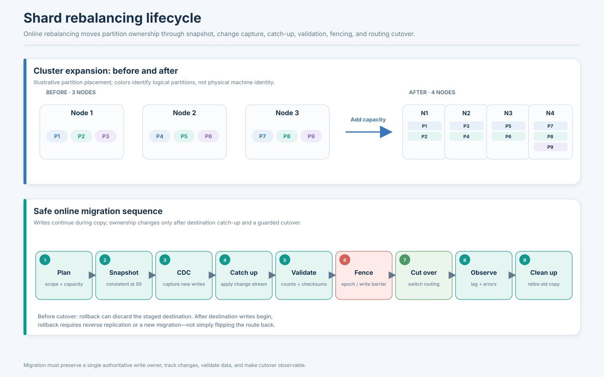

**Diagram specification — `shard-rebalancing-lifecycle.svg`**

- Left half: three-node cluster before expansion; highlight an overloaded node and logical partitions assigned to it.
- Right half: four-node cluster after selected partitions move to the new node; use identical partition IDs and colors before/after to make ownership changes clear.
- Bottom sequence lane: `Plan → Snapshot at S0 → CDC capture → Apply/catch up → Validate → Write barrier/epoch increment → Routing cutover → Observe → Cleanup`.
- Show write arrows continuing to the old owner during snapshot and CDC, then switching to the new owner only after catch-up and fencing.
- Show rollback as a guarded branch before cutover and a reverse-migration requirement after new-owner writes begin.
- Learning outcome: online migration is a controlled data-and-routing transition with a consistency boundary.

---

# 8. Secondary Indexes in Sharded Databases

Sharding changes the meaning and cost of a secondary index. On one database, an index can reference rows in the same storage engine. Across shards, an index may be local to each shard or maintained as a separate distributed data structure.

## 8.1 Primary and secondary keys

- A **primary key** uniquely identifies a record in its logical table or collection.
- A **partition/shard key** determines where the record is stored. It may be the same as the primary key or only one component of a composite key.
- A **secondary key** is a field used for an alternate access path, such as `email`, `category`, or `order_date`.
- A **secondary index** stores an ordered or searchable structure that maps secondary-key values to primary-key values or record locations.

The index's scope matters: does it exist only on one shard, or does it provide a cluster-wide lookup?

## 8.2 Local secondary indexes

A **local secondary index** is maintained within the shard that owns the base record. If the application already knows the shard key, it can route to the shard and use the local index there.

Example: orders are partitioned by `customer_id`; a customer query requests all orders for customer 123 during a date window. The router maps customer 123 to one shard, and a local index on `order_date` within that shard can efficiently find the rows.

A query by `order_date` alone does not identify the customer shard. It may need to fan out to every shard and merge results, unless an additional global index or time-oriented data structure exists.

## 8.3 Global secondary indexes

A **global secondary index** is a cluster-level access path that can find records using a secondary attribute independent of the base table's partition key. The index itself must be partitioned and made available across the cluster. It usually stores a mapping such as:

`category = "laptops" → [(seller_17, product_891), (seller_42, product_120), ...]`

Marketplace example: products are sharded by `seller_id`, but search is primarily by `category`. A global index on category maps the category to base-record keys and shard locations. Query execution becomes: search global index → get matching primary keys/owners → fetch product records from multiple shards → filter/rank/aggregate.

### Global-index challenges

- **Write amplification:** inserting or changing a product requires updating the base record and the global index.
- **Atomicity:** if the base write commits but the index update fails, the index may be temporarily incomplete or stale.
- **Consistency:** synchronous maintenance may require cross-shard transactions; asynchronous maintenance introduces lag and stale results.
- **Movement:** when a record migrates, index pointers or routing references must be updated without producing duplicate or dangling entries.
- **Index hot spots:** a popular category or low-cardinality secondary value can make one index partition hot.
- **Fan-out:** index results may point to many base shards, adding network cost.

A robust design can use an outbox/CDC pipeline, idempotent index consumers, versioned index entries, and reconciliation scans. The query path should tolerate stale entries by validating the target record and dropping deleted or moved references. These are design patterns, not a universal product implementation.

## 8.4 DynamoDB terminology: important product-specific semantics

DynamoDB defines Local Secondary Indexes (LSIs) as sharing the base table's partition key and using a different sort key. Global Secondary Indexes (GSIs) may use a different partition key and sort key and have their own partition space. AWS documentation describes differences in consistency, capacity, and constraints; for example, GSI queries are eventually consistent, while LSI queries can support strong consistency, and LSIs have an item-collection size constraint. Do not assume these exact semantics apply to other databases. [DynamoDB secondary indexes](https://docs.aws.amazon.com/amazondynamodb/latest/developerguide/SecondaryIndexes.html), [GSI](https://docs.aws.amazon.com/amazondynamodb/latest/developerguide/GSI.html), [LSI](https://docs.aws.amazon.com/amazondynamodb/latest/developerguide/LSI.html)

Cassandra secondary-index behavior is not identical to DynamoDB's LSI/GSI model. Cassandra's index mechanisms and query restrictions depend on release and index implementation; evaluate current documentation and the data model before assuming a local/global equivalence.

## 8.5 Local vs global index comparison

| Property | Local secondary index | Global secondary index |
|---|---|---|
| Scope | Within base shard/partition scope | Across base-data partitions |
| Lookup | Efficient when shard key is known | Can locate records by alternate key |
| Query fan-out | Avoided for targeted shard queries | Index lookup may still fan out to base shards |
| Write cost | Local index maintenance | Distributed index maintenance / extra write path |
| Consistency | Often shares local transaction boundary | May require distributed coordination or async lag |
| Rebalancing | Moves with base shard in many designs | Must maintain correct mapping across movement |
| Hot-key risk | Hot base partition can overload index | Popular secondary value can hot-spot the index |
| Best fit | Query by shard key plus local sort/filter | Query patterns that do not contain base shard key |

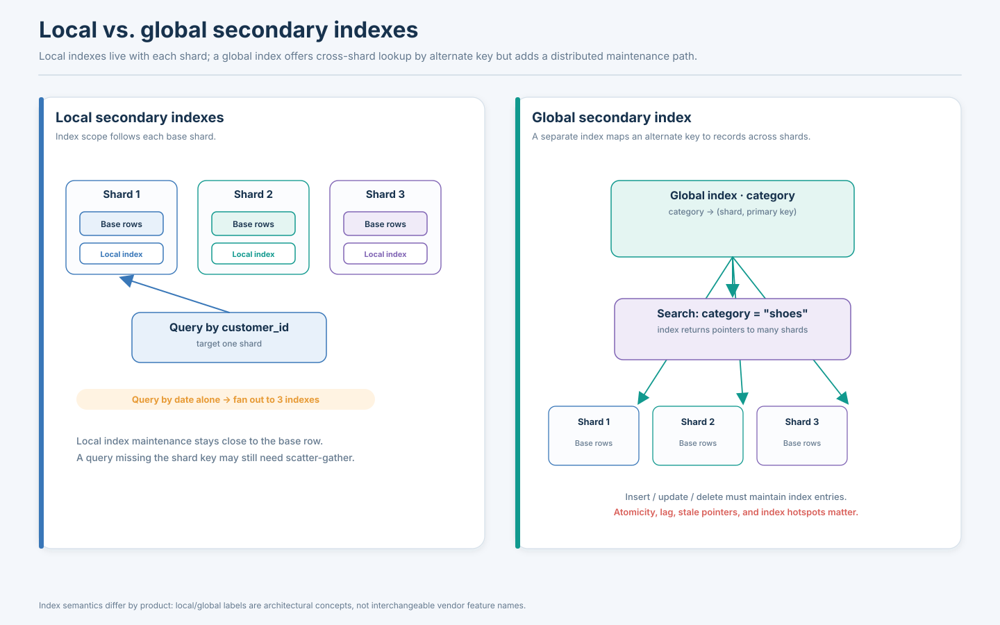

**Diagram specification — `local-vs-global-secondary-index.svg`**

- Left panel: three base shards; each contains its own local `order_date` index. A query with `customer_id` is routed to exactly one shard.
- Show a query by `order_date` alone fanning out to all three local indexes and merging results.
- Right panel: three base shards plus a separately drawn global index partitioned by `category`; a category query reads the global index, then fetches records from multiple base shards.
- Add arrows for index updates on insert/update/delete and label the consistency/atomicity boundary.
- Learning outcome: local indexes preserve shard locality; global indexes add alternate access paths but require distributed maintenance and can introduce stale references or hot index keys.

---

# 9. Request Routing and Service Discovery

Data placement is useful only if a request can find the correct owner. A routing design answers two distinct questions:

1. **Which logical partition owns this key?** This is the shard-routing problem.
2. **Which live network endpoint currently serves that partition and role?** This is the service-discovery/endpoint-selection problem.

These questions may be answered by one component or several. A load balancer that knows healthy database endpoints does not automatically know which endpoint owns a particular key range. Conversely, a shard map that knows ownership does not necessarily know whether the owner's leader is healthy.

## 9.1 Client-side routing

Clients embed or use a database driver that maintains a shard map and routes directly to the selected database node. The map may be computed from a stable hash and cluster membership, or fetched from a control plane.

**Benefits:** fewer proxy hops, no central query router bottleneck, and potentially lower latency.

**Costs:** every client must refresh routing metadata correctly; library versions and schema changes matter; routing rules spread into application deployments; stale clients can continue sending requests to old owners.

A safe system needs versioned maps, bounded metadata staleness, error responses that trigger refresh, and a controlled protocol for ownership changes. Long-lived connection pools must also follow leader or shard movement.

## 9.2 Proxy-based routing

A proxy or gateway sits between applications and database nodes. Clients connect to a stable endpoint; the proxy parses or receives routing information, looks up shard ownership, chooses an endpoint, and forwards the request.

Examples include MongoDB's `mongos` router and Vitess VTGate. MongoDB clients connect through `mongos` for normal sharded operations; the router uses cluster metadata to target shards. [MongoDB sharding architecture](https://www.mongodb.com/docs/manual/sharding/)

**Benefits:** centralized routing logic, simpler client configuration, common connection management, and easier observability.

**Costs:** proxy capacity and availability become important; an extra network hop is introduced; SQL parsing or query planning can be complex; proxy fleets must be horizontally scaled and upgraded safely.

## 9.3 Coordinator-based routing

A coordinator receives a logical query, builds a distributed plan, sends sub-queries to the relevant shards, and merges results. It may perform partition pruning, distributed joins, sorting, aggregation, and partial-failure handling.

A simple point lookup should not necessarily invoke an expensive global query planner. Good systems optimize targeted operations while retaining a distributed execution path for cross-shard queries.

## 9.4 Service discovery and membership

Routing metadata may contain:

- Shard/partition ID and owner node.
- Node network address and port.
- Replica role (leader, follower, read-only replica).
- Health and readiness status.
- Datacenter/region and failure domain.
- Ownership epoch or map version.
- Connection limits and capability/compatibility metadata.

Service discovery identifies available endpoints; routing chooses the right one for a key and operation. Health checks are imperfect: a node can be alive but overloaded, reachable from one zone but not another, or stale in the control plane. A failover mechanism must not route a write to an old leader merely because the old endpoint still answers TCP connections.

## 9.5 Complete request walkthrough: `GET /users/987654`

Assume 8 logical shards and a database router.

1. **Ingress:** API gateway receives the HTTP request and authenticates the caller.
2. **Key extraction:** application extracts `user_id=987654`.
3. **Logical placement:** stable hash or partition metadata maps the ID to logical shard `P5`.
4. **Physical ownership:** shard map version 42 maps `P5` to database group `Shard 5`.
5. **Role selection:** read consistency policy selects the leader for a linearizable/current read, or a suitable replica for a weaker read.
6. **Connection:** router reuses a healthy pooled connection to the endpoint.
7. **Execution:** database uses primary-key index to retrieve the row.
8. **Failure:** timeout or redirect indicates the endpoint may be stale/unhealthy; router checks the current shard map and role.
9. **Retry discipline:** retry only when safe. Reads are usually easier to retry; writes require idempotency keys or a way to determine whether the original write committed.
10. **Response:** API returns the result and records shard/route/version/latency metrics for diagnosis.

For a query that joins users to posts partitioned differently, the coordinator may need to run subqueries on multiple shards and merge results. The cost profile is completely different from the point lookup.

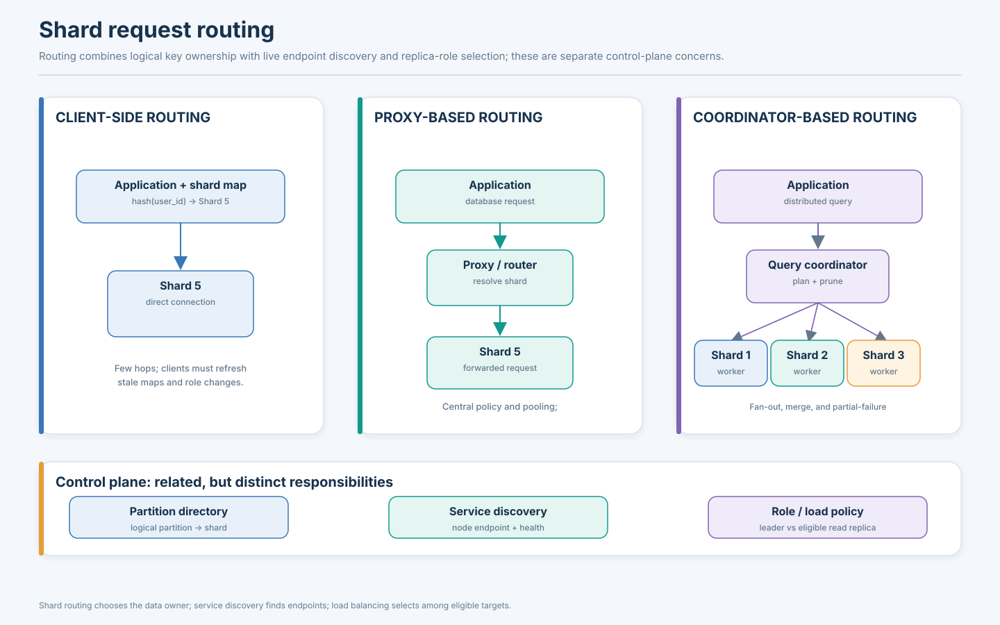

**Diagram specification — `shard-request-routing.svg`**

- Three columns: client-side routing, proxy-based routing, coordinator-based routing.
- Client-side: application holds map → directly reaches target shard.
- Proxy: application → proxy/router → metadata lookup → target shard.
- Coordinator: application → query coordinator → multiple shard workers → merge/aggregate → response.
- Show service discovery as a separate control-plane component supplying node endpoints/health, and the partition directory supplying ownership.
- Mark `shard routing ≠ service discovery ≠ load balancing`.
- Learning outcome: request destination depends on both key ownership and current live endpoint/replica role.

---

# 10. Scatter-Gather Queries and Cross-Shard Operations

A **scatter-gather** query fans a request out to multiple partitions, collects local results, and combines them into one logical answer. It is necessary when the query does not specify enough of the partition key to target a subset, or when the result is inherently global.

## 10.1 Marketplace top-100 example

A marketplace has 20 shards, each storing a subset of products. The request asks for the 100 most popular products across all sellers and regions. If popularity is not aligned with the shard key, the coordinator may need to ask each shard for candidate top results.

An inefficient plan might fetch every product row from all 20 shards, move them to the coordinator, sort globally, and return 100. This can create massive network and memory cost.

A better plan pushes computation toward the data:

1. Each shard computes its local top `K` candidates using an index/order by score.
2. The coordinator merges at most `20 × K` candidates.
3. The coordinator performs a final top-100 merge.
4. If ranking depends on data from another service, only candidate IDs and compact scores should move initially; details can be fetched after final selection.

For a strict top-100 query with a common total ordering and no filtering that invalidates local ranks, each shard's local top 100 is sufficient to produce the global top 100: any item ranked below 100 on its own shard already has at least 100 items on that shard ahead of it, so it cannot be in the global top 100. Real plans must preserve tie-breaking, authorization filters, and ranking semantics.

## 10.2 Operational costs

- **Fan-out:** one client request creates many sub-requests.
- **Tail latency:** if the coordinator waits for all shards, the response time is often determined by the slowest shard. With many independent shard latencies, the probability of seeing one slow response rises.
- **Partial failure:** a missing shard may make exact results impossible. The API must define whether it fails, returns partial results, or falls back to a degraded mode.
- **Global sorting:** local ordering does not remove the need for a merge.
- **Pagination:** offset pagination across shards is expensive and unstable under concurrent changes; cursor/keyset approaches need a global merge cursor.
- **Distributed joins:** joining tables with different partition keys may move large intermediate datasets across the network.
- **Aggregations:** counts, sums, percentiles, and distinct counts require mergeable partial aggregates or approximation algorithms.

## 10.3 Query optimizations

- **Partition pruning:** use predicates on the partition key to avoid irrelevant shards.
- **Query pushdown:** filter, project, aggregate, and sort locally before moving results.
- **Top-K aggregation:** send compact local candidates instead of all rows.
- **Colocation:** partition related tables using the same key so joins can execute locally.
- **Denormalization:** store a read-optimized copy when cross-shard joins dominate and consistency trade-offs are acceptable.
- **Materialized views:** precompute expensive global aggregates and update them asynchronously or transactionally according to the required freshness.
- **Analytics pipeline:** export events to a system designed for distributed analytics rather than repeatedly scanning an operational database.

A strong schema aligns the partition key with the application's common request path. A design where every ordinary request becomes a 20-shard scatter-gather system has not achieved useful locality.

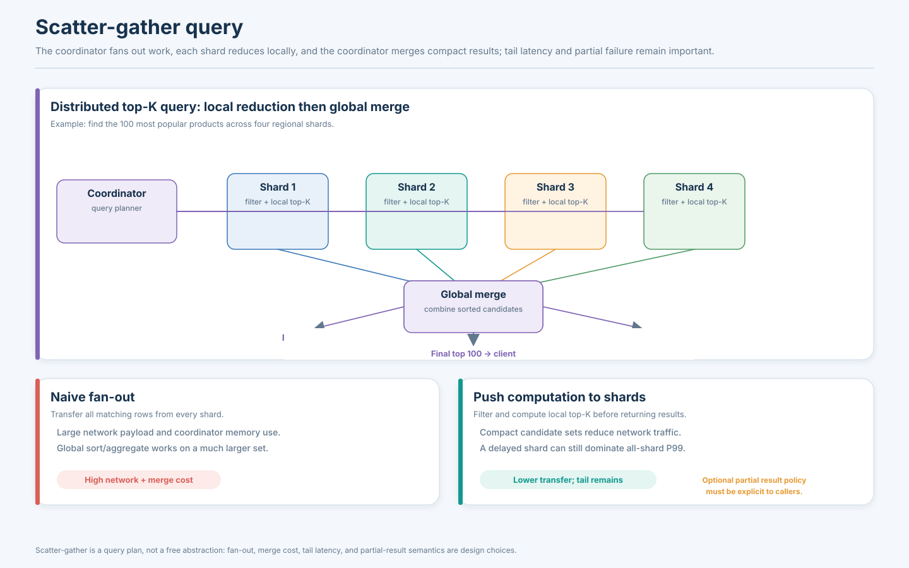

**Diagram specification — `scatter-gather-query.svg`**

- One coordinator at left sends the same logical query to four shard nodes.
- Each shard performs local filtering and local top-K, returning a small candidate set and a partial count.
- Coordinator merges sorted candidate streams, calculates final top-K, and sends a single response.
- Add a delayed shard and show that tail latency can hold up an all-shard request; add a separate optional partial-result branch clearly labeled as degraded semantics.
- Show the optimization contrast: `all rows transferred` versus `local reduction + compact merge`.
- Learning outcome: scatter-gather is a distributed query plan with network, tail-latency, and partial-failure costs.

---

# 11. Real-World Sharding Architecture Case Studies

Product names are useful only when the underlying mechanism is described precisely. The following case studies distinguish general partitioning ideas from product-specific architecture. Vendor-managed behavior can evolve; use the linked documentation for the exact version and service tier in production.

## 11.1 Amazon Dynamo and Amazon DynamoDB

### Original Dynamo paper

The 2007 Dynamo paper describes a highly available key-value store built for services that primarily needed key-based access. Its design combined partitioning and replication using consistent hashing, object versioning, quorum-like read/write operations, and decentralized replica synchronization. The paper discusses a preference for availability under certain failures and application-assisted conflict resolution rather than pretending every operation is a globally serializable relational transaction. [DeCandia et al., *Dynamo: Amazon's Highly Available Key-value Store*](https://www.amazon.science/publications/dynamo-amazons-highly-available-key-value-store)

Key ideas include:

- A consistent-hash ring maps keys to a set of responsible storage nodes.
- A replication factor determines how many nodes store a key's replicas.
- Nodes may own multiple token ranges through virtual nodes.
- Quorum-style parameters influence read/write availability and consistency behavior.
- Versioning and reconciliation handle concurrent updates and temporary replica divergence.
- Membership and placement changes require ownership metadata and data transfer.

### DynamoDB is not simply the original Dynamo paper as a managed service

DynamoDB exposes a managed key-value/document data model with a partition key and optional sort key. Its internal partition placement, capacity management, and service operations are managed by AWS; customers should design keys to distribute activity and understand partition-level throughput and hot-key behavior rather than assume the 2007 ring implementation is a public contract.

A high-cardinality partition key such as `customer_id` can distribute items, but a very active customer still concentrates traffic. A composite key or write-sharding pattern may be necessary for high-volume event streams. DynamoDB documentation explains key design and the importance of access patterns; use its current guidance rather than relying on an assumed fixed physical partition formula.

### DynamoDB secondary indexes

- A **GSI** uses a key schema that may differ from the base table and has a separate index partition space; GSI queries can cover all base-table partition-key values. GSI reads are eventually consistent.
- An **LSI** shares the base table's partition key and uses a different sort key; it provides alternate sorting/filtering within the partition-key item collection. LSIs have a documented 10 GB item-collection limit and must be defined when the table is created.
- Indexes are automatically maintained by the service, but consume additional storage and write capacity. Low-cardinality or heavily skewed index keys can be hot.

See [DynamoDB secondary indexes](https://docs.aws.amazon.com/amazondynamodb/latest/developerguide/SecondaryIndexes.html), [GSI details](https://docs.aws.amazon.com/amazondynamodb/latest/developerguide/GSI.html), and [LSI details](https://docs.aws.amazon.com/amazondynamodb/latest/developerguide/LSI.html).

**Lessons:** model around access patterns; a partition key is both a placement choice and a workload-distribution choice; global alternate access paths cost storage and writes; distinguish the original Dynamo paper's protocol choices from the managed DynamoDB service contract.

## 11.2 Apache Cassandra

Cassandra is a distributed wide-column database in which the partition key determines a token via the configured partitioner. In common deployments, the Murmur3 partitioner maps partition-key bytes into a token space. The token ring and replication strategy determine which nodes own replicas of each token range.

### Data model implications

- The **partition key** decides which logical partition and replica set receives the row.
- The **clustering columns** order rows within a partition and support efficient range access inside that partition.
- Multiple rows with the same partition key are colocated. A partition that grows without bound can become a storage, memory, repair, and query problem.
- A query model should identify the partition key; Cassandra is not designed to make arbitrary relational queries cheap by scattering through the whole cluster.

A messaging table might use `conversation_id` as the partition key and `message_timestamp` plus a tie-breaker as clustering columns. This makes reading a conversation history local and ordered. But a globally popular conversation or extremely large conversation can become a hot/oversized partition. Bucketing by time or sequence can bound partition size, at the cost of reading multiple buckets for long histories.

### Vnodes, replication, and topology changes

Vnodes give a physical node multiple token ranges, improving distribution and making ownership movement more fine-grained. Replication strategy determines which nodes store copies; token ownership alone is not a complete durability story. Node addition, decommission, replacement, removal, movement, cleanup, and repair are distinct operational activities. Data streaming moves the ranges that become the responsibility of a new node; stale replicas or missed data require repair procedures.

Cassandra's official topology guide documents adding/replacing/moving/removing nodes and streaming responsibilities: [Cassandra topology changes](https://cassandra.apache.org/doc/latest/cassandra/managing/operating/topo_changes.html).

### Hot partitions and tombstones

A good distribution of distinct partition keys does not guarantee that one partition key has reasonable size or traffic. A high-volume tenant or conversation can concentrate reads/writes. Deletes and TTL expiry can create tombstones; queries that scan large partitions containing many tombstones may perform poorly. Partition design should bound row count and queried time range, not only balance partition-key hashes.

**Lessons:** partition key and clustering order are the center of Cassandra data modeling; query-first schema design is essential; a token ring distributes partitions but does not make a single large/hot partition safe.

## 11.3 MongoDB sharded clusters

MongoDB distributes sharded collection documents across shards using a selected shard key. The cluster's main concepts are:

- **Shard:** stores a subset of collection data; a shard is commonly a replica set for high availability.
- **Config server replica set:** stores cluster metadata, including chunk placement.
- **`mongos`:** query router clients use to reach the sharded cluster.
- **Chunk:** a key-range segment of the shard-key space assigned to a shard.
- **Balancer:** background process that migrates chunks to improve distribution while respecting zone constraints.

MongoDB supports ranged and hashed sharding. A range shard key retains locality for nearby values and enables targeted range predicates, but monotonically increasing values can create a hot range. Hashed sharding spreads many values more evenly, including monotonically changing original values, but a range predicate on the original value is less likely to target a small number of shards.

### Query targeting

A query that contains the shard key or a usable prefix of a compound shard key can often be targeted at a shard or subset. A query without enough shard-key information may be broadcast to all shards. The router can merge results, but scatter-gather adds latency and network work.

### Chunk balancing and migration

MongoDB subdivides the shard-key space into chunks with lower-inclusive/upper-exclusive boundaries. The balancer monitors distribution and migrates chunk ranges. A chunk migration copies data, coordinates writes during migration, and eventually removes the donor's copy. It is not free: migration consumes resources and may affect foreground workloads. The balancer also honors zone configuration. [MongoDB sharding architecture](https://www.mongodb.com/docs/manual/sharding/), [balancer administration](https://www.mongodb.com/docs/manual/core/sharding-balancer-administration/), [zones](https://www.mongodb.com/docs/manual/core/zone-sharding/).

### Zones and geographic placement

Zones map ranges of shard-key values to eligible shards. They can support data locality, hardware tiers, or isolation of subsets. This is not arbitrary geography metadata: zone ranges must align with shard-key fields (and compound-key prefixes), so future placement requirements should influence shard-key design.

**Lessons:** choose the shard key before data becomes huge; target queries with key predicates; monitor chunk distribution and shard utilization; treat zones and the balancer as operational controls rather than magic load-leveling features.

## 11.4 Vitess and MySQL sharding

Vitess provides a sharding and operations layer for MySQL. Its concepts include:

- **Keyspace:** a logical database namespace that can be unsharded or sharded.
- **Shard:** a portion of a keyspace.
- **VTGate:** query router and gateway that accepts client traffic, understands Vindexes, and routes queries.
- **VTTablet:** agent/proxy associated with a MySQL instance and its role.
- **Vindex:** mapping function or lookup structure that maps column values to keyspace IDs.
- **Primary Vindex:** unique mapping used to determine the keyspace ID and shard for rows in a sharded table.
- **Secondary Vindex:** alternate mapping used for additional routing/query patterns; non-unique or lookup-backed forms may map to multiple keyspace IDs.

A primary Vindex is more expressive than the simple phrase “hash the shard key”: Vitess allows different Vindex types, including functional and lookup-based mappings. The Vindex chosen affects where rows land and which queries can be efficiently routed. [Vitess Vindexes documentation](https://vitess.io/docs/reference/vindexes/).

### Why this matters for MySQL

Operating many independent MySQL instances creates challenges around schema rollout, topology, routing, failover, online migration, and query orchestration. Vitess centralizes several of these concerns. It does not make every SQL operation automatically cheap or globally transactional; cross-shard queries and transactions have specific trade-offs and constraints.

### Resharding intuition

A logical keyspace may initially have two shards, then expand to four. A migration workflow creates new destination shards, copies data, catches up changes, updates routing/serving metadata, and cuts traffic over. The exact workflow depends on Vitess version and topology. A Vindex/keyspace-ID mapping should remain coherent throughout.

**Lessons:** database sharding needs a routing/control layer and operational automation; the mapping from application values to keyspace IDs is a first-class schema decision; resharding is a lifecycle, not a one-line configuration change.

## 11.5 Citus and PostgreSQL

Citus extends PostgreSQL with distributed tables and a coordinator/worker architecture. A distributed table has a **distribution column**; rows are assigned to shards according to the distribution value. In hash-distributed tables, values map to hash ranges, and shard placements map those ranges to worker nodes.

### Colocation

Related tables can be colocated so that corresponding shard ranges are placed on the same worker. For example, `tenants`, `orders`, and `invoices` can all be distributed by `tenant_id`. When the query filters or joins on that tenant, the relevant rows can be colocated and much of the relational work can execute on one worker. Citus documentation stresses distribution-column selection and colocation for multi-tenant workloads. [Citus distribution-column guidance](https://learn.microsoft.com/en-us/postgresql/citus/data-modeling?view=citus-14).

### Reference tables

Small tables that are needed on many workers can be replicated as reference tables, so joins do not need to fetch a tiny dimension table across the network for each query. This is useful for shared lookup data, but updates must be propagated and the replicated table should remain appropriately small.

### Query planning and rebalancing

A coordinator plans queries and dispatches work to workers. Colocated joins are more efficient than joins across unrelated distributions. Distributed aggregates may be computed partially on workers and merged. Rebalancing updates shard placements; colocated shard groups may need to move together. [Citus DDL and colocation](https://learn.microsoft.com/en-us/postgresql/citus/reference-ddl?view=citus-14).

**Lessons:** choose the distribution column around tenant or entity relationships; colocate tables that frequently join; avoid accidental colocation of unrelated tables where it makes shard movement costly; not all PostgreSQL features become transparently global simply because a table is distributed.

## 11.6 Google Cloud Spanner

Spanner distributes ordered primary-key ranges into units called **splits**. Splits can be moved among servers and adjusted based on size and load. The primary key therefore influences physical locality and write distribution.

### Key-range locality and hotspots

A monotonically increasing first key component can direct new inserts to the end of the key space, concentrating write traffic on a narrow range. Spanner's schema guidance recommends approaches such as UUIDv4 keys, reordering key columns, bit-reversed sequences, or adding a hash/shard component when appropriate. [Spanner schema design](https://docs.cloud.google.com/spanner/docs/schema-design).

### Automatic split behavior

Spanner can create and move splits to distribute data and load. Its documentation describes load-based splitting to mitigate read hotspots, but schema design still matters: a single key or a hot range cannot always be divided into independent work without changing the schema or access pattern. [Spanner schema and data model](https://docs.cloud.google.com/spanner/docs/schema-and-data-model).

### Partitioning is only one layer

Spanner combines range partitioning with replication, transaction processing, strong consistency, and geographic placement. A split's placement interacts with replication and locality. It is therefore inaccurate to describe Spanner as “just a range-sharded database”; its consistency and transaction architecture are central to its product behavior.

**Lessons:** range locality enables efficient related-record access; primary-key order can create a hot write tail; distributed databases can automate placement while application schema still determines how much parallelism is possible.

---

# 12. Choosing a Partition Key

A partition key is one of the highest-impact design choices in a distributed data model. It determines where rows live, which queries can be targeted, what can be colocated, what may become hot, and how difficult future migration will be.

## 12.1 Evaluation dimensions

| Dimension | What to ask | Warning sign |
|---|---|---|
| Cardinality | How many distinct values exist? | Very few values create too few partitions |
| Frequency distribution | Are values used uniformly? | A few values dominate traffic |
| Data volume per key | Can one key grow without bound? | One tenant/conversation owns huge data |
| Query locality | Which fields appear in common predicates? | Most queries omit the shard key |
| Write distribution | Do new writes spread over keys? | Sequential key creates a hot tail |
| Read distribution | Are a few keys read constantly? | Celebrity/product hot keys |
| Join locality | Which tables are commonly joined? | Related rows land on different shards |
| Tenant isolation | Do some tenants need dedicated resources? | One large tenant starves others |
| Mutability | Can the key change? | Updating key means moving a record |
| Time and geography | Do queries need temporal/regional locality? | Hash destroys required ordering/locality |
| Growth | How do data and traffic evolve? | Initial distribution is good but future growth is not |
| Operations | Can the owner map and partitions be moved safely? | No migration or rollback strategy |

## 12.2 Social media partition-key candidates

| Candidate | Helps | Risks |
|---|---|---|
| `user_id` | User profile and user-owned records are local | Celebrity user is hot; feed reads may span followers |
| `post_id` | Point lookup for a post | User timeline needs many post partitions unless indexed/denormalized |
| `follower_id` | A user's follow graph or inbox is local | A celebrity's follower list may be large; posts by followed users require fan-out |
| `region` | Regional locality and residency | Low cardinality and geographic skew; large regions can overload one partition |
| `(user_id, time_bucket)` | User/time history locality with bounded partitions | Very active user can still hot-spot current bucket; long history fans out |

A sensible design may use different partition keys for different bounded contexts: user profiles by `user_id`, media objects by media ID, and feed entries by recipient ID plus time bucket. A single universal shard key across every entity is not always correct.

## 12.3 E-commerce candidates

| Candidate | Good query path | Main risk |
|---|---|---|
| `customer_id` | Customer order history, account state | Large customer/hot customer; global order search needs alternate index |
| `order_id` | Direct order lookup | Customer history becomes fan-out unless order-to-customer mapping exists |
| `product_id` | Inventory/catalog reads for product | Popular item becomes hot; order processing touches many products |
| `seller_id` | Seller catalog and seller analytics | Mega-seller skew and marketplace-wide category search |
| `(region, customer_id)` | Regional locality plus customer grouping | Cross-region access and reassigning a mobile customer |

For an order management system, customer-centric order rows can be colocated for account history, but inventory may need a separate product-centric partitioning model. Cross-entity workflows then use explicit transaction or saga design rather than pretending every entity belongs on the same shard.

## 12.4 Messaging candidates

| Candidate | Strength | Risk |
|---|---|---|
| `conversation_id` | Conversation history and ordering are local | Very large/hot conversation |
| `user_id` | Inbox and per-user settings are local | Group messages touch many user partitions |
| `message_id` | Direct lookup | Conversation range scans scatter |
| `(conversation_id, time_bucket)` | Bounded ordered history | Query must enumerate buckets; current bucket can be hot |

Conversation ID is often a good partition key for sequential chat history because it matches the read path. A globally popular public channel may need separate handling.

## 12.5 Multi-tenant SaaS candidates

- **Tenant ID:** strong locality and isolation for tenant-scoped requests; can create a hot/oversized tenant.
- **Tenant ID + entity ID:** preserves tenant locality but may still concentrate a very large tenant.
- **Tenant ID + bucket:** enables a large tenant to spread across partitions but makes tenant-wide queries fan out.
- **Dedicated shard for large tenants:** handles skew explicitly but increases operations, reserved capacity, and placement complexity.

A common pattern is a tiered placement policy: small and medium tenants share hash-distributed shards; large tenants receive dedicated logical or physical shards; exceptional tenants can be subdivided by workload domain. The directory must understand the tenant's placement and version.

## 12.6 Decision matrix

| Dominant workload | Candidate strategy | Why | Important caveat |
|---|---|---|---|
| Point lookups by high-cardinality ID | Hash / consistent hash | Spreads keys and enables deterministic routing | Range scans become expensive |
| Time-window scans and chronological retention | Range/time partitions | Local ordered ranges and easy pruning/archival | Monotonic write tail |
| Multi-tenant transactions | Directory by tenant, hash/range within tenant | Tenant locality and custom placement | Very large tenant may need subdivision |
| Regional residency and locality | Region directory/zone + range/hash inside region | Keeps relevant data near region | Cross-region queries and failover complexity |
| Irregular tenant sizes | Directory-based placement | Explicitly isolate large tenants | Metadata and migration correctness |
| Distributed cache | Rendezvous or consistent hashing | Minimal remapping on membership changes | O(N) rendezvous scoring or ring complexity |
| Append-heavy single entity | Buckets/salted key | Splits one key's write stream | Read merge and ordering cost |

## 12.7 Common shard-key mistakes

1. **Low cardinality:** `country` or `status` may produce too few partitions.
2. **Monotonic first key:** new writes pile into a hot range.
3. **Ignoring common query predicates:** most requests become scatter-gather.
4. **Hashing away required locality:** time and range queries touch many partitions.
5. **Ignoring hot tenants:** average tenant size hides enterprise outliers.
6. **Using one key for every entity:** unrelated access patterns are forced into a compromise.
7. **Choosing a mutable key:** changing it requires moving data and updating references.
8. **Ignoring secondary indexes:** alternate access paths become expensive or impossible.
9. **No migration plan:** key choice becomes permanent because there is no safe route to reshard.
10. **Confusing balanced keys with balanced traffic:** a uniform hash does not distribute hot keys.

---

# 13. Operational Monitoring and Production Troubleshooting

Sharding increases the number of independently failing and saturating components. Monitoring must be partition-aware, not merely cluster-wide.

## 13.1 Essential metrics

| Area | Metrics | Why they matter |
|---|---|---|
| Compute | CPU per shard, run queue, memory pressure | Detect uneven processing and saturation |
| Storage | Data bytes, index bytes, disk latency, IOPS, free space | Reveal size skew and storage bottlenecks |
| Traffic | Read/write QPS, bytes/sec, connection count | Compare workload distribution |
| Latency | P50/P95/P99 by shard and by query class | Find slow partitions hidden by cluster average |
| Queues | Connection wait, executor backlog, pending compaction/flush | Detect overload and backpressure |
| Partition map | Map version, stale-route rejects, unknown partition errors | Detect routing drift |
| Replication | Lag, follower health, replica repair backlog | Identify under-replicated or stale data |
| Rebalancing | Bytes moved, migration rate, CDC lag, active migrations | Protect foreground capacity and migration safety |
| Indexes | Size, write rate, lag, query hit ratio, hot index partitions | Identify alternate access-path bottlenecks |
| Query shape | Scatter-gather fan-out, rows/bytes moved, cross-shard joins | Quantify data-locality failures |
| Errors | Timeouts, retry rate, partial result rate, stale owner errors | Detect local failure and unsafe retry patterns |

Alert on skew ratios as well as fixed thresholds. For example, `max(shard_write_qps) / median(shard_write_qps)` above a workload-specific threshold can reveal a hot shard. Do not pick one universal alert threshold: a shard with large batch scans has different expected CPU behavior from a latency-critical OLTP shard.

## 13.2 Troubleshooting scenario 1: one shard at 90% CPU, others idle

**Symptoms:** high p99 latency for a subset of customer IDs; one shard has high CPU and queue depth; cluster average CPU is moderate.

**Likely causes:** hot tenant/key, a query without a selective index, range tail writes, uneven tenant placement, or a heavy background job pinned to one shard.

**Investigation:** group request metrics by shard, tenant, key, and query fingerprint; inspect top query plans, index use, hot-key frequency, and partition bytes. Compare read vs write load.

**Mitigation:** cache or replicate hot reads, throttle a tenant, move the tenant, add a suitable local index, split a range, or bucket an append stream. Long-term: revise key design and add per-tenant workload isolation.

## 13.3 Scenario 2: p99 latency increases after adding a shard

Possible causes include client shard-map disagreement, warm-up/cache misses, new proxy or metadata load, rebalancing competing for disk/network, more cross-shard fan-out, uneven token movement, or an increased number of slow dependencies per request.

Compare before/after: fan-out count, shard-map refresh rate, cache hit rate, migration bytes/sec, per-shard latency, client connection churn, and network traffic. Adding a node may improve storage capacity while temporarily reducing latency due to migration and cache movement.

## 13.4 Scenario 3: resharding raises write latency

Bulk copy and CDC replay compete with production writes for I/O and CPU. Reduce migration concurrency, throttle by source/destination load, schedule large range moves, isolate network bandwidth if possible, and set a lag target. Confirm replication lag and transaction-log retention headroom; CDC falling behind can cause unbounded disk growth or force a restart from a new snapshot.

## 13.5 Scenario 4: global secondary index bottleneck

A low-cardinality indexed value (for example, `status=ACTIVE`) may route a huge amount of index traffic to a small key range. Index writes may be more expensive than base writes; global queries may fan out to many base shards.

Inspect index-partition QPS, item distribution, index write latency, lag, and returned-to-fetched record ratio. Consider a more selective compound key, bucketed index key, materialized search system, or query-specific projection. Do not make the base key worse merely to save one index query.

## 13.6 Scenario 5: requests intermittently reach the wrong shard

Likely causes: stale routing cache, inconsistent shard-map versions, migration epoch race, DNS or service discovery staleness, a proxy with stale metadata, or a client retry to an old endpoint.

Require an owner epoch/version in routing decisions; make the shard validate ownership for writes; return an explicit stale-route response; refresh metadata; retry idempotently. Log map version, partition ID, node ID, epoch, and request ID together.

## 13.7 Scenario 6: large tenant overloads shared shard

Measure tenant-specific storage, qps, query cost, and connection use. A shared shard's average utilization can hide one noisy neighbor. Apply tenant quotas/admission control, route large tenants to dedicated capacity, and migrate with snapshot+CDC+epoch cutover. Ensure tenant-wide queries can tolerate additional sub-partition fan-out if subdividing the tenant.

## 13.8 Scenario 7: sequential inserts create a hot range

Confirm that the leading range key is monotonically increasing and that the newest range receives nearly all writes. Consider a hash prefix, logical write buckets, reversed/bit-reversed IDs, a time bucket plus a spreading key, or a database-native load-based split mechanism. Evaluate how the change affects chronological scans and ordering.

## 13.9 Scenario 8: scatter-gather dominates network traffic

Identify queries that omit shard keys or require global ranking/joining. Measure number of shards touched, bytes returned per shard, coordinator memory, and time spent waiting for the slowest participant. Push filters/aggregations down, colocate related tables, introduce purpose-built indexes/materialized views, and move analytics to an analytics system.

---

# 14. Architecture Design Exercises

The exercises below model the reasoning expected in a system-design interview or an architecture review. Numbers are hypothetical and should be recalculated from measured workloads, storage formats, and service limits.

## 14.1 Design a global social media platform

### Requirements and scale

- 500 million registered users.
- 80 million daily active users.
- 2 million posts/day baseline, with major event spikes.
- User-profile point reads dominate; feed reads are latency sensitive.
- Media blobs are stored in object storage, not inside the profile database.
- Users follow many accounts; some celebrity accounts have tens of millions of followers.

### Data model and access patterns

Entities: users, profiles, posts, follow edges, feed entries, reactions, comments, and media metadata. Primary query paths include profile lookup by user ID, posts by author, a user's home feed, follower lookup, and post-by-ID.

### Partitioning decision

Use separate placement strategies for distinct aggregates:

- Profiles by `user_id` hash for point lookup.
- Author posts by `(author_id, time_bucket)` for author history.
- Follow edges by `follower_id` for “who do I follow?” and by a reverse index or separate materialized table for “who follows this user?”
- Feed entries by recipient/user ID with time ordering; very active recipients may use buckets.
- Post/media metadata by `post_id` or object ID.

One universal key would make some critical access paths scatter. Separate projections and materialized views are reasonable because feed generation has different needs from profile storage.

### Hotspot risks and mitigations

Celebrity reads use caching and read replicas; fan-out on write is limited or hybrid for high-follower accounts; current feed buckets are monitored; user/tenant quotas prevent abuse. A popular post can be served from a CDN/cache while the database remains the durable source.

### Routing and rebalancing

Client or gateway routes profile requests using a stable logical shard map; feed service uses a separate map. Physical placement is movable through a versioned directory. When user-related partitions move, use snapshot plus change capture and ownership epochs. A global event pipeline supports analytics rather than querying every operational shard.

### Trade-offs

The architecture duplicates selected data for read locality. It must define feed freshness, delete propagation, privacy changes, and follow-graph consistency. It optimizes common read paths but accepts eventual consistency for derived feed materialization.

## 14.2 Design a multi-tenant SaaS database

### Requirements

- 20,000 tenants.
- Tenant-scoped transactional CRUD.
- Most requests include `tenant_id`.
- 100 large tenants account for 60% of total activity.
- Some customers require regional residency and dedicated capacity.

### Candidate architecture

Use a directory-based tenant placement layer. Small tenants are distributed over shared PostgreSQL/Citus-style or independent database shards. Large tenants can be isolated on dedicated shards. Within a very large tenant, divide domains such as audit logs, events, and documents by separate keys or buckets.

Tables that participate in tenant-scoped joins use `tenant_id` as their distribution key and are colocated. Reference/configuration data that is small and read everywhere can be replicated as a reference table. Tenant-level background jobs must be rate-limited and scheduled fairly.

### Routing and migration

A control-plane directory maps tenant ID to database group, region, and ownership epoch. Application middleware resolves this mapping and includes the epoch in writes. Migration follows snapshot, CDC, catch-up, validation, write fence, routing cutover, observation, cleanup.

### Failure and operational concerns

- Directory outage: cached routes may continue under a bounded policy, but stale write ownership must be rejected.
- Hot tenant: throttle or isolate; don't let one tenant consume all connections.
- Region failover: maintain a documented residency/failover policy; replica placement must comply with legal and product requirements.
- Schema changes: rollout across all database groups with compatibility windows and version tracking.

### Why not one shard per tenant?

It gives strong isolation but 20,000 databases create excessive provisioning, maintenance, connection, backup, schema rollout, and monitoring overhead. A tiered shared/dedicated model is often more practical.

## 14.3 Design an e-commerce order management system

### Requirements

- 50 million customers.
- 2 billion historical orders.
- Customer history queries are common.
- Order lookup by order ID is required for support.
- Inventory is shared across customers and keyed by product/warehouse.
- Orders can include items from multiple sellers.

### Data model and placement

Partition the customer-facing order header/line view by `customer_id` (possibly with order-time buckets). Maintain a unique order-ID lookup index/directory so support can locate an order without scanning all customer shards. Inventory is a separate product/warehouse-oriented service because its transaction boundary and contention pattern differ from customer order history.

### Query and transaction behavior

Customer history is targeted to one shard. Order-ID lookup consults a global directory. Checkout reserves inventory across multiple product/warehouse partitions and creates order state; if a single ACID distributed transaction is unavailable or too expensive, use a reservation state machine/saga with idempotent commands, expiry, and compensating release.

### Hotspots

Flash-sale products can be extremely hot. Inventory updates may need per-warehouse allocation, reservation queues, quotas, or pre-partitioned inventory counters. A single global stock counter can serialize every purchase.

### Rebalancing

Customer order history may move between customer shards. Order-ID directory entries and support indexes must move/update atomically with the data migration protocol. Historical cold partitions can be archived separately.

## 14.4 Design a high-throughput messaging platform

### Requirements

- 100 million users.
- 5 million active conversations/day.
- Ordered messages within a conversation.
- Group chats and public channels.
- Recent history reads dominate; older messages are less frequently accessed.

### Partitioning

Use `conversation_id` as the primary locality key and a sequence/timestamp as an ordering key. Use time or sequence buckets to prevent unbounded partitions for very large conversations. Keep membership and user inbox projections separately partitioned by user ID.

### Routing

The message gateway resolves conversation ownership and routes writes to the conversation's partition leader/primary. Consumers update inbox projections asynchronously. Client retries use message IDs/idempotency keys to avoid duplicate messages.

### Hotspot and ordering risks

A public live channel can be a hot conversation. It may require a dedicated partition, hierarchical fan-out, or a publish-log model with multiple ingestion lanes and a merge sequence. If strict total order is required, the system must define where that order is established; splitting writes across buckets can weaken a single total-order guarantee.

### Rebalancing

Migrate bounded conversation partitions independently, snapshot plus log replay, then fence the old owner. Very large live channels should be treated as special workloads instead of moved in the same way as ordinary conversations.

## 14.5 Design a global analytics platform — quantitative exercise

### Assumptions

- 2 billion events/day.
- Average compressed event size in hot storage: 500 bytes.
- Retain 30 days in the operationally queryable store.
- 12 physical workers.
- 2 copies for the chosen durability tier.

Daily logical ingest:

\[
2\times10^9 \times 500\text{ bytes} = 1\text{ TB/day (decimal)}
\]

Thirty-day logical hot data is approximately 30 TB, before indexes and overhead. With two copies, raw replicated data is at least 60 TB. If using a planning factor of 1.35 for indexes/metadata and 25% free-space reserve, approximate provisioned capacity is:

\[
C = 30\text{ TB} \times 2 \times 1.35 \times 1.25 = 101.25\text{ TB}
\]

Across 12 workers, the naive average is 8.44 TB/worker. A real design must reserve capacity for uneven partitions, compaction, rebalancing, skew, and failure recovery; 8.44 TB is not a safe disk target by itself.

### Data model and strategy

Partition by event date/time for retention and range scans, but avoid a single monotonically increasing hot write range. A compound strategy such as `(date_bucket, hash(tenant_id) bucket)` can spread ingestion while keeping time-bounded scans partition-prunable. The number of logical buckets should match query and ingestion requirements, not be chosen arbitrarily.

### Query architecture

Use a distributed analytical engine with partition pruning, columnar storage, local aggregation, and a coordinator that merges partial aggregates. Do not use a transactional OLTP database as the only engine for billion-event global analytics.

### Risks

Hot tenants, late-arriving events, backfills, skewed event types, and large joins can defeat simple date partitioning. Use schema evolution, event versioning, late-arrival windows, and lifecycle policies.

## 14.6 Design a URL shortener at billions of redirects — quantitative exercise

### Assumptions

- 10 billion short codes.
- Average mapping payload and metadata: 300 bytes.
- 100,000 redirect requests/second peak.
- 99.99% read traffic; creation is much lower.
- Short-code lookups are exact point queries.

Logical storage:

\[
10^{10}\times 300\text{ bytes}=3\text{ TB}
\]

Assume indexes and storage overhead add 60%, then three copies:

\[
3\text{ TB}\times1.6\times3=14.4\text{ TB}
\]

Before reserve and cache, a rough ten-shard layout averages 1.44 TB per shard. This must be sized against usable capacity and peak throughput per shard.

### Partitioning choice

A hash of `short_code` distributes exact lookups. A range key based on creation time would not match the hottest redirect query. A global cache (CDN/edge or application cache) absorbs repeated redirects. If expiration, domain, or owner queries are required, add a secondary index or a separate metadata projection.

### Operational considerations

- Use stable collision-resistant code generation and uniqueness constraints.
- Cache hot mappings; set explicit invalidation/expiry semantics.
- Avoid hot global counters for ID generation.
- For custom aliases, ensure uniqueness is enforced across shards or route alias namespaces through a directory.
- Treat redirect target changes and abuse takedowns as cache invalidation and consistency events.

---

# 15. Quantitative Reasoning and Worked Examples

Capacity calculations are planning tools, not production guarantees. State every assumption, account for replication and overhead, and reserve room for maintenance and failure recovery.

## 15.1 Shard count from storage

Let:

- `D` = logical dataset bytes including expected indexes;
- `R` = replication factor;
- `H` = desired free-space/headroom multiplier (for example, 1.25 means 25% reserve);
- `C` = safe usable capacity per physical node;
- `N` = required node count.

A first approximation is:

\[
N_{storage}=\left\lceil\frac{D\times R\times H}{C}\right\rceil
\]

Example: 120 TB logical indexed data, replication factor 3, 25% reserve, 20 TB safe usable per node:

\[
N=\left\lceil\frac{120\times3\times1.25}{20}\right\rceil
=\lceil22.5\rceil=23\ nodes
\]

This is a conservative aggregate calculation. A real replication topology may place copies across failure domains, and a failed node may require temporary capacity on survivors. Uneven shards can require more nodes than the average suggests.

## 15.2 Shard count from throughput

Let peak throughput be `Q`, and let one shard safely sustain `q` requests/second for the actual query mix at the target latency. With safety factor `S` (for example, 1.5), a first approximation is:

\[
N_{throughput}=\left\lceil\frac{Q\times S}{q}\right\rceil
\]

Example: 60,000 requests/sec peak; benchmark shows 4,000 requests/sec per shard at the target p99; safety factor 1.4:

\[
N=\left\lceil\frac{60{,}000\times1.4}{4{,}000}\right\rceil=21
\]

Do not use one benchmark number for a mixed query workload. A simple cacheable point lookup, a multi-row transaction, a large sort, and a cross-shard join have very different resource costs.

## 15.3 Combined storage and throughput constraint

The required shard count must satisfy both constraints:

\[
N\geq\max(N_{storage},N_{throughput},N_{operational})
\]

`N_operational` accounts for failure-domain layout, maintenance, minimum replica placement, and recovery headroom. This is still only a first design estimate; load testing and failure testing are required.

## 15.4 Average data per shard

For `D` logical bytes and `N` equal partitions:

\[
D_{avg}=D/N
\]

But do not confuse the average with a safe maximum. Measure the distribution and use p95/max partition size. If 100 TB is spread across 10 shards, average is 10 TB; one 25 TB tenant can make the maximum far higher.

## 15.5 Storage headroom

If a node has usable capacity `C` and the desired maximum steady utilization is `u`, the dataset capacity target is:

\[
D_{node}\leq C\times u
\]

For a 10 TB usable disk with a 70% steady-state target, use at most 7 TB for steady data. The remaining 3 TB is not “wasted”: it provides room for compaction, snapshots, repair, migration, temporary duplication, and node failure handling.

## 15.6 Data movement during rebalancing

Suppose 80 TB must be moved from old owners to new owners. If the migration network sustains 400 MB/s of effective copy throughput:

\[
T=\frac{80\times10^{12}\ bytes}{400\times10^6\ bytes/s}
=200{,}000\ s\approx55.6\ hours
\]

This is a theoretical lower bound before verification, concurrent writes, throttling, retries, indexes, replication, compression changes, and network contention. In practice, use measured effective throughput and include catch-up time for new writes.

## 15.7 Modulo hashing vs consistent hashing

Assume 1 million uniformly distributed keys and four equal nodes. Naive modulo hashing distributes approximately 250,000 keys per node in expectation. Increasing to five nodes and changing the modulus can remap about 80% of keys in the common uniform model; the exact remapping depends on the old/new moduli and hash values.

A consistent-hash ring with five equal nodes should move roughly one-fifth of keys to the new node when adding it, leaving roughly four-fifths where they were. Vnodes and balanced token placement improve the approximation, but the actual moved fraction depends on token ownership and replication.

The important distinction is the movement pattern, not a promise that exactly 20% or 80% will move in every deployment.

## 15.8 Hot-key concentration

Suppose total traffic is 100,000 reads/sec across 10 equally sized shards. Average is 10,000 reads/sec per shard. A single hot key receives 25,000 reads/sec and all its requests map to Shard 4. If other traffic contributes another 7,500 requests/sec to that shard, Shard 4 receives 32,500 reads/sec while many others remain near 7,500. Adding ten more shards does not change the owner of that one key. A cache or replicated read path can distribute the hot reads.

## 15.9 Scatter-gather latency

If a coordinator waits for all `N` shards, request latency is approximately:

\[
T_{request}=T_{dispatch}+\max(T_1,T_2,\ldots,T_N)+T_{merge}
\]

This is not the sum of all shard latencies when requests run in parallel, but the maximum participant latency still dominates. As the number of participants grows, the probability that at least one is slow increases. If each shard independently has probability `p` of exceeding a latency threshold, the probability at least one of `N` shards exceeds it is:

\[
P(\text{at least one slow})=1-(1-p)^N
\]

For `p=0.01` and `N=50`, this is approximately `1 - 0.99^50 ≈ 39.5%`. Independence is a simplifying assumption; correlated overload can make real behavior worse.

## 15.10 Cross-shard network overhead

Suppose a query reads 1,000,000 candidate rows from 10 shards, with 500 bytes per row. Sending all rows to the coordinator moves roughly 500 MB. If each shard filters locally and returns 100 candidates, only 1,000 rows move—about 500 KB—before final fetches. Query pushdown can reduce network transfer by orders of magnitude.

## 15.11 Replication overhead

For logical data size `D` and replication factor `R`, raw stored copies are approximately:

\[
D_{physical}\approx D\times R
\]

This excludes indexes, logs, snapshots, compression, repair, and temporary migration copies. With 50 TB logical data and three replicas, expect approximately 150 TB of raw copies before those additional costs.

---

# 16. Important Conceptual Distinctions

| Distinction | Precise difference | Practical example and why it matters |
|---|---|---|
| Partitioning vs replication | Partitioning stores different subsets; replication stores copies of the same subset. | Shard users by ID, then replicate each shard for availability. Adding replicas does not automatically distribute writes across disjoint data. |
| Horizontal vs vertical partitioning | Horizontal splits rows; vertical splits columns or functional data. | Separate user profile rows by user ID vs move large biography/media fields to another table/service. |
| Range vs hash partitioning | Range preserves ordered key locality; hash spreads values through a hash space. | Order history by time vs exact customer-ID lookups. |
| Hash partitioning vs consistent hashing | Modulo hash commonly binds placement to a fixed N; consistent hashing limits movement under node membership changes. | `hash(k)%N` can remap many keys when N changes; a ring moves only affected intervals. |
| Consistent vs rendezvous hashing | Ring ownership uses clockwise successor; rendezvous chooses highest key-node score. | Rendezvous is direct O(N) scoring; ring implementations use ordered token positions. |
| Physical vs virtual nodes | Physical node is a server; vnode is a logical token/range position assigned to one or more physical nodes. | Cassandra node may own many token ranges. |
| Data vs workload skew | Different stored bytes vs different request/resource demand. | Historical shard is large but cold; small celebrity shard is hot. |
| Hot key vs hot partition | One key is dominant vs an entire partition receives disproportionate load. | One account's post vs many hot accounts colocated in one shard. |
| Partition split vs rebalancing | Split divides one partition; rebalance changes placement among nodes. | Split a large date range, then move one resulting range to a new server. |
| Rebalancing vs resharding | Rebalancing moves existing logical partitions; resharding changes the partition scheme/key/count/boundaries. | Move hash ranges between nodes vs change from customer ID to tenant+bucket. |
| Local vs global secondary index | Local index operates within a shard's scope; global index provides alternate lookup across the full dataset. | Local order-date index on customer shard vs category index spanning seller shards. |
| Client vs proxy routing | Client selects owner itself; proxy/gateway selects and forwards. | Embedded shard library vs `mongos`/VTGate. |
| Service discovery vs shard routing | Discovery finds live endpoints; routing maps a key to its owner. | DNS/health says node is alive; partition map says whether it owns key range P7. |
| Single-shard vs scatter-gather query | One partition executes the query vs multiple partitions execute and merge. | User lookup by ID vs global top products. |
| Partition ownership vs replica ownership | Partition ownership assigns key space; replica role determines which copy is leader/follower/reader. | A logical shard has three replicas but one write leader. |
| Database sharding vs distributed query processing | Sharding distributes storage; query processing coordinates work across partitions. | A sharded database can store data well but still have a poor coordinator plan for cross-shard joins. |

---

# 17. Interview Preparation

The answers emphasize reasoning and trade-offs. In an interview, state assumptions first, identify the dominant access patterns, and explain why a choice is appropriate rather than naming an algorithm in isolation.

## 17.1 Beginner questions (1–25)

### 1. What is sharding?
Sharding is horizontal distribution of a logical dataset across multiple database nodes. Each shard stores a subset of records, and a routing mechanism directs requests to the shard that owns the relevant keys.

### 2. Why do systems shard databases?
Sharding expands aggregate storage and processing capacity beyond one machine and can distribute write load. It is usually introduced when vertical scaling, indexing, caching, and read replicas are insufficient or operationally unsuitable.

### 3. What is a partition key?
A partition key is the field or tuple used to decide where a record belongs. It should be chosen from real query patterns and distribution behavior because it influences locality, hot spots, and routing.

### 4. What is the difference between a partition and a shard?
A partition is a logical subset of data; a shard commonly means a partition assigned to a separate database node or shard group. Terminology varies by database, so explain the physical and logical meaning in context.

### 5. What is range partitioning?
Range partitioning divides an ordered key space into contiguous intervals. It is good for range scans and time-window queries but can create hot tails when new keys always increase.

### 6. What is hash partitioning?
Hash partitioning applies a deterministic hash to a key and maps the result to a logical partition. It tends to spread sequential identifiers but usually sacrifices locality for original-key range queries.

### 7. What is directory-based partitioning?
A directory stores an explicit mapping from a tenant/key/range to a shard. It allows custom placement and tenant isolation, but the directory and its cached versions become a correctness and availability concern.

### 8. How is partitioning different from replication?
Partitioning stores different records on different shards; replication stores copies of the same records. A production system often replicates each shard so that it gains both scale and fault tolerance.

### 9. What is a shard key?
It is the application- or database-level key that determines a record's shard placement. A good shard key has enough cardinality, distributes the workload, and appears in common queries.

### 10. What is a shard map?
A shard map is metadata mapping logical keys, ranges, tokens, or partition IDs to current physical owners. It may be computed, cached, or served by a control plane.

### 11. What is a hot partition?
A hot partition is a shard or logical partition receiving disproportionately high resource demand. It may be caused by a hot key, skewed tenant, monotonic range, or expensive query—not necessarily by storing the most data.

### 12. What is a hot key?
A hot key is one key or a small key set receiving a disproportionate share of requests. More nodes do not automatically split that key; caching, replication, bucketing, or data-model redesign may be needed.

### 13. What is data skew?
Data skew means partition sizes or distributions are unequal. Workload skew is different: partitions may have similar sizes but very different request rates or query costs.

### 14. What is consistent hashing?
Consistent hashing places nodes and keys in a shared hash space and maps each key to a ring successor. Adding/removing a node generally changes ownership for a limited portion of the space.

### 15. What are virtual nodes?
Virtual nodes are multiple logical token positions assigned to one physical machine. They improve placement granularity and usually reduce imbalance, at the cost of more metadata and movement operations.

### 16. What is rendezvous hashing?
Rendezvous hashing selects the node with the highest deterministic score for a key. It has simple membership semantics and limited remapping, but naive scoring evaluates every candidate node.

### 17. Why is modulo hashing difficult to resize?
Changing `hash(key) % N` changes the mapping for many keys when N changes. A large fraction of cache entries or data may need remapping, unless a higher-level logical partition layer is used.

### 18. What is rebalancing?
Rebalancing moves existing partitions or token ranges among physical nodes to distribute capacity and load. It should be distinguished from resharding, which changes the logical partition scheme itself.

### 19. What is scatter-gather?
Scatter-gather sends a logical query to multiple shards, collects their local results, and merges them. It enables global queries but incurs fan-out, network, tail-latency, and partial-failure costs.

### 20. What is partition pruning?
Partition pruning is the ability to eliminate partitions that cannot satisfy a query predicate. Predicates containing the partition key often allow targeted execution rather than broadcasting.

### 21. What is a local secondary index?
A local secondary index is scoped to a base shard or partition. It is efficient when the query already identifies that shard, but it cannot necessarily provide a cluster-wide alternate lookup.

### 22. What is a global secondary index?
A global secondary index provides an alternate access path across base partitions. It improves query flexibility but costs storage and write maintenance and may introduce consistency or fan-out complexity.

### 23. What is client-side shard routing?
The client maintains or computes the shard map and connects directly to the selected owner. It reduces proxy hops but makes metadata refresh and routing correctness a client-library responsibility.

### 24. What is proxy-based shard routing?
A gateway receives client requests and forwards them to the owning shard. It centralizes routing and connection management, but the proxy fleet must itself be scalable and highly available.

### 25. Does adding more shards always improve performance?
No. It may increase cross-shard fan-out, coordination, connection count, metadata load, and rebalancing cost. It also does not solve a single hot key unless the key's workload is split or replicated.

## 17.2 Intermediate questions (26–55)

### 26. How do you choose a shard key?
Start with the most frequent and latency-sensitive queries, then test cardinality, key frequency, data size per key, write arrival pattern, join locality, and migration needs. Validate using workload distributions, not averages alone.

### 27. Why can a high-cardinality key still be a bad shard key?
High cardinality only means many distinct values; it does not guarantee uniform traffic or match query predicates. A random UUID may distribute data well but force every customer-history query to fan out if customer ID is the real access path.

### 28. Why does range partitioning create hot spots with sequential IDs?
New IDs are assigned near the upper range boundary, so all fresh writes target the newest partition. Historical partitions may be idle while the tail partition saturates.

### 29. How does hash partitioning reduce sequential write hotspots?
A stable hash scatters adjacent original values throughout the hash space. It reduces concentration from monotonically increasing identifiers but does not split requests for one identical key.

### 30. How does consistent hashing differ from modulo hashing?
Modulo placement depends on the partition count, so changing N often remaps many keys. Consistent hashing assigns keys to ring intervals and typically moves only keys in intervals affected by node membership changes.

### 31. How many keys move when adding a node to a consistent-hash ring?
With N equal-capacity nodes and uniform placement, the new node should acquire roughly `1/(N+1)` of the keys. Vnodes, weights, replication, and real key distributions change the actual amount.

### 32. Why are virtual nodes useful in Cassandra-style rings?
They give a physical node many small token ranges, reducing random imbalance and making ownership movement finer-grained. They do not by themselves eliminate hot partition keys or uneven request demand.

### 33. What are the trade-offs of using many virtual nodes?
More vnodes improve placement granularity but increase metadata and operational task counts. They can make streaming, repair, and ownership diagnostics more complex, so vnode count is a product/configuration decision.

### 34. Explain rendezvous hashing in one minute.
For each key, compute a deterministic score against every candidate node and choose the highest-scoring node. Adding a node changes ownership only for keys where the new node wins; straightforward lookup costs O(N) candidate scores.

### 35. How do you handle a celebrity hot key?
First determine whether it is read- or write-dominated. Cache and replicate hot reads; for append writes, split into buckets; for feeds, use a hybrid fan-out strategy; for one indivisible serialized update, redesign the aggregate boundary or accept serialization explicitly.

### 36. What is key salting?
Key salting adds a bucket/hash component so one logical entity maps to multiple physical keys. It spreads writes, but readers must query and merge buckets, and ordering/uniqueness must be designed carefully.

### 37. Fan-out on write vs fan-out on read—when would you use each?
Fan-out on write precomputes recipient-specific data, improving read latency but amplifying writes. Fan-out on read stores the source once and assembles results at request time, saving write amplification but increasing read work; hybrid designs handle celebrity accounts separately.

### 38. How do you rebalance a fixed-partition cluster?
Keep logical partition IDs stable and move a subset of those partitions to the new node. Copy data, capture concurrent changes, validate, fence the old owner, update routing, and clean up after a safe period.

### 39. How does dynamic partitioning work?
The system detects a large or hot range, selects a split point, creates new partition metadata, moves or reassigns data, and updates routers. Splitting cannot solve an indivisible hot key by itself.

### 40. What is proportional partitioning?
It assigns more partitions or token ranges to machines with greater capacity. It is useful for heterogeneous fleets but requires a meaningful capacity-weighting policy and periodic remeasurement.

### 41. What is the safest broad pattern for online tenant migration?
Take a consistent snapshot, capture changes after that snapshot, copy and replay them, validate, stop or fence old-owner writes, cut routing over using a new epoch, observe, and then clean up. Rollback after new writes begin on the destination requires reconciling those writes.

### 42. Why is dual writing dangerous?
Two independent writes are not one atomic operation. One may succeed while the other fails or commits in a different order; use a durable outbox/CDC pipeline, idempotency, reconciliation, or a database-supported transaction protocol.

### 43. Why should routing metadata have a version or epoch?
It distinguishes current ownership from stale cached ownership. A shard can reject writes using an old epoch, preventing a former owner from accepting authoritative updates after migration.

### 44. What is change data capture in a migration?
CDC streams committed changes from a source database log after the snapshot point. It closes the gap between snapshot creation and cutover, provided ordering, checkpoints, retries, and schema compatibility are handled correctly.

### 45. How do local secondary indexes affect sharded queries?
They make queries efficient after the shard is known, but a predicate on only the secondary field may require every shard to execute a local lookup and return results for merging.

### 46. Why can a global secondary index be expensive?
It has additional storage and index-write work, may require distributed coordination or asynchronous updates, and can itself contain hot keys. Index records must remain correct when base rows are migrated or deleted.

### 47. How is a DynamoDB GSI different from an LSI?
A GSI can use a different partition key and has its own index partition space; it supports eventual-consistent queries. An LSI shares the base table partition key, changes the sort key, is defined at table creation, and has product-specific item-collection constraints. See current AWS docs for exact semantics.

### 48. Why does a query without the shard key often become expensive?
The router may need to broadcast the query to many or all shards. Even in parallel, the slowest shard can dominate latency and the coordinator must merge intermediate results.

### 49. How do you optimize global top-K queries?
Push top-K computation to each shard, return bounded candidate sets, merge sorted results at the coordinator, and use deterministic tie-breaking. Avoid transferring every row to the coordinator.

### 50. How do you make joins efficient in a distributed relational database?
Choose distribution columns so related rows land together, colocate tables, push predicates down, and avoid large repartition/shuffle operations. If the workload cannot be colocated, consider denormalized projections or a separate query system.

### 51. What does a database proxy do in a sharded cluster?
It accepts application connections, resolves shard ownership, forwards requests, manages connections, and may coordinate distributed queries. It does not automatically remove the costs of cross-shard transactions or make arbitrary SQL local.

### 52. Is service discovery the same as shard routing?
No. Service discovery identifies live endpoints and their health/roles; shard routing maps a data key to its owner. A correct request path needs both pieces of information.

### 53. How do zones help with sharding?
Zones constrain which shards may own selected key ranges, supporting locality, data isolation, or hardware tiers. The key-range definition must align with the shard-key fields; zone configuration cannot magically place arbitrary records by an unrelated attribute.

### 54. What is the difference between data skew and workload skew?
Data skew is uneven bytes/rows; workload skew is uneven request or compute demand. A small, heavily requested partition can be more dangerous than a large cold partition.

### 55. What should you monitor per shard?
At minimum: read/write QPS, p95/p99 latency, CPU, memory, disk IOPS, data/index bytes, queue depth, hot-key distribution, replication lag, migration progress, stale-route errors, and scatter-gather fan-out.

## 17.3 Advanced questions (56–80)

### 56. How can a hash-partitioned system still have a hot partition?
Hashing distributes distinct keys, not requests. If one key receives a large fraction of traffic, every request for it still maps to one owner; if several hot keys collide into one partition, skew can also arise.

### 57. When would you prefer directory-based placement over pure hashing?
When placement must account for tenant size, legal region, service tier, hardware capacity, or special hot tenants. The price is a reliable metadata control plane and a safe ownership-migration protocol.

### 58. How do you avoid making the directory a single point of failure?
Replicate and durably store metadata, serve bounded cached versions, use a highly available control plane, and define read/write behavior during directory unavailability. Cached metadata should not permit stale authoritative writes after a handoff.

### 59. How does consistent hashing interact with replication factor?
A key maps to a primary owner or ring position, then the replication policy selects additional distinct nodes/replicas. The replica-selection rules must account for failure domains and should not be confused with the single owner lookup.

### 60. Why is balanced token ownership not the same as balanced throughput?
Token ranges approximate key-space ownership, but keys have different data sizes and request frequencies. A small hot partition can dominate CPU even when token counts and total bytes are balanced.

### 61. What is the purpose of partition colocation in Citus-like systems?
Colocation places corresponding shard ranges from related tables on the same worker. This reduces data movement for tenant-scoped joins and can allow relational operations to execute locally.

### 62. What happens if tables use different distribution keys?
A join may require a repartition/shuffle, broadcast of one side, or coordinator-side merge. Query cost can become network-bound and feature support may be limited compared with colocated data.

### 63. Explain MongoDB's role of `mongos` in a sharded cluster.
`mongos` is the client-facing query router. It uses cluster metadata to target one or more shards, forwards operations, and merges distributed results where needed; clients normally connect through a router for sharded operations.

### 64. What is a MongoDB chunk?
A chunk is a range of shard-key values with lower-inclusive and upper-exclusive boundaries assigned to a shard. The balancer may migrate chunks to improve distribution while respecting configured zones.

### 65. What is the difference between Cassandra partition key and clustering key?
The partition key determines the token and replica placement. Clustering columns order rows within the partition and determine how rows can be efficiently retrieved/ranged within that partition.

### 66. Why can very large Cassandra partitions be problematic?
They create large read/repair/compaction workloads, can increase memory and latency, and may contain many tombstones. Use bounded partition design (for example, time buckets) while accounting for read fan-out.

### 67. What is a Vitess Vindex?
A Vindex maps column values to keyspace IDs or lookup results used for routing. The Primary Vindex determines a sharded row's keyspace ID and is required for a sharded table; secondary Vindexes support additional routing paths.

### 68. Why is a Spanner primary key capable of creating hotspots?
Spanner distributes ordered primary-key ranges into splits. A monotonically increasing leading key component sends fresh writes to the end of the key space, potentially saturating one split until the schema distributes the write pattern.

### 69. How can Spanner schema design reduce a monotonic-key hotspot?
Use a non-monotonic key component, UUIDv4, bit-reversed sequence, reordered key columns, or an explicit logical shard/hash prefix when appropriate. These techniques trade simple chronological ordering for a more distributed write pattern.

### 70. When should a large tenant be subdivided rather than moved to its own shard?
Subdivide when one tenant's write/read workload exceeds a single node's safe capacity or needs independent scaling. Dedicated placement is simpler when the tenant fits one shard and isolation is the primary need.

### 71. How should global uniqueness be enforced across shards?
Use a globally unique ID, a dedicated uniqueness directory/registry, a deterministic owner for the unique key, or a coordinated transaction/constraint service. A local unique index cannot enforce uniqueness across all independent shards by itself.

### 72. How does resharding differ from adding a replica?
Adding a replica copies the same shard's data to another node; resharding changes how distinct records are divided or mapped. Replica movement is a fault-tolerance/capacity operation, while resharding changes key ownership and often query routing.

### 73. Why is migration rollback harder after cutover?
The new owner may have accepted writes that the old owner does not contain. A reverse cutover must capture and reconcile those writes, or the system risks data loss; a routing pointer change is insufficient.

### 74. What can go wrong if a stale client sends writes to a former shard owner?
Both old and new owners could accept conflicting authoritative writes, creating split ownership. A monotonically increasing ownership epoch/fencing check lets storage reject stale requests.

### 75. How do you handle long-running scatter-gather requests when one shard is unavailable?
Define whether exact results are required. The coordinator can fail fast, retry a bounded number of times, or return explicitly partial/degraded results; it must not silently represent incomplete results as complete.

### 76. How do you design cross-shard pagination?
Use a deterministic global sort key and a merge cursor that records per-shard positions or continuation tokens. Offset pagination requires repeated work and can produce duplicates/skips under concurrent updates.

### 77. Why can a global secondary index become a hot spot?
A low-cardinality or highly popular index key sends large query and update traffic to a limited portion of the index space. Bucket or compound the index key, cache results, or use a dedicated search/aggregation architecture.

### 78. When is a separate search engine preferable to a global database index?
When search requires full-text ranking, flexible filters, faceting, or high-volume global queries. The search index is typically an asynchronously maintained projection, so the design must define acceptable indexing lag and stale result behavior.

### 79. How do geographic partitioning and replication interact?
A region may own a primary partition while replicas exist in other failure domains or regions. Placement must balance latency, residency, failover behavior, and cross-region write/replication cost; geography does not automatically imply one independent partition per country.

### 80. How would you prove a sharding design is safe to migrate?
Define invariants (no lost acknowledged writes, one authoritative owner, no duplicate unique key, complete index state), instrument checkpoints, validate snapshots and CDC, test retries/failures, use fencing epochs, and rehearse rollback before production cutover.

## 17.4 Scenario-based questions (81–100)

### 81. One shard receives 70% of writes although the hash function is uniform. What do you inspect?
Inspect the top partition keys and write frequencies; the issue may be one hot tenant/key rather than bad hashing. Check whether many hot keys happen to map to one logical partition and whether the key design needs buckets or dedicated placement.

### 82. A new node is added and most application cache entries miss. What might be wrong?
The cache client may use naive modulo hashing with the physical node count. Use a stable logical partition layer or consistent/rendezvous hashing and gradually warm the new destination.

### 83. A customer requests all orders from the last year, but orders are partitioned by order ID. What is the concern?
The query cannot prune shards by time and may fan out widely. Add a time-oriented index/projection or reconsider a composite partition key if time-window queries dominate.

### 84. A system uses `tenant_id` as the shard key and one tenant grows to 40% of writes. What do you do?
Confirm the tenant is the actual bottleneck, then isolate it or subdivide by workload/time/entity bucket. Preserve tenant-wide query semantics and migrate with snapshot+CDC and an epoch-based ownership handoff.

### 85. The source snapshot copied successfully, but destination row counts differ after CDC. What do you investigate?
Check snapshot consistency point, CDC starting offset, transaction ordering, filtered tables, schema transformations, duplicate handling, failed event retries, and checkpoint persistence. Compare checksums by key range and inspect dead-letter/error queues.

### 86. Two tenants are assigned to different shards but join frequently. What could improve performance?
If the tenants are not cross-tenant related, partition each table by tenant ID and colocate corresponding tenant rows. If the join is inherently cross-tenant, push down filters, broadcast small dimensions, or maintain a read-optimized projection.

### 87. A query fans out to 100 shards and p99 latency triples. Why?
The coordinator waits on many participants; the probability of a slow shard rises with fan-out. Reduce the participant count through key predicates, local aggregation, materialized views, and better partition alignment.

### 88. A range-partitioned event table receives writes only on the newest range. What are possible fixes?
Add a hash/bucket dimension, partition by tenant/device plus time, or use logical write buckets. Verify that chronological reads can merge buckets and that retention/archival remains manageable.

### 89. A hash-partitioned product catalog has no efficient category browse. What is a suitable design?
Create a global category index or a search projection keyed by category, then fetch product records by IDs. Account for eventual consistency, index maintenance, and hot categories.

### 90. A large tenant migration is 10 hours behind because CDC cannot catch up. What should be changed?
Throttle the initial copy less aggressively only if source/destination have headroom; otherwise increase apply parallelism safely, optimize writes/indexing, reduce migration concurrency elsewhere, or schedule a lower-load window. Do not cut over while the lag exceeds the defined barrier tolerance.

### 91. The destination shard accepted writes before the router map was updated everywhere. What prevents dual ownership?
A storage-enforced ownership epoch/fencing token or write barrier. Routers are not the only authority; old owners must reject stale epochs, and new owner writes must be gated until migration is complete.

### 92. One product is read 50,000 times/sec, but writes are rare. Do you reshard the whole product table?
Probably not. Cache the product, use read replicas/edge caching, and possibly replicate the hot immutable record. Reshard the table only if the broader distribution is also unhealthy.

### 93. One partition contains 30% of the table but receives 1% of traffic. Is that necessarily an incident?
Not necessarily; it may be cold historical data. Verify disk capacity, backup/restore, compaction, and future access patterns; if storage capacity is safe, moving it solely to equalize bytes may add unnecessary risk.

### 94. A database router is unavailable but cached shard maps remain valid. Should all reads stop?
It depends on the architecture and failure policy. Client-side direct routing may continue with bounded cached metadata; proxy-dependent traffic cannot. Writes must not proceed with stale ownership after a migration or leader change.

### 95. A shard is healthy but its replica is far behind. Can the router send strong reads to it?
No. Strong/current reads should go to an appropriate authoritative replica or use a protocol that verifies read freshness. A lagging replica may be eligible only for explicitly stale-tolerant reads.

### 96. A query needs the latest 100 orders globally, but every shard has local time ordering. How should it run?
Each shard returns a bounded local top-100 ordered by a deterministic key; the coordinator performs a k-way merge and emits a global page/cursor. Ensure the ordering includes tie-breakers and pagination state across shards.

### 97. A node removal would move too much data at once. How do you reduce risk?
Move smaller token ranges/logical partitions in controlled batches, throttle streaming, monitor foreground latency and replica health, and keep enough capacity for temporary data duplication. Avoid overlapping migrations that saturate the same failure domain.

### 98. A tenant's local index works for tenant queries but global reports are slow. Why?
The local index is scoped to each shard and the report needs a cross-shard scan/merge. Add a global analytics/search projection or precomputed aggregate rather than pretending local indexes form a global index automatically.

### 99. After changing a shard key, some records are missing from global search. What could cause it?
The base-row migration and global index update may not have the same consistency boundary. Check CDC lag, stale owner references, deleted/duplicate index rows, and migration checkpoints; validate by reconciling index entries against base data.

### 100. How would you present a sharding design in a system-design interview?
State scale and query patterns, identify the dominant aggregate, select a shard key and justify distribution/locality, show routing and replica placement, analyze hot spots and secondary indexes, describe scatter-gather/cross-shard behavior, then explain rebalancing, observability, and failure recovery. Quantify the decision with explicit assumptions.

---

# 18. Common Design Mistakes

A sharded architecture can become slower, less reliable, and more expensive than a single database when its distribution key or operational model is poorly chosen. The following mistakes are common because the design looks balanced on paper but does not reflect the real workload.

## 18.1 Treating sharding as a substitute for database design

- **Why it happens:** teams reach for more nodes before fixing missing indexes, inefficient queries, excessive row width, or N+1 access patterns.
- **Scenario and consequence:** every request scans millions of rows on each shard; adding shards multiplies the scans and network work.
- **Better approach:** benchmark and optimize a single-node schema/query plan first. Sharding multiplies capacity for well-structured work; it does not repair inefficient work.

## 18.2 Selecting a low-cardinality shard key

- **Why it happens:** a field such as country, status, or account tier looks meaningful to the business.
- **Scenario and consequence:** only a handful of distinct values exist, so only a few shards receive most records and writes.
- **Better approach:** evaluate cardinality and frequency distribution. Use a composite key, a secondary dimension, or a directory when placement needs to respect the business field.

## 18.3 Ignoring actual access patterns

- **Why it happens:** designers optimize data distribution without modeling common requests.
- **Scenario and consequence:** records are evenly spread by random ID, but user history queries need to scan all shards.
- **Better approach:** enumerate point lookups, range scans, joins, reports, and writes. Select keys that make the critical paths targeted; build deliberate projections for other access patterns.

## 18.4 Assuming hash distribution guarantees uniform traffic

- **Why it happens:** hash functions are associated with uniform distribution in algorithm explanations.
- **Scenario and consequence:** one celebrity key or large tenant receives most reads/writes on one shard despite well-distributed distinct keys.
- **Better approach:** measure per-key and per-tenant load. Use caching, replication, salting, dedicated placement, or workload quotas where appropriate.

## 18.5 Ignoring hot keys

- **Why it happens:** capacity estimates are based on average requests per shard.
- **Scenario and consequence:** one hot product or conversation saturates a partition; adding nodes has little effect.
- **Better approach:** perform top-key analysis, isolate hot objects, and design explicit read/write splitting strategies. Test burst traffic, not only average load.

## 18.6 Using too few logical partitions

- **Why it happens:** the initial cluster is small, so one partition per node looks sufficient.
- **Scenario and consequence:** adding capacity requires moving huge indivisible ranges or changing the partition scheme.
- **Better approach:** choose a logical partition granularity that permits incremental movement while accounting for per-partition metadata and operational overhead.

## 18.7 Creating excessive partitions without considering overhead

- **Why it happens:** more partitions appear to guarantee perfect rebalancing flexibility.
- **Scenario and consequence:** metadata, compaction, scheduling, per-partition indexes, repair, and monitoring become expensive.
- **Better approach:** size partitions to product behavior and workload. Run capacity/operational tests and avoid assuming that the maximum supported count is the ideal count.

## 18.8 Ignoring secondary-index costs

- **Why it happens:** a global index is treated as a free query shortcut.
- **Scenario and consequence:** writes now update multiple distributed structures, and a hot category index becomes the new bottleneck.
- **Better approach:** justify every index by a real query, model write amplification and consistency, monitor index skew, and consider a search/analytics projection.

## 18.9 Assuming cross-shard joins are cheap

- **Why it happens:** SQL makes a distributed join look like a local join in the application code.
- **Scenario and consequence:** the engine repartitions large intermediate datasets across the network, increasing memory and latency.
- **Better approach:** colocate join-heavy tables by a shared distribution key, push predicates down, broadcast only small dimensions, or denormalize intentionally.

## 18.10 Ignoring metadata availability and consistency

- **Why it happens:** a shard map is treated as static configuration.
- **Scenario and consequence:** a tenant migrates but one application instance continues writing to the old shard.
- **Better approach:** version ownership metadata, distribute it reliably, set bounded cache policies, and enforce epochs at the storage boundary.

## 18.11 Failing to plan for resharding

- **Why it happens:** initial partition-key choice is assumed to last forever.
- **Scenario and consequence:** the key becomes hot or a new query pattern appears, but moving data would require a risky application-wide rewrite.
- **Better approach:** preserve logical partition IDs or provide an explicit directory, version the routing layer, and rehearse migration before growth forces it.

## 18.12 Performing uncontrolled bulk migration

- **Why it happens:** data copy is considered a background maintenance task with no foreground budget.
- **Scenario and consequence:** migration saturates storage and network, replication lag increases, and p99 latency rises for all tenants.
- **Better approach:** throttle, batch, monitor source/destination saturation, maintain checkpoints, and define abort thresholds.

## 18.13 Ignoring stale routing metadata

- **Why it happens:** client-side caches and long-lived connections are assumed to refresh immediately.
- **Scenario and consequence:** reads return old data or writes reach a former owner after cutover.
- **Better approach:** include routing epoch/version, handle stale-owner responses explicitly, refresh map and connections, and make writes idempotent.

## 18.14 Neglecting tenant isolation

- **Why it happens:** tenants are assumed to have similar data size and usage.
- **Scenario and consequence:** one large customer's reports and imports starve small tenants (noisy-neighbor effect).
- **Better approach:** enforce per-tenant quotas, connection budgets, rate limits, workload queues, and dedicated placement tiers.

## 18.15 Ignoring observability at partition granularity

- **Why it happens:** dashboards show only total cluster CPU and QPS.
- **Scenario and consequence:** average metrics look healthy while one shard is overloaded and a small cohort experiences failures.
- **Better approach:** tag metrics with shard, tenant, partition, query fingerprint, map version, and migration ID; compare maximum/median and p99 distributions.

## 18.16 Using a mutable partition key without a migration plan

- **Why it happens:** the business field appears stable but can change (region, owner, organization, account mapping).
- **Scenario and consequence:** updating the key physically moves records and can break foreign references and cached mappings.
- **Better approach:** use an immutable surrogate partition identity or define a transactional migration workflow for key changes.

## 18.17 Ignoring uniqueness and referential constraints across shards

- **Why it happens:** local database constraints are assumed to remain global.
- **Scenario and consequence:** two shards accept the same email/alias or a row references an object on a different shard that has not been created.
- **Better approach:** route unique values to a single owner, maintain a global uniqueness directory, use globally unique IDs, or coordinate the workflow explicitly.

## 18.18 Treating data movement as only a storage operation

- **Why it happens:** engineers move rows but forget caches, indexes, events, background jobs, blobs, permissions, and consumers.
- **Scenario and consequence:** primary data is correct but search indexes, cache entries, and asynchronous workers continue to reference the old shard.
- **Better approach:** build a dependency inventory and migration checklist across every derived system, not just the base table.

---

# 19. Final Summary and Revision Notes

## 19.1 Chapter summary

Partitioning divides a logical dataset into independently managed subsets so that storage and work can scale across machines. Sharding is the common term for horizontal partitioning across database nodes. Replication is complementary: it creates multiple copies of a shard for availability and read scaling.

Range partitioning preserves key order and supports efficient range scans, but monotonic keys and skewed ranges can create hot tails. Hash partitioning spreads distinct keys but removes original-key ordering and can make range queries scatter. Directory-based partitioning provides flexible placement and tenant isolation but introduces a metadata control plane that must remain available, consistent, and safe during ownership changes.

Consistent hashing limits data movement when cluster membership changes. Virtual nodes improve placement granularity and can reduce imbalance, but they do not solve hot-key traffic. Rendezvous hashing chooses the highest-scoring node for a key and provides deterministic minimal-remapping behavior, with O(N) simple scoring.

The hardest operational problems are usually skew, migrations, routing, and alternate query paths. A production migration needs a consistent snapshot, change capture, catch-up, validation, a write barrier or fencing epoch, routing cutover, monitoring, rollback planning, and eventual cleanup. Local indexes are efficient when the shard is known; global indexes support alternate access paths but add distributed maintenance and consistency costs. Scatter-gather enables cross-shard queries but adds fan-out, tail latency, network transfer, and partial-failure semantics.

Product implementations are not interchangeable. Cassandra's partition-key/token model, MongoDB's shard-key chunks and `mongos`, Vitess Vindexes, Citus distribution columns and colocation, Dynamo/DynamoDB designs, and Spanner's key-range splits each have different data models and operational contracts.

## 19.2 Decision framework for choosing a partitioning strategy

1. **Start with access patterns:** list the top queries, writes, joins, reports, and latency requirements.
2. **Define the aggregate boundary:** decide which records must be accessed or transacted together.
3. **Choose candidate keys:** evaluate cardinality, skew, mutability, monotonicity, and query availability.
4. **Choose locality:** range for ordered windows, hash for distributed point access, directory for custom placement, or a composite/hybrid.
5. **Test hot workloads:** model top tenants/keys and burst behavior, not just uniform random traffic.
6. **Design alternate access paths:** local/global indexes, materialized views, search projections, and analytics systems.
7. **Define routing:** decide client-side, proxy, or coordinator and define metadata versioning and failover.
8. **Plan movement before launch:** define partition granularity, snapshot/CDC/cutover, epoch fencing, rollback, and throttling.
9. **Instrument partitions:** measure per-shard load, skew, query fan-out, index cost, and migration lag.
10. **Load test and failure test:** simulate shard loss, stale metadata, network partitions, hot keys, and a rebalance during peak traffic.

## 19.3 Sharded database design checklist

- [ ] The dominant query patterns and data growth are documented.
- [ ] Partition key has sufficient cardinality and acceptable frequency skew.
- [ ] Range queries and ordering requirements are understood.
- [ ] Hot tenants and hot keys have explicit mitigation paths.
- [ ] Related tables are colocated where useful.
- [ ] Global unique constraints have an implementation strategy.
- [ ] Local/global index behavior and maintenance costs are documented.
- [ ] Single-shard queries are the common case where possible.
- [ ] Scatter-gather queries have bounded fan-out and result size.
- [ ] Shard routing and endpoint service discovery are separate, explicit concepts.
- [ ] Metadata has versioning/epoch semantics and a failure policy.
- [ ] Logical partitions can be moved or the resharding procedure is defined.
- [ ] Online migration includes snapshot, CDC, validation, cutover, and rollback.
- [ ] Rebalancing is throttled and monitored.
- [ ] Per-shard dashboards and alerting are available.
- [ ] Backups and restores are tested at shard and cluster scope.

## 19.4 Production-readiness checklist

- [ ] Capacity planned for normal load, peak load, one-node loss, and migration overhead.
- [ ] Replica placement spans appropriate failure domains.
- [ ] Routing caches have bounded staleness and refresh behavior.
- [ ] Stale owners reject writes using ownership epochs or an equivalent safety mechanism.
- [ ] Retry behavior is safe for idempotent and non-idempotent operations.
- [ ] Connection pools and proxy fleet are sized for shard count.
- [ ] Migration CDC retention can survive an extended catch-up window.
- [ ] Data validation checks counts, checksums, invariants, and index state.
- [ ] Rollback after cutover has a defined reverse-write reconciliation procedure.
- [ ] Hot-key, hot-tenant, and noisy-neighbor runbooks exist.
- [ ] Partial-result semantics are explicit for distributed reads.
- [ ] Schema changes can roll across shards in a compatibility window.
- [ ] Observability is tagged by shard, tenant, query class, routing epoch, and migration ID.
- [ ] Disaster recovery and restore procedures are practiced.

## 19.5 Key algorithms and their properties

| Algorithm/mechanism | Main idea | Typical use | Limitation |
|---|---|---|---|
| Range partitioning | Contiguous key intervals | Time/range queries | Hot tails and skewed ranges |
| Modulo hash | `hash(key) mod N` | Simple fixed partition count | Large remapping when N changes |
| Consistent hashing | Clockwise successor on ring | Distributed cache/storage placement | Basic ring can be imbalanced |
| Virtual nodes | Multiple ring positions per physical node | Fine-grained token ownership | Metadata/repair/streaming overhead |
| Rendezvous hashing | Highest key-node score wins | Cache/request placement | O(N) straightforward scoring |
| Directory mapping | Explicit key-to-owner metadata | Tenant placement and custom policy | Metadata consistency and availability |
| Dynamic split/merge | Split overloaded partitions and merge small ones | Range stores and auto-scaling databases | More control-plane transitions |
| Scatter-gather | Fan-out and merge | Global query | Tail latency and network overhead |

## 19.6 Real-world system mapping

| System | Core placement concepts | Routing/coordination concepts | Key design lesson |
|---|---|---|---|
| Original Dynamo | Consistent hashing, virtual nodes, replication | Distributed ownership and replica reconciliation | Availability and partitioning work together; it is not identical to DynamoDB |
| DynamoDB | Partition key, sort key, service-managed partitions | Managed key routing, LSIs/GSIs | Access-pattern design and hot-key distribution are critical |
| Cassandra | Partition-key hashing, token ring, vnodes | Coordinator/partition-aware routing, replication strategy | Partition and clustering keys define query locality |
| MongoDB | Shard-key ranges or hashed values, chunks | `mongos`, config metadata, balancer, zones | Target queries with shard key and monitor chunk distribution |
| Vitess | Keyspaces, shards, Vindexes | VTGate, VTTablet, topology metadata | Routing function is part of schema design |
| Citus | Distribution column, hash shards, colocation | Coordinator and worker query planning | Colocate join-heavy tenant data |
| Spanner | Ordered primary-key ranges and splits | Automatic split placement plus replication/transactions | Primary-key ordering can cause hotspots |

## 19.7 Twenty most important interview takeaways

1. Sharding splits data; replication copies data.
2. A shard key is simultaneously a placement decision and an access-pattern decision.
3. High cardinality is not enough—frequency skew matters.
4. Range partitioning supports ordered scans but can create hot tails.
5. Hash partitioning spreads keys but often turns range queries into scatter-gather.
6. `hash(key) % N` is easy to understand but expensive to resize.
7. Consistent hashing limits remapping under membership changes.
8. Virtual nodes improve ownership granularity, not hot-key semantics.
9. Rendezvous hashing chooses the maximum deterministic key-node score.
10. A hot key can overload one shard even when keys are uniformly distributed.
11. Caching is especially effective for repeated hot reads; write hot spots need different techniques.
12. Key salting spreads writes but increases read fan-out and merge complexity.
13. Rebalancing moves logical partitions; resharding changes the partition scheme.
14. Online migration requires snapshot plus change capture and a controlled ownership handoff.
15. Versioned routing metadata and fencing prevent stale owners from accepting writes.
16. Local indexes are local; global indexes create a distributed alternate access path.
17. Queries without a partition key may scatter to many or all shards.
18. Coordinators pay for network movement, global sorting, and tail latency.
19. Product-specific semantics matter: Cassandra, MongoDB, Vitess, Citus, DynamoDB, and Spanner are not interchangeable.
20. A mature sharding design is incomplete until it includes observability, rebalancing, failure recovery, and a rollback plan.

## 19.8 Glossary

| Term | Definition |
|---|---|
| Adaptive partitioning | Changing partition boundaries/placement in response to size or load |
| Balancer | Control-plane process that redistributes partitions/chunks |
| Bucket | One of several subkeys used to split a logical entity's data |
| Change data capture (CDC) | Stream of committed database changes, often read from a transaction log |
| Chunk | Bounded shard-key range used by systems such as MongoDB |
| Colocation | Placing related table partitions on the same worker |
| Coordinator | Component that plans/aggregates distributed work |
| Directory | Explicit metadata mapping a key/tenant/range to an owner |
| Distribution column | Citus term for the column used to assign rows to shards |
| Fan-out | One logical request creating multiple downstream requests |
| Fan-out on read | Constructing a view when a request arrives |
| Fan-out on write | Precomputing/propagating derived data when source data changes |
| Global secondary index | Alternate lookup structure spanning base partitions |
| Hot key | Key receiving disproportionate traffic |
| Hot partition | Partition receiving disproportionate resource demand |
| Logical partition | Stable partition ID independent of current physical node |
| Partition map | Metadata from key-space/partition IDs to owners |
| Partition key | Field/tuple determining partition placement |
| Partition pruning | Eliminating partitions that cannot satisfy a query |
| Physical shard | Database node/group storing one logical subset |
| Range partition | Partition owning a contiguous interval of ordered keys |
| Rendezvous hashing | Highest-random-weight hashing for deterministic node selection |
| Rebalancing | Moving existing partition ownership among nodes |
| Resharding | Changing partition key/count/boundaries or mapping scheme |
| Scatter-gather | Fan-out query execution followed by result merge |
| Secondary index | Alternate access path over non-primary attributes |
| Service discovery | Finding current endpoints and health/role information |
| Shard key | Key chosen to distribute records across shards |
| Shard map | Mapping from logical partitions to physical shard owners |
| Skew | Uneven distribution of data or workload |
| Split | Dividing one partition/range into smaller partitions |
| Token | Hash-space coordinate used by ring/token-based systems |
| Virtual node | Logical token/range position assigned to a physical node |
| Write amplification | More physical/index writes caused by one logical write |

## 19.9 Chapter progression

| Chapter | Topic | Key concepts |
|---|---|---|
| 1 | Foundations | Distributed system fundamentals |
| 2 | Time, Clocks, and Ordering | Logical clocks, causality |
| 3 | Communication | RPC, messaging, retries |
| 4 | Consistency Models | Linearizability, eventual consistency |
| 5 | Consensus and Coordination | Raft, Paxos, leader election |
| 6 | Replication | Replicas, quorums, conflict resolution |
| 7 | Partitioning (Sharding) | Data distribution, shard keys, rebalancing |

---

# 20. Further Reading and References

The linked material below is intended for deeper study and product-specific verification. Product behavior can vary by release and managed-service offering; consult the current manual before turning a conceptual example into an operational procedure.

## Foundational research

1. Giuseppe DeCandia et al., [*Dynamo: Amazon's Highly Available Key-value Store* (SOSP 2007)](https://www.amazon.science/publications/dynamo-amazons-highly-available-key-value-store). Foundational paper on consistent hashing, replication, versioning, and availability-oriented key-value storage.
2. David Karger et al., [*Consistent Hashing and Random Trees: Distributed Caching Protocols for Relieving Hot Spots on the World Wide Web*](https://dl.acm.org/doi/10.1145/258533.258660). Foundational consistent-hashing work.
3. David G. Thaler and Chinya V. Ravishankar, [*A Name-Based Mapping Scheme for Rendezvous* (University of Michigan Technical Report, 1996)](https://www.eecs.umich.edu/techreports/cse/96/CSE-TR-316-96.pdf), with related journal publication [*Using Name-Based Mappings to Increase Hit Rates*](https://garance.cat/assets/images/consistent_hashing.pdf). Foundational description of highest-random-weight assignment.

## Official database and platform documentation

4. MongoDB, [Sharding Introduction and Architecture](https://www.mongodb.com/docs/manual/sharding/). Shards, shard keys, chunks, range/hashed sharding, query routing, and zones.
5. MongoDB, [Sharded Cluster Balancer](https://www.mongodb.com/docs/manual/core/sharding-balancer-administration/). Background balancing and migration behavior.
6. MongoDB, [Zones](https://www.mongodb.com/docs/manual/core/zone-sharding/). Range-based placement constraints and zone-aware balancing.
7. Apache Cassandra, [Adding, replacing, moving and removing nodes](https://cassandra.apache.org/doc/latest/cassandra/managing/operating/topo_changes.html). Token ownership changes and streaming operations.
8. Apache Cassandra, [Configuration file — partitioner](https://cassandra.apache.org/doc/latest/cassandra/managing/configuration/cass_yaml_file.html). Documents the default Murmur3Partitioner and the role of the partitioner.
9. Amazon DynamoDB, [Secondary indexes](https://docs.aws.amazon.com/amazondynamodb/latest/developerguide/SecondaryIndexes.html). LSI/GSI definitions and comparison.
10. Amazon DynamoDB, [Using Global Secondary Indexes](https://docs.aws.amazon.com/amazondynamodb/latest/developerguide/GSI.html). GSI key schema, projections, maintenance, and consistency behavior.
11. Amazon DynamoDB, [Local Secondary Indexes](https://docs.aws.amazon.com/amazondynamodb/latest/developerguide/LSI.html). LSI partition-key semantics and item-collection constraints.
12. Vitess, [Vindexes](https://vitess.io/docs/reference/vindexes/). Primary and secondary Vindex behavior.
13. Microsoft Learn/Citus, [Choosing a distribution column](https://learn.microsoft.com/en-us/postgresql/citus/data-modeling?view=citus-14). Multi-tenant distribution and colocation.
14. Microsoft Learn/Citus, [Create and modify distributed objects](https://learn.microsoft.com/en-us/postgresql/citus/reference-ddl?view=citus-14). Distributed table creation and colocation controls.
15. Google Cloud, [Spanner schema design best practices](https://docs.cloud.google.com/spanner/docs/schema-design). Primary-key design and hotspot mitigation.
16. Google Cloud, [Spanner schemas and data model](https://docs.cloud.google.com/spanner/docs/schema-and-data-model). Key-range splits and load-based splitting.

## How to study these sources

- Read the Dynamo paper for the original distributed key-value placement design; do not treat its details as a current DynamoDB API specification.
- Read the MongoDB manual alongside a practical shard-key review. Pay attention to chunk ranges, query targeting, and zones.
- Read Cassandra's data-modeling and topology documentation together: partition keys decide locality, while topology operations determine how ranges move.
- Read Vitess Vindex documentation before designing a routing keyspace; it is not merely `hash(id) % shard_count`.
- Read Citus distribution-column and colocation documentation with actual joins from the application workload.
- Read Spanner key-design guidance before selecting monotonic primary-key components.

---

## Final perspective

A good sharding design makes the common query path local, spreads work according to actual traffic, and leaves a safe path for future ownership changes. A great sharding design also makes its compromises explicit: it knows which reads will fan out, how global indexes stay correct, how large tenants are isolated, what happens when metadata is stale, and how data is moved without losing writes. The partitioning algorithm is only one part of that architecture.
