# Chapter 8: Distributed Transactions

> **Advanced distributed-systems study notes**  
> Focus: preserving business and data correctness under concurrency, independent failures, network uncertainty, and partial completion.

## How to use this chapter

This chapter moves from database fundamentals to distributed transaction architectures. Read Sections 1–7 to understand correctness inside transactional storage; Sections 8–12 to understand business workflows across microservices; Sections 13–15 for representative distributed-database designs; and Sections 16–24 for architectural selection, operations, practice, and revision.

The examples use simplified account, inventory, and order models. They are designed to expose invariants and failure windows, not to prescribe a particular vendor's schema. Product behavior changes by version and configuration; check the linked vendor documentation before relying on a product-specific guarantee.

## Table of contents

- [1. Introduction to Distributed Transactions](#1-introduction-to-distributed-transactions)
- [2. ACID Properties in Distributed Settings](#2-acid-properties-in-distributed-settings)
- [3. Isolation Levels](#3-isolation-levels)
- [4. Transaction Anomalies](#4-transaction-anomalies)
- [5. MVCC — Multi-Version Concurrency Control](#5-mvcc--multi-version-concurrency-control)
- [6. Optimistic vs Pessimistic Concurrency Control](#6-optimistic-vs-pessimistic-concurrency-control)
- [7. Distributed Commit Protocols](#7-distributed-commit-protocols)
- [8. Distributed Transactions in Microservices](#8-distributed-transactions-in-microservices)
- [9. Saga Pattern](#9-saga-pattern)
- [10. Transactional Outbox Pattern](#10-transactional-outbox-pattern)
- [11. Transactional Messaging and Exactly-Once Semantics](#11-transactional-messaging-and-exactly-once-semantics)
- [12. TCC — Try, Confirm, Cancel](#12-tcc--try-confirm-cancel)
- [13. Percolator Transaction Model](#13-percolator-transaction-model)
- [14. Calvin — Deterministic Database Transactions](#14-calvin--deterministic-database-transactions)
- [15. Spanner-Style Distributed Transactions](#15-spanner-style-distributed-transactions)
- [16. Comparing Distributed Transaction Approaches](#16-comparing-distributed-transaction-approaches)
- [17. Choosing the Right Transaction Architecture](#17-choosing-the-right-transaction-architecture)
- [18. Operational Challenges and Production Troubleshooting](#18-operational-challenges-and-production-troubleshooting)
- [19. Quantitative Reasoning and Worked Examples](#19-quantitative-reasoning-and-worked-examples)
- [20. Architecture Design Exercises](#20-architecture-design-exercises)
- [21. Important Conceptual Distinctions](#21-important-conceptual-distinctions)
- [22. Interview Preparation](#22-interview-preparation)
- [23. Common Design Mistakes](#23-common-design-mistakes)
- [24. Final Summary and Revision Notes](#24-final-summary-and-revision-notes)
- [25. SVG Diagram Planning — Phase 1 Only](#25-svg-diagram-planning--phase-1-only)
- [References and further reading](#references-and-further-reading)

---

# 1. Introduction to Distributed Transactions

## 1.1 What is a transaction?

A **database transaction** is a logical unit of work whose operations are treated as one indivisible state transition. A transfer that debits one account and credits another is not two unrelated updates: the business meaning is one transfer. If the debit succeeds and the credit does not, money appears to disappear. A transaction groups the reads, checks, and writes that must be governed by one correctness decision.

A transaction normally has a lifecycle:

1. **Begin:** establish a transaction context and, in snapshot-based systems, a read timestamp or snapshot.
2. **Read and compute:** read data, validate business conditions, and calculate intended changes.
3. **Write:** stage changes, acquire locks, create new versions, or record intents.
4. **Validate:** detect constraints, write conflicts, serialization conflicts, and participant failures.
5. **Commit or abort:** make the result durable and visible, or discard its effects.
6. **Recover:** after a crash, use logs, transaction records, and protocol state to determine the outcome.

The key distinction is between *work being performed* and *work being committed*. A row may be modified in a private transaction workspace, yet remain invisible to other transactions until commit.

## 1.2 What makes a transaction distributed?

A transaction is distributed when its correctness boundary spans independently executing components that cannot be controlled by one local storage engine. Examples include:

- **Cross-table transaction:** multiple tables inside one database. This is usually still a local transaction because one transaction manager controls the tables.
- **Cross-database transaction:** two database instances or independent storage engines participate.
- **Cross-shard transaction:** rows are placed on different partitions, potentially on different nodes, within one distributed database.
- **Cross-service business transaction:** order, inventory, and payment services own separate databases and coordinate a business workflow.
- **Cross-region transaction:** participants are in geographically separated regions. The transaction pays WAN latency and must tolerate regional failures.

The word *distributed* is about the failure and ownership boundary, not simply the number of tables. One SQL statement touching ten tables on one primary is normally a local transaction. A workflow touching two services with one database each is distributed even if both databases run in the same rack.

### Local versus distributed execution

A single-node database has one transaction manager, one log/recovery domain, and usually one local mechanism for ordering writes. A distributed transaction has multiple participants, independent logs, independent clocks and failure domains, and messages that may be delayed, duplicated, lost, or delivered after a timeout.

| Dimension | Local transaction | Distributed transaction |
|---|---|---|
| Decision maker | One database transaction manager | Coordinator, protocol, or workflow state machine across participants |
| Atomicity | One engine's commit/rollback machinery | Requires a shared decision protocol or business compensation |
| Failure | Process, host, storage, or local engine failure | Any participant, coordinator, network link, region, or broker can fail independently |
| Latency | Mostly local memory, CPU, and storage latency | Includes network round trips and remote persistence/replication |
| Recovery | Local log and crash recovery | Durable protocol state plus participant recovery and message retries |
| Isolation | Enforced by one engine's concurrency-control implementation | Must be coordinated across partitions or deliberately weakened to workflow-level consistency |

## 1.3 Why distributed transactions are difficult

### Partial failure

In a distributed system, a caller cannot always distinguish a slow component from a failed component. A timeout says that a response was not received by the deadline; it does **not** prove that the remote operation did not happen. The payment service might have committed a charge and lost the response. Retrying blindly can charge twice.

### Independent transaction managers

Each database may have its own commit log and local notion of success. A transaction manager in database A cannot simply roll back a committed transaction in database B unless a protocol arranged for that possibility before the commit decision. Once one participant makes data durable and visible, the other participants must follow a compatible decision or an explicit business compensation must occur.

### Coordinator failure

A coordinator may crash after participants have prepared but before they learn the final decision. Participants can then be left *in doubt*. They cannot safely infer commit or abort from silence. In Two-Phase Commit (2PC), a participant that voted YES has promised it can commit; unilaterally aborting could contradict a global COMMIT decision that was durably recorded elsewhere.

### Network partitions and timeouts

A partition can isolate the coordinator from one participant while the participant remains healthy. The protocol must choose between blocking, retrying, or weakening guarantees. A timeout is an operational trigger for investigation/recovery, not a universal proof that the operation failed.

### Concurrency and duplicate work

Two orders may contend for the final unit of stock. Two clients may submit the same checkout request. A broker may deliver the same event more than once. Correctness requires both concurrency control and idempotent handling of retries.

## 1.4 E-commerce checkout: a running example

Consider an order involving five services:

- **Order:** creates and tracks the order.
- **Inventory:** reserves or releases stock.
- **Payment:** authorizes, captures, or refunds money.
- **Shipping:** creates or cancels a shipment.
- **Notification:** sends email/SMS/push messages.

A plausible workflow is:

1. Client sends `PlaceOrder` with a unique idempotency key.
2. Order service commits a `PENDING` order.
3. Inventory service reserves the requested quantities.
4. Payment service authorizes/captures the payment.
5. Shipping service creates a shipment.
6. Order service marks the order `CONFIRMED`.
7. Notification service sends confirmation.

Each numbered step may be a separate local transaction. A distributed design must decide how to recover from every point where a process or network can fail.

| Failure window | What may already have happened? | Safe recovery direction |
|---|---|---|
| Payment succeeds, inventory reservation fails | Money may be captured while no stock is held | Do not assume the payment failed; query by payment idempotency key, then void/refund under a durable workflow |
| Inventory reservation succeeds, payment times out | Stock is held; payment outcome is unknown | Query payment status; retry with the same key; release stock only after a definitive payment failure or policy timeout |
| Order row commits, application crashes before HTTP response | Order exists although client saw an error | Client retries with same idempotency key; return the existing order result rather than creating another order |
| Payment is retried with a new key | The provider may charge twice | Reuse stable payment intent/idempotency key; deduplicate requests and reconcile provider records |
| Shipping fails after order confirmation | Order and payment may be committed, shipment absent | Keep an explicit fulfillment-pending state; retry shipping or compensate according to policy |
| One service is unavailable | Some earlier local transactions may have committed | Persist workflow state, retry with bounded backoff, expose pending status, and compensate only when the business decision is final |

A normal local SQL transaction cannot automatically include a remote service's database because the local engine has no authority over the remote engine's commit log. Sending HTTP requests inside `BEGIN ... COMMIT` does not make remote effects transactional. It usually makes matters worse: locks stay open while waiting for unpredictable network latency, and a rollback cannot undo an external side effect.

## 1.5 Four related terms

- **Database transaction:** one engine's atomic/isolated state change.
- **Distributed database transaction:** one database product coordinates a logical transaction across its partitions/replicas, possibly using 2PC-like protocols, consensus-backed logs, timestamps, or intents.
- **Distributed business transaction:** a business operation spans independently owned services. It is often implemented with a Saga, TCC, or a combination of local transactions and messaging.
- **Long-running transaction:** a workflow that may span seconds, minutes, or days. Holding database locks for its full duration is generally undesirable; durable workflow state and compensation are more practical.

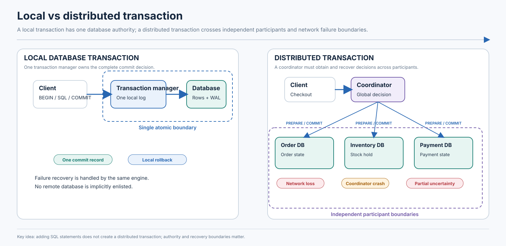

*Figure: Local vs distributed transaction.*
---

# 2. ACID Properties in Distributed Settings

ACID describes properties of a transaction, not a replication topology. Distributed systems must implement each property across more complicated failure and concurrency boundaries.

## 2.1 Atomicity

**Atomicity** means all effects within the transaction become committed together, or none of them become committed effects. It is stronger than “the application tries to undo what happened.”

A bank transfer of ₹500 from account A to B has the invariant:

\[
A_{after} = A_{before} - 500, \qquad B_{after} = B_{before} + 500
\]

The total across the two accounts is conserved (ignoring fees):

\[
A_{after} + B_{after} = A_{before} + B_{before}
\]

A local database can stage both row updates and expose them only after one commit. If A and B are on separate database participants, a global decision must prevent a permanent one-sided outcome. Atomic commit protocols such as 2PC arrange a durable decision, but they do not themselves define the isolation level or business logic.

**Partial writes:** A participant might have written data to its log but not yet exposed it. This is acceptable if the write remains uncommitted and can be resolved consistently. The dangerous state is one participant exposing a commit while another participant is allowed to abort the same global transaction.

## 2.2 Consistency

**ACID consistency** means each committed transaction preserves declared database constraints and application invariants, assuming the transaction logic correctly enforces them. Examples:

- Account balance may not become negative, unless overdraft is explicitly supported.
- Inventory available quantity must not become negative.
- An order must reference an existing customer.
- A booking must not allocate the same exclusive seat to two active reservations.
- Ledger debits and credits must balance within the defined accounting model.

Consistency is not the same as every replica instantly holding identical bytes. Replication consistency describes what values/versions clients can observe across replicas and in what order. A database can maintain application invariants while replicas temporarily lag, provided its read/write rules prevent invalid observations where those guarantees matter.

## 2.3 Isolation

**Isolation** governs the effects of concurrent transactions. It specifies which interleavings are allowed and what a transaction may observe. A transaction can preserve all database constraints in isolation but violate an application invariant when run concurrently under a weak isolation level. This is the source of anomalies such as write skew.

Distributed isolation has additional challenges: reads and writes may reach different shards; clocks and snapshots must be reconciled; locks may be remote; and conflicts can be discovered after substantial work has already been performed.

## 2.4 Durability

**Durability** means that once a commit is acknowledged according to the system's stated contract, the committed result survives the failures covered by that contract.

Mechanisms include:

- **Write-ahead logging (WAL):** log records describing changes are made durable before the corresponding data pages must be flushed.
- **Replication:** logs or state are copied to other machines. Synchronous replication can wait for a quorum/replica acknowledgment; asynchronous replication can acknowledge earlier but may lose recent acknowledged writes under some failover scenarios, depending on the contract.
- **Consensus-backed replication:** a replicated log uses an agreement protocol such as Raft or Paxos to order state changes across a quorum.
- **Crash recovery:** the engine replays committed log records and discards or resolves incomplete transactions.

Durability is bounded by configuration and failure assumptions. “Committed” may mean persisted locally, replicated to a quorum, or synchronously acknowledged by a configured set of replicas. A design review must ask exactly which machine/region failures the acknowledgment survives.

## 2.5 Distributed bank transfer walkthrough

Assume account A is stored on partition P1 and account B on P2. The transfer amount is ₹500. Initial balances are A=₹2,000 and B=₹700.

| Step | P1 / source account | P2 / destination account | Global state |
|---|---|---|---|
| 1 | Read A=₹2,000 | Read B=₹700 | No writes yet |
| 2 | Validate A≥₹500 | Validate destination constraints | Business preconditions pass |
| 3 | Stage A=₹1,500 | Stage B=₹1,200 | Changes are provisional |
| 4 | Prepare and durably record prepared state | Prepare and durably record prepared state | Participants vote YES |
| 5 | Coordinator durably records COMMIT | Await decision | One authoritative outcome exists |
| 6 | Apply/expose A=₹1,500 | Apply/expose B=₹1,200 | Both participants resolve COMMIT |
| 7 | Acknowledge client | — | Transfer result is durable under system contract |

If P1 commits locally but the coordinator loses its connection before receiving confirmation, the client sees an **ambiguous outcome**. The system must not infer that the transfer failed. It should resolve transaction status from durable coordinator/participant records and let the client query using a stable transfer ID.

### What if a participant crashes?

- Before prepare: the transaction can generally be aborted because no participant has promised a prepared commit.
- After a participant has prepared: it recovers its prepared record and waits for the durable global decision or follows a protocol-specific recovery rule.
- After global COMMIT: a participant that restarts must learn/replay COMMIT and make the committed version visible.
- During cleanup: committed data may already be logically decided even if local housekeeping is incomplete. Visibility must follow the protocol's commit metadata, not the presence or absence of a cleanup task.

## 2.6 How ACID is achieved in different architectures

| Property | Single-node relational database | Distributed SQL database | Microservices using a Saga |
|---|---|---|---|
| Atomicity | One engine's transaction log and commit protocol | Distributed commit/intent protocol across shards, often combined with replicated logs | Not global all-or-nothing; local commits plus forward recovery and compensation |
| Consistency | Constraints and transaction logic inside one database | Constraints/transaction logic plus distributed coordination | Domain rules enforced per service and by workflow; temporary business states are explicit |
| Isolation | Locks, MVCC, SSI, or engine-specific control | Distributed locks, timestamps, MVCC, conflict detection, serializable ordering (product-dependent) | No automatic global isolation; reservations, state machines, deduplication, and business policy reduce conflicting effects |
| Durability | WAL/redo log and configured storage persistence | Replicated logs/quorums and durable transaction metadata | Each service durably records local state; event/outbox/workflow state enables recovery |

A Saga does **not** automatically provide the same atomicity and isolation as a distributed ACID transaction. During a Saga, an inventory reservation may be visible while payment is pending. Compensation is a later business action, not a time machine that erases the intermediate state.

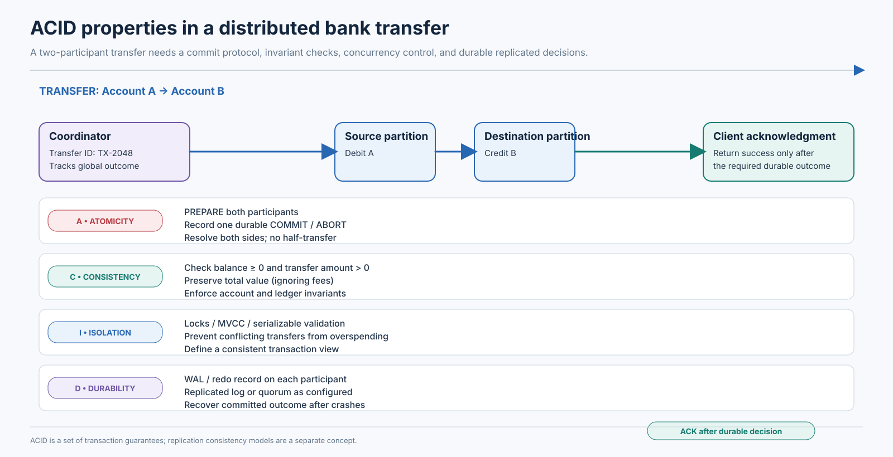

*Figure: Acid in distributed systems.*
---

# 3. Isolation Levels

## 3.1 Schedules, serial execution, and serializability

A **transaction schedule** is the order in which operations from concurrent transactions execute. Use `r1(X)` for T1 reading X, `w1(X)` for T1 writing X, `c1` for T1 commit, and `a1` for T1 abort.

A serial schedule runs one transaction to completion before the next begins. A concurrent schedule interleaves operations. Concurrency is safe when the resulting effects are equivalent to an allowed serial order or satisfy the selected weaker isolation contract.

**Conflict serializability** analyzes pairs of operations from different transactions that access the same item and at least one is a write. The conflicts are read-write, write-read, and write-write. Build a precedence graph with one node per transaction and an edge Tᵢ→Tⱼ when a conflicting operation of Tᵢ occurs before one of Tⱼ. A cycle means the schedule is not conflict-serializable.

**View serializability** is broader: it asks whether the schedule preserves which writes each read observes and the final writer of each item. Some view-serializable schedules are not conflict-serializable, but practical engines commonly use mechanisms that target conflict graphs, locks, timestamps, or equivalent serializable execution rules.

A dependency may be:

- **Write-read (wr):** T2 reads a value written by T1.
- **Read-write (rw):** T2 changes data that T1 previously read; this is especially important for predicate/read-set conflicts.
- **Write-write (ww):** two transactions try to write the same item.

## 3.2 Read Uncommitted

Read Uncommitted permits a transaction to observe another transaction's uncommitted writes under the SQL standard's phenomena-based definition. This permits **dirty reads** and may also permit non-repeatable reads, phantoms, and serialization anomalies.

Timeline:

| Time | T1 | T2 |
|---|---|---|
| t1 | `BEGIN` | |
| t2 | `UPDATE account SET balance=0` (not committed) | |
| t3 | | `SELECT balance` → sees 0 (dirty read) |
| t4 | `ROLLBACK` | |
| t5 | | T2 has acted on a value that never committed |

The practical danger is cascading behavior: if T2 commits a decision based on T1's uncommitted write, and T1 later aborts, T2's result may need to be rolled back as well. Many mainstream MVCC databases do not expose dirty reads even when the user requests this level. PostgreSQL treats `READ UNCOMMITTED` as `READ COMMITTED`; therefore, the standard label does not imply identical behavior across products.

## 3.3 Read Committed

Read Committed prevents dirty reads: every statement sees committed data as of a defined statement-level visibility point. It does not necessarily guarantee that two statements in the same transaction see the same snapshot.

Example: T1 reads an account balance of ₹1,000. T2 changes it to ₹800 and commits. T1 reads the row again and can receive ₹800. The first and second statements each read committed data, so no dirty read occurred; the value simply changed between statements.

| Time | T1 | T2 |
|---|---|---|
| t1 | `BEGIN` | |
| t2 | `SELECT balance` → 1000 | |
| t3 | | `UPDATE balance=800; COMMIT` |
| t4 | `SELECT balance` → 800 | |
| t5 | `COMMIT` | |

Phantoms may also occur: a repeated predicate query can return a different row set after another transaction inserts a qualifying row. Lost-update prevention depends on statement form and implementation. A guarded atomic update such as `UPDATE inventory SET qty=qty-1 WHERE sku=? AND qty>0` is safer than application-side read-modify-write, but applications still need to check the affected-row count and consider transaction isolation.

## 3.4 Snapshot Isolation

**Snapshot Isolation (SI)** gives a transaction a consistent snapshot of committed data. Its reads generally see versions committed before the transaction's snapshot timestamp, while its own writes are visible to itself. A common implementation uses **first-committer-wins** for concurrent transactions that write the same item: one commits, and the other aborts or waits/revalidates.

SI prevents many read anomalies, but is not equivalent to serializable isolation. It can permit write skew because transactions may read overlapping facts and write different rows, avoiding a direct write-write conflict.

### Hospital on-call write skew

Invariant: at least one doctor must remain on call. Rows A and B both have `on_call=true`.

| Time | T1: remove A | T2: remove B |
|---|---|---|
| t1 | Snapshot reads A=true, B=true | Snapshot reads A=true, B=true |
| t2 | Writes A=false | Writes B=false |
| t3 | Commit succeeds | Commit succeeds |
| t4 | Final state: A=false, B=false; invariant violated | Same final state |

Both transactions made decisions based on a valid snapshot. They wrote different rows, so a basic same-row write conflict does not detect the dangerous combination. A serial execution would allow only one doctor to be removed after the first transaction commits, assuming the second transaction rechecked the invariant.

Possible fixes include serializable isolation, explicitly locking a shared roster row, maintaining a single aggregate counter with a guarded atomic update, or designing the invariant so that all conflicting changes contend on one key.

## 3.5 Serializable Isolation

Serializable isolation requires the committed concurrent result to be equivalent to some serial execution. Implementations vary:

- **Strict two-phase locking (2PL):** transactions acquire locks and hold the necessary locks until commit/abort. Predicate or range locking is needed to protect set-based reads.
- **Serializable Snapshot Isolation (SSI):** transactions read from snapshots while the engine tracks dangerous read-write dependency structures and aborts transactions when needed to prevent a serialization cycle.
- **Timestamp/validation approaches:** transactions are ordered and validated so their effects correspond to a serial history.

A serializable transaction can abort even when no server crashes. A concurrent transaction may create a dependency that would make the overall schedule non-serializable. The engine rejects one transaction rather than commit an incorrect history. The client should retry the **entire transaction** from fresh reads when the database reports a serialization failure.

Serializable is a correctness contract, not a promise of zero aborts or highest throughput. Contention-heavy workloads can see more waits and retries. Keep transactions short, index predicates, make retry logic bounded and idempotent, and avoid unnecessary read/write sets.

## 3.6 Isolation comparison

| Isolation level | Dirty reads | Non-repeatable reads | Phantom reads | Write skew | Serializable guarantee |
|---|---|---|---|---|---|
| Read Uncommitted (SQL standard) | Allowed | Possible | Possible | Possible | No |
| Read Committed | Prevented | Possible | Possible | Possible | No |
| Snapshot Isolation (common model) | Prevented | Prevented within transaction snapshot | Usually prevented as a repeated snapshot read, but predicate/write anomalies can remain | Possible | No |
| Serializable | Prevented | Prevented | Prevented as an anomaly | Prevented | Yes |

**Important nuance:** SQL standard isolation levels are defined in terms of forbidden phenomena; real products may provide stronger behavior than the minimum. Snapshot Isolation is a useful implementation model but is not a standard SQL isolation-level name. `REPEATABLE READ` in one database may differ from `REPEATABLE READ` in another.

### Product-specific behavior (verify deployed version/configuration)

| Product | Relevant behavior to remember |
|---|---|
| PostgreSQL | `READ UNCOMMITTED` behaves as `READ COMMITTED`; `READ COMMITTED` uses a new statement snapshot; `REPEATABLE READ` is snapshot-based and prevents phantom reads in PostgreSQL's implementation but can still permit serialization anomalies; `SERIALIZABLE` uses SSI and can report serialization failures. |
| MySQL/InnoDB | Default is commonly `REPEATABLE READ`; consistent nonlocking reads use a snapshot; locking reads and writes use current-read/locking behavior; next-key locks combine record and gap locking to prevent phantom inserts for relevant index ranges. `READ COMMITTED` changes gap-lock behavior. |
| SQL Server | Supports lock-based isolation and row-versioned modes. `READ_COMMITTED_SNAPSHOT` gives statement-level versioned reads; `SNAPSHOT` gives a transaction-level snapshot and detects update conflicts. `SERIALIZABLE` uses range protection where needed. |
| Oracle Database | Uses multiversion read consistency; default `READ COMMITTED` provides statement-level consistency. `SERIALIZABLE` provides transaction-level consistency and can fail with serialization/update conflicts; Oracle does not expose dirty reads as a normal isolation mode. |
| Distributed SQL | Behavior is product-specific. CockroachDB defaults to serializable transactions and expects retries for serialization errors; TiDB supports optimistic/pessimistic modes and documents snapshot/Read Committed behavior; Spanner defaults to serializable with external consistency for read-write transactions. |

Do not infer that a product implements a named level exactly like another product. Check whether the read is a snapshot read or a locking/current read, what happens to predicate ranges, when the snapshot is acquired, and whether the engine retries internally or returns a retryable error.

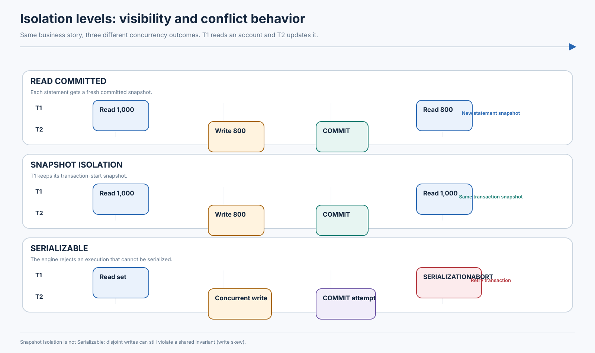

*Figure: Transaction isolation levels.*
---

# 4. Transaction Anomalies

An anomaly is a surprising result of an allowed concurrent schedule. It is useful to distinguish the *symptom* (what a user sees) from the *mechanism* (which conflicting operations were allowed).

## 4.1 Dirty read

**Definition:** T2 reads a value written by T1 before T1 commits. If T1 aborts, T2 has observed a value that never became committed state.

Schedule:

```text
T1: BEGIN ── WRITE(balance=0) ───────── ROLLBACK
T2:              READ(balance=0) ── COMMIT decision based on 0
```

**Consequence:** a fraud or credit decision may be made from a transient balance; cascading aborts may be required. Dirty reads are prevented by common production isolation levels. Dirty writes (overwriting another transaction's uncommitted write) are a separate anomaly and are usually prevented by locking/MVCC conflict rules.

**Prevention:** use Read Committed or stronger; ensure application code does not read uncommitted replicas or caches as though they were transactional truth.

## 4.2 Non-repeatable read

**Definition:** one transaction reads the same row twice and sees different committed values.

```text
T1: READ(price=100) ───────────────── READ(price=120) ─ COMMIT
T2:                  UPDATE price=120 ─ COMMIT
```

**Consequence:** checkout displays ₹100, then a later step in the same transaction computes tax/total using ₹120. Depending on the business rule, this can be acceptable (current price wins) or unacceptable (price should be frozen at order acceptance).

**Relevant levels:** possible under Read Committed; prevented within a transaction by common Repeatable Read/Snapshot Isolation implementations and Serializable. A business process may need to persist the quoted price rather than depend on a long transaction snapshot.

## 4.3 Phantom read

**Definition:** a repeated predicate/range query returns a different set of rows because another transaction inserted, deleted, or changed a row so it now qualifies.

Example: T1 queries `SELECT * FROM orders WHERE total > 10000`. T2 inserts an order with total ₹15,000 and commits. T1 reruns the query and sees an additional row.

Phantoms differ from non-repeatable reads: non-repeatable read changes a previously observed row's value; a phantom changes the membership of a predicate's result set.

**Protection:** predicate locks, index-range/next-key locks, serializable validation, or a stable transaction snapshot (which prevents the inserted row from entering the same snapshot). An implementation can prevent observed phantoms and still permit other serialization anomalies.

## 4.4 Lost update

**Definition:** two transactions read the same original value, calculate updates independently, and the later write overwrites the earlier one.

Initial `stock=1`:

```text
T1: READ stock=1 ─ compute 0 ─ WRITE stock=0 ─ COMMIT
T2:      READ stock=1 ─ compute 0 ─ WRITE stock=0 ─ COMMIT
```

The numeric value may look plausible, but both customers may have received a reservation. The database row shows zero remaining, while the business has sold two units.

**Prevention:** atomic conditional update (`... WHERE stock > 0`), row lock (`SELECT ... FOR UPDATE`), version column/CAS, unique reservation constraints, or serializable isolation. Do not split a read-modify-write across application code without validation.

## 4.5 Write skew

**Definition:** transactions read overlapping data and update different rows. No direct write-write conflict exists, but the combined result violates a cross-row invariant.

Hospital example: two doctors are on call. T1 reads both on-call rows and turns A off; T2 reads the same snapshot and turns B off. SI may allow both commits.

Financial example: two departments each have a spending cap of ₹100,000 and shared committed spend of ₹80,000. Each transaction reads ₹80,000, adds ₹15,000 to a different expense row, and sees enough remaining capacity. Both commit, producing ₹110,000. The transactions write different expense records but violate a shared aggregate limit.

**Prevention:** serializable isolation; lock a shared invariant row; maintain a serialized aggregate; or use a database constraint/atomic counter that forces a write-write conflict. A lock must cover the predicate/invariant, not just the row each transaction happens to update.

## 4.6 Read skew

**Definition:** a transaction reads related values from different logical moments and observes a combination that never existed atomically.

Two accounts initially A=₹500, B=₹500. Transfer ₹100 from A to B should preserve total ₹1,000.

```text
Transfer T: A=400, B=600 (atomic logical change)
Report R:   READ A=400 ───────────── READ B=500
```

The report sees A after transfer and B before transfer, so total appears ₹900. A consistent snapshot read of both accounts prevents this form of read skew. For distributed reports, the system needs a cross-shard snapshot/read timestamp or a deliberately approximate reporting contract.

## 4.7 Serialization anomaly

**Definition:** a set of committed transactions produces a result that cannot correspond to any serial ordering of those transactions. Write skew is one common example.

A precedence graph represents dependencies. If T1's read influences T1's later write and T2's write invalidates what T1 read, and vice versa through another item/predicate, the graph can contain a cycle. Under SSI, dangerous structures involving overlapping read-write anti-dependencies are tracked; the engine may abort one transaction to break a potential serialization cycle.

**Production relevance:** PostgreSQL Serializable can raise `serialization_failure`; CockroachDB can return retry errors; other systems may abort/restart, wait, or use different validation. Applications must distinguish retryable serialization errors from ambiguous commit outcomes.

## 4.8 Anomaly reference table

| Anomaly | Core pattern | Commonly permitted under | Typical protection |
|---|---|---|---|
| Dirty read | Read another transaction's uncommitted write | Read Uncommitted (where implemented) | Read Committed or stronger |
| Non-repeatable read | Same row, different committed value | Read Committed | Snapshot/Repeatable Read or stronger |
| Phantom | Predicate result set changes | Read Committed; may be prevented by some stronger implementations | Predicate/range locks, snapshot semantics, Serializable |
| Lost update | Stale read-modify-write overwrites a concurrent update | Depends on isolation and write method | Atomic conditional update, lock, version check, conflict detection |
| Write skew | Read common invariant; write disjoint rows | Snapshot Isolation | Serializable or shared invariant lock/guard row |
| Read skew | Related reads observe different points in time | Read Committed across statements/partitions | Consistent snapshot/read timestamp |
| Serialization anomaly | No serial ordering explains committed result | Below Serializable | Serializable execution/validation |

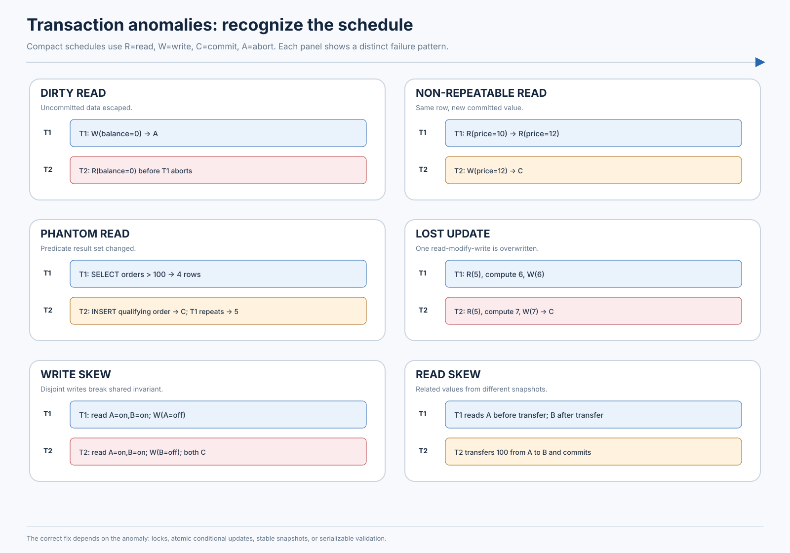

*Figure: Transaction anomalies.*
---

# 5. MVCC — Multi-Version Concurrency Control

## 5.1 Why MVCC exists

With single-version storage, a reader and writer may block each other because there is only one current value for a row. **Multi-Version Concurrency Control (MVCC)** retains multiple committed versions so readers can select a version visible to their snapshot while writers create a newer version.

MVCC is a storage/visibility technique, not an isolation level by itself. An engine can use MVCC to implement Read Committed, Snapshot Isolation, or Serializable isolation, with additional conflict detection/locking rules.

A conceptual version record may contain:

```text
(key, value, begin_timestamp, end_timestamp, transaction_status)
```

Real products use different metadata, transaction IDs, undo records, commit timestamps, intents, and indexes. The conceptual visibility rule is: a snapshot at timestamp `s` sees a version that was committed by `s` and not superseded before `s`, subject to the engine's transaction-ID/status rules.

## 5.2 Numerical version walkthrough

Initial account balance is ₹1,000.

1. T1 starts and receives snapshot timestamp 100. It reads version `v1=(1000, committed before 100)`.
2. T2 starts later, changes the balance to ₹800, and commits at timestamp 120, creating `v2`.
3. T1 reads again. Under a transaction-level snapshot, it still sees `v1=1000` because `v2` is newer than its snapshot.
4. T3 begins after T2 commits with snapshot timestamp 130 and sees `v2=800`.

| Version | Value | Visibility interval (conceptual) |
|---|---:|---|
| v1 | 1,000 | Visible to snapshots at/after its commit and before v2 supersedes it |
| v2 | 800 | Visible to snapshots at/after commit timestamp 120 |

This is why readers and writers can often proceed concurrently: T1 can continue reading the older committed version while T2 writes a new version. Writers still need conflict rules to prevent unsafe concurrent updates.

## 5.3 Snapshot creation and visibility

A database may create a snapshot at transaction start or at the start of each statement:

- **Statement snapshot:** each statement chooses its own committed visibility point. Read Committed commonly behaves this way in MVCC engines.
- **Transaction snapshot:** all reads in a transaction use the same visibility point. Repeatable Read/Snapshot Isolation commonly behaves this way.
- **Read timestamp:** distributed MVCC systems may use a timestamp that defines which versions are eligible for the read.

The engine must also account for the transaction's own writes, concurrent uncommitted versions, aborted transactions, and commit records whose status is not yet resolved.

## 5.4 MVCC and isolation

- **Read Committed + MVCC:** each statement reads a committed statement snapshot. Repeated statements can observe newer commits.
- **Snapshot Isolation + MVCC:** a transaction retains a stable snapshot. Common systems detect write-write conflicts; write skew may still occur.
- **Serializable + MVCC:** the engine adds predicate locks, SSI dependency tracking, validation, or another mechanism to ensure the committed history is serializable.

Therefore, MVCC alone does not guarantee serializability. It primarily solves version visibility and reduces reader/writer blocking; conflict control is a separate requirement.

## 5.5 Implementation differences

### PostgreSQL

PostgreSQL stores tuple versions in heap pages. Updates generally create new tuple versions; old versions remain until vacuum determines that no active snapshot needs them. Transaction IDs and tuple metadata participate in visibility checks. Long-running snapshots can prevent cleanup and contribute to table/index bloat. PostgreSQL Serializable uses SSI on top of MVCC rather than simply making all reads block writes.

### MySQL/InnoDB

InnoDB uses clustered-index records plus undo information to reconstruct older versions for consistent reads. Read views determine which transaction versions are visible. Undo history is purged when no active transaction needs it. Locking reads and writes use current versions and locking semantics, which differ from nonlocking consistent snapshot reads. Next-key locks protect index ranges in relevant locking operations.

### Oracle

Oracle uses undo data to provide multiversion read consistency. A query sees a consistent point-in-time view without ordinary readers blocking writers. Long-running queries can fail if required undo information is no longer available (for example, snapshot-too-old conditions under unsuitable retention/workload conditions).

### CockroachDB and Spanner-style systems

Distributed systems commonly attach hybrid/physical/logical timestamps to MVCC versions. Reads at a timestamp may be served from replicas that are sufficiently caught up or may need coordination to establish a safe timestamp. Transaction intents or provisional writes represent uncommitted changes. CockroachDB and Spanner have their own transaction and timestamp protocols; they should not be described as identical implementations.

### FoundationDB

FoundationDB exposes an ordered transactional key-value abstraction with a versioned storage/transaction model. Its transaction system offers a bounded read-conflict range and write-conflict range model; the client transaction is validated against conflicting committed transactions. It is useful to understand the API-level conflict model rather than assume it is a row-versioned SQL engine.

## 5.6 Garbage collection and operational costs

Old versions cannot be deleted while an active snapshot may still need them. This creates a retention horizon.

Operational symptoms include:

- High dead-tuple/undo/version storage.
- Vacuum/purge/GC falling behind write volume.
- Long-running transactions or idle-in-transaction sessions.
- Increased read amplification from traversing version chains.
- Extra storage I/O and cache pressure.
- Transaction ID wraparound risk in PostgreSQL if freezing/vacuum maintenance is neglected.
- Replication/CDC consumers retaining old log positions and indirectly delaying cleanup in some architectures.

**Operational practices:** set transaction timeouts where safe; avoid user think-time inside transactions; monitor oldest active snapshot and version retention; tune vacuum/undo/GC capacity; examine long-running read-only reports; and schedule heavy maintenance with workload awareness.

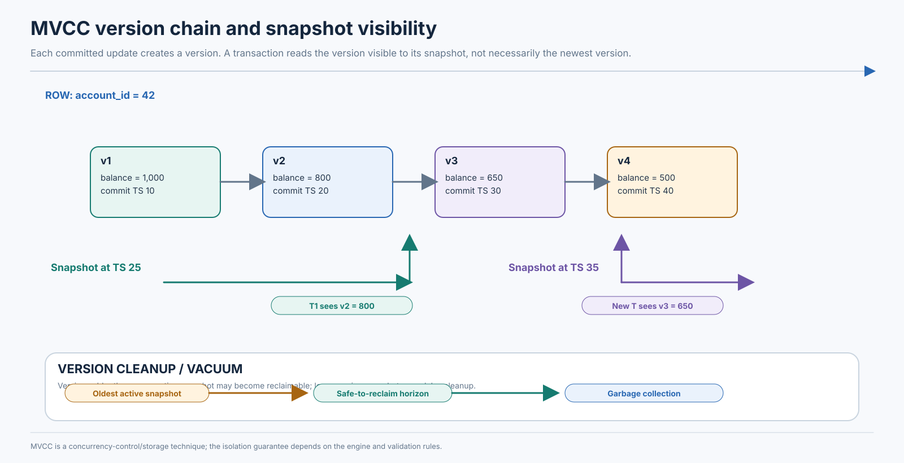

*Figure: Mvcc version chain.*
---

# 6. Optimistic vs Pessimistic Concurrency Control

## 6.1 Pessimistic concurrency control

Pessimistic control assumes conflicts are sufficiently likely that transactions should protect data before changing it. A transaction can obtain:

- **Shared (S) lock:** permits compatible readers but blocks conflicting writers.
- **Exclusive (X) lock:** permits the holder to write and normally excludes other conflicting locks.
- **Row lock:** protects one row/key.
- **Table lock:** protects a larger relation/object.
- **Predicate/range lock:** protects a set of rows defined by a condition, including qualifying future inserts where required.

A simplified compatibility matrix:

| Requested / held | Shared | Exclusive |
|---|---:|---:|
| Shared | Compatible | Conflicts |
| Exclusive | Conflicts | Conflicts |

Databases may use intention locks, key-range locks, next-key locks, predicate locks, or lock escalation. The exact lock modes are product-specific.

### Banking withdrawal example

Account balance is ₹1,000. Two concurrent withdrawals each request ₹700.

1. T1 obtains an exclusive lock on account A.
2. T1 reads balance ₹1,000 and validates sufficient funds.
3. T2 requests an exclusive lock and waits.
4. T1 writes ₹300 and commits, releasing the lock.
5. T2 acquires the lock, reads ₹300, and rejects the ₹700 withdrawal.

Without coordination, both transactions might read ₹1,000 and both approve. Locking forces the second decision to use the updated state.

### Deadlocks

A deadlock occurs when transactions form a cycle of waits. Example: T1 holds A and requests B; T2 holds B and requests A. A wait-for graph has a directed edge from the waiting transaction to the holder. A cycle indicates deadlock.

Databases may detect the cycle and abort a victim, or rely on timeouts. Preventive techniques include acquiring locks in a global order, keeping transactions short, indexing predicates to avoid broad scans, and avoiding user/network work while locks are held. Deadlock retries must be safe and bounded.

## 6.2 Optimistic concurrency control (OCC)

OCC assumes conflicts are relatively rare. It usually has three conceptual phases:

1. **Read phase:** read data and remember versions/keys accessed; perform computations privately.
2. **Validation phase:** verify that the transaction's read/write assumptions have not been invalidated by concurrent commits.
3. **Write phase:** commit changes if validation succeeds; otherwise abort/retry.

A version-based update can use compare-and-swap semantics:

```text
read seat(version=17, status=AVAILABLE)
compute reservation
UPDATE seat
SET status='HELD', version=18
WHERE id=? AND version=17 AND status='AVAILABLE'
```

If another transaction changed the row first, the update affects zero rows or the database reports a write conflict. The application must not assume the reservation succeeded.

### Seat reservation example

Two customers read `seat 12A, version 17`. T1 validates first and commits version 18 as HELD. T2 tries to update version 17; validation fails because the current version is 18. T2 retries, reads HELD, and returns unavailable.

## 6.3 Comparison

| Dimension | Pessimistic | Optimistic |
|---|---|---|
| Conflict assumption | Conflicts are likely or costly | Conflicts are relatively rare |
| Locking | Acquires locks before/while accessing protected data | May avoid long-lived locks during read/compute phase; commit may still lock/validate |
| Validation | Often implicit through lock ownership and constraints | Explicitly checks versions, write conflicts, or read/write dependencies |
| Abort behavior | Waits, deadlocks, or lock-timeout aborts | Conflict/validation aborts and retries |
| Contention | Can queue requests and increase lock waits | Can create high abort/retry rates |
| Deadlocks | Possible with multiple locks | Basic OCC validation avoids many lock deadlocks, but commit/storage mechanisms can still lock |
| Low contention throughput | Can be excellent; lock overhead remains | Often good because work proceeds without waiting |
| High contention throughput | Predictable serialization but long waits | May collapse due to repeated abort/recompute |
| Retry requirements | Deadlock/timeout retries still matter | Conflict retry is central to the model |
| Good workloads | Hot keys, financial invariants, predictable updates | Mostly independent records, low-conflict writes, short transactions |

Neither is universally better. Network distance increases the cost of holding remote locks and waiting for lock owners. OCC may perform local computation concurrently but waste work if validation repeatedly fails. Long-running transactions are problematic for both: they retain locks in pessimistic systems and retain large read sets/stale assumptions in optimistic systems.

### Product examples

- PostgreSQL uses MVCC for reads and locks for writes; its Serializable mode adds SSI validation.
- InnoDB combines MVCC consistent reads with record and next-key locks for writes/locking reads.
- TiDB supports optimistic and pessimistic transaction modes; current documentation notes pessimistic mode is the default for newly created clusters from the relevant versions and documents changes to optimistic auto-retry behavior. Always check the deployed release.
- Distributed SQL systems may use distributed locks, intents, timestamps, or validation over shard-local state. A product's “optimistic” label should not be assumed to mean no locks anywhere.

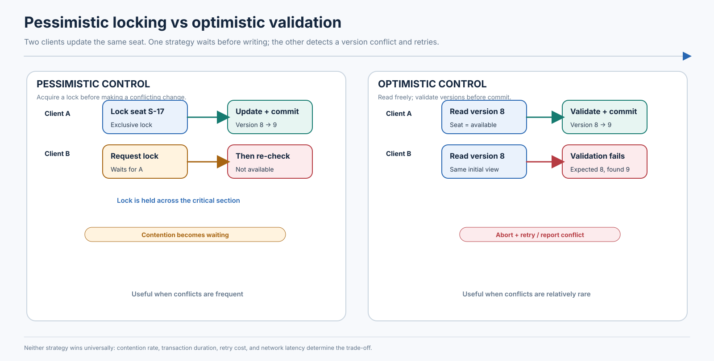

*Figure: Optimistic vs pessimistic concurrency.*
---

# 7. Distributed Commit Protocols

Distributed commit is the mechanism that makes participants agree whether a transaction commits or aborts. It is separate from the isolation mechanism that determines which concurrent histories are permitted.

## 7.1 Two-Phase Commit (2PC)

2PC has a **coordinator** and multiple **participants**. It aims to ensure all participants make the same durable commit/abort decision.

### Phase 1: Prepare / vote

1. Coordinator begins a global transaction and sends `PREPARE` to participants.
2. Each participant performs local work and validates constraints/conflicts.
3. Each participant writes enough durable log state to promise it can commit later.
4. Participant replies `YES` (prepared) or `NO` (cannot commit).

A participant that votes YES has entered a prepared state. It must retain the resources/state needed to honor a later COMMIT. It cannot safely infer ABORT merely because the coordinator is temporarily unreachable.

### Phase 2: Decision

- If any participant votes NO, or a failure policy forces abort before a commit decision, the coordinator durably records ABORT and sends it to participants.
- If all vote YES, the coordinator durably records COMMIT and sends COMMIT to all participants.
- Participants apply the decision, persist completion, release locks, and acknowledge.

The coordinator must make its decision durable before relying on it for recovery. Participants also log prepare/commit/abort state so they can recover after a crash.

### Bank-transfer trace

```text
Coordinator       Partition A                Partition B
    |                 |                         |
    |---- PREPARE ---->|                         |
    |---------------- PREPARE ----------------->|
    |                 | validate + log PREPARED  |
    |                 |---- YES ---------------->|
    |                 |                         | validate + log PREPARED
    |<---------------- YES ----------------------|
    | durable COMMIT decision                    |
    |---- COMMIT ---->|                         |
    |---------------- COMMIT ------------------->|
    |                 | commit + ACK              | commit + ACK
    |<---------------- ACK -----------------------|
    |------------------------------ ACK ---------|
```

(The diagram is conceptual; the two YES responses are each sent directly to the coordinator.)

### Failure analysis at every stage

| Failure point | Correct interpretation and recovery |
|---|---|
| Coordinator crashes before PREPARE | No participant has prepared; coordinator recovery can usually abort/forget according to durable state and transaction protocol. |
| Coordinator crashes after sending PREPARE but before recording votes | Participants may have prepared. On restart, coordinator consults its log and drives the protocol; participants may be in doubt until they learn the outcome. |
| Coordinator receives all YES votes and crashes before durable decision | A prepared participant cannot know whether the coordinator had enough information to decide COMMIT. It remains in doubt and may block while awaiting recovery. |
| Coordinator durably records COMMIT and crashes before sending all messages | COMMIT is authoritative. Recovery resends it; participants must not independently abort. |
| Participant crashes after YES | It recovers its prepared state from durable log and waits for the decision/recovery message. |
| Network partition during COMMIT | Some participants may commit while others have not yet learned the decision. The logical decision is still one durable COMMIT; unavailable participants resolve when communication recovers. |
| COMMIT arrives twice | Decision handling must be idempotent; second application must not duplicate business effects. |
| Coordinator recovers with incomplete local state | It uses durable log records and protocol state, not volatile memory or client guesses, to resume or abort where permitted. |

### Why 2PC blocks

2PC is a blocking atomic commit protocol in the classic model. If participants have voted YES and the coordinator becomes unavailable before the final decision is known, participants cannot safely decide on their own. They may hold locks and retain prepared resources while waiting. The protocol preserves agreement at the cost of availability/progress during some failures.

Timeouts can trigger recovery attempts or heuristics, but a timeout alone is not proof that abort is safe. Heuristic completion can create a split outcome and requires explicit operational reconciliation.

## 7.2 Three-Phase Commit (3PC)

3PC adds a **CanCommit?** phase, **PreCommit**, and **DoCommit**:

1. **CanCommit:** coordinator asks if participants can commit; they vote YES/NO.
2. **PreCommit:** if all vote YES, coordinator tells participants to enter a state indicating commit is likely and records protocol state.
3. **DoCommit:** coordinator sends the final commit command; participants commit.

The additional phase aims to create states in which participants can use timeouts to make progress without waiting indefinitely for the coordinator. This depends on assumptions such as bounded communication delay, no network partition that splits participants into inconsistent views, and a controlled failure model. In a fully asynchronous system with arbitrary delays and partitions, timeouts cannot distinguish a failed coordinator from a slow one. 3PC therefore does not eliminate all blocking/consistency problems under arbitrary network failures.

Practical systems more often use 2PC with replicated coordinators/consensus-backed metadata, consensus-based transaction architectures, or Saga-style business workflows rather than rely on classic 3PC.

## 7.3 2PC vs 3PC

| Dimension | 2PC | 3PC |
|---|---|---|
| Phases | Prepare/vote, then commit/abort | CanCommit, PreCommit, DoCommit |
| Messages/round trips | Fewer phases | More phase communication |
| Blocking | Can block with prepared participants and failed coordinator | Designed to reduce blocking under its timing/failure assumptions |
| Failure assumptions | Can preserve safety with blocking in asynchronous networks | Requires stronger timing/partition assumptions for nonblocking progress |
| Recovery | Durable coordinator/participant logs resolve outcome | Additional state transitions help timeout recovery, but assumptions remain critical |
| Network partition | Must avoid inconsistent decisions; progress may stop | Can still fail to make safe progress under arbitrary partitions |
| Production use | Common building block in distributed databases | Much less common as a standalone production transaction protocol |

## 7.4 Atomic commit versus consensus

- **Atomic commit** asks: can all participants commit this transaction, or must all abort?
- **Consensus** asks: can a set of replicas agree on one value/order despite failures within a defined fault model?
- **Replicated log** uses consensus to replicate an ordered sequence of state changes.
- **Leader election** chooses a node allowed to coordinate/append under the consensus protocol.

2PC is not consensus. A transaction coordinator may use consensus to replicate its log/decision so that coordinator failure does not erase the decision. Participants may still need an atomic commit protocol to coordinate a transaction across multiple independent groups. Production systems often combine these layers: consensus replicates each shard/group's state and transaction metadata; an atomic transaction protocol coordinates the cross-group operation.

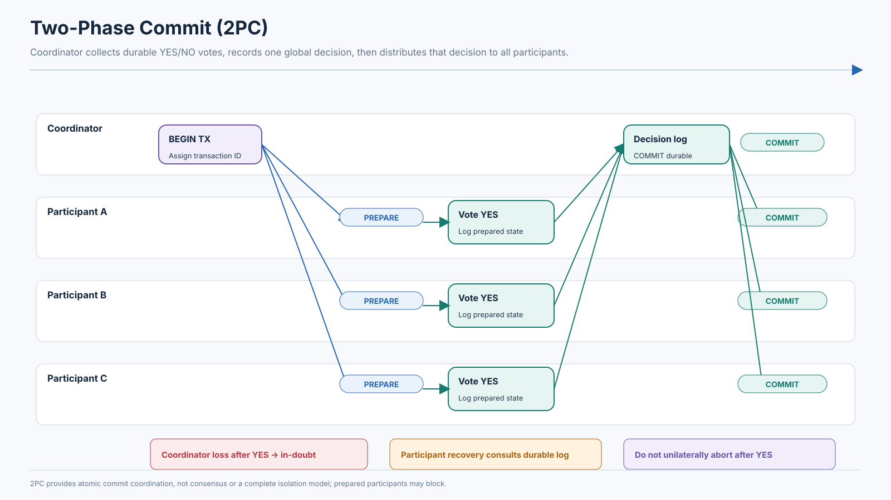

*Figure: Two phase commit.*
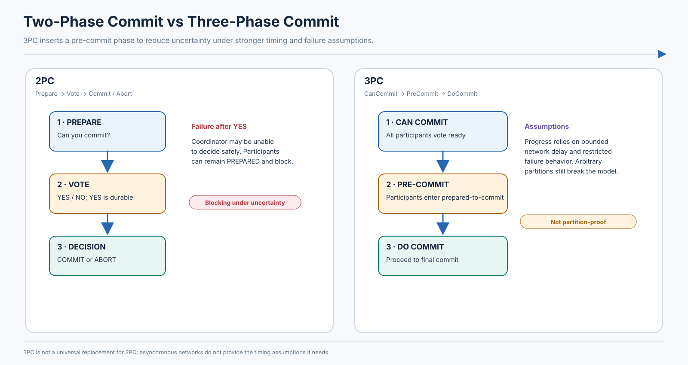

*Figure: Two phase vs three phase commit.*
---

# 8. Distributed Transactions in Microservices

## 8.1 Why microservices change the problem

In a database-per-service architecture, each service owns its data and exposes operations through APIs/events. The Order service should not directly update the Inventory database because this breaks ownership, schema autonomy, and independent deployment. A local SQL transaction cannot span services unless all participants deliberately support a shared distributed transaction protocol.

A cross-service workflow therefore typically uses **local transactions** plus one of:

- Saga orchestration or choreography.
- TCC when participants can reserve resources.
- Transactional outbox/inbox for reliable event transfer.
- A distributed database transaction if all data truly belongs to one database transaction boundary and the product supports it.

## 8.2 Why not hold locks across remote calls?

Imagine an Order transaction locks its row, calls Inventory over HTTP, waits 700 ms, calls Payment, waits 1.8 seconds, and then attempts Shipping. During those calls:

- Locks are held much longer than a local database operation requires.
- A slow service can exhaust database connections and lock queues.
- Deadlock probability increases when multiple services call one another.
- A timeout leaves the caller uncertain whether the remote side committed.
- A local rollback cannot undo a remote charge or reservation.

The better pattern is to persist a durable workflow state, commit local changes quickly, communicate asynchronously/reliably, and use explicit states such as `PENDING_PAYMENT`, `RESERVED`, `PAYMENT_UNKNOWN`, `CONFIRMED`, `CANCELLED`, or `MANUAL_REVIEW`.

## 8.3 Complete order lifecycle

A robust state progression might be:

```text
NEW
  -> PENDING_INVENTORY
  -> INVENTORY_RESERVED
  -> PENDING_PAYMENT
  -> PAYMENT_AUTHORIZED
  -> PENDING_SHIPMENT
  -> CONFIRMED

Failure branches:
  INVENTORY_REJECTED -> CANCELLED
  PAYMENT_DECLINED -> RELEASE_INVENTORY -> CANCELLED
  PAYMENT_UNKNOWN -> RECONCILING (query provider; do not charge with a new key)
  SHIPMENT_REJECTED -> retry / alternative carrier / refund-and-release policy
```

Each service commits its own state transition locally. The orchestration record includes workflow ID, order ID, current step, idempotency keys, attempt count, deadline, last known outcome, and correlation/trace ID.

### Technical failure versus business failure

- **Technical failure:** timeout, process crash, unavailable database, broker outage. Often retryable, but outcome may be ambiguous.
- **Business failure:** card declined, item out of stock, invalid address, credit limit exceeded. Usually not fixed by retrying the same request. It requires an alternative path or compensation.

Do not translate every timeout into a business rejection. A payment timeout should be `PAYMENT_UNKNOWN` until reconciled, not `PAYMENT_FAILED` by assumption.

### Duplicate requests and customer-visible state

A client sends an idempotency key on `PlaceOrder`. Order service stores `(customer_id, idempotency_key)` under a unique constraint along with the original result. Repeated requests return that result. Each downstream participant receives a stable operation key such as `order-123:reserve-inventory:v1` and records processed commands/events so retries do not duplicate work.

The customer should see meaningful intermediate states rather than a false synchronous success: “Order received — payment confirmation pending,” “Inventory reserved,” “Payment processing,” or “We are reconciling your payment.”

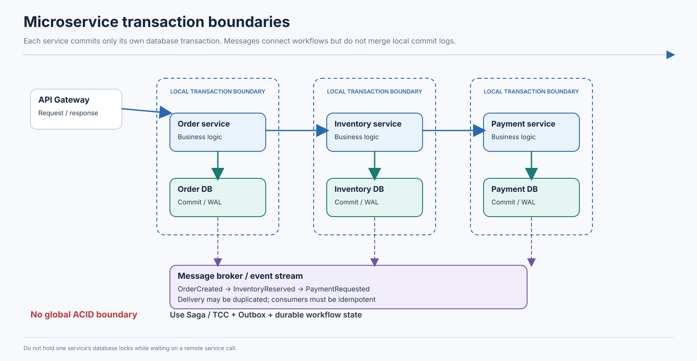

*Figure: Microservice transaction boundaries.*
---
# 9. Saga Pattern

## 9.1 Saga from first principles

A **Saga** is a long-running business transaction decomposed into a sequence of local transactions. Each local transaction commits independently. If a later step cannot complete, the system executes **compensating transactions** for earlier completed steps according to business policy.

A Saga is not one global database transaction held open for the entire workflow. It deliberately accepts intermediate states and eventual convergence. The workflow state must be durable so that a process restart does not lose the knowledge of which steps completed.

For each step define:

- Forward operation and its unique command ID.
- Success result and durable outcome.
- Retryability and retry deadline.
- Compensation operation (if possible).
- Compensation idempotency key.
- Timeout and reconciliation procedure.
- Whether the operation is reversible, compensatable, or irreversible.

## 9.2 E-commerce Saga walkthrough

| Step | Forward transaction | Compensation / recovery |
|---|---|---|
| 1 | Create pending order | Cancel order or mark rejected |
| 2 | Reserve inventory | Release inventory reservation |
| 3 | Authorize/capture payment | Void authorization or refund capture; refund may be asynchronous |
| 4 | Create shipment | Cancel label/pickup if still possible; otherwise intercept/return workflow |
| 5 | Confirm order | Reopen, cancel, or route to manual fulfillment policy if a late failure occurs |

Example: inventory is reserved, payment is captured, but shipping creation returns a definitive carrier rejection. The Saga may first retry with an alternate carrier. If no carrier can serve the address, it may refund payment and release inventory, then mark the order cancelled. The refund is not an erasure of the charge; it is a new financial transaction that must be recorded and reconciled.

### Compensation is not rollback

A database rollback restores the database transaction's uncommitted state as though the transaction had not committed. A compensation is a new business action that attempts to restore an acceptable business condition.

- A payment refund can take several days and may incur fees.
- A package handed to a courier cannot always be recalled.
- A notification cannot be unsent; a correction message may be sent instead.
- A released inventory reservation may already have been taken by another customer.
- A discount or exchange rate may no longer be available.

The compensation policy must account for irreversibility and external actors. Some failures require manual review rather than an automatic inverse operation.

## 9.3 Orchestration

In **Saga orchestration**, a central orchestrator owns the workflow state machine. It dispatches commands, records outcomes, schedules retries/timeouts, and starts compensations.

Typical persisted fields:

```text
saga_id, business_id, current_state, next_action,
step_statuses, command_ids, attempt_counts,
deadline, last_error, compensation_state, updated_at
```

Flow:

1. Orchestrator commits `OrderSagaStarted` and a command to reserve inventory.
2. Inventory service handles the command idempotently, commits the reservation, and emits a result.
3. Orchestrator records `InventoryReserved`, then commands payment.
4. Payment service reports authorized/declined/unknown.
5. Orchestrator advances, retries, reconciles, or compensates based on the result.

**Advantages:** centralized workflow visibility, explicit timeouts, clear compensation order, easier audit trail, and a single place to reason about business state.

**Disadvantages:** orchestrator becomes an important dependency; workflow definitions can become a large central model; it can become tightly coupled to service command contracts; durable state/versioning is required for workflow evolution.

Temporal-style durable workflows, AWS Step Functions, and Camunda-style workflow engines are examples of orchestration technology. They help persist and resume workflow execution, but do not by themselves make several independent databases one ACID transaction. The underlying activities still need idempotency, local transactions, reliable messaging, and compensation semantics.

## 9.4 Choreography

In **Saga choreography**, participants react to domain events and publish their own events. There is no central component issuing every next command.

Example sequence:

```text
OrderCreated
   -> Inventory service reserves stock
   -> InventoryReserved
   -> Payment service captures payment
   -> PaymentCompleted
   -> Shipping service creates shipment
   -> ShipmentCreated
   -> Order service marks order confirmed
   -> OrderConfirmed
```

Failure branch:

```text
PaymentDeclined
   -> Inventory service handles ReleaseInventory
   -> InventoryReleased
   -> Order service marks order cancelled
   -> OrderCancelled
```

The workflow state is distributed across event histories and participating services. Event correlation IDs, causation IDs, aggregate versions, trace context, and a durable event log are important for reconstructing the business process.

**Advantages:** fewer central workflow commands, event-driven autonomy, and natural fit for simple event reactions.

**Disadvantages:** control flow is implicit; dependencies become hard to visualize; cycles and accidental event chains can develop; debugging requires cross-service tracing; compensation behavior is distributed; schema evolution can break consumers.

## 9.5 Orchestration vs choreography

| Dimension | Orchestration | Choreography |
|---|---|---|
| Coordination | Central state machine sends commands | Services react to events |
| Central control | Explicit orchestrator | No central controller; control is encoded in subscriptions/handlers |
| Coupling | Orchestrator knows workflow participants/contracts | Producers/consumers are coupled to event meanings and schemas |
| Workflow visibility | Usually centralized and queryable | Must reconstruct from distributed events/traces |
| Debugging | Easier to inspect step and next action | Harder across many event handlers and asynchronous paths |
| Scalability | Orchestrator must be highly available and partitioned/scaled | Event consumers scale independently; broker and event design remain critical |
| Failure recovery | Durable state machine retries/compensates | Durable event processing, inbox/outbox, and local state machines |
| Business complexity | Good for branching, deadlines, and long workflows | Good for simple, loosely coupled reactions |
| Best fit | Checkout, travel booking, fulfillment with explicit process ownership | Notifications, projections, simple domain-event reactions |

Choose orchestration when business flow has many branches, timers, compensation, and audit needs. Choose choreography when reactions are simple and service autonomy is more valuable than central visibility. A practical architecture can combine them: an orchestrator drives critical checkout steps while downstream notifications and analytics react to events.

## 9.6 Saga failure scenarios

| Failure | Detection | Recovery / prevention |
|---|---|---|
| Command processed but response lost | Timeout with unknown outcome | Retry with same command ID; participant returns previously stored result; query by business operation key |
| Compensation fails | Compensation state remains pending/failed; alert on age/attempts | Retry with backoff; persist compensation intent; escalate to manual operations; never mark Saga fully compensated prematurely |
| Event delivered twice | Duplicate event ID or aggregate version | Inbox/dedup table with unique event ID; make handler idempotent |
| Events arrive out of order | Version gap or invalid state transition | Partition by aggregate key; include sequence/version; reject/defer stale events; fetch/reconcile current aggregate state |
| Orchestrator crashes | Heartbeat/worker lost; workflow state remains durable | Another worker resumes from durable state; use transactional outbox for outgoing commands and fencing/leases where needed |
| Customer cancels during payment | Competing cancel event and payment completion | Model cancellation as a state transition; serialize on order aggregate version; if capture won, start refund; if authorization only, void |
| Timeout while original operation is still executing | No response before deadline | Mark outcome unknown; query participant; do not compensate blindly while the original can still complete; use operation IDs and fencing/deadline semantics |
| Service unavailable for hours | Retry exhaustion / queue age / circuit breaker | Persist pending step, bounded retry with jitter, operational alert, allow cancellation/manual action according to business deadline |

A timeout is not a failure result. It is a lack of timely knowledge. For payment or other irreversible external actions, the recovery process should reconcile with the provider before deciding to issue an inverse action.

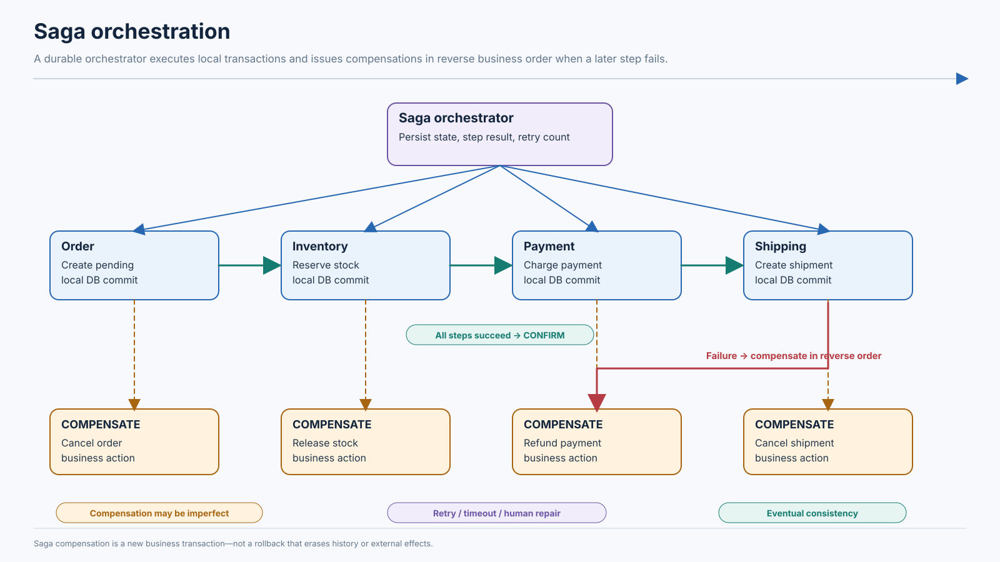

*Figure: Saga orchestration.*
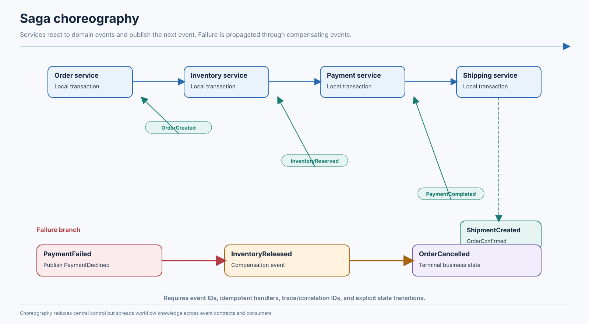

*Figure: Saga choreography.*
---

# 10. Transactional Outbox Pattern

## 10.1 The dual-write problem

A service often needs to update its database and publish an event. These are two separate writes to two systems:

```text
Database: INSERT order
Broker:   PUBLISH OrderCreated
```

Without a shared atomic transaction, there are two failure windows:

1. Database commit succeeds, then broker publish fails. The order exists but downstream services never learn about it.
2. Broker publish succeeds, then database transaction rolls back. Consumers see an event for an order that does not exist.

Publishing before commit can expose phantom events; publishing after commit can lose events if the process crashes in between. A try/catch block does not close this gap.

## 10.2 Outbox design

The **Transactional Outbox** stores the business update and the event intent in the same local database transaction.

Example schema (illustrative):

| Column | Meaning |
|---|---|
| `event_id` | Globally unique event identifier |
| `aggregate_type` | e.g. `Order` |
| `aggregate_id` | Order ID; useful as broker key |
| `aggregate_version` | Monotonic version for ordering |
| `event_type` | `OrderCreated` |
| `payload` | Event body or immutable reference to it |
| `created_at` | Database event creation time |
| `published_at` / status | Optional delivery tracking for polling publishers |

Within one local transaction:

```text
BEGIN;
  INSERT INTO orders (..., status) VALUES (..., 'PENDING');
  INSERT INTO outbox(event_id, aggregate_id, event_type, payload)
    VALUES ('evt-...', 'order-123', 'OrderCreated', ...);
COMMIT;
```

Either both the order and event intent commit or neither commits. A separate publisher reads committed outbox records and sends them to the broker.

### Publisher lifecycle

1. Business transaction commits order + outbox row.
2. Polling worker or CDC connector observes the outbox insert.
3. Publisher sends event to Kafka or another broker.
4. Publisher tracks success/offset/position or marks the row delivered.
5. Consumer receives the event and processes it idempotently.
6. Outbox retention/cleanup removes delivered records only after a safe retention period and operational policy.

A crash after broker publish but before recording the outbox row as published can produce a duplicate. Therefore, the common guarantee is **at-least-once publication**, not magical exactly-once end-to-end execution.

## 10.3 Polling versus Change Data Capture (CDC)

| Dimension | Polling publisher | CDC publisher |
|---|---|---|
| Mechanism | Repeatedly queries unpublished rows | Reads database change log/WAL/binlog/change stream |
| Latency | Depends on polling interval and batch size | Often lower and continuous, bounded by connector processing |
| Database load | Repeated index scans/updates; must tune batches | Reads transaction log; less query polling but requires connector/log infrastructure |
| Concurrency | Needs safe claiming (`SKIP LOCKED`, leases, status) and multiple-worker coordination | Connector offsets/partitioning and log position management |
| Ordering | Must deliberately preserve aggregate order | Can inherit log/partition ordering, but end-to-end order still depends on keys/topics/consumers |
| Recovery | Re-query unmarked records; duplicates possible | Resume from durable offsets; replay/duplicates possible depending on connector/broker failure window |
| Complexity | Simpler to start; table state and polling load | More operational components, permissions, retention, schema evolution, and connector monitoring |

Debezium's Outbox Event Router is a practical CDC implementation that captures outbox-table changes and routes them to topics. The general outbox pattern does not require Debezium or Kafka.

## 10.4 Idempotent consumers

The consumer should assume duplicate delivery. A robust pattern is an inbox/deduplication table written in the same local transaction as the consumer's business change:

```text
BEGIN;
  INSERT INTO processed_events(event_id) VALUES ('evt-123');
  -- unique constraint makes a duplicate detectable
  UPDATE inventory ...;
COMMIT;
```

If the event ID already exists, the transaction treats it as already processed. Do not mark an event processed in one transaction and apply its business effect in a separate unprotected transaction; a crash between them creates a lost effect or duplicate effect.

Useful mechanisms:

- Unique event ID and unique constraint.
- Idempotency key for external API calls.
- Inbox table or processed-message table.
- Version/sequence checks on an aggregate.
- Dead-letter queue for poison messages, with controlled replay.
- Stable partition key to preserve per-aggregate order.

## 10.5 Outbox operational concerns

- Alert on oldest unpublished event age and total backlog.
- Monitor publisher lag, failed sends, connector task health, and database log retention.
- Partition/ index by status and creation time for polling.
- Ensure message keys preserve ordering requirements.
- Define schema compatibility and event versioning.
- Purge only after delivery and retention/replay requirements are met.
- Avoid storing sensitive data in event payloads without appropriate controls.

The outbox solves the **database-to-message dual-write problem within one database boundary**. It does not atomically update two unrelated databases or guarantee that a consumer's external side effect occurs exactly once.

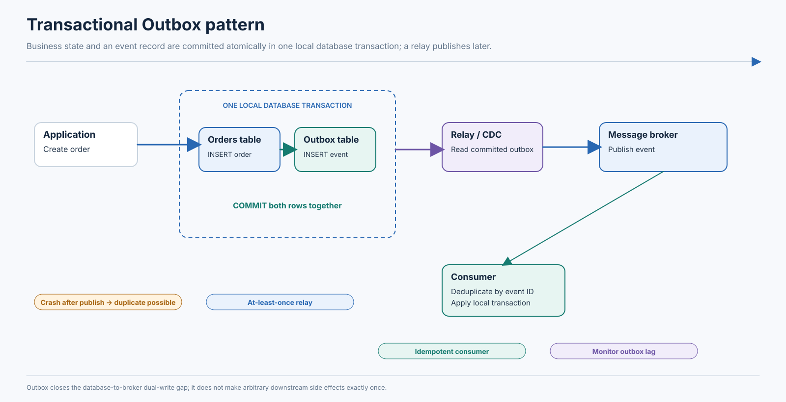

*Figure: Transactional outbox pattern.*
---

# 11. Transactional Messaging and Exactly-Once Semantics

## 11.1 Delivery semantics

- **At-most-once:** a message is delivered zero or one times; retries are avoided, so loss is possible.
- **At-least-once:** a message is retried until acknowledged; duplicates are possible.
- **Exactly-once effect:** under a clearly defined scope, the system ensures a logical effect is applied once even if messages are replayed. This normally depends on atomic state+offset handling, deduplication, or idempotent updates.

“Exactly once” must specify what is exactly once: producer publication, broker log insertion, stream-processing state, a database write, or an external payment effect. These are not interchangeable claims.

## 11.2 Kafka transactions

Kafka supports idempotent producers and transactions. A transactional producer can write records to multiple Kafka partitions/topics atomically: consumers configured to read committed data do not expose aborted transactional records. Kafka can also atomically commit consumed offsets together with produced records in a consume-transform-produce flow.

Conceptual stream-processing flow:

1. Consumer reads input records at offsets O.
2. Application computes output records.
3. Producer begins a Kafka transaction.
4. Producer writes output records.
5. Producer adds the consumed offsets to the same transaction.
6. Producer commits the transaction.

If the transaction aborts, output records are not visible to `read_committed` consumers and offsets are not committed as successful progress. After restart/rebalance, input can be processed again.

### What Kafka transactions do not automatically make atomic

If the handler also writes to an unrelated PostgreSQL database, calls a payment gateway, or sends an email, those effects are outside the Kafka transaction. A committed Kafka transaction cannot roll back a payment provider. Use an outbox/inbox, idempotent external calls, or a database-native integration strategy.

Kafka transactions are not a universal cross-system distributed ACID coordinator. Their exactly-once processing scope is strongest within Kafka's transactional log and offset model.

## 11.3 Guarantee comparison

| Mechanism | Main guarantee | Important limitation |
|---|---|---|
| At-most-once | No duplicate delivery in the configured flow | A failure can lose the message/effect |
| At-least-once | Retry until acknowledgment; eventual delivery under recovery assumptions | Duplicate delivery/processing must be handled |
| Idempotent producer | Retries from a producer session do not create duplicate broker records within the producer's supported scope | Does not make arbitrary consumer DB writes or external calls exactly once |
| Transactional messaging | Atomic visibility of a defined set of broker records and related offsets | Scope is the broker transaction; external side effects remain separate |
| Transactional outbox | Business DB update and event intent commit together | Publisher may send duplicates; consumer effects need deduplication/idempotency |
| End-to-end exactly-once effect | A logical operation is applied once across the specified system boundary | Requires a precise boundary, stable identity, atomic dedup+effect, and external-provider support or reconciliation |

## 11.4 Consumer offset and external database failure

Suppose a consumer commits Kafka offset 20 and then crashes before updating PostgreSQL. On restart, Kafka begins at offset 21, and the database update for message 20 is lost. If the consumer writes PostgreSQL first and crashes before committing offset 20, the message is replayed and the database effect may occur twice.

The usual safe approaches are:

- Store a processed event ID and the business effect in the same database transaction; commit offset only after DB commit. On replay, the unique key identifies already-applied work.
- Use the outbox pattern in the producer side and an inbox/dedup table in the consumer side.
- Use a connector or framework with a carefully scoped transactional integration, verifying its guarantees.

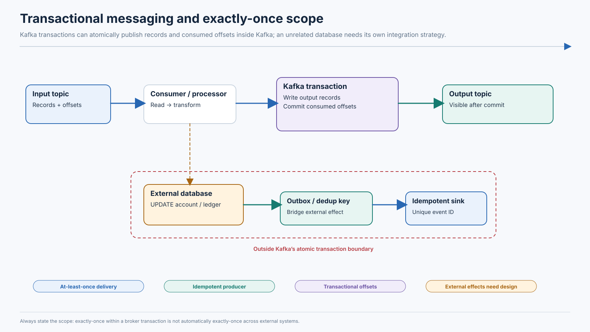

*Figure: Transactional messaging flow.*
---

# 12. TCC — Try, Confirm, Cancel

## 12.1 TCC fundamentals

**TCC** is a business-level distributed transaction pattern in which each participant implements three operations:

- **Try:** reserve or provisionally allocate the resource, validating that it is available.
- **Confirm:** make the reservation final after all participants have successfully completed Try.
- **Cancel:** release the provisional resource if the overall transaction cannot proceed.

Unlike a Saga that often performs a forward business action and later compensates it, TCC asks participants to reserve resources before final confirmation. This can provide stronger resource-reservation behavior for scarce items such as seats, rooms, or payment limits.

TCC does not automatically provide database serializability across participants. It depends on explicit participant semantics, reservation state, expiration, idempotency, and correct coordinator recovery.

## 12.2 Travel booking example

A customer requests a flight, hotel, and rental car.

| Participant | Try | Confirm | Cancel |
|---|---|---|---|
| Flight | Hold a seat/price for a bounded interval | Issue ticket/confirm reservation | Release seat/hold |
| Hotel | Hold room inventory | Confirm booking | Release room |
| Car | Hold vehicle category | Confirm rental | Release vehicle |

Flow:

1. Coordinator creates a TCC transaction ID.
2. Sends Try to Flight, Hotel, and Car participants.
3. Each participant commits a local reservation record and returns success/failure.
4. If all Try operations succeed, coordinator durably decides Confirm and sends Confirm to all.
5. If any Try fails, coordinator durably decides Cancel and sends Cancel to participants that may have reserved.
6. Participants retry Confirm/Cancel idempotently until all reach a terminal state.

### Failure scenarios

- **Flight Try succeeds, Hotel Try fails:** coordinator chooses Cancel; flight reservation is released. If Try outcome for another service is unknown, query/retry using the same transaction ID.
- **Coordinator crashes after Try:** participant reservations remain pending. On restart, coordinator recovers durable state and continues; reservation leases prevent indefinite resource retention.
- **Confirm arrives twice:** participant treats the second request as a duplicate and returns the prior result; Confirm must not issue a second ticket or charge.
- **Cancel arrives before Try:** participant records a cancellation tombstone/terminal state so a late Try cannot create an orphan reservation. This is often called empty rollback handling.
- **Participant unavailable:** coordinator retries within policy; reservations may expire, but expiry must be coordinated with transaction status to avoid cancel/confirm races.
- **Reservation expires while coordinator is deciding:** use explicit lease/token/version semantics; a late Confirm must not confirm a resource already released and reallocated.

## 12.3 Required participant state machine

An illustrative state machine:

```text
ABSENT --Try--> RESERVED --Confirm--> CONFIRMED
   |                |
   |                +--Cancel--> CANCELLED
   +--Cancel--> CANCELLED (empty rollback marker)
```

Each state transition should be idempotent and conditional on transaction ID plus version/state. A participant should distinguish duplicate delivery from conflicting terminal commands. A terminal `CONFIRMED` transaction must not later become `CANCELLED` just because an old cancellation message is replayed.

### TCC hazards

- **Empty rollback:** Cancel arrives before Try; participant must prevent a late Try from creating resources after cancellation.
- **Hanging transaction:** Try succeeded but neither Confirm nor Cancel is received. Leases, status checks, and coordinator recovery are needed.
- **Confirm/Cancel retries:** participant operations must be repeatable and safe.
- **Competing reservations:** reservation rows/locks/counters must enforce capacity.
- **Resource expiration:** expiration and final decision need a race-safe protocol.

## 12.4 TCC versus Saga

| Dimension | TCC | Saga |
|---|---|---|
| Core idea | Reserve first, then confirm or cancel | Commit local forward steps, compensate prior steps if later work fails |
| Resource reservation | Explicit provisional reservation | May reserve, or may make a forward state change immediately |
| Isolation behavior | Can shield a scarce resource during reservation; not general cross-service serializability | Intermediate states are visible; business invariants must tolerate them |
| Compensation | Cancel releases provisional resource; Confirm finalizes | Compensation is a new business operation after a committed step |
| Lock/resource duration | Reservation/lease can hold capacity for workflow duration | Depends on forward actions and compensation policy |
| Availability | Participant must support Try/Confirm/Cancel and status recovery | Services can often progress independently with local commits/events |
| Complexity | Higher participant complexity, empty rollback, hanging transaction and lease races | Orchestration/event state, compensation, duplicate handling |
| Best fit | Scarce capacity, payment authorization, seat/room inventory | Order fulfillment, account provisioning, multi-step workflows where eventual compensation is acceptable |

TCC often gives stronger reservation semantics than a loose Saga, but only because participants explicitly implement a reservation protocol. It is not a universal replacement for Sagas.

## 12.5 Production applications

TCC-style designs are useful for inventory allocation, payment authorization/credit reservation, flight/hotel booking, and distributed commerce. For payment, Try may authorize or reserve funds rather than capture them; Confirm captures/settles; Cancel voids the authorization. Real payment networks and providers expose their own lifecycle semantics, so the TCC participant must map to the provider's documented operations and reconcile unknown outcomes.

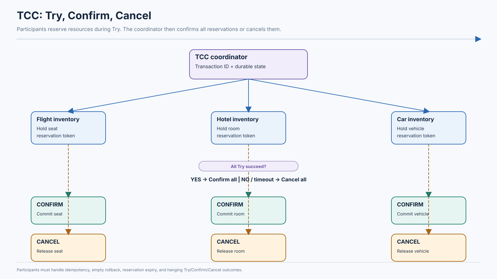

*Figure: Tcc try confirm cancel.*
---

# 13. Percolator Transaction Model

## 13.1 Historical context and core idea

Google's Percolator was introduced for large-scale incremental processing over Bigtable. The motivation was to process small independent mutations continuously instead of repeatedly rebuilding large datasets through batch MapReduce jobs. The original paper describes using distributed transactions and notifications for incremental web indexing.

Percolator is a transactional protocol layered over a distributed storage substrate. It uses timestamps and a two-phase commit-like protocol with primary and secondary locks. The description below is conceptual; TiDB/TiKV and other descendants are Percolator-inspired but should not be assumed to implement the original system unchanged.

## 13.2 Core metadata

- **Timestamp oracle (TSO):** allocates monotonically ordered timestamps used to establish transaction start and commit versions.
- **`start_ts`:** timestamp defining the transaction's snapshot.
- **`commit_ts`:** timestamp assigned when the transaction commits.
- **Primary lock:** one chosen lock acts as the authoritative transaction status record.
- **Secondary locks:** locks on other modified keys point to the primary record.
- **Prewrite:** write tentative data and locks, checking for conflicts.
- **Commit:** commit the primary record at a commit timestamp; secondary lock cleanup can proceed after the primary decision is known.

A simplified Percolator storage layout uses columns/records analogous to `data`, `lock`, and `write`:

- Data stores values by key and timestamp.
- Lock metadata describes active prewrite state.
- Write metadata maps a committed version to the transaction's start timestamp.

## 13.3 Transaction walkthrough

Suppose a transaction changes key X on storage node A and key Y on node B.

1. Obtain `start_ts=100` from the timestamp oracle.
2. Read X and Y at snapshot 100.
3. Compute new X and Y values.
4. Select X as primary (the choice is stable for this transaction).
5. **Prewrite X:** verify no conflicting lock/newer committed write; write the new value provisionally and place primary lock.
6. **Prewrite Y:** perform equivalent conflict check; write value provisionally and place secondary lock referencing X.
7. If any prewrite fails, roll back/resolve the transaction and clear its locks according to protocol.
8. If all prewrites succeed, obtain `commit_ts=120`.
9. Commit the primary: remove/replace primary lock with a committed write record at commit timestamp 120.
10. Resolve secondary locks. This cleanup can be asynchronous because the primary record determines whether the transaction committed.

### Why the primary matters

If a reader encounters a secondary lock, it can locate the primary record and ask whether the transaction committed. If the primary is committed, the reader can treat the value as committed at `commit_ts` even if the secondary lock has not yet been physically cleaned up. If the primary is rolled back or absent under the relevant recovery rules, the secondary can be resolved accordingly.

The primary reduces the need for all secondaries to be atomically cleaned up at precisely the same instant. Logical commit status is determined by the authoritative primary/transaction record, while cleanup may lag.

## 13.4 Failure scenarios

| Failure | Expected handling (conceptual Percolator family) |
|---|---|
| Coordinator crashes before prewrite | No locks may exist; transaction can be abandoned/aborted safely. |
| Coordinator crashes after some prewrites | Locks remain; another transaction/reader may resolve by checking primary status and applying rollback rules after determining the transaction did not commit. |
| Primary commit succeeds, secondary cleanup incomplete | Transaction is logically committed; readers resolve secondaries through primary status; background cleanup completes later. |
| Reader encounters unresolved lock | Reader checks primary transaction status, may wait, help resolve, or return/retry depending on implementation. |
| Timestamp oracle unavailable | New transaction start/commit timestamp allocation may stall; timestamp service availability/monotonicity matters. |
| Concurrent conflicting write | Prewrite detects lock or a newer committed version and aborts/conflicts according to timestamp rules. |

## 13.5 Modern connections

TiDB's transaction model is inspired by Percolator and uses timestamped MVCC with prewrite/commit concepts. Modern TiDB also supports optimistic and pessimistic transaction modes and has evolved beyond the original research implementation. TiKV documentation describes the two-phase `Prewrite`/`Commit` protocol, primary/secondary locks, and timestamp oracle concepts.

Do not equate the original Percolator deployment architecture with current TiDB internals. The useful architectural idea is the interaction between snapshot reads, timestamp ordering, prewrite locks, a primary transaction record, and recoverable lock resolution.

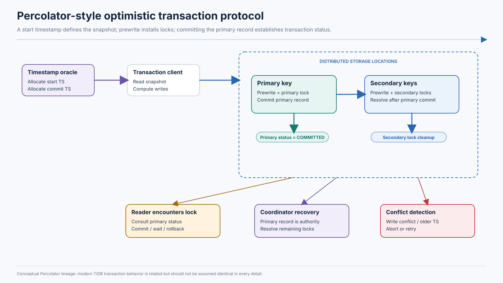

*Figure: Percolator transaction protocol.*
---

# 14. Calvin — Deterministic Database Transactions

## 14.1 Motivation

Traditional distributed transaction execution may discover conflicts and coordinate participants at runtime. Calvin takes a different approach: it first establishes a deterministic global order of transactions, then executes transactions according to that order across partitions. Knowing the order in advance can reduce coordination during execution and make replicas execute the same serial-equivalent history.

Calvin's architecture is commonly described in three layers:

1. **Sequencing layer:** accepts transaction inputs and places them in a globally agreed order; the input sequence is replicated/logged.
2. **Scheduling layer:** uses deterministic locking/scheduling so transactions execute in the order required by the sequence while independent work can run concurrently.
3. **Storage layer:** provides the physical key/value or relational data layout.

## 14.2 Bank transfer walkthrough

Accounts A and B are on partitions P1 and P2. A transfer T debits A and credits B.

1. Client submits T with deterministic transaction logic and inputs.
2. Sequencer assigns T position 417 in the transaction order.
3. Replicas/partitions learn the same ordered input sequence.
4. Transaction's read/write set or required keys are determined according to the Calvin execution model; the system may use declared stored procedures or deterministic input to resolve access patterns.
5. Scheduler acquires locks in a deterministic order to avoid conflicting transactions deadlocking in inconsistent lock orders.
6. P1 and P2 execute their portions of T consistent with sequence position 417.
7. T becomes visible when its ordered execution and required replication/durability conditions are satisfied.

If T2 is sequenced after T1 and conflicts with it, the scheduler enforces the required order. Transactions that do not conflict may execute in parallel while preserving the global serial order.

## 14.3 Why sequencing helps

If all replicas know the same transaction order, they do not need to independently discover a conflicting serial order at commit time. Deterministic execution reduces certain forms of runtime coordination and can reduce aborts caused by late conflict discovery.

It does not mean “no coordination.” The sequencing layer itself is a coordination point and must replicate/order transaction inputs. Distributed reads/writes and lock management still require communication. The transaction logic and inputs must be sufficiently deterministic for replicas to produce the same effects.

## 14.4 Trade-offs

- **Determinism requirement:** transactions should not depend on unrecorded nondeterminism such as local wall-clock time, arbitrary random numbers, or uncontrolled external reads. Such values need to be captured as inputs or otherwise made deterministic.
- **Sequencing latency:** transactions may wait for an ordering position before execution.
- **Access-set knowledge:** execution benefits when data access requirements are known/declared; dynamic branching that discovers new keys can complicate scheduling.
- **Hot partitions:** deterministic ordering cannot eliminate a true hot-key bottleneck.
- **Replication and sequencing availability:** the sequencer/order log must remain available under its fault model.
- **Workload fit:** deterministic OLTP workloads can benefit; highly interactive transactions with unpredictable external dependencies may be harder to express.

### Calvin compared with 2PC and OCC

- 2PC coordinates a commit decision after participants perform work/preparation.
- OCC runs work and validates conflicts before commit; conflicts may force retries.
- Calvin orders transactions first and schedules execution to obey that order, shifting coordination earlier into sequencing.

Calvin is not simply a faster form of 2PC. It is a transaction-processing architecture with a different execution model.

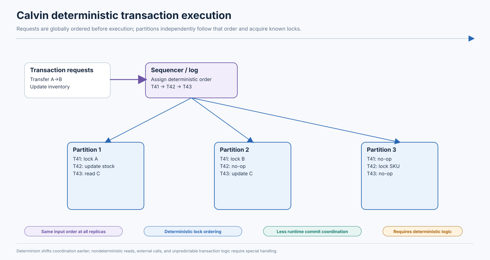

*Figure: Calvin deterministic execution.*
---

# 15. Spanner-Style Distributed Transactions

## 15.1 Architecture overview

Google Spanner is a globally distributed, synchronously replicated, multi-version database that supports distributed transactions and external consistency. Data is divided into **splits** served by groups of replicas. Replication groups use Paxos-based replication; a transaction touching multiple groups needs coordination across those participants.

Concepts to distinguish:

- **Paxos group:** replicates a shard/split's state and chooses a durable ordered log.
- **Transaction coordinator:** coordinates a read-write transaction that touches multiple participant groups.
- **TrueTime:** exposes a bounded uncertainty interval for time, rather than pretending physical clocks are perfectly synchronized.
- **MVCC timestamp:** defines transaction visibility/order.
- **Commit wait:** waits until the assigned commit timestamp is definitely in the past according to the time API, helping establish external consistency.

This is a product architecture, not a universal recipe for all distributed SQL databases.

## 15.2 TrueTime and external consistency

Physical clocks can differ because of oscillator drift, synchronization delay, network delay, and failures in time sources. A clock reading should therefore be treated as uncertain.

TrueTime is often described conceptually as an interval:

\[
TT.now() = [earliest, latest]
\]

The actual time is guaranteed to lie within the interval under the system's assumptions. Let the uncertainty be:

\[
\epsilon = \frac{latest-earliest}{2}
\]

(For a symmetric illustration; real bounds need not be represented this way.)

Suppose transaction T1 is assigned commit timestamp 10:00:00.100, while TrueTime returns `[10:00:00.096, 10:00:00.104]`. The system waits until the lower bound of a later TrueTime interval is greater than 10:00:00.100. Only then is it certain that the commit timestamp is in the past. This is the intuitive role of commit wait.

### External consistency

Serializability says transactions behave as if executed in some serial order. **External consistency** additionally requires that serial order respects real-time order of transactions: if T1 completes before T2 begins, T1 must appear before T2 in the serialization order.

This is stronger than ordinary serializability. If a client sees T1 complete, a later transaction T2 cannot be assigned a timestamp that places it before T1.

Do not confuse external consistency with perfect clock synchronization. Spanner accounts for bounded uncertainty and waits where needed; it does not assume every machine's physical clock is identical.

## 15.3 Distributed read-write transaction

Assume a transaction transfers value between records in two different Paxos groups, G1 and G2.

1. Client starts a read-write transaction.
2. Transaction reads data and acquires the relevant locks/records its intent according to the transaction protocol.
3. A coordinator is selected among participants (implementation details vary by transaction and product version).
4. Participant groups prepare their work and make necessary state durable through their replicated groups.
5. Coordinator determines/records the global commit decision.
6. Commit timestamp is chosen consistent with ordering constraints and participant state.
7. Commit wait ensures the timestamp is safely in the past relative to TrueTime uncertainty.
8. Commit becomes externally visible according to the protocol, and client receives acknowledgment.
9. If coordinator fails, replicated logs/transaction metadata and participants' prepared state enable recovery of the decision.

Replication and transaction coordination solve different layers: Paxos replicates each group's state; multi-group transaction coordination ensures one transaction touching G1 and G2 has one coherent commit decision and timestamp.

## 15.4 Read-only transactions

Read-only transactions do not write data and can often avoid acquiring the same write locks or running the full read-write commit protocol. They read at a timestamp that gives a consistent snapshot across data groups. Spanner supports timestamp-based reads and stale reads with defined staleness choices; the exact mode determines freshness/coordination trade-offs.

The value of MVCC is that an old committed version can be read while newer writes proceed. A consistent timestamp across groups prevents read skew. A bounded-staleness read may trade freshness for lower coordination/latency, but the staleness contract must be explicit.

## 15.5 Product comparison

| System | Transaction/coordination model | Isolation/consistency notes | Important caveat |
|---|---|---|---|
| Google Spanner | Distributed read-write transactions across Paxos groups; TrueTime/commit timestamps; MVCC | Serializable and external consistency by default for relevant read-write transactions | Strong guarantee has WAN/commit-wait and schema/transaction design trade-offs; details vary by API/read mode |
| CockroachDB | Distributed transactions with replicated ranges and timestamp/transaction records; retryable serializable execution | Serializable by default | Client must handle retry errors and ambiguous outcomes appropriately; long transactions/contended keys remain costly |
| TiDB | TiDB SQL layer + TiKV distributed storage; timestamp oracle and Percolator-inspired transaction protocol; optimistic/pessimistic modes | Supports documented Snapshot/Repeatable Read and Read Committed modes; configuration/version matters | Do not assume original Percolator exactly; transaction mode and retry semantics changed across releases |
| YugabyteDB | Distributed DocDB transaction manager, transaction status tablet, provisional records, hybrid time; Raft replication | Documents Snapshot, Serializable, and Read Committed mappings | Cross-tablet transactions add coordination; single-tablet fast paths differ from distributed path |
| Traditional sharded relational DB | Application routes requests to shards; cross-shard 2PC or application-level orchestration | Depends heavily on middleware and engine | Cross-shard operations can be operationally complex and may have weaker guarantees than one database transaction |
| Dynamo-style NoSQL | Often favors partition-local operations, quorum/reconciliation, conditional writes, or limited transaction APIs | Product-specific; many designs emphasize availability/partition behavior and eventual convergence | Do not assume arbitrary relational multi-row ACID semantics; identify transaction scope and conflict model precisely |

## 15.6 Geographic latency

A transaction that spans regions must communicate with remote leaders/replicas and often wait for replicated durability. If a coordinator and participants are geographically distant, network round trips dominate local computation. Strong global ordering can require waiting for the slowest relevant participant or a safe timestamp condition. Data placement, locality, transaction size, and read/write ratio matter as much as raw database throughput.

A strong global transaction is appropriate when correctness requires it; it should not be used reflexively for every workflow. Keep globally coordinated transactions small and colocate data that is commonly updated together when product topology allows.

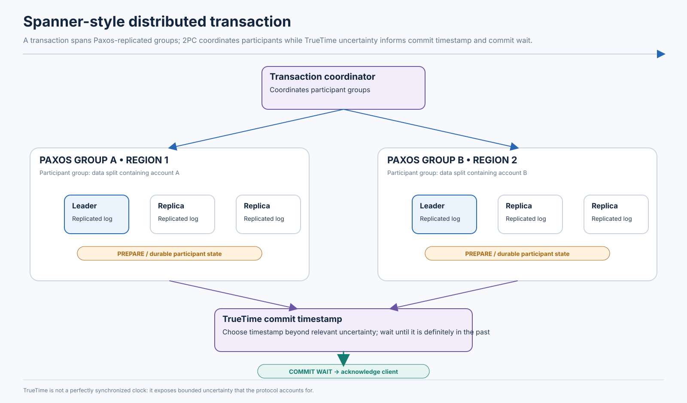

*Figure: Spanner distributed transaction.*
---
# 16. Comparing Distributed Transaction Approaches

The following approaches solve different portions of the problem. A local ACID transaction groups writes inside one database engine; 2PC coordinates atomic commit; Saga coordinates business-level forward/compensation steps; Outbox reliably records event intent with local data; TCC reserves resources; Percolator, Calvin, and Spanner-style systems are database transaction architectures.

| Approach | Transaction scope | Atomicity model | Isolation model | Coordination mechanism | Blocking/abort behavior | Best use case |
|---|---|---|---|---|---|---|
| Local ACID | One database transaction manager | Engine-level all-or-nothing | Engine's selected isolation | Local locks/MVCC/log | Waits, deadlocks, serialization aborts | One service's relational invariants |
| 2PC | Multiple transaction participants | Global commit/abort decision | Not defined by 2PC; separate concurrency control | Coordinator + prepare/vote + durable decision | Can block prepared participants if decision is unknown | Short distributed DB transactions requiring atomic commit |
| 3PC | Multiple participants | Commit/abort protocol with extra phase | Not defined by 3PC | CanCommit, PreCommit, DoCommit | Progress under stronger timing assumptions; unsafe to generalize to arbitrary partitions | Specialized systems with bounded-delay failure assumptions |
| Saga orchestration | Multiple service-local transactions | Forward steps + compensations; eventual business recovery | No automatic global isolation | Durable central workflow state machine | Steps commit independently; compensation can fail/retry | Complex checkout, fulfillment, travel workflow |
| Saga choreography | Multiple service-local transactions | Event-driven forward/compensation actions | No automatic global isolation | Domain events and local handlers | Duplicate/out-of-order delivery and distributed recovery | Simple loosely coupled event reactions |
| Transactional Outbox | One service DB plus event publication | Atomic local DB + event intent; usually at-least-once delivery | Local DB isolation; no cross-service isolation | Polling or CDC publisher | Publisher retries/duplicates; consumer dedup required | Reliable state change notifications |
| TCC | Multiple resource participants | Try reservations + global Confirm or Cancel | Participant-defined reservation semantics; not general serializability | Coordinator and participant state machines | Hanging reservations, retries, empty rollback | Scarce resource allocation and payment authorization |
| Percolator | Multi-key distributed storage transaction | Timestamped prewrite/commit with primary lock | Snapshot Isolation-style model in classic description, implementation-specific additions | Timestamp oracle, primary/secondary locks | Conflicts abort; lock resolution/recovery after coordinator failure | Large distributed incremental data systems / Percolator-inspired KV transactions |
| Calvin | Distributed deterministic transaction processing | Transactions executed in globally sequenced serial-equivalent order | Deterministic serial execution model | Replicated sequencer + deterministic scheduler | Queues behind sequence/locks; sequencing availability matters | Predictable high-throughput OLTP workloads |
| Spanner-style | Globally distributed database transaction | Distributed commit across replicated groups | Serializable; external consistency with TrueTime-style ordering | Paxos groups, transaction coordinator, timestamp/commit wait | Waits/aborts on conflicts; WAN/replication latency | Global relational transactions requiring strong ordering |

### Why they are not interchangeable

- **Outbox is not distributed commit:** it atomically stores a local event intent with local data. It does not atomically commit arbitrary writes to several databases.
- **Saga is not rollback:** compensation is a new business operation and may be delayed, partial, or impossible.
- **TCC is not simply a Saga with different names:** Try must establish a provisional reservation that Confirm/Cancel resolves.
- **2PC is not Serializable:** 2PC ensures one commit/abort outcome; the participants still need concurrency control that guarantees the required isolation.
- **Percolator, Calvin, and Spanner differ architecturally:** Percolator uses timestamped locks/prewrite/commit; Calvin orders transactions before deterministic execution; Spanner combines MVCC, replicated groups, distributed transaction coordination, and bounded clock uncertainty for external consistency.

---

# 17. Choosing the Right Transaction Architecture

Start with business invariants, not with a favorite protocol. Ask: what must be true at every externally visible point? Which data is owned by one service? Can the business tolerate a pending state? Is a scarce resource reservable? What is the required recovery time? Which failures must be survived without operator intervention?

## 17.1 Banking and financial transfers

**Requirements:** no one-sided transfer, durable audit trail, idempotent initiation, defined balance/overdraft rules, strong isolation for account/ledger invariants, reconciliation, and controlled reversal/refund semantics.

**Recommendation:** keep ledger postings within one strongly transactional database boundary where possible. If debit and credit must span partitions in one distributed database, use the database's supported distributed ACID transaction and appropriate isolation. Persist a unique transfer ID and immutable ledger entries; use balanced debit/credit records and reconciliation jobs. If an external payment rail is involved, treat it as a separate business participant with states such as submitted, accepted, settled, rejected, and unknown; use idempotent provider references and reconciliation.

**Alternatives:** a Saga can coordinate external rail operations but does not replace atomicity inside the ledger. Avoid using eventual consistency for the core double-entry invariant. The recommendation changes if the business explicitly accepts pending/clearing states and has a legally/operationally defined settlement workflow.

## 17.2 E-commerce checkout

**Requirements:** reserve stock, collect/authorize payment, create shipment, avoid duplicate charge, and communicate pending status.

**Recommendation:** Saga orchestration for the lifecycle, local ACID in each service, Outbox for every service that emits events, inbox/idempotency at consumers, and TCC-like holds for high-contention inventory/payment resources when participants support them. Use a durable order state machine.

**Alternatives:** a single distributed SQL transaction can be attractive if all critical data lives in one database product and the workflow is short. It is a poor fit when payment gateways and carriers participate. The recommendation changes for low-value digital goods with no inventory/fulfillment, where the flow can be shorter.

## 17.3 Ticket booking

**Requirements:** a seat cannot be sold twice; last-seat contention is high; reservations expire; payment may be asynchronous.

**Recommendation:** conditional atomic reservation or TCC hold with expiry, a unique constraint on active seat assignment, idempotent confirm/cancel, and reconciliation between booking and payment. Serialize the seat/flight/date key, not the entire platform.

**Alternatives:** optimistic version checks work when contention is low; hot on-sale events may need queueing/partitioned admission control. A pure Saga that captures payment and only later tries to reserve a seat is risky.

## 17.4 Microservice order processing

**Requirements:** independent teams/deployments, long-running fulfillment, durable events, explicit recovery, and customer-visible intermediate states.

**Recommendation:** Saga orchestration plus local transactions and Outbox/Inbox. Choreography is appropriate for peripheral reactions such as notification and analytics. Keep business workflow state versioned and observable.

**Alternatives:** a shared transactional database may simplify a small system, but it increases coupling and weakens service ownership. The recommendation changes as the workflow becomes shorter or more services need to own their own data.

## 17.5 Global financial application

**Requirements:** multi-region availability, globally ordered financial state, strong cross-region transactions, auditability, and controlled commit latency.

**Recommendation:** evaluate a distributed SQL database with documented serializable/external consistency guarantees, region-aware data placement, and synchronous replication. Keep transaction scope small and co-locate related records. Define region failure and quorum requirements explicitly.

**Alternatives:** partition by account/customer and keep most transfers local; use asynchronous cross-region settlement with explicit pending states if business/regulatory rules permit. The recommendation changes if cross-region atomicity is rare and latency sensitivity dominates.

## 17.6 Selection checklist

| Question | Architectural implication |
|---|---|
| Must all writes become visible atomically across databases? | Use an actual supported distributed transaction protocol/database; Saga is not equivalent |
| Is the workflow long-running or dependent on external providers? | Prefer durable Saga/TCC and explicit business state |
| Is a scarce resource being allocated? | Use conditional atomic update, lock, or TCC reservation |
| Is a database update coupled to event publication? | Use transactional outbox/CDC or an equivalent atomic integration |
| Are duplicates possible? | Stable IDs, idempotency keys, inbox/dedup, and unique constraints |
| Is the invariant cross-row/predicate-based? | Evaluate Serializable or a shared guard/constraint design; SI may permit write skew |
| Is cross-region real-time order required? | Evaluate externally consistent distributed database and accept its latency cost |
| Can intermediate states be visible? | Make them first-class business states with SLAs and recovery paths |
| Can compensation truly reverse the effect? | If not, design forward recovery, manual review, or irreversible-step ordering |

---

# 18. Operational Challenges and Production Troubleshooting

Distributed correctness is not finished at design time. Operations teams must detect stuck decisions, retries, unresolved reservations, storage-retention pressure, and events that are no longer making progress.

## 18.1 Core metrics

| Area | Useful metrics |
|---|---|
| Transaction latency | p50/p95/p99 begin-to-commit latency; participant RPC latency; commit-wait duration |
| Commit protocol | prepare duration, prepared transaction count/age, in-doubt count, coordinator recovery count |
| Concurrency | lock wait time, deadlock rate, conflict rate, serialization abort rate, retry attempts per transaction |
| MVCC | oldest active snapshot, version/undo retention, vacuum/purge/GC lag, dead tuple/version count |
| Saga | active Sagas by state/age, step retry count, timeout count, compensation backlog/failure rate |
| Messaging | consumer lag, broker publish failures, duplicate rate, DLQ volume, outbox oldest-event age/backlog |
| TCC | reservations by state/age, expired holds, unresolved Try operations, Confirm/Cancel retry age |
| Reliability | coordinator election/restart, participant unavailability, region RTT, clock uncertainty where exposed, ambiguous outcomes |

Correlate metrics with transaction IDs, Saga IDs, trace IDs, event IDs, and business IDs. Avoid putting raw customer/payment data in logs.

## 18.2 Troubleshooting playbooks

### 1. Distributed transaction remains prepared

- **Symptoms:** prepared transaction count rises; locks remain held; other transactions wait; participants report in-doubt state.
- **Likely causes:** coordinator crash after prepare, network partition, lost decision message, unavailable coordinator log/metadata.
- **Metrics:** prepared count and oldest age, coordinator health, participant log state, lock wait, network failures.
- **Investigation:** identify global transaction ID; inspect coordinator and participant durable logs/status; determine whether a COMMIT/ABORT decision was durably recorded.
- **Immediate mitigation:** restore coordinator connectivity/recovery; do not manually abort a prepared participant without proving the global decision. Use vendor-supported recovery tooling.
- **Prevention:** replicate coordinator decision state, alert on prepared age, test failover, and cap transaction duration.

### 2. Payment succeeds but order remains pending

- **Symptoms:** provider dashboard shows charge; order state is `PENDING_PAYMENT` or `PAYMENT_UNKNOWN`.
- **Likely causes:** provider response lost, consumer/outbox backlog, event handler crash, duplicate-dedup bug, orchestration state update failed.
- **Metrics:** payment-provider status, payment idempotency key, outbox lag, consumer lag, Saga step age.
- **Investigation:** query provider using the stable payment intent/reference; inspect event ID, outbox row, inbox/dedup record, and Saga history.
- **Immediate mitigation:** reconcile status; if captured, advance workflow or start refund policy; do not issue a new charge with a new key.
- **Prevention:** persist payment intent before call, use provider idempotency, transactional outbox, and reconciliation jobs.

### 3. Event is published twice

- **Symptoms:** duplicate emails, inventory decremented twice, repeated downstream actions.
- **Likely causes:** publisher crashed after send before marking delivered; broker redelivery; consumer committed effect but not offset/ack; connector replay.
- **Metrics:** duplicate event IDs, producer retries, rebalance count, consumer retry count.
- **Investigation:** compare event IDs and aggregate versions; trace the first and repeated delivery; inspect consumer transaction boundary.
- **Immediate mitigation:** deduplicate by event ID; repair duplicated business effects with a controlled compensating action.
- **Prevention:** inbox unique constraint, idempotent commands, and atomic dedup+effect transaction.

### 4. Saga compensation fails

- **Symptoms:** order cancellation is pending but inventory/payment remains reserved/captured.
- **Likely causes:** participant unavailable, refund/void rejected, expired token, non-idempotent compensation, compensation not modeled for a partial state.
- **Metrics:** compensation attempts/age, participant error classes, reservation state, payment provider state.
- **Investigation:** read Saga history and participant state; determine whether compensation is retryable or requires business intervention.
- **Immediate mitigation:** keep Saga in `COMPENSATION_PENDING`/`MANUAL_REVIEW`; retry safe operations; alert operations/finance.
- **Prevention:** define compensation before launch, make it idempotent, and test partial/ambiguous states.

### 5. Serializable transactions frequently abort

- **Symptoms:** elevated serialization errors and request retries; p99 latency increases.
- **Likely causes:** hot rows/predicates, broad read sets, long transactions, overlapping business invariants, poor key distribution.
- **Metrics:** abort rate by query/transaction type, conflict graph/serialization diagnostics if available, retry count, lock and contention metrics.
- **Investigation:** group failures by query shape and keys; identify overlapping reads/writes; inspect whether invariant can be localized.
- **Immediate mitigation:** add bounded exponential backoff with jitter; reduce transaction size; avoid retrying non-idempotent external actions.
- **Prevention:** index predicates, partition workload, use atomic counters/guard rows, and redesign high-contention invariants.

### 6. Transaction waits on a lock across database nodes

- **Symptoms:** long lock waits and distributed RPC latency; queueing on one shard.
- **Likely causes:** hot key, long transaction, remote participant/leader slow, lock held during application think-time.
- **Metrics:** lock wait by key/tablet, transaction age, RPC RTT, leader load, hot range utilization.
- **Investigation:** inspect blocking transaction and its query/trace; map hot keys to partitions; verify participant leader health.
- **Immediate mitigation:** cancel safely identified runaway transactions; throttle hot-key writers; route traffic to appropriate leaders.
- **Prevention:** keep transactions short, colocate correlated data, use bounded admission control, and avoid external I/O under locks.

### 7. Coordinator failure leaves participants uncertain

- **Symptoms:** prepared/in-doubt transactions, unresolved intents, blocked reads/writes.
- **Likely causes:** failed coordinator host, unavailable replicated transaction record, incomplete failover, partition.
- **Metrics:** coordinator leader changes, unresolved transaction count, decision-log replication, participant wait time.
- **Investigation:** locate authoritative decision record and distinguish no decision from COMMIT/ABORT.
- **Immediate mitigation:** recover/replace coordinator and replay decision messages; follow product guidance for in-doubt resolution.
- **Prevention:** durable replicated decision metadata, tested recovery, and bounded transaction scope.

### 8. Cross-region transactions have high latency

- **Symptoms:** commit p99 correlates with remote region RTT; slowdowns during WAN congestion.
- **Likely causes:** participants span distant leaders, synchronous replication waits on far quorum, commit-wait uncertainty, too many round trips.
- **Metrics:** per-region network RTT/loss, participant count, prepare/commit duration, commit-wait duration, replica lag.
- **Investigation:** map each transaction's read/write participants and placement; determine which stage dominates latency.
- **Immediate mitigation:** route region-local transactions locally; reduce participant count; avoid unnecessary read-write transactions for read-only paths.
- **Prevention:** locality-aware schema/placement, group related data, use bounded-staleness reads where acceptable, and design regional workflows explicitly.

### 9. MVCC version storage grows rapidly

- **Symptoms:** table/undo/version storage expands; vacuum/GC lag; reads become slower.
- **Likely causes:** long-lived snapshots, idle transactions, high update churn, retention/log consumer lag, insufficient cleanup capacity.
- **Metrics:** oldest transaction/snapshot, dead tuples, undo history length, GC safe point, vacuum throughput, disk growth.
- **Investigation:** find oldest snapshots and idle-in-transaction sessions; correlate write churn and maintenance lag.
- **Immediate mitigation:** terminate clearly abandoned transactions under operational policy; increase cleanup capacity; protect required backups/replication slots before changing retention.
- **Prevention:** transaction timeouts, query/report isolation, vacuum/GC monitoring, and workload-aware maintenance.

### 10. Outbox publisher falls behind

- **Symptoms:** growing unpublished row count; downstream services see stale state; broker consumer lag may remain low because messages are not yet published.
- **Likely causes:** publisher crash, DB polling query regression, CDC connector paused, log retention issue, broker throttling.
- **Metrics:** oldest outbox age, row count, publisher throughput/error rate, CDC offset lag, database WAL/binlog retention, broker send latency.
- **Investigation:** identify whether backlog is before broker (outbox/CDC) or after broker (consumer); inspect connector task/offset and query plan.
- **Immediate mitigation:** restart/scale publisher safely, fix broker credentials/quota, or reduce batch contention; preserve event ordering.
- **Prevention:** alert on age not just count, capacity-test peak bursts, retain logs long enough, and define safe replay procedures.

### 11. TCC reservation remains unresolved

- **Symptoms:** inventory/seat/credit remains held; transaction has no terminal state.
- **Likely causes:** coordinator lost, Confirm/Cancel messages dropped, lease expiry race, participant unavailable, empty rollback bug.
- **Metrics:** reservation age/state, coordinator heartbeat, confirm/cancel attempts, expiry count, unresolved transaction count.
- **Investigation:** query coordinator decision and participant reservation by transaction ID; compare lease/token version.
- **Immediate mitigation:** recover durable decision; resend idempotent Confirm/Cancel; manually reconcile only with evidence.
- **Prevention:** lease-based reservation, empty rollback tombstones, retryable state machine, and alert on old holds.

### 12. Consumer commits offset but fails to update external database

- **Symptoms:** message is not replayed, but business row is missing/stale.
- **Likely causes:** offset committed before DB transaction; exception swallowed; acknowledgment ordering bug.
- **Metrics:** consumed offsets versus processed-event table, DB write errors, event-to-state reconciliation count.
- **Investigation:** compare broker offsets with event IDs in inbox/business tables; inspect consumer acknowledgment order.
- **Immediate mitigation:** replay from a safe offset or repair from durable event log using deduplication.
- **Prevention:** commit DB effect before offset, atomically dedup+apply in DB, or use a supported transactional integration.

## 18.3 Production readiness checklist

- Every cross-service operation has a stable transaction/workflow ID and correlation ID.
- Every retryable command has a stable idempotency key.
- Every message has a unique event ID and schema version.
- Event publication is coupled to local data using Outbox or an equivalent mechanism.
- Consumer deduplication and business effect share one local transaction where feasible.
- Unknown outcomes are distinct from definitive failures.
- Saga/TCC state is durable and restartable.
- Compensation/forward-recovery logic is defined and tested.
- Prepared transactions, old snapshots, locks, outbox lag, Saga age, and reservation age are monitored.
- Runbooks distinguish safe automated retries from manual reconciliation.
- Chaos tests cover coordinator, participant, broker, and region failures.
- Audit records are immutable and sufficient to reconstruct financial/business decisions.

---

# 19. Quantitative Reasoning and Worked Examples

All numbers below are **hypothetical estimates** intended to teach the calculation. They are not performance claims for a named product.

## 19.1 Network-round-trip contribution to transaction latency

Assume one cross-region RTT is 80 ms, local durable log flush is 4 ms, and application/database processing is 6 ms. A simplified protocol path with two sequential remote round trips has approximate latency:

\[
L \approx 2(80) + 4 + 6 = 170\text{ ms}
\]

If the protocol requires three sequential WAN RTTs:

\[
L \approx 3(80) + 4 + 6 = 250\text{ ms}
\]

**Interpretation:** reducing one sequential WAN round trip can be more valuable than shaving several milliseconds of local computation. Real systems pipeline messages, parallelize participants, batch log writes, and encounter variable tail latency; count sequential dependencies rather than simply multiplying every message by RTT.

## 19.2 2PC round-trip model

Assume coordinator-to-participant RTT is 12 ms within a region. A simplified prepare request/vote round trip costs 12 ms, and commit request/ack round trip costs another 12 ms. Add 5 ms local prepare persistence and 5 ms final commit persistence:

\[
L_{2PC} \approx 12 + 5 + 12 + 5 = 34\text{ ms}
\]

This excludes client-to-coordinator time, quorum replication, queueing, participant skew, and recovery. The slowest participant often determines phase completion, so if three participants have RTTs 8, 12, and 40 ms, the phase may be gated by the 40 ms path.

## 19.3 Coordinator failure probability and recovery impact

Suppose a coordinator has an illustrative independent crash probability of 0.001 per transaction attempt. In one million attempts, expected crash occurrences are:

\[
1{,}000{,}000 \times 0.001 = 1{,}000
\]

If 2% of those occur after participants have prepared, expected in-doubt cases are:

\[
1{,}000 \times 0.02 = 20
\]

The lesson is not that 20 is a universal expected incident count. The lesson is that a small failure probability can still produce operationally meaningful in-doubt cases at high volume. Durable decisions and automated recovery matter even when coordinator crashes are rare.

## 19.4 Lock-holding time across remote calls

A local transaction normally holds a row lock for 8 ms. A poor design adds a 700 ms inventory call and a 1,200 ms payment call before commit:

\[
T_{hold}=8+700+1200=1908\text{ ms}
\]

Lock duration increases by:

\[
\frac{1908}{8}=238.5\times
\]

Even if calls are parallel, the lock is held for the longest call plus overhead. Long lock durations increase queueing, deadlocks, and tail latency. Persist a workflow state and release database locks before external calls.

## 19.5 MVCC version retention estimate

Assume a table generates 12,000 obsolete row versions per second, average version footprint 180 bytes, and the oldest active snapshot prevents cleanup for 900 seconds.

\[
V = 12{,}000 \times 900 = 10{,}800{,}000\text{ versions}
\]

\[
S = 10{,}800{,}000 \times 180 = 1{,}944{,}000{,}000\text{ bytes}
\]

That is approximately 1.94 GB decimal (before index, page, alignment, and storage amplification). A long-running snapshot can therefore retain substantial obsolete data even if the application is otherwise healthy.

## 19.6 Conflict probability and retries

For a simplified model, suppose a transaction has probability `p=0.08` of conflicting on any attempt, independently of previous attempts. Probability of success on one attempt is `1-p=0.92`.

Expected attempts until success for a geometric model:

\[
E[A] = \frac{1}{1-p}=\frac{1}{0.92}\approx1.087
\]

At `p=0.40`, expected attempts become `1/0.60≈1.667`. This underestimates real hot-key systems because conflicts are correlated: retries may collide again during the same burst.

## 19.7 Retry amplification

If 1,000 logical operations arrive per second and each requires an average of 1.25 attempts, the database sees:

\[
1{,}000 \times 1.25 = 1{,}250\text{ attempts/s}
\]

A degraded service that causes retries can increase its own load. Use exponential backoff with jitter, bounded attempts, admission control, and retry budgets. Do not retry non-idempotent external calls with a new identity.

## 19.8 Outbox publication delay

A polling publisher runs every 500 ms. Assume a row is inserted uniformly within the polling interval and the publisher has no backlog. Average schedule wait is approximately half the interval:

\[
E[W] \approx \frac{500}{2}=250\text{ ms}
\]

Add 40 ms query time and 60 ms broker publish time: average event availability is approximately 350 ms after insertion, excluding queueing and retries. Under backlog, delay is determined by service rate and queue length rather than polling interval alone.

## 19.9 Saga completion time

Suppose forward steps take 120 ms (inventory), 250 ms (payment), 180 ms (shipping), and 40 ms (local order update), executed sequentially:

\[
T_{forward}=120+250+180+40=590\text{ ms}
\]

If payment fails after inventory reservation, compensation takes 90 ms to release inventory plus 30 ms workflow updates:

\[
T_{failure}=120+250+90+30=490\text{ ms}
\]

If payment outcome is unknown and reconciliation takes 2 seconds, user-visible completion may take seconds rather than 590 ms. The workflow should expose pending state instead of keeping an HTTP request open indefinitely.

## 19.10 Cross-region transaction estimate

Assume two participant groups are in regions with a 70 ms RTT to the coordinator. A prepare phase and decision phase each need one sequential cross-region RTT; local replication/persistence contributes 15 ms per phase and final wait contributes 10 ms:

\[
T \approx 2(70)+2(15)+10=180\text{ ms}
\]

This is a simplified lower-level model. Real quorum placement, participant parallelism, network jitter, leader routing, and clock uncertainty can dominate. The key design question is how many sequential WAN dependencies are on the critical path.

## 19.11 Commit-wait impact from clock uncertainty

Assume a conceptual TrueTime uncertainty half-width of 4 ms. A commit timestamp may require waiting up to roughly that uncertainty bound before the system can be certain that the timestamp is in the past (actual behavior depends on timestamp selection and the time interval at the point of commit).

For a hypothetical 25 ms local transaction path:

\[
T_{with
early	ext{-}commit	ext{-}wait} \approx 25+4=29\text{ ms}
\]

The 4 ms is illustrative, not a statement about Google's current clock uncertainty. The purpose is to understand the trade-off: tighter clock bounds can reduce waiting, while the system must preserve the guarantee under its actual time uncertainty.

## 19.12 Throughput under lock contention

Assume a single hot row can be updated by one transaction at a time and each transaction holds the lock for 5 ms. The idealized serialized capacity is:

\[
\mu = \frac{1}{0.005}=200\text{ transactions/s}
\]

If each transaction holds the lock for 50 ms because of remote calls:

\[
\mu = \frac{1}{0.050}=20\text{ transactions/s}
\]

This is a service-rate upper bound for one serialized resource, not whole-database throughput. Sharding keys, reducing critical sections, or changing the invariant's representation can improve throughput; simply adding application servers cannot remove a single hot-key serialization limit.

## 19.13 How to use these estimates

For each production estimate:

1. Identify sequential network dependencies, not just total message count.
2. Measure p50/p95/p99 RTT and storage flush latency.
3. Identify the slowest participant on each protocol phase.
4. Measure time spent holding locks/leases.
5. Estimate retained versions from write rate × retention window × bytes/version.
6. Model retries under correlated contention, not only independent probabilities.
7. Include queueing and recovery backlog; averages can hide tail behavior.

---

# 20. Architecture Design Exercises

Each exercise provides one defensible design. In interviews, alternate architectures can be valid if the invariants and failure handling are explicit.

## Exercise 1 — Distributed banking transfer

**Requirements:** transfer between accounts on different partitions; no one-sided posting; unique transfer request; audit trail; overdraft policy; crash recovery.

**Data model:** `accounts(account_id, balance, version)`, immutable `ledger_entries(entry_id, transfer_id, account_id, direction, amount)`, `transfers(transfer_id, status, source, destination, amount, idempotency_key)`. Unique constraints on transfer ID and `(transfer_id, account_id, direction)`.

**Transaction boundaries:** if supported, one distributed SQL transaction validates/debits/credits/inserts both ledger entries and marks transfer committed. If the ledger lives in one shardable transactional store, colocate paired postings or use the database's distributed ACID transaction.

**Consistency/isolation:** require serializable or an equivalent design using conditional balance updates and conflict detection; balance invariant and double-entry total must hold. Durable commit must survive the defined node/region failures.

**Concurrency risks:** two withdrawals from same account; duplicate client submission; participant timeout after commit; simultaneous reversal.

**Failure timeline:**

```text
Client -> Transfer API: transfer_id=T9
T9 -> DB: BEGIN distributed transaction
DB/P1: validate A balance >= amount; stage debit
DB/P2: stage credit + ledger entry
Coordinator: PREPARE both participants
P1: YES; P2: YES
Coordinator: durable COMMIT
P1 commits; network to P2 temporarily fails
Client sees timeout (outcome unknown)
Recovery: coordinator replays COMMIT; P2 commits
Client retries with T9; API returns existing committed result
```

**Recovery/idempotency:** query by transfer ID; never create a new transfer on retry; use durable coordinator status and reconciliation. A reversal is a new compensating ledger transaction, not deletion of old entries.

**Monitoring:** transfer unknown-age, prepared transaction age, duplicate idempotency key rate, serialization aborts, ledger imbalance checks.

**Justification:** financial posting requires a strong atomic ledger boundary. Saga may coordinate external payment rails, but it should not weaken internal ledger correctness.

## Exercise 2 — E-commerce checkout

**Requirements:** cart to order, reserve stock, charge/authorize payment, ship, notify; survive service failures; show progress.

**Data model:** orders, order_items, inventory_reservations, payment_intents, shipments, saga_state, outbox, inbox.

**Boundaries:** one local transaction per service step. Order creation plus `OrderCreated` outbox event is atomic; inventory reservation plus result event atomic; same for payment and shipping.

**Isolation:** inventory uses conditional decrement or reservation rows with unique active allocation; order aggregate transitions use version checks; external workflow is eventual.

**Risks:** duplicate checkout; final stock race; payment timeout; shipment rejection; compensation failure.

**Recovery timeline:** order pending → inventory reserved → payment outcome unknown → query provider with same key → payment captured → shipping temporarily down → retry → confirmed. If payment definitively declined, release inventory and cancel order.

**Idempotency:** checkout key, reserve command ID, payment provider key, event ID, shipment request ID. Dedup and effect share one service DB transaction.

**Monitoring:** Saga age, pending payments, outbox lag, reservation expiry, refund backlog, DLQ.

**Justification:** Saga orchestration + Outbox/Inbox; use TCC-like reservations for inventory/payment where supported.

## Exercise 3 — Ticket booking platform

**Requirements:** one seat per active booking; last-seat races; temporary hold; payment; expiration.

**Data model:** `seat_inventory(event_id, seat_id, status, version)`, `holds(hold_id, seat_id, customer_id, expires_at, state)`, `bookings(booking_id, hold_id, status)`, `payment_intents`.

**Boundaries/isolation:** atomic conditional update or row lock reserves the seat; unique constraint prevents two active bookings for one seat. TCC or explicit lease state supports hold/confirm/cancel.

**Failure timeline:**

```text
A and B both request seat 12A
A wins conditional update AVAILABLE -> HELD(hold-A)
B's conditional update affects 0 rows; B receives unavailable
A payment authorization times out -> booking state PAYMENT_UNKNOWN
System queries provider using same idempotency key
If authorized: confirm seat before hold deadline / extend safely
If declined: cancel hold; seat becomes AVAILABLE
```

**Risks:** expiration races with confirmation; duplicate payment callback; late Confirm after release.

**Recovery:** transaction ID, reservation version, lease token/fencing generation, idempotent confirm/cancel. A stale confirm with an old token must not confirm a seat reallocated to another customer.

**Monitoring:** remaining seats vs active holds, expired-hold cleanup lag, duplicate callbacks, hold age, booking/payment mismatch.

**Justification:** serialize only on the seat key. TCC-style hold is better than charging first and hoping the seat remains available.

## Exercise 4 — Hotel and flight reservation platform

**Requirements:** coordinate flight, hotel, and vehicle; price/availability can change; holds have time limits; cancellation rules differ.

**Data model:** travel order, participant reservation IDs, quote snapshot, expiration, TCC state, cancellation policies, payment authorization.

**Boundaries:** Try/Confirm/Cancel per provider participant; orchestrator persists every request/result. Confirm only after all required Try operations succeed and payment authorization is valid.

**Isolation:** provider-specific seat/room reservation semantics; local unique transaction IDs; no claim of global serializability across providers.

**Risks:** flight hold expiry while hotel is slow; provider timeout with unknown reservation; partial confirm; cancellation fees.

**Recovery:** query provider by client reference; retry idempotently; cancel confirmed participants where possible; escalate irreversible or fee-bearing outcomes to manual review.

**Monitoring:** hold expiry slack, unknown provider operations, confirm/cancel backlog, reconciliation mismatch.

**Justification:** TCC-like reservations plus Saga/orchestration for business-level completion. A provider's API may not support true Try/Confirm/Cancel; adapt honestly.

## Exercise 5 — Digital wallet and payment processing

**Requirements:** wallet balance, transfers, merchant capture, idempotent APIs, audit and reconciliation.

**Data model:** immutable ledger, wallet accounts, payment intents, authorization/capture/refund state, idempotency records.

**Boundaries:** wallet-internal double-entry postings in one strong ACID transaction; gateway operations outside the DB transaction and coordinated with a durable workflow.

**Isolation:** serializable or atomic conditional balance/ledger operations; unique payment reference. Avoid read-check-write in application memory.

**Risks:** provider accepts capture but response lost; duplicate webhook; partial refund; chargeback after settlement.

**Recovery:** query provider, process webhooks idempotently, reconcile provider statements, append reversal entries, never mutate ledger history to hide mismatch.

**Monitoring:** ledger balance invariant, payment unknown state age, duplicate webhook rate, authorization/capture drift.

**Justification:** strong local ledger transaction plus Saga/outbox for external provider lifecycle.

## Exercise 6 — Order fulfillment across microservices

**Requirements:** order, warehouse allocation, carrier, notifications, returns; long-running process; independently deployed services.

**Data model:** order aggregate/version, allocations, shipment, return authorization, Saga state, outbox/inbox.

**Boundaries:** local transactions in each service; central orchestrator handles branch, timer, and compensation. Choreography can handle notification/search projections.

**Isolation:** each service protects local invariants; order aggregate version serializes state transitions; warehouse quantity uses reservation locks/atomic update.

**Risks:** cancellation races with pick/pack; duplicate label; out-of-order events; compensation after courier handoff.

**Recovery:** forward recovery, intercept/return shipment, refund, manual exception queue. Do not pretend a shipped parcel can be rolled back.

**Monitoring:** orders by state, aging work queues, shipment/warehouse mismatch, compensation backlog.

**Justification:** durable Saga orchestration with Outbox/Inbox and explicit irreversible boundaries.

## Exercise 7 — Global inventory reservation

**Requirements:** stock in multiple regions; local checkout latency; global scarcity and rebalancing; prevent oversell.

**Data model:** SKU-location inventory, allocation pools, reservation leases, transfer-in-transit, allocation version.

**Boundaries:** local atomic reservation at the region holding stock; cross-region transfers are workflows. If strict global inventory total must be preserved at each instant, use a distributed transaction or centralized/leased allocation quota.

**Isolation:** conditional updates and serializable constraints on allocation pools; reservation IDs unique.

**Risks:** region partition; duplicate regional allocation; stale replica reads; transfer in transit; expired lease.

**Recovery:** allocate regional quotas under a strong transaction, decrement local quota atomically, reconcile global total asynchronously; move quota with a transaction that avoids double ownership.

**Monitoring:** allocated vs physical stock, quota drift, reservation age, oversell attempts, cross-region transfer backlog.

**Justification:** pre-allocate quotas to regions when business allows; reserve globally only for high-value/scarce items where global correctness outweighs latency.

## Exercise 8 — Distributed financial ledger

**Requirements:** immutable postings, balanced journal entries, high read volume, shardability, audit, no silent data loss.

**Data model:** journal, journal_lines, account balances/projections, idempotency requests, reconciliation checkpoints.

**Boundaries:** append journal header and balanced debit/credit lines atomically; account projection updates either in same transaction or rebuilt from the immutable journal with a consistent sequence.

**Isolation:** serializable or robust locking/guard strategy for account invariants; unique source event ID; deterministic ordering for hot accounts.

**Risks:** projection lag, duplicate posting, unbalanced journal, multi-currency rounding, cross-shard posting failure.

**Recovery:** replay from journal, reconcile account projection against line sums, use adjustment entries rather than rewriting history, and keep a durable commit identity.

**Monitoring:** debits-minus-credits, projection lag, duplicate source IDs, unresolved transactions, audit sequence gaps.

**Justification:** ledger correctness dominates; event-driven projections can be eventual, but authoritative postings need a strong atomic boundary.

---

# 21. Important Conceptual Distinctions

| Distinction | Precise difference | Practical example | Why it matters |
|---|---|---|---|
| Local vs distributed transaction | One engine's transaction manager vs multiple participants/failure domains | Two tables on one DB vs order and payment services | Determines whether local ACID is sufficient |
| ACID consistency vs distributed consistency | Constraint/invariant preservation vs replica visibility/order guarantees | Balance never negative vs replica catches up | Prevents misuse of “consistency” as one vague property |
| Atomic commit vs consensus | All participants commit/abort vs replicas agree on ordered value/log | 2PC coordinator vs Raft log | Production systems often need both layers |
| 2PC vs 3PC | Two phases with blocking in classic async model vs added precommit phase under stronger timing assumptions | Prepared participant waits vs 3PC timeout state | Avoid assuming 3PC solves arbitrary partitions |
| Serializability vs Snapshot Isolation | Equivalent to serial execution vs stable snapshots with possible write skew | Two doctors independently removed from call | Choose isolation based on invariants, not label alone |
| Read Committed vs Repeatable Read | Statement-level committed view vs stable transaction view in common implementations | Price changes between two selects | Vendor semantics differ; query form matters |
| Non-repeatable vs phantom read | Existing row's value changes vs predicate result membership changes | Price row changes vs new qualifying order appears | Different locking/index protections may be required |
| Lost update vs write skew | Concurrent writes overwrite same item vs disjoint writes violate shared invariant | Stock read-modify-write vs two doctors off call | Version check may fix lost update but not all write skew |
| MVCC vs locking | Version-based visibility vs mutual exclusion; systems often combine both | Reader sees old tuple while writer creates new version | They are complementary, not mutually exclusive |
| Optimistic vs pessimistic control | Validate after concurrent work vs protect with locks before work | Version CAS vs `SELECT FOR UPDATE` | Contention profile changes performance |
| DB rollback vs Saga compensation | Discard uncommitted local work vs issue a new business action to counter a committed effect | rollback insert vs refund charge | Compensation may be delayed/partial/impossible |
| Saga orchestration vs choreography | Central state machine vs event-reactive services | Checkout controller vs `OrderCreated` event chain | Affects workflow visibility and coupling |
| Saga vs TCC | Forward commits plus later compensation vs reserve, then confirm/cancel | Order fulfillment vs seat hold | TCC needs reservation semantics and lease recovery |
| Outbox vs distributed commit | Atomic local DB+event intent vs coordinated commit across DB participants | Order row + outbox vs two DB writes | Outbox does not solve arbitrary multi-database atomicity |
| At-least-once vs exactly-once effect | Redelivery may occur vs logical effect deduplicated within explicit boundary | Broker retry + inbox unique key | Delivery count and side-effect count are different |
| Percolator vs Calvin | Timestamped prewrite/primary locks vs pre-sequenced deterministic execution | KV transaction vs sequenced OLTP workload | Different coordination placement and workload assumptions |
| Calvin vs Spanner-style processing | Order-first deterministic execution vs MVCC/TrueTime plus distributed coordination | Sequencer log vs globally timestamped transaction | Both distribute transactions but solve ordering differently |
| Serializable vs external consistency | Any serial order vs serial order respecting real-time completion order | transaction order vs later client-observed transaction | External consistency is stronger for observable real-time order |
| Read-only vs read-write transaction | Reads a consistent snapshot without modifying state vs reads and commits writes | analytics snapshot vs money transfer | Read-only may avoid locks/commit coordination |
| Business vs database transaction | Business process may span time and organizations; DB transaction is a storage atomicity boundary | travel booking vs one local reservation insert | Do not hold DB transactions open across long business processes |

---
# 22. Interview Preparation — 120 Questions with Answers

The answers below emphasize reasoning and trade-offs. In an interview, state the invariant first, define the failure model, then explain the mechanism and its limitations.

## 22.1 Beginner (1–30)

### 1. What is a distributed transaction?
A distributed transaction is one logical operation whose correctness boundary spans multiple independently managed participants, such as shards, databases, or services. Its difficulty comes from requiring a coherent outcome even though participants and network links can fail independently.

### 2. Explain ACID.
Atomicity means all-or-nothing; Consistency means committed state preserves declared constraints/invariants; Isolation controls interference among concurrent transactions; Durability means acknowledged committed state survives the failures covered by the system contract. ACID does not, by itself, specify replication topology or global real-time ordering.

### 3. Why are distributed transactions difficult?
The coordinator may not know whether a remote operation succeeded after a timeout. Participants have separate logs and can crash at different points, while network partitions delay messages. The system must preserve one decision and recover without guessing.

### 4. What is a transaction coordinator?
It is the component that drives a multi-participant protocol or workflow. In 2PC it collects votes and records the final commit/abort decision; in a Saga orchestrator it advances business steps and compensations. These are related roles but do not imply identical guarantees.

### 5. What is a participant in 2PC?
A participant is a resource manager that performs local transaction work and votes during prepare. A YES vote means it has durably entered a prepared state and can honor a later commit decision, subject to recovery protocol rules.

### 6. What is isolation?
Isolation defines which effects of concurrent transactions may be observed and which interleavings are allowed. It ranges from weaker statement-level visibility to serializable histories; the exact behavior depends on the database implementation.

### 7. What is a dirty read?
A dirty read occurs when a transaction reads another transaction's uncommitted write. If the writer aborts, the reader acted on data that never became committed state.

### 8. What is a non-repeatable read?
A transaction reads the same row twice and sees different committed values because another transaction updated and committed between the reads. Read Committed commonly permits this; transaction-level snapshots prevent it within the snapshot.

### 9. What is a phantom read?
A repeated predicate query returns a different set of rows because another transaction inserted, deleted, or changed rows so they now satisfy the predicate. Predicate/range protection or a stable snapshot can prevent the observed phantom.

### 10. What is a lost update?
Two transactions read the same old value, calculate new values, and one overwrites the other's update. Use atomic conditional updates, locking, version checks, or suitable isolation to prevent stale read-modify-write behavior.

### 11. What is write skew?
Two transactions read overlapping facts and write different rows, jointly violating an invariant. Snapshot Isolation can permit it because there may be no same-row write conflict; Serializable isolation or a shared guard is needed.

### 12. What is MVCC?
Multi-Version Concurrency Control stores multiple versions of data and lets a transaction read the version visible to its snapshot. It reduces reader/writer blocking but requires version retention and cleanup; MVCC alone does not guarantee serializability.

### 13. Why do databases use WAL?
Write-ahead logging records changes durably before data pages must be flushed. After a crash, recovery replays committed log records and resolves incomplete work, supporting atomicity and durability.

### 14. What is a transaction snapshot?
A snapshot is a logical view of committed versions at a particular point in the database's transaction history. A statement-level snapshot can change between statements; a transaction-level snapshot remains stable for that transaction.

### 15. What is a database lock?
A lock is a concurrency-control mechanism that restricts conflicting operations on a row, key range, table, or other resource. Shared locks typically permit compatible readers; exclusive locks protect writes from conflicting access.

### 16. What is a deadlock?
A deadlock is a cycle of transactions waiting for locks held by one another. A database may detect a cycle using a wait-for graph and abort a victim; consistent lock ordering reduces the risk.

### 17. What is optimistic concurrency control?
It allows transactions to perform work without holding all protection locks and validates that their assumptions are still valid before commit. Conflicting work is aborted/retried; it performs best when conflicts are uncommon.

### 18. What is pessimistic concurrency control?
It assumes conflicts are likely and acquires locks before or during access to protect the relevant data. It can avoid wasted computation under contention but introduces waiting, deadlocks, and lock-management overhead.

### 19. What is Two-Phase Commit?
2PC is an atomic commit protocol with a prepare/vote phase followed by a commit/abort decision phase. Participants that vote YES retain prepared state until they learn the decision; coordinator failure can therefore cause blocking.

### 20. Why does 2PC have two phases?
The prepare phase asks every participant whether it can commit and makes YES votes durable. Only after all votes are known can the coordinator durably decide commit; the second phase distributes that one decision.

### 21. What is a Saga?
A Saga is a sequence of local transactions coordinated as a long-running business workflow. If a later step fails, the system executes compensating business actions for earlier committed steps rather than rolling them back as one database transaction.

### 22. What is Saga compensation?
Compensation is a new operation intended to restore an acceptable business state, such as refunding a payment or releasing inventory. It can be delayed, partial, or impossible, so it is not equivalent to database rollback.

### 23. What is the Outbox pattern?
The Outbox pattern writes business data and an event-intent row in one local database transaction. A separate publisher delivers the event; duplicates remain possible, so consumers must be idempotent.

### 24. What is the dual-write problem?
It is the consistency gap caused by writing to two independent systems, such as a database and message broker. One write can succeed while the other fails; an outbox makes the local database change and event intent atomic.

### 25. What is idempotency?
An operation is idempotent when repeating it with the same logical identity does not create additional effects. Stable idempotency keys and durable deduplication are essential because timeouts and message retries can repeat operations.

### 26. What is at-least-once delivery?
The sender retries until it receives acknowledgment under the system's recovery assumptions, so the message is not intentionally dropped but can be delivered more than once. The consumer must deduplicate or make its effect idempotent.

### 27. What is exactly-once processing?
It is a scoped guarantee that a logical effect is applied once despite retries/replays. A useful answer must define the boundary—broker records, stream state, offsets, database effect, or external provider—and explain the atomicity/deduplication mechanism.

### 28. What is TCC?
TCC means Try, Confirm, Cancel. Participants first reserve resources, then either finalize all reservations or release them; participants must handle duplicate messages, empty rollback, and hanging reservations.

### 29. What is a transaction timeout?
A timeout is the caller's deadline for waiting, not proof that the transaction failed. The operation may have committed with a lost response; resolve its status using a stable transaction ID before issuing a new logical operation.

### 30. What is the difference between a database transaction and a business transaction?
A database transaction is a short storage-level unit of work with ACID semantics. A business transaction can include external providers and human-time delays; it is commonly modeled as a durable Saga or state machine.

## 22.2 Intermediate (31–60)

### 31. Explain Snapshot Isolation.
A transaction reads a consistent snapshot, often chosen at transaction start, and concurrent writers are commonly checked for same-item conflicts. It prevents dirty and non-repeatable reads within that snapshot but can permit write skew because different rows can be updated based on overlapping reads.

### 32. Why is Snapshot Isolation not serializable?
Two transactions can read the same invariant and then update disjoint rows. Since they do not write the same item, first-committer-wins does not necessarily abort either; their combined state can violate the invariant and fail to correspond to any serial order.

### 33. How does MVCC decide which row version to show?
It compares version/transaction metadata with the reader's snapshot and transaction status. It selects a committed version visible at that snapshot, accounts for the reader's own writes, and ignores aborted or too-new versions.

### 34. What is the difference between statement snapshot and transaction snapshot?
A statement snapshot is chosen per SQL statement, so later statements may see newly committed data. A transaction snapshot remains fixed for the transaction, giving repeatable visibility but retaining old versions longer.

### 35. How does PostgreSQL implement Serializable isolation?
PostgreSQL uses Serializable Snapshot Isolation (SSI) on top of MVCC. It tracks read-write dependency structures and aborts transactions when committing them could create a serialization anomaly; applications must retry serialization failures.

### 36. How does InnoDB prevent phantom rows in common Repeatable Read locking operations?
InnoDB uses next-key locks, combining record locks with gap locks on index ranges. A locking range scan can therefore prevent another transaction from inserting a row into the protected gap; details depend on index and isolation level.

### 37. Compare Read Committed and Repeatable Read.
Read Committed commonly gives each statement a fresh committed view, permitting non-repeatable reads. Repeatable Read commonly keeps one transaction snapshot, but vendor implementations differ in phantom behavior, locking reads, and write-conflict handling.

### 38. What is predicate locking?
Predicate locking protects the logical set of rows satisfying a condition, including qualifying rows that do not yet exist. It is important for serializability because locking only the rows currently returned by a query cannot prevent a phantom insert.

### 39. How do you prevent a lost update?
Prefer one atomic conditional statement or a guarded update such as `UPDATE ... WHERE version = old_version`. Alternatively acquire an appropriate lock or use serializable isolation; verify affected-row count and retry the full logical transaction when required.

### 40. How do you prevent write skew?
Use Serializable isolation or make transactions contend on a common guard row/key. A redesign that stores the invariant in one atomically updated aggregate can also prevent disjoint writes from bypassing conflict detection.

### 41. Explain 2PC coordinator and participant logs.
Participants log enough state to recover their prepared vote and later commit/abort; the coordinator logs votes and its decision. Recovery must use durable records because volatile memory is lost after a crash.

### 42. Why can 2PC block?
After a participant votes YES, it cannot safely abort based only on coordinator silence. If the coordinator failed before the decision became known, the participant may have to retain locks/resources until the decision can be recovered.

### 43. What is an in-doubt transaction?
It is a transaction for which a participant cannot yet determine the global commit/abort result. It often follows coordinator/network failure around the prepare/decision boundary; operational tools must resolve it from authoritative durable state.

### 44. Does 2PC provide serializable isolation?
No. 2PC coordinates atomic commit across participants. Each participant or distributed database must separately provide the required concurrency control, such as locks, MVCC validation, or serializable execution.

### 45. Why is consensus different from atomic commit?
Consensus orders/chooses a value among replicas within a fault model; atomic commit coordinates whether multiple resource managers commit one transaction. Consensus can replicate a coordinator's decision, while atomic commit still coordinates distinct transaction participants.

### 46. Compare Saga orchestration and choreography.
Orchestration centralizes workflow state and sends commands, making branching, timers, and auditing explicit. Choreography lets event consumers trigger the next step, reducing central control but distributing workflow knowledge and making debugging harder.

### 47. What happens if a Saga event is delivered twice?
The consumer checks a stable event ID or aggregate version and records processing in the same local transaction as its business effect. A duplicate should return the previous result or become a no-op, not decrement stock or charge again.

### 48. How does the Outbox pattern solve dual writes?
The service commits its business row and outbox event row in one database transaction. A publisher can retry delivery from the durable outbox; because it can crash after publishing but before marking delivery, downstream deduplication is still necessary.

### 49. Polling outbox versus CDC outbox?
Polling queries unprocessed rows at intervals and is simpler but adds query load and polling delay. CDC streams inserts from the database log and can lower latency, but requires connector offsets, log retention, schema management, and more operational infrastructure.

### 50. What is an idempotent consumer?
It is a consumer whose logical effect is not repeated when the same event is delivered again. A common implementation inserts the event ID into an inbox table with a unique constraint and applies the business update in the same transaction.

### 51. What is the role of a DLQ?
A dead-letter queue stores messages that exceed retry policy or cannot be processed. It prevents poison messages from blocking a partition indefinitely, but it requires alerting, inspection, safe correction, and controlled replay; it is not a substitute for correctness.

### 52. Explain Kafka's consume-transform-produce transaction.
A transactional producer writes output records and the consumed offsets in one Kafka transaction. `read_committed` consumers see only committed output, and a restart can reprocess input if the transaction aborted; external database writes are outside this atomic scope.

### 53. What does TCC Try do?
Try validates and reserves the resource, often by creating a hold with transaction ID and expiry. It must be durable and race-safe so two transactions cannot reserve the same scarce capacity.

### 54. What is empty rollback in TCC?
It occurs when Cancel arrives before Try because messages are delayed/reordered. The participant records a terminal cancellation marker so a late Try with the same transaction ID cannot create a reservation after the global transaction has been cancelled.

### 55. What is a hanging TCC transaction?
A resource remains reserved because neither Confirm nor Cancel reaches the participant. Durable coordinator state, participant leases, retries, status queries, and alerts are needed to release or finalize it safely.

### 56. Explain Percolator prewrite and commit.
Prewrite checks conflicts and writes provisional values plus primary/secondary locks at a start timestamp. Commit obtains a commit timestamp and commits the primary record; secondary locks can then be resolved by consulting the primary status.

### 57. Why does Percolator use a primary lock?
It acts as the transaction's authoritative status/decision record. A reader encountering a secondary lock can consult the primary to decide whether the transaction committed or should be rolled back/resolved, even if secondary cleanup is incomplete.

### 58. What is Calvin's sequencing layer?
It assigns transactions a deterministic global order and replicates/logs that order. Schedulers on partitions execute transactions according to the same order, enabling serial-equivalent deterministic execution with less runtime conflict-order discovery.

### 59. What is deterministic transaction execution?
The same ordered inputs and initial state produce the same transaction actions/results on replicas. Nondeterministic inputs, such as external data or random/time values, must be captured or controlled so replicas do not diverge.

### 60. Why does Spanner use commit wait?
TrueTime represents physical time as an uncertainty interval. Waiting until the assigned commit timestamp is definitely in the past helps ensure that externally observed transaction completion order agrees with commit timestamp/serial order.

## 22.3 Advanced (61–90)

### 61. Explain Percolator's snapshot read and timestamp ordering.
A transaction receives `start_ts` from a timestamp oracle and reads versions committed by that snapshot. Its prewrite checks for conflicting locks/newer writes; successful commit is assigned a later `commit_ts`, establishing version order.

### 62. What if a Percolator coordinator crashes after prewrite?
Locks and provisional writes may remain. A reader or recovery process consults the primary lock/transaction status and resolves the transaction according to whether the primary committed or the transaction can be rolled back; lock cleanup is not the same as logical commit.

### 63. Why can secondary lock cleanup be asynchronous?
The primary record is the authoritative decision point. Once the primary commit is durable, readers can resolve secondaries by checking it and treat the transaction as committed at its commit timestamp; background cleanup can finish later.

### 64. How does Calvin reduce distributed commit coordination?
It sequences transactions before execution and distributes the same order to all replicas/partitions. Deterministic scheduling then enforces that order during execution, moving some coordination to the sequencing layer rather than discovering a serial order at commit time.

### 65. What are Calvin's limitations?
Transaction logic must be deterministic, sequencing must remain available, and unpredictable dynamic access patterns can complicate scheduling. A hot key remains a bottleneck, and transactions may queue behind earlier ordered work.

### 66. Compare Percolator and Calvin.
Percolator is timestamped optimistic MVCC with prewrite locks and a primary status record. Calvin is order-first deterministic execution using a sequencer and scheduler; one resolves conflicts through timestamp/lock protocol, the other through pre-established order.

### 67. How does Spanner achieve external consistency?
It uses timestamped MVCC and TrueTime's bounded uncertainty. Commit wait ensures the commit timestamp is safely in the past before completion is acknowledged, allowing the serialization order to respect real-time order of observed commits.

### 68. What is the difference between serializability and external consistency?
Serializability requires equivalence to some serial order. External consistency additionally requires that if one transaction completes before another begins, the first must precede the second in the serial order; it ties serialization to real-time observations.

### 69. Why are physical clocks insufficient without uncertainty bounds?
Physical clocks drift and their synchronization has error. Treating timestamps as exact can assign an order inconsistent with real-time completion; a bounded interval makes uncertainty explicit so the protocol can wait or choose safe timestamps.

### 70. How do Paxos and 2PC interact in a distributed database?
Paxos replicates state/logs within a group so that a shard's committed state and transaction records survive failures. A multi-group transaction still needs to coordinate participants into one outcome; consensus-backed participant/coordinator records can make that coordination recoverable.

### 71. How does CockroachDB handle serializable transaction retries?
Its transaction model uses serializable isolation and can return retry errors when the transaction cannot be safely committed as executed. Client code should rerun the complete transaction closure from fresh reads; ambiguous outcomes must be handled separately with idempotency/status checks.

### 72. What is the difference between a retryable error and an ambiguous result?
A retryable serialization error means the transaction did not commit and can generally be restarted. An ambiguous result means the client lost certainty about whether commit occurred; query by stable transaction/business ID before reissuing non-idempotent work.

### 73. Why can automatic retry break correctness?
If the system retries only write statements with a new snapshot but keeps application decisions based on old reads, it can violate the intended transaction semantics. The safe retry unit is the entire logical transaction with all reads and decisions recomputed.

### 74. How does YugabyteDB represent provisional distributed writes?
Its documented transaction layer writes provisional records on participating tablets and keeps transaction status in a status tablet. A committed status and commit hybrid timestamp make all records logically committed; asynchronous resolution applies/cleans up the provisional records.

### 75. What is a transaction status tablet?
In YugabyteDB's architecture it tracks pending/committed/aborted status, commit timestamp, and participants for a transaction. It provides a central status lookup so provisional records across tablets can be interpreted consistently.

### 76. How can a database provide atomic visibility if records are physically written at different times?
It can write them as provisional/intention records and make a single durable transaction decision authoritative. Readers consult transaction status/commit timestamps and do not expose a partial set merely because one participant's physical cleanup happened earlier.

### 77. What is the relationship between MVCC and replication?
MVCC assigns versions/timestamps to logical data changes; replication copies ordered state/logs to replicas. A consistent read needs both a suitable version and a replica known to have applied state through the read timestamp/safe point.

### 78. What is a safe timestamp/read timestamp in distributed storage?
It is a timestamp at which a replica/partition can answer a read without missing transactions that should be visible at that time. Systems derive safe times from replication/transaction metadata; reads may wait or route elsewhere if the replica is not sufficiently advanced.

### 79. Why can long-running read-only transactions hurt MVCC systems?
They pin an old snapshot, preventing cleanup of versions that might still be visible to them. This can cause storage bloat, undo retention, vacuum/GC lag, and higher read costs even though the transaction performs no writes.

### 80. How would you model a cross-row invariant under Snapshot Isolation?
Find a common serialization point: a guard row, an atomic counter, a unique/exclusion constraint, or Serializable isolation. The goal is to ensure competing transactions conflict on a shared object or have their dependency cycle detected.

### 81. What is the difference between 2PC's prepared state and a Saga's pending state?
Prepared in 2PC is a protocol state with a durable promise to commit if COMMIT is decided, often retaining locks. A Saga's pending state is a business workflow state; local steps may already be committed and the workflow may continue or compensate.

### 82. Is a Saga eventually consistent?
Often yes, in the sense that service-local states converge to a terminal business outcome through events/retries/compensations. But eventual consistency is not automatic: permanent failures, compensation impossibility, or missing reconciliation can leave the workflow inconsistent indefinitely.

### 83. How do you design an idempotency key for payment?
Use a stable key tied to the logical order/payment intent and action, not a random key per retry. Persist request parameters/result mapping, enforce uniqueness locally, pass the key to the provider if supported, and reconcile unknown outcomes before changing identity.

### 84. How do you avoid duplicate side effects when consuming events?
Store event identity and apply the effect in the same local database transaction; use unique constraints and version checks. For external providers, pass an idempotency key or use provider query/reconciliation because a local inbox cannot atomically control the provider.

### 85. Why is “exactly-once delivery” usually a misleading phrase?
A message can be delivered repeatedly after acknowledgment loss, and consumers can crash between effect and offset commit. What matters is a scoped exactly-once effect, implemented by atomic state+offset or durable deduplication, not an assertion that a network delivers only once.

### 86. How would you choose between TCC and Saga for inventory?
If inventory can be reliably held with an expiry and explicit Confirm/Cancel, TCC prevents a later step from losing the scarce unit. If allocation is flexible and can be re-planned/compensated, Saga may be simpler; the decision depends on reservation semantics, hold duration, and capacity costs.

### 87. What is the danger of compensation after an irreversible action?
The inverse action may not exist or may not restore the original external world. A dispatched parcel cannot always be recalled; a sent notification cannot be unsent. Design irreversible actions late, use forward recovery/manual handling, and communicate business consequences.

### 88. How do you diagnose a hot-key transaction bottleneck?
Correlate lock waits/abort rates and latency by key or partition; identify the shared invariant; inspect transaction duration and remote calls under lock. Reduce critical-section work, distribute contention when semantics allow, or serialize admission explicitly.

### 89. How should a client handle serialization failures?
Retry the entire transaction from its first read with bounded exponential backoff and jitter. Ensure the transaction body contains no unprotected external side effects; use stable identities for any side effect that cannot be moved outside the transaction.

### 90. How should an application handle commit timeout?
Treat it as ambiguous unless the database explicitly guarantees abort. Query transaction status or a unique business operation record; retry with the same idempotency identity and reconcile before creating a new operation.

## 22.4 Scenario-based (91–120)

### 91. A bank transfer debits the source participant, then the destination participant becomes unavailable. What do you do?
First determine whether the transaction is prepared or whether a global COMMIT was durably decided. If the decision is COMMIT, recover/retry destination commit; if there is no commit decision, follow the protocol's abort/recovery rules. Never compensate based only on a network timeout.

### 92. Payment succeeds, but inventory reservation fails. How do you prevent a double charge during retry?
Use a stable payment intent/idempotency key and query the provider for its outcome. If capture occurred, issue a refund/void according to policy and record it as a new operation; retry inventory only if the business policy permits and the payment state is known.

### 93. Two users attempt to reserve the final seat. What is your design?
Use one atomic conditional update or lock keyed by event+seat, and enforce a unique active reservation. If a hold must span payment, use a lease/TCC state with fencing token; only one transaction can move AVAILABLE to HELD.

### 94. The 2PC coordinator crashes after receiving all YES votes. What happens?
Participants remain prepared and may block. Coordinator recovery reads its durable log to determine whether COMMIT/ABORT was recorded; if the decision is absent, the protocol may require waiting or a safe abort path determined by coordinator state, not a participant's guess.

### 95. A COMMIT message is delivered twice to one participant. How do you handle it?
Make participant decision application idempotent using global transaction ID and durable terminal state. A repeated COMMIT returns the existing committed result and must not duplicate ledger or external effects.

### 96. A broker delivers `OrderCreated` twice and inventory is decremented twice. What failed?
The consumer lacked durable idempotency or deduplication was not atomic with the inventory update. Add event ID uniqueness in an inbox table and apply reservation/decrement in the same local transaction; reconcile duplicate reservations already created.

### 97. `PaymentCompleted` arrives before `InventoryReserved`. How should the Saga react?
Use aggregate version/causation metadata and explicit state transitions. Defer/reject out-of-order events or reconcile current participant state; do not advance the order based only on arrival order.

### 98. A Saga has been running for 12 hours because a provider is unavailable. What is the safe response?
Persist the pending state and bounded retry policy, surface the delay to the customer, and alert on SLA breach. Decide whether to keep the reservation, release it, or escalate based on business deadlines; do not let an unbounded retry hold scarce resources indefinitely.

### 99. Payment API times out but later sends a success webhook. What should happen?
The payment participant stores webhook event ID and provider intent ID, applies it idempotently, and updates the payment state. The Saga consumes the success state and resumes; it must reconcile against its earlier unknown result instead of issuing another charge.

### 100. A compensation refund fails repeatedly. Should the order be marked cancelled?
Not as fully compensated. Mark it in a state such as `CANCELLED_REFUND_PENDING` or `MANUAL_REVIEW`, preserve the financial liability, retry safely, and alert operations/finance. Customer-facing status must not claim the refund is complete before confirmation.

### 101. An orchestrator crashes after sending ReserveInventory but before recording the response. How can it resume?
On restart, read durable Saga state and retry with the same command ID. Inventory service returns the previously committed reservation result from its idempotency record; orchestrator advances without creating a second hold.

### 102. A customer cancels while payment capture is in progress. How do you resolve the race?
Serialize order state transitions with an aggregate version or workflow lock. Query/record payment outcome: if capture committed, begin refund; if only authorization exists, void it; if still unknown, remain in reconciliation state until outcome is known.

### 103. An outbox row is published to Kafka, but publisher crashes before marking it sent. What happens?
It will likely be published again after restart. This is expected at-least-once behavior; consumer inbox deduplication by event ID prevents duplicate effects. Do not attempt to eliminate the failure window by pretending the database and broker share a local transaction.

### 104. Outbox backlog is increasing even though Kafka is healthy. Where do you look?
Inspect publisher/CDC connector health, query plan, database log retention, poll batch size, row locks, permissions, and oldest event age. Distinguish failure to publish from consumer lag after publication.

### 105. A consumer commits its Kafka offset before PostgreSQL update and crashes. How do you recover?
The broker will not automatically redeliver that offset. Replay from a safe offset or rebuild the missing state from durable event history; change the consumer to commit the DB effect first with inbox deduplication or use a supported transactional integration.

### 106. A TCC Cancel arrives before Try. What should the inventory participant do?
Persist an empty-rollback terminal marker for that transaction ID. When a delayed Try arrives, it observes cancellation and does not allocate stock; state transitions must be idempotent and fenced by transaction ID/version.

### 107. A TCC reservation expires just before Confirm arrives. How do you prevent confirming reallocated stock?
Use a lease generation/fencing token and conditional state transition. Confirm must verify the hold is still owned and valid; if expiry/reallocation won, it must fail and trigger the global recovery path rather than silently take the new owner's allocation.

### 108. Two doctors are each removed from an on-call roster under Snapshot Isolation. How do you fix it?
The transactions updated disjoint rows after reading the same snapshot, causing write skew. Use Serializable isolation or a shared roster guard/counter row so both operations conflict; verify the invariant after each serialized change.

### 109. A distributed transaction's prepared state blocks new writes after a region failure. What do you investigate?
Find the transaction ID and coordinator/participant decision records; inspect consensus/leader state, cross-region connectivity, prepared age, and lock owners. Restore the authoritative decision path and use product-supported recovery; manual abort risks violating atomicity.

### 110. Serializable transactions abort heavily during a flash sale. What do you change?
Measure hot keys and aborts by SKU/transaction. Use per-SKU atomic reservation or admission queue, reduce transaction read sets, shorten work, add bounded backoff, and possibly partition inventory pools. Do not downgrade isolation until the last-unit invariant is still protected.

### 111. A read-only report shows total account funds lower than expected during a transfer. Why?
It may read one account before the transfer and another after, creating read skew. Use a consistent snapshot/read timestamp across accounts or run the report against a transactionally consistent ledger snapshot.

### 112. A transaction appears committed on one distributed SQL node but not another. Is atomicity broken?
Not necessarily; one node may have stale replication or a provisional version. Verify read consistency, safe timestamp, transaction status, and replica role. A strongly consistent read should follow the product protocol rather than inspect raw storage state.

### 113. Cross-region transactions are too slow. What would you profile?
Count sequential WAN round trips, participant groups, remote leader hops, quorum placement, commit wait, and p99 network latency. Co-locate correlated data and reduce transaction scope; use regional reads or asynchronous workflows only where the business invariant allows.

### 114. MVCC storage grows while query traffic is low. What is your hypothesis?
Look for old snapshots, idle-in-transaction sessions, long-running reports, replication/CDC retention, and cleanup lag. Readers can pin old versions even when they perform no writes.

### 115. A payment was applied once in the database but twice at the provider. Why can inbox dedup fail?
Inbox protects only local consumer effects. If the external API call succeeds and the consumer crashes before recording that outcome, retry may call provider again unless provider-side idempotency or status reconciliation is used.

### 116. A message is in the DLQ. Can you simply replay it?
Only after identifying the failure cause and verifying the handler is now safe. Preserve event ID, ordering, and aggregate version; replay through the same dedup logic and inspect whether partial effects already occurred.

### 117. The coordinator logs COMMIT, but one participant remains unavailable for a long time. What is the outcome?
The global decision remains COMMIT if the durable authoritative log confirms it. The unavailable participant must apply commit during recovery; the client should see an outcome that is committed-but-not-fully-observed only if the product exposes such a state, not a fabricated abort.

### 118. A distributed transaction spans 50 shards. What design concern arises?
The slowest participant and coordination fan-out dominate latency and failure probability; locks/intents and recovery work grow. Re-evaluate data locality, transaction boundaries, batching, and whether the operation can be decomposed without weakening a critical invariant.

### 119. How would you test a transaction system under failures?
Inject coordinator/participant crashes at each protocol boundary, drop/delay/duplicate messages, partition regions, restart consumers after side effects, and force lock contention. Assert invariants from durable state after recovery, not merely that APIs returned success.

### 120. What is your final design rule for distributed transactions?
Write down the invariant, authoritative state, transaction boundary, and failure model first. Choose the narrowest mechanism that preserves the invariant, then make every timeout, retry, duplicate, partial completion, and recovery path explicit and observable.

---

# 23. Common Design Mistakes

| # | Mistake | Realistic scenario and why it fails | Better engineering approach |
|---:|---|---|---|
| 1 | Assuming distributed transactions equal local transactions | A client times out and retries a transfer, assuming nothing committed; it creates a duplicate. | Model ambiguous outcomes, durable IDs, status lookup, and reconciliation. |
| 2 | Confusing atomic commit with serializable isolation | 2PC commits all shards, but concurrent transfers still violate an invariant under weak isolation. | Specify atomicity and isolation independently; choose both deliberately. |
| 3 | Treating Saga compensation as perfect rollback | A courier already has the parcel; “undo shipment” is impossible. | Use business-level compensation/forward recovery and explicit irreversible states. |
| 4 | Using 2PC for long business workflows without considering locks | Payment/shipping takes minutes while participants remain prepared and hold resources. | Use Saga/TCC for long workflows; keep 2PC transactions short. |
| 5 | Assuming retries are automatically safe | A retry charges the provider twice after the first response was lost. | Reuse idempotency identity and query outcome before repeating effects. |
| 6 | Ignoring idempotency | Broker redelivery decrements stock twice. | Unique event IDs, inbox table, idempotent commands, and conditional state transitions. |
| 7 | Publishing outside transaction without Outbox/equivalent | Database row commits but event publish fails. | Commit business state and event intent atomically; publish asynchronously. |
| 8 | Claiming end-to-end exactly-once without defining scope | Kafka transaction is assumed to include an unrelated payment database. | State the exact boundary and use outbox/inbox/provider idempotency outside it. |
| 9 | Ignoring duplicate/out-of-order events | Old `OrderCreated` reopens a cancelled order. | Aggregate versions, causation IDs, legal state transitions, deduplication, and ordering strategy. |
| 10 | Treating timeout as definitive failure | Payment succeeded but caller compensates inventory and tells customer payment failed. | Use `UNKNOWN` states and reconcile the participant before compensation. |
| 11 | Holding locks across slow network calls | Database lock is held for seconds while payment provider responds. | Commit local workflow state before remote calls; use durable asynchronous coordination. |
| 12 | Ignoring MVCC cleanup | Long-lived report pins old versions and storage grows. | Monitor oldest snapshots, set safe timeouts, and size vacuum/undo/GC capacity. |
| 13 | Choosing Snapshot Isolation for a cross-row invariant without analysis | Two doctors are both removed from on-call roster. | Use Serializable or a shared guard/atomic aggregate. |
| 14 | Failing to model write skew | Different rows are updated, so ordinary write-write detection sees no conflict. | Analyze read-write dependencies and invariant scope. |
| 15 | Not persisting Saga state | Orchestrator restart loses which steps completed and repeats charges. | Durable workflow state, command IDs, event history, and replay-safe handlers. |
| 16 | Not designing compensation for partial failures | Refund works only when charge succeeded fully, not when provider outcome is unknown. | Define states for authorized/captured/unknown/partially refunded and reconciliation paths. |
| 17 | Ignoring coordinator recovery | Prepared participants remain blocked after coordinator crash. | Replicate durable decision metadata, test recovery, and monitor in-doubt age. |
| 18 | Assuming 3PC solves arbitrary network partitions | Split network causes nodes to use incompatible timeout assumptions. | State the timing/failure model; use protocols appropriate for arbitrary asynchronous networks. |
| 19 | Using TCC without hanging-reservation handling | A seat stays held forever after coordinator crash. | Leases, expiry, status query, retry, empty rollback, and operational reconciliation. |
| 20 | Not monitoring prepared transactions/backlogs | An outbox or prepared-transaction queue silently grows until capacity is exhausted. | Alert on age, rate, backlog, and terminal-state progress; maintain recovery runbooks. |
| 21 | Retrying only part of a transaction | Writes are retried using a new snapshot but decisions came from stale reads. | Retry the full logical transaction so all reads and decisions are recomputed. |
| 22 | Treating a DLQ as the resolution | Poison message remains stuck forever with no replay/repair process. | Define ownership, alert, remediation, audit, and controlled replay. |
| 23 | Forgetting business constraints on compensation | Inventory is released after customer already received shipping confirmation. | Order irreversible actions carefully; use explicit forward recovery and customer communication. |
| 24 | Assuming replicas are interchangeable for strong reads | A stale replica is used to confirm payment/stock state. | Use product-defined strong/snapshot reads or verify replica safe timestamp. |
| 25 | Making a transaction touch too many shards | Every order transaction fans out to dozens of participants and becomes tail-latency bound. | Co-locate correlated data, reduce scope, batch, or redesign workflow while preserving invariants. |

---

# 24. Final Summary and Revision Notes

## 24.1 Comprehensive chapter summary

A distributed transaction is a correctness problem before it is a protocol-selection problem. The system must preserve business invariants while requests execute concurrently and participants fail independently. The main architectural choices differ in the guarantee they provide:

- Local ACID is strongest and simplest when one database owns the invariant.
- Distributed ACID/atomic commit extends one transaction across storage participants but introduces coordination, latency, and in-doubt recovery.
- Isolation determines which concurrent histories are legal; atomic commit does not select the isolation model.
- MVCC gives readers stable versions, but needs conflict control and old-version cleanup.
- Pessimistic control protects early with locks; optimistic control validates after work.
- Saga provides durable business workflow and compensation, not instantaneous rollback.
- Outbox closes the local database/message dual-write gap; consumers must still be idempotent.
- TCC reserves scarce resources before a global confirmation decision.
- Percolator, Calvin, and Spanner illustrate different ways to coordinate distributed transactional state.

The correct design starts with an invariant, chooses the narrowest transaction boundary that can enforce it, and explicitly models every ambiguous or partial outcome.

## 24.2 ACID revision sheet

| Property | Question to ask | Typical mechanisms |
|---|---|---|
| Atomicity | Can a subset of the transaction become a permanent effect? | WAL/undo, intents, 2PC, local commit protocol |
| Consistency | Which invariants must hold before and after commit? | Constraints, conditional updates, transaction logic, serialized aggregate |
| Isolation | Which concurrent interleavings are permitted? | Locks, MVCC, SSI, timestamp ordering, serializable validation |
| Durability | Which failures can an acknowledged commit survive? | WAL/redo, synchronous replication, quorum/consensus, recovery |

## 24.3 Isolation-level revision table

| Level/model | Stable view? | Main anomalies/risks | Typical use |
|---|---|---|---|
| Read Uncommitted | No | Dirty reads and other anomalies | Rarely appropriate for critical data |
| Read Committed | Usually per statement | Non-repeatable reads, phantoms, some lost-update patterns | General OLTP when statements are independent or guarded |
| Snapshot Isolation | Transaction snapshot | Write skew and other serialization anomalies | Read-heavy workloads with careful invariant design |
| Serializable | Equivalent to serial execution | Waits/retries/aborts under conflict | Cross-row invariants, financial operations, correctness-critical writes |

## 24.4 Transaction anomaly quick reference

| Anomaly | Memory cue | First prevention to consider |
|---|---|---|
| Dirty read | Read uncommitted value | Read Committed or stronger |
| Non-repeatable read | Same row, changed value | Transaction snapshot / Repeatable Read |
| Phantom | Predicate returns new row | Range/predicate protection or snapshot/Serializable |
| Lost update | Stale write overwrites | Atomic update / version check / lock |
| Write skew | Disjoint writes break shared rule | Serializable / guard row |
| Read skew | Related rows from different times | Consistent cross-row snapshot |
| Serialization anomaly | No serial order explains result | Serializable validation/locking |

## 24.5 MVCC in one minute

MVCC retains multiple row versions. A reader selects the version visible to its snapshot; a writer creates a new version or provisional intent. Statement snapshots and transaction snapshots produce different isolation behavior. Old versions remain until no active snapshot needs them. MVCC improves reader/writer concurrency but does not alone prevent write skew or guarantee serializability.

## 24.6 Concurrency-control comparison

| Technique | Strong point | Cost/risk |
|---|---|---|
| Pessimistic locks | Prevent conflicting work before it proceeds | Waits, deadlocks, lock retention |
| Optimistic validation | Good when conflicts are rare | Abort/retry amplification under contention |
| MVCC | Readers can observe old committed versions without blocking writers in many cases | Version storage and cleanup; needs separate conflict control |
| Serializable validation/SSI | Preserves serializable history | May abort transactions and require complete retries |

## 24.7 Distributed commit protocol comparison

| Protocol | Central idea | Main limitation |
|---|---|---|
| 2PC | Prepare all, then distribute one durable decision | Can block prepared participants if decision is unknown |
| 3PC | Adds precommit state for progress under bounded-delay assumptions | Does not solve arbitrary asynchronous partitions |
| Consensus | Replicas agree on a value/order | Not the same as coordinating multiple independent resource managers |
| Saga | Sequence local transactions with compensation | No global atomic visibility; compensation is a new action |

## 24.8 Saga, Outbox, and TCC comparison

| Pattern | Primary problem solved | Guarantee to remember |
|---|---|---|
| Saga | Long-running multi-service business workflow | Local commits + durable recovery/compensation; intermediate states exist |
| Outbox | Database/message dual write | Atomic local DB+event intent; usually at-least-once delivery |
| TCC | Scarce resource reservation across participants | Try reserves; Confirm finalizes; Cancel releases; state machine must handle expiry/reordering |

## 24.9 Percolator, Calvin, and Spanner comparison

| System/model | Coordination idea | Key concept |
|---|---|---|
| Percolator | Timestamped prewrite/commit with primary/secondary locks | Primary lock/status resolves transaction and secondary intents |
| Calvin | Sequence transaction inputs before deterministic execution | Global order plus deterministic scheduler |
| Spanner-style | MVCC + replicated groups + distributed transaction coordination + bounded clock uncertainty | TrueTime/commit wait supports external consistency |

## 24.10 Transaction architecture decision checklist

- Identify the business invariant and its authoritative data.
- Determine whether one local database transaction can own it.
- If distributed, decide whether the requirement is atomic visibility or business-level eventual recovery.
- Choose isolation separately from commit protocol.
- Identify all operations with ambiguous outcomes.
- Give each logical action a stable ID/idempotency key.
- Persist workflow state before relying on remote progress.
- Define forward and compensation paths before implementation.
- Make event publication durable with Outbox or equivalent.
- Deduplicate messages atomically with consumer effects.
- Keep locks and reservations bounded; define lease expiry and fencing.
- Monitor in-doubt transactions, lock waits, retries, version retention, workflow age, and message backlog.
- Test crashes and network partitions at every protocol transition.

## 24.11 Production-readiness checklist

- [ ] The invariant and transaction boundary are documented.
- [ ] Isolation guarantees are understood for the exact product/version/configuration.
- [ ] Timeout is not treated as definitive failure.
- [ ] Stable transaction, command, event, and idempotency IDs exist.
- [ ] Duplicate and out-of-order events are safe.
- [ ] Outbox/inbox delivery is monitored and replayable.
- [ ] Saga/TCC state survives process restart.
- [ ] Compensation failure has a manual path and customer-visible status.
- [ ] Prepared/in-doubt transaction runbooks are tested.
- [ ] Old snapshot/version cleanup is monitored.
- [ ] Retry loops are bounded, jittered, and do not repeat non-idempotent external effects.
- [ ] Audit and reconciliation can identify partial/ambiguous outcomes.
- [ ] Chaos tests verify invariants after recovery, not only service availability.

## 24.12 Glossary

| Term | Meaning |
|---|---|
| Atomic commit | Agreement that all transaction participants commit or all abort |
| Atomicity | All-or-nothing effect of one transaction |
| Causation ID | Identifier of the command/event that caused another event |
| Commit timestamp | Logical/physical timestamp assigned to committed version/transaction |
| Compensation | New business action intended to counteract a prior committed action |
| Coordinator | Component that drives a distributed protocol/workflow |
| Deadlock | Cycle of transactions waiting on one another's locks |
| Deduplication | Detecting repeated delivery/requests by stable identity |
| External consistency | Serializability plus serialization order respecting real-time completion order |
| Fencing token | Monotonically changing token that prevents stale owners from acting after lease/ownership changes |
| Idempotency key | Stable identifier used to make retries produce one logical effect |
| Inbox | Durable record of processed event IDs at a consumer |
| In-doubt transaction | Participant cannot yet determine the global transaction outcome |
| Intent/provisional write | Uncommitted write recorded for later resolution/visibility |
| MVCC | Multi-Version Concurrency Control |
| Outbox | Local table storing event intent atomically with business state |
| Predicate lock | Lock protecting a set defined by a condition, including possible future matching rows |
| Read skew | Related values read from inconsistent logical snapshots |
| Read timestamp | Timestamp defining the version visibility boundary for a read |
| Saga | Long-running workflow of local transactions and compensations |
| Serialization failure | Rejection of a transaction because its concurrent execution cannot be safely serialized |
| Snapshot Isolation | Transaction-level snapshot visibility with implementation-specific conflict detection |
| TCC | Try, Confirm, Cancel resource reservation pattern |
| TrueTime | Google Spanner time API that exposes a bounded uncertainty interval |
| Write skew | Disjoint concurrent writes violate a shared invariant after reading overlapping data |
| Write-ahead log | Durable log written before corresponding data pages need to be flushed |

## 24.13 The 25 most important interview takeaways

1. A timeout means “unknown,” not necessarily “failed.”
2. Atomic commit and serializable isolation are separate guarantees.
3. 2PC can block after participants prepare.
4. Consensus and atomic commit solve related but different problems.
5. A durable decision log is essential for coordinator recovery.
6. Read Committed commonly uses statement snapshots.
7. Snapshot Isolation can permit write skew.
8. Serializable transactions may abort without a machine failure.
9. MVCC improves version visibility but does not automatically provide serializability.
10. Long-running snapshots retain old versions and can cause bloat.
11. Pessimistic locking moves conflict cost to waiting; OCC moves it to validation/retry.
12. A lost update and write skew are different anomalies.
13. Predicate/range protection matters for phantom prevention.
14. Never hold database locks across slow remote service calls without a compelling reason.
15. A Saga is a durable business state machine, not a global rollback.
16. Compensation may be delayed, partial, or impossible.
17. Orchestration makes complex workflows explicit; choreography distributes flow across events.
18. Outbox atomically couples local data with event intent, not arbitrary databases.
19. At-least-once delivery requires idempotent consumers.
20. Kafka transactions have a defined broker/offset scope; external effects need another strategy.
21. TCC reserves before confirming and must handle empty rollback and hanging holds.
22. Percolator uses timestamps and primary/secondary lock resolution.
23. Calvin sequences transactions before deterministic execution.
24. Spanner uses bounded clock uncertainty and commit wait for external consistency.
25. Begin every design with the invariant, authoritative state, failure model, and recovery path.

## 24.14 Chapter progression

| Chapter | Topic | Key concepts |
|---|---|---|
| 1 | Foundations | Distributed system fundamentals |
| 2 | Time, Clocks, and Ordering | Logical clocks, causality |
| 3 | Communication | RPC, messaging, retries |
| 4 | Consistency Models | Linearizability, eventual consistency |
| 5 | Consensus and Coordination | Raft, Paxos, leader election |
| 6 | Replication | Replicas, quorums, conflict resolution |
| 7 | Partitioning (Sharding) | Data distribution, shard keys, rebalancing |
| 8 | Distributed Transactions | ACID, isolation, MVCC, Saga, TCC, distributed commit |

---

# 25. SVG Diagram Planning — Phase 1 Only

**Phase 1 deliverable rule:** This Markdown file contains placeholders and specifications only. No actual SVG assets are generated in this phase. The placeholders are intentionally named so Phase 2 can replace them with relative image references such as ``.

## 25.1 Diagram inventory

| # | SVG filename | Section | Main teaching goal |
|---:|---|---:|---|
| 1 | `local-vs-distributed-transaction.svg` | 1 | Compare one local transaction manager with distributed participants and network failure points |
| 2 | `acid-in-distributed-systems.svg` | 2 | Map ACID properties to mechanisms in a distributed bank transfer |
| 3 | `transaction-isolation-levels.svg` | 3 | Compare statement snapshots, transaction snapshots, and serializable conflict prevention |
| 4 | `transaction-anomalies.svg` | 4 | Recognize dirty read, non-repeatable read, phantom, lost update, and write skew schedules |
| 5 | `mvcc-version-chain.svg` | 5 | Show version visibility, timestamps, and garbage-collection horizon |
| 6 | `optimistic-vs-pessimistic-concurrency.svg` | 6 | Compare lock-before-work with validation-after-work |
| 7 | `two-phase-commit.svg` | 7 | Show coordinator/participant prepare, decision, acknowledgments, and in-doubt failure |
| 8 | `two-phase-vs-three-phase-commit.svg` | 7 | Compare phase count and failure assumptions of 2PC and 3PC |
| 9 | `microservice-transaction-boundaries.svg` | 8 | Show database-per-service local transaction boundaries and message exchange |
| 10 | `saga-orchestration.svg` | 9 | Show central state machine, forward commands, retries, and compensation |
| 11 | `saga-choreography.svg` | 9 | Show event chain and compensating events across autonomous services |
| 12 | `transactional-outbox-pattern.svg` | 10 | Show one local DB transaction writing business data and event intent |
| 13 | `transactional-messaging-flow.svg` | 11 | Mark broker transaction scope and external database boundary |
| 14 | `tcc-try-confirm-cancel.svg` | 12 | Show reservation barrier and Confirm/Cancel outcomes across participants |
| 15 | `percolator-transaction-protocol.svg` | 13 | Show timestamp oracle, prewrite, primary commit, and secondary lock resolution |
| 16 | `calvin-deterministic-execution.svg` | 14 | Show global sequencing and deterministic partition execution |
| 17 | `spanner-distributed-transaction.svg` | 15 | Show Paxos groups, transaction coordinator, TrueTime uncertainty, and commit wait |

## 25.2 Shared visual language for Phase 2

Use one consistent diagram style across all 17 assets:

- **Canvas:** SVG with a responsive `viewBox`; light background; enough margin for labels and arrowheads.
- **Typography:** readable sans-serif system fonts; headings, lane labels, and message labels should have a clear hierarchy. Avoid text smaller than is comfortable at a 1000 px-wide rendering.
- **Participants:** rounded rectangles for services/databases; cylinder or stacked-disk convention for storage if useful; dashed outlines for provisional/pending state.
- **Messages:** solid arrows for requests/commands; dashed arrows for replies/events; label every protocol message (`PREPARE`, `YES`, `COMMIT`, `OrderCreated`, etc.).
- **Decisions:** diamond or clearly labeled state transition; do not rely only on color.
- **Outcomes:** green/teal for successful commit/confirmed state, red/orange for abort/failure/compensation, neutral grey for waiting/pending; always pair color with text/icon/line style for accessibility.
- **Failure markers:** small warning symbol plus precise failure point (e.g. “coordinator crashes after YES”).
- **Timelines:** use consistent time direction left-to-right or top-to-bottom; align swimlanes so message ordering is unambiguous.
- **Terminology:** use the exact protocol vocabulary in this chapter; distinguish `ABORT` from Saga `COMPENSATE`, and `PREPARED` from business `PENDING`.
- **Portability:** embed no remote images or scripts; use basic SVG shapes/text/markers supported by VS Code and GitHub.

## 25.3 Placeholder replacement rule

In Phase 2, create all 17 files in the same folder as `08-distributed-transactions.md`. Replace each placeholder block with a relative Markdown image reference using the exact filename from the inventory. Keep a short caption or explanatory paragraph below the image. Validate each SVG with an XML parser and render previews before delivery. No Mermaid diagram should replace an SVG specified in this inventory.

---

# References and Further Reading

The explanations above use the following primary/vendor references for implementation-specific details. Always verify the documentation for the exact database/broker release and configuration deployed in production.

1. PostgreSQL, [Transaction Isolation](https://www.postgresql.org/docs/current/transaction-iso.html) — SQL phenomena, PostgreSQL's `READ COMMITTED`, `REPEATABLE READ`, and Serializable Snapshot Isolation behavior.
2. MySQL, [InnoDB Locking](https://dev.mysql.com/doc/refman/8.4/en/innodb-locking.html) — record locks, gap locks, next-key locks, and locking behavior.
3. Microsoft SQL Server, [Transaction Locking and Row Versioning Guide](https://learn.microsoft.com/en-us/sql/relational-databases/sql-server-transaction-locking-and-row-versioning-guide) — lock-based and row-versioned isolation behavior.
4. Oracle, [Database Concepts: Data Concurrency and Consistency](https://docs.oracle.com/en/database/oracle/oracle-database/23/cncpt/data-concurrency-and-consistency.html) — multiversion read consistency and transaction behavior.
5. Google Research, Corbett et al., [Spanner: Google's Globally-Distributed Database](https://research.google/pubs/spanner-googles-globally-distributed-database-2/) (OSDI 2012) — architecture, TrueTime, and externally consistent transactions.
6. Google Cloud, [Spanner Transactions](https://cloud.google.com/spanner/docs/transactions) — transaction behavior and isolation.
7. Google Cloud, [TrueTime and External Consistency](https://cloud.google.com/spanner/docs/true-time-external-consistency) — bounded uncertainty and commit-wait rationale.
8. Peng and Dabek, [Large-scale Incremental Processing Using Distributed Transactions and Notifications](https://research.google/pubs/large-scale-incremental-processing-using-distributed-transactions-and-notifications/) (OSDI 2010) — original Percolator research paper.
9. TiKV, [Percolator Transaction](https://tikv.org/deep-dive/distributed-transaction/percolator/) — primary/secondary locks, prewrite, and commit explanation.
10. PingCAP, [TiDB Transaction Overview](https://docs.pingcap.com/tidb/stable/transaction-overview/) — transaction modes and isolation overview.
11. PingCAP, [TiDB Optimistic Transaction Model](https://docs.pingcap.com/tidb/stable/optimistic-transaction/) — optimistic conflict/retry behavior and version caveats.
12. Calvin paper, [Calvin: Fast Distributed Transactions for Partitioned Database Systems](https://ceres.cs.umd.edu/818/papers/calvin.pdf) — sequencer, scheduler, deterministic locking, and architecture.
13. Apache Kafka, [Design: Message Delivery Semantics and Transactions](https://kafka.apache.org/40/design/design/) — idempotence, transactional processing, and consume-transform-produce scope.
14. Debezium, [Outbox Event Router](https://debezium.io/documentation/reference/stable/transformations/outbox-event-router.html) — CDC-based outbox implementation.
15. CockroachDB, [Developer Basics](https://www.cockroachlabs.com/docs/stable/developer-basics.html) — serializable transactions, contention, and retries.
16. YugabyteDB, [Distributed Transactions](https://docs.yugabyte.com/stable/architecture/transactions/distributed-txns/) — provisional records, transaction status, and atomic visibility.
17. YugabyteDB, [Transactional I/O Path](https://docs.yugabyte.com/stable/architecture/transactions/transactional-io-path/) — transaction status tablet, provisional writes, and participant processing.

---

*End of Chapter 8 — Distributed Transactions.*
