# Chapter 9: Storage Systems

> **Purpose.** A deep, architecture-first guide to the storage engines and distributed data platforms that underpin modern applications. The focus is on physical organization, read/write paths, durability, failure recovery, scaling, operational behavior, and workload fit—not on implementing databases from scratch.
>
> **Scope note.** This chapter separates general architectural patterns from publicly documented product behavior. Hardware numbers and capacity calculations are illustrative, not guarantees. Managed-service internals that providers do not publish are intentionally treated as black boxes. Product features and defaults change; check the linked documentation for the exact release and configuration deployed.

## Table of Contents

- [1. Introduction to Storage Systems](#1-introduction-to-storage-systems)
- [2. Storage Fundamentals and Performance](#2-storage-fundamentals-and-performance)
- [3. B-Trees and B+ Trees](#3-b-trees-and-b-trees)
- [4. LSM Trees](#4-lsm-trees--log-structured-merge-trees)
- [5. LSM Trees vs B-Trees](#5-lsm-trees-vs-b-trees)
- [6. Write-Ahead Logs (WAL)](#6-write-ahead-logs-wal)
- [7. Distributed Storage Architecture](#7-distributed-storage-architecture)
- [8. Distributed File Systems](#8-distributed-file-systems)
- [9. Object Storage](#9-object-storage)
- [10. Key-Value Storage Systems](#10-key-value-storage-systems)
- [11. Wide-Column Storage Systems](#11-wide-column-storage-systems)
- [12. Document Databases](#12-document-databases)
- [13. NewSQL and Distributed SQL Databases](#13-newsql-and-distributed-sql-databases)
- [14. Storage Architecture Decision Framework](#14-storage-architecture-decision-framework)
- [15. Storage Failure Models and Recovery](#15-storage-failure-models-and-recovery)
- [16. Quantitative Reasoning and Worked Examples](#16-quantitative-reasoning-and-worked-examples)
- [17. Architecture Design Exercises](#17-architecture-design-exercises)
- [18. Important Conceptual Distinctions](#18-important-conceptual-distinctions)
- [19. Interview Preparation](#19-interview-preparation)
- [20. Common Storage Architecture Mistakes](#20-common-storage-architecture-mistakes)
- [21. Final Summary and Revision Notes](#21-final-summary-and-revision-notes)
- [22. SVG Diagrams — Phase 2 Complete](#22-svg-diagrams--phase-2-complete)
- [References and further reading](#references-and-further-reading)

---

# 1. Introduction to Storage Systems

## 1.1 What is a storage system?

A **storage system** is the combination of hardware, data structures, software, metadata, and operational processes that accepts data, places it somewhere durable or temporarily accessible, organizes it, retrieves it, protects it against failures, and eventually reclaims its space. It is not simply a disk. A disk supplies blocks; a storage system decides what those blocks mean, which machine owns them, how they are indexed, how updates become durable, and how the data is recovered after a fault.

A database storage system must answer several questions:

1. **Representation:** How are records encoded? Are values stored in fixed-width pages, variable-length records, documents, sorted key-value entries, or large objects?
2. **Placement:** Which page, file, device, node, rack, or region contains the data?
3. **Access:** How does a query locate a value without scanning everything?
4. **Mutation:** Does an update overwrite a page, append a log record, create a new immutable file, or write a new object version?
5. **Durability:** At what point may the system acknowledge a write as safe against a process crash, OS crash, power loss, or node loss?
6. **Distribution:** Which partitions and replicas hold the data, and how is a request routed to them?
7. **Repair:** How does the system detect and replace missing or corrupted copies?
8. **Economics:** What are the latency, throughput, storage, network, compute, and operational costs?

Storage architecture matters because data access is often the dominant cost in a distributed application. A design that looks efficient at the API level can become expensive when each request causes random disk I/O, a cross-region round trip, a cache miss, a compaction backlog, or a quorum wait. The physical organization of data therefore affects user-visible latency, infrastructure cost, failure behavior, and the maximum sustainable workload.

## 1.2 Storage devices and the memory hierarchy

Storage technologies differ in latency, bandwidth, capacity, cost, endurance, and failure mode. A simplified hierarchy is:

| Layer | Typical role | Approximate access scale | Persistence | Main trade-off |
|---|---|---:|---|---|
| CPU registers / L1 cache | Current instructions and operands | Sub-ns to a few ns | No | Extremely fast, tiny, volatile |
| L2/L3 CPU cache | Reuse of nearby data | Few to tens of ns | No | Fast but capacity-constrained |
| DRAM | Buffer pools, memtables, caches | Tens to hundreds of ns | No | Fast, volatile, relatively expensive per GB |
| Persistent memory / byte-addressable NVM concepts | Low-latency durable memory | Device and platform dependent; historically sub-µs to µs-class | Yes, when correctly configured | Specialized hardware/software support; availability varies |
| NVMe SSD | Database files, WAL, local storage | Tens to hundreds of µs for many I/O patterns | Yes | High parallelism and random I/O; endurance and power-loss details matter |
| SATA SSD | General persistent storage | Often hundreds of µs for random access | Yes | Lower interface bandwidth and queueing headroom than NVMe |
| HDD | Bulk capacity, sequential files, cold data | Several ms for random seeks | Yes | Cheap capacity; seek-heavy random access is costly |
| Network block/file storage | Shared or managed volumes | Network and service dependent; commonly sub-ms to many ms | Usually | Network adds latency and failure modes |
| Object storage | Durable large-object and archival data | Usually ms-scale request latency, with wide variation | Yes | Huge scale and durability; not a local random-write device |

These are order-of-magnitude illustrations, not promises. An NVMe device under queueing pressure can be slower than a lightly loaded SATA SSD; cloud storage latency depends on region, request size, service tier, network, and throttling. Benchmark the actual device and workload.

### Sequential versus random I/O

A sequential workload accesses neighboring blocks. The device can transfer a stream with little repositioning and can exploit large requests, read-ahead, command parallelism, and efficient controller scheduling. A random workload asks for unrelated locations. HDDs pay mechanical seek and rotational delay; SSDs avoid mechanical movement but still pay command, flash translation, queueing, mapping, and software overhead.

For illustration, suppose a device sustains 2 GB/s on large sequential reads. A 1 MiB request can take roughly 0.5 ms of transfer time, ignoring protocol and queueing overhead. If the same device serves 4 KiB random reads at 100,000 IOPS, the average completed request rate is 100,000 × 4 KiB ≈ 390.6 MiB/s. The device's advertised sequential bandwidth does not imply that it can deliver 2 GB/s for tiny random reads.

### Latency, bandwidth, throughput, and IOPS

- **Latency:** Time from issuing an operation to its completion. Always define whether the measurement is client-observed, device-level, queueing-inclusive, or service-side.
- **Bandwidth:** Data transferred per unit time, such as MB/s or GB/s.
- **Throughput:** Completed operations or useful work per unit time; report requests/s, transactions/s, or bytes/s as appropriate.
- **IOPS:** Input/output operations per second. IOPS is incomplete without block size, read/write mix, queue depth, and latency.
- **Tail latency:** A high percentile such as P95, P99, or P99.9. It captures slow requests that can dominate user experience and fan-out request completion.

A queue depth of 1 emphasizes individual I/O latency. Higher queue depth allows devices to exploit parallelism but can increase waiting time. There is usually a throughput/latency trade-off rather than a single best queue depth.

## 1.3 Storage architecture vocabulary

- **Data organization:** The physical and logical layout of values—pages, records, blocks, files, objects, or sorted runs.
- **Indexing:** Auxiliary structures that map search keys to record locations or candidate ranges.
- **Buffering/caching:** Keeping frequently accessed data in RAM to avoid slower storage operations. A database buffer pool is not the same thing as an application cache.
- **Partitioning (sharding):** Dividing a logical dataset into disjoint subsets assigned to different storage units.
- **Replication:** Maintaining multiple copies of the same logical data for availability, durability, or read scale.
- **Consistency:** Rules governing which version of data a read may observe and how concurrent operations are ordered.
- **Placement:** Choosing physical locations for partitions and replicas, often with rack- or zone-awareness.
- **Rebalancing:** Moving data after nodes are added, removed, or become unevenly loaded.

## 1.4 Database, storage engine, and storage products

| System category | Main responsibility | Typical interface | Example |
|---|---|---|---|
| Database management system (DBMS) | Query language, transactions, authorization, constraints, indexes, concurrency control, recovery | SQL or database API | PostgreSQL, MySQL |
| Storage engine | Physical organization and retrieval of records/indexes; page or log management | Internal engine API | InnoDB, WiredTiger, RocksDB |
| Distributed database | Database semantics across multiple nodes, including routing, replication, and often distributed transactions | SQL or NoSQL API | Spanner, CockroachDB, Cassandra |
| Distributed file system | Files/directories and block or chunk placement across machines | Filesystem API | HDFS, GFS (historical design) |
| Object storage | Objects addressed by keys in buckets/namespaces with metadata and API operations | HTTP/object API | Amazon S3, Google Cloud Storage |
| Key-value store | Lookup and mutation by key | GET/PUT-like API | Redis, DynamoDB |
| Document database | Query and update semi-structured documents | Document query API | MongoDB |
| Wide-column store | Sparse, ordered rows organized by partition/row keys and column families | Row/column-family API | Bigtable, HBase, Cassandra (wide-column data model) |
| Analytical/columnar store | Scan and aggregate large datasets efficiently | SQL/analytical API or files | Parquet-based lakehouse systems, columnar warehouses |

A database may embed a storage engine, as PostgreSQL does with its heap and index access methods or MongoDB does with WiredTiger. A storage engine alone usually does not provide the full DBMS experience. A distributed database adds routing and replication but is not identical to a distributed filesystem: it understands records, indexes, and query semantics, while a filesystem exposes files and byte ranges.

## 1.5 Why one e-commerce platform uses multiple storage systems

Consider a global e-commerce service with customer profiles, product catalogs, carts, orders, payment records, images, activity logs, and analytical datasets. These have different access patterns and correctness requirements:

| Data | Dominant access pattern | Plausible storage choice | Reason and caution |
|---|---|---|---|
| Customer profile | Read/update by customer ID; relational constraints may matter | Relational DB or distributed SQL | Transactions and secondary indexes are useful |
| Product catalog | Flexible attributes, product variants, filtered queries | Relational or document database; search index for discovery | Catalog schema and query patterns decide; search indexes are often derived data |
| Shopping cart | Very low-latency key lookup/update, TTL, atomic counters | Redis or a durable key-value store | A cache-only cart needs a loss/reconstruction policy |
| Orders | ACID state transitions, auditability | Relational or distributed SQL | Do not trade away transaction semantics casually |
| Payment ledger | Strong integrity, immutable audit trail, reconciliation | Transactional relational storage with durable WAL and independent backups | Idempotency and correctness dominate raw throughput |
| Product images/videos | Large immutable blobs, range reads, lifecycle tiers | Object storage plus CDN | Metadata lives separately; use signed URLs and checksums |
| Activity logs | Append-heavy, high-volume ingestion | Log pipeline plus LSM/wide-column/object storage | Retention and compaction or partition pruning are key |
| Analytics | Large scans and aggregations | Data lake/object storage with columnar files and query engine | Optimize for scan cost rather than point updates |

A typical architecture may have an API tier, a transactional relational database, Redis for cache/session acceleration, a document or search service for catalog discovery, object storage for media and backups, a message/log pipeline for events, and a data lake or warehouse for analysis. The systems are connected by explicit consistency and ownership contracts. A product image object and its catalog metadata, for example, should not be assumed to update atomically unless the design adds a workflow such as an outbox, state machine, or compensating cleanup.

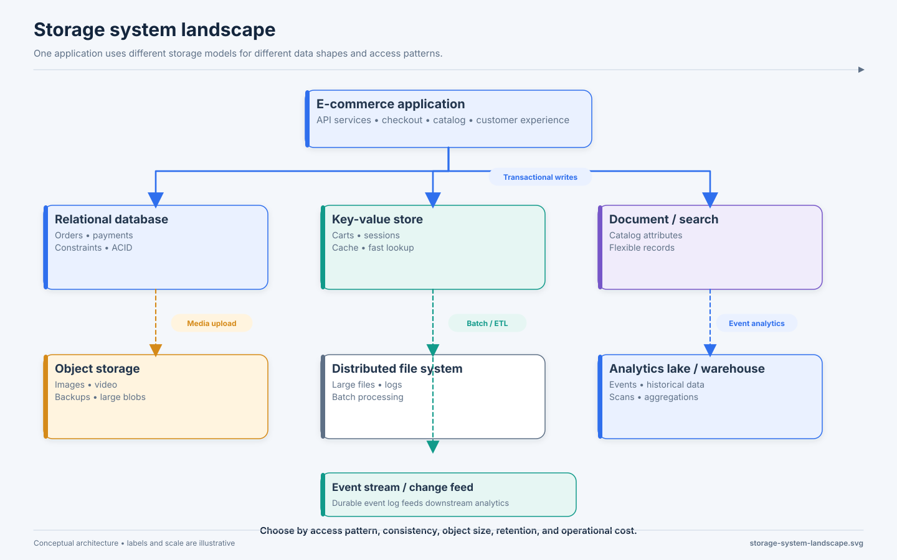

- **Purpose:** Show why a single application uses several storage classes.
- **Components and labels:** Application/API services; relational DB; key-value cache/store; document/search store; object storage; distributed file system; analytics lake/warehouse; event stream.
- **Relationships and data flow:** Orders and payments flow to relational storage; carts/sessions to key-value storage; catalog records to document/relational storage; media to object storage; events to a log and analytics storage.
- **Learning objective:** Match data shape and access pattern to storage interface and durability model.
- **Suggested layout:** Application services across the top; six storage domains below, with labeled arrows and a side legend for transactional, cache, blob, and analytical workloads.

---

# 2. Storage Fundamentals and Performance

## 2.1 Storage hierarchy in practice

The memory hierarchy is not just a ranking of devices; it shapes the software architecture. A database often keeps hot index and data pages in a **buffer pool**. LSM engines keep active writes in **memtables** and frequently used file blocks in a **block cache**. Operating systems cache file pages. Applications may add another cache. Each layer can reduce latency, but layered caches create invalidation, staleness, and observability challenges.

| Layer | Relative latency | Cost per GB | Capacity tendency | Random access | Sequential access | Failure/persistence characteristics |
|---|---|---|---|---|---|---|
| CPU cache | Lowest | Highest | Very small | Excellent for cache hits | Excellent | Volatile; managed by hardware |
| DRAM | Very low | High | GBs to TBs per server | Excellent | Excellent | Volatile; process/host loss removes contents |
| Persistent memory class | Low, hardware-dependent | High | Specialized | Low-latency byte/near-memory access | High | Persistent only with supported platform and correct flush semantics |
| NVMe SSD | Low persistent I/O | Medium | TBs | Strong relative to HDD | Very high | Flash wear, controller, firmware, and power-loss considerations |
| SATA SSD | Low persistent I/O | Medium/low | TBs | Good | High but interface-limited | Similar flash failure considerations |
| HDD | Higher random latency | Low | Many TBs | Poor for seek-heavy patterns | Good for streaming | Mechanical failure; rebuilds can be long |
| NAS/SAN/network block | Network-dependent | Service-dependent | Shared or provisioned | Depends on protocol/service | Depends on network and backend | Network and control-plane failures added |
| Object storage | Request/service latency | Low for suitable tiers | Very large | API/key based, not local block random I/O | Good for large objects/ranges | Provider durability/availability model; request and retrieval costs |

Cost rankings can change with cloud region, instance type, provisioned IOPS, reserved capacity, data transfer, and support plans. Compare total cost of ownership, not only price per stored GB.

### A worked throughput example

A media-processing job reads 5 TB of files sequentially. At an idealized 1 GB/s, transfer time is approximately 5,000 seconds (about 83 minutes) using decimal units. If it instead performs 4 KiB random reads at 20,000 IOPS, useful data throughput is only about 78.1 MiB/s, so moving the same 5 TB would take roughly 18.2 hours before protocol overhead and queueing. The example illustrates workload shape, not a benchmark for a specific device.

## 2.2 IOPS, throughput, queue depth, and block size

For fixed-size requests, a rough relationship is:

\[
\text{Throughput (bytes/s)} \approx \text{IOPS} \times \text{Average I/O size (bytes)}
\]

For example, 80,000 IOPS at 16 KiB/request corresponds to about 1.22 GiB/s of payload throughput. This equality is only a conversion; actual devices may not sustain both figures simultaneously. A larger block size can improve throughput while reducing the number of independent IOPS. A small block can increase IOPS while transferring fewer bytes per operation.

Little's Law is useful when reasoning about a stable queue:

\[
L = \lambda W
\]

where \(L\) is average number of outstanding requests, \(\lambda\) is completion rate, and \(W\) is average time in the system. If a device sustains 50,000 operations/s at 2 ms average response time, a rough average of 100 operations are in flight. This does not mean setting queue depth to 100 always improves performance; saturation, device parallelism, and latency objectives still matter.

### Average latency versus tail latency

Suppose 99 requests complete in 5 ms and one request completes in 500 ms. The average is 9.95 ms, but the P99 is near the slow request. In a fan-out service that waits for the slowest of 50 storage calls, tail behavior becomes even more visible. Monitor latency histograms and percentiles alongside throughput, queue depth, retries, and errors.

### Amplification metrics

- **Read amplification:** More bytes, blocks, files, or devices are read than the logical result size suggests. An LSM point lookup may consult multiple levels; a B-tree lookup may fetch several pages, often with upper levels cached.
- **Write amplification:** Physical bytes written divided by logical bytes accepted. Compaction, journaling, page rewrites, checksums, and replication can all contribute, depending on the measurement boundary.
- **Space amplification:** Physical bytes occupied divided by live logical data. Old versions, tombstones, fragmentation, replication, and temporary compaction outputs increase it.

Always state the measurement boundary. A three-replica cluster has at least 3× storage consumption from replication alone, but that should not be confused with storage-engine write amplification within one replica.

## 2.3 Durability and reliability

**Durability** is the probability or guarantee that acknowledged data survives a defined set of failures. The phrase “durable” is incomplete unless the failure model is specified: process crash, kernel crash, power loss, device failure, host loss, rack loss, region loss, operator error, or malicious deletion.

Important mechanisms:

- **Checksums:** Detect accidental corruption of blocks, log records, or network payloads. They detect errors; they do not repair them by themselves.
- **Scrubbing:** Periodically reads stored data, verifies checksums, and triggers repair from a known-good copy when possible.
- **Flush/fsync:** Requests that buffered data be pushed toward stable storage. Correct guarantees depend on OS, filesystem, device cache, controller, and power-loss protection behavior.
- **Write barriers/order constraints:** Preserve required ordering so metadata or data is not made durable before prerequisite log or allocation information.
- **Power-loss protection:** Hardware capacitors or equivalent mechanisms can protect volatile device cache during sudden power loss; absence of protection must be included in the durability model.
- **RAID:** Adds device-level redundancy or striping. RAID is not a backup and does not protect against all logical errors, ransomware, or site loss.
- **Replication:** Creates copies across failure domains. Replication may copy a mistaken delete or corrupted logical update, so it is not a backup.
- **Backup and point-in-time recovery:** Preserve historical recovery points, ideally with immutable/offline or separately credentialed copies.
- **Recovery testing:** Verifies that backups, WAL archives, metadata, keys, and runbooks actually work under realistic timelines.

| Term | Meaning | What it does not guarantee |
|---|---|---|
| Durability | Acknowledged data survives the specified fault model | Continuous access while recovery is underway |
| Availability | Requests can be served within a defined SLO | That all served data is the newest version |
| Reliability | System performs correctly over time | Any one particular fault tolerance mechanism |
| Redundancy | Extra components/copies exist | Independence of failure domains or recoverability |
| Backup | Separate recovery copy or point-in-time state | Immediate failover or zero data loss |
| Disaster recovery | Ability to restore service/data after a major disruption | Cheapness or instant recovery |

### Power-failure scenario: page cache is not durable storage

Suppose a DBMS appends a record to a process buffer and the OS page cache, then acknowledges the client before a durable flush. A sudden power loss may discard both volatile buffers. After reboot, the application might observe that the transaction never happened even though it previously returned success. That violates a common durability expectation.

A safe write path coordinates software and hardware: append the required WAL record, ensure it reaches the durability boundary promised by configuration (for example, an appropriate fsync or group commit), then acknowledge. Data pages can be written later because recovery replays durable log records. The guarantee still depends on the filesystem, controller, device cache, and honest implementation of flush commands. A database cannot repair hardware that falsely reports persistence.

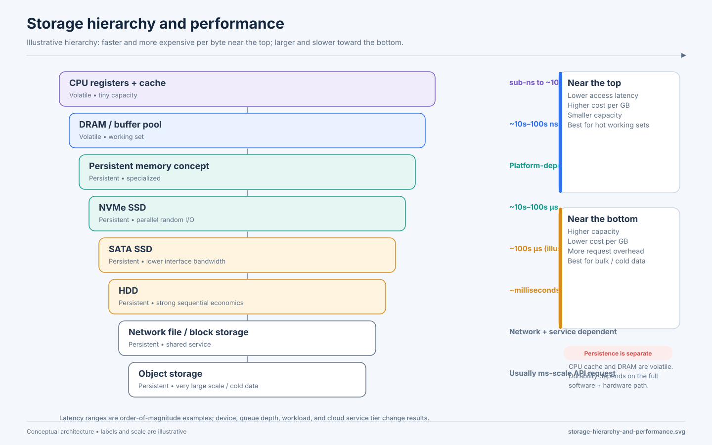

- **Purpose:** Relate performance and persistence across the storage hierarchy.
- **Components and labels:** CPU cache, DRAM, persistent memory concept, NVMe, SATA SSD, HDD, network storage, object storage.
- **Relationships and data flow:** A vertical hierarchy showing decreasing latency/increasing cost toward the top and increasing capacity toward the bottom; mark volatile versus persistent.
- **Learning objective:** Explain why working-set placement and I/O shape matter.
- **Suggested layout:** Pyramid or stepped stack with a latency/cost/capacity legend and callouts for random versus sequential access.

---

# 3. B-Trees and B+ Trees

## 3.1 Why disk-oriented trees have high fan-out

A conventional binary search tree has at most two child pointers per node. Even a balanced tree over one billion keys would require roughly 30 levels because \(2^{30}\) is approximately one billion. If each level caused a storage-page read, a point lookup could require many expensive I/Os.

A B-tree groups many separator keys and child pointers into a **page-sized node**. A 16 KiB page can hold hundreds of compact key-pointer entries, giving the tree high fan-out and low height. The structure is designed around page transfers, not around one pointer dereference per key.

A B-tree node generally contains sorted keys and child references. Search within a node uses binary search or an optimized search routine. The chosen child is read, and the process repeats until the target entry is found. Database buffer pools cache frequently used pages, so the root and upper internal levels often remain in memory.

## 3.2 Search, insertion, deletion, and rebalancing

**Search:** Compare the requested key against separators in the current node, select the correct child, and continue. In a B+ tree, the leaf contains the index entry or record pointer/value.

**Insertion:** Find the target leaf and insert the key in sorted order. If there is space, the change can be made in the page. If the page overflows, it splits into two pages and a separator is inserted into the parent. A parent overflow can cascade upward; a root split increases tree height.

**Deletion:** Remove or mark the key. If a node falls below its occupancy threshold, the engine may borrow an entry from a sibling (redistribution) or merge with a sibling. Parent separators are updated, and the root may shrink. Real storage engines may use lazy cleanup, page deletion, or versioning rules rather than immediately performing textbook rebalancing for every logical delete.

**Page split cost:** A split can allocate a page, copy/move entries, update parent pages, and generate WAL. Repeated inserts into random key positions can cause scattered page writes. Monotonic keys may create right-edge hot pages; some engines optimize this case. Fill factor controls how full pages are initially packed, trading space for fewer near-term splits.

## 3.3 B-tree versus B+ tree

The terminology varies across textbooks and implementations, but the common distinction is:

- A **B-tree** may store record payloads in both internal and leaf nodes.
- A **B+ tree** stores data entries/record references at the leaf level, while internal nodes contain separator keys and child pointers. Leaves are commonly linked for ordered scans.

The B+ tree's internal pages are more compact because they store routing information rather than full records. This allows higher fan-out. Once a range scan reaches the first leaf, it follows linked leaf pages in key order, which is efficient for ordered traversal. Leaf-level storage of all entries also simplifies range and index-only access patterns, subject to visibility and included-column semantics.

## 3.4 Numerical worked example: one billion records

Assumptions (deliberately simplified):

- Logical records: 1,000,000,000.
- Page size: 16 KiB = 16,384 bytes.
- Each leaf entry averages 100 bytes after key, pointer, and local overhead.
- Usable page fraction: 75% for leaf payload, yielding 12,288 usable bytes.
- Internal separator plus child pointer and overhead: 32 bytes per entry.
- Internal page usable fraction: 70%, or about 11,469 bytes.

**1. Leaf pages.** Each leaf holds approximately \(12,288 / 100 = 122\) entries. Required leaf pages are approximately \(1,000,000,000 / 122 = 8.20\) million.

**2. Fan-out.** Each internal page holds approximately \(11,469 / 32 = 358\) routing entries. A convenient conservative fan-out assumption is 350.

**3. Tree levels.** With 350-way fan-out, one level can address 350 leaves, two levels 122,500 leaves, three levels 42.875 million leaves. Since 8.20 million leaves fit under 42.875 million, a plausible tree has a root plus two internal levels plus leaf level: about **4 page levels**. The exact count depends on root structure and occupancy.

**4. Point lookup.** Worst-case cold lookup touches about four pages (root, two internal levels, leaf), plus a data page if the index is non-clustered and the record is stored elsewhere. If upper levels are cached, the physical reads may be one or two. A clustered index may make the leaf itself contain or closely organize the row.

**5. Range scan.** Suppose the query returns 10,000 adjacent records. At about 122 entries per leaf, it needs approximately 82 leaf pages after the initial descent, plus root/internal pages. A sequential scan over adjacent leaf pages is much more efficient than performing 10,000 independent root-to-leaf lookups.

**Limitations:** Real engines have variable-length keys, page headers, MVCC metadata, fragmentation, deduplication, fill-factor behavior, compression, nonuniform key distributions, and buffer-pool effects. The estimate is for reasoning, not capacity planning.

## 3.5 B+ trees in production databases

- **PostgreSQL:** B-tree is the default index access method for common ordered comparisons. PostgreSQL heap tables store tuples separately from ordinary secondary indexes; a B-tree index entry points to a heap tuple location (TID). Index-only scans may avoid heap visits when visibility-map conditions permit. PostgreSQL WAL protects changes, and vacuum/pruning manage dead tuple effects.
- **MySQL/InnoDB:** The primary key is the clustered index; table rows are stored in primary-key order in its leaf pages. Secondary-index leaves contain the secondary key plus the primary-key value, which is used to find the clustered row. A wide primary key therefore increases secondary-index size. InnoDB uses redo logging, undo information for MVCC/rollback, and doublewrite protection for relevant page-write failure scenarios.
- **SQL Server:** Rowstore indexes are organized as B+ trees; clustered and nonclustered index semantics determine where row data and row locators live. Page splits, fill factor, and fragmentation affect write/read behavior.

### Banking example

A banking system may have a primary key on `account_id` and a composite index on `(account_id, transaction_timestamp)`. A balance lookup is a point query; transaction history is a range scan bounded by account and time. B+ tree ordering makes this combination natural. The application still needs correct transaction isolation, ledger invariants, and indexes aligned to its actual query patterns. An index cannot make an unbounded history scan cheap if the query asks for too many rows.

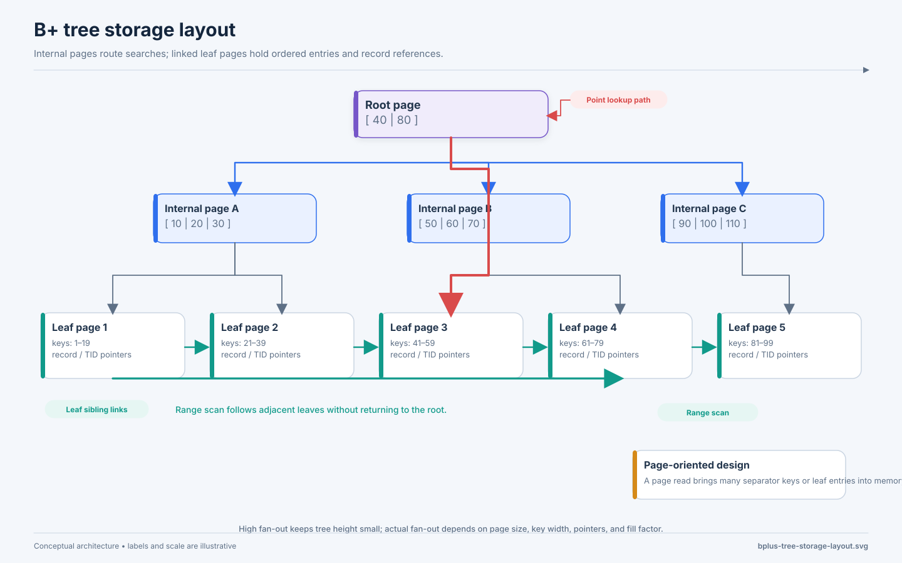

- **Purpose:** Explain page-oriented indexing and ordered scans.
- **Components and labels:** Root page, internal pages, separator keys, child pointers, leaf pages, next-leaf links, record/TID references, 16 KiB page annotation.
- **Relationships and data flow:** Highlight one point lookup path and a second path that enters the first range leaf and follows sibling links.
- **Learning objective:** Understand fan-out, tree height, and why leaf linking makes range scans efficient.
- **Suggested layout:** Three-level tree across the top half; linked leaf chain below; use distinct arrows for point lookup and range scan.

---

# 4. LSM Trees — Log-Structured Merge Trees

## 4.1 Why LSM trees exist

An LSM tree (Log-Structured Merge tree) is designed to turn many small, potentially random updates into buffered and largely sequential writes. Instead of locating and modifying the exact on-disk page for every update, the engine first records the write in a sequential log and an in-memory sorted structure. Later it flushes batches as immutable sorted files and merges those files in the background.

This makes the write path attractive for high-ingest workloads, but it moves work into reads and compaction. A lookup may need to check several in-memory and on-disk structures. Compaction rewrites data and consumes I/O bandwidth, CPU, and temporary space. The architecture trades immediate random page updates for deferred merge work.

## 4.2 Components

- **WAL / commit log:** Append-only recovery log. It protects recent changes that have not yet been flushed to the durable sorted-file representation.
- **Memtable:** In-memory ordered structure receiving new mutations. Implementations may use skip lists, trees, or other structures.
- **Immutable memtable:** A frozen memtable waiting to be written to disk while a new active memtable accepts writes.
- **SSTable:** Sorted String Table, an immutable file containing sorted key/value records. It usually has data blocks, an index, filters, metadata, and checksums.
- **Levels or tiers:** Organized groups of SSTables. Leveled systems generally control overlap between files in lower levels; tiered/size-tiered systems keep several runs of similar size.
- **Compaction:** Background merge of sorted files, resolving versions and tombstones and producing replacement SSTables.
- **Bloom filter:** Probabilistic membership structure used to avoid unnecessary file reads for keys that are definitely absent.
- **Sparse index:** A compact index with sampled key-to-block offsets; the engine searches the index and then scans within the relevant block.
- **Tombstone:** A deletion marker retained until the engine can safely remove older versions and the marker itself.

## 4.3 LSM write path

Consider a write `customer:42 → address=Bengaluru`:

1. The client sends the mutation to the database.
2. The engine assigns a sequence number/timestamp according to its concurrency model.
3. The write is appended to the WAL/commit log. Durability depends on the configured flush/sync policy.
4. The mutation is inserted into the active memtable.
5. Acknowledgment is returned when the system's configured durability and replication conditions have been met.
6. When the memtable reaches a threshold, it becomes immutable; a fresh memtable becomes active.
7. The immutable memtable is sorted/already ordered and flushed into a new SSTable.
8. The SSTable is installed in the appropriate level/tier after metadata is updated safely.
9. Background compaction merges files, removes obsolete versions when safe, and writes new SSTables.
10. WAL segments become reclaimable only when all data they protect is durably represented elsewhere and recovery rules permit truncation.

The ordering between WAL append and memtable mutation is essential. If the process crashes after a memtable update but before a durable log record, the mutation may be lost even if the client received success. Conversely, a durable log record with an unflushed memtable can be replayed at restart.

### Example with three values

Assume key `cart:77` is set to `A`, then `B`, then `C` before compaction. SSTable A may contain version A, a newer SSTable B may contain version B, and the active memtable contains C. A read must choose the newest visible version. During compaction, the engine may keep C and discard A/B if no snapshot or other retention rule still needs them.

## 4.4 LSM read path

A point read often follows this order:

1. Check the active memtable.
2. Check immutable memtables, newest first.
3. Identify candidate SSTables using key range metadata.
4. Consult Bloom filters to skip files that definitely do not contain the key.
5. Search sparse indexes to find candidate data blocks.
6. Read blocks from the block cache or storage.
7. Merge candidate versions and select the newest version visible to the reader.
8. Apply tombstones and snapshot/sequence-number rules so deleted or obsolete values are not returned.

A Bloom filter has no false negatives under its normal assumptions: if it says “definitely absent,” the key is absent; if it says “possibly present,” the engine still performs an index/data lookup. A false positive causes extra work, not an incorrect answer.

A database may have multiple SSTables with overlapping key ranges in upper levels. Lower levels in a leveled design usually constrain overlap for a key range, allowing more targeted reads. Read amplification depends on compaction strategy, level count, filters, caches, and workload distribution.

## 4.5 SSTable organization

An SSTable is immutable after publication. A common conceptual layout is:

```text
+---------------------------+
| File footer / version     |
+---------------------------+
| Filter block (e.g. Bloom) |
+---------------------------+
| Index block               | ---> key range to data-block offset
+---------------------------+
| Data block 0              |
| Data block 1              |
| ...                       |
| Data block N              |
+---------------------------+
| Properties / metadata     |
+---------------------------+
```

Implementations differ: filters and indexes may be partitioned, compressed, cached, checksummed, or loaded lazily. Immutability simplifies concurrent readers, file-cache behavior, replication/backup, and crash-safe installation. A compaction does not mutate an SSTable in place; it writes new files and atomically updates metadata/manifests so the old files can be reclaimed when no reader still references them.

## 4.6 Compaction

Compaction is required because every update creates a newer record and every delete creates a tombstone rather than overwriting arbitrary old bytes. Without merging, reads would have to search an increasing number of files and storage would retain obsolete versions indefinitely.

Typical strategies:

- **Size-tiered compaction:** Merge several similarly sized SSTables into a larger file. It can offer good write throughput but may allow more overlapping files and larger space spikes.
- **Leveled compaction:** Organize files into levels with bounded target sizes and limited overlap in lower levels. It can reduce read amplification at the cost of rewriting data more often in some workloads.
- **Time-window compaction:** Group data by time windows, often useful for time-series/TTL-heavy data where old windows can be expired or dropped efficiently. It works best when timestamp-based access and retention align with the chosen windows.

A simplified merge example:

| Input file | Sorted records |
|---|---|
| SST-1 (old) | `a=1, b=2, d=4, f=6` |
| SST-2 (newer) | `b=20, c=3, e=5` |
| SST-3 (newest) | `d=DELETE, f=60` |

The merge compares keys in order. For each key it selects the newest version allowed by the active snapshot/retention rules. A possible output is `a=1, b=20, c=3, e=5, f=60`; `d=DELETE` can be omitted only when it is safe to prove no older value can reappear from an un-compacted file, replica, backup/snapshot requirement, or tombstone grace rule. The old files are removed from the live manifest after the output is installed safely; physical deletion waits until readers and recovery constraints permit it.

**Compaction debt** is pending merge work. If incoming writes create SSTables faster than compaction can process them, file counts and read amplification grow. Eventually the engine may throttle or stall writes to prevent unbounded debt. Monitor pending compaction bytes, compaction throughput, pending tasks, write stalls, disk bandwidth, and free space. A compaction may temporarily require both old inputs and new outputs, so disk headroom matters.

## 4.7 Bloom filters: a numerical example

For a classical Bloom filter with `m` bits, `n` inserted items, and `k` independent hash functions, the approximate false-positive probability is:

\[
p \approx \left(1-e^{-kn/m}\right)^k
\]

The approximate optimal number of hashes is:

\[
k_{opt} = \frac{m}{n}\ln 2
\]

The approximate bit budget for a desired false-positive rate is:

\[
\frac{m}{n} \approx -\frac{\ln p}{(\ln 2)^2}
\]

For one million keys and a target false-positive probability of 1%:

- Bits per key ≈ \(-\ln(0.01)/(\ln 2)^2 ≈ 9.59\).
- Total bits ≈ 9.59 million bits, or about 1.14 MiB (before implementation overhead).
- Optimal hash count ≈ \(9.59 × 0.693 ≈ 6.64\), so use about 7 hashes in the idealized formula.

In practice, implementations use optimized hashing and may choose different filter policies or formats. More bits reduce false positives but consume memory/cache space.

## 4.8 Production LSM systems

- **RocksDB:** Embedded LSM key-value engine used inside larger services and databases. It exposes tuning for compaction, block cache, Bloom filters, write buffers, WAL, and column families. Its performance depends strongly on workload and configuration.
- **LevelDB:** Earlier embedded LSM engine that established many of the design patterns later used by RocksDB.
- **Apache Cassandra:** Wide-column distributed database whose storage engine uses memtables, commit log, immutable SSTables, Bloom filters, and compaction. The commit log is per node and distinct from replica coordination.
- **Apache HBase:** Bigtable-inspired wide-column database; Regions contain Stores, each with MemStore and HFiles (SSTable-like files), protected by WAL.
- **ScyllaDB:** Cassandra-compatible distributed database with an LSM-style storage architecture and a shard-per-core execution model.
- **TiKV:** Distributed transactional key-value storage layer used by TiDB; it uses RocksDB-based storage engines with distributed Raft replication. TiKV's MVCC and Raft layers add semantics beyond a single local RocksDB instance.

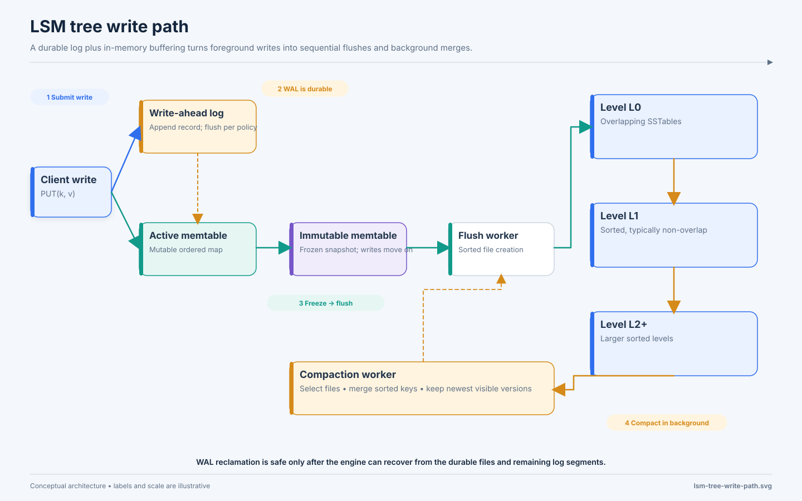

- **Purpose:** Visualize the buffered write path and durable flush sequence.
- **Components and labels:** Client, WAL, active memtable, immutable memtable, flush worker, SSTable, L0/L1/L2, compaction worker.
- **Relationships and data flow:** Numbered arrows for append, in-memory insert, freeze, flush, install, compact, and reclaim WAL/file space.
- **Learning objective:** Understand why an LSM write is not an in-place update to a disk page.
- **Suggested layout:** Left-to-right pipeline with the WAL above the memtable path and stacked levels to the right.

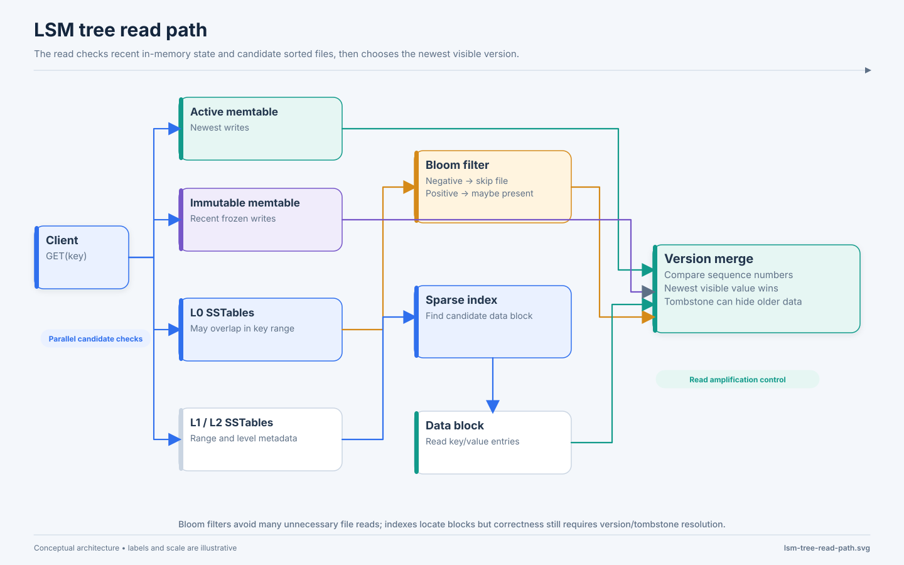

- **Purpose:** Explain how a read finds the newest value.
- **Components and labels:** Active/immutable memtables, candidate SSTables, key-range metadata, Bloom filters, sparse index, data blocks, tombstone/version merge.
- **Relationships and data flow:** Read fans out to candidate sources; Bloom negatives short-circuit; result versions merge by sequence number.
- **Learning objective:** Understand read amplification and why filters/indexes matter.
- **Suggested layout:** Client on left; in-memory structures and levels in parallel lanes; converging result selector on right.

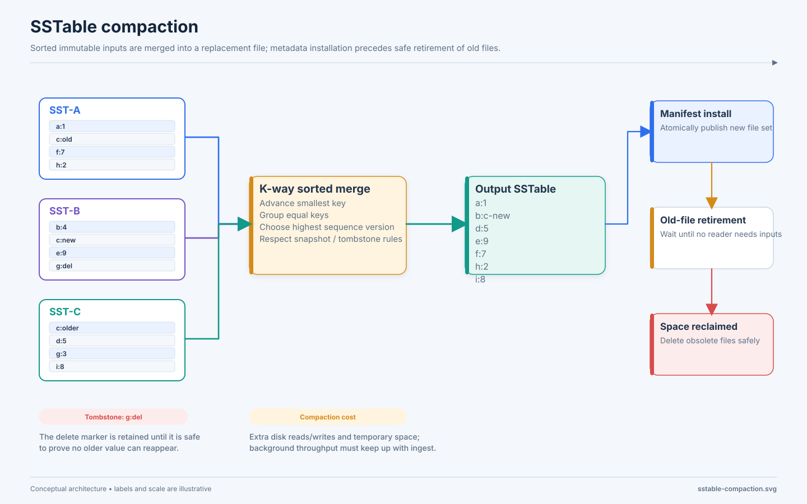

- **Purpose:** Show immutable input files merged into replacement output.
- **Components and labels:** SST-A/B/C, overlapping key ranges, sorted merge cursor, newest-version selection, tombstone, output SST, manifest, old-file cleanup.
- **Relationships and data flow:** Multiple sorted inputs feed a merge stage; one new file is installed; old references are retired safely.
- **Learning objective:** Understand compaction, version cleanup, write amplification, and temporary disk-space use.
- **Suggested layout:** Three input-file columns converging on a merge funnel, then one output file and a lifecycle arrow.

---

# 5. LSM Trees vs B-Trees

The fundamental distinction is the write path. A B-tree/B+ tree locates and modifies page-oriented structures; an LSM engine buffers writes and later merges immutable sorted structures. This distinction influences cache behavior, compaction, range scans, tail latency, and operational tuning.

| Dimension | B-tree / B+ tree | LSM tree |
|---|---|---|
| Write path | Find leaf page, modify page, log changes, eventually flush page | Append WAL, update memtable, flush immutable sorted file, compact later |
| Read path | Root-to-leaf traversal; range scan follows ordered leaves | Check memtables and candidate SSTables; merge visible versions |
| Random writes | Can cause random page updates and splits | Often converts writes to sequential log/flush patterns |
| Sequential writes | Efficient for clustered/append-like patterns, but still page-managed | Natural for WAL and sorted-file flushes |
| Range queries | Strong when index order matches predicate | Good when files/levels and key ranges align; may merge multiple sources |
| Write amplification | Page updates, WAL, doublewrite or checkpoint behavior; workload-dependent | Flush plus compaction rewrites; can be substantial |
| Read amplification | Tree levels plus possible heap/data lookup | Multiple memtables/files/levels; filters/cache reduce work |
| Space amplification | Fragmentation, free space, MVCC versions | Old versions/tombstones and temporary compaction files |
| Compaction | Not the defining mechanism; vacuum/defrag/reorganization may be needed | Central background operation |
| Cache behavior | Upper tree levels and hot pages are highly reusable | Block cache, filter/index cache, and memtables are important |
| Crash recovery | WAL/redo/undo and checkpoints | WAL replay plus manifest/SSTable recovery |
| Write-heavy fit | Good in many mixed OLTP settings; random page writes can bottleneck | Often attractive for very high ingest and append-heavy workloads |
| Read-heavy fit | Often predictable point/range reads, especially with cache | Can be excellent after tuning/compaction; more sources may increase tail latency |
| Operational complexity | Vacuum, bloat, page split, buffer cache and checkpoint tuning | Compaction debt, tombstones, filters, write stalls and disk headroom |

There is no universal winner. Storage-engine performance depends on key distribution, row size, update frequency, range locality, read/write ratio, retention, durability policy, device characteristics, and concurrency.

## 5.1 Workload decisions

### Banking database

Frequent point lookups, transactional updates, indexes, and ordered history queries favor a relational DBMS with B-tree indexes as a common starting point. A write-ahead log and carefully designed composite indexes are essential. If data must span regions or nodes with SQL transactions, evaluate a distributed SQL system, while accounting for consensus and cross-region latency. A pure LSM key-value store may work as a component but does not automatically supply relational integrity or ledger constraints.

### Write-heavy event ingestion

Millions of append-like events with time/key-based reads can favor an LSM engine or wide-column store. Partition by a key that distributes ingestion while preserving useful query locality. Bound compaction debt, define retention, size Bloom filters/cache, and test recovery/replay. A naive timestamp-only partition key can create a hot partition.

### Time-series database

An LSM-oriented engine with time-window compaction can work well when timestamps and retention are central. Partition by tenant/device and time buckets to balance parallelism with queries. Old windows may be expired efficiently, but late-arriving events and out-of-order timestamps complicate window cleanup.

### Social media activity feed

High-volume inserts and recent reads often use a combination: durable event store (LSM/wide-column), per-user or per-follower feed materialization (key-value or wide-column), relational identity and permissions, and object storage for media. Multiple secondary indexes and fan-out-on-write can create write amplification; fan-out-on-read increases read cost. Choose based on follower distribution and product freshness needs.

## 5.2 Production examples and precision

- PostgreSQL and InnoDB use B-tree-family indexes for their primary general-purpose indexes, although page, MVCC, and recovery behavior differs.
- RocksDB and LevelDB are LSM engines.
- Cassandra's storage engine is LSM-based.
- MongoDB's default WiredTiger storage engine uses B-tree-based structures for collections/indexes; do not describe standard MongoDB WiredTiger collections as an LSM store. WiredTiger has internal implementation choices and multiple data formats, but the supported MongoDB architecture should be described from MongoDB documentation, not generalized from the WiredTiger library's other possible configurations.

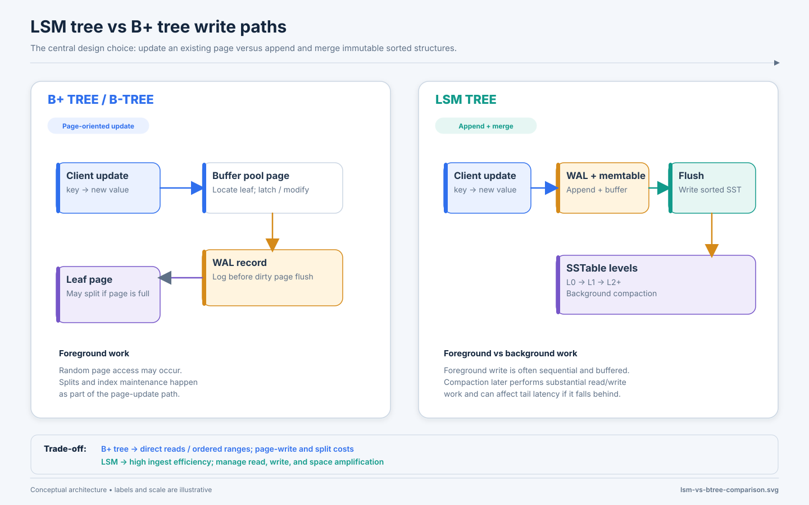

- **Purpose:** Compare page-update and log/merge write paths.
- **Components and labels:** B+ tree pages, leaf split, WAL, buffer pool; LSM WAL, memtable, immutable memtable, SSTable levels, compaction.
- **Relationships and data flow:** One logical update is shown through each engine side by side.
- **Learning objective:** Explain how the core physical update strategy creates different costs.
- **Suggested layout:** Two equal vertical panels sharing one client write arrow and a bottom strip comparing read and maintenance costs.

---

# 6. Write-Ahead Logs (WAL)

## 6.1 Purpose and structure

A write-ahead log is an append-oriented record of changes that allows a storage engine to recover from a crash. The defining rule is that the log record describing a change must reach the required durability boundary **before** the corresponding modified data page is allowed to become durable. The log can be written sequentially, while data pages are flushed later in batches.

A log record may include a transaction identifier, log sequence number (LSN), page or key identity, before/after information or logical operation, and a record type. A commit record marks the transaction's commit decision. The exact format and recovery algorithm are product-specific.

- **LSN:** Monotonically ordered identifier/position used to order log records and correlate durable log state with dirty pages.
- **Redo:** Reapply an operation during recovery to ensure a change is reflected in data pages.
- **Undo:** Reverse effects of transactions that did not commit (in systems using undo recovery).
- **Checkpoint:** A recovery marker describing a known state of data pages/transactions, reducing how far recovery must scan.
- **Group commit:** Several transactions share a WAL flush, amortizing expensive sync operations.
- **Log truncation/archiving:** Reclaim or move old segments after checkpoints, replicas, and recovery requirements no longer need them.

## 6.2 Account-balance example

A transaction changes account A from 1,000 to 800 because 200 is transferred out:

1. Begin transaction T42.
2. Read/lock or otherwise protect the required account state according to the DBMS concurrency-control model.
3. Generate log record(s) describing the debit and corresponding credit or invariant-preserving ledger entries.
4. Append records to the WAL and assign LSNs.
5. Append a commit record.
6. Flush WAL through the commit LSN according to the configured durability policy; in a replicated database, any required replication/consensus condition must also be met.
7. Acknowledge commit.
8. Data pages may be written later by background flushing/checkpointing.
9. A crash occurs before the dirty data page reaches disk.
10. On restart, recovery reads the log and redoes the committed change; uncommitted effects are handled according to the engine's recovery protocol.

The system need not flush every changed data page before commit because the durable WAL contains enough information to reconstruct committed state. This is the core performance benefit of WAL. The system must never discard the required log before the data pages and recovery metadata make that safe.

## 6.3 Redo, undo, and ARIES concepts

- **Redo logging:** Record enough information to repeat updates. Recovery may redo committed operations that were not yet reflected in data pages.
- **Undo logging:** Record enough information to reverse uncommitted changes.
- **Undo/redo logging:** Supports both operations, as in ARIES-style designs.
- **Analysis phase:** Reconstruct transaction and dirty-page state at crash time.
- **Redo phase:** Repeat history from a recovery point so updates are reflected consistently, including updates from transactions that later require undo.
- **Undo phase:** Roll back loser (uncommitted) transactions, often writing compensation log records so recovery itself is restartable.
- **Dirty Page Table (DPT):** Tracks pages dirtied in memory and relevant recovery LSNs.
- **Transaction Table:** Tracks transactions and their status/last LSN.

WAL is a recovery mechanism and write-ordering rule. A transaction log is a broader term that may describe audit history, replication stream, CDC feed, or application event log. Not every transaction log is a physical page-recovery WAL.

## 6.4 Group commit

Flushing each transaction separately can serialize commits behind durable storage latency. With group commit, the DBMS gathers several commit records and performs one flush through the highest required LSN. Each transaction can then be acknowledged once the shared flush covers its commit.

Example: if one sync costs 2 ms and the database commits 100 transactions together, the system may amortize the sync across those transactions, improving throughput. It does not make each transaction's durability instantaneous: batching may add a small wait before the flush. The appropriate group size and delay depend on throughput and latency objectives.

## 6.5 WAL in production systems

- **PostgreSQL:** WAL supports crash recovery and, when configured, streaming replication/point-in-time recovery. WAL archiving and retention must be sized and monitored; a stalled replication slot or archive destination can cause WAL growth.
- **MySQL/InnoDB:** Redo logs support crash recovery; undo logs support rollback and MVCC. The doublewrite mechanism protects against certain partial page-write failure modes. Exact settings are version-specific.
- **SQLite:** WAL mode records changes in a separate WAL file and checkpoints changes back to the main database. Readers can continue reading a stable snapshot while a writer appends, subject to SQLite's locking and checkpoint rules.
- **RocksDB:** WAL protects writes in memtables before they are flushed to SSTables; WAL configuration and sync behavior affect acknowledged-write durability.
- **Cassandra:** Its local commit log protects mutations before memtable flush; replica consistency levels govern acknowledgement across nodes and are a different layer from the local log.

A local recovery WAL answers “can this node reconstruct its local state after a crash?” A distributed replication log/consensus log answers “which operations are committed and in what order across replicas?” A product may use related log concepts at both layers, but they are not interchangeable.

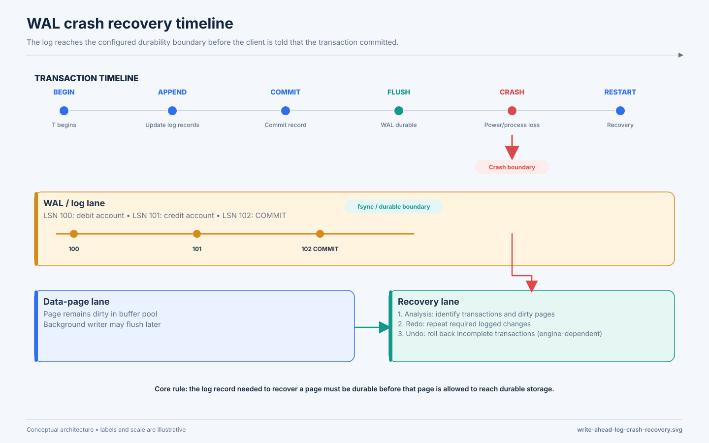

- **Purpose:** Show why log persistence allows data pages to be flushed later.
- **Components and labels:** Transaction, log records, commit LSN, durable WAL, dirty page, background flusher, crash, recovery scan, redo/undo, recovered page.
- **Relationships and data flow:** Commit becomes durable before page flush; crash interrupts; recovery replays the log.
- **Learning objective:** Understand the WAL rule and commit durability boundary.
- **Suggested layout:** Timeline across the page with separate WAL and data-page lanes; crash marker between commit and page flush.

---

# 7. Distributed Storage Architecture

A distributed storage system spreads data across several machines so capacity and throughput can grow beyond one host and faults can be tolerated without losing the entire service. Distribution introduces new problems: routing, membership, metadata, network partitions, replica lag, repair, rebalancing, and correlated failures.

## 7.1 Core building blocks

1. **Partitioning:** Split the key space or file/object set into disjoint ownership units. Hash partitioning spreads keys; range partitioning preserves order and can support range scans but may hotspot on monotonic keys.
2. **Replication:** Store each partition on multiple nodes, ideally across independent racks or availability zones.
3. **Metadata/catalog:** Track partition ownership, replicas, schema, object locations, or range boundaries. Metadata itself requires durability and high availability.
4. **Routing:** A client, proxy, coordinator, or library maps a request to the appropriate owner/replica.
5. **Membership and failure detection:** Heartbeats and health checks estimate which nodes are alive. Failure detectors are suspicion mechanisms; network delay can resemble failure.
6. **Repair:** Rebuild missing replicas, reconcile divergent versions, or reconstruct fragments from parity.
7. **Rebalancing:** Move partitions as nodes are added/removed or load shifts. Throttle movement to avoid overwhelming foreground traffic.
8. **Consistency protocol:** Define write acknowledgement, read selection, conflict resolution, and ordering.

## 7.2 A 100-node example

Assume a dataset is divided into 1,000 partitions and each partition has three replicas. A coordinator or partition-aware client maps a key to one of the 1,000 partitions, then routes to a replica appropriate for the requested consistency level. If one node holds 30 replica partitions and fails, the remaining replicas may continue serving requests. The control plane marks the missing replica, schedules replacement copies, and rebalances ownership.

The critical operational question is not simply “are there three copies?” It is “where are they?” Three replicas on the same host or rack do not tolerate a rack failure. If a zone fails, copies placed in that zone are unavailable together. If write quorum was not satisfied or a partition was isolated, the system's consistency rules determine whether it accepts writes, rejects them, or creates concurrent versions.

## 7.3 Distributed storage versus related concepts

- **Distributed storage** is the broad idea of placing and protecting bytes/records across nodes.
- **Distributed database** adds database-level semantics such as query processing, indexes, transactions, and consistency.
- **Distributed filesystem** presents files/directories while distributing file blocks/chunks.
- **Object store** exposes object-level operations and metadata through an API, usually with a flat key namespace.
- **Storage replication** copies physical/logical storage units; database replication may additionally order transactions, coordinate commit, and enforce consistency.
- **Data locality** runs compute near the data; **compute locality** may also refer to keeping related computation and state together to minimize network transfer.

### Common request flow

A request arrives at a client or gateway, which consults cached metadata or a routing layer. It finds the partition owner and an eligible replica. The target validates the request, performs the local storage operation, and participates in any acknowledgement/consensus protocol. The client receives a result only after the system's configured completion conditions are met.

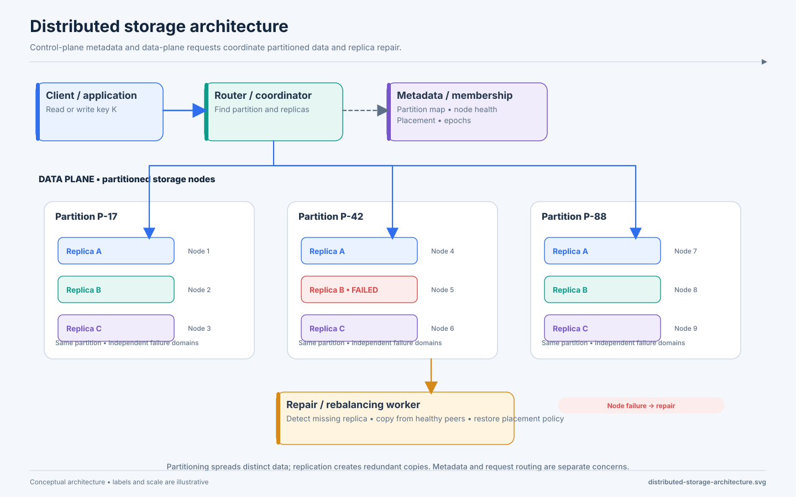

- **Purpose:** Show routing, metadata, partitions, replicas, and repair.
- **Components and labels:** Client, router/coordinator, metadata service, 100 storage nodes, partition IDs, replica groups, failure detector, repair/rebalance worker.
- **Relationships and data flow:** Client asks metadata/routing; reads/writes go to replica group; failed node triggers repair from surviving copies.
- **Learning objective:** Separate logical partitioning from physical replication and control-plane metadata.
- **Suggested layout:** Metadata/control plane above a grid of storage nodes; highlight one partition's three replicas and a failed node.

---

# 8. Distributed File Systems

Distributed file systems provide a file-oriented abstraction over a cluster. A file is divided into blocks/chunks, metadata maps file offsets to block identifiers and locations, and storage nodes hold the bytes. They are optimized for large files and sequential or streaming access rather than arbitrary low-latency mutation of tiny records.

## 8.1 Core design

- **Namespace:** Paths, directories, permissions, ownership, and file metadata.
- **Metadata manager:** Maps files to blocks/chunks, tracks replication, and handles namespace operations.
- **Storage nodes:** Store blocks/chunks and serve data directly to clients.
- **Block reports/heartbeats:** Storage nodes periodically report health and inventory.
- **Replication:** Multiple block copies are placed across hosts/racks.
- **Rack awareness:** Copies are distributed to reduce the risk of a rack-level outage while balancing network cost.
- **Data locality:** Compute frameworks schedule tasks near the blocks they process, reducing network traffic.
- **Re-replication:** Missing copies are rebuilt after a node failure.
- **Checksums:** Detect corrupted data during reads and background verification.

A centralized metadata manager can simplify namespace and placement decisions but can become a scalability and availability concern. Modern systems mitigate this with high availability, federation, sharding, caching, or distributed metadata designs.

## 8.2 Google File System (GFS)

The original GFS paper described a system designed for Google's large data-processing workloads on commodity machines, frequent component failures, large files, streaming reads, large sequential writes, and record append. The historical design used a **master**, **chunkservers**, and **clients**.

- The master maintained namespace and file-to-chunk metadata, including chunk handles and replica locations. It kept important metadata in memory and persisted changes through an operation log/checkpoints.
- Chunkservers stored fixed-size chunks on local disks and served chunk data.
- Clients contacted the master for metadata/location information, then transferred data directly to chunkservers rather than routing every data byte through the master.
- The original paper used large 64 MiB chunks. This is a historical design parameter, not a statement about every modern Google storage product.
- Replicas were placed across machines and failure domains. Heartbeats helped the master monitor chunkservers.

### Lease-based primary and mutation ordering

For a mutation to a chunk, the master could grant a lease to one replica designated primary. The primary established the mutation order; secondary replicas applied the operation in that order. This reduced the need for the master to coordinate every byte of every mutation. If a primary failed or its lease expired, a new primary could be selected.

GFS's consistency model reflected its workload and mutation semantics. Concurrent writes and record appends had defined but not always simple outcomes. The original atomic record-append operation selected an offset and appended a record atomically with respect to other appenders, allowing multiple producers to share a file without coordinating offsets themselves. Under failures/retries, the record could be appended more than once; replicas could also contain padding or regions whose contents were not fully defined in the same way as a conventional database transaction. Applications therefore used record identifiers, checksums, and retry/deduplication logic. Atomic record append was a useful file-level primitive, not a general multi-record transaction system.

### Petabyte web-log pipeline example

1. A producer creates a log file; the client asks the master to create namespace metadata.
2. As the file grows, the master allocates chunk handles and selects chunkserver replicas.
3. The client receives locations and writes payloads directly to chunkservers.
4. For a mutation, the lease-holding primary orders the operation and forwards it to secondaries for application.
5. A processing client asks the master for chunk locations, then streams data from chunkservers directly.
6. If a chunkserver fails, the master detects missing replicas through heartbeat/inventory state and schedules re-replication from healthy copies.

The master is control plane, not data plane. This distinction is a major design lesson.

Modern Google storage products have evolved significantly; the GFS paper should be understood as a foundational architecture rather than a complete description of present-day Google Cloud storage internals.

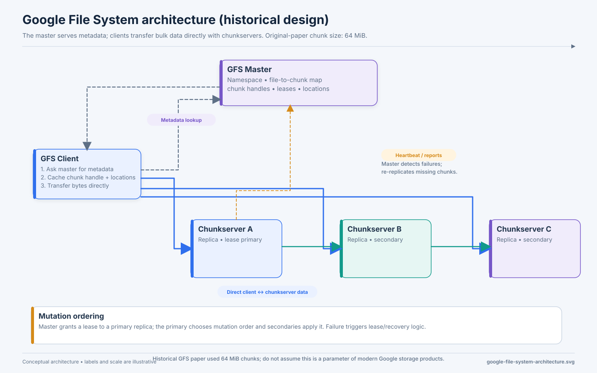

- **Purpose:** Explain metadata lookup and direct data transfer.
- **Components and labels:** GFS master, client, chunkservers A/B/C, chunk handle, 64 MiB historical chunk, replica set, lease primary, heartbeat.
- **Relationships and data flow:** Client asks master for metadata; master returns chunk handle/locations; client reads/writes directly to chunkservers; primary orders mutations; replica repair follows failure.
- **Learning objective:** Distinguish the metadata control path from the high-volume data path.
- **Suggested layout:** Master at top, client at left, three chunkservers at bottom, solid data arrows and dashed metadata/heartbeat arrows.

## 8.3 Hadoop Distributed File System (HDFS)

HDFS is designed for large datasets and high-throughput streaming access in Hadoop-style clusters. Its main components are:

- **NameNode:** Manages filesystem namespace and metadata such as file-to-block mappings and block locations.
- **DataNodes:** Store blocks and serve client reads/writes; report heartbeats and block inventories.
- **Client:** Requests metadata from the NameNode and transfers data to/from DataNodes.
- **Blocks:** Files are split into configurable blocks. A 128 MiB block is a common/default configuration in many deployments, but it is configurable and version/deployment dependent.
- **Replication factor:** A common setting is three copies, with placement influenced by rack awareness and cluster policy.
- **Checkpointing:** The Secondary NameNode or CheckpointNode periodically merges namespace image and edit logs to create checkpoints. It is not automatically a hot standby NameNode.
- **High Availability (HA):** Deployments can use active/standby NameNodes and shared or journal-based edit-log mechanisms, with failover coordination.
- **Federation:** Multiple independent NameNodes/namespaces can manage different portions of the filesystem namespace.
- **Safe mode:** A startup/read-only phase in which the NameNode waits for sufficient block reports/replication conditions before allowing normal writes.

### HDFS write pipeline

1. Client asks the NameNode to create a file; the NameNode checks namespace and permissions.
2. Client requests a block allocation.
3. NameNode chooses DataNodes according to replication and rack-placement policy.
4. Client establishes a pipeline: client → DataNode 1 → DataNode 2 → DataNode 3 (for a three-copy example).
5. Client streams packets with checksums to the first DataNode; packets flow through the pipeline.
6. Each DataNode writes locally and forwards the packet downstream.
7. Acknowledgments return in reverse order through the pipeline.
8. When a block is full, the client requests another block; when the file closes, the NameNode records completion metadata.
9. If a DataNode fails mid-pipeline, the client and HDFS pipeline logic reconfigure around healthy nodes and the missing replica is scheduled for reconstruction.

### HDFS read path

The client asks the NameNode for block locations. The NameNode returns candidate DataNodes, generally ordered to favor network proximity. The client reads blocks directly from a suitable DataNode, verifies checksums, and moves to the next block. The NameNode is not in the bulk data path. Data locality can be exploited by compute schedulers such as MapReduce/Spark.

### GFS versus HDFS

| Dimension | Original GFS | HDFS |
|---|---|---|
| Metadata manager | Master | NameNode |
| Storage nodes | Chunkservers | DataNodes |
| Data unit | Historical 64 MiB chunks | Configurable blocks; 128 MiB is common in many deployments |
| Replication | Multiple chunk replicas | Configurable block replication, often factor 3 |
| Write model | Lease-based primary orders chunk mutations; record append supported | Pipeline writes with packet acknowledgements; append support exists with constraints |
| Metadata role | File namespace, chunk handles/locations, leases | Namespace, block mappings, DataNode locations |
| Failure handling | Heartbeats, re-replication | Heartbeats, block reports, re-replication, HA NameNode options |
| Data locality | Large-data processing near chunkservers | Strong integration with Hadoop compute scheduling |
| Primary workloads | Google's original large-scale data processing | Hadoop ecosystem, batch analytics, large-file workloads |
| Influence | Foundational distributed filesystem design | Influenced by GFS and related design ideas |

They share a master/metadata plus storage-node structure, large blocks, replication, and direct client data transfer, but they are different systems with different APIs, implementation details, and operational models.

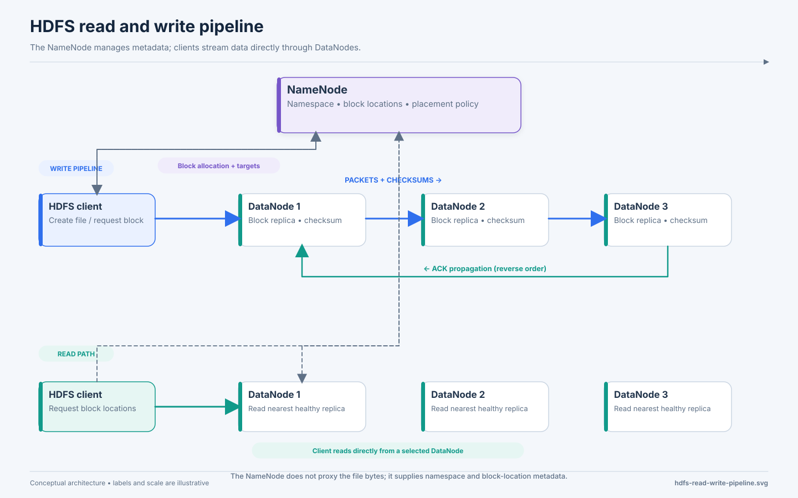

- **Purpose:** Show client metadata operations and DataNode pipeline flow.
- **Components and labels:** Client, NameNode, DataNodes 1–3, block ID, packet/checksum, replication factor, ack path, block locations.
- **Relationships and data flow:** Metadata request to NameNode; write packets pipeline through DataNodes; ACKs return in reverse; reads go directly from client to a selected DataNode.
- **Learning objective:** Understand the NameNode's metadata role and the write pipeline.
- **Suggested layout:** Two lanes labeled WRITE and READ; metadata service above both; reverse ACK arrows beneath write lane.

---

# 9. Object Storage

Object storage exposes objects—usually byte sequences plus metadata—through an API. A bucket/namespace contains keys; a key identifies an object, often with versioning and metadata. A “folder” is commonly a user-interface convention built from key prefixes rather than a true hierarchical directory. The service may distribute object bytes and metadata over many machines, but the provider's implementation is often not public.

## 9.1 Object, file, and block abstractions

| Abstraction | Unit | Typical interface | Strength | Limitation |
|---|---|---|---|---|
| Block storage | Fixed-size logical blocks/volume | Attach/mount volume, read/write blocks | Low-level random I/O for databases/filesystems | User must manage filesystem/database layout; usually tied to a volume lifecycle |
| File storage | Files, directories, offsets | POSIX-like filesystem API | Shared file semantics and familiar namespace | Metadata/locking semantics and scaling depend on service |
| Object storage | Whole objects with keys and metadata | PUT/GET/DELETE/LIST/HEAD and multipart APIs | Massive scale, durability, metadata, lifecycle, low operational burden | Not a local filesystem or low-latency transactional block device |
| Relational database | Rows, columns, transactions | SQL | Constraints, indexes, transactions | Not ideal for large immutable media blobs or petabyte archives |

Object stores support metadata, versioning, lifecycle rules, access control, checksums, multipart upload, and range GETs. They may expose strong or eventual consistency semantics depending on product and operation. Always read the provider's contract rather than assuming all object stores behave like one another.

## 9.2 Amazon S3: documented behavior versus architectural concepts

S3 concepts include buckets, object keys, object metadata, storage classes, multipart uploads, versioning, lifecycle management, object locking, notifications, and cross-region replication. At the API level, a client issues requests to regional service endpoints; internal routing and storage placement are provider-managed.

**Documented guarantee:** Amazon S3 provides strong read-after-write consistency for successful PUTs, overwrites, deletes, and LIST operations in its documented model. After a successful write or delete, subsequent reads/listings reflect the latest operation. This is a service-level guarantee; do not reverse-engineer undocumented metadata or physical replica internals from it.

### Upload and retrieval lifecycle

- For a small object, the client sends a PUT with object bytes and metadata.
- For a large object, multipart upload divides the object into independently uploaded parts. The client completes the multipart upload to assemble the object, or aborts it to discard incomplete parts. Multipart upload improves parallelism and retry efficiency.
- For retrieval, the client issues GET. A Range header can fetch selected byte ranges, useful for media seeking and partial processing.
- With versioning enabled, overwrites create new versions and deletes can create delete markers; previous versions may remain addressable until lifecycle or explicit deletion removes them.
- Lifecycle policies can transition or expire objects. Storage classes trade retrieval latency/cost, minimum storage duration, availability design, and retrieval charges.
- Cross-region replication copies objects asynchronously according to configured rules; it is not a cross-region transaction.

Storage classes include frequently accessed, infrequent access, intelligent tiering, and archival tiers. Exact class names, retrieval behavior, minimum storage duration, object-size billing rules, and availability/durability targets vary and should be checked in current AWS documentation.

### Conceptual architecture (not a claim about S3 internals)

A generic object store may separate request routing and metadata lookup from object data placement. Metadata can include object key, version, size, checksum, access policy, placement information, and lifecycle attributes. Data may be replicated or erasure-coded across failure domains. This is a useful generic model, but it must not be presented as a definitive diagram of S3's undocumented internal services.

## 9.3 Replication versus erasure coding

### Three-way replication

A 600 GB logical dataset stored in three complete copies uses:

\[
600\text{ GB} \times 3 = 1,800\text{ GB}
\]

The raw storage overhead relative to the logical dataset is 1,200 GB, or 200%. Any one or two independent replica failures can be tolerated if at least one intact copy remains accessible and placement/network policies are correct. Three copies do not protect against all correlated failures, logical corruption replicated everywhere, or operator deletion.

### 6+3 erasure coding

A 6+3 Reed–Solomon-style scheme splits data into six data fragments and computes three parity fragments. A complete stripe contains nine fragments; any six valid fragments can reconstruct the original data, so it can tolerate up to three missing fragments under the assumed independent-fragment failure model.

For a 600 GB logical dataset:

\[
\text{Stored capacity} = 600\text{ GB} \times \frac{6+3}{6} = 900\text{ GB}
\]

Parity overhead is 300 GB, or 50% relative to logical data. Compared with 1.8 TB for three-way replication, this uses half the physical capacity in this simplified comparison.

| Property | 3× replication | 6+3 erasure coding |
|---|---|---|
| Physical capacity for 600 GB | 1,800 GB | 900 GB |
| Raw overhead vs logical | 200% | 50% |
| Fragment failures tolerated | Up to 2 copies can fail while one remains | Up to 3 fragments can be missing, assuming any 6 survive |
| Read path | One intact copy may satisfy read | May read/reconstruct multiple fragments depending on placement and failure state |
| Write/repair cost | Copy bytes to replicas | Encode/decode and write parity/data fragments |
| Operational trade-off | Simple reads and repairs; high storage cost | Better capacity efficiency; more compute/network and repair complexity |

The model assumes equal-size fragments, correct stripe placement, no correlated failure beyond the threshold, and a successful reconstruction path. Small objects can have disproportionate metadata/stripe overhead. Repair traffic can be expensive; partial fragment loss can require reading substantial data from surviving fragments. Many architectures use replication for hot data and erasure coding for colder, larger objects.

## 9.4 Object storage use cases and limitations

Good fits include images/video, backups, data lakes, ML datasets, static website assets, logs, artifacts, and archival data. Object storage is generally not the right direct substrate for a low-latency OLTP workload that updates many tiny records in place with multi-record transactions. Put transactional metadata in a database and blobs in object storage; use immutable object keys/content hashes, checksums, and a workflow to coordinate metadata publication.

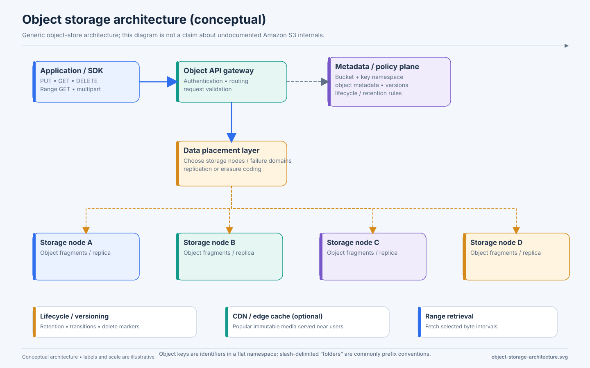

- **Purpose:** Show an application using an object API and a generic distributed backend.
- **Components and labels:** Application, API endpoint/gateway, authentication, metadata/routing plane, bucket/key namespace, object fragments/replicas, lifecycle manager, optional CDN.
- **Relationships and data flow:** PUT/GET/HEAD/LIST requests pass through API/routing; metadata resolves an object; bytes flow to storage placement; lifecycle moves or expires objects.
- **Learning objective:** Understand object abstraction and separate documented API behavior from provider-private implementation.
- **Suggested layout:** API tier top, metadata and policy plane middle, distributed object fragments bottom; note “conceptual, not S3 internals.”

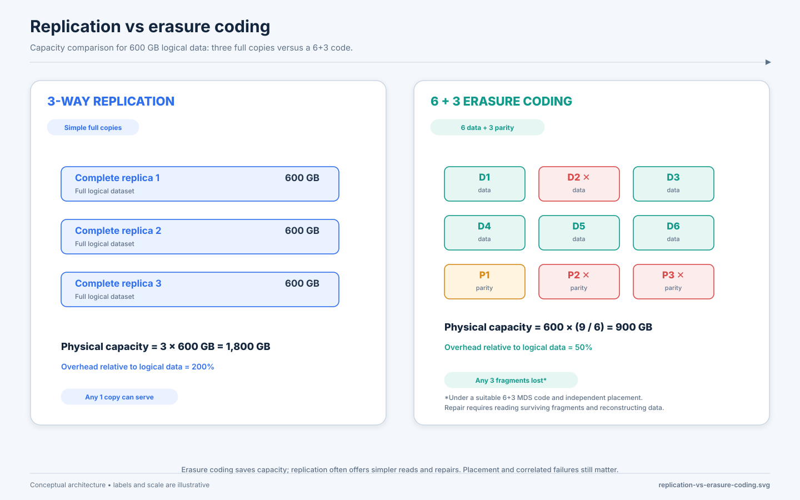

- **Purpose:** Compare storage overhead and fault tolerance.
- **Components and labels:** Three complete replicas; 6 data fragments D1–D6; parity fragments P1–P3; failed fragments; reconstruction path; 600 GB logical input.
- **Relationships and data flow:** Replication fans out full copies; erasure coding splits data and computes parity; highlight recovery after three fragment losses.
- **Learning objective:** Understand capacity efficiency versus repair/read complexity.
- **Suggested layout:** Two side-by-side panels with capacity math below each and failure markers above fragments.

---
# 10. Key-Value Storage Systems

A key-value store exposes a simple abstraction: a key identifies a value. The value may be a byte string, structured object, or encoded record. The simplicity of the API does not imply a simple implementation. Production key-value systems still need partitioning, indexes, replication, persistence, eviction, TTL handling, concurrency control, and failure recovery.

## 10.1 Core concepts and workloads

- **Key lookup:** Hash or range-map a key to a storage partition, then locate its value.
- **Persistence:** Values may be memory-only, periodically snapshotted, logged to disk, or stored in a persistent LSM/B-tree engine.
- **TTL:** A value expires after a configured time. Expiration may be lazy on access, handled by background work, or represented by tombstones.
- **Atomic operations:** Operations such as increment, compare-and-set, or conditional put prevent races for a limited key scope.
- **Transactions:** Some systems support multi-key or multi-row transactions; others deliberately limit atomicity to one key or partition.
- **Consistency:** A single-key read may be linearizable, quorum-based, eventually consistent, or session-consistent depending on the product.
- **Partitioning:** Hash partitioning provides distribution; range partitioning can provide ordered access but can create hot ranges.

Common use cases include cache entries, sessions, carts, user preferences, rate-limit counters, idempotency keys, metadata, and high-throughput lookup services. The key design question is whether the application needs only lookup by key or also rich queries, transactions, and secondary indexes.

## 10.2 Original Amazon Dynamo architecture

The original Dynamo paper described an always-on distributed key-value store designed for high availability in the face of failures. It is an influential design, not the implementation specification for today's DynamoDB managed service.

### Main mechanisms

- **Consistent hashing:** Maps keys and nodes onto a ring; virtual nodes distribute ownership more evenly and help when capacity changes.
- **Replication factor N:** A key is stored on N replica nodes selected from the ring.
- **Quorum parameters R and W:** A client can read from R replicas and write to W replicas. If \(R+W>N\), read and write quorums overlap in the idealized model. Quorums alone do not guarantee linearizability under all failure and concurrency conditions.
- **Vector clocks:** Track causal history of versions so concurrent updates can be detected rather than silently overwritten.
- **Sloppy quorum:** When preferred replicas are unavailable, writes may be accepted by reachable substitute nodes to improve availability.
- **Hinted handoff:** A substitute node stores a hint for the unavailable intended replica and forwards the data when it recovers.
- **Read repair:** A read that detects stale replicas may update them with a newer value.
- **Anti-entropy:** Background reconciliation, historically using Merkle trees to compare ranges efficiently, repairs divergence.
- **Conflict resolution:** The service may expose siblings/concurrent versions and rely on application-level merge semantics, depending on design.

### Example write and read

Assume N=3, W=2, R=2. A coordinator routes a write to three replicas; if two acknowledge, the write may return success under the configured policy. A later read queries two replicas and reconciles their versions. Because writes can overlap or nodes may be unavailable, vector clocks may reveal concurrent values. The application might merge a shopping cart by set union, or it might choose a version using a domain timestamp or explicit conflict-resolution function.

If one intended replica is unavailable, sloppy quorum may send the write to a substitute. That substitute records a hint and later hands it off. Anti-entropy remains necessary because hints can be lost or delayed and replicas can diverge for other reasons.

**Critical distinction:** The paper's Dynamo design is a research/production architecture that emphasizes availability and tunable consistency. Amazon DynamoDB is a managed service with its own API, partitioning, consistency options, transactions, and multi-region features. Do not infer DynamoDB internals such as vector-clock behavior or sloppy-quorum configuration from the original paper.

## 10.3 Redis

Redis is an in-memory data-structure server. It supports strings, hashes, lists, sets, sorted sets, streams, bitmaps, probabilistic structures, and atomic command execution on a server. Its speed comes from keeping the active dataset in memory, efficient event-driven request processing, and purpose-built data structures. Network, command complexity, CPU, memory allocator behavior, persistence, replication, and hot keys still limit throughput.

### Persistence

- **RDB snapshots:** Save point-in-time dataset snapshots. They are compact and often useful for backups/fast restart, but writes after the last snapshot may be lost if no other durability mechanism covers them.
- **AOF (Append Only File):** Records write commands so Redis can reconstruct state on restart. The fsync policy controls the durability/performance trade-off. `appendfsync always` favors durability but adds sync overhead; `everysec` is a common compromise; `no` delegates flushing to the OS and weakens the guarantee.
- **AOF rewrite:** Rewrites accumulated commands into a more compact representation of current state; the exact mechanism is version-dependent.
- **Combined RDB + AOF:** Can provide snapshot and log recovery characteristics, with operational and disk-space costs.

Persistence does not equal replication. Persistence helps one node recover after restart; replication creates copies on other nodes. Replication is often asynchronous and can lose acknowledged-but-not-yet-replicated writes during a failover. A backup must also be stored separately and tested.

### Replication, Sentinel, and Cluster

- **Replication:** A primary streams its dataset and subsequent writes to replicas. Replicas can serve reads where stale data is acceptable.
- **Sentinel:** Monitors primary/replica instances and can coordinate automatic failover for non-clustered Redis deployments. Sentinel is not the same as Redis Cluster sharding.
- **Redis Cluster:** Divides the key space into 16,384 hash slots. A key's slot is computed by CRC16 modulo 16,384, with hash tags allowing related keys to map to the same slot. Each primary owns a subset of slots and can have replicas. Clients learn slot ownership and route commands to the right node. Failover promotes a replica when conditions and cluster majority rules permit.
- **Eviction:** When configured memory limits are reached, Redis applies a policy such as no eviction, all-keys LRU/LFU, or volatile-key variants. Evicted cache data must be recomputable or recoverable.

### Shopping platform example

Redis may cache product availability, hold session tokens, store a cart snapshot, and enforce a rate limit. A cache miss falls back to a source-of-truth database. A primary failure may trigger replica promotion; recent writes can be lost if replication lag existed. Therefore, do not make Redis the only copy of a payment ledger or order transition unless the full persistence, replication, backup, and consistency requirements are deliberately satisfied.

Memory sizing must include dataset bytes, object/allocator overhead, replication buffers, persistence fork copy-on-write headroom, fragmentation, client buffers, and failover/rebuild reserve. A 100 GB logical dataset can require materially more than 100 GB of physical RAM.

## 10.4 Amazon DynamoDB

DynamoDB is a managed distributed NoSQL database with a key-value/document data model. Its primary key is either a partition key alone or a composite partition key plus sort key. The partition key determines item distribution; the sort key supports ordered access within a partition-key value.

Important concepts:

- **Partition key design:** Uniformly distribute activity across partition keys where possible. A monotonically increasing timestamp or a single global counter can create hot-key/partition pressure.
- **Request routing:** AWS manages partition placement and routing; the application designs keys and access patterns rather than managing physical nodes.
- **Read consistency:** Tables and local secondary indexes support eventual or strong reads; global secondary indexes and streams are eventually consistent. Read capacity/cost differs by consistency mode.
- **Capacity modes:** Provisioned capacity sets read/write capacity; on-demand mode adapts to workload within service quotas and scaling behavior. Current quotas and adaptive capacity details must be checked in the service documentation.
- **Secondary indexes:** Local secondary indexes share the table partition key and vary the sort key; global secondary indexes have a different key schema and are maintained as separate index structures with their own throughput and eventual consistency behavior.
- **Conditional writes:** Apply changes only when a condition is true, useful for optimistic concurrency and idempotency.
- **Transactions:** Multi-item ACID transactions are available within a Region, subject to limits and API semantics.
- **Streams:** Capture item-level changes for event processing and materialized views.
- **TTL:** Marks items for eventual expiration/deletion; expiration is not a precise real-time scheduler.
- **Global tables:** Replicate tables across Regions. The service documents multi-Region eventual and multi-Region strong consistency modes with different latency/availability trade-offs. Transactions are not globally atomic across Regions; check current documentation for exact mode requirements and limitations.

### Partition-key example

A table keyed by `tenant_id` can be effective when tenants are numerous and activity is balanced. If one tenant accounts for 60% of traffic, that key can become hot even though the table has many other tenants. A write-sharded pattern such as `tenant_id#bucket` can distribute load, but queries must fan out across buckets and merge results. The best key depends on the dominant access patterns, not simply on the number of distinct values.

## 10.5 Dynamo versus DynamoDB versus Redis

| Dimension | Original Dynamo | DynamoDB | Redis |
|---|---|---|---|
| System type | Distributed key-value design described in a research paper | Managed AWS NoSQL service | In-memory data-structure server; clustering and managed offerings available |
| Data model | Key/value with version/conflict concepts | Items with partition/sort keys and attributes | Rich in-memory structures addressed by keys |
| Persistence | Replicated distributed storage in the original design | Managed durable service; internal implementation is not public contract | Optional RDB/AOF persistence; deployments vary |
| Partitioning | Consistent hashing and virtual nodes | Service-managed partitioning guided by key design | Cluster hash slots or application-managed sharding |
| Replication | Preference lists, quorums, sloppy quorum/handoff | Managed replication; global tables across Regions | Primary/replica; cluster failover and Sentinel options |
| Consistency | Tunable/quorum behavior; concurrent versions possible | Documented eventual/strong read options and global table modes | Primary command behavior with asynchronous replica propagation in common deployments |
| Transactions | Not a general relational transaction engine | ACID transactions for bounded item sets in a Region | Atomic command execution; transactions/scripts with scope constraints; not relational ACID by default |
| Performance profile | Availability-oriented distributed KV design | Managed low-latency key-based access | Very low latency for in-memory operations |
| Common workloads | Highly available service state | User profiles, carts, game state, metadata, event state | Caching, sessions, counters, queues, rate limiting |

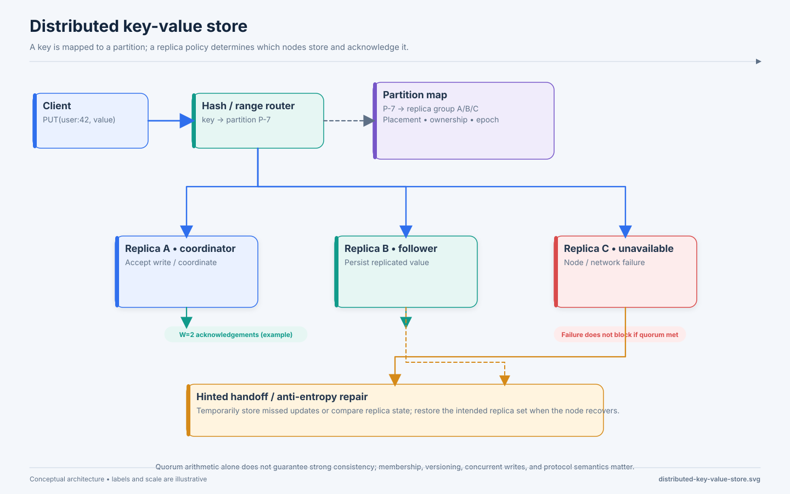

- **Purpose:** Show key routing, partition ownership, replication, and repair.
- **Components and labels:** Client, hash/range router, partition map, replica nodes A/B/C, primary/coordinator, unavailable node, hinted handoff/repair arrow.
- **Relationships and data flow:** Hash key to partition; route to replicas; collect configured acknowledgements; detect failure and repair.
- **Learning objective:** Understand logical key placement separately from replica copies.
- **Suggested layout:** Ring or partition map at top, replica group below, failure/repair inset.

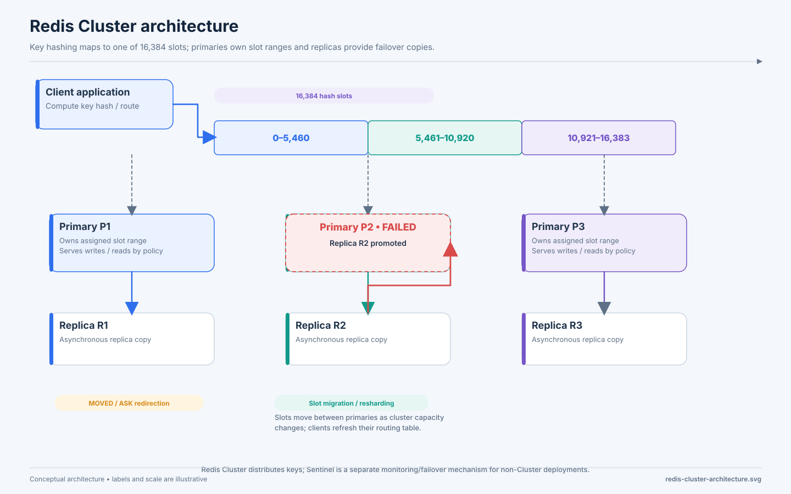

- **Purpose:** Explain hash-slot ownership and failover.
- **Components and labels:** Client, 16,384 hash slots, primary nodes P1/P2/P3, replicas R1/R2/R3, slot migration, primary failure.
- **Relationships and data flow:** CRC16 hash routes key to slot and primary; replica promotion changes slot owner during failover.
- **Learning objective:** Distinguish Cluster sharding from Sentinel monitoring and from persistence.
- **Suggested layout:** Slot bar across three primaries with replica directly below each, plus client redirection arrow.

---

# 11. Wide-Column Storage Systems

A wide-column database stores data as ordered rows addressed by row keys, with columns grouped into families. Rows can be sparse: different rows may contain different qualifiers, and a row may hold many cells and versions. The model is designed for partitioned, distributed access patterns rather than arbitrary relational joins.

## 11.1 Wide-column versus relational and analytical columnar systems

- **Relational database:** Tables have a declared schema, constraints, joins, and SQL semantics. Rows are commonly indexed using B-tree structures.
- **Wide-column store:** Rows are partitioned and ordered by row key; column families define storage grouping; cells may have timestamps/versions. Query design centers on row/partition keys.
- **Columnar analytical format/store:** Values are physically organized by column for scan compression and vectorized analytics (e.g., Parquet files). This is not the same as Bigtable-style column families.

A wide-column model can be efficient for known query patterns over enormous sparse datasets. It is less suitable when the application expects ad hoc joins or many arbitrary secondary filters.

## 11.2 Google Bigtable

The original Bigtable design describes a distributed sparse, persistent, multidimensional sorted map indexed by row key, column key, and timestamp. The data model can be thought of as:

\[
(\text{row key},\ \text{column family:qualifier},\ \text{timestamp}) \rightarrow \text{value}
\]

- **Row key:** Primary ordering and partitioning dimension. Reads within a row are atomic in the original model; rows are stored lexicographically.
- **Column family:** A declared group used to control storage and configuration. Qualifiers within a family can be numerous and sparse.
- **Timestamp:** Supports multiple cell versions and retention/version policies.
- **Tablet:** A contiguous range of row keys; tablets split and move to distribute load.
- **Tablet server:** Serves a subset of tablets.
- **SSTables and commit log:** Immutable sorted files persist data; a commit log protects recent mutations.
- **Metadata:** Locates tablets and supports client routing. In the original system, Chubby contributed coordination/locking and metadata-related roles; do not assume the same control plane in today's managed Google Cloud Bigtable service.

### Row-key design for machine metrics

Suppose metrics arrive from 10 million machines.

1. **`machine_id#timestamp`:** Efficient for fetching one machine's time range. However, if the system assigns sequential machine IDs or a burst targets one machine, distribution may skew. A time-ordered suffix is useful within a machine's range.
2. **`timestamp#machine_id`:** Makes global time-window scans easier, but all writes for the newest timestamp region can cluster and create a hot range.
3. **`hash(machine_id)#time_bucket#machine_id`:** Prefix hashing spreads writes across key ranges while time buckets bound scans. The application may need to query multiple buckets or de-hash/reassemble results.

There is no universally best key. Start from queries: machine-specific history, fleet-wide time slice, tenant-level rollups, and recent alerts have different locality requirements. Add salting only when the fan-out cost is acceptable.

Google Cloud Bigtable is a managed service derived from the Bigtable model. Its service architecture and capabilities evolve; distinguish managed-service documentation from the 2006 paper's historical internal design.

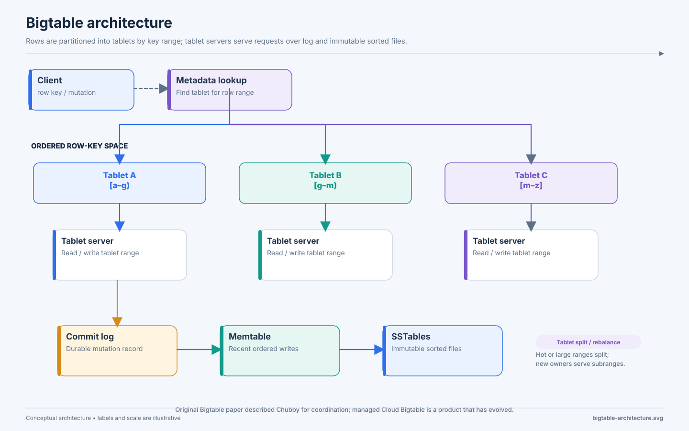

- **Purpose:** Show clients, tablet metadata, tablet servers, and sorted storage.
- **Components and labels:** Client, frontend/service endpoint, metadata lookup, tablet ranges, tablet servers, commit log, SSTable files, replication.
- **Relationships and data flow:** Client resolves row-key range to tablet server; requests serve from memory/files; writes log and flush; tablet splits/rebalances.
- **Learning objective:** Understand row-range partitioning and tablet movement.
- **Suggested layout:** Key-range continuum across servers with one tablet expanded into log, memory, and immutable files.

## 11.3 Apache HBase

HBase follows important Bigtable ideas and integrates with the Hadoop ecosystem. A table is split into **Regions**, each a contiguous key range. Regions are assigned to RegionServers. Within a Region, each column family has a Store with a MemStore and zero or more StoreFiles (HFiles).

- **HMaster:** Coordinates region assignment, schema/admin operations, and cluster management; it is not the main data path for every cell read/write.
- **RegionServer:** Serves reads/writes for assigned Regions and performs flush, split, and compaction work.
- **WAL:** Records mutations before they are placed in MemStore, allowing replay after RegionServer failure.
- **MemStore:** In-memory write buffer for a Store. A flush writes sorted data to HFiles.
- **HFiles:** Immutable sorted StoreFiles based on the SSTable concept.
- **ZooKeeper:** Historically used for coordination and discovery; exact responsibilities vary by HBase version and deployment.
- **Region split/assignment:** Large regions split into smaller key ranges and are assigned to RegionServers. Poor row-key distribution can create hot regions.

### HBase write/read outline

A Put is routed to the RegionServer that owns the row-key range. The RegionServer appends the mutation to WAL and updates the relevant MemStore. A flush creates HFiles; compaction merges HFiles. A Get/Scan reads MemStore and HFiles, merges versions according to timestamp/visibility rules, and uses block indexes/Bloom filters/cache to limit I/O. If a RegionServer crashes, WAL edits are recovered/replayed and regions are reassigned.

### Bigtable versus HBase

| Dimension | Bigtable | HBase |
|---|---|---|
| System type | Google's distributed wide-column system; managed Cloud Bigtable available | Open-source distributed wide-column database |
| Data model | Sparse sorted map by row, column, timestamp | Bigtable-inspired row/column-family/cell model |
| Distribution unit | Tablets | Regions |
| Storage layer | Original design: SSTables and commit log; modern service internals differ | HFiles/StoreFiles, MemStore, WAL; commonly backed by HDFS in Hadoop deployments |
| Metadata | Original design had tablet metadata and Chubby coordination roles | HMaster/metadata tables and coordination mechanisms; exact version matters |
| Replication | Managed service supports cluster replication; original design has its own replication mechanisms | HBase replication mechanisms and HDFS block replication are separate layers |
| Compaction | Immutable sorted-file compaction | HFile minor/major compaction |
| Deployment | Google-managed service and Google-internal lineage | Self-managed or vendor-managed open-source ecosystem |
| Ecosystem | Google Cloud services and APIs | Hadoop ecosystem and compatible tools |
| Operations | Provider manages much of infrastructure in managed service | Operator manages cluster sizing, HDFS, coordination, upgrades, and tuning unless managed |

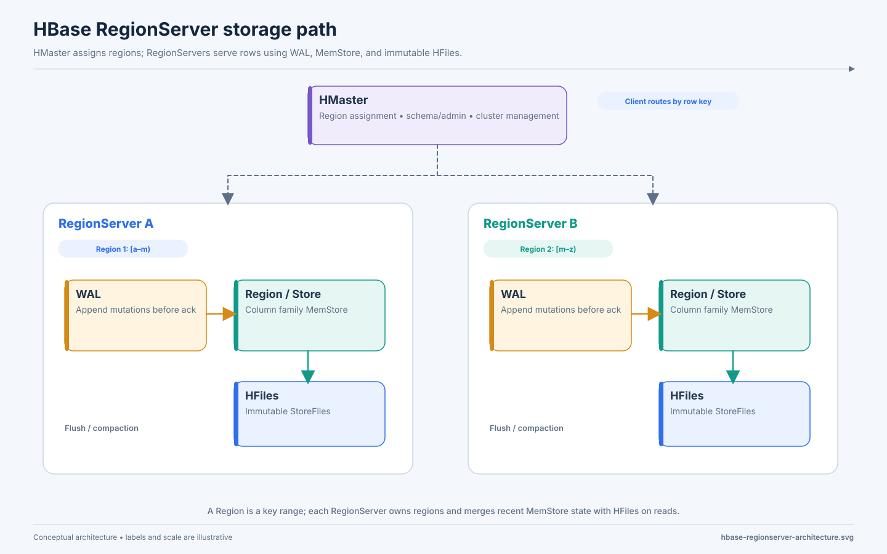

- **Purpose:** Show how HBase routes a row key to a Region and stores mutations.
- **Components and labels:** Client, HMaster, RegionServer A/B, Region, Store per column family, MemStore, WAL, HFiles, compaction.
- **Relationships and data flow:** HMaster assigns region; client routes to RegionServer; Put logs then buffers; flush creates HFile; reads merge MemStore/HFiles.
- **Learning objective:** Understand region ownership and the HBase LSM-style storage path.
- **Suggested layout:** Cluster-level region assignment above one expanded RegionServer storage internals panel.

---

# 12. Document Databases

Document databases store records as JSON-like documents. Documents can contain nested objects and arrays, which can model aggregates such as product details and variants without requiring every field to live in a separate normalized table. Flexible schema supports gradual evolution, but flexibility does not eliminate the need for schema governance, indexes, validation, and migration planning.

## 12.1 Document design trade-offs

- **Embedding:** Store related data inside one document. It can reduce round trips and make aggregate reads/writes simple. It can create large documents, duplication, update contention, and bounded-size problems.
- **Referencing:** Store related data separately and link by identifier. It avoids duplicating large or frequently changing entities but requires additional queries/joins/lookups and consistency management.
- **Document-level atomicity:** Many document stores guarantee atomic updates to one document; multi-document transaction support varies.
- **Secondary indexes:** Make alternate queries possible but add write cost, disk use, and memory/cache pressure.
- **Aggregation:** Server-side pipelines can transform and group documents; pipeline design and indexes determine cost.
- **Schema evolution:** Old and new document shapes may coexist. Application code must handle versioning, defaults, backfills, and validation.

A relational model is preferable when data has strong relationships, many joins, complex constraints, or cross-entity transactions. A document model is attractive when the application reads/writes a natural aggregate and its shape is nested or varies by type.

## 12.2 MongoDB and WiredTiger

MongoDB stores BSON documents in collections. BSON is a binary representation with types and length prefixes, while the application commonly uses JSON-like objects. The default WiredTiger storage engine provides document/collection and index storage, compression, journaling, and checkpointing. MongoDB's standard WiredTiger collection/index implementation should be described as B-tree-oriented; do not casually label MongoDB itself an LSM database.

### Write path (conceptual)

1. Client sends an insert/update/delete to the primary of a replica set or through `mongos` for a sharded collection.
2. MongoDB validates the operation and applies it to the relevant storage structures/indexes under its concurrency and transaction model.
3. WiredTiger journal and checkpoint mechanisms provide local crash recovery; the MongoDB oplog records replicated operations for replica-set members.
4. The write concern determines when the client receives acknowledgement—e.g., after primary application or after specified replication acknowledgement conditions.
5. Secondaries replicate oplog entries and apply them, potentially with lag.

### Read path

A query targets a primary/secondary according to read preference and read concern. The query planner selects an index or collection scan. WiredTiger pages are served from cache or storage; MVCC/concurrency semantics govern visibility. On a sharded cluster, `mongos` routes to relevant shards using the shard key and merges results where needed.

### Replica sets and sharding

- **Replica set:** One primary accepts writes; secondaries replicate via the oplog. Elections choose a new primary after failure, subject to voting/majority rules. Write concern and read concern determine acknowledgement and visibility guarantees.
- **Sharded cluster:** Data is partitioned across shards by a shard key. `mongos` routes queries; config servers hold cluster metadata. Chunks/ranges are balanced/migrated as the distribution changes.
- **Hot shard:** Poor shard key or skewed activity concentrates load on one shard. A shard key must be selected from query patterns and cardinality/distribution, not solely from an entity ID.

### Product catalog example

A product document can embed variant options, color/size metadata, dimensions, and a small number of frequently displayed specifications. Reviews may be a separate collection because they can grow without bound and are queried/paginated independently. Inventory may be separate because it changes frequently and requires transactional invariants. Embedding every review and inventory event into the product would create an ever-growing, contended document.

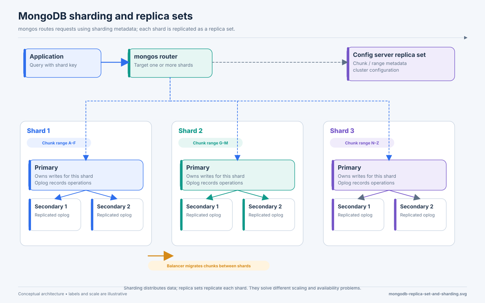

- **Purpose:** Show request routing through mongos to sharded replica sets.
- **Components and labels:** Application, mongos routers, config server replica set, shards 1–3, primary/secondaries per shard, shard key/chunk ranges, migration arrow.
- **Relationships and data flow:** Router consults metadata and targets shard(s); replica set replicates oplog; balancer migrates chunks.
- **Learning objective:** Separate sharding (distribution) from replica-set replication (availability).
- **Suggested layout:** mongos tier above three shard boxes, each with one primary and two secondaries; config servers at side.

---

# 13. NewSQL and Distributed SQL Databases

NewSQL describes systems that aim to retain relational/SQL capabilities and strong transactional semantics while distributing data and query execution across machines. It is not simply “SQL with replicas.” Replicas alone do not partition write ownership or provide transparent distributed transactions. A distributed SQL system must coordinate data placement, transaction concurrency, replication, consensus, and query execution.

## 13.1 Why NewSQL emerged

Traditional single-node relational databases provide mature SQL, constraints, indexes, and ACID transactions, but vertical scaling and a single write leader can become constraints. NoSQL systems can scale horizontally and simplify specific access patterns, but some designs restrict joins, secondary indexes, or transaction scope. Distributed SQL aims to combine relational modeling and transaction guarantees with horizontal distribution, at the cost of additional coordination and operational complexity.

Important concepts:

- **Partitioning:** Split tables/indexes into ranges, tablets, or hash partitions.
- **Consensus replication:** Replicate each partition's ordered log/state using Raft or Paxos-like protocols.
- **MVCC:** Keep multiple versions to support snapshot reads and transaction isolation.
- **Serializable isolation:** Transactions behave as if executed in some serial order, often requiring conflict detection, retries, or distributed coordination.
- **Distributed query:** A query plan is divided into local and remote fragments; data may be shuffled or merged across nodes.
- **Geo-distribution:** Data placement and transaction design consider network latency, locality, and regional failure domains.

## 13.2 Google Spanner

The original Spanner paper describes a globally distributed, synchronously replicated, multi-version database that supports externally consistent distributed transactions. Key ideas include:

- **Directories/splits:** Data is partitioned into key ranges/splits that can move and be replicated.
- **Paxos groups:** Each replicated partition is coordinated by a Paxos group; leader/replica behavior provides a consistent replicated state.
- **TrueTime:** An API exposes a time interval with bounded uncertainty rather than pretending every machine clock is exact. Spanner uses this uncertainty to reason about commit timestamps.
- **External consistency:** If transaction T1 completes before T2 begins in real time, T1's commit precedes T2's commit in the serialization order.
- **Commit wait:** A read-write transaction may wait until the uncertainty interval has passed the commit timestamp before reporting commit, helping guarantee external consistency.
- **MVCC:** Versions allow consistent reads at selected timestamps and historical reads within retention.
- **Distributed transactions:** Read-write transactions use locking/transaction coordination across groups; read-only transactions can often use timestamped snapshots without taking the same write locks.

The important lesson is that global serializable behavior has a real cost: cross-region coordination and time uncertainty affect latency. Spanner's TrueTime infrastructure is a distinctive part of the original design; other products use different clock and transaction strategies.

## 13.3 CockroachDB

CockroachDB exposes a PostgreSQL-compatible SQL interface over a distributed key-value layer. Its data is divided into **ranges** (contiguous key spans), which are replicated using Raft. A range's leaseholder coordinates operations that require a lease/leader-like owner; Raft replication maintains the replicated state. MVCC stores multiple versions, and transactions use distributed coordination and serializable isolation semantics with retries where necessary.

A SQL query is parsed and planned, then translated into key-value operations. The optimizer tries to push work close to data. A query that touches one range may be served locally; a query spanning ranges can be distributed and require data exchange/merge. Cross-range transactions have more coordination points and may be more expensive than single-range operations.

Ranges split as they grow or need load balancing. Replicas can be rebalanced across nodes/failure domains. A range without a quorum cannot safely commit new writes under its consensus protocol; availability is intentionally sacrificed for that range rather than accepting conflicting writes.

## 13.4 TiDB

TiDB separates SQL/query processing from distributed transactional storage:

- **TiDB servers:** Stateless SQL layer that parses, optimizes, and executes SQL; multiple nodes can serve application traffic.
- **TiKV:** Distributed transactional key-value storage. Data is split into Regions; each Region is replicated using Raft. MVCC and transaction protocol support transactional semantics.
- **Placement Driver (PD):** Cluster control plane for timestamp allocation, Region metadata, scheduling, and placement decisions.
- **Percolator-inspired transactions:** TiDB/TiKV use a distributed transaction protocol with prewrite/commit phases and timestamps; exact implementation details and modes vary by version.
- **TiFlash:** Columnar analytical replica/storage engine used to support analytical processing, typically integrated through replication and MPP execution paths.

A SQL query arrives at TiDB, is optimized, and is pushed down to TiKV or TiFlash where possible. TiKV Regions serve transactional row-oriented requests; TiFlash can serve analytical scans. PD coordinates metadata and placement but is not the normal path for every row read.

## 13.5 YugabyteDB

YugabyteDB offers YSQL (PostgreSQL-compatible SQL interface) and YCQL APIs over a distributed storage layer. Tables are partitioned into tablets. Tablet replicas use Raft; a tablet leader coordinates writes. The architecture includes master services for catalog/cluster metadata and tablet servers for data. MVCC and distributed transaction coordination support multi-row operations. Hybrid Logical Clocks (HLCs) combine physical time and logical counters for ordering/causality in the system; they are not identical to Spanner TrueTime.

YSQL compatibility does not mean every PostgreSQL extension, operational behavior, or performance characteristic is identical. The SQL layer translates relational operations into distributed tablet operations, and cross-tablet transactions can incur network and consensus costs.

## 13.6 NewSQL comparison

| Dimension | Spanner | CockroachDB | TiDB | YugabyteDB |
|---|---|---|---|---|
| SQL interface | GoogleSQL and PostgreSQL dialect options in current service; check product/version | PostgreSQL wire/protocol and SQL compatibility | MySQL-compatible SQL | YSQL PostgreSQL-compatible; YCQL API also available |
| Storage architecture | Distributed MVCC database with Paxos-replicated splits | Distributed KV with ranges | SQL layer separated from TiKV KV storage; TiFlash analytical store | YSQL/YCQL over distributed DocDB storage |
| Partitioning unit | Splits/key ranges | Ranges | Regions in TiKV | Tablets |
| Replication | Synchronous Paxos replication groups | Raft range replication | Raft Region replication | Raft tablet replication |
| Consensus | Paxos in the original architecture | Raft | Raft | Raft |
| Transaction model | Distributed read-write and read-only transactions | Distributed SQL transactions | Percolator-inspired distributed transaction protocol | Distributed transactions with MVCC |
| Isolation/ordering | External consistency for supported transaction model | Serializable by default (with retry semantics) | Transaction isolation modes; exact behavior version/config dependent | Serializable semantics for YSQL; check current feature docs |
| Clock strategy | TrueTime uncertainty intervals | Hybrid logical clock / timestamp mechanisms | PD timestamp oracle concepts | Hybrid logical clocks |
| Query execution | Distributed relational execution | Distributed SQL planning/execution across ranges | TiDB optimizer plus pushdown to TiKV/TiFlash | Distributed SQL execution across tablets |
| Multi-region | First-class global placement and replication | Multi-region survival/locality configurations | Multi-region placement options | Multi-region placement and replication |
| Operational model | Managed Google Cloud service | Self-hosted or managed Cloud | Self-managed or managed TiDB Cloud | Self-hosted or managed YugabyteDB |

This is a conceptual comparison, not a version-by-version feature matrix. SQL dialect coverage, isolation modes, multi-region topologies, indexes, backup/restore, and licensing can change; validate the exact product version and deployment mode.

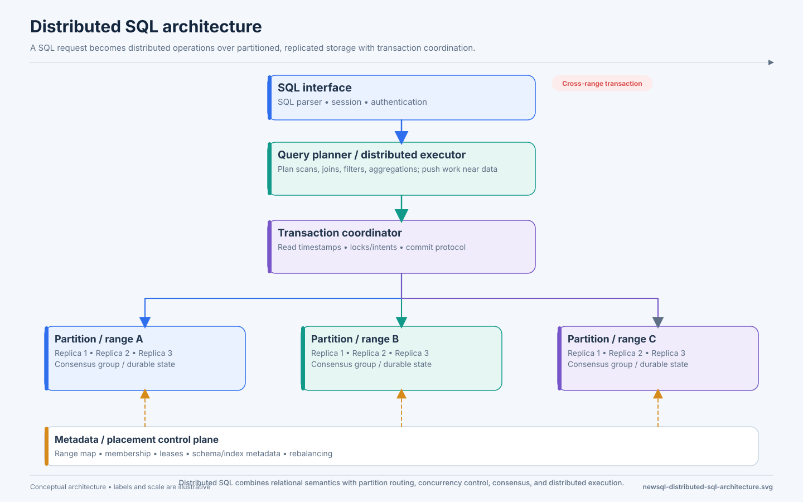

- **Purpose:** Compare the conceptual layers common to distributed SQL systems.
- **Components and labels:** SQL interface, query planner/executor, transaction coordinator, partition/range/tablet layer, consensus replicas, metadata/placement control plane.
- **Relationships and data flow:** SQL request becomes distributed KV operations; transaction coordinator interacts with partitions; consensus replicates committed state.
- **Learning objective:** Understand why distributed SQL needs more than SQL parsing over replicated storage.
- **Suggested layout:** Layered stack with a cross-partition transaction spanning two replicated shards.

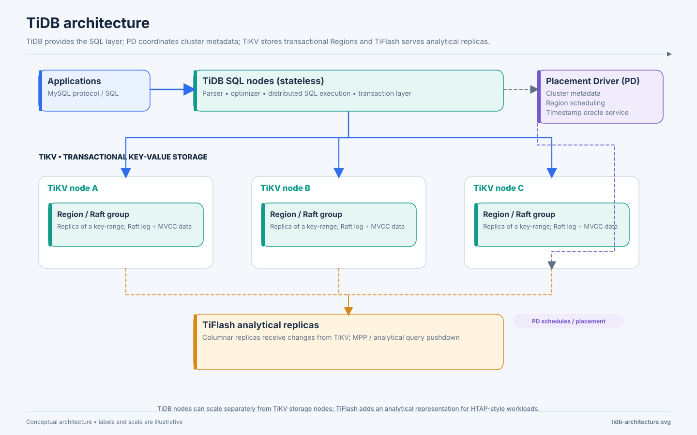

- **Purpose:** Show TiDB's separation of stateless SQL nodes and TiKV/TiFlash storage roles.
- **Components and labels:** Applications, TiDB nodes, PD, TiKV nodes, Region boundaries, Raft replicas, TiFlash analytical replicas.
- **Relationships and data flow:** SQL request to TiDB; PD metadata/timestamps/scheduling; Region operations to TiKV; analytical scan to TiFlash.
- **Learning objective:** Explain the responsibilities of TiDB, PD, TiKV, and TiFlash.
- **Suggested layout:** TiDB tier above storage layer; PD to the side; TiKV Regions and TiFlash replicas below.

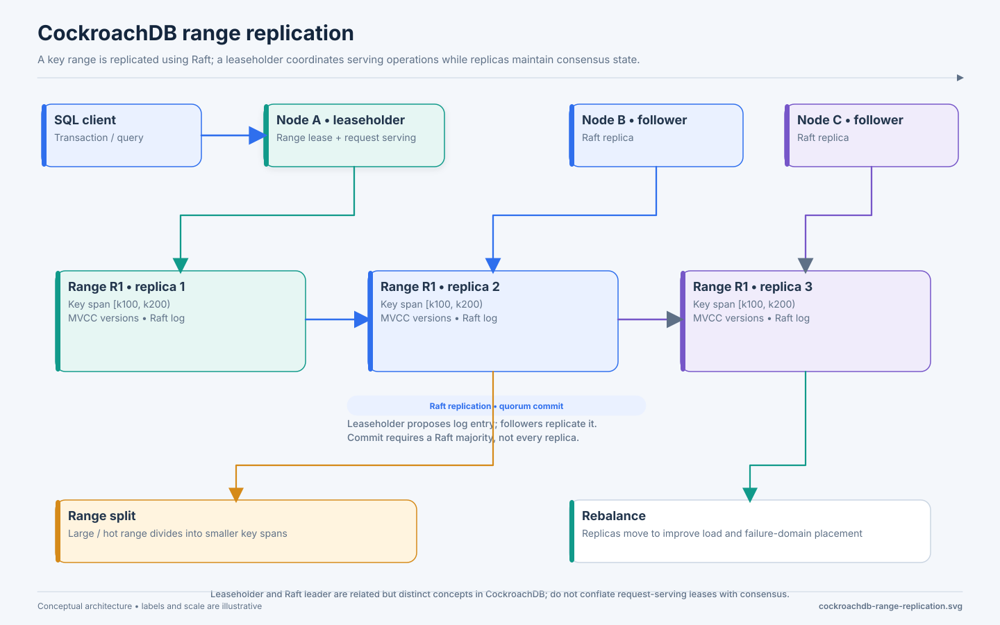

- **Purpose:** Show range replicas and a leaseholder/consensus group.
- **Components and labels:** Nodes A/B/C, stores, range R1, Raft leader/leaseholder, followers, client transaction, split/rebalance arrow.
- **Relationships and data flow:** Client routes to leaseholder; Raft replicates log; quorum commits; range split creates new ranges.
- **Learning objective:** Understand range-level distribution and quorum dependency.
- **Suggested layout:** Three nodes across the page, with one range replicated on all and a leader highlight.

---
# 14. Storage Architecture Decision Framework

Storage selection starts with access patterns and correctness constraints—not brand familiarity. A useful design discussion makes the workload measurable before choosing a technology.

## 14.1 Workload dimensions to collect

| Dimension | Questions to answer | Why it matters |
|---|---|---|
| Read/write mix | Reads/s, writes/s, bytes/s, burstiness, update/delete ratio? | Predicts engine pressure and compaction/page-update cost |
| Key distribution | Uniform, skewed, sequential, hot keys, tenant imbalance? | Determines partition hotspots and cache effectiveness |
| Query shape | Point lookup, bounded range, prefix scan, joins, aggregation? | Determines index and data model requirements |
| Data size | Current logical/physical size and growth per day/month/year? | Drives partition count, retention, backup, and capacity |
| Record/object size | Tiny records, large documents, multi-GB objects? | Determines page/block overhead and storage abstraction |
| Latency SLO | P50/P95/P99 target and maximum tolerated tail? | Affects cache, replication, consistency, and locality |
| Consistency | Read-your-writes, linearizability, serializable transactions, eventual? | Determines coordination and availability trade-offs |
| Transaction scope | One key, one row, partition, multiple partitions, multiple regions? | Determines whether distributed commit is necessary |
| Durability | Which failures must acknowledged writes survive? | Sets WAL sync, quorum, replication, backup, and DR requirements |
| Availability | Allowed error budget during node/rack/zone/region loss? | Drives placement and quorum design |
| Query flexibility | Fixed access patterns or ad hoc SQL/joins? | Relational engines are more flexible; KV/wide-column require modeling around queries |
| Hot/cold profile | What is frequently read, rarely read, or archival? | Supports caching, tiering, and lifecycle policies |
| Index needs | Number of secondary indexes, uniqueness, full-text/spatial? | Indexes consume storage and increase write cost |
| Operations | Who patches, scales, backs up, repairs, and restores? | Managed services reduce some operational burden but add cost/constraints |

## 14.2 Workload-based architecture examples

### Banking and financial ledger

**Recommended shape:** A transactional relational database or distributed SQL platform with durable WAL, explicit transaction boundaries, unique constraints, idempotency keys, and tested backups. Use B-tree indexes for account and time-ordered transaction lookups. A ledger is commonly append-oriented: represent debits/credits as immutable postings and derive balances with controlled materialization, rather than relying only on a mutable balance field.

**Why:** Correctness, auditability, and multi-row atomicity outweigh raw write speed. A distributed SQL choice becomes relevant when availability or data scale requires horizontal placement, but cross-range and cross-region transactions increase latency and retry complexity.

**Failure behavior:** Require commit acknowledgement to meet WAL and replication policy. Use point-in-time recovery from base backup plus WAL archive; replicate to a separate region according to RPO/RTO. Reconcile balances and ledger invariants after recovery.

**Alternatives:** A single PostgreSQL/MySQL primary with synchronous local standby may be simpler at moderate scale. A NoSQL KV store can serve a derived account view but should not replace the authoritative ledger without equivalent transactional guarantees.

### Social media platform

**Recommended shape:** Relational storage for identity, permissions, and relationships that require integrity; a wide-column/LSM event store for high-volume activity; key-value cache for session and feed fragments; object storage/CDN for media; stream processing for feed materialization and analytics.

**Why:** Different entities have different access patterns. A feed is often a derived view, not the canonical record. Fan-out-on-write can make reads cheap for typical users but expensive for users with millions of followers; fan-out-on-read shifts work to request time.

**Failure behavior:** Rebuild feed entries from durable events if cache/feed materialization is lost. Avoid losing authorization changes behind stale caches. Partition by user/time or tenant with explicit hot-key controls.

### Video streaming platform

**Recommended shape:** Object storage for original and transcoded media; CDN for edge delivery; relational/key-value metadata for catalog, entitlements, and playback state; asynchronous transcoding pipeline; checksums and lifecycle policies.

**Why:** Media objects are large, mostly immutable, read-heavy, and geographically distributed. Object storage handles durable blob storage; CDN reduces repeated origin reads and latency.

**Failure behavior:** Retry multipart uploads by part; verify checksums; keep source masters and recovery copies; fail over delivery to alternate origins/CDN paths. A metadata record should not declare an asset published until all required objects/encodings are validated.

### IoT and time-series platform

**Recommended shape:** Partitioned ingestion pipeline feeding an LSM/wide-column or specialized time-series store. Use device/tenant keys with time buckets, compression, downsampling, retention, and time-window compaction. Aggregate hot metrics into a fast analytical store or cache.

**Why:** The workload is append-heavy and time-oriented, but device-level scans and fleet-wide time windows need different key locality. Retention can dominate long-term cost.

**Failure behavior:** Buffer/replicate ingestion events, tolerate late arrival, deduplicate using event IDs, and monitor partition skew/compaction debt. Preserve raw data in object storage if long retention is cheaper there.

### Analytics and data lake

**Recommended shape:** Object storage for durable raw/curated datasets in columnar formats; catalog/metastore for schemas/partitions; distributed query/compute engines; optional HDFS for workloads that specifically benefit from local cluster data locality.

**Why:** Analytics scans large portions of data and benefits from column pruning, compression, partition pruning, and elastic compute. Object storage separates storage and compute scale.

**Failure behavior:** Use immutable or versioned data files, transactional table formats/catalog commits where required, checksums, and separate backups for metadata/catalog. Reprocessing should be deterministic and idempotent.

## 14.3 Decision checklist

1. Write down representative read and write requests, including worst-case hot-key behavior.
2. Define the source of truth and which data is rebuildable.
3. State required transaction scope and consistency semantics.
4. Estimate data size, growth, index overhead, replica overhead, and temporary maintenance headroom.
5. Define RPO/RTO and the exact failure domains tolerated.
6. Test realistic data distribution, not only uniform synthetic keys.
7. Benchmark P95/P99 under compaction, checkpoint, repair, and failover—not only steady state.
8. Include backup/restore and schema migration in the operating design.

---

# 15. Storage Failure Models and Recovery

Storage failures are often partial: one SSD slows down, one rack loses power, a network partition isolates replicas, or a checksum detects one bad block. A robust design specifies what happens for each fault and how the system returns to a healthy state.

## 15.1 Failure classes and responses

| Failure | Likely symptom | Detection | Typical response |
|---|---|---|---|
| Disk/device failure | I/O errors, missing volume, degraded array | SMART/device telemetry, I/O errors, health checks | Fail device, restore from replica/backup, rebuild, replace |
| SSD wear or firmware issue | Rising latency/errors, read-only transition | Wear indicators, error rates, latency histograms | Migrate data, replace device, check firmware and workload |
| Node failure | Heartbeats stop; connections time out | Membership/failure detector | Promote/reroute, re-replicate, recover WAL |
| Rack failure | Many nodes fail together | Rack/zone telemetry | Route to other failure domains, rebuild placement |
| Availability-zone failure | Region-local service loss | Cloud provider and cluster health | Survive with multi-AZ replicas or fail over; account for quorum placement |
| Network partition | Replica groups cannot communicate | Heartbeats, connection and quorum timeouts | Continue only according to consistency protocol; avoid split brain |
| Corrupted block / bit rot | Checksum mismatch | Read verification and scrubbing | Repair from healthy replica or parity; quarantine bad source |
| Missing replica | Reduced redundancy | Replica inventory / under-replication metrics | Re-replicate and monitor repair throughput |
| Metadata loss | Data exists but cannot be located | Namespace/catalog checksum and availability checks | Restore metadata from durable log/backup; maintain metadata redundancy |
| Accidental deletion | Valid data removed | Audit/event records, lifecycle controls | Restore version/snapshot/backup; use retention and approval controls |
| Ransomware / destructive change | Mass overwrite/delete | Anomaly detection, immutable audit, security controls | Isolate credentials, restore offline/immutable backups, rotate keys |
| Software bug / bad upgrade | Corruption or crash across nodes | Canary, invariant checks, error telemetry | Halt rollout, rollback, restore/replay known-good data |
| Incomplete compaction | Extra files or failed task; space pressure | Compaction logs, manifests, pending bytes | Resume/retry safely; preserve old inputs until output is committed |
| Power loss | Crash, unsynced data loss risk | Host/device events, recovery logs | Replay WAL; verify durability assumptions and device behavior |

## 15.2 Recovery mechanisms

- **Replica repair / re-replication:** Rebuild a missing replica from a healthy copy or consensus log. Repair consumes network, disk, and CPU; throttle it so foreground traffic remains healthy.
- **Anti-entropy:** Compare replicas over a range and reconcile differences. Merkle trees can compare large key spaces without transferring all values.
- **Checksums and scrubbing:** Detect latent corruption before the only valid copy is lost. Scrubbing can be expensive, so schedule and rate-limit it.
- **Snapshots:** Capture a point-in-time view; storage-level snapshots may be crash-consistent, application-consistent, or require coordination.
- **Backup:** Keep independent recovery points, ideally isolated from production credentials and failure domains.
- **Point-in-time recovery:** Restore a base backup and replay WAL/log records to a target time or LSN.
- **Disaster recovery:** Restore service in another zone/region, including data, metadata, credentials, encryption keys, DNS, and dependencies.

### Replication is not backup

Replication protects against some infrastructure failures but generally propagates logical changes: a mistaken delete, malicious overwrite, or application bug may reach every replica. A backup provides a historical recovery point separated from the live write path. A sound design usually needs both.

### High availability versus disaster recovery

High availability aims to continue service during local faults with short interruption. Disaster recovery aims to restore service after a large-scale event, often with a larger recovery time and possibly some data loss. Define:

- **RPO (Recovery Point Objective):** Maximum acceptable data loss measured in time.
- **RTO (Recovery Time Objective):** Maximum acceptable time to restore service.

A replicated multi-zone cluster may offer a small RTO for a node loss but still need separate backups for operator error and region disaster.

## 15.3 Production troubleshooting scenarios

### 1. One storage node is much slower than the rest

**Symptoms:** P99 rises only for partitions routed to one node; queue depth, disk latency, or CPU may be abnormal. **Diagnose:** Compare device latency percentiles, compaction/checkpoint work, noisy neighbors, network drops, thermal throttling, and partition skew. **Recover:** Drain/relocate partitions if safe, repair or replace the device, and reduce foreground/repair contention. **Prevent:** Per-node capacity headroom, hardware telemetry, canary maintenance, and automatic rebalancing with throttles.

### 2. LSM database has compaction stalls

**Symptoms:** Pending compaction bytes rise, L0/file counts grow, write latency spikes, and writes may be throttled. **Diagnose:** Compare ingest rate to compaction bandwidth; inspect tombstone volume, skew, disk bandwidth, compression CPU, and free space. **Recover:** Add storage bandwidth/compute, reduce ingestion, tune compaction only with workload evidence, or temporarily provision extra capacity. **Prevent:** Capacity model compaction as foreground-adjacent I/O; alert on debt before stalls.

### 3. B-tree page splits increase write latency

**Symptoms:** Increased page splits, WAL volume, dirty page pressure, and random I/O. **Diagnose:** Examine insert key distribution, page fill factor, index width, and secondary-index maintenance. **Recover:** Rebuild/reorganize where appropriate, change key strategy only with careful migration, and reduce unnecessary indexes. **Prevent:** Choose compact stable keys and monitor index bloat/split behavior.

### 4. DataNode fails during HDFS write

**Symptoms:** Pipeline exception and block under-replication. **Diagnose:** Check DataNode health, network and disk errors, pipeline logs, and NameNode block status. **Recover:** Client pipeline recovers around the failed node and HDFS later re-replicates; verify block health after write. **Prevent:** Rack-aware placement, spare capacity, disk health, and tested decommission/failure procedures.

### 5. Object-storage fragment is corrupted

**Symptoms:** Checksum mismatch or failed read/reconstruction. **Diagnose:** Verify object checksum/version and identify affected replica/fragment. **Recover:** Reconstruct from remaining replicas/fragments, then verify rebuilt checksum. **Prevent:** Scrubbing, independent failure-domain placement, end-to-end checksums, and repair SLOs.

### 6. Redis primary fails during heavy writes

**Symptoms:** Client errors, cluster failover, stale reads, possible loss of recent unreplicated writes. **Diagnose:** Inspect primary logs, replication offset/lag, Sentinel/Cluster state, memory pressure, and persistence health. **Recover:** Promote an eligible replica, reconnect clients, rebuild cache misses from source of truth, and reconcile any correctness-sensitive writes. **Prevent:** Do not use cache replication as a substitute for durable transactional storage; test failover under write load.

### 7. Cassandra node returns stale data

**Symptoms:** Inconsistent reads across coordinators or replicas. **Diagnose:** Check consistency level, replica availability, timestamp/tombstone behavior, clock assumptions, repair history, and hinted handoff. **Recover:** Run targeted repair/read repair as appropriate and validate conflict policy. **Prevent:** Use suitable consistency levels, repair cadence, stable clocks, and data modeling that avoids conflicting updates.

### 8. HBase RegionServer crashes

**Symptoms:** Regions temporarily unavailable; WAL recovery and reassignment activity. **Diagnose:** Check RegionServer logs, JVM/GC, HDFS availability, WAL integrity, and region assignment. **Recover:** Reassign regions and replay WAL edits; verify resulting HFiles and compaction state. **Prevent:** Capacity headroom, region sizing, WAL monitoring, and tested rolling restart procedures.

### 9. Distributed SQL range loses quorum

**Symptoms:** Writes to range fail or time out; reads may also be restricted depending on read mode and lease state. **Diagnose:** Check replica node/rack/zone reachability, Raft state, disk health, and placement. **Recover:** Restore quorum by recovering/replacing replicas; do not force unsafe divergent writes. **Prevent:** Spread replicas across independent failure domains and preserve spare capacity.

### 10. WAL grows without truncation

**Symptoms:** Disk fills despite stable logical data size. **Diagnose:** Inspect checkpoint progress, replication slots/consumers, archiving failures, backup retention, and long-running transactions. **Recover:** Fix the blocked dependency; remove obsolete retention only after confirming recovery requirements. **Prevent:** Alert on WAL age and volume, test archive destinations, and set explicit retention policies.

### 11. Storage use rises while logical data stays stable

**Symptoms:** Physical bytes grow, live row count stable. **Diagnose:** Check old MVCC versions, tombstones, compaction debt, fragmentation, index bloat, snapshots, retained WAL, and replica/backup copies. **Recover:** Vacuum/compact/reclaim only after validating retention/snapshot safety. **Prevent:** Monitor logical-to-physical ratio and schedule maintenance capacity.

### 12. Hot partition causes P99 latency

**Symptoms:** One shard/region receives disproportionate traffic; throttling or queueing concentrated on it. **Diagnose:** Inspect partition-level request rates and key histograms. **Recover:** Split/salt/shard hot keys if the data model allows; add capacity or move partition ownership. **Prevent:** Model expected skew and design write distribution deliberately.

---
# 16. Quantitative Reasoning and Worked Examples

Every number below is hypothetical. The goal is to develop estimation habits, not to substitute a back-of-the-envelope result for workload testing.

## 16.1 B+ tree height and page accesses

Assume 1 billion records, 16 KiB pages, 122 leaf entries/page, and internal fan-out 350 (derived in [Section 3.4](#34-numerical-worked-example-one-billion-records)). Leaf pages ≈ 8.20 million. Two internal levels above those leaves can cover 350² = 122,500 leaves, while three can cover 42.9 million. Therefore, a root plus two internal levels plus leaves is a plausible four-page-level tree. A cold lookup costs about four index-page reads, plus a separate heap/data page for a nonclustered index. Upper levels are usually cached, reducing device reads.

## 16.2 Disk page access estimate

If a cold lookup requires four random reads and average device-level random-read latency is 100 µs, the raw serial I/O contribution is roughly 400 µs. If the root and first two internal pages are cached, only one leaf read may be needed. Real request latency also includes CPU, locks/latches, queueing, WAL interaction for writes, network, and possible data-page fetches.

For a range of 10,000 entries at 122 entries/page, about 82 leaf pages are read. At 16 KiB/page this is about 1.28 MiB of page traffic. Sequential adjacency and read-ahead can improve throughput compared with 10,000 separate point lookups.

## 16.3 LSM read amplification

Assume a point lookup must consult the active memtable, one immutable memtable, and up to four candidate SSTables across upper levels because their key ranges overlap. In the worst case it performs up to six logical structure checks (not necessarily six physical reads—Bloom negatives and cache hits may avoid I/O). With a Bloom false-positive probability of 1%, a file that does not contain the key has roughly a 1% chance of passing the filter, under the model assumptions. If four absent candidate files are checked independently, chance of at least one false positive is approximately \(1-(0.99)^4 \approx 3.94\%\). This demonstrates why filters reduce, but do not eliminate, reads.

## 16.4 LSM write amplification

Suppose an application writes 100 GB/day of logical records. The engine flushes each byte once to L0 and, due to compaction, rewrites data an average of 4 additional times. Simplified physical writes = 100 × (1 + 4) = 500 GB/day; write amplification = 5×. This ignores WAL writes, replication, compression ratio, metadata, and filesystem/device overhead. Measure at a clearly defined boundary (engine logical bytes vs host block writes).

## 16.5 Compaction throughput and debt

Suppose incoming writes create 180 MB/s of data that eventually needs 4× total write traffic after flush and compaction. Approximate storage write demand is 720 MB/s. If the device sustains 1.0 GB/s for the database but foreground reads/writes already consume 450 MB/s, only about 550 MB/s remains for compaction. The backlog grows at roughly 170 MB/s equivalent, so a 1 TB backlog could take about 1.6 hours to drain even if ingest stops and capacity remains steady. In reality, compaction is multi-stage and CPU/network limits can dominate. This example shows why compaction must be budgeted as continuous work.

## 16.6 Bloom filter sizing

For one million keys and a 1% false-positive target, the idealized formula gives 9.59 bits/key, about 1.14 MiB, and approximately 7 hash functions. At 10 million keys, the same rate requires about 11.4 MiB. This is modest compared with many datasets, but filters for many SSTables and column families can consume meaningful memory. Actual formats use implementation-specific optimizations.

## 16.7 WAL throughput and group commit

Assume 40,000 transactions/s and an average WAL record volume of 600 bytes per transaction. Raw logical log generation is:

\[
40{,}000 \times 600 = 24{,}000{,}000\text{ bytes/s} \approx 22.9\text{ MiB/s}
\]

With 2× additional log metadata/page overhead, reserve roughly 45.8 MiB/s in this simplified model. If the device can sustain 1,000 durable syncs/s but transactions arrive at 40,000/s, individual sync per transaction would be inadequate. Grouping an average of 40 transactions per sync can make the sync rate about 1,000/s, subject to the actual batching window and load. The latency cost is the time transactions wait to join a batch.

## 16.8 Replication overhead

A 600 GB logical dataset with three complete replicas consumes 1.8 TB before indexes, logs, backups, and free-space reserve. Raw overhead is 200%. A replication factor of 5 would consume 3 TB, or 400% overhead. This capacity calculation says nothing by itself about quorum policy or availability zones.

## 16.9 Erasure coding overhead

For a 6+3 code, storage multiplier is 9/6 = 1.5. A 600 GB dataset consumes 900 GB, with 50% parity overhead. Three fragment failures are recoverable if any six fragments remain valid and independently accessible. A repair must still read enough surviving fragments and write rebuilt fragments, often causing substantial network traffic.

## 16.10 HDFS capacity planning

Assume 500 TB logical data and replication factor 3. Raw block storage is at least 1.5 PB. If the target steady-state utilization is 70%, provision raw capacity of about 1.5 PB / 0.70 = 2.14 PB. Add more headroom for growth, rebalancing, failed-node replacement, snapshots, and temporary write pipeline needs. If an erasure-coded policy is used for a dataset, calculate by its code ratio instead of replication factor and account for recovery behavior.

## 16.11 Object storage capacity planning

Assume 80 TB/month of new media, average retained for 18 months, and an average 1.2× multiplier for noncurrent versions/metadata/temporary multipart parts (illustrative). Steady-state logical stored data is 80 × 18 = 1,440 TB. Applying 1.2× gives 1,728 TB before the provider's internal redundancy, which should not be multiplied again unless the billing/capacity model explicitly requires it. If lifecycle rules move older data to archival tiers, storage cost may fall but retrieval time/charges and minimum duration rules matter.

## 16.12 Redis memory sizing

Assume 20 million cached entries with average serialized payload 700 bytes. Payload alone is 14 GB (20M × 700). If key strings, object encoding, allocator fragmentation, hash-table overhead, and metadata add an illustrative 60%, dataset memory becomes 22.4 GB. Add 30% operating headroom for buffers, client connections, replication, and persistence copy-on-write: provision roughly 29.1 GB, before high-availability replica memory. This estimate must be validated using Redis `MEMORY USAGE`, `INFO MEMORY`, representative key types, and realistic persistence/failover tests.

## 16.13 Shard storage distribution

A 24 TB dataset divided evenly across 12 shards has 2 TB logical data/shard. With three replicas per shard, total replica storage is 72 TB, or 6 TB per logical shard group across its three copies. If the largest tenant contributes 30% of all data, an even shard count does not guarantee even load; tenant distribution and partition-key skew must be measured.

## 16.14 Node recovery time

A failed node held 12 TB of unique replica data to rebuild. If effective rebuild bandwidth is 400 MB/s, idealized transfer time is:

\[
12{,}000{,}000\text{ MB} / 400\text{ MB/s} = 30{,}000\text{ s} \approx 8.3\text{ hours}
\]

Real recovery takes longer because of foreground workload, throttling, verification, retries, network contention, and data placement constraints. A cluster should avoid allowing a prolonged under-replicated state to overlap with another failure.

## 16.15 Network bandwidth for replica repair

Rebuilding 12 TB within 6 hours requires average payload bandwidth of approximately:

\[
12\text{ TB} / 21{,}600\text{ s} \approx 556\text{ MB/s} \approx 4.45\text{ Gbit/s}
\]

This is payload-only and assumes continuous transfer. Protocol overhead, checksum work, encryption, competing traffic, and multiple simultaneous repairs require more capacity. If several nodes fail together, repair traffic can multiply.

## 16.16 Group commit latency illustration

If the average transaction arrival rate is 20,000/s and the group-commit delay window is 1 ms, about 20 transactions may arrive per window on average under steady load. If a durable flush takes 0.8 ms, the additional batch wait plus flush could put commit acknowledgement around 1.8 ms after an arrival near the start of the window, before queueing. Low-load periods may create smaller batches and different latency. Tune to an SLO rather than maximizing batch size blindly.

---

# 17. Architecture Design Exercises

Each exercise is a worked design prompt. Numbers are hypothetical and intended to expose assumptions. In an interview, begin by clarifying requirements and identifying the source of truth before drawing boxes.

## 17.1 Global banking transaction storage

**Requirements:** 20 million active accounts, 5,000 ledger writes/s average and 20,000/s peak, account history by time, strong integrity, multi-region recovery, auditability. Assume 1.5 KB per ledger posting including logical metadata.

**Model and estimates:** At 5,000 writes/s, logical ingest is 7.5 MB/s or about 648 GB/day. With three replicas, a raw replica capacity estimate is 1.94 TB/day, before indexes/WAL/backups. Define retention and archival separately.

**Architecture:** Transactional relational/distributed SQL source of truth; account and timestamp composite indexes; immutable double-entry ledger postings; WAL and synchronous replication within the required fault domain; separate encrypted backups and archived WAL; object storage for long-term immutable exports.

**Partitioning:** Partition by account or account-range where possible, but transfers between accounts may cross partitions. If using distributed SQL, model the cross-account transaction cost and retry handling. Keep account ownership and ledger invariants explicit.

**Durability/failures:** Commit must wait for documented durable/replicated state. Region DR may have an RPO/RTO trade-off; do not imply synchronous global commit is free. Test recovery and financial reconciliation.

**Alternatives/trade-offs:** Single-region relational primary plus synchronous local standby is operationally simpler; global distributed SQL provides scale/placement but increases transaction latency and operational complexity.

## 17.2 Social media activity and feed storage

**Requirements:** 100 million users, 50 million daily active users, 2 billion activity events/day, recent feed reads under 100 ms P95 in-region. Assume average event record 500 bytes.

**Capacity:** 2B × 500 bytes = 1 TB/day logical; 30 days is 30 TB before indexes/replication. Three copies of the hot event store would require about 90 TB raw.

**Architecture:** Event ingestion via durable stream; LSM/wide-column store partitioned by user/time or tenant/time; Redis for hot feed slices; relational DB for users/permissions; object storage for media. Materialize feeds asynchronously for most users; use fan-out-on-read for exceptionally high-follower accounts.

**Index/partition:** Avoid one global timestamp partition. Salt/bucket time-based partitions; use user ID and time bucket for per-user history. Monitor celebrity/hot-key behavior.

**Failure:** Rebuild feed materialization from events; deduplicate using event ID; authorization checks remain fresh enough to honor blocks/privacy settings.

## 17.3 Video streaming object storage

**Requirements:** 10 million new videos/year, average source size 1.2 GB, multiple transcoded renditions, 5-year retention, global playback.

**Capacity:** Source ingest alone is 12 PB/year. If renditions add 1.5× source size, total new data is roughly 30 PB/year. Use object storage with lifecycle policies, versioning/retention where appropriate, and CDN integration.

**Architecture:** Multipart upload to a staging prefix; checksum validation; asynchronous transcode; publish metadata only after required renditions exist; immutable rendition objects keyed by video ID and version; CDN caches hot content.

**Failure:** Retry failed parts, abort stale multipart sessions, maintain source master, track workflow state idempotently, and preserve metadata/catalog backups. Erasure coding may be appropriate for cold object data; hot delivery uses cache/replica behavior.

## 17.4 IoT time-series database

**Requirements:** 5 million devices, one metric every 10 seconds, 50 bytes/point logical, 30-day hot retention, 1-year aggregate retention.

**Throughput:** 5M / 10 = 500,000 points/s. At 50 bytes, 25 MB/s or about 2.16 TB/day uncompressed logical. Compression/downsampling can materially reduce retained storage, but benchmark actual metric cardinality and labels.

**Architecture:** Ingestion stream; LSM/wide-column time-series store with hashed device prefix plus time bucket; rollups/downsampling; object storage archive. Use TTL/compaction for old raw data.

**Failure:** Buffer with replay offsets, deduplicate late/retried events, monitor compaction and partition hotspots, and keep event time separate from ingestion time.

## 17.5 Distributed product catalog

**Requirements:** 100 million SKUs, variable attributes per category, 50,000 reads/s, 2,000 writes/s, search by text and filtered facets.

**Architecture:** Relational or document database as catalog source of truth; search engine as rebuildable derived index; object storage for product media; cache popular product views. Transactions coordinate catalog state; outbox/event pipeline updates search index.

**Data model:** Embed bounded product variants/specification groups; model reviews and inventory separately if unbounded or independently updated. Keep stable SKU identifiers and category schema versions.

**Failure:** Search index can be rebuilt from canonical records; cache misses fall back to DB; ensure unpublished/deleted products are not exposed by stale search results beyond the accepted consistency window.

## 17.6 Multi-petabyte analytics data lake

**Requirements:** 5 PB raw data, 100 TB new per month, dozens of concurrent analytical users, scans over date/tenant partitions, compute scales independently.

**Architecture:** Object storage for raw/curated columnar files; table metadata/catalog and transactional table format if concurrent writers/readers need atomic snapshots; distributed SQL/compute engine; lifecycle policy for cold data. HDFS remains an option for tightly coupled cluster workloads with data locality but adds cluster storage operations.

**Partitioning:** Partition on commonly filtered dimensions such as event date and coarse tenant; avoid millions of tiny partitions/files. Compact small files and cluster/sort where query patterns justify it.

**Failure:** Immutable raw layer permits reprocessing; protect catalog/metadata separately; validate table snapshots and backup metadata. Budget object request, data transfer, and scan costs.

## 17.7 High-throughput event ingestion system

**Requirements:** 1 million events/s peak, 1 KB/event, 24-hour hot replay, 90-day queryable retention.

**Throughput/capacity:** Peak ingest is about 1 GB/s (decimal), roughly 86.4 TB/day if sustained. This scale requires partitioned ingestion and storage; do not assume one database node can absorb it.

**Architecture:** Partitioned durable log (e.g., Kafka-like) as ingestion buffer; consumers write to LSM/wide-column store for queries and object storage for immutable bulk history; schema registry; idempotent consumer offsets.

**Partitioning:** Use enough partitions for consumer parallelism, balanced keys, and ordering scope. A single global ordering requirement would be extremely expensive; define per-entity ordering instead.

**Failure:** Replay from committed offsets; make sink writes idempotent; monitor consumer lag, backpressure, storage write amplification, and object upload backlog.

## 17.8 Globally distributed transactional SQL database

**Requirements:** 15 regions, customer records and orders, serializable order placement, read locality, no acknowledged data loss for specified region failures, P99 target under 250 ms for local transactions.

**Architecture:** Distributed SQL with region-aware placement, consensus replication, MVCC, and explicit locality policies. Keep transactionally related rows in the same locality/range when feasible. Use follower/local reads only where consistency contract allows.

**Trade-offs:** Global synchronous transactions can exceed a 250 ms budget due to inter-region round trips. Distinguish transactions that need global atomicity from those that can execute regionally and replicate asynchronously. Use per-region ownership for localized writes where business rules permit.

**Failure:** Quorum loss prevents writes to affected ranges; failover and re-replication require enough surviving replicas. Backups remain necessary for logical corruption and operator errors.

---

# 18. Important Conceptual Distinctions

| # | Distinction | Precise difference | Example and why it matters |
|---:|---|---|---|
| 1 | Storage engine vs database | Engine manages physical records/indexes/logs; DBMS adds SQL/API, transactions, authorization, constraints, and query planning. | RocksDB can be embedded inside a database/service; it is not a complete relational DBMS. |
| 2 | B-tree vs B+ tree | B-tree variants may store payloads in internal nodes; B+ tree keeps data entries at leaves and routes through compact internal pages. | B+ leaf links support efficient range scans and high fan-out. |
| 3 | LSM vs B-tree | LSM buffers/flushes/compacts immutable sorted files; B-tree updates page-oriented structure. | Choose based on write/read mix, amplification, and maintenance behavior. |
| 4 | WAL vs SSTable | WAL is an append log for recovery; SSTable is an immutable sorted representation of stored data. | WAL protects unflushed memtable updates; SSTable serves durable sorted reads. |
| 5 | Memtable vs SSTable | Memtable is mutable in-memory ordered state; SSTable is immutable on-disk sorted state. | Memtable threshold triggers flush; SSTables later compact. |
| 6 | Flush vs compaction | Flush writes one memtable to new immutable files; compaction merges existing files/versions. | Flush frees mutable memory; compaction controls read/space amplification. |
| 7 | Read/write/space amplification | Extra bytes/operations read, written, or stored relative to logical workload. | A 5× LSM write amplification means 100 GB logical may cause 500 GB physical engine writes. |
| 8 | Redo log vs undo log | Redo repeats changes; undo reverses uncommitted effects. | ARIES-style recovery uses both concepts and compensation log records. |
| 9 | Local vs distributed storage | Local storage is attached to one machine; distributed storage spans nodes/failure domains and adds routing/repair/consistency. | A local NVMe database needs node-level backup/replication for host failure. |
| 10 | Distributed filesystem vs object storage | Filesystem exposes paths, directories, and file semantics; object store exposes objects by keys and API operations. | HDFS supports compute locality; S3-like storage supports massive durable blobs and range GETs. |
| 11 | GFS vs HDFS | Both use metadata manager plus data nodes, but differ in protocols, implementation, defaults, and consistency semantics. | GFS's historical chunk/lease model is not identical to HDFS's NameNode/DataNode pipeline. |
| 12 | Object vs block storage | Objects are API-addressed blobs with metadata; block storage exposes sectors/volumes for a filesystem or DB. | Do not treat object PUT/GET like random block writes. |
| 13 | Replication vs erasure coding | Replication stores full copies; erasure coding stores data plus parity fragments. | 3× replication of 600 GB is 1.8 TB; 6+3 coding is 900 GB but costs more to reconstruct. |
| 14 | Backup vs replication | Replication mirrors current changes; backup preserves historical recovery points separately. | Replication can copy accidental deletion; backup can restore a previous version. |
| 15 | Dynamo vs DynamoDB | Dynamo is an original availability-oriented design/paper; DynamoDB is a managed AWS database with its own documented API and guarantees. | Do not assume DynamoDB exposes vector clocks or sloppy-quorum knobs. |
| 16 | Redis persistence vs replication | Persistence lets a node reconstruct state after restart; replication copies writes to other nodes. | Async replica lag can lose recent writes at failover even when RDB/AOF exists. |
| 17 | Key-value vs wide-column | KV treats a key as lookup unit; wide-column adds ordered partition/row keys, families, qualifiers, and versions. | Wide-column supports sparse time-series rows but requires careful row-key design. |
| 18 | Wide-column vs columnar analytics | Bigtable-style wide-column stores sparse distributed rows; columnar analytics stores values by column for scans/compression. | Bigtable is not equivalent to Parquet or a columnar warehouse. |
| 19 | Document vs relational DB | Document DB stores nested aggregates; relational DB emphasizes normalized tables, joins, constraints, and SQL. | Embed bounded variants; keep unbounded reviews/inventory in separate collections/tables. |
| 20 | NoSQL vs NewSQL | NoSQL commonly prioritizes specific scale/data models; NewSQL aims for distributed SQL and transactional semantics. | NewSQL still pays for coordination and cross-range transactions. |
| 21 | Partitioning vs replication | Partitioning divides distinct data; replication duplicates the same data. | 12 shards × 3 replicas means each logical partition has three copies. |
| 22 | Consensus replication vs storage replication | Consensus orders operations and decides committed state; storage replication may simply copy bytes/blocks. | Raft range replication is not the same as asynchronously copying a file to a backup bucket. |
| 23 | Distributed SQL vs sharded SQL | Distributed SQL manages partitioning/transactions/query routing as one system; sharded SQL often requires app-level routing and cross-shard orchestration. | Transparent SQL does not eliminate cross-shard latency or retry handling. |

---
# 19. Interview Preparation — 120 Questions with Answers

The answers below aim to show the mechanism, trade-off, and design implication. In an interview, begin with the workload and failure assumptions; avoid absolute statements such as “LSM is always faster” or “three replicas guarantee durability.”

## 19.1 Beginner (Questions 1–30)

### 1. What is a storage engine?
A storage engine is the subsystem responsible for physically organizing data and implementing low-level reads, writes, indexes, logs, pages, and recovery. A DBMS adds query planning, SQL/API semantics, transactions, authorization, and schema management around it.

### 2. What is the difference between RAM and persistent storage?
RAM provides low-latency working memory but loses contents when power is removed. SSDs/HDDs retain data across power cycles, but access is slower and must be coordinated through OS, filesystem, controller, and device durability semantics.

### 3. What is a B-tree?
A B-tree is a balanced multiway search tree whose nodes hold multiple sorted keys and child pointers. High fan-out keeps height low, reducing the number of storage pages required for point lookups.

### 4. What is a B+ tree?
A B+ tree is a B-tree variant in which internal pages primarily route searches and all data entries are stored at leaf level. Linked leaves make ordered range scans efficient and compact internal pages improve fan-out.

### 5. Why are binary search trees usually unsuitable for large disk datasets?
A binary tree has a small fan-out and can require many pointer/page traversals. A page-oriented B+ tree packs hundreds of routing entries into one I/O unit, greatly reducing tree height.

### 6. What is an LSM tree?
An LSM tree buffers writes in memory and flushes them as immutable sorted files, which are merged by compaction. It favors write batching and sequential I/O but creates read and maintenance work across multiple files.

### 7. What is a memtable?
A memtable is an in-memory ordered data structure that holds recent writes in an LSM engine. When it reaches a threshold, it becomes immutable and is flushed to an SSTable.

### 8. What is an SSTable?
A Sorted String Table is an immutable file containing key/value records in sorted order. It commonly includes data blocks, an index, metadata, checksums, and possibly a Bloom filter.

### 9. What is a write-ahead log?
A WAL is an append-oriented recovery log that records changes before corresponding data pages are allowed to become durable. After a crash, the engine replays or rolls back logged changes according to its recovery algorithm.

### 10. What is compaction?
Compaction merges immutable sorted files, resolves multiple versions, and removes obsolete data/tombstones when safe. It controls read and space amplification but consumes CPU, disk bandwidth, and temporary capacity.

### 11. What is a Bloom filter?
A Bloom filter is a probabilistic structure that tests whether a key may be present in a set. It can produce false positives but, under its assumptions, not false negatives; it avoids unnecessary SSTable reads.

### 12. What is a distributed file system?
It presents file and directory semantics while storing file blocks/chunks across multiple machines. Metadata services locate blocks, and storage nodes serve the data directly to clients.

### 13. What is object storage?
Object storage stores byte objects addressed by keys and accompanied by metadata. It is designed for large-scale durable blobs, lifecycle management, and API access rather than in-place block-level transactions.

### 14. What is a key-value database?
It stores values addressed by keys and optimizes lookup/mutation by that key. Query capability beyond key access varies, so data modeling must align with the application's access patterns.

### 15. What is a wide-column database?
It stores sparse, ordered rows identified by row keys, with columns grouped into families and often timestamped versions. It scales around partition/row-key access patterns rather than arbitrary relational joins.

### 16. What is a document database?
It stores JSON-like or binary documents that can contain nested fields and arrays. It is useful when an application reads/writes an aggregate as a unit, but unbounded embedded data and cross-document consistency need care.

### 17. What is write amplification?
Write amplification is physical write volume divided by logical write volume at a stated measurement boundary. LSM compaction, WAL, page rewrites, and replication can all contribute, but should not be combined without defining the boundary.

### 18. What is read amplification?
Read amplification is the extra physical/logical read work needed to return a result. An LSM lookup may check multiple SSTables; a nonclustered B-tree lookup may read both index and heap pages.

### 19. What is space amplification?
Space amplification is the physical capacity used relative to live logical data. Old versions, tombstones, fragmentation, temporary compaction files, indexes, and replicas increase it.

### 20. What is a tombstone?
A tombstone is a deletion marker retained in an immutable storage structure so older copies of a value are not accidentally returned. It can be removed only when the engine knows older versions are no longer needed or visible.

### 21. What is replication?
Replication maintains multiple copies of the same logical data on separate nodes or failure domains. It can improve availability and read scale, but does not replace historical backups.

### 22. What is partitioning or sharding?
Partitioning divides a dataset into disjoint subsets, each managed by a different storage unit. The partition key affects data distribution, locality, hotspots, and the cost of cross-partition queries.

### 23. What is erasure coding?
Erasure coding transforms data into data and parity fragments so the original can be reconstructed from a sufficient subset. It often uses less capacity than full replication but makes repair and reconstruction more computationally and network intensive.

### 24. What is a checksum?
A checksum detects accidental data corruption by comparing a computed value with a stored/expected value. It identifies corruption but requires a replica, parity, or backup to repair the damaged content.

### 25. What is a buffer pool?
A buffer pool is a database-managed cache of disk pages in memory. It reduces physical reads for hot pages and coordinates dirty-page flushing, eviction, and page pinning.

### 26. What is a checkpoint?
A checkpoint records a recovery boundary/state so a database need not replay its entire history after a crash. Checkpoints may flush dirty pages or record which pages still require redo, depending on the engine.

### 27. What is a distributed key-value store?
It is a key-value interface backed by partitioned and replicated state across nodes. It needs a routing mechanism, replica protocol, membership/failure handling, and repair strategy.

### 28. What is a hot partition?
A hot partition receives disproportionate traffic or data compared with others. It causes queueing and tail latency even when total cluster capacity appears sufficient.

### 29. What is data locality?
Data locality means running computation near the storage holding the input, minimizing network transfer. It is especially useful for large distributed file-system scans and batch processing.

### 30. Why is a backup different from a replica?
A replica follows current updates, including accidental deletes or corruption. A backup preserves an independent historical recovery point and can restore data to a prior state.

## 19.2 Intermediate (Questions 31–70)

### 31. Compare B-tree and B+ tree storage layouts.
A B-tree variant may place records in internal nodes, while a B+ tree routes through internal separator pages and stores entries at leaves. B+ trees typically provide higher internal fan-out and efficient sequential leaf traversal.

### 32. Why do B+ trees have high fan-out?
A page stores many separator keys and pointers rather than one key per node. The number of child pointers per page can be hundreds, so tree height grows logarithmically with a large base.

### 33. How does a B+ tree range scan work?
The engine descends once to the first matching leaf, then follows linked leaf pages in key order until the range ends. This avoids repeating a full root-to-leaf descent for every row.

### 34. What causes a B-tree page split?
An insertion overflows a page. The engine divides entries across two pages, inserts a separator into the parent, and may propagate a split upward if the parent is full.

### 35. What is a clustered index?
A clustered index determines the physical/logical order in which table rows are stored in the index structure. In InnoDB the primary key is clustered, so secondary indexes carry the primary-key value as a row locator.

### 36. Why can a wide primary key be expensive in InnoDB?
Every secondary index stores the primary key along with its secondary key to locate the clustered row. A wide primary key therefore increases all secondary-index entries and can raise memory, disk, and write costs.

### 37. Explain the LSM write path.
The engine appends a mutation to WAL, inserts it into the active memtable, and acknowledges according to durability policy. When memory thresholds are reached, immutable memtables flush to SSTables; compaction later merges files and removes obsolete versions.

### 38. Explain the LSM read path.
The engine checks active and immutable memtables, then candidate SSTables. Bloom filters and sparse indexes reduce file/block reads, and the engine merges versions/tombstones to return the newest visible value.

### 39. Why are SSTables immutable?
Immutable files avoid in-place mutation races and simplify caching, concurrent readers, and crash-safe file installation. Updates create new versions; compaction merges those versions later.

### 40. How does a Bloom filter reduce I/O?
It can say a key is definitely absent from an SSTable, allowing the engine to skip that file. A “possibly present” result still requires index/data lookup because false positives are allowed.

### 41. Why can an LSM database experience write stalls?
If flush or compaction throughput falls behind ingestion, immutable memtables or L0 files accumulate. The engine throttles writes to prevent unbounded file count, read amplification, and disk exhaustion.

### 42. Compare leveled and size-tiered compaction.
Leveled compaction constrains overlap in lower levels and often improves read predictability at the cost of more rewriting. Size-tiered compaction merges similarly sized runs and can offer good write throughput but may permit more overlapping files and space spikes.

### 43. What is a WAL checkpoint?
It marks a point from which crash recovery can begin with less historical log scanning, based on the state of dirty pages and transactions. WAL before the checkpoint can be reclaimed only when no recovery/replication/backup dependency still needs it.

### 44. Why must WAL be durable before data pages?
If a page reaches disk without the log record needed to recover or explain it, crash recovery can leave an inconsistent state. WAL ordering ensures the database can redo or undo changes after an interrupted page write.

### 45. Explain redo and undo recovery.
Redo reapplies changes needed to reflect logged history in data pages; undo reverses effects of transactions that did not commit. An engine may use redo-only, undo-only, or combined strategies, often with checkpoints and transaction state.

### 46. What is group commit?
Multiple transactions share one durable log flush. This amortizes sync overhead and increases throughput, but batching may add a small wait before acknowledgment.

### 47. What is the difference between WAL and a replication log?
A local WAL primarily protects one node's storage state across crash recovery. A replication/consensus log establishes ordered operations across replicas and a commit decision; one product can build one layer on top of another.

### 48. Explain the GFS architecture.
The original GFS used a master for namespace/chunk metadata and chunkservers for actual chunk data. Clients asked the master for locations and then read/wrote directly to chunkservers; leases and a primary replica ordered mutations.

### 49. Why did GFS use large chunks?
Large chunks reduced metadata overhead and suited large sequential workloads. A large chunk can be inefficient for many tiny files or random small-record workloads, which were not the original system's primary target.

### 50. What does the GFS master do?
It manages namespace, chunk metadata, replica locations, and leases; it is not intended to proxy every byte of application data. Keeping bulk data out of the master data path avoids making it a bandwidth bottleneck.

### 51. Explain the HDFS write pipeline.
The client requests block allocation from the NameNode, then streams packets through a selected chain of DataNodes. Each node writes and forwards data; acknowledgements flow back in reverse, and failures trigger pipeline reconfiguration and later re-replication.

### 52. Is the HDFS Secondary NameNode a standby NameNode?
No. Its traditional role is checkpointing namespace image and edit logs. High Availability deployments use active/standby NameNodes and failover coordination; these are separate concepts.

### 53. What is data locality in HDFS?
Compute tasks are scheduled on or near DataNodes containing their input blocks. This reduces network traffic for large scans and improves cluster utilization.

### 54. Compare GFS and HDFS.
Both use metadata managers, distributed data nodes, large blocks/chunks, and replication. They differ in APIs, implementation, write protocols, defaults, ecosystem, and consistency details; HDFS's DataNode pipeline should not be described as identical to GFS's lease-based primary mutation flow.

### 55. Explain object keys and prefixes.
An object key is the identifier for an object in a bucket. Prefixes make keys look directory-like in user interfaces, but the namespace is commonly flat rather than a POSIX directory tree.

### 56. What is multipart upload?
It splits a large object into independently uploaded parts that can be parallelized and retried. The client completes the upload to assemble the object; abandoned uploads should be aborted or cleaned up by lifecycle policy.

### 57. What are range reads?
A range read retrieves a specified byte interval from an object. It supports media seeking and partial processing without downloading the entire object.

### 58. Does Amazon S3 provide eventual consistency?
Current documented S3 behavior provides strong read-after-write consistency for successful PUT, overwrite, delete, and LIST operations. Do not carry forward older eventual-consistency assumptions; check the current API contract for the exact operation.

### 59. Compare replication and erasure coding.
Replication stores complete copies and usually provides simple reads/repair at high capacity cost. Erasure coding stores data and parity fragments, lowering capacity overhead but increasing encode/decode and repair complexity.

### 60. Explain Dynamo's consistent hashing.
Keys and virtual nodes map to a ring; a key is assigned to successor nodes that become its replicas. Virtual nodes help spread ownership and rebalance capacity when machines are added or removed.

### 61. What are vector clocks used for in Dynamo?
They represent causal histories of versions and can reveal concurrent updates. If two versions are concurrent, the system or application must resolve the conflict rather than assuming one is causally newer.

### 62. What is hinted handoff?
When a preferred replica is unavailable, a substitute may temporarily store a write plus a hint identifying the intended replica. When the target returns, the substitute forwards the mutation; anti-entropy is still needed for broader divergence.

### 63. Explain Redis RDB versus AOF.
RDB creates point-in-time snapshots; AOF records write commands for replay. RDB is compact and useful for backups/fast load, while AOF can reduce data loss depending on fsync policy but may use more disk and recovery time.

### 64. Does Redis replication guarantee no data loss?
No. Common Redis replication is asynchronous, so a primary can fail before a recent write reaches a replica. Persistence and replication reduce different risks and should be combined with application-level correctness controls.

### 65. How does Redis Cluster distribute keys?
Redis Cluster maps keys to one of 16,384 hash slots using CRC16, then assigns slots to primaries. Replicas can be promoted during failover; hash tags allow related keys to share a slot for multi-key operations.

### 66. What is a hot partition in DynamoDB?
A small set of partition-key values receives a disproportionate share of reads or writes. It can throttle requests even when table-wide capacity appears adequate; write sharding can distribute load but makes reads more complex.

### 67. Compare Dynamo and DynamoDB.
Dynamo is the original research/production design with consistent hashing, vector clocks, and availability mechanisms. DynamoDB is a managed AWS service with documented key schema, read consistency, transactions, indexes, and global tables; do not assume identical internals.

### 68. Explain Bigtable's data model.
Bigtable is a sparse sorted map addressed by row key, column family/qualifier, and timestamp. Row-key order defines locality and tablet ranges, so key design directly affects scan patterns and hotspots.

### 69. Why is row-key design critical in HBase/Bigtable?
Rows are distributed and ordered by row key. Sequential keys can concentrate writes on one region/tablet, while salting spreads writes but may require fan-out queries and reduce locality.

### 70. Explain MongoDB replica sets.
A replica set has one primary and secondaries that replicate operations through the oplog. Elections can promote a new primary; write concern/read concern determine acknowledgement and visibility, and lagging secondaries can serve stale reads depending on policy.

## 19.3 Advanced (Questions 71–100)

### 71. How would you estimate B+ tree height for billions of records?
Estimate leaf entries per page from usable page bytes divided by average entry size, then estimate internal fan-out from separator/pointer size. Divide page counts by fan-out level by level until one root remains, explicitly stating fill-factor and record-size assumptions.

### 72. How do you reason about LSM read amplification?
Count possible memtables and candidate files per level/tier, then factor in key-range overlap, Bloom filters, sparse indexes, cache hit rate, and compaction strategy. Logical candidate checks are not the same as physical reads; measure both.

### 73. What is compaction debt and how do you control it?
Compaction debt is accumulated work the engine has not yet merged. Compare incoming write rate to effective compaction throughput, monitor pending bytes/file counts, preserve disk headroom, and throttle ingest or add I/O capacity before stalls occur.

### 74. Why can tombstones be dangerous?
A tombstone must remain until older values cannot reappear from unmerged files, replicas, snapshots, or delayed repair. Removing it too early can resurrect deleted data; keeping it too long wastes space and adds read/compaction work.

### 75. How do MVCC snapshots interact with compaction?
Old versions may still be visible to active snapshots or transactions. Compaction must preserve versions required by the oldest active read/retention boundary; otherwise a long-running transaction could observe missing or inconsistent history.

### 76. How would you prevent LSM write stalls at scale?
Provision enough compaction bandwidth and disk headroom, tune memtable and compaction parameters based on workload, reduce unnecessary tombstone churn, and monitor per-level backlog. Capacity-plan for peak ingestion and maintenance simultaneously, not average writes alone.

### 77. Why are B-tree random writes expensive on HDDs?
Updating many pages can require seeks to unrelated locations, while page splits and WAL add more I/O. SSDs reduce seek cost but do not eliminate queueing, write amplification, cache misses, or page-management overhead.

### 78. How does fill factor influence B-tree behavior?
A lower fill factor leaves free space in pages, reducing near-term splits for inserts that land in those pages. It increases initial index size and may not help if inserts are concentrated at a different edge or update pattern.

### 79. Explain ARIES recovery at a high level.
ARIES performs analysis, redo, and undo, using LSNs, a dirty-page table, transaction table, and compensation log records. It repeats history to restore page state and then rolls back loser transactions in a restartable way.

### 80. What can cause unbounded WAL growth?
A blocked checkpoint, replication slot/consumer lag, failed archive destination, long-running transaction, or retention dependency can prevent truncation. Diagnose the oldest required LSN and fix the dependency before manually deleting logs.

### 81. How does a distributed filesystem avoid a metadata bottleneck?
Options include metadata caching, federation/sharding, HA metadata nodes, hierarchical namespace design, and batching. The data plane should serve bulk bytes directly so the metadata service is not in every read/write path.

### 82. How does HDFS recover a lost block replica?
The NameNode detects missing or under-replicated blocks through DataNode heartbeats and block reports. It schedules a healthy DataNode to copy the block from a surviving replica, honoring rack-aware placement and available capacity.

### 83. What is the difference between HDFS HA and Federation?
HA provides active/standby NameNode availability for a namespace. Federation allows multiple independent NameNodes/namespaces to divide namespace management and scale metadata ownership.

### 84. How does rack awareness improve durability?
Replicas are placed across racks so one rack outage does not remove every copy. The policy must balance failure independence with network bandwidth and read locality; actual placement rules depend on the cluster configuration.

### 85. How can object storage offer high durability without exposing replicas?
A provider can use redundant placement, erasure coding, checksums, repair workflows, and independent failure domains behind a stable API. The public contract describes behavior and targets; internal placement details may remain proprietary.

### 86. What is the trade-off of erasure-coded repair?
Reconstruction may require reading several surviving fragments and performing CPU-heavy decode before writing a replacement. It saves stored capacity but can consume significant network and I/O during degraded operation.

### 87. How would you choose between replication and erasure coding?
Consider object size, access frequency, read latency, failure model, repair bandwidth, CPU, storage cost, and expected concurrent failures. Hot/latency-sensitive data may use replicas; colder large objects may use erasure coding.

### 88. Why does a key-value store need a partition map?
The key must map to an owner and replica set. The map must be cached or discoverable and updated safely during node addition/removal, otherwise clients route to stale owners or create hotspots.

### 89. What consistency trade-off does a sloppy quorum introduce?
It can accept writes while preferred replicas are unavailable by using substitutes, improving availability. However, reads may encounter more divergent versions and repair/handoff is needed; quorum overlap alone does not guarantee linearizability in this failure model.

### 90. Why are vector clocks useful but operationally complex?
They track causality and distinguish concurrent writes from sequential overwrites. They can create multiple siblings and require application conflict resolution, which complicates API and business logic.

### 91. What are the risks of using Redis as the only data store?
Memory limits, eviction, restart/persistence policy, asynchronous replication, and failover can all threaten data availability or recency. It can be authoritative only when the full durability, transaction, backup, and recovery requirements are explicitly met.

### 92. How should Redis memory be sized?
Measure representative key/value structures and allocator overhead, then include fragmentation, client buffers, replication buffers, persistence fork copy-on-write headroom, and failover capacity. Payload size alone severely underestimates memory use.

### 93. Why is a DynamoDB partition key a schema decision rather than an infrastructure detail?
The partition key determines distribution and is central to all access patterns. A poor key can create hot partitions or force expensive scans/fan-out; changing it later often requires data migration and a new table/index design.

### 94. When is a wide-column database preferable to a relational database?
When access patterns are predictable and need horizontally distributed sparse rows, ordered row-key scans, and high write throughput. Relational storage is generally preferable for joins, constraints, and flexible ad hoc querying.

### 95. Why can a timestamp-first row key hotspot?
New writes cluster near the newest key range, which can overload one tablet/region. Prefix salting or time bucketing spreads writes but requires fan-out or merge logic for global time queries.

### 96. How does HBase recover after a RegionServer crash?
The cluster detects the failed server, reassigns its regions, and replays its WAL edits so mutations not yet flushed to HFiles are restored. Region assignment and WAL split/replay must complete before normal operation stabilizes.

### 97. What are the main trade-offs of embedding documents in MongoDB?
Embedding makes aggregate reads and single-document atomic updates efficient. It can cause document growth, duplication, update contention, and unbounded arrays; reference separately growing or independently updated entities.

### 98. How do secondary indexes affect MongoDB write performance?
Every indexed field may require index maintenance on inserts/updates/deletes. More indexes improve query options but increase storage, memory footprint, and write amplification; build only indexes justified by query patterns.

### 99. How do Raft and storage replication interact in distributed SQL?
Raft orders and commits a log across replicas of a range/tablet. The storage engine applies committed commands and persists state; local WAL/checkpoint behavior is a lower layer, while Raft establishes the replicated order and quorum.

### 100. Why do globally distributed SQL transactions incur latency?
They may need to coordinate locks/reads/writes and quorum replication across network links. Cross-region RTT and commit protocols can dominate; design locality and transaction boundaries so global coordination is used only when required.

## 19.4 Scenario-Based (Questions 101–120)

### 101. A write-heavy LSM database has rising P99 latency. What do you inspect?
Check compaction debt, L0 file count, pending bytes, immutable memtable backlog, disk queue depth, CPU compression, and hot-key distribution. Compare write arrival rate with compaction throughput, then reduce ingest or add bottleneck capacity before tuning blindly.

### 102. An LSM database is approaching disk capacity even though logical data is stable. What could explain it?
Old versions/tombstones, compaction output coexistence with inputs, retained snapshots, WAL retention, replicas, and backups may all consume space. Inspect live versus obsolete SSTable bytes, compaction progress, and retention boundaries before deleting anything.

### 103. A B-tree OLTP workload sees frequent page splits. What is your response?
Measure whether inserts are random or concentrated, inspect page density and index width, and identify redundant indexes. Consider fill factor or key redesign only after confirming the access pattern; rebuilding an index alone may not solve a persistent skew.

### 104. An HDFS DataNode dies during a large file write. What happens?
The write pipeline detects a failed node and is reconfigured to continue with surviving DataNodes, while the intended replication factor may temporarily be unmet. The NameNode later schedules a replacement replica; verify checksum and block health after completion.

### 105. An object store reports a checksum mismatch on an archived object. How do you recover?
Identify the affected version/fragment, stop serving the corrupted copy, and reconstruct from a healthy replica/parity or restore from an independent backup. Verify the reconstructed object end-to-end and audit whether the corruption affects other objects.

### 106. A Redis primary fails during a burst of cart updates. What consistency issue arises?
A recently acknowledged write may not have reached the promoted replica if replication was asynchronous. Rebuild cache state from the durable order/cart source where possible, and do not treat cache failover as proof that every mutation survived.

### 107. Cassandra reads sometimes return old values. What do you investigate?
Check read/write consistency levels, which replicas responded, timestamp conflicts, repair cadence, hinted handoff, tombstone behavior, and clock health. State exactly what consistency the application requires; choose levels and repair operations accordingly.

### 108. An HBase RegionServer repeatedly crashes under one tenant's traffic. What is likely?
A hot region or oversized region, GC pressure, large cells, or skewed row keys may concentrate work. Inspect region-level throughput and heap/GC, split/redistribute or salt the key space carefully, and validate that scans remain efficient.

### 109. A CockroachDB range loses quorum after a rack outage. Should an operator force writes on the remaining minority?
No, not as a normal recovery action. Without quorum the range cannot safely commit Raft writes; restore enough replicas or perform documented disaster-recovery procedures that preserve consistency rather than creating divergent histories.

### 110. WAL grows indefinitely while database size is stable. What are the likely causes?
A replication slot/consumer may be retaining old WAL, archiving may be failing, checkpoint progress may be blocked, or a long-running transaction may hold resources. Find the oldest required LSN and repair that dependency; never remove WAL files manually without a validated recovery plan.

### 111. Physical storage use doubles without an increase in live rows. How do you troubleshoot?
Compare logical data with index, WAL, MVCC version, tombstone, replica, snapshot, and backup bytes. Check whether compaction/vacuum is behind and whether retention policies are pinning old files.

### 112. One DynamoDB tenant is throttled while table-level throughput is available. Why?
A hot partition key can concentrate activity on a small part of the table. Use partition-level metrics/key analysis and consider write sharding or a different access pattern, recognizing that fan-out reads become more complex.

### 113. A video catalog says an object is ready, but one rendition is missing. How should the workflow change?
Use explicit object/transcoding states and idempotent events; publish the catalog record only after all required renditions pass checksum and availability checks. A transactional outbox or workflow state machine can coordinate DB metadata with object creation.

### 114. A global SQL transaction exceeds its latency SLO. What do you inspect?
Measure transaction scope, range/tablet distribution, leader locality, number of consensus round trips, cross-region RTT, lock contention, and retries. Co-locate related data or relax unnecessary global atomicity while preserving business invariants.

### 115. Erasure-coded storage saves capacity but repair time is too high. What can be changed?
Evaluate stripe width, fragment placement, repair bandwidth, parallel reconstruction, caching, and whether frequently accessed data should be replicated. Model degraded-mode performance as part of the durability design.

### 116. An analytics job creates millions of tiny object files. Why is this harmful?
Per-object metadata and request overhead can dominate, query planning/catalog operations slow down, and scans issue too many requests. Compact files into appropriately sized columnar objects and partition by query patterns without creating excessive partition cardinality.

### 117. A Cassandra workload has rising tombstone warnings on reads. What does this indicate?
Reads are scanning many deletion markers, possibly due to delete churn, long TTL patterns, or compaction lag. Inspect tombstone distribution and compaction strategy; redesign retention/query windows and ensure grace/repair rules still protect against resurrection.

### 118. MongoDB query latency grows after adding several indexes. Why?
Indexes consume memory and storage and increase write maintenance; the working set may no longer fit in cache. Review explain plans and index usage, remove redundant indexes, and ensure the shard key and query predicates target the intended shards.

### 119. A distributed file system has a NameNode metadata bottleneck. What architectural options exist?
Reduce metadata-heavy small-file patterns, cache metadata, increase namespace efficiency, and consider HA/federation or metadata sharding supported by the system. The data path should remain direct to storage nodes for bulk reads/writes.

### 120. A node fails while the cluster is rebalancing. What should the design guarantee?
The placement/control plane must make moves idempotent and preserve at least the required number of valid replicas/fragments through each transition. It should throttle repairs, track source/destination state durably, avoid deleting the last known-good copy, and resume safely after another failure.

---

# 20. Common Storage Architecture Mistakes

At least twenty mistakes appear in production systems because the design optimizes a local metric while ignoring the complete storage lifecycle.

| # | Mistake | Realistic scenario and resulting problem | Better engineering approach |
|---:|---|---|---|
| 1 | Choosing an engine without workload analysis | A team selects an LSM store for a read-heavy, multi-index workload and later sees expensive scans and compaction load. | Quantify point/range reads, writes, data shape, and consistency before selecting. Benchmark representative distributions. |
| 2 | Assuming LSM is always faster than B-tree | Sequential writes look excellent in a microbenchmark, but production reads span many SSTables and P99 rises. | Compare full read/write/maintenance lifecycle and amplification, not only ingest throughput. |
| 3 | Ignoring compaction overhead | Ingest saturates SSD bandwidth; compaction falls behind and writes stall. | Reserve I/O/CPU/disk headroom; monitor debt and test peak sustained ingest. |
| 4 | Ignoring write amplification | Logical write volume is used for capacity sizing while flash wear and device writes are several times higher. | Measure physical writes at a defined boundary and include compaction/WAL/index costs. |
| 5 | Ignoring long-term read amplification | File counts accumulate, making point lookups slow even though ingestion remains fast. | Track file counts per level, Bloom effectiveness, cache, and compaction progress. |
| 6 | Poor row keys in wide-column databases | Timestamp-first writes all target the newest tablet/region. | Design row keys from query patterns; use salting/buckets where fan-out is acceptable. |
| 7 | Weak WAL durability configuration | A service acknowledges transactions before the required flush; power loss removes acknowledged writes. | Define failure model and sync boundary; test device/OS durability and commit behavior. |
| 8 | Treating replication as backup | A malicious delete is replicated to every node. | Maintain immutable/offline historical backups and test point-in-time restore. |
| 9 | Assuming three replicas eliminate all durability risk | All replicas share one rack or a corrupted update is replicated everywhere. | Place across independent failure domains, checksum/scrub, keep backup, and rehearse correlated failure scenarios. |
| 10 | Ignoring checksums and silent corruption | Latent bit rot is discovered only after the other copies fail. | Use end-to-end checksums and background scrubbing with repair from verified sources. |
| 11 | Using object storage as an OLTP database | Application performs thousands of tiny overwrites with multi-record transactions on object keys. | Put transactional metadata in a database; use object storage for blobs and immutable artifacts. |
| 12 | Selecting erasure coding without repair analysis | Storage cost falls, but rebuilding a lost fragment saturates cross-zone bandwidth. | Model degraded-mode repair bandwidth and consider replication for hot data. |
| 13 | Ignoring HDFS metadata scale | Millions of tiny files exhaust NameNode memory/metadata throughput. | Consolidate small files, use suitable file formats, and evaluate namespace federation/alternatives. |
| 14 | Underestimating Redis memory | Payload bytes fit, but allocator, key, object, buffer, and fork overhead cause OOM. | Measure representative objects and include fragmentation, replication, and persistence headroom. |
| 15 | Designing poor Cassandra partition keys | One customer or time bucket dominates a node. | Estimate per-partition data/traffic, distribute hot writes, and model query fan-out. |
| 16 | Ignoring MongoDB index overhead | Every new filter gets an index; writes slow and cache working set grows. | Track index usage and query plans; build only indexes with measured value. |
| 17 | Treating NewSQL like a single-node SQL server | Developers issue many cross-region transactions and are surprised by latency/retries. | Model ranges/tablets, leader locality, consensus, transaction scope, and retry semantics. |
| 18 | Ignoring cross-region latency | A synchronous quorum is placed across distant regions for every write. | Define regional failure goals and locality; distinguish local transactions from truly global ones. |
| 19 | Failing to plan compaction and repair traffic | Normal workload consumes all I/O; repair or compaction cannot catch up after an outage. | Reserve maintenance bandwidth and capacity; test simultaneous foreground and repair load. |
| 20 | Ignoring recovery-time requirements | A 50 TB node takes days to rebuild, leaving the cluster under-replicated. | Estimate rebuild throughput, parallelism, bandwidth, and RTO; reduce shard size or increase spare capacity if needed. |
| 21 | Ignoring storage growth and retention | Object versions, WAL, snapshots, and tombstones accumulate until disks fill. | Set lifecycle/retention policy, monitor physical/logical ratio, and test cleanup safely. |
| 22 | Using a monotonically increasing shard key without mitigation | New writes hit one range/partition and create a hotspot. | Use composite/salted keys, time buckets, or controlled range splitting while preserving required query access. |
| 23 | Treating cache invalidation as an afterthought | Old product permissions or prices remain visible after a source update. | Define cache ownership, TTL, invalidation events, versioning, and acceptable staleness explicitly. |
| 24 | Forgetting restore drills | Backups exist but encryption keys, WAL archives, or metadata are missing. | Schedule full restore exercises with measured RPO/RTO and independent access credentials. |
| 25 | Ignoring maintenance-time disk headroom | Compaction or rebalancing needs temporary copies, but the volume is nearly full. | Capacity-plan peak temporary space and maintain safety thresholds for degraded operation. |

---
# 21. Final Summary and Revision Notes

## 21.1 Comprehensive chapter summary

Storage systems turn physical devices into useful, durable, searchable abstractions. The central design problem is to match the physical write/read path to the workload while preserving the required consistency, durability, availability, and cost profile.

- Memory hierarchy determines where hot data should live and why random I/O, sequential I/O, queue depth, and tail latency must be measured separately.
- B+ trees organize records into page-sized nodes with high fan-out. They offer predictable point lookups and efficient ordered range scans, but updates can cause page writes and splits.
- LSM trees buffer mutations, append them to a WAL, flush sorted immutable files, and compact files in the background. They favor write batching but require careful control of read amplification, write amplification, tombstones, and compaction debt.
- WAL establishes the durability boundary for local crash recovery. A durable log can allow data pages to be flushed later; it is distinct from a distributed consensus log even when both are present in one system.
- Distributed storage partitions data and replicates or erasure-codes it across failure domains. Routing, metadata, membership, repair, and rebalancing are first-class parts of the design.
- GFS and HDFS separate metadata coordination from bulk data transfer. Clients discover chunk/block locations from a metadata service and then communicate directly with storage nodes.
- Object storage offers durable object-level APIs and lifecycle features. It is excellent for large blobs, backups, archives, and data lakes, but not a replacement for low-latency transactional block storage.
- Key-value stores simplify access by key. Dynamo's original design, DynamoDB, and Redis differ significantly in data model, consistency, persistence, and operations.
- Wide-column systems scale sparse ordered rows using row keys, tablets/regions, and LSM-like files. Key design determines locality and hotspot risk.
- Document databases model nested aggregates and flexible records. Embedding versus referencing is a data-growth and consistency decision, not merely a syntax preference.
- NewSQL systems distribute SQL transactions over replicated partitions. Consensus, MVCC, locality, and retries are part of normal query behavior.
- Backups, checksums, scrubbing, repair, and recovery tests are necessary even in highly replicated deployments.

## 21.2 Storage hierarchy revision sheet

| Layer | Remember | Typical use |
|---|---|---|
| CPU cache | Fastest, tiny, volatile | Reuse of nearby data/instructions |
| DRAM | Very low latency, volatile | Buffer pools, memtables, caches |
| Persistent memory concept | Low latency and durable when supported | Specialized persistent data structures |
| NVMe SSD | Fast random and sequential persistent I/O | WAL, database pages/SSTables, hot data |
| SATA SSD | Persistent flash, lower interface headroom | General storage |
| HDD | Cheap sequential capacity; random seek expensive | Bulk/cold data, sequential workloads |
| Network storage | Adds network and service latency | Shared volumes/files |
| Object storage | Key-addressed durable blobs, request-based | Media, backup, archive, data lake |

Remember the distinction: **IOPS** counts operations, **throughput** counts bytes or useful work, and **latency** measures time. Always state request size, queue depth, read/write mix, and percentile.

## 21.3 B-tree versus LSM revision sheet

| Question | B+ tree answer | LSM answer |
|---|---|---|
| How does a write land? | Modify target page and log it | WAL + memtable, then immutable SSTable flush |
| Where does merge work happen? | Page splits/reorganization and cleanup | Explicit compaction across sorted files |
| Why can reads be predictable? | One root-to-leaf path plus data fetch | Filters/indexes and compaction limit candidate files |
| Main operational risk | Random page I/O, bloat, split/checkpoint pressure | Compaction debt, tombstones, read/write/space amplification |
| Good workload clue | Point/range queries with rich secondary indexes | High-ingest append/update streams and sorted-key access |

## 21.4 WAL and crash recovery revision sheet

1. Generate a log record before a modified data page is allowed to become durable.
2. Flush the commit record through the promised LSN before acknowledging a durable commit.
3. Data pages can be written later; the WAL supports redo/undo recovery.
4. Checkpoints bound recovery work; logs are reclaimable only after all required dependencies are clear.
5. Group commit amortizes sync cost but may add batching delay.
6. Local WAL recovery and distributed replication/consensus logs solve related but different problems.
7. Durability claims must include the OS, filesystem, controller, and storage-device flush behavior.

## 21.5 GFS versus HDFS revision sheet

| Concept | GFS | HDFS |
|---|---|---|
| Metadata manager | Master | NameNode |
| Data servers | Chunkservers | DataNodes |
| Data transfer | Client directly accesses chunkservers | Client directly accesses DataNodes |
| Write coordination | Lease-based primary orders chunk mutations | Client-to-DataNode packet pipeline and reverse acknowledgements |
| Data unit | Historical 64 MiB chunks in original paper | Configurable blocks; 128 MiB is common in many deployments |
| Availability | Chunk replication, master metadata persistence and recovery | Block replication, NameNode HA options, DataNode heartbeat/report mechanisms |
| Workload | Original large sequential files/append workloads | Hadoop batch processing and large sequential datasets |

Do not confuse HDFS checkpointing by a Secondary NameNode with active/standby NameNode HA.

## 21.6 Object storage revision sheet

- Object = bytes + key + metadata; bucket = namespace/container.
- Prefixes often imitate folders without requiring a hierarchical filesystem.
- Multipart upload supports large objects, parallelism, and retry at part level.
- Range reads fetch byte intervals.
- Versioning preserves previous object versions/delete markers according to policy.
- Lifecycle policies transition or expire data; archival tiers change retrieval economics.
- Strong consistency is provider-specific. S3 documents strong read-after-write consistency for successful PUT/overwrite/delete and LIST operations.
- Object storage is a strong fit for blobs and data lakes, not multi-row low-latency OLTP.

## 21.7 Replication versus erasure coding revision sheet

| Consideration | Replication | Erasure coding |
|---|---|---|
| Stored representation | Full copies | Data plus parity fragments |
| Simple storage ratio | N copies | (k+m)/k |
| Read/repair | Read one copy; copy from a healthy replica | Reconstruct from a sufficient set of fragments |
| Fault tolerance | Depends on independent copies and placement | Up to m missing fragments in a k+m code, under assumptions |
| Best intuition | Simplicity and read availability | Capacity efficiency for larger/cooler data |
| Key risk | Storage cost and correlated failures | Repair bandwidth/CPU and degraded-mode complexity |

## 21.8 Key-value store comparison revision sheet

| System | Core idea | Remember this caveat |
|---|---|---|
| Original Dynamo | Availability-oriented distributed KV; consistent hashing, quorum, vector clocks, hinted handoff | It is not today's DynamoDB API specification |
| DynamoDB | Managed partition/sort-key NoSQL service | Partition-key design and consistency mode determine behavior/cost |
| Redis | In-memory data structures, optional persistence, replication/cluster modes | Memory sizing and async replication/failover matter |
| RocksDB | Embedded LSM key-value engine | It is a storage engine, not a managed distributed DB by itself |
| Cassandra | Distributed wide-column system with LSM storage | Partition key, consistency level, tombstones, and repair are central |

## 21.9 Wide-column and document database comparison

| Dimension | Wide-column | Document |
|---|---|---|
| Primary access model | Ordered partition/row key and column families | Document ID and indexed document fields |
| Data shape | Sparse cells, qualifiers, timestamps/versions | Nested JSON-like object with arrays and fields |
| Distribution | Tablets/regions/token ranges | Shards based on shard/partition key |
| Strength | Huge sparse datasets, predictable key-range access, high write scale | Flexible aggregate model and nested application records |
| Main risk | Poor row-key distribution and limited ad hoc joins | Unbounded documents/arrays, index overhead, cross-document consistency |
| Examples | Bigtable, HBase, Cassandra | MongoDB |

## 21.10 NewSQL architecture comparison revision sheet

| System | Storage/replication unit | Consensus/clock concept | Main architecture cue |
|---|---|---|---|
| Spanner | Splits/key ranges and Paxos groups | TrueTime uncertainty intervals; external consistency | Globally distributed relational DB with commit wait |
| CockroachDB | Ranges | Raft and hybrid logical timestamp mechanisms | SQL over distributed KV with leaseholder and MVCC |
| TiDB | TiKV Regions | Raft; PD timestamp oracle concepts | Stateless TiDB SQL layer + TiKV + PD + TiFlash |
| YugabyteDB | Tablets | Raft and HLC | YSQL/YCQL over distributed DocDB storage and tablet servers |

## 21.11 Storage architecture decision checklist

- [ ] Workload and peak/burst rate quantified (not only daily average).
- [ ] Point, range, scan, join, and aggregation patterns documented.
- [ ] Hot-key and tenant skew analyzed.
- [ ] Data model and authoritative source of truth identified.
- [ ] Transaction scope and consistency semantics stated.
- [ ] B-tree/LSM/object/wide-column choice justified by access patterns.
- [ ] Partition key and replica placement defined.
- [ ] Index count and write cost included.
- [ ] Logical size, physical size, replicas, indexes, logs, and maintenance headroom estimated.
- [ ] RPO/RTO tied to concrete failures and tested recovery paths.
- [ ] Checksums, scrubbing, backups, and restore drills included.
- [ ] Compaction, vacuum, rebalancing, and repair traffic budgeted.
- [ ] P95/P99 measured during maintenance, failover, and degraded operation.
- [ ] Retention, TTL, versioning, and deletion semantics defined.
- [ ] Security, encryption keys, audit, and backup isolation considered.
- [ ] Operational ownership, alerting, runbooks, and upgrade strategy assigned.

## 21.12 Production storage-readiness checklist

**Before launch:**

- [ ] Load test with realistic key skew, object sizes, and read/write mix.
- [ ] Validate consistency and durability at the exact configured acknowledgement level.
- [ ] Kill a node during writes and verify recovery/replay.
- [ ] Simulate rack/zone loss and ensure replica placement meets the design.
- [ ] Test compaction/checkpoint/vacuum under peak traffic.
- [ ] Test disk-full and WAL/archive failure behavior.
- [ ] Restore a backup into an isolated environment and verify application invariants.
- [ ] Test schema/index changes and rolling upgrades.
- [ ] Confirm encryption keys and metadata/catalog are recoverable.

**During operation:**

- [ ] Alert on disk headroom, IOPS, throughput, queue depth, and P99 latency.
- [ ] Track physical/logical storage ratio, index growth, WAL retention, and tombstones.
- [ ] Track compaction/repair/rebalance backlog and duration.
- [ ] Track replica lag, under-replicated partitions, quorum status, and checksum failures.
- [ ] Audit backup success, age, immutability, and restore-test date.
- [ ] Revisit capacity and hot-key distribution as tenants and workload grow.

## 21.13 Glossary

| Term | Definition |
|---|---|
| AOF | Redis Append Only File persistence log |
| Anti-entropy | Background process to reconcile replicas |
| Availability zone | Independent cloud failure domain within a region |
| B-tree | Balanced multiway search tree for page-oriented data |
| B+ tree | B-tree variant with entries at leaves and routing keys in internal pages |
| Block | Fixed-size or configured unit of file/object/device I/O |
| Bloom filter | Probabilistic structure that tests possible set membership |
| Buffer pool | Database-managed cache of pages in memory |
| Checkpoint | Recovery boundary/state marker that limits log replay |
| Chunk | Large data unit in distributed filesystems such as original GFS |
| Compaction | Merge of immutable sorted files and version cleanup |
| Commit log | Append-only mutation log used by a storage engine (e.g. Cassandra) |
| Consensus | Protocol for replicas to agree on an ordered committed state |
| Data locality | Place computation near the data it reads |
| DataNode | HDFS worker that stores and serves blocks |
| Durability | Survival of acknowledged data under a specified failure model |
| Erasure coding | Data/parity encoding that reconstructs data from fragments |
| Fan-out | Number of child pointers/requests spawned from a node or operation |
| fsync | OS API requesting synchronization of file data/metadata to durable storage |
| HFile | HBase immutable StoreFile format |
| Hot partition | Partition with disproportionately high traffic or storage |
| IOPS | Input/output operations per second |
| LSM tree | Log-Structured Merge tree; buffered writes and immutable sorted runs |
| LSN | Log Sequence Number ordering WAL records |
| MemStore | HBase in-memory write buffer for a Store |
| Memtable | LSM engine's mutable in-memory ordered write structure |
| MVCC | Multi-Version Concurrency Control |
| NameNode | HDFS metadata manager |
| Object key | Identifier of an object within an object-store namespace |
| P99 | 99th percentile latency; 99% of observations are at or below it |
| Partition key | Key component that determines partition placement |
| Quorum | Required subset of replicas for an operation/decision |
| Range | Contiguous key span used as a distribution/replication unit in some databases |
| Read amplification | Extra read work relative to logical result |
| Replica | Copy of a logical data partition or object |
| RPO | Recovery Point Objective; acceptable data-loss window |
| RTO | Recovery Time Objective; acceptable restoration time |
| SSTable | Immutable sorted key-value file |
| Tablet | Contiguous row-key range in Bigtable/Yugabyte-style systems |
| Tombstone | Deletion marker retained to hide older values |
| WAL | Write-Ahead Log |
| Write amplification | Physical write volume divided by logical write volume |

## 21.14 The 25 most important interview takeaways

1. Storage design begins with workload and failure assumptions, not product names.
2. Sequential bandwidth does not predict random-read performance.
3. IOPS is meaningless without request size, queue depth, and latency.
4. Tail latency matters more than averages for many distributed requests.
5. B+ tree fan-out keeps on-disk lookup height small.
6. B+ tree leaf ordering is valuable for range scans.
7. InnoDB's primary key is clustered; secondary indexes carry primary-key values.
8. LSM trees trade write-path simplicity for background compaction and extra read work.
9. WAL durability and SSTable persistence are separate layers in an LSM engine.
10. Bloom filters reduce false-positive file checks but do not replace indexes.
11. Tombstones must not be dropped until old values cannot reappear.
12. Compaction debt can turn a fast-ingest database into a stalled database.
13. WAL must reach the promised durability boundary before commit acknowledgement.
14. A local recovery WAL is not the same as a consensus replication log.
15. GFS/HDFS metadata services should not proxy bulk data transfer.
16. HDFS Secondary NameNode checkpointing is not the same as HA standby.
17. Object storage is for objects and API operations, not low-latency transactional blocks.
18. S3's current documented consistency is strong for relevant object operations; old eventual-consistency guidance is stale.
19. Replication improves availability but is not a backup.
20. Erasure coding saves capacity but can make repairs expensive.
21. Dynamo's vector clocks and sloppy quorums should not be attributed to DynamoDB without evidence.
22. Redis persistence and replication solve different failure problems.
23. Wide-column row-key design determines locality and hot-spot behavior.
24. Distributed SQL pays for consensus and coordination; cross-region transactions are not free.
25. Recovery tests, repair capacity, and operational runbooks are part of the storage architecture—not afterthoughts.

### Chapter progression table

| Chapter | Topic | Key concepts |
|---|---|---|
| 1 | Foundations | Distributed system fundamentals |
| 2 | Time, Clocks, and Ordering | Logical clocks, causality |
| 3 | Communication | RPC, messaging, retries |
| 4 | Consistency Models | Linearizability, eventual consistency |
| 5 | Consensus and Coordination | Raft, Paxos, leader election |
| 6 | Replication | Replicas, quorums, conflict resolution |
| 7 | Partitioning (Sharding) | Data distribution, shard keys, rebalancing |
| 8 | Distributed Transactions | ACID, isolation, MVCC, Saga, TCC |
| 9 | Storage Systems | B-trees, LSM trees, WAL, distributed storage, NoSQL, NewSQL |

---

# 22. SVG Diagrams — Phase 2 Complete

**Phase 2 status:** All 21 SVG diagrams have been generated, validated as well-formed XML, rendered for visual inspection, and embedded at their corresponding locations above. The diagrams are self-contained and use relative links to the `assets/` directory so the chapter remains portable in VS Code and GitHub.

## Diagram production conventions

Use a consistent design language across all diagrams:

- Use a 16:9 canvas for architecture diagrams unless a tall hierarchy/tree is clearer in portrait orientation.
- Keep labels concise and legible at normal Markdown preview size.
- Use solid arrows for data movement, dashed arrows for metadata/control traffic, and dotted arrows for health/repair signals; include a legend.
- Use consistent shapes: rounded boxes for services, cylinders or stacked pages for storage, grouped outlines for replica sets/regions, and warning symbols for failure events.
- Label consistency/durability boundaries explicitly; distinguish synchronous acknowledgement from asynchronous repair.
- Do not imply a provider's undocumented internal implementation. Mark conceptual diagrams as such where appropriate.
- Use relative paths from the chapter directory, e.g. ``.

## Complete diagram register

| # | SVG filename | Placement | Purpose and required content |
|---:|---|---|---|
| 1 | `storage-system-landscape.svg` | Section 1 | Application mapped to relational, key-value, document/search, object, distributed file, and analytical storage. Show workload-to-store arrows and distinguish transactional, cache, blob, and analytical data. |
| 2 | `storage-hierarchy-and-performance.svg` | Section 2 | CPU cache → DRAM → persistent memory concept → NVMe/SATA SSD → HDD → network storage → object storage. Annotate relative latency, cost, capacity, persistence, and random/sequential characteristics. |
| 3 | `bplus-tree-storage-layout.svg` | Section 3 | Multi-level B+ tree with root/internal pages, separator keys, child pointers, linked leaves, record pointers. Highlight one point lookup and one range scan. |
| 4 | `lsm-tree-write-path.svg` | Section 4 | Client write through WAL, active/immutable memtables, flush worker, SSTable levels, compaction, and safe WAL/file reclamation. |
| 5 | `lsm-tree-read-path.svg` | Section 4 | Read checks active/immutable memtables, candidate SSTables, Bloom filters, sparse indexes, data blocks, and newest-visible-version merge. |
| 6 | `sstable-compaction.svg` | Section 4 | Multiple sorted inputs with overlapping key ranges merge into output; show newest-value selection, tombstone handling, manifest installation, and eventual old-file cleanup. |
| 7 | `lsm-vs-btree-comparison.svg` | Section 5 | Side-by-side B+ tree page update/split and LSM WAL/memtable/SSTable/compaction path for one logical write. |
| 8 | `write-ahead-log-crash-recovery.svg` | Section 6 | Transaction log records and commit LSN become durable before data-page flush; crash event; restart analysis/redo/undo and recovered page. |
| 9 | `distributed-storage-architecture.svg` | Section 7 | Client, coordinator/router, metadata service, partition map, nodes with replicas, node failure, repair and rebalancing. Separate control and data paths. |
| 10 | `google-file-system-architecture.svg` | Section 8 | Original GFS master, client, chunkservers, chunk handles, direct data transfer, lease primary, replication and heartbeat. Mark 64 MiB as historical original-paper value. |
| 11 | `hdfs-read-write-pipeline.svg` | Section 8 | NameNode, client, DataNodes; write packet pipeline and reverse acknowledgements; block locations and direct read path. |
| 12 | `object-storage-architecture.svg` | Section 9 | Generic object API gateway, bucket/key namespace, metadata/routing/policy, distributed object fragments/replicas, lifecycle, optional CDN. Label as conceptual rather than S3 internals. |
| 13 | `replication-vs-erasure-coding.svg` | Section 9 | Three full replicas versus 6+3 data/parity fragments; 600 GB capacity calculations; illustrate recovery after failures. |
| 14 | `distributed-key-value-store.svg` | Section 10 | Key hashing/routing to partition and replica group; quorum acknowledgements, unavailable node, hinted handoff/repair. |
| 15 | `redis-cluster-architecture.svg` | Section 10 | Redis 16,384 hash slots assigned to primaries, replicas, client routing/redirection, slot migration and primary failover. |
| 16 | `bigtable-architecture.svg` | Section 11 | Client, metadata lookup, tablet ranges, tablet servers, commit log, immutable SSTables, replication and tablet split/rebalance. Distinguish original paper from managed service. |
| 17 | `hbase-regionserver-architecture.svg` | Section 11 | HMaster region assignment, RegionServers, Regions, Stores, MemStore, WAL, HFiles, flush and compaction. |
| 18 | `mongodb-replica-set-and-sharding.svg` | Section 12 | Application → mongos → config servers and multiple shards; each shard as replica set with primary/secondaries; shard key/chunks and migration. |
| 19 | `newsql-distributed-sql-architecture.svg` | Section 13 | Generic SQL interface, query planner/executor, transaction coordinator, partitioned storage, consensus replicas, metadata/placement plane. |
| 20 | `tidb-architecture.svg` | Section 13 | Applications, stateless TiDB SQL nodes, PD, TiKV Regions with Raft replicas, TiFlash analytical replicas and query pushdown. |
| 21 | `cockroachdb-range-replication.svg` | Section 13 | CockroachDB nodes/stores with replicated range, Raft group, leaseholder, followers, client request, quorum commit, split/rebalance. |

## Phase 2 completion checklist

- [x] Generate all 21 SVGs using the filenames in the diagram register.
- [x] Use a consistent font family, typography scale, spacing system, arrow style, and neutral color palette.
- [x] Validate XML/SVG syntax and render every diagram at normal size.
- [x] Review rendered diagrams for label overlap and arrow direction; diagrams are conceptual and not to scale.
- [x] Replace every placeholder block with a relative SVG reference at the same location.
- [x] Keep all SVGs in the documented relative `assets/` directory.
- [x] Verify every relative image link resolves within the chapter bundle.
- [x] Use plain, self-contained SVG files with no external image dependencies; GitHub-compatible Markdown references.

---

# References and Further Reading

The following sources support product-specific statements and provide deeper primary documentation. Product behavior can vary by version and deployment configuration; consult the documentation matching the deployed release.

## Storage engines and transaction recovery

1. PostgreSQL, *Write-Ahead Logging (WAL)* — https://www.postgresql.org/docs/current/wal-intro.html
2. PostgreSQL, *Index Types* — https://www.postgresql.org/docs/current/indexes-types.html
3. MySQL 8.4 Reference Manual, *InnoDB Index Types* — https://dev.mysql.com/doc/refman/8.4/en/innodb-index-types.html
4. MySQL 8.4 Reference Manual, *InnoDB Redo Log* — https://dev.mysql.com/doc/refman/8.4/en/innodb-redo-log.html
5. MySQL 8.4 Reference Manual, *InnoDB Doublewrite Buffer* — https://dev.mysql.com/doc/refman/8.4/en/innodb-doublewrite-buffer.html
6. RocksDB, *RocksDB Overview* — https://github.com/facebook/rocksdb/wiki/RocksDB-Overview
7. RocksDB, *Compaction* — https://github.com/facebook/rocksdb/wiki/Compaction
8. Apache Cassandra, *Storage Engine* — https://cassandra.apache.org/doc/stable/cassandra/architecture/storage-engine.html
9. Apache Cassandra, *Compaction Overview* — https://cassandra.apache.org/doc/stable/cassandra/managing/operating/compaction/overview.html
10. SQLite, *Write-Ahead Logging* — https://www.sqlite.org/wal.html

## Distributed file and wide-column systems

11. Google Research, *The Google File System* — https://research.google/pubs/the-google-file-system/
12. Apache Hadoop, *HDFS Architecture Guide* — https://hadoop.apache.org/docs/stable/hadoop-project-dist/hadoop-hdfs/HdfsDesign.html
13. Google Research, *Bigtable: A Distributed Storage System for Structured Data* — https://research.google/pubs/bigtable-a-distributed-storage-system-for-structured-data/
14. Google Cloud, *Bigtable Overview* — https://docs.cloud.google.com/bigtable/docs/overview
15. Apache HBase, *Architecture: Regions* — https://hbase.apache.org/docs/architecture/regions/
16. Apache HBase, *Architecture: RegionServer* — https://hbase.apache.org/docs/architecture/regionserver/

## Object storage and key-value systems

17. AWS, *Amazon S3 Strong Consistency* — https://aws.amazon.com/s3/consistency/
18. AWS, *Understanding and Managing S3 Storage Classes* — https://docs.aws.amazon.com/AmazonS3/latest/userguide/storage-class-intro.html
19. AWS, *S3 Multipart Upload Overview* — https://docs.aws.amazon.com/AmazonS3/latest/userguide/mpuoverview.html
20. Amazon, DeCandia et al., *Dynamo: Amazon's Highly Available Key-value Store* — https://www.allthingsdistributed.com/files/amazon-dynamo-sosp2007.pdf
21. Amazon DynamoDB, *Read Consistency* — https://docs.aws.amazon.com/amazondynamodb/latest/developerguide/HowItWorks.ReadConsistency.html
22. Amazon DynamoDB, *Partition Key Design Best Practices* — https://docs.aws.amazon.com/amazondynamodb/latest/developerguide/bp-partition-key-design.html
23. Amazon DynamoDB, *Global Tables: How It Works* — https://docs.aws.amazon.com/amazondynamodb/latest/developerguide/globaltables_HowItWorks.html
24. Redis, *Persistence* — https://redis.io/docs/latest/operate/oss_and_stack/management/persistence/
25. Redis, *Cluster Specification* — https://redis.io/docs/latest/operate/oss_and_stack/reference/cluster-spec/

## Document and distributed SQL databases

26. MongoDB, *WiredTiger Storage Engine* — https://www.mongodb.com/docs/manual/core/wiredtiger/
27. MongoDB, *Replica Set Oplog* — https://www.mongodb.com/docs/manual/core/replica-set-oplog/
28. Google Research, Corbett et al., *Spanner: Google's Globally-Distributed Database* — https://research.google/pubs/spanner-googles-globally-distributed-database-2/
29. CockroachDB, *Architecture* — https://www.cockroachlabs.com/docs/stable/architecture/overview.html
30. TiDB, *TiDB Architecture* — https://docs.pingcap.com/tidb/stable/tidb-architecture/
31. TiKV, *Architecture Overview* — https://tikv.org/docs/6.1/concepts/architecture/
32. YugabyteDB, *Architecture* — https://docs.yugabyte.com/stable/architecture/

## How to use these references

Use papers for foundational design intent (GFS, Bigtable, Dynamo, Spanner), and current vendor/project documentation for the behavior of a deployed product. Do not extrapolate a paper's historical parameters into a current managed service, and do not infer proprietary implementation details from an API-level guarantee.

---

**End of Chapter 9 — Storage Systems.**
