# Chapter 11: Batch and Large-Scale Computation

> **Purpose.** This chapter treats large-scale computation as a problem of partitioning, moving, scheduling, executing, recovering, and optimizing work across a fleet of machines. It is an architecture and systems-internals guide, not a programming tutorial.
>
> **Scope and version note.** Product behavior changes across releases and deployment modes. Architectural explanations below describe durable concepts; settings, defaults, APIs, and execution details that can vary are identified as version- or engine-dependent. Consult the linked official documentation for the version actually deployed.

## Table of Contents

- [1. Introduction to Batch and Large-Scale Computation](#1-introduction-to-batch-and-large-scale-computation)
- [2. MapReduce](#2-mapreduce)
- [3. Hadoop Ecosystem and Distributed Batch Processing](#3-hadoop-ecosystem-and-distributed-batch-processing)
- [4. Apache Spark Architecture](#4-apache-spark-architecture)
- [5. RDDs—Resilient Distributed Datasets](#5-rdds-resilient-distributed-datasets)
- [6. Spark DAG Execution](#6-spark-dag-execution)
- [7. Shuffle Operations](#7-shuffle-operations)
- [8. Spark DataFrames, Datasets, and Spark SQL](#8-spark-dataframes-datasets-and-spark-sql)
- [9. Dataflow Models](#9-dataflow-models)
- [10. Lambda vs Kappa Architecture](#10-lambda-vs-kappa-architecture)
- [11. Cluster Scheduling and Resource Management](#11-cluster-scheduling-and-resource-management)
- [12. YARN—Yet Another Resource Negotiator](#12-yarnyet-another-resource-negotiator)
- [13. Apache Mesos](#13-apache-mesos)
- [14. Kubernetes for Distributed Computation](#14-kubernetes-for-distributed-computation)
- [15. Stragglers and Speculative Execution](#15-stragglers-and-speculative-execution)
- [16. Data Skew in Large-Scale Computation](#16-data-skew-in-large-scale-computation)
- [17. Large-Scale Computation Performance Engineering](#17-large-scale-computation-performance-engineering)
- [18. Real-World Large-Scale Computation Case Studies](#18-real-world-large-scale-computation-case-studies)
- [19. Quantitative Reasoning and Worked Examples](#19-quantitative-reasoning-and-worked-examples)
- [20. Architecture Design Exercises](#20-architecture-design-exercises)
- [21. Important Conceptual Distinctions](#21-important-conceptual-distinctions)
- [22. Interview Preparation](#22-interview-preparation)
- [23. Common Large-Scale Computation Design Mistakes](#23-common-large-scale-computation-design-mistakes)
- [24. Final Summary and Revision Notes](#24-final-summary-and-revision-notes)
- [25. SVG Diagrams—Phase 2 Complete](#25-svg-diagramsphase-2-complete)
- [26. Quality, Further Reading, and Chapter Progression](#26-quality-further-reading-and-chapter-progression)

---

# 1. Introduction to Batch and Large-Scale Computation

## 1.1 What large-scale computation means

Large-scale computation is the execution of a workload whose data volume, computational demand, memory footprint, duration, or availability requirements make a single machine an impractical execution unit. The workload is divided into smaller pieces, those pieces are placed on workers, and partial results are combined into a complete result.

The key insight is not merely that many CPUs can run simultaneously. The system must decide **which data each task reads, where that task runs, how intermediate results move, how failures are recovered, and how the final result is committed**. In large clusters, communication and coordination can cost more than arithmetic.

A useful model separates five resources:

1. **CPU:** parsing, decompression, hashing, sorting, joins, aggregation, and user-defined computation.
2. **Memory:** input buffers, hash tables, sort buffers, cached partitions, broadcast relations, and runtime metadata.
3. **Storage:** source files, shuffle spill, checkpoints, temporary output, and final datasets.
4. **Network:** remote reads, shuffle exchanges, replication, broadcast distribution, and control messages.
5. **Coordination:** job planning, task scheduling, heartbeats, retries, metadata lookups, and barrier synchronization.

A pipeline can be CPU-bound while parsing JSON, memory-bound while building a hash table, disk-bound while spilling a sort, network-bound during a shuffle, or scheduler-bound when it creates millions of tiny tasks. Correct diagnosis starts by identifying the constrained resource rather than adding workers blindly.

## 1.2 Why a single machine may be insufficient

Consider a company collecting **10 TB of clickstream events per day**. It wants daily product views, active users, conversion funnels, regional traffic, customer cohorts, and revenue by category.

A single server has finite RAM, disk bandwidth, CPU, and network bandwidth. Even when the dataset is larger than RAM but fits on disk, one machine must scan the entire dataset, parse records, group keys, and sort or aggregate them. The wall-clock time may exceed the reporting SLA. A single node is also a larger failure domain: a machine outage can stop the whole computation unless the job is checkpointed or restarted elsewhere.

A distributed plan could divide the input into 2,000 logical partitions of approximately 5 GB each. A cluster with 100 workers can process many partitions concurrently. Each task reads a partition, parses events, filters invalid records, and produces partial aggregates. A later exchange groups data by the dimensions required for final aggregation. Reducer-side tasks combine partial results and write partitioned outputs.

This design provides parallelism and failure isolation, but introduces data serialization, network transfer, retries, scheduling, and possible skew. A 10 TB job does not automatically become 100 times faster on 100 machines: input locality, task balance, shuffle volume, cluster contention, and output commit costs bound speedup.

### End-to-end distributed computation lifecycle

1. **Ingest:** source data is made durable in a distributed file system or object store.
2. **Plan:** the engine builds a computation graph and determines dependencies.
3. **Partition:** input and intermediate work are split into units that can run independently.
4. **Schedule:** a resource manager provides CPU and memory; the engine assigns tasks to executors or containers.
5. **Execute:** workers process local partitions and produce local or intermediate output.
6. **Exchange:** when records must be regrouped, workers transfer shuffle blocks across the network.
7. **Aggregate:** downstream tasks combine records and produce final partitions.
8. **Commit:** output is made visible using a safe commit protocol appropriate to the storage system.
9. **Observe:** metrics and logs show task distributions, failures, throughput, spill, and output correctness.

## 1.3 Batch, stream, interactive analytics, query processing, HPC, and distributed ML

| Workload | Input and execution model | Typical latency objective | Common examples |
|---|---|---|---|
| Batch processing | Bounded dataset processed to completion | Minutes to hours, sometimes seconds | Daily ETL, index construction, payroll, historical aggregates |
| Stream processing | Unbounded events processed continuously | Milliseconds to seconds, or low minutes | Fraud signals, telemetry, clickstream alerts |
| Interactive analytics | Repeated exploratory queries over prepared data | Seconds to minutes | BI dashboards, analyst SQL, notebook exploration |
| Distributed query processing | Query plan distributed over partitions/nodes | Seconds to minutes, workload-dependent | Distributed SQL engines, Spark SQL, Trino-like systems |
| High-performance computing | Tightly coupled parallel numerical work, often with specialized interconnects | Throughput or time-to-solution | Simulation, weather models, scientific computing |
| Distributed machine learning | Data-parallel or model-parallel training/inference | Iteration latency and convergence time | Large-scale feature generation, distributed training |

These categories overlap. Spark can run batch jobs and structured streaming workloads; a dataflow runner can execute bounded and unbounded pipelines; a distributed SQL engine can run analytical queries. The correct question is the workload's execution semantics, state model, latency, replay, and correctness requirements—not the label attached to a product.

## 1.4 Parallelism versus distribution

**Parallelism** means multiple operations make progress at the same time. It can exist inside one host through cores, vector instructions, threads, and GPUs. **Distribution** means work and usually data are spread across separate machines connected by a network. Distributed parallelism has additional costs: network latency, serialization, partial failures, clock differences, remote resource contention, and coordination.

- **Data parallelism:** apply the same computation to many data partitions. Example: parse each log partition independently.
- **Task parallelism:** execute different operations concurrently. Example: enrich one stream with product metadata while another computes customer features.
- **Pipeline parallelism:** different stages process different batches at the same time. Example: one stage reads while another compresses and writes.
- **Model parallelism:** divide a model's parameters or layers across devices because a model does not fit or compute efficiently on one device.
- **Concurrency:** multiple tasks are in flight; they need not execute at the same instant.

A cluster with 100 workers can still perform poorly if 99 workers wait for one hot-key reducer. That is why effective parallelism depends on the data distribution and dependency graph, not just the machine count.

## 1.5 Costs and trade-offs

| Benefit | Cost or new failure mode |
|---|---|
| Aggregate CPU and memory across machines | Network and serialization overhead |
| Process partitions concurrently | Partition imbalance and scheduling overhead |
| Recover from worker loss | Retries may repeat computation or side effects |
| Scale storage and compute independently | Data locality may be weaker; storage reads cross the network |
| Share clusters among teams | Contention, noisy neighbors, quotas, and fairness issues |
| Reuse intermediate data | Cache eviction, memory pressure, and stale data risks |
| Reprocess historical data | Retention, compute cost, and output idempotency requirements |

## 1.6 When distributed computation is a poor fit

A single machine or a small database may be better when data fits comfortably in memory, the operation is simple, the latency budget is tighter than a distributed job's startup cost, the workload is small, or the coordination complexity outweighs the benefit. Distribution is an engineering trade-off, not a goal in itself.

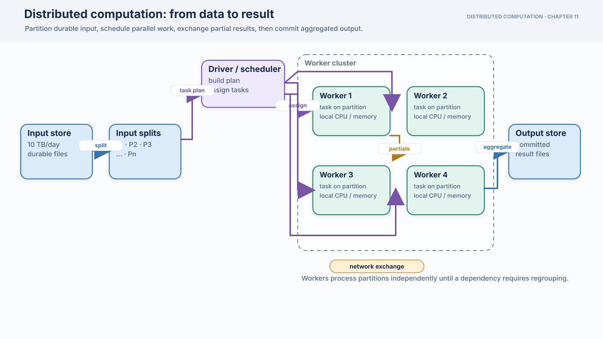

<details>
<summary>Diagram notes and learning objective</summary>

- **Purpose:** explain the basic distributed execution lifecycle.
- **Components:** durable input store, input partitions, scheduler/driver, worker machines, local tasks, exchange network, aggregation stage, output store.
- **Flow:** split input → assign partitions → execute parallel tasks → exchange/group partial results → aggregate → commit output.
- **Learning objective:** distinguish data partitioning, task placement, network exchange, and result aggregation.
- **Suggested layout:** left-to-right pipeline, with a central cluster boundary containing several workers and a separate control-plane scheduler above them.

</details>

---

# 2. MapReduce

## 2.1 Historical motivation and programming model

MapReduce made large-scale data processing approachable by expressing a computation as two user-defined functions over key-value data. A **map** function transforms input records into intermediate key-value pairs. The framework partitions, transfers, sorts, and groups those pairs by key. A **reduce** function then processes each key and its associated values to produce output.

The original Google MapReduce design targeted large datasets on clusters of commodity machines. Its major contribution was not the word-count example; it was the framework's handling of input splitting, task scheduling, worker failure, data locality, intermediate output, and reduction coordination. Hadoop MapReduce adopted the programming model and implemented it in the Hadoop ecosystem, but the internal components and versions are not identical to Google's original system.

A MapReduce computation is often described as:

\[
\text{Input records} \xrightarrow{map} (k,v)^* \xrightarrow{partition+shuffle+sort} (k,[v_1,\dots,v_n]) \xrightarrow{reduce} \text{output}
\]

The `*` means a mapper may emit zero, one, or many pairs for each input record.

## 2.2 Map phase

The framework divides input files into **input splits**. A split is a logical unit of input assigned to a mapper; it is not necessarily identical to an HDFS block or an individual physical file. A record reader converts bytes into records and supplies them to the map function.

For every input record, the mapper emits intermediate pairs. A mapper may normalize text, extract a key, filter records, or emit several keys. Mapper output is usually local to the worker at first; it is not yet the final result and is not necessarily stored in durable distributed storage.

### Combiner and local aggregation

A combiner performs optional local aggregation of mapper output before it is transferred to reducers. For word count, a mapper can turn repeated occurrences of a word in its own split into `(word, local_count)` rather than sending one `(word, 1)` for every occurrence. A combiner is safe only when its operation can be applied repeatedly without changing correctness—typically associative and commutative aggregation. The framework may run a combiner zero, one, or multiple times, so application logic must not depend on a particular invocation count.

## 2.3 Shuffle and sort phase

A **partitioner** maps an intermediate key to a reducer partition. All values for a given key must reach the same reducer partition if the reduce function is to see the complete group. A common hash partitioner uses:

\[
partition(k)=hash(k)\bmod R
\]

where \(R\) is the number of reducer partitions. The framework transfers each reducer's partition from every mapper. This network exchange is called the shuffle. On the reducer side, fetched segments are merged and sorted/grouped by key. In Hadoop MapReduce, shuffle and sort overlap in execution: a reducer can fetch mapper outputs while map tasks are still completing, and merge operations occur as segments arrive.

The shuffle is expensive because it may involve many small network transfers, serialization, checksums, disk spill, merge-sort, and repeated disk reads/writes. Reducer count, compression, partitioning, network capacity, and local disk behavior all matter.

## 2.4 Reduce phase

The reducer receives a key and an iterator or sequence of values for that key. It aggregates or transforms them and emits final records. Reducer output is generally written to a distributed file system. The number of reducer tasks determines the number of output partitions/files in many Hadoop jobs, subject to output format and committer behavior.

## 2.5 Worked word-count example

Input:

```text
distributed systems are powerful
distributed systems scale
systems require coordination
```

**Step 1 — Map.** Treat each line as a record and emit `(word, 1)`:

```text
(distributed,1) (systems,1) (are,1) (powerful,1)
(distributed,1) (systems,1) (scale,1)
(systems,1) (require,1) (coordination,1)
```

**Step 2 — Optional local combine.** If the first two lines are in one split, a local combiner could emit `(distributed,2)` and `(systems,2)` for that split. The third line may emit `(systems,1)`, `(require,1)`, `(coordination,1)`.

**Step 3 — Partition.** Each word is assigned to one reducer partition. The mapping is deterministic for a fixed partitioner and reducer count, but the exact reducer assignment is not important to the result.

**Step 4 — Shuffle and group.** The logical groups are:

```text
are          -> [1]
coordination -> [1]
distributed  -> [1, 1]
powerful     -> [1]
require      -> [1]
scale        -> [1]
systems      -> [1, 1, 1]
```

**Step 5 — Reduce.** Sum values per key:

| Word | Values | Final count |
|---|---:|---:|
| are | [1] | 1 |
| coordination | [1] | 1 |
| distributed | [1, 1] | 2 |
| powerful | [1] | 1 |
| require | [1] | 1 |
| scale | [1] | 1 |
| systems | [1, 1, 1] | 3 |

The important architectural event is the key-based exchange: words that appeared in different input splits must be brought together before the final count can be computed.

## 2.6 MapReduce architecture and job lifecycle

A generic Hadoop MapReduce-on-YARN execution includes:

- **Client:** builds and submits job configuration, code, input paths, and output path.
- **ResourceManager:** arbitrates cluster resources across applications.
- **ApplicationMaster:** coordinates a particular application, negotiates containers, and tracks task progress.
- **NodeManager:** manages containers and reports node/resource status.
- **Map tasks:** read input splits, execute map logic, spill/merge intermediate partitions.
- **Reduce tasks:** fetch mapper output, merge/group keys, execute reduce logic, and write final output.
- **Distributed storage:** holds input and committed output, commonly HDFS in a classic Hadoop installation.

A job is submitted, an application master is started, containers are allocated, map tasks are placed—preferably near input blocks—and reducer tasks fetch the relevant intermediate data. The application completes only after required tasks have succeeded and output commit has completed.

### Original Google MapReduce versus Hadoop MapReduce

The original Google system and Hadoop share a programming model, but should not be described as if they were the same implementation. They differ in codebase, operational environment, storage integration, resource management, and release-specific mechanics. Hadoop 2+ commonly uses YARN for resource negotiation, whereas early Hadoop MapReduce used a different master/worker architecture. Google’s original paper describes its own master, workers, GFS integration, and internal task-failure behavior.

## 2.7 Fault tolerance

MapReduce frameworks assume tasks and machines can fail. A failed task attempt can be retried elsewhere. If a map worker fails after producing local intermediate files, those files are lost with the worker; the framework may need to rerun that map task so reducers can fetch its output again. This is why mapper output is commonly materialized on local disk and treated as recomputable rather than as the canonical durable dataset.

Reducer tasks can also be retried. Since reducers consume mapper output and generate output files, the framework must avoid exposing partial or conflicting task output. Output commit protocols isolate task-attempt output and publish successful output only after the job's commit conditions are met. Exact semantics depend on the storage connector and committer implementation.

**Speculative execution** can launch another attempt of a task that appears unusually slow. The framework accepts one successful result and discards the other attempt. This helps with transient slow machines, but wastes resources when the task is legitimately expensive due to skew. It is unsafe to rely on speculation to suppress non-idempotent external side effects.

## 2.8 Data locality

A scheduler prefers to run a map task on the node that stores its input block, or on a nearby node in the same rack, instead of moving large input data across the network. The preference is not absolute: a scheduler may wait for locality for a bounded interval or run remotely when the cluster is busy. Local, rack-local, and off-rack execution have different network costs.

A reducer generally needs records from many mapper machines, so its input is inherently distributed. It cannot be fully data-local in the same sense as a mapper reading one block. Its performance depends heavily on the shuffle network and reducer balance.

## 2.9 Limitations of classic MapReduce

- Each job has a job-submission and scheduling lifecycle; very short jobs can be dominated by startup overhead.
- Intermediate output is commonly written to disk between map and reduce phases.
- Reusing the same dataset for multiple iterations can require repeatedly materializing and rereading it.
- Interactive workloads suffer from relatively high job latency.
- Complex multi-step algorithms become chains of jobs, with durable intermediate output between them.
- Iterative algorithms such as PageRank, gradient-based optimization, or graph traversal repeatedly use prior iteration state; classic MapReduce's disk-oriented job model can make that expensive.
- The programming model is expressive for many key-grouped computations but less natural for long-lived stateful streaming operators or highly interactive query planning.

MapReduce remains useful for robust, throughput-oriented, bounded batch jobs, especially when the work naturally decomposes into map/group/reduce steps and intermediate materialization is acceptable.

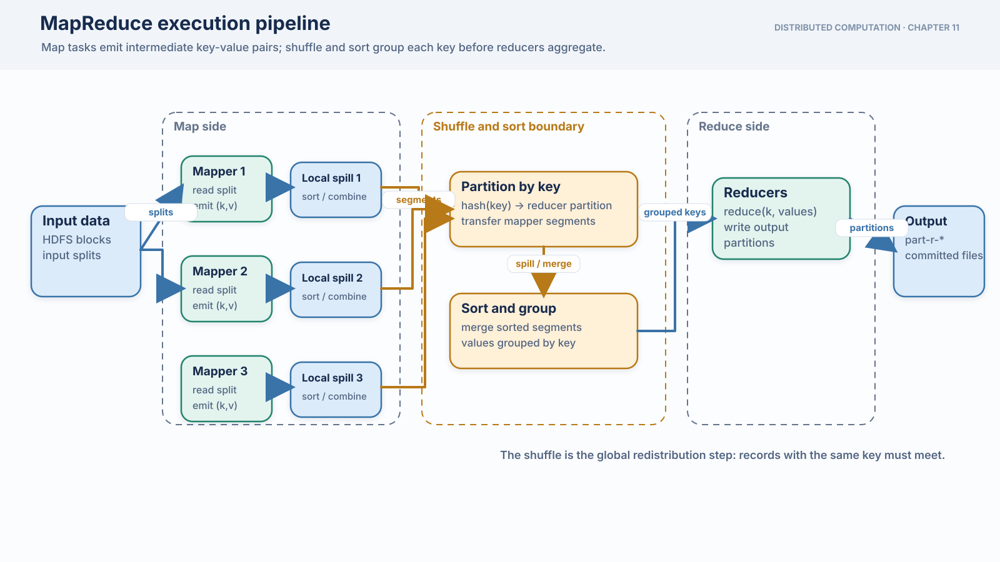

<details>
<summary>Diagram notes and learning objective</summary>

- **Purpose:** show the full MapReduce job flow.
- **Components:** HDFS/input store, input splits, mapper tasks, local spill/combiner, partitioned intermediate files, shuffle network, reducer tasks, output files.
- **Flow:** split → map → optional combine → partition → shuffle/sort → reduce → commit output.
- **Learning objective:** see which data remains local and where the network exchange occurs.
- **Layout:** horizontal stages, with parallel mapper and reducer lanes and a highlighted shuffle boundary.

</details>

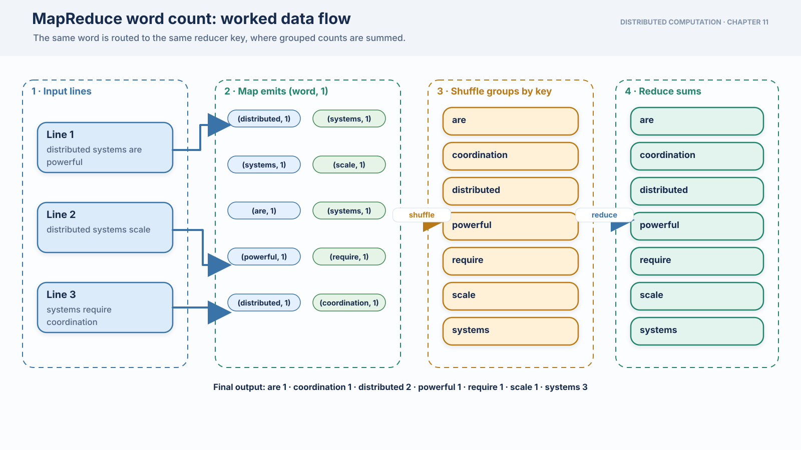

<details>
<summary>Diagram notes and learning objective</summary>

- **Purpose:** make the abstract key-value model concrete.
- **Components:** three input lines, emitted `(word,1)` pairs, local combined counts, reducer groups, final counts.
- **Flow:** records → pairs → grouped lists → sums.
- **Learning objective:** understand why identical keys from different splits must reach the same reducer partition.
- **Layout:** four vertical columns with word-level labels and arrows connecting records to grouped values.

</details>

---

# 3. Hadoop Ecosystem and Distributed Batch Processing

## 3.1 Core components

The Hadoop ecosystem historically brought together storage, batch execution, and cluster resource management:

- **HDFS:** distributed file system optimized for large files and high-throughput streaming access.
- **MapReduce:** batch computation framework using map, shuffle/sort, and reduce.
- **YARN:** cluster resource management layer that separates global resource arbitration from per-application execution coordination.
- **Hadoop Common:** shared libraries and utilities used by the Hadoop modules.

Other ecosystem components may provide ingestion, SQL, workflow orchestration, metadata catalogs, or interactive query layers. They are not all part of the core Hadoop runtime.

## 3.2 How storage and compute cooperate

HDFS stores files as blocks distributed across DataNodes. The NameNode manages namespace and block-location metadata; clients normally transfer file data directly with DataNodes rather than proxying all bytes through the NameNode. Replication and rack awareness provide fault tolerance and placement diversity.

A MapReduce job reads input splits corresponding to file regions. The scheduler uses HDFS block-location information to seek data-local map placement. Map tasks read records, transform them, and spill intermediate partitions to local disk. Reducers fetch their partitions over the network, merge/sort them, and write output back to HDFS.

This architecture deliberately distinguishes:

- **Durable source and final output:** stored in HDFS.
- **Recomputable intermediate output:** often stored on mapper-local disks.
- **Control metadata:** managed by NameNode and resource/job coordination components.
- **Resource allocation:** handled by YARN in modern Hadoop deployments.

## 3.3 Nightly web-log processing example

A company stores billions of web-log records in HDFS. At 01:00, an orchestrator submits a job to compute hourly traffic, error rates, and top endpoints.

1. Files are partitioned by event date and ingestion date, allowing the job to select relevant folders.
2. YARN accepts the application and launches its ApplicationMaster.
3. The ApplicationMaster requests containers for map and reduce work.
4. Map tasks are placed near HDFS blocks where practical.
5. Mappers parse records, reject malformed events, and emit keys such as `(hour, endpoint)` with count and latency aggregates.
6. A combiner reduces repeated local keys.
7. Shuffle transfers intermediate partitions to reducers.
8. Reducers compute final counts, sums, and histograms; they may write multiple output partitions.
9. The output committer publishes the completed job output.
10. A reporting layer reads the result, while monitoring retains job, stage, and task metrics.

A production pipeline also handles late-arriving logs, schema changes, duplicate input delivery, partial job reruns, and safe overwrite/append semantics. The storage layout and output commit protocol must make reruns predictable.

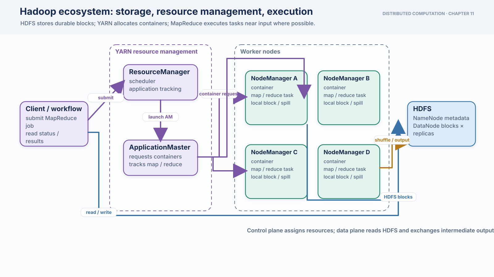

<details>
<summary>Diagram notes and learning objective</summary>

- **Purpose:** show the separation of storage, resource management, and computation.
- **Components:** client/orchestrator, HDFS NameNode/DataNodes, YARN ResourceManager/NodeManagers/ApplicationMaster, MapReduce map/reduce containers.
- **Flow:** client submission → YARN allocation → HDFS-local map reads → shuffle → reducer output → HDFS.
- **Learning objective:** understand why HDFS, YARN, and MapReduce are separate but cooperating layers.
- **Layout:** three horizontal bands—storage, control/resource management, and compute—with labeled metadata and data paths.

</details>

---

# 4. Apache Spark Architecture

## 4.1 Why Spark emerged

Spark is a general-purpose distributed computation engine designed to support more than a single map/reduce pass. It offers DAG execution, in-memory persistence, structured SQL processing, and APIs for batch and streaming workloads. Its advantage over classic disk-materializing MapReduce is especially visible when a computation reuses datasets or has multiple dependent transformations. It is not universally faster: a simple one-pass scan can be limited by input bandwidth, and Spark still performs disk I/O and network shuffle when needed.

The phrase **in-memory computing** is shorthand, not a guarantee that all data remains in RAM. Spark can cache data in memory, use memory-and-disk storage levels, spill temporary data, and recompute lost partitions from lineage. Working-set size and storage level determine whether caching is beneficial.

## 4.2 Architecture components

- **Driver:** process that runs the application entry point, creates the Spark session/context, builds plans, coordinates jobs, and schedules tasks.
- **SparkSession:** primary entry point for modern Spark SQL and DataFrame operations; it exposes access to the underlying Spark context as appropriate.
- **SparkContext:** coordinates connection to a cluster manager and creation of distributed work for RDD-based execution.
- **Cluster manager:** external resource allocator such as Spark Standalone, YARN, or Kubernetes. It allocates executors/resources; it is not the same as Spark's task scheduler.
- **Worker node:** machine or node capable of running application processes.
- **Executor:** application-specific process on a worker that executes tasks and can store cached/shuffle-related data.
- **Task:** smallest scheduled unit of Spark work in a stage, generally operating on one partition.
- **Job:** computation initiated by an action or query execution request.
- **Stage:** group of tasks separated from downstream stages by shuffle or other stage-level dependency boundaries.
- **DAG scheduler:** derives stages from dependencies and tracks stage completion/retry.
- **Task scheduler:** submits individual tasks to executors and tracks their execution.
- **Block manager:** manages storage and retrieval of blocks, including persisted data and shuffle-related blocks, depending on version and subsystem.
- **Shuffle manager:** handles the mechanisms used to write and read shuffle data; exact implementation is version- and configuration-dependent.

Each Spark application generally has its own driver and executors. A cluster manager can allocate resources to multiple Spark applications, but the driver and task scheduling decisions remain part of the Spark application runtime.

## 4.3 Execution lifecycle

1. The application starts and creates a `SparkSession` or `SparkContext`.
2. The driver requests executors through the selected cluster manager.
3. Executors start and register with the driver.
4. Application code defines transformations and query operations. Lazy transformations describe work rather than immediately executing all of it.
5. An action or query execution triggers a job.
6. Spark builds/optimizes a plan. RDD operations use dependency information; DataFrame/SQL operations also use logical and physical query planning.
7. The DAG scheduler divides work into stages based on dependencies.
8. The task scheduler creates and assigns tasks for partitions.
9. Executors process data, cache blocks if requested, and write/read shuffle data when required.
10. Results are written to storage or returned to the driver. Returning a huge result to the driver is usually a design error.
11. Failed tasks or lost partitions are retried/recomputed according to engine semantics and configured policies.

## 4.4 Lazy evaluation

Transformations such as `map` and `filter` build a lineage or query plan. They do not necessarily execute immediately. Laziness lets the engine combine compatible operations, avoid work on data that is ultimately not needed, push filters closer to data sources, and choose a physical execution strategy. Actions such as `count`, `collect`, and `save` require results and therefore trigger execution.

Lazy evaluation is not the same as free computation. A transformation chain may still be recomputed for a second action unless its result is persisted, checkpointed, or otherwise materialized. A pipeline should persist a reused expensive dataset intentionally and release it when no longer needed.

## 4.5 Spark deployment modes and cluster managers

Spark can run with its Standalone cluster manager, on YARN, or on Kubernetes. Deploy mode determines where the driver runs: in client mode it runs in the submitting process/environment; in cluster mode it is launched within the cluster environment. Connectivity, credentials, dependency distribution, and lifecycle behavior differ by mode.

Kubernetes schedules driver/executor pods to nodes; Spark then schedules its own tasks inside the executors. YARN allocates containers; Spark tasks execute inside its executor processes. The cluster manager does not decide which RDD partition each Spark task should compute.

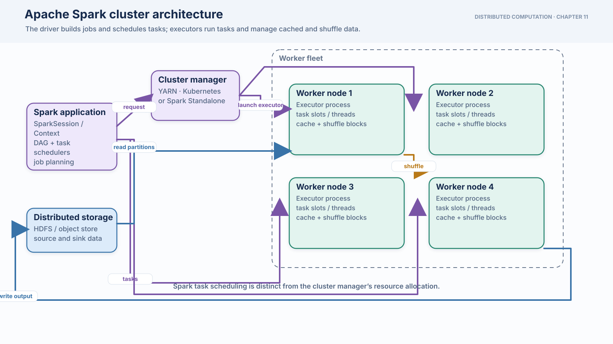

<details>
<summary>Diagram notes and learning objective</summary>

- **Purpose:** distinguish Spark's application control plane from worker execution.
- **Components:** client, driver, cluster manager, worker nodes, executor processes, task slots/threads, distributed source and output storage.
- **Flow:** driver requests resources → cluster manager launches executors → driver submits tasks → executors read partitions and exchange data → result written.
- **Learning objective:** distinguish cluster-level resource allocation from Spark-level task scheduling.
- **Layout:** driver and manager above a row of workers; multiple executors/tasks inside worker boxes; data store outside cluster boundary.

</details>

---

# 5. RDDs—Resilient Distributed Datasets

## 5.1 RDD fundamentals

An RDD is an immutable, partitioned collection of records that can be operated on in parallel. It records enough dependency information—its **lineage**—for Spark to recompute lost partitions when their inputs remain available. RDDs can be created from existing driver collections or external storage systems supported by Spark/Hadoop input integrations.

RDD properties:

- **Distributed:** records are divided among partitions.
- **Immutable:** transformations create new RDDs rather than updating records in place.
- **Lazy:** transformations describe operations and are evaluated when an action requires output.
- **Fault-tolerant through lineage:** lost partitions can be recreated by rerunning ancestor transformations, unless the required source data or nondeterministic external state is unavailable.
- **Persistable:** applications can request that computed partitions be retained in memory and/or disk for reuse.

An RDD is not a database table and does not automatically provide a schema, indexes, or a cost-based SQL optimizer.

## 5.2 Transformations and execution implications

| Operation | Conceptual effect | Typical dependency/performance concern |
|---|---|---|
| `map` | One input record produces one output record | Usually narrow; can pipeline |
| `flatMap` | One input can produce zero or many outputs | Usually narrow, but can greatly expand data |
| `filter` | Retains records matching a predicate | Narrow; push early when it reduces later work |
| `mapPartitions` | Processes an iterator for one partition | Narrow; can amortize per-record setup, but risks oversized partition state |
| `union` | Combines parent RDDs | Often narrow at the partition level; partition count grows |
| `distinct` | Removes duplicates | Typically requires key-based redistribution/shuffle |
| `reduceByKey` | Aggregates values per key | Shuffle required; map-side combine can reduce network volume |
| `groupByKey` | Collects all values per key | Shuffle plus potentially large per-key memory pressure |
| `join` | Matches records by key | Usually shuffle unless partitioning/broadcast-like optimizations apply |
| `sortByKey` | Orders records by key | Distributed range partitioning/sorting and shuffle commonly required |

### Narrow and wide dependencies

A **narrow dependency** means each child partition depends on a limited set of parent partitions, often one. Spark can commonly pipeline narrow operations in one stage. A **wide dependency** means a child partition depends on data from many parent partitions, which typically requires a shuffle. These are execution concepts, not simply API categories; the physical strategy can vary by operation and data layout.

`map` followed by `filter` is a common narrow chain. `reduceByKey` is wide because all values for a key must be co-located. A join can be wide when both sides must be repartitioned by join key.

## 5.3 Actions and driver memory

| Action | Purpose | Main caution |
|---|---|---|
| `count` | Count records | Triggers a full scan unless metadata or plan permits otherwise |
| `collect` | Return every record to driver | Can exhaust driver heap/network; use only for bounded results |
| `reduce` | Aggregate to a single result | Reduction function should be associative/commutative for order-independent parallel execution |
| `take` | Return a small prefix/sample | May still need to examine multiple partitions depending on data |
| `saveAsTextFile` | Write distributed output | Output is partitioned; commit/overwrite semantics matter |
| `foreach` | Execute an action for each record | External side effects can repeat under retries; design for idempotency |

The driver is not a central data sink. Calling `collect()` on billions of records defeats the distributed design and may crash the driver. Use distributed writes or bounded summaries instead.

## 5.4 Lineage and recovery

Suppose a pipeline is:

`raw events → parse → filter invalid → normalize → aggregate by customer → write`

If an executor loses a cached partition created after `normalize`, Spark can use lineage to recompute that partition by rerunning the necessary parent computation from the source. It need not recompute every partition—only those required by the failed work and the dependency graph.

Recovery cost depends on how far back the lineage reaches and how expensive the transformations are. If a long iterative pipeline repeatedly recomputes the same ancestors, checkpointing can materialize a reliable boundary and truncate lineage. Checkpointing adds I/O and storage requirements, so it is most useful when lineage is long or expensive to replay.

Deterministic transformations make recomputation predictable. A transformation that calls an external service, reads changing mutable state, or uses unseeded randomness may produce different values when retried. Such behavior must be controlled if exact repeatability is required.

## 5.5 Persistence and caching

Persistence lets Spark retain partitions for reuse. Typical storage choices include memory-only, memory-and-disk, disk-only, and serialized/replicated variants; names and exact behavior depend on API and version. A cache can be evicted under memory pressure; the engine may recompute partitions from lineage or retrieve them from disk depending on the storage level.

Cache a dataset when:

- It is expensive to derive.
- It is used by multiple downstream actions/branches.
- The expected reuse saves more time than cache encoding, memory pressure, and eviction cost.
- The cached working set fits sufficiently well to produce stable benefit.

Avoid caching when the data is used once, is cheap to recompute, is too large for the cluster's available storage memory, or displaces more valuable cached data. Monitor cached bytes, eviction, executor memory, GC, and recomputation.

### Executor-loss example

An executor holding partitions 4, 5, and 6 of a cached normalized RDD crashes. The driver detects executor loss through runtime communication. Cached copies on that executor are unavailable. Spark identifies which downstream tasks need the lost partitions, traces their lineage to the source, and schedules recomputation elsewhere. Shuffle outputs may also be lost depending on shuffle service and deployment configuration; affected map tasks or shuffle blocks may need regeneration. This is not the same as restoring the entire cluster from a checkpoint.

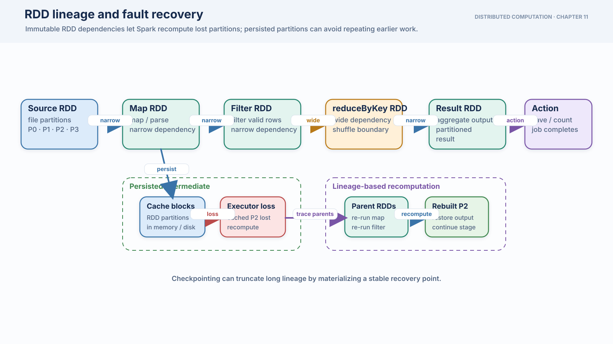

<details>
<summary>Diagram notes and learning objective</summary>

- **Purpose:** explain dependencies and partition recomputation.
- **Components:** source RDD, map/filter stages, wide dependency/shuffle, persisted RDD partitions, failed executor, recomputation tasks.
- **Flow:** source → transformations → cache; executor loss removes selected cached blocks; lineage identifies ancestors and recomputes only required partitions.
- **Learning objective:** understand partition-level recovery and when checkpointing truncates long lineage.
- **Layout:** DAG with partition labels; visually cross out lost cached blocks and highlight recovery paths.

</details>

---

# 6. Spark DAG Execution

## 6.1 DAG, job, stage, and task

A **directed acyclic graph (DAG)** represents dependencies between operations. A Spark action or SQL execution request creates a **job**. The DAG scheduler divides that job into **stages** at shuffle boundaries and other scheduling boundaries. Each stage is executed through **tasks**, usually one task per partition of the stage's input.

| Term | Meaning | Example |
|---|---|---|
| DAG | Dependency graph with no directed cycles | parse → filter → key aggregate → sort → write |
| Job | Work triggered by an action/query execution | save aggregated results |
| Stage | Tasks that can run without crossing a shuffle dependency boundary | map/filter work before a reduce exchange |
| Task | One execution attempt over a partition | process partition 73 |

A stage with 800 partitions may create roughly 800 tasks, subject to the actual plan and task partitioning. A job with multiple shuffle dependencies may have multiple stages. The exact stage count is derived from the actual DAG and physical plan; do not infer it only by counting API calls.

## 6.2 Worked DAG example

Consider:

`read → filter → map → reduceByKey → sortByKey → save`

A simplified plan is:

1. **Read:** creates source partitions.
2. **Filter:** narrow; can run in the same task pipeline as the map.
3. **Map:** narrow; transforms each retained record into a key-value pair.
4. **reduceByKey:** wide; records for the same key must be brought together. A shuffle boundary separates upstream map-side work from downstream reduce-side aggregation.
5. **sortByKey:** generally requires a distributed sorting exchange (often another shuffle), with range partitioning or another selected plan.
6. **Save:** writes the final partitions.

A simplified stage view may look like:

- Stage 0: read + filter + map + map-side combine + shuffle write.
- Stage 1: shuffle read + reduceByKey + shuffle write for ordering.
- Stage 2: sort/merge final data + save.

This is only an illustrative shape. A different physical plan, sort implementation, partitioner reuse, optimizer, or API can merge or split stages differently.

## 6.3 Stage boundaries and task counts

A shuffle dependency requires downstream tasks to consume data partitioned according to the target partitioner. Upstream tasks must first generate shuffle blocks. Downstream tasks fetch those blocks after they are available. Stage boundaries therefore represent a synchronization and data-redistribution cost.

Tasks within a stage can execute concurrently up to available task slots and resource limits. If there are 2,000 tasks and 200 concurrent slots, the stage runs in multiple waves. Adding more slots can reduce queueing, but will not reduce the work per task or fix a single oversized partition.

## 6.4 DAG optimization

- **Pipeline fusion:** compatible narrow transformations execute in one task pipeline instead of materializing a dataset after each operation.
- **Predicate pushdown:** filters are moved closer to the source when the data source can apply them.
- **Projection pruning:** unused columns are removed early, reducing bytes read and shuffled.
- **Catalyst:** Spark SQL's optimizer analyzes and optimizes structured query plans; it does not optimize arbitrary RDD function bodies the same way.
- **Adaptive Query Execution (AQE):** Spark SQL can use runtime statistics to revise parts of a physical plan, for example coalescing post-shuffle partitions or adapting skewed joins, depending on configuration and version.
- **Join planning:** the optimizer may choose broadcast hash join, sort-merge join, or another applicable strategy based on size/statistics/configuration.

RDD lineage and Spark SQL Catalyst are related but distinct. RDD execution is built around RDD dependencies and scheduler stages. DataFrame/SQL execution has logical analysis, optimization, physical planning, and runtime execution layers.

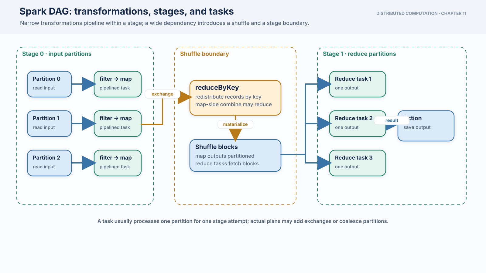

<details>
<summary>Diagram notes and learning objective</summary>

- **Purpose:** show how narrow operations are pipelined and wide dependencies produce stage boundaries.
- **Components:** source partitions, filter/map operators, shuffle write, exchange boundary, shuffle read, reduce, sort, save, task groups.
- **Flow:** stage 0 tasks → shuffle → stage 1 tasks → next exchange → stage 2 tasks.
- **Learning objective:** distinguish a job, stage, and per-partition task.
- **Layout:** DAG across the page, with stage regions shaded and multiple task boxes under each stage.

</details>

---

# 7. Shuffle Operations

## 7.1 Why shuffle exists

A shuffle redistributes records so that downstream work receives the data arrangement it requires. For `reduceByKey`, all values for a key must be combined at the same downstream partition. If the values are spread across many upstream partitions, the engine must route partial data across the cluster.

Shuffle can require serialization, partitioning, local buffering, disk spill, network transfer, remote block fetch, merge, and deserialization. It is often one of the most expensive parts of a batch job.

## 7.2 Shuffle lifecycle using reduceByKey

1. Each input partition is processed by an upstream task.
2. Each record's key is mapped to a target reduce partition by the partitioner.
3. A local combiner may aggregate values sharing a key within the map task.
4. Intermediate records are serialized into shuffle blocks.
5. Data is buffered; when memory limits are reached, data may spill to local disk.
6. The map task completes and exposes shuffle output metadata.
7. Downstream reduce tasks fetch their required blocks from upstream executors or shuffle storage services.
8. The reduce side merges and may sort/group fetched records.
9. Final aggregation is performed and results are passed to later operators or written out.

## 7.3 Why shuffle is expensive

- **Network:** every target partition may need blocks from many upstream partitions.
- **Disk:** spill and merge operations can create multiple reads/writes.
- **Memory:** hash aggregation and sort buffers compete with execution and cached data.
- **CPU:** serialization, hashing, compression, sorting, and deserialization consume CPU.
- **Metadata:** many map and reduce partitions can create large numbers of shuffle blocks and fetch requests.
- **Tail latency:** one slow map output or reducer can delay stage completion.

Shuffle time is not just bytes divided by network bandwidth. It includes fixed per-block costs, disk, CPU, skew, retries, concurrency, and contention.

## 7.4 Hash and range partitioning

**Hash partitioning** distributes keys according to a hash function. It tends to spread ordinary keys but can concentrate a hot key because all records with that key must remain together for a conventional aggregation.

**Range partitioning** assigns key ranges to partitions. It can support ordered output and range queries, but needs range boundaries and can be imbalanced if the distribution differs from the sample or changes over time.

Partition count is a trade-off. Too few partitions create oversized tasks and underutilization. Too many create task scheduling and per-partition metadata overhead, and may create small files downstream.

## 7.5 groupByKey versus reduceByKey

`groupByKey` shuffles values and materializes all values for a key at the receiving side. If a key has millions of values, this can create large memory pressure. `reduceByKey` combines values locally before shuffle when the aggregation supports a safe combiner, so fewer records may cross the network.

For a count or sum, use an aggregation operation rather than retaining every value. `groupByKey` is appropriate only when downstream logic genuinely needs the complete collection, and even then large-key cardinality must be considered.

## 7.6 Join strategies

| Strategy | Data movement | Appropriate situation | Principal risk |
|---|---|---|---|
| Broadcast hash join | Small relation broadcast to executor-side tasks; large side need not be repartitioned by join key | One side is safely small enough to replicate in memory | Broadcast size, executor memory, network fan-out |
| Shuffle hash join | Both sides are shuffled by join key, then a hash structure is built for a side per partition | Partitioned side fits available memory and engine chooses it | Per-task memory pressure; skewed partitions |
| Sort-merge join | Both sides are partitioned and sorted by join key, then merged | Large relations where sort/partitioned execution is appropriate | Shuffle and sort cost, skew, spill |

The chosen plan depends on statistics, distribution, configuration, and engine version. A broadcast join is not automatically faster if the supposedly small table is unexpectedly large or if broadcasting it to many executors is expensive.

## 7.7 Shuffle optimizations

- Reduce records/columns before the exchange through filters, projection pruning, and partial aggregation.
- Prefer map-side aggregation when the computation is associative and commutative.
- Choose partition counts based on bytes and expected task size, not just record count.
- Reuse compatible partitioning where possible.
- Broadcast a genuinely small dimension table when the plan and memory budget support it.
- Use bucketing/partitioned storage where repeated query patterns justify the write-time cost.
- Enable and inspect adaptive execution where supported.
- Compress shuffle data when network savings exceed compression CPU cost.
- Avoid unnecessary wide transformations and repeated repartitioning.
- Handle skewed keys explicitly rather than merely increasing the worker count.

## 7.8 Numerical shuffle example

Assume a job reads **1 TB** of input and an effective local combiner reduces intermediate data volume by **70%**. Under the simplifying assumption that the input volume is a reasonable proxy for the serialized intermediate volume before combining:

\[
V_{before}=1\text{ TB},\qquad V_{after}=1\text{ TB}\times(1-0.70)=0.30\text{ TB}
\]

So approximately **300 GB** of intermediate data remains after local aggregation, rather than 1 TB. This is not a guaranteed 700 GB reduction in network traffic: input columns may not all be emitted, values may expand, compression changes byte size, map-side aggregation effectiveness depends on duplicate-key locality, and some data may be consumed locally or written in different formats. If 300 GB is spread evenly across 100 reduce partitions, the arithmetic mean is 3 GB per partition; a skewed distribution can make the maximum partition much larger.

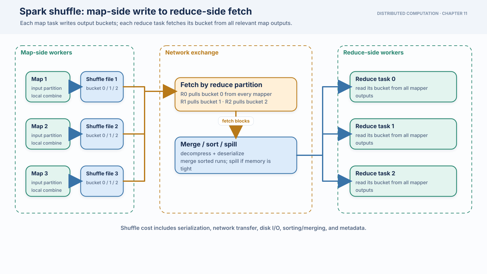

<details>
<summary>Diagram notes and learning objective</summary>

- **Purpose:** visualize the all-to-all exchange between map and reduce partitions.
- **Components:** workers with source partitions, map tasks, shuffle block files, network links, reduce tasks, target partitions.
- **Flow:** map tasks partition and write blocks → reduce tasks fetch blocks from many workers → merge/aggregate.
- **Learning objective:** see why shuffle consumes network, disk, memory, and metadata resources.
- **Layout:** two rows of workers (map side and reduce side) connected by a matrix of labeled shuffle-block arrows.

</details>

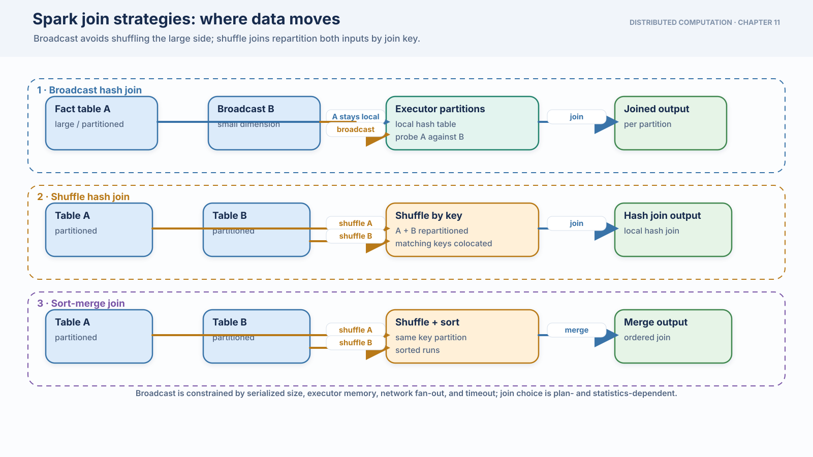

<details>
<summary>Diagram notes and learning objective</summary>

- **Purpose:** compare distributed join plans.
- **Components:** large fact table, small dimension table, broadcast variable, hash tables, shuffle exchanges, sorted partitions, join output.
- **Flow:** broadcast path vs two-sided shuffle hash path vs two-sided sort-merge path.
- **Learning objective:** understand how join strategy changes network movement and memory pressure.
- **Layout:** three side-by-side lanes with data movement highlighted and risk annotations below each lane.

</details>

---

# 8. Spark DataFrames, Datasets, and Spark SQL

## 8.1 Structured APIs

An **RDD** is a general distributed collection. A **DataFrame** is a distributed dataset organized into named columns with a schema and relational operations. In Scala and Java, a **Dataset** adds a typed programming abstraction; the availability and role of typed Dataset APIs differ by language. In PySpark, DataFrame is the primary structured abstraction.

Structured data provides the engine with information about column names, types, predicates, joins, and aggregations. This makes it possible to optimize a plan without inspecting arbitrary user-defined function internals.

## 8.2 Logical and physical query plans

A query such as “calculate total revenue by country for completed orders” proceeds conceptually through:

1. **Parsing/API construction:** SQL text or DataFrame calls become a logical plan.
2. **Analysis:** resolve table, column, and function names; validate types and references.
3. **Logical optimization:** apply rules such as filter pushdown, projection pruning, constant folding, and expression simplification.
4. **Physical planning:** select join strategies, exchanges, scans, aggregates, and sort operators.
5. **Code generation/execution:** execute operators in tasks over partitions, using optimized runtime paths where applicable.
6. **Output:** materialize results, write a distributed dataset, or return a bounded result to the driver.

The exact internal plan and operator names are implementation/version-specific. A query plan should be inspected with the engine's explain and UI tools rather than guessed from source code.

## 8.3 Catalyst and Tungsten concepts

**Catalyst** is Spark SQL's extensible query optimizer. It works on structured logical plans and selects/rewrites operations using rule-based optimization and planning. It is not a universal optimizer for arbitrary Python or Scala code inside RDD functions.

**Tungsten** refers to a set of Spark execution optimizations historically focused on memory management, binary representations, and efficient CPU execution. Whole-stage code generation can fuse compatible operators into generated code, reducing virtual calls and intermediate object creation. The exact set of optimizations available depends on data types, operators, runtime settings, and release.

Columnar execution and vectorized readers can improve throughput by operating over batches of values rather than one object at a time. Predicate pushdown and projection pruning reduce the amount of data read from supported data sources.

## 8.4 Adaptive Query Execution (AQE)

AQE uses runtime statistics to revise parts of a query plan after some stages have executed. Examples include:

- Coalescing small post-shuffle partitions to reduce task overhead.
- Handling skewed shuffle partitions by splitting or otherwise adapting work for supported joins.
- Changing join strategy when observed sizes make another strategy more suitable.

AQE can improve workloads where estimates are inaccurate or partition sizes vary. It does not remove the cost of data movement, guarantee a perfect plan, or fix all forms of skew. Its behavior and default settings should be checked against the exact Spark version and workload. Current Spark documentation describes AQE as enabled by default in current releases; earlier releases and customized configurations may differ.

## 8.5 When structured APIs are preferable

Prefer DataFrames/SQL for relational operations, columnar files, filters, projections, aggregations, and joins where the optimizer can reason about expressions. Use RDDs when custom per-record logic or low-level control is necessary and cannot be expressed cleanly in structured APIs. Avoid converting structured data to opaque RDD transformations prematurely, because that can hide optimization opportunities.

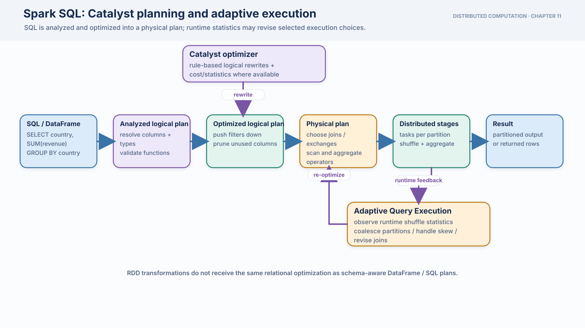

<details>
<summary>Diagram notes and learning objective</summary>

- **Purpose:** show the structured query planning pipeline.
- **Components:** SQL/DataFrame input, parsed logical plan, analyzed plan, optimized logical plan, physical operators, exchanges, stages/tasks, distributed storage.
- **Flow:** query → analysis → logical optimization → physical plan → stage/task execution → result.
- **Learning objective:** distinguish planning from runtime and understand where Catalyst and AQE operate.
- **Layout:** layered funnel from high-level SQL at top to partition-level operators at bottom, with a runtime-statistics feedback arrow into adaptive planning.

</details>

---

# 9. Dataflow Models

## 9.1 Computation as a graph

A dataflow model represents a computation as a graph. **Operators** are nodes—sources, filters, maps, joins, aggregations, windows, and sinks. **Edges** carry records or batches between operators. The graph records data dependencies and allows a runtime to schedule independent operators concurrently, fuse compatible operators, buffer exchanges, and recover failed work.

MapReduce is a relatively rigid dataflow pattern: map, group by key through shuffle/sort, then reduce. General dataflow engines expose richer graphs with multiple inputs, branches, joins, stateful operators, windows, and continuous execution.

### Push and pull

- In **push-based** execution, an upstream operator pushes produced records downstream when the consumer is ready or when buffers allow.
- In **pull-based** execution, a downstream operator requests records from an upstream iterator or source.
- Real engines can combine both approaches. The choice affects buffering, scheduling, backpressure, and operator fusion.

### Operator fusion and materialization

Adjacent operators may be fused so a record flows through several operations without being written as a full intermediate dataset. Fusion reduces scheduling and serialization overhead, but can increase the complexity of a task and can make isolation or parallelism boundaries less flexible.

Materialization writes an intermediate result to storage or a durable exchange boundary. It costs I/O and storage, but supports reuse, decouples downstream work from upstream task lifetimes, and may provide a recovery boundary.

## 9.2 Static and dynamic dataflow

| Aspect | Static/bounded dataflow | Dynamic/unbounded dataflow |
|---|---|---|
| Input | Finite dataset | Events continue arriving |
| Completion | Job can finish when input is consumed | Pipeline may run indefinitely |
| State | Often per task/job or materialized dataset | Long-lived keyed/operator state is common |
| Time | Often processing/partition order | Event time and processing time both matter |
| Recovery | Retry stages/tasks and reuse durable inputs | Restore state/checkpoints and replay source offsets/events |
| Main concern | Throughput, cost, skew, completion SLA | Latency, event-time correctness, state growth, backpressure |

A batch pipeline can still be incremental across daily partitions, while a streaming pipeline can execute in micro-batches. The distinction is about input boundedness and execution semantics, not merely how often a job is triggered.

## 9.3 Programming model, runner, and runtime

Apache Beam separates a **pipeline programming model** from the **runner** that executes it. The Beam SDK describes transforms and collections; a runner translates the pipeline into execution for an engine or managed service. The same pipeline definition may be run on different runners, subject to feature support and semantics.

Apache Flink is an execution engine and runtime with its own APIs and deployment model. It represents programs as dataflow graphs and executes operators across TaskManagers. Spark Structured Streaming offers a structured streaming API integrated with Spark SQL; its execution behavior, trigger mode, and state semantics depend on the mode and supported operations.

| Layer | Question it answers | Examples |
|---|---|---|
| Programming model | How does the developer express work and semantics? | Beam transforms, SQL, DataFrame operations |
| Logical pipeline/plan | What operations depend on what data? | DAG, logical query plan |
| Runner/engine | Which runtime executes the plan? | Beam runner, Spark, Flink |
| Resource manager | Where are worker processes/containers placed? | Kubernetes, YARN, standalone cluster manager |
| Storage/source/sink | Where do input, state, and results live? | Kafka, object storage, HDFS, databases |

## 9.4 Event time, processing time, watermarks, windows, and triggers

For a streaming record:

- **Event time** is when the event is said to have occurred, usually embedded in the record.
- **Processing time** is when a runtime processes the record.
- **Ingestion time** is when the system first accepts the record, if tracked separately.
- **Watermark** is the runtime/source's estimate of event-time progress: a claim about how far it believes it has progressed with respect to event timestamps. It is not proof that no earlier event can ever arrive.
- **Window** assigns events to a finite logical group, such as a fixed five-minute interval, sliding interval, or session.
- **Trigger** controls when a window emits a result—after event-time progress, after processing-time delay, after element count, or through a composite policy.
- **Late data** arrives after the watermark has passed the window's end. The pipeline may accept it within allowed lateness, emit corrections, route it elsewhere, or discard it according to configured policy.

Example: a five-minute event-time window covers 10:00:00 through 10:04:59. A click event generated at 10:02 arrives at 10:06 because a mobile device was offline. The processing-time clock is later than the event time. The watermark may already have passed the window end; the event is late. If allowed lateness and triggers permit corrections, the output can be revised. If not, it may be dropped from the aggregate.

Watermark quality depends on source behavior and the runner's estimation logic. A fixed “30-second delay” is a simplifying example, not a universal guarantee. A source with partition lag, idle partitions, or unbounded event delays needs an explicit policy for idleness, late data, and state retention.

## 9.5 Stateful processing and exactly-once claims

Stateful operators retain information across records: per-account counts, session state, deduplication keys, join buffers, or timers. State needs lifecycle rules, checkpointing, and recovery. State size is operationally important: cardinality, TTL, window count, and key churn determine how much state must be kept and checkpointed.

“Exactly once” is an end-to-end property, not a magic property conferred by a stream engine. A runtime may provide exactly-once state updates or checkpoint consistency, but the source, sink, transaction protocol, and external side effects must also participate. A non-transactional HTTP call inside a retried operator can execute twice even if the internal operator state is restored consistently.

## 9.6 Apache Beam and Google Dataflow model

Beam's model describes bounded and unbounded `PCollection`s, transforms, windowing, triggers, watermarks, state, and timers. The runner translates the pipeline into an execution backend. A Dataflow-style model emphasizes event-time semantics and correct aggregation when events arrive out of order.

Dynamic work rebalancing can split work at runtime to improve utilization when some work items are larger or slower than others. The details depend on source/sink and runner capabilities. A pipeline that is portable at the API level may still rely on runner-specific features or have different performance characteristics on different runners.

## 9.7 Apache Flink dataflow runtime

Flink executes dataflow programs as operator graphs. A JobManager coordinates job scheduling, execution state, checkpointing, and recovery; TaskManagers execute subtasks and exchange data. Operators can be chained when compatible, reducing overhead between consecutive operations. Checkpoints capture consistent state and source progress for recovery, while savepoints are used for controlled operations such as upgrades or migration. Exact deployment and checkpoint details vary by release and backend.

Flink is commonly associated with stateful stream processing, but it can execute bounded/batch-style workloads as well. Its runtime concepts should not be conflated with Beam's programming abstraction: Beam can target runners, while Flink is an engine/runtime.

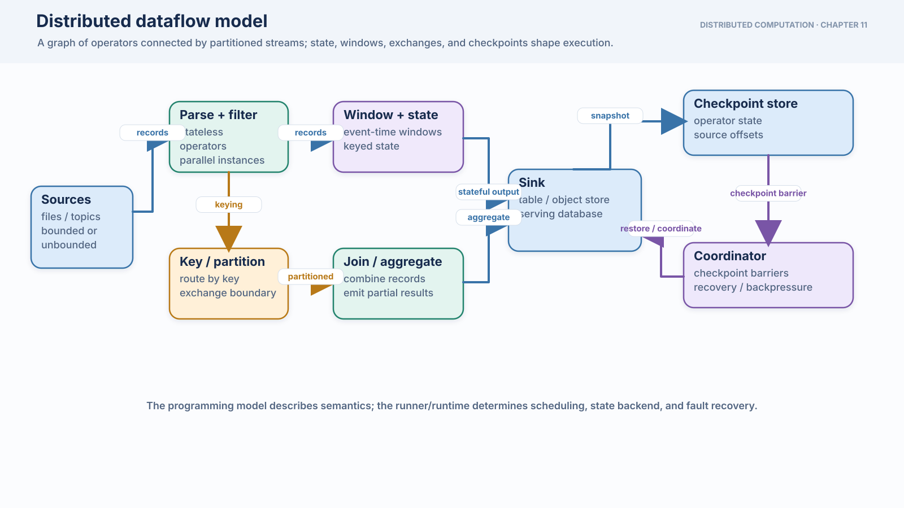

<details>
<summary>Diagram notes and learning objective</summary>

- **Purpose:** illustrate a general distributed dataflow graph.
- **Components:** sources, map/filter operators, keyed exchange, stateful window aggregate, join, sink, workers, buffers/checkpoints.
- **Flow:** source records travel through fused operators; a repartition edge moves keyed data; stateful operator emits windowed results to sink.
- **Learning objective:** connect graph topology to parallelism, exchanges, state, and recovery boundaries.
- **Layout:** graph across three worker lanes, with operator chains shown inside workers and network exchange edges between them.

</details>

---

# 10. Lambda vs Kappa Architecture

## 10.1 Lambda architecture

Lambda architecture separates processing into complementary paths:

- **Batch layer:** stores the authoritative historical dataset and computes accurate batch views over all retained data.
- **Speed layer:** processes recent events with lower latency, often producing provisional or incremental views before the batch layer catches up.
- **Serving layer:** exposes queryable views by combining or selecting batch and speed outputs.

The batch layer can recompute results from the immutable master dataset when business logic changes or historical corrections are required. The speed layer fills the freshness gap. A serving layer must reconcile duplicate windows or combine the two views without double-counting.

### Example: social-media statistics

A platform needs precise historical daily active users, near-real-time trending topics, and hourly engagement summaries. The batch layer runs a complete daily calculation over retained events. The speed layer updates trending scores as events arrive. The serving layer exposes both a recent low-latency view and reconciled historical totals.

The difficult parts are often operational rather than conceptual: two code paths can implement subtly different business logic; batch recomputation may overlap with stream output; late data can change previous windows; and serving must determine which output is authoritative at each time.

## 10.2 Kappa architecture

Kappa architecture emphasizes one stream-processing path over an append-only, replayable event log. The processing application consumes new events continuously. To rebuild a view or apply new logic, the operator deploys a revised processor and replays retained events from an appropriate offset or snapshot boundary.

Kappa can reduce duplicated batch and streaming logic, but depends on a durable log with sufficient retention or an archival/replay mechanism. Replaying years of high-volume data may be costly; state restoration and versioned outputs are necessary; and the stream processor must support the required historical throughput.

## 10.3 Comparison

| Dimension | Lambda | Kappa |
|---|---|---|
| Processing paths | Separate batch and speed paths | One stream-oriented processing path |
| Historical accuracy | Batch recomputation over authoritative history | Replay/rebuild from retained event log or archive |
| Freshness | Speed layer supplies recent results | Continuous processing supplies recent results |
| Logic duplication | Risk of separate implementations | Less duplicated processing logic |
| Replay | Batch layer reruns bounded history | Stream processor replays log |
| Storage | Historical dataset plus stream state/log | Durable replayable log plus state/output |
| Complexity | Reconciliation across paths | Replay scale, state bootstrap, and versioning |
| Best fit | Distinct batch and low-latency paths with different needs | Stream engine can meet both freshness and replay requirements |

Neither architecture is universally superior. A hybrid is often sensible: a stream processor handles operational freshness while periodic batch jobs validate aggregates, backfill corrections, compact lake data, or train models.

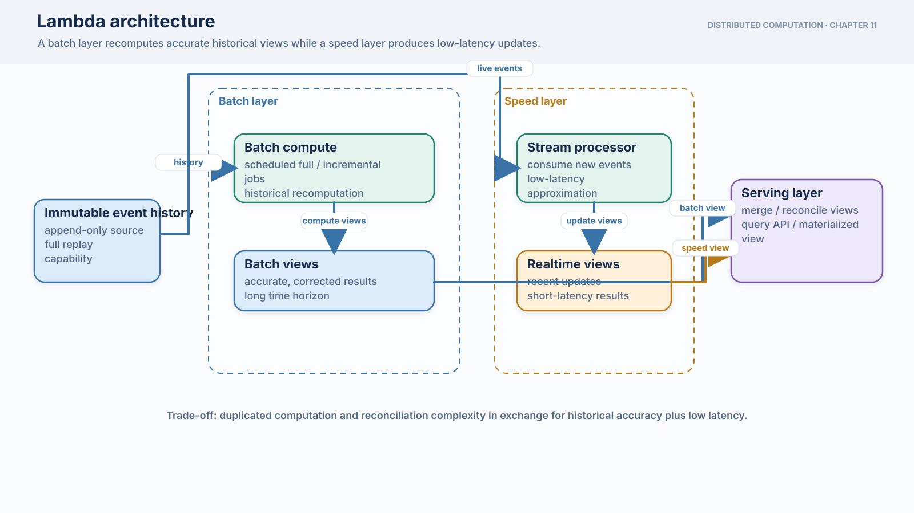

<details>
<summary>Diagram notes and learning objective</summary>

- **Purpose:** show the batch and speed paths and their serving reconciliation.
- **Components:** immutable event store, batch engine, batch views, streaming engine, speed views, serving database/API.
- **Flow:** full history → batch layer; live events → speed layer; both views → serving/reconciliation.
- **Learning objective:** understand why two paths exist and why reconciliation is necessary.
- **Layout:** two parallel lanes converging on a serving layer; show the batch layer's historical input and the speed layer's low-latency input.

</details>

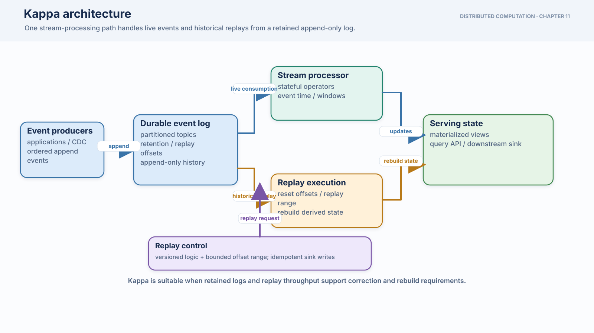

<details>
<summary>Diagram notes and learning objective</summary>

- **Purpose:** show a replay-first event-processing architecture.
- **Components:** append-only event log, stream processor, state/checkpoints, serving store, replay controller/new processor version.
- **Flow:** live log → processor → state/output; replay starts from earlier offsets to rebuild a new view.
- **Learning objective:** understand how one processing path can support live updates and historical recomputation, and what retention makes possible.
- **Layout:** log at left with live and replay arrows entering processor versions; state/checkpoint and serving output at right.

</details>

---

# 11. Cluster Scheduling and Resource Management

## 11.1 Why resource management is separate from computation

A computation engine knows what tasks it wants to run. A cluster resource manager knows which machines have available resources and how to share them among applications. Separation allows multiple engines or jobs to coexist on a cluster.

The schedulable resources can include CPU cores, memory, ephemeral disk, network bandwidth, GPUs, accelerators, and specialized devices. Resource managers typically account directly for only a subset of these dimensions, while applications still need to monitor bottlenecks not captured in allocation requests.

## 11.2 Scheduling terminology

- **Job scheduling:** decides when an application/job is eligible to run.
- **Resource scheduling:** allocates cluster resources to applications or containers.
- **Task scheduling:** assigns individual computation tasks to available executors/slots.
- **Container orchestration:** manages lifecycle, placement, restart, networking, and resource isolation of containers/pods.

These layers interact but are not interchangeable. Kubernetes can place a Spark executor pod on a node; the Spark task scheduler still decides which partition task runs inside the executor.

## 11.3 Scheduling policies

### FIFO

First-in-first-out scheduling is simple: jobs enter a queue and are serviced in order. A long job can delay many short jobs, leading to head-of-line blocking. FIFO can still be appropriate in a dedicated cluster or when predictable queue order matters more than latency fairness.

### Fair scheduling

Fair schedulers attempt to distribute resources among jobs or pools over time. Weights, minimum shares, and maximum shares can express business priorities. Fairness does not mean every job finishes at the same time; it means the allocation policy attempts to prevent a single job from monopolizing all resources.

### Capacity scheduling

Capacity schedulers allocate guaranteed capacity to queues. Unused capacity may be made available to other queues according to policy. This supports organizational isolation and reserved capacity for teams or workloads. Queue configuration, preemption, and user limits determine the practical behavior.

### Priority and preemption

Priority can cause important jobs to receive resources earlier. Preemption reclaims resources from lower-priority workloads to meet policy goals. Preemption can interrupt work and may waste already-completed computation, so it must be balanced against service-level objectives and retry cost.

## 11.4 Data locality and resource fragmentation

Locality-aware scheduling considers where input data is stored and where tasks can run. Strong locality preferences can reduce remote reads but may delay task launch when local resources are busy. A scheduler balances waiting for locality against using idle non-local capacity.

**Resource fragmentation** occurs when aggregate cluster capacity is sufficient but no individual node or available allocation shape can satisfy a request. For example, the cluster may have 64 free cores in total, but an executor asking for 16 cores and 64 GB RAM cannot fit on any node. Smaller allocations improve fit but may increase executor and task overhead.

## 11.5 Multi-tenancy and isolation

A shared platform should define quotas, queues, resource requests/limits, priority classes, and noisy-neighbor safeguards. Memory limits can prevent one application from starving others, but hard limits can also cause container termination when the application exceeds its allocation. CPU limits may throttle bursty tasks; a high CPU request reserves capacity and can reduce overall packing efficiency.

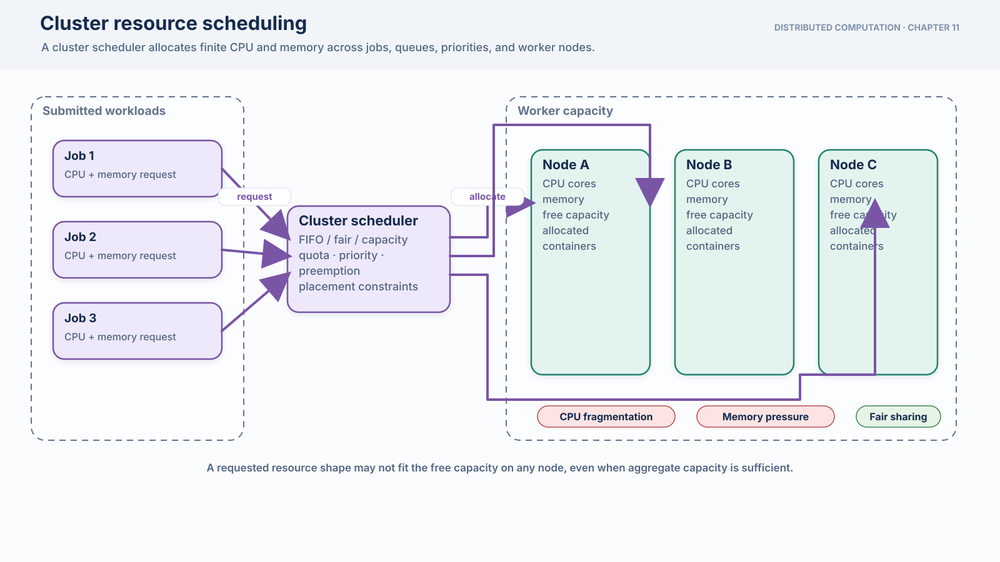

<details>
<summary>Diagram notes and learning objective</summary>

- **Purpose:** explain how a shared scheduler allocates finite cluster capacity.
- **Components:** queue/pool definitions, jobs A/B/C, resource manager, worker nodes, CPU/memory slots, task containers.
- **Flow:** jobs submit requests → scheduler applies queue/priority/fairness policy → workers receive allocations → tasks execute and release resources.
- **Learning objective:** distinguish total capacity, per-node fit, fairness, and application-level task parallelism.
- **Layout:** scheduler in center, queues above it, workers below it; use stacked CPU/memory allocation bars per worker.

</details>

---

# 12. YARN—Yet Another Resource Negotiator

## 12.1 Architecture

YARN separates global resource management from application-specific execution coordination.

- **ResourceManager (RM):** cluster-wide authority for resource arbitration and application management. The scheduler component allocates resources according to configured policies.
- **NodeManager (NM):** per-node agent responsible for launching and monitoring containers and reporting node/resource status.
- **ApplicationMaster (AM):** per-application coordinator. It negotiates containers with the RM and works with NMs to execute and monitor the application's tasks.
- **Container:** allocation of resources on a node within which an application process/task executes.

The ResourceManager does not execute every map or reduce task itself. It allocates resources; the application master tracks the application's work and requests containers.

## 12.2 Execution lifecycle for a MapReduce job

1. Client submits job configuration, application artifacts, input paths, and output path.
2. ResourceManager accepts the application and allocates resources to launch its ApplicationMaster.
3. The NodeManager on the selected node launches the AM container.
4. The AM registers with the ResourceManager and requests containers for map/reduce tasks based on resource needs and placement preferences.
5. RM's scheduler allocates containers; AM asks corresponding NodeManagers to launch task processes.
6. Tasks read input, execute map logic, write intermediate shuffle output, fetch data, and execute reducers.
7. Task progress and failures are reported. AM requests replacement containers/retries according to job policy.
8. Once tasks succeed and output commit completes, AM reports application completion and resources are released.

## 12.3 Scheduling and operational concerns

YARN supports pluggable scheduling policies, commonly including FIFO, Capacity, and Fair scheduling in relevant versions/distributions. Queue settings, memory/vcore resource accounting, labels, preemption, and node health all affect execution.

A job can wait even when some cluster resources appear free because its queue may be capped, a requested container may not fit, node labels may constrain placement, user limits may apply, or locality/resource policies may defer allocation. Diagnose the queue and allocation state rather than looking only at cluster-wide free CPU.

YARN enabled multiple computation frameworks to share a Hadoop cluster by providing a common resource-management layer. The actual framework-specific scheduling still resides in an application master or engine runtime.

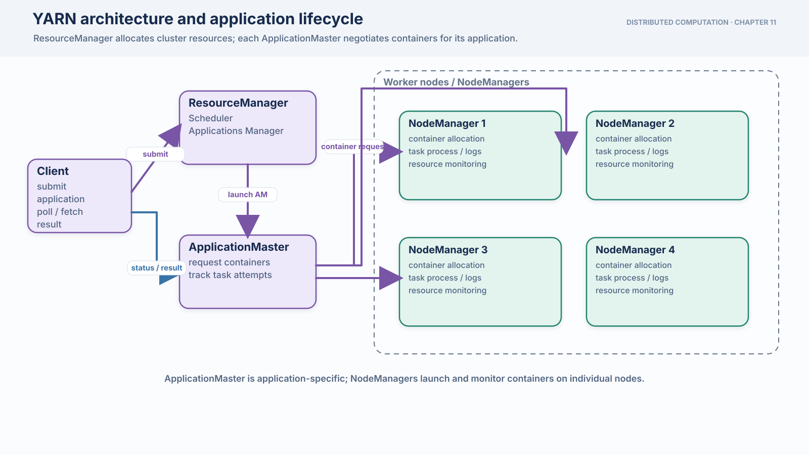

<details>
<summary>Diagram notes and learning objective</summary>

- **Purpose:** show YARN's global and per-application responsibilities.
- **Components:** client, ResourceManager/Scheduler, ApplicationMaster, NodeManagers, containers, map/reduce tasks.
- **Flow:** submission → AM launch → container requests → NM launch → task execution/monitoring → completion.
- **Learning objective:** understand the separation of cluster resource arbitration and application coordination.
- **Layout:** ResourceManager above several NodeManagers; AM spans the application boundary and communicates with both RM and NMs.

</details>

---

# 13. Apache Mesos

## 13.1 Architecture and two-level scheduling

Apache Mesos introduced a two-level resource-sharing model for multiple frameworks. Its core components are:

- **Master:** tracks agents/frameworks and offers available resources according to an allocation policy.
- **Agent:** runs on each cluster node and reports available resources.
- **Framework scheduler:** receives offers and decides whether/how to use them for framework tasks.
- **Executor:** process on an agent that launches and manages tasks for a framework.

The master decides what resources to offer to a framework; the framework scheduler decides which of the offered resources to accept and which tasks to launch. This division is the essence of two-level scheduling.

## 13.2 Resource-offer walkthrough

Assume Agent 1 reports 4 CPUs and 4 GB of available memory.

1. Mesos Master applies its allocation policy and offers these resources to Framework A.
2. Framework A's scheduler inspects the offer and can accept it, decline it, or accept part of it according to framework rules.
3. Framework A responds with task descriptions—for example, Task 1 requests 2 CPUs/1 GB and Task 2 requests 1 CPU/2 GB.
4. Master sends launch instructions to Agent 1.
5. Agent 1 launches the framework executor, which starts the tasks.
6. Task completion/failure is reported back through the executor/agent/master path.

Mesos can share a cluster among long-running services, batch jobs, and engines such as Spark or Hadoop, provided the relevant frameworks integrate with it. The design offers framework flexibility, but resource-offer interactions and multiple scheduler policies add operational complexity.

## 13.3 Mesos versus YARN

YARN typically places global allocation in the ResourceManager and application-specific coordination in the ApplicationMaster. Mesos offers resources to framework schedulers, which make task-placement choices for their own framework. Both support multi-tenant resource sharing, but their scheduling abstractions and integration models differ.

Mesos is an important historical cluster-management design. For a new deployment, evaluate the current maintenance status, ecosystem integration, operational expertise, and supported versions rather than assuming the same adoption profile as its earlier deployments. Kubernetes has become a prominent general-purpose orchestration platform, but it is not a drop-in semantic replacement for every Mesos/YARN setup.

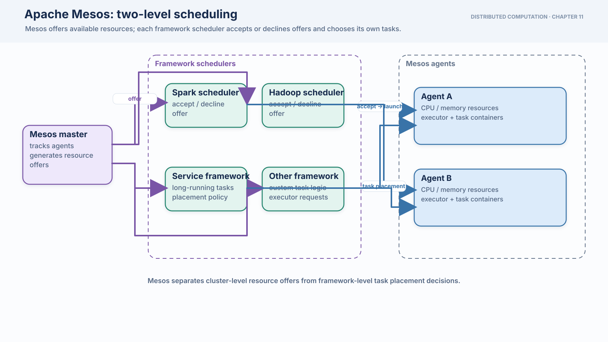

<details>
<summary>Diagram notes and learning objective</summary>

- **Purpose:** illustrate the resource-offer cycle.
- **Components:** Mesos Master, Agent 1/2, Framework A/B schedulers, executors, tasks, CPU/memory offers.
- **Flow:** agents report free resources → master offers resources → framework accepts/declines and specifies tasks → agent launches executor/tasks.
- **Learning objective:** understand the two scheduling decisions and where framework-specific logic lives.
- **Layout:** master in center, agents below, framework schedulers above; label offers and task-launch arrows separately.

</details>

---

# 14. Kubernetes for Distributed Computation

## 14.1 Kubernetes primitives relevant to batch engines

Kubernetes is a container orchestration system. Its control plane stores desired state and schedules Pods onto Nodes; node agents start containers and report status.

- **API server:** exposes the Kubernetes API and validates/stores objects.
- **Scheduler (`kube-scheduler`):** chooses a node for an unscheduled Pod using filtering and scoring.
- **Controller manager:** runs controllers that reconcile desired state and observed state.
- **Worker node:** machine that hosts pods.
- **Kubelet:** node agent that ensures assigned pods and containers run.
- **Pod:** smallest schedulable unit, containing one or more tightly coupled containers.
- **Job/CronJob:** controllers for finite tasks and scheduled tasks.
- **StatefulSet:** controller for workloads needing stable identities/storage semantics.
- **PersistentVolume/PersistentVolumeClaim:** abstractions for persistent storage.

A Pod requests and limits resources such as CPU and memory. Requests influence scheduling; limits constrain runtime consumption. A Pod can remain Pending if no node can meet its request or placement constraints.

## 14.2 Scheduling constraints

- **Node selector/affinity:** constrain or prefer nodes with labels or topology.
- **Taints/tolerations:** keep pods off nodes unless they tolerate the taint.
- **Pod affinity/anti-affinity:** express co-location or separation preferences.
- **Topology spread constraints:** distribute pods across zones/nodes according to policy.
- **Priority and preemption:** allow higher-priority pods to displace lower-priority ones under appropriate conditions.
- **Resource requests and limits:** influence placement and runtime enforcement.
- **Quotas and limit ranges:** constrain namespace-level resource use.

Kubernetes scheduling is a placement decision for pods. It is distinct from the application engine's scheduling of internal tasks across executor processes.

## 14.3 Spark on Kubernetes

A common deployment runs a Spark driver in a driver Pod. The driver requests executor Pods through the Kubernetes API. Executor Pods start on worker nodes, register with the driver, and execute Spark tasks. The driver handles Spark DAG/stage/task scheduling; Kubernetes places and supervises the Pods.

Production concerns include:

- Driver/executor service accounts, RBAC, secrets, and access to storage.
- Network policies, DNS, and driver reachability from executors.
- Image contents, dependency distribution, and version compatibility.
- Resource requests/limits and JVM/off-heap memory planning.
- Dynamic allocation and executor lifecycle.
- Local ephemeral storage for shuffle spill and temporary files.
- Persistent shuffle services or remote shuffle approaches where required by the architecture.
- Driver failure/restart semantics and application restart policy.
- Cleanup of executor pods, event logs, and temporary resources.

Dynamic executor allocation is not the same as node autoscaling. Spark may ask for more executors; Kubernetes can schedule pods only if suitable node capacity exists. A cluster autoscaler may add nodes, but node provisioning is a separate control loop and takes time.

## 14.4 Scheduling challenges

- **CPU/memory fragmentation:** free aggregate resources may not fit a large executor Pod.
- **Pending Pods:** quotas, taints, node selectors, insufficient memory, or topology requirements may block placement.
- **Data locality:** object-store reads may be remote by design; HDFS locality may not align with pod placement.
- **Preemption:** can interrupt executors and trigger task retries.
- **Spot/preemptible nodes:** reduce cost but increase interruption risk; checkpoint/retry logic must tolerate it.
- **Persistent storage topology:** attached volumes may constrain where a pod can run.
- **Noisy neighbors:** CPU throttling and disk/network contention can create task-duration variance.

## 14.5 YARN vs Mesos vs Kubernetes

| Dimension | YARN | Mesos | Kubernetes |
|---|---|---|---|
| Primary abstraction | Application containers and per-app AM | Resource offers to frameworks | Pods and controllers |
| Scheduling model | RM allocates containers; AM coordinates app tasks | Master offers resources; framework scheduler chooses tasks | Scheduler filters/scores Nodes for Pods; application engine schedules internal tasks |
| Resource allocation | Cluster-wide RM queues/policies | Allocation policy and offers | Pod requests/limits, quotas, priorities |
| Application integration | Hadoop ecosystem and framework-specific AM | Framework integration via scheduler/executor | Containerized engines and operators/controllers |
| Container support | YARN containers; isolation depends on deployment | Executors/tasks with isolation modules | Native container/pod lifecycle |
| Multi-tenancy | Queues, capacity/fair policies, limits | Framework shares and allocation modules | Namespaces, quotas, RBAC, priorities, policies |
| Failure handling | RM/NM/AM and task retries | Master/agent/framework recovery | Pod/container restart and controller reconciliation; app-level recovery still required |
| Best fit | Hadoop-oriented shared clusters | Legacy/multi-framework resource sharing | Broad containerized application orchestration |

These systems are not exact substitutes. YARN and Mesos are primarily cluster resource managers with application/framework abstractions; Kubernetes is a container orchestration platform with a rich declarative API. Spark's own task scheduler remains responsible for partition tasks whichever supported cluster manager is used.

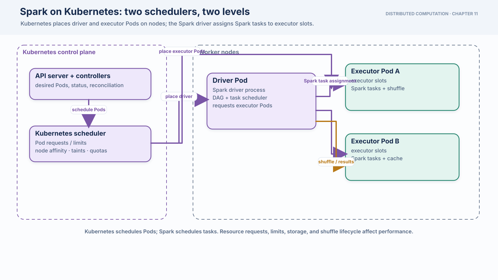

<details>
<summary>Diagram notes and learning objective</summary>

- **Purpose:** show the two levels of scheduling in Spark on Kubernetes.
- **Components:** Kubernetes API server/scheduler, worker nodes, driver Pod, executor Pods, Spark task scheduler, tasks, input/output storage.
- **Flow:** driver requests executor Pods → Kubernetes schedules Pods → executors register → Spark driver assigns partition tasks → executors process/shuffle/write.
- **Learning objective:** distinguish pod placement from task-to-executor scheduling.
- **Layout:** Kubernetes control plane across top, worker nodes across bottom, driver and executor pods inside nodes; show separate Kubernetes and Spark control arrows.

</details>

---

# 15. Stragglers and Speculative Execution

## 15.1 What is a straggler?

A **straggler** is a task whose progress is much slower than comparable tasks in the same stage. It may be slow because it received more records, has more expensive values, is running on a busy or degraded machine, is spilling to disk, is contending for network bandwidth, or is suffering from garbage collection or hardware differences.

Distributed stages often wait for all required tasks before downstream stages can proceed. Therefore, a single straggler can dominate stage completion time even when most of the cluster is idle.

## 15.2 Numerical impact

A stage has 100 tasks:

- 95 tasks finish in 20 seconds.
- 4 tasks finish in 25 seconds.
- 1 task finishes in 180 seconds.

Ignoring downstream overlap, stage completion is governed by the slowest required task: approximately **180 seconds**, not 20 seconds. After most tasks finish, their resources may be idle while the straggler continues. The stage's tail can therefore have low cluster utilization and high wall-clock delay.

Adding workers does not necessarily fix the problem. If the slow task owns a skewed partition containing 35% of all data, it still has to process that partition. Additional workers help only if the engine can split/repartition the work or the bottleneck is contention that more capacity can relieve.

## 15.3 Speculative execution

Speculative execution detects tasks whose progress or duration is unusually poor relative to peers and launches another attempt, often on another worker. If one attempt succeeds first, the other may be killed and the successful result is used. This can reduce the impact of transiently slow hardware or noisy neighbors.

The decision requires a policy: when is a task “slow enough,” how much duplicate capacity can be used, and how are attempts coordinated? A false positive wastes CPU, memory, network, and slots. Some systems expose speculation settings; exact detection algorithms and defaults are framework/version-specific.

## 15.4 Limitations

- If the input partition is genuinely much larger, both attempts may be slow.
- A hot key may force the same reducer-level bottleneck in the speculative attempt.
- Duplicate external side effects can occur if task code writes to an external service without an idempotency key or transactional commit.
- The duplicate can contend with the original attempt and make both slower.
- A transiently slow attempt can recover just as the duplicate starts.
- Speculation does not fix a poor partitioning strategy.

## 15.5 Mitigation strategies

- **Skew-aware partitioning:** distribute hot keys across multiple intermediate keys and combine later where mathematically valid.
- **Salting:** append a temporary salt to a hot key to fan out work, then aggregate salt buckets in a second pass.
- **Partition splitting:** divide oversized inputs into smaller units when source format and operator semantics allow.
- **Adaptive execution:** use runtime statistics to coalesce or split work where supported.
- **Resource isolation:** reduce noisy-neighbor interference and identify CPU/memory/disk contention.
- **Profiling:** examine task duration percentiles, bytes read/written, records processed, spill, GC, and executor host.
- **Data-locality improvements:** reduce remote reads or use suitable storage layout.
- **Idempotent outputs:** make retries and duplicate attempts safe using transactional sinks, task-attempt commit protocols, or deterministic idempotency keys.

### Hot customer example

A customer-ID aggregation contains one customer responsible for 35% of events. A normal hash partitioner sends all records for that customer to one reducer partition. The task becomes much larger than peers. A salting strategy assigns that customer's records to a set of temporary salted keys, such as `(customer_id, salt_bucket)`. The first aggregation computes one partial result per salted key; a second aggregation removes the salt and combines the partial results by customer. This works for associative aggregates such as count and sum. It may not directly work for operations that require ordering or retain all original records.

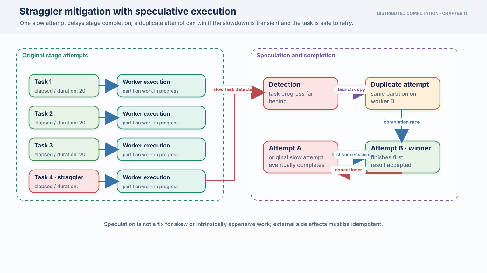

<details>
<summary>Diagram notes and learning objective</summary>

- **Purpose:** show a slow task and a speculative backup attempt.
- **Components:** one stage with many fast tasks, one straggler, duplicate attempt on another worker, scheduler, accepted output, cancelled attempt.
- **Flow:** tasks start → most finish → straggler exceeds threshold → backup starts → first successful attempt wins → redundant attempt is stopped.
- **Learning objective:** distinguish mitigation of transient slowness from correction of data skew.
- **Layout:** two panels (before/after speculation), using a timeline to show task durations.

</details>

---

# 16. Data Skew in Large-Scale Computation

## 16.1 Definitions and forms

**Data skew** means records or processing cost are distributed unevenly across partitions. A partition may contain many more bytes, records, or expensive values than its peers. Skew can occur before any computation (input skew), after key partitioning (key-frequency skew), during joins, or because a small number of records require disproportionately expensive processing.

Examples:

- **E-commerce:** one viral product produces far more click events than other products.
- **Social media:** one celebrity account receives most interactions.
- **Finance:** one large institution contributes a dominant share of transactions.
- **IoT:** one gateway aggregates traffic from thousands of devices while others handle only a few.

## 16.2 Why key skew is hard

For a normal `groupByKey` or key aggregation, all values for a key must be combined logically. A hash partitioner sends identical keys to the same reducer. Adding more partitions does not split one key across reducers. The key must be transformed, decomposed, or processed through a specialized algorithm if parallelism is to be increased without changing correctness.

Skew causes a long tail, oversized hash tables, spill, OOM failures, uneven shuffle fetch, and wasted cluster capacity. A skewed join can be particularly expensive because one key may create a huge many-to-many match set.

## 16.3 Mitigation techniques

### Key salting and two-stage aggregation

Create several temporary keys for the hot key, distribute records across salts, aggregate locally per salt, then remove the salt and combine partial aggregates. Effective for associative/commutative aggregates. The extra stage and partial results add overhead.

### Broadcast join

When one relation is genuinely small, broadcast it to workers so the large relation can be scanned without repartitioning both sides by the join key. This avoids a large shuffle but consumes executor memory and network bandwidth. It is not appropriate if the “small” side is too large after serialization or if it changes unexpectedly.

### Partition splitting and adaptive execution

Split oversized shuffle partitions or input splits into smaller tasks when the engine and operator support it. Spark SQL AQE can adapt skewed join partitions in supported cases. It does not provide a universal mechanism for every RDD operation or arbitrary UDF.

### Sampling and custom partitioners

Sampling helps estimate key distribution and range boundaries. A custom partitioner may distribute known hot keys intentionally. Sampling itself costs time and can miss rare but extreme keys; custom rules can become stale as data changes.

### Pre-aggregation and data modeling

Aggregate early when semantics permit, store data in layouts aligned with frequent access patterns, and avoid a single global key when the business model can use a hierarchy (region → customer → account, for example).

| Technique | Best for | Trade-off/limitation |
|---|---|---|
| Salting | Hot keys with decomposable aggregates | Requires a second aggregation and more keys |
| Broadcast join | One side safely small | Memory/network cost; threshold is not universal |
| AQE skew handling | Supported Spark SQL joins with runtime skew evidence | Not all operators and APIs are covered |
| Range partitioning | Ordered/range workloads with estimable distribution | Range boundaries can skew when distribution changes |
| Custom partitioner | Known, stable key distribution | Operational maintenance and possible hot spots |
| Pre-aggregation | Repeated values that can be combined locally | Not safe for non-decomposable operations without more state |

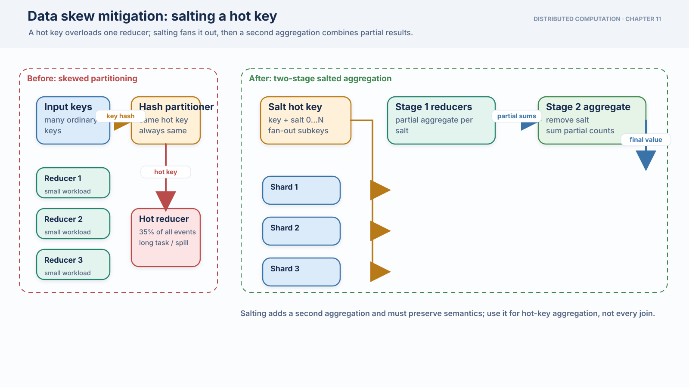

<details>
<summary>Diagram notes and learning objective</summary>

- **Purpose:** contrast balanced and skewed partitioning and show a mitigation.
- **Components:** input keys with one hot key, hash partitions, overloaded reducer, salted key buckets, second-stage aggregate.
- **Flow:** normal partitioning → hot partition; salting → several first-stage partitions → final merge.
- **Learning objective:** understand why simply adding reducers does not divide one key and how two-stage aggregation restores the original key.
- **Layout:** upper panel shows one overloaded partition; lower panel shows salted fan-out and final aggregation.

</details>

---

# 17. Large-Scale Computation Performance Engineering

## 17.1 Partition sizing and parallelism

Partition count determines the number of tasks and the granularity of scheduling. A very large partition creates long tasks, higher memory pressure, and poor recovery granularity. Too many tiny partitions create scheduler overhead, metadata pressure, many small output files, and excessive task setup.

Estimate partition count from input size and desired task size, then tune from observed task-duration distributions and spill. There is no universal optimal partition size: decompression ratio, row width, CPU cost, storage format, cluster memory, and shuffle behavior all matter.

A useful starting calculation is:

\[
P \approx \left\lceil\frac{D}{S}\right\rceil
\]

where \(D\) is the input bytes after the relevant representation is considered and \(S\) is a target partition size. This is a planning approximation, not a promise that every partition will have size \(S\).

## 17.2 Executor sizing

Executor sizing balances concurrency, JVM/process overhead, garbage collection, memory use, and cluster packing. Large executors may reduce process overhead but increase the blast radius of a failure and create large heap/GC pauses. Very small executors may create too many processes and reduce memory available per task.

Plan memory beyond the nominal heap: container memory can include JVM overhead, off-heap/native allocations, Python worker memory, direct buffers, and other runtime processes. Know the deployment mode's memory-accounting rules.

## 17.3 CPU, memory, storage, and network tuning

- **CPU:** inspect CPU utilization per executor, throttling, task CPU time, and serialization/compression cost.
- **Memory:** inspect heap, execution/storage pressure, off-heap memory, spill, GC, and container OOM events.
- **Disk:** monitor local scratch/shuffle storage throughput, queue depth, free space, and I/O wait.
- **Network:** inspect shuffle bytes, fetch wait, retries, congestion, and cross-rack traffic.
- **Serialization:** compact formats reduce bytes but trade CPU for compression/decompression.
- **Caching:** retain only data that is expensive to recompute and meaningfully reused.
- **Locality:** balance local placement against waiting for locality and using idle capacity.

## 17.4 Metrics that matter

| Metric | What it reveals | Diagnostic use |
|---|---|---|
| Job duration | End-to-end completion time | SLA trend and regression |
| Stage duration | Time spent in dependency segment | Identify expensive stages |
| P50/P95/P99 task duration | Task distribution and tail | Detect skew/stragglers |
| Input records/bytes | Work entering tasks | Compare partition sizes |
| Shuffle read/write bytes | Exchange volume | Quantify data movement |
| Spill bytes | Memory pressure during sort/aggregate | Tune partitions and memory/operator plan |
| GC time | JVM collection cost | Detect heap/object pressure |
| Executor CPU utilization | CPU saturation or idleness | Distinguish compute from waiting |
| Scheduler delay | Time waiting before task execution | Detect too many tasks or resource shortage |
| Failed/retried task count | Reliability and unstable work | Inspect hosts, fetch failures, non-determinism |
| Output file count/size | Sink partitioning quality | Find small-file problem |
| Straggler ratio | Share of tasks far slower than median | Diagnose tail latency |

## 17.5 Production troubleshooting scenarios

### 1. Spark becomes slower after adding workers

**Symptoms:** lower throughput despite more nodes. **Possible causes:** increased shuffle fan-out, more cross-rack traffic, tiny partitions, metadata overhead, source bottleneck, or resource fragmentation. **Investigate:** stage/task metrics, network, scheduler delay, input throughput, and executor CPU. **Mitigate:** reduce unnecessary repartitioning, tune partition sizes, locate source bottlenecks, and measure scaling efficiency rather than node count.

### 2. Stage spends most of its time in shuffle

**Symptoms:** high shuffle read/write and fetch wait. **Causes:** wide transformations, high key cardinality, large joins, insufficient local combine, remote spill, or skew. **Investigate:** shuffle bytes by task, spill, fetch wait, partition size, and join plan. **Mitigate:** filter/project earlier, use safe pre-aggregation, choose join strategy intentionally, and address skew.

### 3. One reducer takes ten times longer

**Symptoms:** long stage tail and one large shuffle partition. **Causes:** hot key or uneven range partition. **Investigate:** records/bytes and key frequencies per partition. **Mitigate:** salting, skew-aware join, range-boundary adjustment, or data-model change.

### 4. Executors repeatedly run out of memory

**Symptoms:** container OOM, executor loss, task retries. **Causes:** oversized partitions, huge aggregation maps, broadcast too large, retained caches, or Python/native memory outside heap. **Investigate:** heap/off-heap/container metrics and failing task input. **Mitigate:** smaller partitions, bounded aggregation, release cache, revise join strategy, and size container overhead accurately.

### 5. Large datasets spill heavily to disk

**Symptoms:** high spill bytes, I/O wait, long tasks. **Causes:** sort/hash state larger than execution memory, skew, too many records per task. **Investigate:** spill per task, partition sizes, memory and GC. **Mitigate:** increase useful parallelism, reduce shuffle volume, change aggregation/join, and adjust memory after diagnosing actual pressure.

### 6. Broadcast join causes memory pressure

**Symptoms:** executors OOM or high GC after broadcast. **Causes:** dimension table larger than expected, object expansion after deserialization, multiple concurrent broadcasts. **Investigate:** serialized and in-memory size, executor heap, concurrent query load. **Mitigate:** avoid broadcast, filter/project dimension first, or increase executor capacity only if cluster economics justify it.

### 7. CPU appears idle while jobs wait

**Symptoms:** low CPU utilization, long scheduler delay. **Causes:** queue limits, unavailable slots, blocked input, remote fetch waits, driver bottleneck, or unschedulable resource shapes. **Investigate:** scheduler/cluster manager state, task backlog, input waits, and executor registration. **Mitigate:** correct queue/resource requests, improve source availability, or reduce per-task resource constraints.

### 8. YARN allocation delays

**Symptoms:** application accepted but containers are slow to launch. **Causes:** queue capacity, user limits, node labels, container size, locality wait, unhealthy nodes. **Investigate:** scheduler UI/logs and pending resource requests. **Mitigate:** right-size containers, review queue policy, and address node health/capacity.

### 9. Kubernetes executor Pods remain Pending

**Symptoms:** driver running but no executors. **Causes:** insufficient resources, requests too large, quota, taint, selector, affinity, PVC topology. **Investigate:** Pod events, scheduler events, namespace quota, and node allocatable resources. **Mitigate:** correct requests/placement constraints, provide node capacity, or change storage topology.

### 10. Speculation increases cost without lowering latency

**Symptoms:** duplicate tasks run but stage tail remains. **Causes:** deterministic skew or large partition rather than transient slow host. **Investigate:** task bytes/records and host correlation. **Mitigate:** disable inappropriate speculation and fix partitioning/skew.

### 11. Tasks repeatedly fail after executor loss

**Symptoms:** repeated stage retries or fetch failures. **Causes:** lost shuffle files, unstable nodes, insufficient local disk, or aggressive preemption. **Investigate:** executor-loss reason, shuffle service, disk, and host-level logs. **Mitigate:** stabilize resources, use supported shuffle durability mechanisms, and ensure retry limits are appropriate.

### 12. Excessive scheduling overhead

**Symptoms:** short tasks, high scheduler delay, many task events. **Causes:** too many tiny partitions or overly granular transformations. **Investigate:** median task runtime versus launch/scheduler delay. **Mitigate:** coalesce partitions or use larger input splits where possible.

### 13. Poor data locality

**Symptoms:** high remote-read traffic or slow input stage. **Causes:** compute/storage separated, skewed block placement, resource scarcity on data nodes. **Investigate:** locality levels and remote bytes. **Mitigate:** adjust placement, storage format, or locality wait; don't sacrifice all cluster utilization for locality.

### 14. Daily batch pipeline misses SLA

**Symptoms:** increasing completion time despite stable input. **Causes:** growth, contention, skew, source slowdown, downstream commit time. **Investigate:** stage-level trend and per-task distribution. **Mitigate:** incremental processing, workload isolation, optimize expensive stages, reserve capacity, and define late-data/reprocessing policy.

### 15. Large join creates extreme skew

**Symptoms:** one or a few tasks dominate. **Causes:** hot join key or many-to-many relationship. **Investigate:** key cardinality/frequency and join output size. **Mitigate:** broadcast small side, salt hot keys, split heavy hitters into dedicated paths, or redesign join/aggregation.

---

# 18. Real-World Large-Scale Computation Case Studies

The following examples are reference architectures, not claims about a particular company's confidential implementation. Dataset sizes and choices are illustrative.

## 18.1 Search indexing pipeline

**Requirements:** process crawled web pages, extract text/metadata, tokenize content, generate an inverted index, and publish index segments for serving.

**Data and computation:** raw pages are partitioned by crawl batch or URL hash. Map tasks parse documents and emit `(term, document_id, positions)` records. Shuffle groups postings by term and partitions index segments. Reducers build compressed posting lists. Additional stages merge segments, remove duplicates, and publish versioned index manifests.

**Storage and execution:** object storage or a distributed file system holds raw pages and immutable index segments. MapReduce or Spark performs bounded batch transformations. A resource manager schedules parsers and reducers.

**Trade-offs:** term skew is severe for common words; index partitions must avoid oversized hot terms. Index segment merging creates I/O. Versioned output and an atomic manifest switch prevent search serving from seeing a half-built index. Incremental crawl updates reduce full rebuild costs but require tombstones/deletion handling.

## 18.2 E-commerce analytics platform

**Requirements:** calculate product engagement, customer funnels, cart abandonment, regional conversion, and revenue by day.

**Data layout:** partition clickstream by event date and possibly region; retain schema/version metadata. Use columnar files and compression for scans. A daily job filters invalid events, deduplicates according to event ID, enriches product/customer dimensions, and aggregates by dimensions.

**Execution plan:** early projections and filters reduce bytes. Small dimensions may be broadcast; larger dimensions require partitioned joins. Aggregations use map-side combine; hot products may need salting. Outputs are written to curated data-lake tables with partitioning aligned to common queries.

**Fault and correctness:** use idempotent output partitions keyed by processing date/version, maintain late-arrival correction windows, and ensure reruns replace the same logical output instead of double-appending.

## 18.3 Recommendation data pipeline

**Requirements:** build user/item interaction matrices, aggregate implicit feedback, generate training features, and support iterative model computation.

**Why Spark can help:** iterative algorithms reuse intermediate partitions; persistence can avoid rereading source data across iterations. Structured feature pipelines can use DataFrames; specialized algorithms may use partition-level or distributed ML libraries.

**Risks:** user/item degree skew, very large joins, high-cardinality state, and caches that exceed memory. A user with millions of interactions can dominate a partition. Partition by stable composite keys, cap/weight extreme users where the model permits, and evaluate feature freshness/reproducibility.

## 18.4 Large-scale log processing

**Requirements:** parse logs, extract errors, calculate endpoint latency distributions, and produce historical reports.

**Architecture:** raw logs land in object storage/HDFS, partitioned by ingestion/event date. Batch jobs decode, validate, normalize, and aggregate. Approximate sketches may be suitable for percentile estimation when exact quantiles are too costly, but the accuracy contract must be documented. A separate alerting stream may handle recent anomalies.

**Trade-offs:** compressed logs save storage and network but cost CPU; small files create listing/planning overhead; late logs require a correction policy; malformed records should be counted and quarantined rather than silently discarded.

## 18.5 Financial risk computation

**Requirements:** calculate exposure, portfolio aggregates, scenario risk, and regulatory reports from large transaction and reference datasets.

**Execution:** partition by account, portfolio, instrument, or business date depending on joins and computation. Broadcast truly small reference data; otherwise partition both sides consistently. Use deterministic inputs, versioned code/configuration, reproducible snapshots, and audit records.

**Correctness:** financial calculations require explicit precision/rounding rules, late-data treatment, lineage, and rerun controls. Speculative or retried tasks must not post duplicate transactions. The output should be produced into isolated staging data and committed only after validation.

## 18.6 Data lake batch and streaming architecture

**Requirements:** ingest change-data-capture events, scheduled files, and live event streams; support both current dashboards and historical recomputation.

**Architecture:** event broker feeds streaming ingestion; batch sources land in object storage. A streaming engine builds low-latency materialized views. Batch Spark jobs compact data, enforce schemas, backfill historical periods, and compute large aggregates. A catalog tracks table metadata and schema evolution. A serving layer exposes curated results.

**Trade-offs:** coordinate streaming/batch writes to shared tables, avoid conflicting commits, manage small files, preserve source offsets, and define whether results are at-least-once, deduplicated, or transactionally committed. The storage format and catalog commit protocol are part of correctness, not just performance.

---

# 19. Quantitative Reasoning and Worked Examples

All numbers in this section are hypothetical. They demonstrate how to reason about capacity and bottlenecks; they are not product performance guarantees. Real estimates must account for file format, compression, data skew, serialization, cache, storage/network behavior, task overhead, and concurrent cluster workloads.

## 19.1 MapReduce mapper and reducer counts

Assume 10 TiB of input and a target input split size of 256 MiB.

\[
10\text{ TiB}=10\times 1024\text{ GiB}=10,240\text{ GiB}
\]

\[
256\text{ MiB}=0.25\text{ GiB}
\]

\[
M=\frac{10,240}{0.25}=40,960\text{ map tasks}
\]

This is an approximate split count. Actual input splits depend on file boundaries, splittability, block size, record format, and framework configuration. If compressed input is not splittable, the number of mappers may be governed by file count rather than this arithmetic.

Reducer count is not directly calculated from mapper count alone. Suppose the job targets 1.5 GiB of post-combine shuffle input per reducer and expects 600 GiB after map-side aggregation:

\[
R\approx\left\lceil\frac{600}{1.5}\right\rceil=400
\]

The estimate should then be checked against per-reducer memory, sorting cost, output-file count, cluster slots, and skew. If a hot key accounts for 25% of the data, one reducer may receive about 150 GiB even though the mean is 1.5 GiB; the partitioning strategy must address that key.

## 19.2 Data split sizing

A 3 TiB dataset is processed with 512 MiB splits.

\[
3\text{ TiB}=3\times 1024\times 1024=3,145,728\text{ MiB}
\]

\[
N_{splits}=3,145,728/512=6,144
\]

At 300 concurrently runnable map slots, the idealized number of waves is:

\[
W=\lceil 6,144/300\rceil=21
\]

If each task takes an average of 40 seconds and tasks ran in perfectly balanced waves, the compute floor would be about 840 seconds (14 minutes). Real runtime is higher due to task startup, data reading, stragglers, shuffle, retries, and output commit. Input split size is not necessarily equal to one HDFS block and is not necessarily the post-decompression data size.

## 19.3 Network shuffle volume

A 4 TiB source job emits 1.2 TiB of intermediate data before local combine. The combiner reduces emitted bytes by 55%.

\[
V_{shuffle}=1.2\text{ TiB}\times(1-0.55)=0.54\text{ TiB}
\]

\[
0.54\text{ TiB}=552.96\text{ GiB}
\]

At an ideal aggregate transfer rate of 20 GiB/s, the lower-bound serialization-free transfer time would be:

\[
t=552.96/20=27.648\text{ s}
\]

This is only a theoretical lower bound. Real transfer takes longer because bandwidth is shared, data is split into blocks, compression and serialization consume CPU, disk spill may occur, and network paths can be congested. The slowest reduce partition can dominate stage time even if aggregate network throughput is high.

## 19.4 Spark input partition counts

Suppose a columnar dataset occupies 2.4 TiB compressed on object storage. A workload test suggests a target of 256 MiB compressed bytes per input partition.

\[
P=\frac{2.4\times 1024\text{ GiB}}{0.25\text{ GiB}}\approx 9,830.4
\]

Round to an initial estimate of about 9,831 partitions, subject to file sizes and split behavior. If each partition averages 256 MiB compressed but expands to 900 MiB in memory, a task may have a much larger working set. Target partition sizing must therefore be tested using actual scan, row width, and operator state—not only object-store file size.

## 19.5 Executor and task parallelism

Assume 40 worker nodes. Each node has 32 physical CPU cores and 128 GiB RAM. Reserve 4 cores and 16 GiB per node for the OS and cluster agents. The application cluster budget is therefore:

\[
CPU=40\times(32-4)=1,120\text{ cores}
\]

\[
RAM=40\times(128-16)=4,480\text{ GiB}
\]

Suppose an executor uses 4 cores and requests 20 GiB container memory. Ignoring node packing constraints:

\[
Executors_{CPU}=1,120/4=280
\]

\[
Executors_{RAM}=4,480/20=224
\]

Memory is the limiting aggregate resource, so at most about 224 such executors fit in the cluster under the simplified model. If each executor can run four tasks concurrently, the theoretical task concurrency is 896 tasks. Actual concurrency may be lower due to per-node fit, additional memory overhead, shuffle/cached blocks, heterogeneous nodes, queue policies, and cluster-manager limits. This estimate also assumes a single application owns the whole usable budget.

## 19.6 DAG stage latency

A three-stage job has the following measured times:

- Stage A: 6 minutes.
- Stage B: 9 minutes, including shuffle write/read.
- Stage C: 4 minutes.

If stages are strictly dependent and do not overlap:

\[
T_{job}=6+9+4=19\text{ minutes}
\]

If Stage B includes 2 minutes of avoidable shuffle overhead, reducing that overhead by half saves 1 minute, not 2 minutes. The new total would be about 18 minutes, a 5.3% end-to-end reduction. Optimizing a stage matters in proportion to its share of total critical-path time. If independent branches overlap, use the critical path rather than summing all stage durations.

## 19.7 Shuffle read/write volume

A job has 500 map tasks. Each produces 200 MiB of shuffle output after compression.

\[
V_{write}=500\times 200\text{ MiB}=100,000\text{ MiB}\approx97.66\text{ GiB}
\]

If there are 100 reduce partitions and the output is evenly distributed, mean shuffle read per reducer is:

\[
97.66/100\approx0.977\text{ GiB}
\]

Each reducer may fetch blocks from many map outputs. The mean is not a cap: hot keys or uneven partition sizes can create a much larger reduce partition.

## 19.8 Broadcast join memory

Assume a dimension table is 500 MiB in serialized form. It expands by a factor of 2.4 when decoded into an in-memory hash representation. Each of 80 executors receives a copy.

\[
Memory_{per\ executor}=500\times2.4=1,200\text{ MiB}\approx1.17\text{ GiB}
\]

\[
Aggregate\ copies=80\times1.17\approx93.6\text{ GiB}
\]

This is only the table representation and excludes hash-table overhead, concurrent tasks, other cached data, JVM overhead, and temporary structures. A broadcast can therefore be expensive even when the serialized table appears small. Assess both per-executor peak memory and aggregate network fan-out.

## 19.9 Cluster CPU utilization

A cluster has 1,000 allocatable cores. A job has 700 cores assigned, and its average CPU utilization while running is 45%.

\[
Consumed\ CPU\ capacity=700\times0.45=315\text{ cores}
\]

Relative to total cluster capacity:

\[
Utilization=315/1,000=31.5\%
\]

The cluster can appear underutilized even though the job owns 700 cores. Tasks may be waiting on shuffle, input reads, locks, memory pressure, or scheduler delays. Increasing executor cores may not help if the bottleneck is network or data skew.

## 19.10 Memory allocation estimate

A worker has 128 GiB physical RAM. Reserve 16 GiB for OS, node agent, and safety margin. The remaining 112 GiB is available to containers. If four executors are placed on the node, an equal initial memory budget is:

\[
112/4=28\text{ GiB per executor container}
\]

If the JVM heap is 22 GiB, 6 GiB remain for overhead such as native memory, direct buffers, Python worker processes, and other container memory. This split must be validated against the execution engine's actual accounting rules. Setting heap equal to container limit is unsafe when the process uses off-heap/native memory.

## 19.11 Batch duration and throughput

A 12 TiB job must complete within 2 hours. Required effective throughput is:

\[
12\times 1024\text{ GiB}/7,200\text{ s}=1.7067\text{ GiB/s}
\]

If the measured end-to-end pipeline achieves 1.2 GiB/s, it needs:

\[
12,288/1.2=10,240\text{ s}\approx2.84\text{ h}
\]

It misses the SLA by roughly 50 minutes. Possible remedies include reducing data scanned, incremental processing, parallelizing a bottleneck, reducing shuffle, increasing storage throughput, or reserving more cluster capacity. Merely adding workers may fail if the source or sink is already saturated.

## 19.12 Straggler impact and speculation savings

A stage has 64 tasks. Sixty-three tasks finish in 30 seconds; one task takes 150 seconds. Stage completion is 150 seconds. If speculation starts a duplicate at 70 seconds and the duplicate finishes 35 seconds later (at 105 seconds), the stage can complete at about 105 seconds, saving 45 seconds.

The duplicate used extra capacity. The result assumes the duplicate runs faster due to a transient host issue, not because the underlying partition is inherently much larger. If both attempts process the same hot partition at the same speed, speculation produces little or no benefit.

## 19.13 Data-skew distribution

A shuffle has 100 partitions and 1 TB of data. Uniform distribution would average 10 GB per partition. Suppose the hottest key receives 35% of all records and is routed to one partition. That partition may receive at least 350 GB for that key alone, while the remaining 650 GB is distributed among the other partitions.

The average of 10 GB hides the 350 GB heavy hitter. If the aggregate is a sum, use 20 salted buckets for that hot key. The first stage then processes roughly 17.5 GB per salt bucket, assuming uniform salt assignment. A second stage combines 20 partial sums. This transforms one huge reducer workload into several smaller workloads plus a small final merge.

## 19.14 Resource fragmentation

A cluster has 10 nodes with 16 free cores each: 160 free cores total. An application requests one executor of 24 cores and 80 GiB memory, but each node has only 16 cores free. The aggregate CPU is sufficient, yet the executor cannot be placed on any node. This is fragmentation.

Possible responses include smaller executors, different placement constraints, waiting for resources, or changing node shape. Smaller executors may improve fit but increase process overhead and can affect memory/cache efficiency.

## 19.15 Scheduling overhead

A job creates 200,000 tasks. Assume each task needs 150 ms of scheduling/launch/control overhead beyond useful compute.

\[
Overhead=200,000\times0.15\text{ s}=30,000\text{ s}
\]

That is 8 hours and 20 minutes of aggregate task overhead across the task population. Actual overhead overlaps across tasks and is not simply wall-clock time, but the total illustrates why millions of tiny tasks can burden the driver, scheduler, and event-processing infrastructure. Coalescing partitions may improve performance when tasks are too small.

## 19.16 Storage and network throughput

A pipeline scans 8 TiB from object storage in 90 minutes.

\[
Throughput=8\times1024/5,400\approx1.52\text{ GiB/s}
\]

If the cluster's measured network receive capacity is 4 GiB/s, the source scan is not necessarily saturating the network. Storage throttling, request concurrency, file layout, decompression CPU, or per-object latency may be limiting throughput. Compare bytes delivered, request latency, CPU, and task wait time before declaring the bottleneck.

---

# 20. Architecture Design Exercises

Each exercise is a design prompt with a reference direction. The purpose is to practice deriving a plan from requirements, not to memorize one “correct” stack.

## 20.1 Design a 10 TB/day clickstream analytics pipeline

**Requirements:** process 10 TB of events daily; produce product views, funnels, conversion metrics, and regional aggregates; finish within a two-hour reporting window; support late events and reruns.

**Reference design:** land raw events in object storage partitioned by ingestion date/hour and preserve event timestamps. A schema-aware batch engine scans bounded partitions, filters early, projects only required columns, deduplicates by event ID, enriches with product/customer dimensions, and computes aggregates. Use a stream path only for dashboards requiring lower latency; batch remains the reconciliation path if exact historical reporting is needed.

**Execution:** split the 10 TB input into measured partition sizes. Pre-aggregate locally; shuffle only required grouping keys. Broadcast small dimensions only after checking decoded memory. Salt heavily skewed product/customer keys where aggregation permits it. Write versioned output partitions and commit atomically through the table/storage protocol.

**Illustrative sizing:** at 256 MiB compressed per input partition, 10 TiB yields about 40,960 partitions. A 200-worker cluster with 8 concurrent tasks per worker gives 1,600 concurrent task slots, or about 26 idealized waves. With an average of 20 seconds per task, the compute-only floor would be 520 seconds; actual time is dominated by scans, shuffle, skew, scheduling, and output commit. Benchmark a representative day and maintain headroom.

**Failure/cost:** source replay, duplicate event handling, late-data correction, small-file compaction, and isolated output versions are mandatory. Compare reserved compute against spot/preemptible capacity for retry-tolerant stages.

## 20.2 Design a distributed search-indexing system

**Requirements:** index billions of documents, support incremental crawl updates, preserve serving availability during index rebuild.

**Reference design:** immutable crawled-document storage feeds a parser/tokenizer job. Map tasks emit term/document postings; shuffle partitions by term; reducers build compressed posting segments. A merge stage compacts segments and applies deletions. A versioned manifest points serving nodes to the current segment set.

**Decisions:** partition by term ranges or hash buckets; isolate common heavy terms; use a second path for extremely frequent terms if needed. Use immutable output files and atomic manifest publication so partial builds remain invisible. Recompute only changed crawl partitions where possible.

**Failure:** retry failed partitions, preserve raw crawl data for replay, and keep the old index version serving until validation passes.

## 20.3 Design a recommendation feature pipeline

**Requirements:** generate user/item features daily, incorporate recent events, support iterative training and reproducibility.

**Reference design:** event log/object storage for raw interactions, curated columnar tables, batch feature generation with joins/aggregations, and a model-training engine. Build stable point-in-time snapshots to prevent label leakage. Use partitioned user/item features and maintain consistent feature definitions for training and serving.

**Skew:** heavy users/items are identified with frequency metrics. Apply sampling, per-key caps/weights if statistically justified, or salted partial aggregation. Cache reusable interaction partitions only when the working set fits.

**Failure:** version code, input snapshot, feature schema, and output; retriable computation must not create duplicate feature rows.

## 20.4 Design a financial risk computation platform

**Requirements:** compute exposure and scenario risk from transaction, portfolio, instrument, and market data; produce auditable reports.

**Reference design:** durable versioned input snapshots, deterministic batch computation, typed decimal arithmetic, documented rounding, partitioned joins, staged output, and post-computation reconciliation. Large market/reference tables may be broadcast only if they fit per executor under concurrent load; otherwise partition by instrument or another join key.

**Scheduling:** use a protected queue with sufficient capacity near reporting deadlines. Resource preemption policies must not create unacceptable SLA risk. Record task attempts and input versions for audit.

**Failure:** retries are computation-only; never make external financial postings from an uncommitted task. Publish results after validation and commit.

## 20.5 Design a large-scale log analytics system

**Requirements:** parse raw logs, detect errors, estimate latency distributions, and provide hourly/daily reports.

**Reference design:** ingest logs into object storage partitioned by time and source. A batch DAG performs schema validation, parsing, normalization, and aggregation. Use columnar data for repeated analytics. Keep malformed records in a dead-letter/quarantine dataset with reason codes. A separate streaming pipeline can generate near-real-time alerts.

**Performance:** project only needed fields, parse once into a curated representation, avoid repeated full scans, and choose approximate quantile sketches when the error bounds are acceptable. Coalesce tiny files before analytical reads.

## 20.6 Design a distributed ML feature pipeline

**Requirements:** process terabytes of training data, create joins/features, manage versioned features for batch and online use.

**Reference design:** raw data lake plus curated feature tables, batch DAG for offline features, event/CDC ingestion for recent updates, metadata registry for feature definitions, and materialized online store for low-latency retrieval. Ensure offline/online transformations have shared semantic definitions and explicit point-in-time behavior.

**Risks:** skewed joins, high-cardinality aggregations, leakage, schema drift, and training/serving skew. Validate feature distributions and version artifacts.

## 20.7 Design a multi-tenant data lake processing platform

**Requirements:** multiple teams submit Spark/SQL jobs; isolate workloads, support quotas, cost allocation, and predictable SLAs.

**Reference design:** object storage and a catalog for durable datasets; Kubernetes or YARN as deployment/resource layer depending on environment; logical queues/namespaces per tenant; admission controls; priority classes; policy-based resource limits; centralized logs/metrics; workload tagging and chargeback.

**Scheduling:** define minimum/maximum shares, priorities, and fair-share policy. Protect interactive jobs from large batch jobs and isolate expensive backfills. Monitor node fragmentation, scheduler delay, and noisy neighbors.

**Security:** use workload identities, least-privilege data access, encryption, network policy, and audit logs. Separate user data and secrets from shared worker images.

## 20.8 Design a hybrid batch and streaming analytics system

**Requirements:** low-latency metrics, accurate historical reports, replay, corrections, and cost-efficient backfills.

**Reference design:** durable event log plus object-storage archive. Streaming engine processes events with event-time windows, watermarks, state, and checkpointing. Batch engine recomputes historical partitions and validates streaming aggregates. Serving layer distinguishes provisional from finalized metrics and supports corrected results.

**Correctness:** define event identity, deduplication horizon, allowed lateness, correction policy, sink idempotency/transactions, and replay offset. Do not claim exactly-once end-to-end unless the source, state, and sink semantics actually compose to provide it.

**Illustrative sizing:** assume 2 million events/minute at 500 bytes average payload. Input rate is 1 GB/minute, approximately 16.7 MB/s before protocol/compression overhead. If the stream must replay 24 hours in 4 hours, the replay engine needs at least 6× real-time ingest capacity, plus headroom for skew, backpressure, state restore, and downstream writes. This is a throughput target, not a machine count; benchmark records/sec per core and state cost.

---

# 21. Important Conceptual Distinctions

| # | Concept A vs B | Precise distinction | Example and why it matters |
|---:|---|---|---|
| 1 | Batch vs stream processing | Batch consumes bounded input to completion; streaming processes continuously arriving/unbounded input. | Daily billing vs live fraud detection. Determines state, latency, replay, and completeness semantics. |
| 2 | Parallelism vs distribution | Parallelism is simultaneous progress; distribution places work/data across machines. | Threads on one host vs tasks across nodes. Distribution adds network and partial failure. |
| 3 | Data vs task parallelism | Data parallelism applies similar work to partitions; task parallelism runs different operations concurrently. | Parse many file partitions vs parse and enrich separate branches. |
| 4 | MapReduce vs Spark | MapReduce centers on map/shuffle/reduce jobs and materialized intermediate output; Spark executes DAGs with pipelining and optional persistence. | Iterative feature generation benefits from reuse; neither is always faster. |
| 5 | Mapper vs reducer | Mapper emits intermediate key-value records from input records; reducer processes grouped values for a key. | Word count maps words to 1 and reduces sums. Separates local record work from grouped aggregation. |
| 6 | Shuffle vs local aggregation | Shuffle redistributes records across partitions; local aggregation combines records within an upstream partition before exchange. | `reduceByKey` can shrink network bytes. Use combiners only when semantics permit. |
| 7 | RDD vs DataFrame | RDD is a general partitioned collection; DataFrame is schema-aware relational data. | Custom graph traversal vs optimized SQL aggregation. Structured plans expose more optimizer information. |
| 8 | Transformation vs action | Transformation defines a new dataset/plan; action requests a result or side effect and triggers execution. | `filter` vs `count`. Helps reason about laziness and repeated computation. |
| 9 | Narrow vs wide dependency | Narrow child partitions depend on limited parent partitions; wide dependencies redistribute data among partitions. | `map` vs `reduceByKey`. Wide dependencies typically create shuffle boundaries. |
| 10 | Job vs stage vs task | Job is action-triggered computation; stage is a group of tasks between dependency boundaries; task processes a partition. | One save action may produce multiple stages and thousands of tasks. |
| 11 | DAG scheduler vs task scheduler | DAG scheduler derives stages/dependencies; task scheduler launches task attempts on executors. | Stage creation vs placing partition task 42. Diagnoses planning vs placement problems. |
| 12 | Shuffle vs broadcast | Shuffle repartitions data across workers; broadcast replicates a small relation to workers. | Large-large join vs large table joined to small dimension. Broadcast trades exchange for memory/fan-out. |
| 13 | Dataflow vs MapReduce model | General dataflow permits rich operator graphs; classic MapReduce imposes map/group/reduce structure. | Stateful multi-branch stream graph vs nightly key aggregate. Affects expressiveness and runtime scheduling. |
| 14 | Lambda vs Kappa | Lambda has batch and speed paths; Kappa relies on a replayable log and stream path. | Accurate history plus low-latency view vs replay-based single path. Complexity shifts between reconciliation and replay. |
| 15 | Batch layer vs speed layer | Batch recomputes broad history; speed layer processes recent data quickly. | Daily DAU vs live trending. Serving must reconcile results. |
| 16 | Job vs task scheduling | Job scheduling decides application admission/order; task scheduling assigns individual work units. | YARN queue selection vs Spark partition task placement. Different bottleneck layer. |
| 17 | Resource scheduling vs orchestration | Resource scheduler allocates compute; orchestration manages container/pod lifecycle and desired state. | YARN container allocation vs Kubernetes Pod reconciliation. Some platforms combine aspects but responsibilities remain distinct. |
| 18 | YARN vs Mesos | YARN allocates containers and uses per-app AMs; Mesos offers resources to framework schedulers. | Different integration and scheduling contracts. Important for legacy platform migration. |
| 19 | YARN vs Kubernetes | YARN is Hadoop-oriented cluster resource management; Kubernetes is general container orchestration. | Spark on YARN vs Spark driver/executor Pods. Not interchangeable without deployment changes. |
| 20 | Mesos vs Kubernetes | Mesos uses resource offers and framework schedulers; Kubernetes schedules Pods through declarative controllers and a scheduler. | Different abstractions, ecosystems, and operational models. |
| 21 | Data locality vs compute locality | Data locality places computation near data; compute locality places related tasks/processes near each other. | Map near HDFS block vs co-located operators. Balances network traffic and scheduling wait. |
| 22 | Data skew vs stragglers | Skew is uneven data/work distribution; a straggler is a task that finishes much later than peers. | A hot key creates a straggler. A straggler may instead be caused by noisy hardware. |
| 23 | Speculative execution vs retry | Speculation runs a duplicate attempt while the original is still running; retry runs again after failure. | Slow task vs crashed executor. Duplicate side effects must be controlled. |
| 24 | Checkpointing vs lineage | Checkpointing materializes recovery state/data; lineage describes how to recompute a derived partition. | Long iterative DAG checkpoint vs recompute lost RDD partition. Checkpoints cost storage but can bound replay. |
| 25 | Adaptive execution vs static planning | Static planning chooses a plan before execution; adaptive execution revises parts using runtime statistics. | AQE coalesces shuffle partitions. Runtime adaptation helps estimation errors but adds planning/runtime constraints. |

---

# 22. Interview Preparation — 130 Questions with Answers

The answers emphasize execution semantics and architecture. In an interview, state assumptions, draw the data path, identify exchanges and failure boundaries, and explain trade-offs rather than stopping at a definition.

## 22.1 Beginner questions (1–30)

**1. What is MapReduce?**  
MapReduce is a distributed programming model in which a map function converts input records into intermediate key-value pairs, and a reduce function aggregates values grouped by key. The framework handles partitioning, shuffle/sort, scheduling, and task recovery.

**2. Why was MapReduce influential?**  
It made large batch jobs feasible on clusters of commodity machines without requiring every application developer to implement task scheduling, data locality, retries, and intermediate data movement. Its contribution was the runtime model as much as the two functions.

**3. What does a mapper do?**  
A mapper processes input records independently and emits zero or more intermediate key-value pairs. It usually performs parsing, filtering, normalization, or key extraction before data is grouped across the cluster.

**4. What does a reducer do?**  
A reducer receives one key and the values associated with that key, then aggregates or transforms them. The shuffle ensures that a key's values are routed to the same reducer partition.

**5. What is a MapReduce shuffle?**  
It is the redistribution of mapper output to reducer partitions, usually followed by merge/sort and grouping by key. It is costly because it involves serialization, network transfer, disk I/O, and potentially large intermediate data.

**6. What is Apache Spark?**  
Spark is a distributed computation engine for batch, SQL/structured analytics, and streaming-style workloads. It builds execution plans, divides work into stages/tasks, and runs tasks on executors allocated by a cluster manager.

**7. What is an RDD?**  
An RDD is an immutable, partitioned distributed collection that supports parallel operations and lineage-based recomputation. It is a low-level Spark abstraction compared with schema-aware DataFrames.

**8. What is lazy evaluation in Spark?**  
Transformations record a plan rather than immediately calculating every result. An action triggers execution, enabling Spark to combine compatible operations and avoid computing data that is never needed.

**9. What is a DAG?**  
A directed acyclic graph is a representation of operations and their dependencies with no directed cycles. Spark uses dependency information to divide work into stages and schedule tasks.

**10. What is a partition?**  
A partition is a logical subset of a distributed dataset processed by a task. It controls task granularity and parallelism; too-large partitions create long tasks, while too many tiny partitions create scheduler and metadata overhead.

**11. What is a Spark driver?**  
The driver runs the main application logic, constructs execution plans, coordinates jobs, and schedules tasks. It should not be used as a destination for unbounded result data.

**12. What is an executor?**  
An executor is an application-specific process on a worker node that runs Spark tasks and can hold cached/shuffle-related data. Each Spark application has its own executor processes.

**13. What is a Spark job?**  
A job is a unit of distributed computation triggered by an action or query execution request. It is divided into one or more stages based on dependencies.

**14. What is a Spark stage?**  
A stage is a set of tasks that can execute without crossing a shuffle dependency boundary. A stage typically contains one task per relevant input partition.

**15. What is a Spark task?**  
A task is the smallest scheduled unit of work, generally processing one partition for one stage. A task attempt may be retried or speculatively duplicated.

**16. What is the difference between a transformation and an action?**  
A transformation defines a derived dataset or plan, such as `map` or `filter`; an action requests a result or output, such as `count` or `save`. Transformations are lazy; actions trigger execution.

**17. What is a narrow dependency?**  
A narrow dependency means each child partition depends on a limited set of parent partitions, often one. The engine can commonly pipeline the operations without a network-wide redistribution.

**18. What is a wide dependency?**  
A wide dependency means a child partition may depend on data from many parent partitions. It typically requires a shuffle, creating a stage boundary.

**19. What is RDD lineage?**  
Lineage records how an RDD was derived from parent RDDs. Spark can use it to recompute lost partitions instead of requiring every intermediate result to be durably replicated.

**20. What is caching in Spark?**  
Caching/persisting retains computed partitions for reuse. It helps when an expensive dataset is referenced repeatedly, but consumes cluster memory/disk and can be evicted under pressure.

**21. What is data locality?**  
Data locality means scheduling computation near the data it reads to reduce network transfer. It is especially useful for large block-based input, though a scheduler may trade locality against waiting for free resources.

**22. What is YARN?**  
YARN is Hadoop's cluster resource-management layer. It separates cluster-wide resource arbitration by the ResourceManager from per-application coordination by the ApplicationMaster.

**23. What is a YARN container?**  
A container is a resource allocation on a node in which an application process or task runs. The NodeManager launches and monitors containers on its node.

**24. What is Apache Mesos?**  
Mesos is a cluster resource-sharing system based on resource offers to framework schedulers. The master allocates offers and frameworks decide which tasks to launch using accepted resources.

**25. What is Kubernetes?**  
Kubernetes is a container orchestration platform that schedules Pods onto Nodes and reconciles declared desired state. It manages workload placement and lifecycle; an engine such as Spark still schedules its internal tasks.

**26. What is a dataflow model?**  
It expresses computation as a graph of source, transformation, state, and sink operators connected by data edges. It supports parallel execution and makes exchange and dependency structure explicit.

**27. What is a watermark?**  
A watermark is a runtime/source estimate of event-time progress, used to reason about when a window is expected to have received its events. It is not an absolute guarantee that no earlier event can arrive.

**28. What is data skew?**  
Data skew is an uneven distribution of records or work across partitions. It creates overloaded tasks and long stage tails, often due to hot keys or uneven input sizes.

**29. What is a straggler?**  
A straggler is a task that finishes much later than comparable tasks. Causes include skew, slow hardware, contention, spills, network problems, or expensive individual records.

**30. What is speculative execution?**  
Speculative execution launches a duplicate attempt for a task judged unusually slow. It can mask transient slow workers, but adds resource cost and does not solve deterministic skew.

## 22.2 Intermediate questions (31–70)

**31. Explain the full MapReduce execution path.**  
The framework splits input, starts mappers, buffers/spills intermediate records, partitions keys, transfers mapper partitions to reducers, merges/sorts/group values, runs reducers, and commits output. Resource managers and storage systems participate in job placement and data access.

**32. Why is shuffle-and-sort often expensive?**  
It causes network transfer from many map tasks, serialization, local spill/merge, remote fetch, and reducer-side grouping. Skew and block-level request overhead can dominate even when aggregate bandwidth looks sufficient.

**33. What is a combiner?**  
A combiner performs optional local aggregation of mapper output to reduce data transferred to reducers. It must be safe if invoked zero, one, or multiple times, so it is generally suitable for associative/commutative operations such as sum or count.

**34. Why can a mapper's output be lost when a worker fails?**  
Map output is commonly stored on the worker's local disk as recomputable intermediate data. If that disk/node is lost, the framework reruns the mapper from durable input to regenerate the output.

**35. How does data locality improve MapReduce performance?**  
It places map tasks near the blocks they read, reducing remote network traffic. A locality-aware scheduler still balances locality against queue wait and available worker capacity.

**36. Why can iterative algorithms be slow in classic MapReduce?**  
Each iteration may become a new job and require materializing and rereading intermediate state. Iterative algorithms repeatedly reuse the same data, so persistent in-memory partitions or a stateful engine can reduce repeated I/O.

**37. How is Spark different from MapReduce?**  
Spark supports a general DAG, pipelines narrow operations, and can persist reused data. Classic MapReduce centers on map/shuffle/reduce jobs with intermediate materialization. Both still perform distributed shuffles and can use disk.

**38. Describe Spark's driver/executor relationship.**  
The driver plans jobs and schedules task attempts; executors run those tasks and manage application data blocks. A cluster manager provides executor resources but does not replace the driver’s partition-level scheduling.

**39. Why are transformations lazy?**  
Laziness permits plan-level optimization, pipelining, and elimination of unused computation. The trade-off is that an expensive lineage can be recomputed for multiple actions unless persisted or materialized.

**40. How are Spark partitions related to tasks?**  
A stage normally creates one task for each partition it must process. Task concurrency is limited by executor cores/slots and available resources; excess tasks run in waves.

**41. Explain RDD lineage recovery.**  
When a partition is lost, Spark walks its dependency graph to identify the required parent data and transformations, then recomputes the partition. This works while its source data and dependencies remain available and deterministic enough for the required semantics.

**42. When should an RDD be cached?**  
Cache expensive datasets reused by multiple downstream operations, provided their working set can be retained economically. Avoid caching one-use or cheap-to-recompute data, and monitor eviction and memory pressure.

**43. Why is `collect()` dangerous?**  
It transfers all records to the driver, which may not have enough memory or network capacity. It destroys distributed result handling and can crash the driver; use distributed output or bounded aggregates.

**44. Explain narrow versus wide transformations with examples.**  
`map` and `filter` commonly preserve partition-local dependencies and can pipeline. `reduceByKey`, `groupByKey`, many joins, and global sorts need records redistributed, so they commonly introduce shuffle boundaries.

**45. How does Spark derive stage boundaries?**  
The DAG scheduler follows dependencies and groups pipelinable operations into stages. Shuffle dependencies require an upstream stage to produce exchange data before downstream tasks can consume it. Actual stages depend on the physical plan and runtime.

**46. Why is a shuffle not the same as `map` or `reduce`?**  
Shuffle is a data redistribution mechanism. A `map` transformation may be narrow and local; a shuffle can occur in operations whose API name does not contain “shuffle,” such as joins and repartitioning.

**47. Compare `groupByKey` and `reduceByKey`.**  
`groupByKey` transfers and retains values for each key, which can create large per-key memory structures. `reduceByKey` can aggregate locally before transfer, reducing network bytes when the aggregation is decomposable.

**48. Explain broadcast hash join.**  
The engine broadcasts a small relation to executors and joins it with partitions of the larger relation locally. It avoids repartitioning the large side by key but can consume substantial memory and network if the broadcast is not actually small.

**49. Explain sort-merge join.**  
Both relations are partitioned and sorted by join key, then corresponding sorted streams are merged. It is suitable for large relations but can require significant shuffle and sort I/O.

**50. What is Catalyst?**  
Catalyst is Spark SQL's optimizer that analyzes and rewrites structured logical plans and selects physical execution strategies. It can reason about columns and expressions but not arbitrary opaque behavior inside general RDD functions.

**51. What is Adaptive Query Execution?**  
AQE uses runtime statistics to revise a query plan during execution. Examples include coalescing post-shuffle partitions and adapting supported skewed joins or join strategies; capabilities vary by Spark version/configuration.

**52. What is the role of Tungsten/whole-stage code generation?**  
These optimizations reduce object and operator overhead through efficient memory representations and generated code for compatible operator pipelines. They do not apply equally to every operation or user-defined function.

**53. What is the difference between DataFrame and RDD?**  
A DataFrame has schema and relational semantics that enable SQL optimization, predicate pushdown, and column pruning. An RDD is a more general collection with lower-level transformation control but fewer automatic relational optimizations.

**54. What are event time and processing time?**  
Event time is the timestamp associated with when an event occurred; processing time is when the runtime handles it. Out-of-order delivery makes the distinction essential for correct windowed aggregates.

**55. How do watermarks help stream processors?**  
They estimate event-time progress and help a runtime decide when windows can emit results and when state may be cleaned up. Because they are estimates, late-data policy and allowed lateness still matter.

**56. What is a trigger in a windowed stream?**  
A trigger determines when a window emits a pane/result, such as when event-time watermark passes the end, after a processing-time delay, or after a count threshold. Early and late firings trade result freshness against completeness and cost.

**57. Explain Lambda architecture.**  
It combines a batch layer over historical data with a speed layer for recent events and a serving layer that reconciles the views. Its main complexity is duplicated logic and consistency between the paths.

**58. Explain Kappa architecture.**  
It uses a replayable event log and a stream-processing path for both live processing and historical rebuilds. It requires adequate retention/archive, replay throughput, state bootstrapping, and versioned output management.

**59. What is YARN's ApplicationMaster?**  
It is a per-application coordinator that negotiates containers with the ResourceManager and coordinates task execution through NodeManagers. It is not the global resource manager.

**60. What is the difference between ResourceManager and NodeManager?**  
The ResourceManager arbitrates cluster-wide resources and scheduling; each NodeManager manages containers and reports status on one node. The ApplicationMaster handles application-specific coordination.

**61. Explain Mesos two-level scheduling.**  
The master offers available resources to framework schedulers. Each framework scheduler decides whether to accept offers and describes tasks; agents launch executors and tasks.

**62. Is Kubernetes the Spark task scheduler?**  
No. Kubernetes schedules driver/executor Pods onto Nodes and manages their lifecycle. Spark's internal task scheduler assigns partition tasks to available executors.

**63. How do Kubernetes resource requests affect Spark executors?**  
Requests influence whether an executor Pod can be placed on a node and how the scheduler accounts for capacity. Limits can constrain runtime consumption; poor request/limit sizing can cause Pending Pods, CPU throttling, or OOM termination.

**64. What causes resource fragmentation?**  
Free resources may be distributed across nodes in shapes that cannot satisfy a particular large request. Aggregate free cores do not guarantee that a 16-core/64-GB Pod can fit on any one node.

**65. What causes data skew?**  
Uneven key frequencies, partition sizes, record costs, or join multiplicities can concentrate work on a few tasks. Hash partitioning does not split one hot key because the key must be grouped together under standard semantics.

**66. How does salting mitigate a hot key?**  
It appends a temporary salt to fan records for a hot key across several partitions, aggregates partial results, and then removes the salt in a second aggregation. It works best for associative/commutative aggregation.

**67. What is speculative execution's main use?**  
It protects a stage against a transiently slow worker by launching a duplicate attempt. It does not fix a task that is intrinsically slow because it received much more work.

**68. Why must distributed task side effects be idempotent?**  
A task can be retried or speculatively duplicated, so the same logical work may run more than once. Idempotency keys, transactional sinks, or output commit protocols prevent duplicate external effects.

**69. What is the difference between job and resource scheduling?**  
Job scheduling controls when an application is admitted/selected; resource scheduling allocates CPU, memory, and containers. Task scheduling then assigns the application’s individual work units.

**70. What is the purpose of checkpoints?**  
Checkpoints materialize recovery state or data so the system need not replay an arbitrarily long computation history. They cost I/O and storage, so place them at useful recovery boundaries.

## 22.3 Advanced questions (71–100)

**71. How would you optimize a Spark job with excessive shuffle?**  
Inspect the physical plan and stage metrics first. Push filters/projections earlier, pre-aggregate where mathematically valid, avoid unnecessary repartitioning, reuse compatible partitioning, choose joins using actual relation sizes, and resolve skew. Validate bytes shuffled, spill, task tail, and end-to-end time after each change.

**72. How do you diagnose one slow reducer?**  
Compare its input bytes/records, shuffle fetch time, spill, GC, and host metrics with peers. A much larger partition suggests skew; similar input but high I/O wait suggests host/disk contention. Use heavy-hitter analysis before increasing cluster size.

**73. How does Spark create stage boundaries?**  
The DAG scheduler groups operations that can pipeline and ends a stage at shuffle dependencies. A downstream stage waits for required upstream shuffle outputs. Do not equate API calls or SQL operators one-to-one with stages; inspect the executed DAG.

**74. How does AQE mitigate skewed joins?**  
It uses runtime shuffle statistics to identify unusually large partitions and can split skewed partitions for supported join plans. This reduces the amount of work assigned to a single task but may replicate matching data and adds more tasks; inspect the actual adaptive plan.

**75. How would you size Spark for a 10 TB daily job?**  
Start with target completion time and measured end-to-end throughput, not a generic node count. Estimate input partitions and required task waves, benchmark CPU/core throughput and shuffle amplification, account for executor/container overhead, and reserve capacity for skew, retries, and concurrent jobs.

**76. How would you prevent a driver from becoming a bottleneck?**  
Avoid massive `collect`, control task/partition counts, reduce driver-side metadata volume, use distributed aggregations and writes, and monitor driver heap/GC and scheduler delay. A huge DAG or millions of tiny tasks can overwhelm the driver even when executors are idle.

**77. How do shuffle files affect executor failure recovery?**  
If map-side shuffle output disappears with an executor, downstream fetches can fail. The engine may need to rerun upstream map tasks to recreate lost blocks; external shuffle services or remote shuffle systems can change this failure behavior.

**78. How do you choose between broadcast and shuffle join?**  
Compare the post-filter/projected build-side size after deserialization with available per-executor memory and network fan-out. Broadcast when it is safely small and avoids major repartitioning; use a shuffle strategy for large relations or when broadcast would exceed memory.

**79. How do you handle a join with a many-to-many hot key?**  
First quantify output cardinality: one key may legitimately produce an enormous Cartesian-like match set. Salting can distribute work only if both sides are replicated/partitioned consistently and output semantics are preserved. Consider isolated heavy-hitter processing or changing the model if the output itself is too large.

**80. What is the difference between Spark's RDD scheduler and SQL optimizer?**  
RDD scheduling derives stages from RDD dependencies after transformations are defined. Spark SQL analyzes and optimizes relational logical plans, selects physical operators, and then schedules the generated work. Catalyst is not a general optimizer for arbitrary RDD closures.

**81. How does a Beam runner differ from the Beam model?**  
The Beam model defines semantics and APIs for collections, transforms, windows, triggers, and state. A runner translates those definitions into a runtime-specific execution plan. Portability is bounded by runner capability and performance differences.

**82. How do event-time and processing-time triggers differ?**  
Event-time triggers fire based on watermark progress relative to event timestamps. Processing-time triggers fire according to wall-clock time at the runtime. Event-time supports event-time completeness reasoning; processing-time favors operational responsiveness.

**83. How would you design state retention for a stream aggregation?**  
Define key cardinality, window/session lifetime, allowed lateness, deduplication horizon, and correction policy. Retain state only as long as correctness requires, checkpoint it, and monitor state bytes and checkpoint duration.

**84. What does end-to-end exactly-once require?**  
It requires coordinated source progress, processor state, and sink commits so recovery neither loses nor duplicates logical results. A runtime's exactly-once checkpoint does not make arbitrary external side effects transactional.

**85. How do Flink and Beam relate?**  
Flink is an execution engine/runtime with operator graphs, task managers, and checkpointing. Beam is a programming model/SDK that can run on multiple supported runners, including Flink in applicable deployments.

**86. How do you decide between Lambda and Kappa?**  
Estimate whether one stream engine can replay retained history fast enough, whether the event log can retain/restore the required period, and whether separate batch and low-latency logic genuinely differ. Choose Lambda when batch recomputation has distinct needs; choose Kappa when stream replay provides a simpler adequate path.

**87. How do you avoid duplicated logic in Lambda?**  
Share business rules or use common semantic definitions, validate speed results against batch outputs, and reconcile by event/window/version. Document which layer is authoritative and how corrections are applied.

**88. How does YARN isolate applications?**  
The ResourceManager allocates containers according to queue and scheduler policies; NodeManagers monitor containers. Isolation strength depends on resource accounting, containerization, queue policies, and cluster configuration.

**89. Why can a YARN application wait despite available cluster resources?**  
Queue capacity/user limits, node labels, memory/vcore fit, locality policy, unhealthy nodes, or per-application constraints can prevent allocation. Aggregate cluster free capacity is not sufficient evidence that a request is schedulable.

**90. Explain Mesos resource offers versus YARN container requests.**  
Mesos master offers available resources to a framework scheduler, which chooses tasks for the offer. In YARN, the ApplicationMaster requests containers and the ResourceManager scheduler allocates them under queue/resource policy.

**91. How does Kubernetes scheduling work at a high level?**  
The scheduler filters Nodes that cannot satisfy the Pod's constraints, scores feasible Nodes, and binds the Pod to a selected Node. Kubelet then ensures the Pod's containers run. Controllers reconcile the desired workload state.

**92. How can Pod resource requests create fragmentation?**  
A large request may not fit on any node even when aggregate free resources are high. Smaller executor Pods may pack better, but increase process/coordination overhead and may alter memory/cache behavior.

**93. What is the relationship between Spark dynamic allocation and Kubernetes autoscaling?**  
Spark dynamic allocation changes the number of executor requests based on pending/running work. Kubernetes schedules Pods against existing nodes; a node autoscaler may add nodes when pods cannot fit. These are separate feedback loops with different delays and signals.

**94. How do you choose partition size?**  
Benchmark task duration, memory, spill, and scheduler overhead using actual data. Choose partitions large enough to amortize task startup but small enough to balance work and recover quickly. Compressed file size is only a starting signal.

**95. How do you choose executor cores?**  
Balance task concurrency against heap pressure, GC, process overhead, and cluster packing. Too many cores per executor can increase concurrent memory demand; too few can create many processes and resource overhead.

**96. Why is “more workers” not a reliable optimization?**  
The job may be limited by one hot partition, source/sink throughput, network, scheduler, or a serial dependency. More workers may increase shuffle fan-out and contention without reducing the critical path.

**97. How do you identify scheduler-bound execution?**  
Compare task runtime with scheduler delay, inspect task count and event volume, and monitor driver CPU/GC. Very short tasks and an enormous number of partitions indicate that granularity is too fine.

**98. How do you make a batch pipeline reproducible?**  
Pin input snapshots, code/configuration versions, schema versions, timezone and rounding rules, random seeds, and external reference datasets. Record output manifests and execution metadata.

**99. How do you recover a long iterative DAG after failure?**  
Persist reusable partitions and place checkpoints at boundaries where recomputation cost becomes high. Checkpoints bound lineage replay but require storage and commit/version management.

**100. What is your approach to performance engineering?**  
Define an SLA and baseline, inspect stage/task distributions, identify the critical-path bottleneck, change one major factor at a time, and validate correctness and cost. Avoid tuning from a single average metric.

## 22.4 Scenario-based questions (101–130)

**101. A Spark stage has one task running ten times longer than the others. What do you do?**  
Compare that task's input bytes, records, key frequencies, spill, GC, host, and fetch time. If it has more data, diagnose skew and split/salt the workload. If similar data but a slow host, investigate disk/network/CPU and consider speculation.

**102. A Spark job spills heavily to disk. How do you investigate?**  
Inspect spill per task, partition sizes, aggregation/join plan, memory, GC, and skew. Reduce data before shuffle, use safer aggregation/join strategies, increase useful parallelism, or adjust memory only after proving it is the limiting factor.

**103. The cluster has idle CPUs but the job is slow. Why?**  
Tasks may wait on network fetch, storage reads, locks, scheduler resources, or a single straggler. Inspect CPU time versus task duration, scheduler delay, fetch wait, and per-partition task metrics before requesting more cores.

**104. A MapReduce job is network-bound. What would you change?**  
Measure map output and reducer traffic, inspect partition skew, enable compression if CPU permits, use a combiner for safe aggregations, reduce emitted columns/records, and consider different key partitioning. Do not reduce reducers blindly if it creates larger reducer workloads.

**105. Spark executor Pods remain Pending in Kubernetes. How do you debug?**  
Inspect Pod events and scheduler reasons: insufficient CPU/memory, quota, node selector, affinity, taint, PVC zone, or priority. Compare executor requests with node allocatable capacity and revise placement or cluster capacity.

**106. A YARN queue has a long pending backlog. What would you inspect?**  
Review queue capacity, user/application limits, preemption, resource requests, node labels, unhealthy nodes, and container fit. Check whether jobs request unnecessarily large containers that fragment capacity.

**107. A join has one key responsible for most records. What is your mitigation?**  
Quantify both sides' multiplicity and expected output. Use broadcast if one side is genuinely small; otherwise isolate heavy hitters, salt the key where semantics allow, or process it separately. Avoid assuming a larger reducer count splits the same key.

**108. Speculative execution creates duplicate external writes. How do you fix it?**  
Make the sink idempotent or transactional. Write attempt outputs to isolated temporary locations and publish one successful attempt through a commit protocol. Avoid direct non-idempotent side effects inside retriable tasks.

**109. A batch pipeline misses its SLA every day as data grows. What is your plan?**  
Measure input growth and critical-path throughput, identify scan/shuffle/compute/sink bottlenecks, and introduce incremental processing where appropriate. Reserve capacity and define late-data backfills; do not simply add nodes without checking scale efficiency.

**110. A stream pipeline receives data hours late. How do you handle it?**  
Define allowed lateness, watermark behavior, state retention, and correction output. Decide whether late events update aggregates, route to a correction stream, or are excluded. Ensure serving can expose provisional versus finalized values.

**111. A Spark action runs twice and recomputes an expensive upstream dataset. Why?**  
The transformed RDD/DataFrame may not have been persisted/materialized. Persist the reused result when reuse cost exceeds cache cost, or restructure the job to write/read an appropriate durable intermediate dataset.

**112. A driver crashes after executors have completed most tasks. What matters for recovery?**  
Determine whether the application can be restarted, whether the source and intermediate shuffle data remain available, and whether the sink commit occurred. Design output publishing and reruns to be idempotent rather than assuming completed tasks equal committed job output.

**113. The job has 500,000 tiny tasks. What is the likely issue?**  
Partition granularity is too fine, causing scheduling and metadata overhead. Coalesce or increase input split size where safe, and examine whether the source produces too many small files.

**114. One executor uses much more memory than peers. What might be happening?**  
It may own a hot partition, a large broadcast hash table, a skewed join, more cached blocks, or a memory-heavy Python/native workload. Compare per-executor task inputs, storage metrics, and process/container memory.

**115. A broadcast join works in testing but fails in production. Why?**  
Production dimensions may be larger or concurrent query load may cause multiple broadcasts. Compare decoded in-memory size and executor memory headroom, not just test-file size. Consider a shuffle join or filter/project before broadcasting.

**116. An output table has millions of tiny files. How do you address it?**  
The job may have too many output partitions or small upstream input files. Coalesce output partitions appropriately, use table-format compaction, and align file size with downstream scan patterns. Avoid one giant partition that creates a new bottleneck.

**117. A job reads the same historical dataset every day. What would you redesign?**  
Use incremental partitions or change-data capture if business semantics permit. Maintain compacted curated data, process only new/changed ranges, and keep periodic full recomputation as a correctness/backfill mechanism.

**118. Increasing Spark executor memory worsens performance. How could that happen?**  
Larger executors can worsen GC pauses, reduce node packing, increase failure blast radius, and allow more concurrent tasks to create bigger memory demand. Profile heap/GC and task parallelism rather than assuming more heap means faster execution.

**119. A pipeline's average task time is normal but P99 is rising. What does it indicate?**  
The tail is worsening, possibly from skew, intermittent storage/network latency, noisy neighbors, retries, or a subset of slow hosts. Track task duration against input bytes, partition IDs, and worker identity.

**120. A stream processor's state grows without bound. What should be reviewed?**  
Inspect key cardinality, window/session lifecycle, TTL, deduplication horizon, late-data policy, and state cleanup timers. Bound state according to correctness requirements and validate checkpoint size/duration.

**121. A replay of 7 days of events takes longer than 7 days. What are the options?**  
Increase replay parallelism, optimize transformation/shuffle, use a snapshot plus tail replay, and reduce unnecessary downstream work. Measure source read capacity and sink throughput; replay speed is constrained by the slowest part of the pipeline.

**122. Two Lambda paths produce different daily totals. How do you troubleshoot?**  
Compare event definitions, timestamp/timezone handling, deduplication, window boundaries, allowed lateness, and business logic versions. Reconcile by event IDs and windows, then make one layer authoritative and add automated cross-checks.

**123. A Kappa replay duplicates historical outputs. What is missing?**  
A versioned/idempotent output strategy. Rebuild into a separate namespace/table version, validate, then atomically publish it; do not append replayed records to the live output without deduplication/transaction semantics.

**124. YARN reports free cluster memory but your request is pending. Why?**  
Free memory may be fragmented across nodes, queue/user limits may apply, vcores may be exhausted, labels may constrain placement, or the requested container may be too large. Inspect scheduler allocation details.

**125. Mesos repeatedly declines a resource offer. What might be wrong?**  
The framework scheduler may reject the offered resource shape due to locality, task requirements, or its own placement logic. Inspect offer constraints, framework resource requirements, and allocation policy rather than assuming the master is failing.

**126. Kubernetes schedules the driver but not executors. Why?**  
Executor Pods may request too many resources or violate node selectors, affinity, taints, quota, or storage topology. Check Pod events and compare each executor request to node allocatable capacity.

**127. A single hot key cannot be salted because the computation needs ordered records. What now?**  
Use a more specialized algorithm: range partition with key-plus-order fields, partition the key's value range into ordered segments and merge, or process the hot key separately. Preserve the required global ordering semantics explicitly.

**128. A stage is slow because of repeated remote reads. What would you change?**  
Check file layout, block placement, storage connector behavior, and task locality. Consider preprocessing into a partitioned format, colocating compute with storage, or caching a reusable dataset if the working set is economical.

**129. A critical report must be reproducible six months later. What do you preserve?**  
Input snapshot/version, schema, job artifact, dependencies, configuration, reference datasets, timezone/locale, numerical rules, random seeds, and output manifest. Retain audit logs and the exact definition of late/duplicate events.

**130. Design the first 30 minutes of an incident response for a distributed batch job that is 3× slower than normal.**  
Confirm scope and change history; compare stage/task timeline to baseline; identify whether delay is input, scheduling, compute, shuffle, skew, or sink; inspect failures/retries, node health, and resource queues. Apply a low-risk mitigation such as pausing competing work or reverting a recent change, preserve evidence, and avoid speculative resource increases before locating the bottleneck.

---

# 23. Common Large-Scale Computation Design Mistakes

Each mistake below includes a realistic scenario, failure mechanism, and better approach.

| # | Mistake and scenario | Why it fails | Better engineering approach |
|---:|---|---|---|
| 1 | Treating a distributed job like ordinary multithreaded code | Ignores partial failure, serialization, network, and retries | Design explicit partitioning, exchange, retry, and commit semantics |
| 2 | Ignoring network costs | A key-based aggregation moves terabytes between nodes | Measure shuffle bytes and reduce data before exchange |
| 3 | Creating too many tiny partitions | Scheduler and task setup dominate useful work | Benchmark target task duration; coalesce when overhead dominates |
| 4 | Creating too few oversized partitions | Tasks become long, skew-sensitive, and memory-heavy | Increase granularity and rebalance large partitions |
| 5 | Assuming more workers always improve speed | Critical path may be source, sink, hot key, or serial work | Identify the bottleneck and measure scaling efficiency |
| 6 | Calling `collect()` on a large dataset | Driver memory/network become the bottleneck | Keep data distributed and write/aggregate on workers |
| 7 | Caching everything | Cache consumes memory and evicts useful data | Cache expensive, reused datasets; release them when done |
| 8 | Ignoring shuffle volume | Network, disk, and merge time dominate the job | Inspect exchange plan; filter/project/aggregate early |
| 9 | Using `groupByKey` for a simple aggregate | Retains all values per key and can exhaust memory | Use reduce/aggregate combiners when semantics allow |
| 10 | Broadcasting an oversized table | Every executor receives a large in-memory copy | Estimate decoded size and concurrency; use shuffle join if needed |
| 11 | Ignoring data skew | One partition dominates stage completion | Inspect heavy hitters; salt, split, or isolate them |
| 12 | Assuming speculation solves every straggler | Duplicate tasks inherit deterministic skew | Fix the partitioning or resource bottleneck first |
| 13 | Ignoring task side effects | Retries/speculation can repeat external writes | Use idempotency keys, transactions, and output committers |
| 14 | Misunderstanding lazy evaluation | An upstream plan is recomputed for repeated actions | Persist/materialize only when reuse justifies it |
| 15 | Confusing transformation with action | Developers expect work to execute immediately | Track the action that triggers the job and inspect the DAG |
| 16 | Ignoring lineage recomputation cost | Failure causes expensive replay of long chains | Checkpoint at useful recovery boundaries |
| 17 | Not checkpointing long iterative pipelines | Recovery repeatedly recomputes many iterations | Periodically checkpoint state/data and plan checkpoint storage |
| 18 | Overallocating executor memory | GC, poor node packing, and large failure blast radius | Measure heap/off-heap and use balanced executor shapes |
| 19 | Ignoring resource fragmentation | Requests cannot fit on any node despite free aggregate capacity | Right-size containers and align node shapes with workloads |
| 20 | Ignoring data locality | Large remote scans consume network and increase latency | Use locality-aware placement and suitable storage layouts |
| 21 | Treating Kubernetes as Spark's task scheduler | Pod placement and partition scheduling are conflated | Separate the Kubernetes and Spark control loops |
| 22 | Choosing a resource manager only by popularity | Integration, queueing, security, and operations may not fit | Evaluate the existing platform, engine support, skills, and SLAs |
| 23 | Duplicating Lambda business logic without reconciliation | Batch and speed results diverge | Share semantic definitions and continuously reconcile outputs |
| 24 | Ignoring small output files | Catalog/listing/query planning and open costs grow | Coalesce/compact files to sizes suited to future scans |
| 25 | Failing to monitor task-duration distributions | Averages hide tail latency and skew | Track P50/P95/P99, bytes per task, spill, host, and retry metrics |
| 26 | Assuming a combiner always runs | Correctness depends on framework invoking it | Write combiner-safe logic that remains correct if it runs zero or multiple times |
| 27 | Using processing time for event-time reporting | Late/out-of-order records fall into wrong reporting intervals | Use event timestamps, watermarks, windows, and explicit late-data policy |
| 28 | Claiming exactly-once from an engine setting | External sink side effects may still duplicate | Compose source offsets, state, and sink transactions/idempotency end to end |
| 29 | Ignoring schema evolution | New fields/types break parsing or silently alter meaning | Version schemas, validate compatibility, and quarantine invalid records |
| 30 | Rerunning a job with append-only output | Repeated runs duplicate logical output | Use idempotent partitions, versioned outputs, and atomic commit/publish |

---

# 24. Final Summary and Revision Notes

## 24.1 Comprehensive summary

Large-scale computation is a data and resource orchestration problem. A job must partition input, build a dependency graph, schedule tasks, move intermediate data, manage memory/disk/network, recover failed work, and commit results safely. The cluster is not simply a large computer: it is a set of independently failing machines connected by finite network and storage resources.

MapReduce introduced a simple key-value computation model and a fault-tolerant runtime. Its shuffle/sort phase groups related keys across input partitions. Spark generalizes execution through DAGs, RDD lineage, DataFrames, SQL optimization, and persistence. Spark's `job → stage → task` model is central to performance reasoning: narrow dependencies can pipeline, while wide dependencies often require exchanges.

Shuffle is a major cost because it consumes network, disk, memory, and CPU. Reduce it through early filtering/projection, safe local aggregation, appropriate partitioning, and careful join strategy. Data skew can make one partition dominate an otherwise fast stage; salting, specialized heavy-hitter paths, adaptive execution, and partition-aware data modeling mitigate it.

Dataflow engines generalize the graph model to bounded and unbounded data, state, windows, event time, watermarks, triggers, and replay. Lambda combines batch and speed paths; Kappa uses a replayable log and stream path. Both require explicit correctness and output-versioning contracts.

YARN, Mesos, and Kubernetes manage cluster resources in different ways. None should be confused with an execution engine's internal task scheduler. Stragglers and resource fragmentation show why average throughput and aggregate free resources do not tell the whole story.

A production platform is ready only when it has reproducible inputs/configuration, idempotent outputs, meaningful task-level observability, retry-safe side effects, backfill/replay plans, quotas/isolation, capacity headroom, and an operational owner.

## 24.2 MapReduce revision sheet

- Mapper: input record → zero or more intermediate key-value pairs.
- Partitioner: intermediate key → reducer partition.
- Combiner: optional safe local aggregation.
- Shuffle: transfer map partitions to reducers.
- Sort/group: prepare all values for a key together.
- Reducer: key + values → final output records.
- Map output may be local/recomputable; final output must be committed to durable storage.
- Task retries and speculative execution require safe output handling.

## 24.3 Spark architecture revision sheet

- Driver plans and schedules; executors execute tasks.
- Cluster manager allocates executors; Spark task scheduler assigns partition tasks.
- Job begins from an action/query execution.
- Stage groups tasks until a shuffle/dependency boundary.
- Task processes a partition.
- RDD lineage supports recomputation; persistence retains reused data.
- DataFrames expose schema and relational operations for Catalyst optimization.

## 24.4 RDD and lineage summary

- RDD = immutable + partitioned + parallel + lineage-backed.
- Transformation creates a derived RDD; action triggers execution.
- Narrow dependencies can pipeline; wide dependencies usually shuffle.
- Cache/persist for reuse; checkpoint to bound long lineage/recovery.
- Avoid unbounded `collect`; keep large outputs distributed.

## 24.5 DAG execution summary

`Action → Job → Stages → Tasks → Executors`

- DAG records dependencies.
- Shuffle boundaries separate dependent stages.
- Parallelism comes from partitions and available task slots.
- Stage completion is determined by all required tasks, so P99/task tail matters.

## 24.6 Shuffle optimization checklist

- [ ] Inspect the physical plan and locate each exchange.
- [ ] Filter rows and project columns before shuffling.
- [ ] Use local aggregation only when operation semantics permit it.
- [ ] Avoid unnecessary `groupByKey`, repartition, and repeated sorting.
- [ ] Estimate both serialized and decoded broadcast size.
- [ ] Examine task-level shuffle bytes and spill, not only aggregate totals.
- [ ] Check key distribution and heavy hitters.
- [ ] Tune partition count based on actual task duration and output file sizes.
- [ ] Validate AQE/adaptive behavior in the exact runtime version.

## 24.7 Dataflow model summary

- Graph nodes are sources, operators, stateful transforms, and sinks.
- Edges carry data and may represent local pipelines or network exchanges.
- Event time differs from processing time.
- Watermarks estimate progress; late-data policy remains necessary.
- Windows group unbounded data; triggers determine when panes/results emit.
- Exactly-once needs source, state, and sink semantics to compose safely.

## 24.8 Lambda vs Kappa summary

- Lambda: historical batch path + recent speed path + serving reconciliation.
- Kappa: replayable event log + one stream-oriented processing path.
- Lambda can simplify full historical recomputation but duplicates logic.
- Kappa can simplify processing logic but requires sufficient replay retention/throughput and state bootstrap.
- Hybrid architectures are often appropriate.

## 24.9 YARN vs Mesos vs Kubernetes summary

- YARN: ResourceManager + NodeManagers + per-application ApplicationMaster + containers.
- Mesos: Master offers resources; framework schedulers choose tasks; agents launch executors.
- Kubernetes: scheduler places Pods; controllers and kubelets manage lifecycle.
- Spark still schedules tasks internally on executors in all supported deployment models.

## 24.10 Straggler and skew checklist

- [ ] Compare P50/P95/P99 task durations.
- [ ] Compare records/bytes per partition.
- [ ] Inspect heavy-hitter keys.
- [ ] Inspect spill, GC, fetch wait, CPU, disk, and host health.
- [ ] Separate transient host slowness from deterministic hot-key work.
- [ ] Apply speculation only when duplicate work can help.
- [ ] Use salting or heavy-hitter paths for decomposable skew.
- [ ] Keep outputs idempotent under retry/speculation.

## 24.11 Production batch-computation readiness checklist

### Data and correctness
- [ ] Source snapshots, schema versions, and event-time fields are recorded.
- [ ] Late events, duplicates, deletes, and replays have defined policies.
- [ ] Transformations are deterministic or their nondeterminism is controlled.
- [ ] Sink writes are idempotent/transactional and have a commit protocol.
- [ ] Output is versioned and can be validated before publication.

### Performance and capacity
- [ ] Partition sizes and task-duration distributions have been benchmarked.
- [ ] Shuffle bytes, spill, GC, and network are monitored.
- [ ] Skew and heavy hitters are tested, not assumed away.
- [ ] Executor/container overhead and node packing are understood.
- [ ] Capacity headroom exists for retries, peak load, and backfills.

### Operations and security
- [ ] Job logs, metrics, alerts, and runbooks exist.
- [ ] Queue/namespace quotas and priorities are defined.
- [ ] Secrets, workload identities, and data permissions are least-privilege.
- [ ] Failed runs can be rerun safely.
- [ ] Cost per completed workload and SLA are tracked.

## 24.12 Glossary

| Term | Meaning |
|---|---|
| Action | Operation that requests a result or output and triggers Spark execution |
| Adaptive Query Execution (AQE) | Runtime query-plan adaptation using observed statistics |
| ApplicationMaster | YARN per-application coordinator |
| Backpressure | A downstream or resource constraint that slows upstream production |
| Batch | Processing of bounded input to completion |
| Broadcast | Replication of a small relation/value to multiple workers |
| Checkpoint | Materialized recovery state/data boundary |
| Cluster manager | Service that allocates resources to applications |
| Combiner | Optional local aggregation before MapReduce shuffle |
| Data locality | Scheduling work close to its input data |
| Data skew | Uneven records or work across partitions |
| DAG | Directed acyclic graph of computation dependencies |
| DataFrame | Schema-aware distributed relational dataset |
| Driver | Spark application's coordinating process |
| Executor | Spark process that executes tasks and stores application data blocks |
| Event time | Timestamp associated with the event's occurrence |
| Executor loss | Failure or removal of a Spark executor process |
| Input split | Logical unit of input assigned to a mapper/task |
| Kappa architecture | Replay-centric stream-processing architecture |
| Lambda architecture | Architecture with batch and speed processing paths |
| Lineage | Dependency history used to recompute derived data |
| Map-side combine | Local aggregation performed before shuffle |
| MapReduce | Key-value batch computation model using map, shuffle/sort, reduce |
| Mesos offer | Description of resources available to a framework scheduler |
| Narrow dependency | Child partition depends on a limited set of parent partitions |
| Partition | Logical unit of distributed data and task execution |
| Processing time | Runtime wall-clock time when a record is processed |
| RDD | Resilient Distributed Dataset |
| Resource fragmentation | Free aggregate resources cannot satisfy a particular node-level request |
| ResourceManager | YARN cluster-wide resource arbitration service |
| Shuffle | Redistribution of intermediate records across partitions |
| Sink | Destination for pipeline output |
| Speculative execution | Duplicate attempt launched for a slow task |
| Stage | Spark group of tasks separated by dependency/shuffle boundaries |
| Straggler | Task significantly slower than peers |
| Task | Unit of work over a partition in a stage |
| Trigger | Rule controlling when a window emits a result |
| Watermark | Estimate of event-time progress/completeness |
| Wide dependency | Child partition depends on records from many parent partitions |
| Window | Logical grouping of records by time or other criteria |

## 24.13 Thirty important interview takeaways

1. Distribution adds communication and partial failure to parallelism.
2. MapReduce's shuffle groups values by key across mapper outputs.
3. Combiners reduce shuffle only when the operation is safely decomposable.
4. Mapper output is often recomputable local intermediate data.
5. Data locality reduces network reads but can conflict with scheduling fairness.
6. Spark is a DAG engine, not merely an in-memory MapReduce replacement.
7. Spark's driver plans/schedules; executors process partitions.
8. Cluster managers allocate resources; Spark schedules tasks internally.
9. An action triggers a Spark job; transformations are lazy.
10. A task generally operates on one partition for one stage.
11. Narrow dependencies can pipeline; wide dependencies normally require redistribution.
12. Shuffle uses network, disk, CPU, memory, and metadata.
13. `reduceByKey` can locally aggregate; `groupByKey` retains grouped values.
14. `collect()` moves data to the driver and must be bounded.
15. Lineage allows partition recomputation; checkpointing bounds replay.
16. DataFrames expose schema and relational operators to Catalyst.
17. AQE can adapt supported plans using runtime statistics.
18. A broadcast join trades shuffle for replicated memory/network cost.
19. Event time and processing time are different clocks for stream semantics.
20. A watermark is an estimate, not a proof that no older event will arrive.
21. Triggers control output timing; late-data policy controls corrections.
22. Lambda uses batch and speed paths; Kappa uses replay through a stream path.
23. Exactly-once must include sources, state, and sinks.
24. YARN's ApplicationMaster coordinates one application.
25. Mesos delegates task selection for offers to framework schedulers.
26. Kubernetes schedules Pods, not Spark partitions.
27. Aggregate free resources do not guarantee a large request can fit.
28. Skew can make one partition dominate stage latency.
29. Speculation handles transient slow tasks, not fundamental skew.
30. Production correctness depends on retries, idempotency, commit, observability, and reproducibility.

---

# 25. SVG Diagrams—Phase 2 Complete

**Phase 2 is complete.** All 19 planned SVG diagrams have been generated, rendered for inspection, and embedded at their corresponding positions in this chapter using relative links under `./assets/`. The files are self-contained SVGs with no external images, linked fonts, scripts, or remote dependencies. Keep the `assets/` directory alongside this Markdown file when moving or publishing the chapter.

## 25.1 Diagram register

| # | SVG filename | Section | Purpose and key components |
|---:|---|---|---|
| 1 | `distributed-computation-overview.svg` | 1 | Dataset partitioning, scheduler/driver, workers, parallel tasks, exchange, aggregation, final output. |
| 2 | `mapreduce-execution-pipeline.svg` | 2 | Input splits, mappers, optional combine, partitioned shuffle, sort/group, reducers, output. |
| 3 | `mapreduce-wordcount-example.svg` | 2 | The chapter's three input lines, mapped `(word,1)` records, grouped values, final counts. |
| 4 | `hadoop-ecosystem-architecture.svg` | 3 | HDFS storage, YARN resource allocation, MapReduce job execution, client submission. |
| 5 | `spark-cluster-architecture.svg` | 4 | Driver, cluster manager, worker nodes, executors, task execution, distributed storage. |
| 6 | `spark-rdd-lineage.svg` | 5 | RDD dependency DAG, persisted partitions, executor loss, lineage-based recomputation. |
| 7 | `spark-dag-stages-and-tasks.svg` | 6 | Narrow transformation pipelines, shuffle boundaries, stages, and per-partition tasks. |
| 8 | `spark-shuffle-data-movement.svg` | 7 | Map-side shuffle blocks and reduce-side fetch/merge across workers. |
| 9 | `spark-join-strategies.svg` | 7 | Broadcast hash join, shuffle hash join, and sort-merge join with data movement and memory. |
| 10 | `spark-catalyst-query-optimization.svg` | 8 | SQL input, analyzed/optimized logical plan, physical plan, runtime stages, AQE feedback. |
| 11 | `distributed-dataflow-model.svg` | 9 | Sources, transformations, exchanges, stateful/window operators, sinks, checkpoints. |
| 12 | `lambda-architecture.svg` | 10 | Immutable history, batch layer, speed layer, serving/reconciliation layer. |
| 13 | `kappa-architecture.svg` | 10 | Append-only event log, live stream processor, state, serving output, historical replay. |
| 14 | `cluster-resource-scheduling.svg` | 11 | Competing jobs/queues, scheduler policy, node CPU/memory allocations, fragmentation. |
| 15 | `yarn-architecture.svg` | 12 | ResourceManager, ApplicationMaster, NodeManagers, containers, task execution path. |
| 16 | `mesos-two-level-scheduling.svg` | 13 | Master offers, framework schedulers accept/decline, agents, executors, tasks. |
| 17 | `kubernetes-spark-deployment.svg` | 14 | Kubernetes control plane schedules driver/executor Pods; Spark driver schedules tasks. |
| 18 | `straggler-and-speculative-execution.svg` | 15 | Fast tasks, slow task, duplicate attempt, winning result, cancelled attempt. |
| 19 | `data-skew-mitigation.svg` | 16 | Balanced vs hot-key partitioning, salted fan-out, second-stage aggregation. |

### Diagram asset layout

```text
11-batch-and-large-scale-computation/
├── 11-batch-and-large-scale-computation.md
├── assets/
│   ├── distributed-computation-overview.svg
│   ├── mapreduce-execution-pipeline.svg
│   ├── mapreduce-wordcount-example.svg
│   ├── hadoop-ecosystem-architecture.svg
│   ├── spark-cluster-architecture.svg
│   ├── spark-rdd-lineage.svg
│   ├── spark-dag-stages-and-tasks.svg
│   ├── spark-shuffle-data-movement.svg
│   ├── spark-join-strategies.svg
│   ├── spark-catalyst-query-optimization.svg
│   ├── distributed-dataflow-model.svg
│   ├── lambda-architecture.svg
│   ├── kappa-architecture.svg
│   ├── cluster-resource-scheduling.svg
│   ├── yarn-architecture.svg
│   ├── mesos-two-level-scheduling.svg
│   ├── kubernetes-spark-deployment.svg
│   ├── straggler-and-speculative-execution.svg
│   └── data-skew-mitigation.svg
└── previews/
    └── contact-sheet.jpg
```

## 25.2 Shared visual language used in the diagrams

All diagrams use a consistent, accessible visual style:

- Canvas: wide landscape format, with sufficient whitespace and no clipped labels.
- Typography: readable sans-serif text; consistent title, section label, node label, and annotation sizes.
- Components: rounded rectangles for processes/services, cylinders or stacked pages for storage, and grouped containers for machines/clusters.
- Arrows: solid arrows for data flow, dashed arrows for control/coordination, and a distinct arrow style for failure/recovery when needed.
- Boundaries: label worker nodes, cluster boundaries, storage boundaries, and control-plane areas explicitly.
- Color: use a restrained, consistent palette; maintain adequate contrast and do not rely on color alone to convey meaning.
- Semantics: label shuffle, replication, task assignment, retries, and recovery paths rather than relying on unexplained arrows.
- Compatibility: use standard SVG elements and text; avoid external CSS, scripts, linked fonts, or remote image dependencies so files render in VS Code and GitHub.

## 25.3 Validation and compatibility

All 19 SVG files were parsed as XML and rendered to PNG previews for visual inspection. Their Markdown references were checked against the bundle's `assets/` directory. The diagrams use standard SVG shapes, paths, markers, and text; the chapter therefore remains portable in VS Code, GitHub, and common SVG viewers. The `previews/contact-sheet.jpg` file provides a single-page overview of the complete diagram set.

---

# 26. Quality, Further Reading, and Chapter Progression

## 26.1 Product-specific accuracy notes

- **Spark:** driver, executor, job, stage, task, RDD, and shuffle behavior should be checked against the specific deployed Spark release. AQE availability and defaults are version/configuration-sensitive.
- **Hadoop/YARN:** ResourceManager, NodeManager, ApplicationMaster, and container responsibilities are the core architectural separation. Scheduler policies and operational defaults vary by release and distribution.
- **Mesos:** resource-offer architecture is described from Apache Mesos documentation. For a new platform decision, verify current project maintenance, distribution support, and security posture rather than relying on historical popularity.
- **Kubernetes:** Pod placement is a control-plane scheduler concern. Resource requests, limits, affinity, taints, quotas, and topology constraints affect scheduling; the batch engine retains its own internal task model.
- **Beam/Dataflow:** Beam models bounded/unbounded collections, windows, triggers, watermarks, state, and timers. Runner capabilities are not identical; verify feature support and semantics for the chosen runner.
- **Flink:** JobManager coordinates scheduling/checkpoints/recovery and TaskManagers execute subtasks and exchange records. Exact deployment and state-backend behavior are version-dependent.

## 26.2 Further reading — official documentation and foundational papers

The following links are useful starting points. Product documentation evolves; consult the version selector or documentation matching the deployed release.

### Foundational MapReduce and Spark

- Google, *MapReduce: Simplified Data Processing on Large Clusters* (2004): https://research.google/pubs/mapreduce-simplified-data-processing-on-large-clusters/
- Apache Hadoop MapReduce Tutorial: https://hadoop.apache.org/docs/current/hadoop-mapreduce-client/hadoop-mapreduce-client-core/MapReduceTutorial.html
- Apache Spark RDD Programming Guide: https://spark.apache.org/docs/latest/rdd-programming-guide.html
- Apache Spark Cluster Mode Overview: https://spark.apache.org/docs/latest/cluster-overview.html
- Apache Spark SQL Performance Tuning: https://spark.apache.org/docs/latest/sql-performance-tuning.html
- Apache Spark Configuration: https://spark.apache.org/docs/latest/configuration.html

### Hadoop and resource management

- Apache Hadoop YARN: https://hadoop.apache.org/docs/current/hadoop-yarn/hadoop-yarn-site/YARN.html
- Apache Hadoop MapReduce Tutorial and job execution details: https://hadoop.apache.org/docs/current/hadoop-mapreduce-client/hadoop-mapreduce-client-core/MapReduceTutorial.html
- Apache Mesos Architecture: https://mesos.apache.org/documentation/latest/architecture/

### Kubernetes

- Kubernetes Scheduler: https://kubernetes.io/docs/concepts/scheduling-eviction/kube-scheduler/
- Kubernetes Pod resource management: https://kubernetes.io/docs/concepts/configuration/manage-resources-containers/
- Kubernetes Jobs: https://kubernetes.io/docs/concepts/workloads/controllers/job/
- Spark on Kubernetes: https://spark.apache.org/docs/latest/running-on-kubernetes.html

### Dataflow, Beam, and Flink

- Apache Beam Programming Guide: https://beam.apache.org/documentation/programming-guide/
- Apache Beam Basics: https://beam.apache.org/documentation/basics/
- Apache Flink Architecture: https://nightlies.apache.org/flink/flink-docs-stable/docs/concepts/flink-architecture/
- Apache Flink Checkpoints: https://nightlies.apache.org/flink/flink-docs-stable/docs/ops/state/checkpointing/

## 26.3 Chapter progression table

| Chapter | Topic | Key concepts |
|---|---|---|
| 1 | Foundations | Distributed system fundamentals |
| 2 | Time, Clocks, and Ordering | Logical clocks, causality |
| 3 | Communication | RPC, messaging, retries |
| 4 | Consistency Models | Linearizability, eventual consistency |
| 5 | Consensus and Coordination | Raft, Paxos, leader election |
| 6 | Replication | Replicas, quorums, conflict resolution |
| 7 | Partitioning (Sharding) | Data distribution, shard keys, rebalancing |
| 8 | Distributed Transactions | ACID, isolation, MVCC, Saga, TCC |
| 9 | Storage Systems | B-trees, LSM trees, WAL, distributed storage |
| 10 | Messaging and Streaming | Kafka, queues, pub/sub, event sourcing, Flink, CDC |
| 11 | Batch and Large-Scale Computation | MapReduce, Spark, DAGs, dataflow, scheduling, stragglers |

---

**End of Chapter 11 — Batch and Large-Scale Computation.**
