# Chapter 12: Caching and Content Delivery

> **A production-oriented guide to cache design, distributed caching, CDNs, probabilistic structures, operations, and system design.**
>
> **Filename:** `12-caching-and-content-delivery.md`  
> **Scope:** Distributed systems, backend engineering, platform architecture, and system-design interviews.

## How to use this chapter

This chapter moves from fundamentals to production architecture. Read Sections 1–5 to understand the mechanics; Sections 6–10 to reason about consistency, failures, Redis, and Memcached; Sections 11–15 for global content delivery and engineering calculations; and Sections 16–24 for applied design, operations, interviews, and revision. Diagram references are intentionally **placeholders** in Phase 1. No SVG files are generated in this document's first phase.

## Table of Contents

- [1. Introduction to Caching](#1-introduction-to-caching)
- [2. Cache Performance and Metrics](#2-cache-performance-and-metrics)
- [3. Cache Placement and Architecture](#3-cache-placement-and-architecture)
- [4. Fundamental Cache Patterns](#4-fundamental-cache-patterns)
- [5. Cache Eviction Policies](#5-cache-eviction-policies)
- [6. Cache Invalidation and Consistency](#6-cache-invalidation-and-consistency)
- [7. Cache Stampede, Penetration, and Avalanche](#7-cache-stampede-penetration-and-avalanche)
- [8. Distributed Caching Architecture](#8-distributed-caching-architecture)
- [9. Redis Architecture and Redis Cluster](#9-redis-architecture-and-redis-cluster)
- [10. Memcached Architecture](#10-memcached-architecture)
- [11. Content Delivery Networks (CDNs)](#11-content-delivery-networks-cdns)
- [12. Probabilistic Data Structures for Caching](#12-probabilistic-data-structures-for-caching)
- [13. Multi-Level and Hierarchical Caching](#13-multi-level-and-hierarchical-caching)
- [14. Cache Warming, Preloading, and Refresh](#14-cache-warming-preloading-and-refresh)
- [15. Cache Capacity Planning and Performance Engineering](#15-cache-capacity-planning-and-performance-engineering)
- [16. Real-World Architecture Case Studies](#16-real-world-architecture-case-studies)
- [17. Failure Scenarios and Troubleshooting](#17-failure-scenarios-and-troubleshooting)
- [18. Cache Security and Multi-Tenant Concerns](#18-cache-security-and-multi-tenant-concerns)
- [19. Technology and Architecture Comparison](#19-technology-and-architecture-comparison)
- [20. System Design Exercises](#20-system-design-exercises)
- [21. Interview Preparation](#21-interview-preparation)
- [22. Common Mistakes and Anti-Patterns](#22-common-mistakes-and-anti-patterns)
- [23. Revision and Quick Reference](#23-revision-and-quick-reference)
- [24. SVG Diagram Plan](#24-svg-diagram-plan)
- [25. References and Further Reading](#25-references-and-further-reading)

---

# 1. Introduction to Caching

## 1.1 What is a cache?

A **cache** is a faster storage layer that retains a copy, derived representation, or previously computed result so that a later request can be served without repeating the more expensive operation that originally produced it. The authoritative data may live in a relational database, object store, remote service, or computation pipeline. A cache is normally an optimization rather than the system of record: it may be incomplete, evict entries, restart, or temporarily contain old values.

A cache is useful when the cost of retrieving or computing a value is materially higher than the cost of storing and looking it up. “Cost” includes more than milliseconds. It can include database CPU, disk I/O, cross-region network traffic, origin bandwidth, expensive computation, connection slots, and operational capacity.

A typical read path is:

1. A client requests a resource, such as product `P-1042`.
2. The service constructs a deterministic cache key, for example `product:v3:P-1042`.
3. It checks a nearby cache. A hit returns the stored value.
4. On a miss, the service reads the authoritative database or upstream service.
5. It stores the result in the cache with a freshness policy, then returns it.
6. Later requests can avoid the database read while the entry remains usable.

This is **cache-aside**; other patterns are covered in Section 4.

## 1.2 Why caching is necessary in distributed systems

Distributed applications place components across processes, machines, availability zones, and geographic regions. A request that crosses a network boundary pays serialization, scheduling, queueing, transport, and remote execution costs. A database read may also require index traversal, page reads, lock coordination, replication, or query execution. Repeating this work for the same popular information is wasteful.

Caching helps in several ways:

- **Latency reduction:** a local memory lookup or nearby cache request is usually cheaper than a database or remote-service round trip.
- **Workload offload:** repeated reads are served without repeating expensive database work.
- **Throughput improvement:** the origin can spend its CPU and I/O budget on cache misses and writes rather than every read.
- **Burst absorption:** cached popular objects can be served during traffic spikes, provided the cache itself has enough capacity.
- **Geographic localization:** a CDN or regional cache serves content closer to users.
- **Cost control:** fewer origin queries, cross-region transfers, and object-store reads can reduce infrastructure cost.
- **Resilience:** a deliberately configured stale-serving policy may let read-heavy features degrade gracefully during a temporary origin failure.

Caching does not make an inherently slow algorithm efficient, fix a bad query plan, or create unlimited capacity. It changes which work is performed and where. A cache also introduces its own network hops, memory pressure, consistency rules, and failure modes.

## 1.3 Locality: temporal and spatial

Caching benefits from locality:

- **Temporal locality:** data accessed recently is likely to be accessed again soon. A product page trending during a sale may receive repeated requests within a short interval.
- **Spatial locality:** data near the requested data is likely to be needed. A user opening one product may next view related products in the same category; adjacent video segments are likely to be requested during playback.

The **working set** is the set of objects actively reused over a relevant time window. If the working set fits in cache, a high hit ratio is achievable. If it is much larger than cache capacity, eviction churn increases and the hit ratio may collapse. Working-set size changes with time, geography, seasonality, and user behavior.

## 1.4 Hits, misses, and ratios

A **cache hit** occurs when the requested key is present and usable under the cache's validity rules. A **cache miss** occurs when it is absent, expired, rejected, or otherwise unusable. Define:

\[
\text{Hit Ratio} = \frac{H}{H+M}, \qquad
\text{Miss Ratio} = \frac{M}{H+M}=1-\text{Hit Ratio}
\]

where \(H\) is the number of hits and \(M\) is the number of misses over the same measurement window and scope. A hit ratio is meaningful only when the denominator is specified: requests, keys, bytes, or cache lookups can produce different ratios. A byte hit ratio is useful for CDN bandwidth analysis; a request hit ratio is common for application caches.

A high ratio is not automatically a good outcome. If a cache is returning incorrect or stale values, its hit ratio may look excellent while the application is wrong. Track correctness, freshness, latency, backend load, and availability alongside hit ratio.

## 1.5 Latency and cache hierarchy

Caches form a hierarchy in which closer layers are generally faster but smaller or less shared. A conceptual path is CPU registers and caches, operating-system page cache, database buffer pool, in-process application cache, shared distributed cache, regional cache, and CDN edge cache. These layers do not all store the same kind of object, and they are governed by different software and hardware protocols.

| Layer | What it typically stores | Main benefit | Important limitation |
|---|---|---|---|
| CPU cache | Cache lines from main memory | Extremely low-latency memory access | Hardware-managed; coherence is a processor concern |
| OS page cache | File-backed pages | Avoids repeated physical disk reads | Memory competes with other processes; kernel-managed |
| Database buffer cache/pool | Database pages and index pages | Avoids storage reads during queries | Does not necessarily cache arbitrary query results |
| In-process application cache | Objects or computed values in one process | No network round trip | Per-instance copies can diverge and disappear on restart |
| Distributed cache | Shared keys/values across service instances | Shared reuse and backend offload | Network dependency, cluster operations, and failure modes |
| CDN/edge cache | HTTP objects and media near viewers | Reduces global latency and origin bandwidth | HTTP cache-key, freshness, and privacy constraints |

Latency depends on the whole path, not just the storage engine's advertised lookup time. A Redis command may take a fraction of a millisecond on a low-latency network, but client queueing, connection acquisition, TLS, serialization, packet loss, and cross-zone distance may dominate. A cache hit can therefore still be slow when the cache is overloaded or poorly placed.

## 1.6 Cache capacity, coherence, and consistency

Cache capacity is finite. The cache must decide which objects to retain and which to evict. Capacity planning must include value bytes, keys, object headers, allocator fragmentation, replication, metadata, and safe headroom. “Ten million values of one kilobyte” does not mean that exactly ten gigabytes of RAM are sufficient.

**Cache coherence** describes how copies of data remain aligned when one copy changes. In a single CPU cache hierarchy, hardware protocols coordinate cache lines. At application level, developers must explicitly define invalidation, refresh, versioning, and consistency behavior. A distributed cache can contain a stale copy after the database has been updated, and several service instances may also hold their own local copies.

The central difficulty is that the database write and cache update are usually separate operations. A process can crash between them; events can be delayed or duplicated; messages can arrive out of order; and concurrent requests can repopulate an old value. A cache design must state what staleness is acceptable and how the system recovers from divergence.

## 1.7 Worked example: an e-commerce product catalog

Assume a retailer has 8 million registered products. During a campaign, 100,000 requests per second read product information, but a small fraction of products account for most views. Product descriptions, images, category metadata, and seller details change relatively infrequently compared with read volume.

Without caching, each page view could perform several database queries: product row, category, seller, price metadata, and recommendations. The database must serve a large number of repeat reads and can become the bottleneck. With caching, the system can cache the assembled public product representation under `product:v5:{productId}`. The first request after expiration reads the database and fills the cache; subsequent requests reuse it. Static images and scripts are served from a CDN; Redis holds structured product summaries; a small in-process cache can hold very hot immutable configuration.

Inventory is different. A product description can often tolerate a few minutes of staleness; available stock during a flash sale may not. The architecture should therefore separate cacheable catalog metadata from purchase-critical inventory checks. The checkout path must validate inventory against an authoritative reservation or inventory service rather than trust a stale product-page cache.

### Request-path comparison

**Before caching:**

`Browser → Application → Database queries → Application assembly → Browser`

Each repeated view incurs origin work. Database connection pools and query CPU scale with page traffic.

**After caching:**

`Browser → CDN (static assets) → Application → L1 local cache → Redis → Database on miss`

A CDN hit avoids the application entirely for suitable static objects. An L1 hit avoids Redis. A Redis hit avoids the database. Only misses travel deeper. Each layer should have a defined TTL, key format, invalidation mechanism, and failure policy.

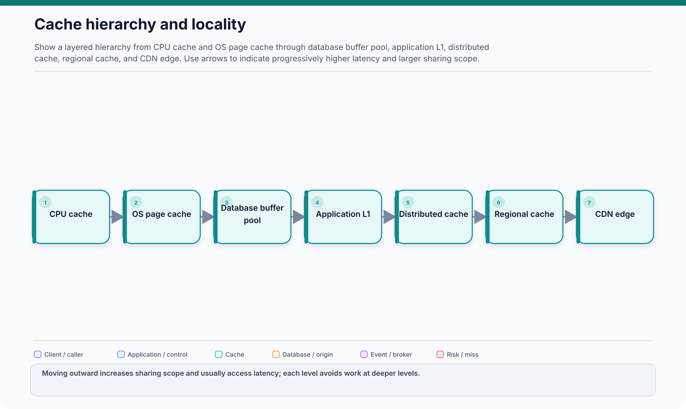

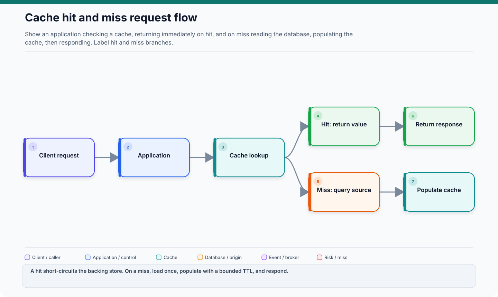

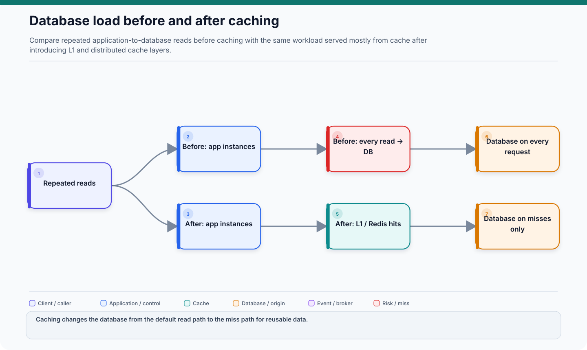

---

# 2. Cache Performance and Metrics

## 2.1 Core metrics

A cache is successful when it improves user-visible latency and reduces expensive origin work without violating freshness or correctness requirements. Measure it from both the cache and the application perspective.

| Metric | Definition | What it tells an operator |
|---|---|---|
| Hit ratio | Hits divided by total lookups | How often cache lookups avoid the next layer |
| Miss ratio | Misses divided by total lookups | How much traffic falls through to the next layer |
| Lookup latency | Time spent performing cache operations | Whether cache access itself is a bottleneck |
| Throughput | Operations or bytes served per second | Whether the cache has enough processing and network capacity |
| Memory utilization | Allocated/used memory relative to limit | Remaining capacity and risk of eviction or OOM |
| Eviction rate | Keys removed due to memory pressure per unit time | Whether working set exceeds configured capacity or policy is ineffective |
| Expiration rate | Keys expiring due to TTL per unit time | Whether TTL settings are generating miss load |
| Turnover | Rate at which entries are replaced relative to resident population | Whether cache contents are stable or churning |
| Backend request reduction | Origin reads avoided relative to baseline | Business value of caching |
| Freshness/staleness | Age of served data or fraction older than target | Whether cache behavior meets correctness requirements |
| Availability | Successful cache operations divided by attempted operations | Whether the cache is reliably reachable |
| Tail latency | p95/p99 lookup or end-to-end latency | Whether a subset of requests experiences severe delay |

Measure metrics by cache tier, key namespace, endpoint, tenant, region, and operation type where feasible. Aggregated cache hit ratio can conceal a failing namespace or a hot partition. Do not put unbounded key values or user IDs into metric labels; use bounded categories to avoid telemetry-cardinality explosions.

## 2.2 Numerical example: 100,000 requests per second

Assume an application receives 100,000 cache lookups per second and its request hit ratio is 95%. Assume every miss causes exactly one database query and there are no retries or secondary reads.

\[
H = 100{,}000 \times 0.95 = 95{,}000 \text{ hits/s}
\]
\[
M = 100{,}000 \times (1-0.95)=5{,}000 \text{ misses/s}
\]

The cache serves 95,000 requests per second and avoids 95,000 database queries per second. Database read traffic falls from 100,000 queries/s to 5,000 queries/s, a **95% reduction** under the stated assumptions.

A 95% hit ratio can still be insufficient. Five thousand misses per second can overwhelm a database whose safe capacity is 2,000 reads/s. A sudden miss burst can also be much larger than the average. Further, one cache miss may fan out into multiple database queries, so actual origin work can exceed the miss count.

## 2.3 Cache amplification

The percentage of misses is not the same as the percentage increase in backend load relative to a more effective cache. At a 98% hit ratio, 100,000 lookups/s produce 2,000 misses/s. At 95%, the same traffic produces 5,000 misses/s: a hit-ratio decline of only three percentage points creates **2.5 times** the backend miss traffic. At 90%, misses become 10,000/s, five times the 98%-hit baseline. This nonlinear operational impact is often called cache amplification.

Track **miss rate per second** and origin QPS, not just hit-ratio percentages. A drop from 99.9% to 99.0% may look small but multiplies misses by ten. Alert on both a ratio change and an absolute miss-rate threshold.

## 2.4 Tail latency and miss penalties

Suppose a hit takes 1 ms and a miss path takes 25 ms. Most requests may be fast, but misses form the slow tail. With a 95% hit ratio, the slowest 5% of requests are likely to include many misses, so p95 can approach the miss-path latency; p99 may be worse under queueing. This is why average latency can look healthy while users report intermittent slowness.

A cache miss can also cause a burst of database work, increasing queue depth and making later misses slower. A cache can therefore convert a moderate miss rate into a tail-latency incident if the origin has little spare capacity. Examine latency histograms at every tier and correlate cache misses with database wait time, pool utilization, and request concurrency.

## 2.5 Freshness and stale-read metrics

A cache entry's age at serve time is a useful freshness signal. Track the fraction of served responses older than the product's freshness objective, the number of invalidation events pending, and the time between a source update and visibility through each cache layer. For event-driven invalidation, measure event lag and consumer backlog. For TTL-only designs, measure age distribution and expiration-driven miss bursts.

A practical service-level objective might say: “99% of public product detail reads reflect a committed catalog update within 60 seconds.” This is stronger and more useful than saying “the cache TTL is 60 seconds,” because it accounts for replication, propagation, retries, and layered caches.

## 2.6 Operational dashboards and alerts

A useful dashboard includes hit/miss rate, cache command latency, connection count, queueing, throughput, memory, fragmentation, evictions, expirations, rejected commands, network I/O, replication lag, failovers, and origin QPS. Break down by node and shard to find uneven hot spots.

Good alerts are tied to user or system impact: rising p99, a miss-rate surge accompanied by database saturation, low free memory with rapid evictions, replica lag beyond the staleness budget, or a sustained increase in cache errors. Avoid paging on a single noisy hit-ratio change without checking whether origin capacity is at risk.

---

# 3. Cache Placement and Architecture

## 3.1 Client-side caching

Browsers and mobile applications can cache responses and static assets close to the user. Browser caches understand HTTP freshness and validation metadata. Mobile applications may additionally cache structured API data or downloaded content in process memory or on disk. Client-side caches reduce round trips and can improve offline behavior, but they are outside the server's immediate control and must be treated as untrusted, potentially stale storage.

Important HTTP directives include:

- `Cache-Control: max-age=N`: a response is fresh for N seconds according to HTTP age rules.
- `public`: shared caches may store the response when other rules permit.
- `private`: a shared cache must not store the response as a shared representation; a private browser cache may store it.
- `no-cache`: storage is permitted, but reuse requires validation with the origin.
- `no-store`: caches should not store the response.
- `s-maxage=N`: freshness lifetime for shared caches, overriding `max-age` for them.
- `must-revalidate`: once stale, the response must be validated rather than reused without validation.
- `stale-while-revalidate=N`: a cache may serve stale content while asynchronously revalidating during the permitted window.
- `stale-if-error=N`: a cache may serve stale content when an error occurs, within the configured window.

`ETag` is a validator for a representation. A client can send `If-None-Match`; if the representation is unchanged, the server can return `304 Not Modified` without retransmitting the body. `Last-Modified` with `If-Modified-Since` provides a time-based validator. Validation reduces payload transfer, although it still requires a request to the server or intermediary.

A response should not be marked public if it contains user-specific or authorization-dependent information. `Vary` and CDN cache policies must account for request fields that actually change the representation. An overly broad `Vary` or cache key fragments the cache; omitting a required dimension can leak one user's response to another.

## 3.2 Application-level caching

An in-process cache stores objects inside each application instance. It is fast because lookup requires no network call, and it can absorb repeated reads to the same instance. But each instance has a separate copy. With 20 instances, a product update may require 20 invalidations; a new instance starts cold; and autoscaling can produce inconsistent hit ratios.

A shared distributed cache provides a common view to application instances. It costs a network hop and requires capacity and availability planning, but it avoids independent copies for many use cases. A **near-cache** combines both: a small local L1 in front of shared L2. The system must define how L1 is invalidated or versioned when L2 changes.

Common application-cache candidates include configuration, feature flags, product metadata, authorization policy snapshots with short validity, expensive computed aggregations, and reference data. Do not cache secrets or permission decisions beyond their allowed revocation window without explicit controls.

## 3.3 Database caching

A database's buffer pool or buffer cache keeps frequently accessed data and index pages in memory. This avoids physical storage reads, but the SQL query still executes and the database still performs parsing/planning, access checks, predicate evaluation, and result construction. Some engines provide query-result caching or materialized views, but such features vary by engine and release and may have invalidation or workload limitations.

Prepared-statement and plan caches reduce parsing or query-planning overhead; they are not necessarily result caches. Materialized views precompute joins or aggregates and trade refresh complexity and freshness for cheaper reads. Database caching is often complementary to application and distributed caching, not a substitute for choosing an appropriate schema and index.

## 3.4 Distributed caching

A distributed cache exposes a logical key/value service backed by one or more nodes. Data may be partitioned, replicated, or both. Application clients locate the node responsible for a key or send requests through a proxy. A cache can be shared across service instances, but it introduces network dependency, cluster membership, failover, routing, replication lag, and memory fragmentation concerns.

Failure handling should be explicit. For noncritical cached reads, a bounded database fallback may be acceptable. For high-volume systems, sending every cache request to the database during a cache outage can create a second outage. Use request limits, bulkheads, local fallbacks, circuit breakers, stale responses where safe, and deliberate load shedding.

## 3.5 Combining the layers in production

A typical public product page might be served as follows:

1. Browser checks its HTTP cache for versioned JS, CSS, and images.
2. CDN serves static assets from a nearby point of presence.
3. API gateway routes a product API request to an application region.
4. Application checks a short-lived L1 cache for the assembled public product object.
5. On L1 miss, application reads Redis L2.
6. On Redis miss, application queries the catalog database and populates Redis and L1.
7. Database buffer pool may satisfy the query from memory rather than storage.
8. Product-update events invalidate or version the relevant application and distributed cache entries; CDN assets use immutable versioned URLs where possible.

The architecture should not blindly cache every layer. Each layer is worthwhile only if its saved cost exceeds lookup, serialization, memory, and invalidation costs. A tiny low-reuse object may be cheaper to recompute than cache.

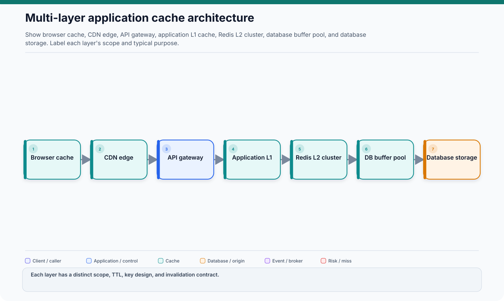

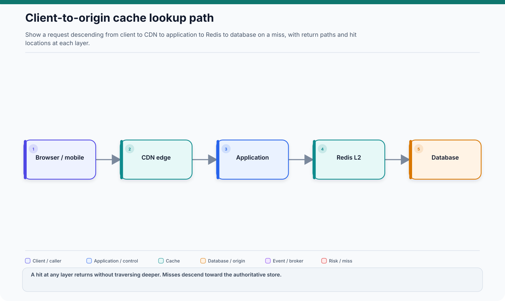

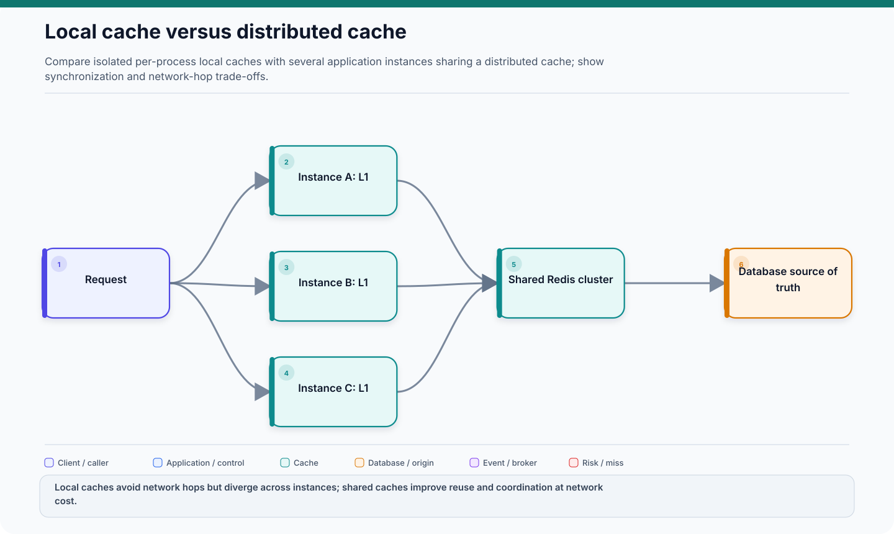

---

# 4. Fundamental Cache Patterns

Cache patterns define which component reads and writes the cache and how the authoritative data store participates. Pattern names are sometimes used loosely by products, so the important question is the actual responsibility and ordering of operations.

## 4.1 Cache-aside (lazy loading)

In cache-aside, the application owns cache lookup and population:

1. Application reads key `K` from cache.
2. If found, it returns the cached value.
3. If absent, it reads the authoritative store.
4. If the record exists, the application writes it to cache with a TTL.
5. It returns the database result.

**Strengths:** easy to add to an existing service; cache is populated only for data that is requested; the application can make per-endpoint decisions; cache failure can be handled by direct reads when safe.

**Weaknesses:** first read is slow; cold keys cause backend load; application code owns invalidation and race handling; different services may implement slightly different key and freshness policies. A burst on one cold key can create a stampede unless misses are coalesced.

For a product catalog, a product detail API can cache public product JSON. On update, the write path commits to the database and then invalidates the product key, or publishes an event consumed by cache invalidators. TTL is a safety net, not a substitute for a correctness plan.

Failure cases include a cache write failure after a successful DB read (return the data but record a cache error), a DB outage after a cache miss (serve stale data only if policy permits), and the classic stale-repopulation race described in Section 6.2.

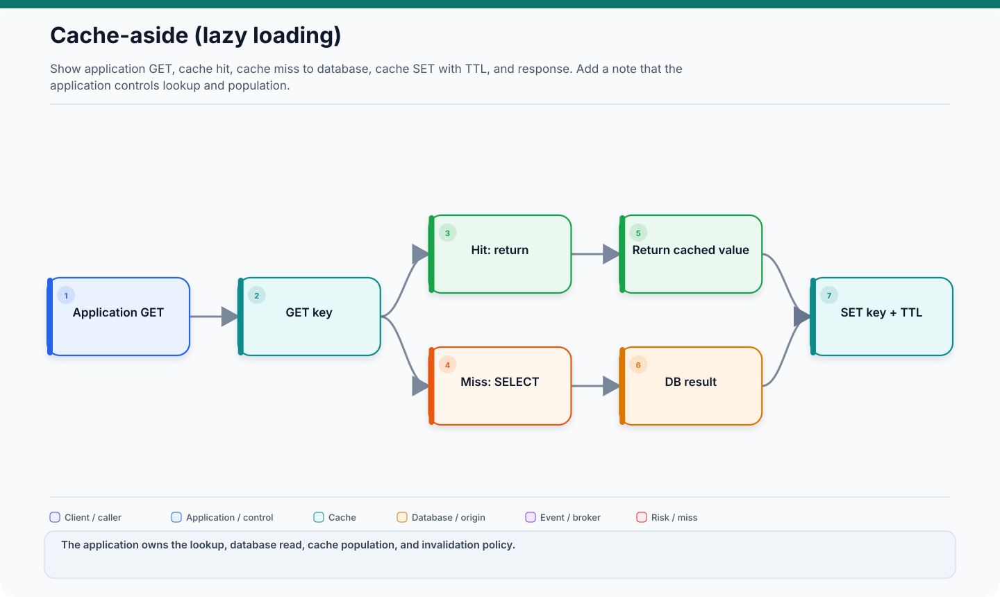

## 4.2 Read-through caching

In read-through caching, the application asks the cache layer for a key and the cache provider or configured loader retrieves the value from the backing store when absent. The application sees a cache abstraction rather than implementing the miss-loading sequence itself.

**Benefits:** centralizes loading behavior; can reduce repeated boilerplate; supports common loading, locking, and expiry policies; encourages a consistent cache API. **Limitations:** the cache provider needs a loader integration; debugging can be less obvious; transaction boundaries and error handling may be hidden; a cache outage still needs a defined fallback. It is suitable when many services use a standardized data-access abstraction and the cache library supports reliable loaders.

The defining distinction from cache-aside is ownership: cache-aside has the application explicitly fetch and populate, while read-through delegates miss loading to the cache abstraction. Both can produce the same underlying sequence.

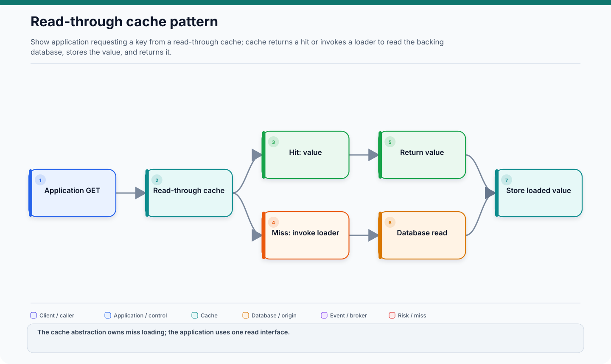

## 4.3 Write-through caching

In write-through, a write passes through the cache layer, which updates the backing store as part of the write operation. The API may acknowledge only after the backing-store write succeeds. The precise ordering and atomicity depend on the product and integration; do not assume a cache and database participate in one distributed transaction.

**Advantages:** cache is updated as part of the normal write path; recently written values are immediately available to readers through that cache; fewer stale windows than an invalidate-only strategy when all writers use the same path.

**Disadvantages:** write latency includes the backing store; every write may populate data that is never read; partial failure between database and cache can still occur; multi-writer systems can bypass the write-through path. For critical customer information, database commit is normally the durability boundary. An account-profile service may write the database and update the cache synchronously after commit, with reconciliation for failures.

If the database rejects the write, the cache must not expose an uncommitted value. If the database commits but cache update fails, the operation's response semantics must be clear: the durable write succeeded, while cache repair/invalidation is pending. A transactional outbox or versioned read-through is often safer than pretending two independent systems commit atomically.

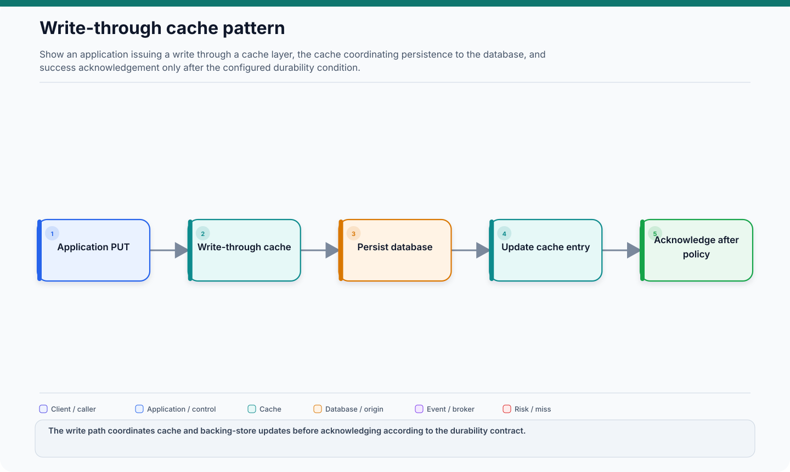

## 4.4 Write-back (write-behind) caching

In write-back, the cache acknowledges a write before the backing database has persisted it. The cache stores a dirty entry or queued mutation, then asynchronously flushes it. Multiple updates can be coalesced: ten counter increments may become one persisted aggregate update.

**Advantages:** very low write latency; absorbs bursts; reduces write amplification; coalesces repeated changes. **Risks:** acknowledged data can be lost if the cache fails before durable logging or replication; asynchronous flush can reorder writes; a dirty queue can grow without bound; retries can duplicate non-idempotent operations; operational recovery is more complex.

Use write-back only when the loss window and replay model are explicit. A telemetry counter may be reconstructed or tolerate small loss. A bank transfer or order placement must not be acknowledged based only on an ephemeral cache entry. Use durable append logs, replication, sequence numbers, idempotency keys, bounded queues, retry backoff, dead-letter handling, and reconciliation when the use case justifies the design.

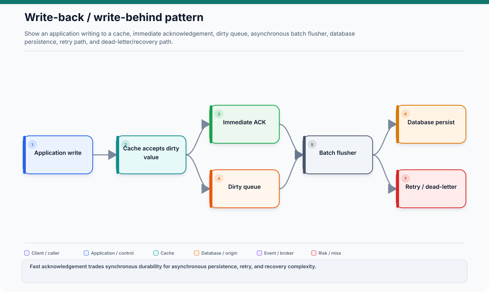

## 4.5 Pattern comparison

| Dimension | Cache-aside | Read-through | Write-through | Write-back |
|---|---|---|---|---|
| Read performance | Fast on hit; miss loads origin | Fast on hit; loader handles miss | Depends on read policy | Usually fast from cache |
| Write performance | Usually DB write plus invalidate/update | Not defined by read loader alone | Slower; waits for backing write | Fast acknowledgement, persistence deferred |
| Consistency | App must coordinate update/invalidation | Loader centralizes reads; writes still need policy | Can keep cache synchronized when all writes use path | Eventually persisted; readers may see unflushed state |
| Durability | Database remains source of truth | Database remains source of truth | Depends on database commit | Requires durable queue/log to avoid loss |
| Complexity | Low–medium | Medium; loader integration | Medium–high | High |
| Failure behavior | Cache failure can fall through; stampede risk | Loader/cache failure semantics matter | Partial update can leave divergence | Cache/queue loss can lose acknowledged writes |
| Backend load | Only misses read origin | Only misses load origin | All writes reach backing store | Batches/coalesces writes |
| Good fit | Read-heavy product/catalog data | Standardized read-through repositories | Customer/profile updates needing warm cache | Telemetry, counters, buffered noncritical writes |

### Choosing a pattern

Choose cache-aside when the application needs explicit control and the data is read-heavy. Choose read-through when a mature cache abstraction can own miss loading consistently. Choose write-through when read-after-write visibility through the cache matters and write latency is acceptable. Choose write-back only when asynchronous persistence is a deliberate product requirement and durability/replay engineering is available.

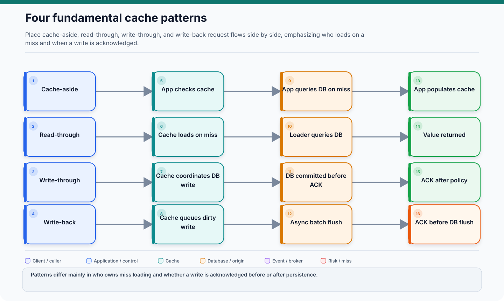

---

# 5. Cache Eviction Policies

## 5.1 Why eviction is necessary

Memory is finite, and cached objects compete for it. When the working set exceeds configured capacity, the cache must remove entries or reject new data. Eviction policy is an approximation of future usefulness: the cache cannot know with certainty which key will be requested next.

Eviction differs from expiration. **Expiration** removes an entry because its validity deadline has passed. **Eviction** removes an entry to reclaim memory, even if it is still within its TTL. Both can produce misses.

## 5.2 LRU — Least Recently Used

LRU evicts the entry whose last access was furthest in the past. The intuition is temporal locality: recently used data is likely to be used again. A textbook exact LRU can use a hash map for key lookup and a doubly linked list ordered by recency; a hit moves an entry to the most-recent position and eviction removes the least-recent item.

**Worked example:** cache capacity is three keys. Access sequence is `A, B, C, A, D`. After `A, B, C`, recency from oldest to newest is `A, B, C`. Accessing `A` changes it to `B, C, A`. Inserting `D` evicts `B`, leaving `C, A, D` (oldest to newest).

LRU works well when recent reuse predicts future access. It can perform poorly during a large sequential scan: a one-time scan can displace frequently used entries. Exact recency updates on every hit can be expensive at high concurrency, so production caches often use sampled or approximate LRU rather than maintaining a perfectly ordered list.

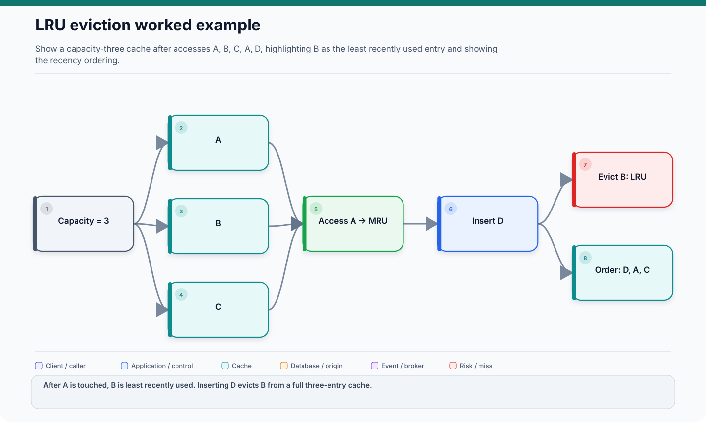

## 5.3 LFU — Least Frequently Used

LFU evicts entries with the lowest observed access frequency. It can retain consistently popular keys even when they were not accessed in the most recent few moments. A conceptual implementation associates a frequency counter with each key and chooses the lowest-frequency victim. Real implementations must make updates and victim selection efficient.

**Worked example:** capacity is three. During a measurement interval, A has 40 accesses, B has 12, C has 3. A new key D arrives; LFU evicts C because it has the lowest frequency. This helps when A is a stable popular product and C was a temporary, rarely viewed object.

A major weakness is stale popularity: a key that was hot yesterday can retain a high counter after it becomes irrelevant. Frequency aging, logarithmic counters, time decay, or periodic normalization reduces this historical bias. LFU is useful for skewed workloads with stable popularity, but its metadata and update costs can exceed those of simple LRU approximations.

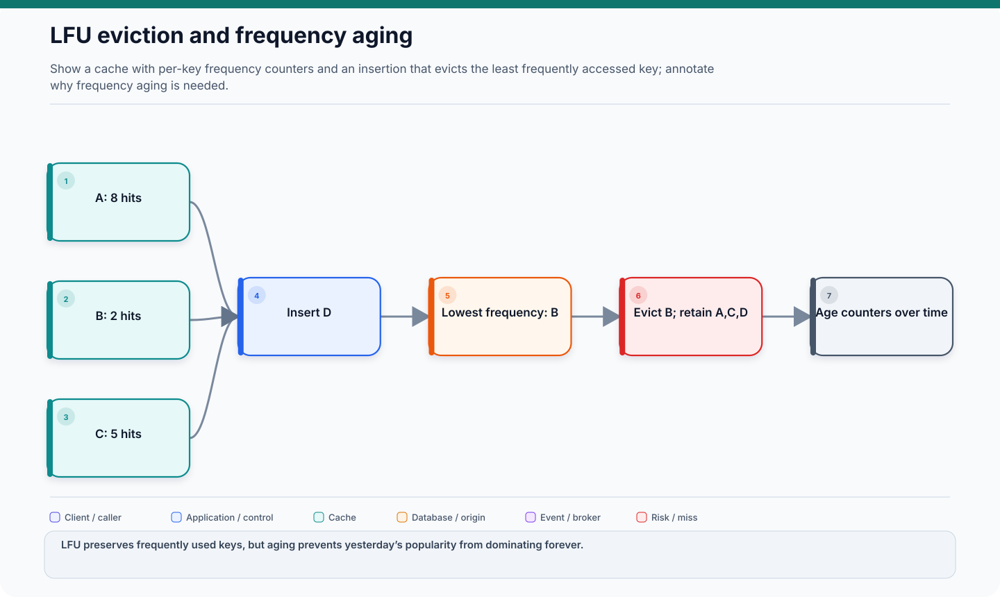

## 5.4 FIFO — First In, First Out

FIFO evicts the oldest inserted entry without considering hits. It is simple to implement and has low metadata overhead, but a heavily reused old key can be evicted while a newer one-time key remains. FIFO may be reasonable when object lifetimes are uniform or when simplicity is more important than maximizing hit ratio.

## 5.5 Random replacement

Random replacement chooses a victim uniformly or pseudo-randomly. It avoids maintaining recency/frequency metadata and can perform acceptably for certain workloads, especially when access patterns are diffuse. It may evict a very hot key by chance and does not exploit locality as directly as LRU/LFU. Randomized replacement can also reduce synchronized metadata contention in specialized designs.

## 5.6 TTL-based expiration

**Time-to-live (TTL)** is the duration for which an entry is considered valid after a specified event, usually insertion or refresh. An absolute expiration stores a deadline such as `expires_at = 14:00 UTC`. A sliding expiration resets the deadline on access, so an actively used key can remain resident indefinitely unless another cap applies.

Expiration may be implemented lazily—check the deadline on access and remove expired keys then—or actively, with periodic sampling/scans that reclaim expired memory even if keys are never read again. Active expiry is usually bounded work; it need not scan every key on every cycle. As a result, physical deletion can occur after the logical expiration time. Expiration precision and cleanup strategy are implementation-specific.

TTL differs from LRU/LFU: TTL expresses freshness or validity, whereas LRU/LFU choose a memory-pressure victim. An entry can expire even when memory is plentiful, or be evicted before its TTL when memory is full.

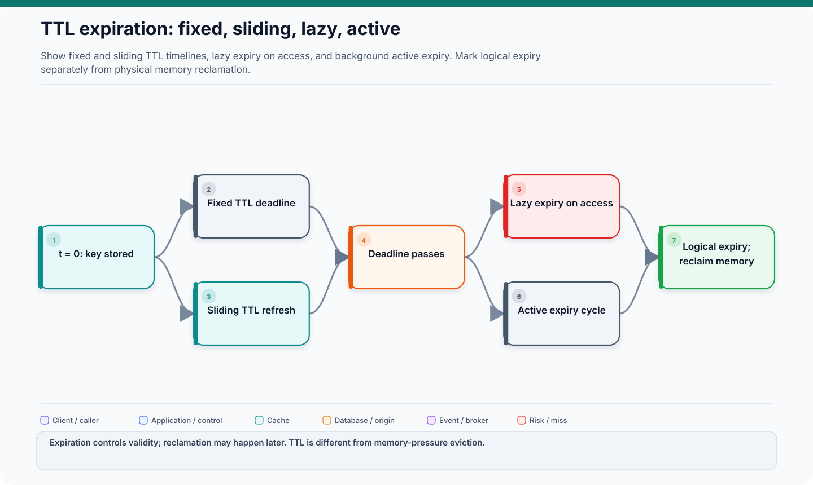

## 5.7 Hybrid and modern strategies

- **Approximate LRU/LFU:** samples a subset of keys and selects a likely victim, reducing per-hit bookkeeping.
- **Segmented LRU (SLRU):** separates newly admitted/probationary items from protected items; repeated hits promote an item.
- **Adaptive replacement (ARC):** balances recency and frequency using feedback about recently evicted items; useful in storage systems where scan resistance matters.
- **TinyLFU:** estimates recent frequency using a compact sketch and uses that estimate to decide whether a new entry deserves admission. It separates admission from eviction.
- **Window TinyLFU:** combines a small recency window with a frequency-based main cache; useful for workloads with bursts and long-term popularity.
- **Cost-aware eviction:** considers size, recomputation cost, origin latency, or business value rather than treating all entries equally.

Admission policy is distinct from eviction. A cache may decide not to admit a one-time scan item at all, which can protect hot entries better than admitting everything and evicting later.

| Policy | Complexity / metadata | Strength | Weakness | Suitable workload |
|---|---|---|---|---|
| LRU | Medium; recency metadata | Good temporal locality | Scan pollution; exact updates contend | General web/application cache |
| LFU | Medium–high; counters and aging | Preserves stable hot set | Historical bias | Strongly skewed, stable popularity |
| FIFO | Low | Simple, predictable | Ignores reuse | Uniform lifetimes, low complexity |
| Random | Very low | Minimal bookkeeping | Can evict hot items | Diffuse workloads, simple embedded caches |
| TTL | Expiry metadata and cleanup | Enforces freshness | Expiry bursts; not capacity policy | Data with explicit validity window |
| SLRU / ARC | Higher | Better scan resistance/adaptation | More implementation complexity | Storage and high-reuse workloads |
| TinyLFU / W-TinyLFU | Sketch metadata | Strong admission under skew | Tuning and implementation cost | High-cardinality caches with churn |
| Cost-aware | Application-specific | Preserves expensive-to-recompute values | Requires reliable cost model | Expensive queries or heterogeneous objects |

## 5.8 Redis eviction policy concepts

Redis exposes memory-pressure policies such as `noeviction`, `allkeys-lru`, `volatile-lru`, `allkeys-lfu`, `volatile-lfu`, `allkeys-random`, `volatile-random`, and `volatile-ttl` in common Redis OSS configurations. In broad terms, `allkeys-*` considers keys across the dataset, while `volatile-*` considers keys with an expiration set. `noeviction` rejects memory-growing writes when the configured limit is reached instead of removing keys. Exact behavior and available choices should be checked against the deployed Redis release and distribution.

Set an explicit memory limit and policy; monitor evictions and rejected writes. Do not use `volatile-*` assuming every key has a TTL unless that is enforced. If non-cache data shares the instance, `allkeys-*` may evict data that the application expected to remain. Separate cache and durable workloads where their eviction semantics differ.

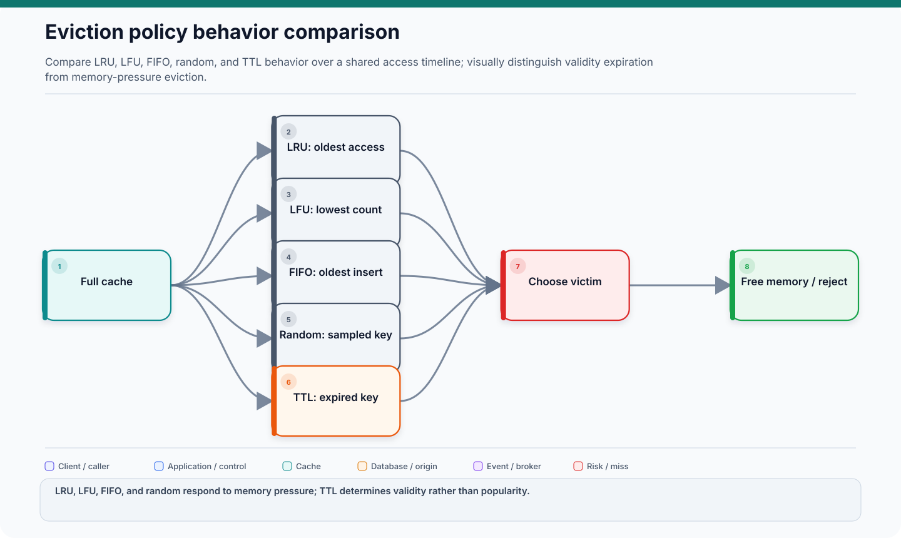

---

# 6. Cache Invalidation and Consistency

## 6.1 Why invalidation is hard

A cache stores a copy. When the source changes, the copy must either be updated, invalidated, or allowed to become stale until an agreed deadline. The challenge is that the database and cache generally do not share one atomic transaction, and distributed communication is asynchronous. Multiple service instances, regions, and CDN PoPs increase the number of copies that may require coordination.

**Invalidation** makes a cached entry unavailable or marks it unusable. **Expiration** makes it unusable after time. Invalidation can be faster but requires reliable propagation. TTL is simpler but gives only a time-based upper bound, subject to refresh and replication delays.

## 6.2 Common invalidation strategies

### TTL-based invalidation

Attach a bounded TTL to each entry. Choose the TTL from the business staleness budget, update frequency, miss cost, and ability to serve stale data. Short TTL improves freshness but increases origin traffic and stampede risk; long TTL improves hit ratio but widens the stale window. Add jitter so millions of entries do not expire together.

### Write-based invalidation or update

After a database write commits, update the relevant cached representation or delete it. Deletion is often safer when multiple derived cache values exist: the next read rebuilds them from the source. The write path must account for cache failure after database commit, often using an outbox or retryable invalidation record.

### Event-based invalidation

A write service emits an event such as `ProductUpdated(productId, version)`. Consumers invalidate keys in Redis and/or publish invalidations to local-cache subscribers. Events should be idempotent; include entity identity and a monotonic version when possible. Monitor consumer lag and provide replay or reconciliation because message delivery is not instantaneous.

### Versioned cache keys

Include a data version in the key, for example `profile:v42:user:17`. After an update, a version pointer changes to 43. Readers use the new key; old entries become unreachable and expire naturally. This can avoid deleting many derived keys, but the version pointer itself must be consistent, and old versions consume memory until expiration.

### Tag-, key-, and dependency-based invalidation

A product can be tagged with `category:shoes`, `brand:acme`, and `product:1042`; a category update invalidates all dependent objects. Tag invalidation is convenient for CDN and application caches but requires a reverse index or provider-specific purge facility. Dependency invalidation models which derived objects depend on changed source records; it is powerful but can become expensive and difficult to reason about.

### Change data capture (CDC)

CDC reads committed database changes from a transaction log or change stream and publishes them to downstream consumers. A cache invalidation service converts row-level changes into entity-level cache actions. CDC decouples cache updates from each application writer and can capture writes from multiple paths, but it introduces lag, schema evolution, event ordering, replay, and delivery semantics that must be operated.

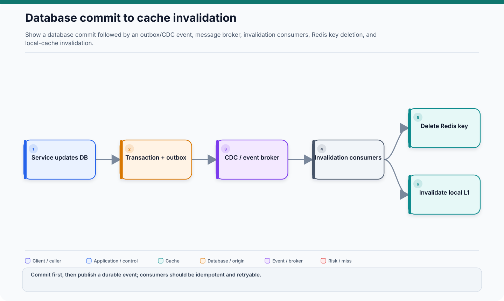

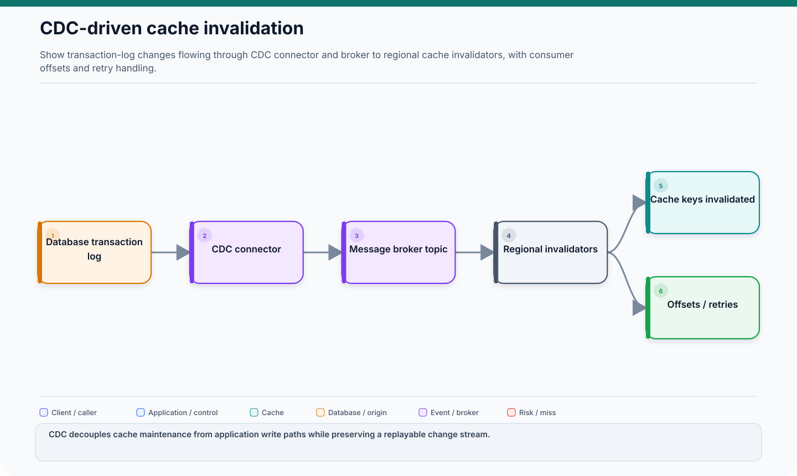

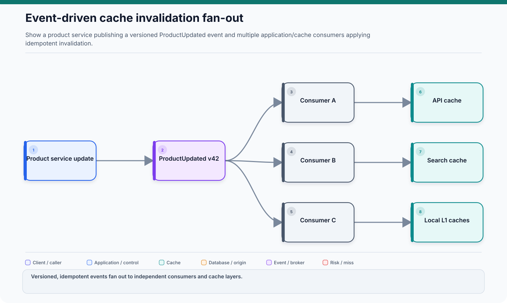

## 6.3 The stale-repopulation race

Consider this sequence:

1. Request A reads old value `v1` from the database because its cache lookup missed.
2. Request B updates the database to `v2` and invalidates the cache.
3. Request A finishes its earlier database read and writes `v1` into the now-empty cache.
4. New readers receive `v1` until another invalidation or expiry.

The invalidation itself succeeded; the race occurs because the old reader populated after the invalidation.

Mitigations include:

- **Version checks:** cache values carry a source version; only write a value if it is not older than the current version marker.
- **Compare-and-set:** populate only if a version/token has not changed since the read began.
- **Write ordering:** update or invalidate after source commit and coordinate in-flight loaders where possible.
- **Short TTL:** limits the duration of stale exposure but does not eliminate the race.
- **Event sequencing:** consumers reject older versions and process a monotonic version per entity.
- **Atomic scripts/operations:** combine version comparison and cache write into one cache-side atomic action.
- **Loader coalescing:** reduce simultaneous miss work, though coalescing alone does not prove freshness.

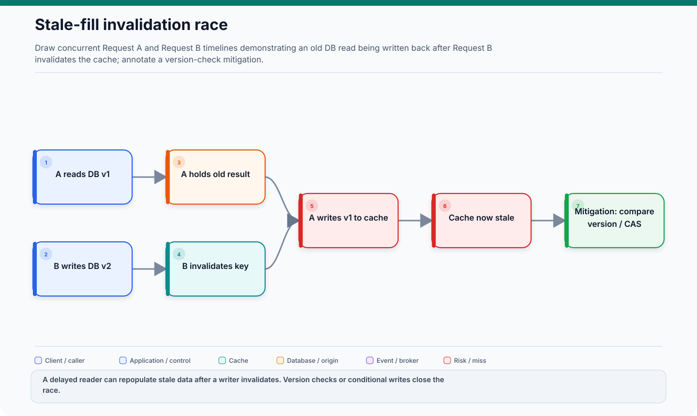

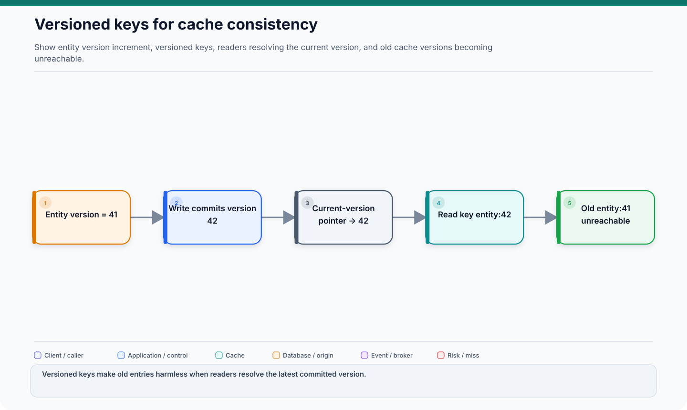

## 6.4 Consistency guarantees and application fit

| Guarantee | Meaning | Example fit |
|---|---|---|
| Strong consistency | Reads observe the latest committed value according to the system's defined serialization/consistency model | Account balance, payment authorization, inventory reservation decision |
| Eventual consistency | Replicas/caches converge if updates stop and propagation succeeds | Social feed, view counts, product descriptions |
| Bounded staleness | Data may lag, but within a defined time/version bound | Public catalog with a 30–60 second freshness SLO |
| Read-your-writes | A client sees its own successful update on subsequent reads | Profile edit, shopping-cart update |

Do not use “strong” casually. A cache in front of an asynchronously replicated database may not provide linearizable reads even if it updates after a write. Critical operations should route to an authoritative consistency boundary or use version/conditional-write checks.

### Data-specific guidance

- **Product catalog:** eventual consistency with short-to-moderate bounded staleness is often acceptable; price and eligibility rules may need stronger treatment during checkout.
- **Shopping cart:** users expect read-your-writes; use versions or session affinity/authoritative cart writes.
- **Account balance:** do not authorize transfers or withdrawals using a potentially stale cache. Cache may be used for display with an “as of” timestamp, but the ledger is authoritative.
- **Inventory availability:** browse pages can show approximate stock; reservation and purchase must use an atomic inventory service.
- **Social feed:** eventual consistency is usually acceptable; duplicate or delayed posts are often less harmful than unavailability.
- **User profile:** bounded staleness is usually acceptable, but privacy and authorization changes need rapid revocation paths.

---

# 7. Cache Stampede, Penetration, and Avalanche

These failures all increase origin traffic, but their triggers differ. Correct diagnosis matters because the mitigations are not identical.

## 7.1 Cache stampede / thundering herd

A stampede occurs when many requests miss the same key at roughly the same time. A popular key expires or is evicted; thousands of callers all query the database; the origin becomes overloaded. A single hot key can therefore create far more backend work than its normal one-refresh-per-TTL pattern.

**Numerical example:** a homepage configuration key is read 10,000 times per second and expires at 12:00:00. If 10,000 concurrent requests all see a miss and each issues a database query, the database receives up to 10,000 near-simultaneous reads for one object rather than one refresh. If the query takes 40 ms, the initial wave can also occupy hundreds of concurrent database operations, depending on request scheduling and retries.

Mitigations:

- **Request coalescing/single-flight:** only one in-flight loader fetches a key; other callers await its result.
- **Distributed lock:** one node becomes refresh leader; keep lease duration, fencing, and lock failure semantics safe.
- **Probabilistic early expiration:** refresh popular keys before hard expiry with probability increasing as the deadline approaches.
- **Background refresh:** refresh asynchronously before expiry based on access or schedule.
- **Stale-while-revalidate:** serve a still-acceptable stale value while one caller refreshes.
- **TTL jitter:** randomize expiry times to prevent synchronized expiration across keys.
- **Prewarming:** load predictable hot entries before traffic spikes.

Locks are not magic. A lock service can fail, a lease can expire while a slow loader is still running, and a paused worker can overwrite newer data. Prefer single-flight inside one process for local duplication; use version/fencing checks when coordination crosses processes.

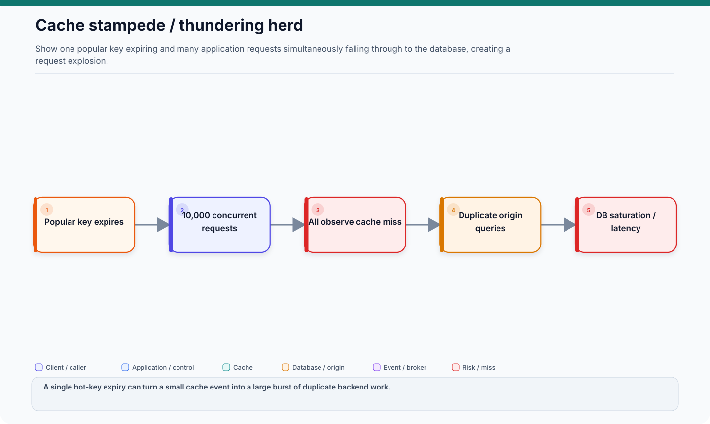

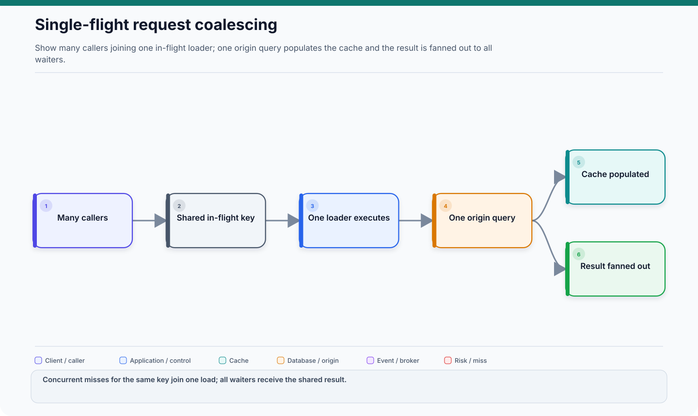

## 7.2 Cache penetration

Cache penetration occurs when requests repeatedly ask for keys that do not exist. Because no value is cached, every request reaches the database. Attackers may generate random product IDs or user IDs to bypass a normal positive cache.

Mitigations:

- **Negative caching:** store a “not found” marker for a short TTL. Keep the TTL short enough that newly created data becomes visible promptly.
- **Bloom filter:** check a compact membership structure before querying storage. A negative result can safely skip a lookup under the filter's assumptions; a positive result may still be a false positive and requires the real lookup.
- **Validation:** reject malformed IDs and impossible key formats before reaching storage.
- **Rate limiting/throttling:** limit abusive sources and protect expensive endpoints.
- **Abuse detection:** monitor high-cardinality miss patterns, repeated 404s, and suspicious identity rotation.

Example: a product endpoint receives requests for random 12-digit IDs. A negative cache entry for a missing ID prevents repeat reads for that ID for, say, 30 seconds. A Bloom filter built from the product-ID set can reject most definitely absent IDs without database calls, while false positives still go to the database.

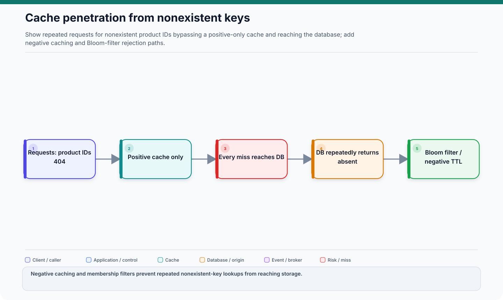

## 7.3 Cache avalanche

An avalanche occurs when many keys become unavailable or expire together, creating a broad miss surge. It differs from stampede: stampede often concentrates on one or a few popular keys, while avalanche involves many keys or an entire cache tier.

Causes include identical TTLs set during a bulk load, mass invalidation, cache restart, region failure, or node replacement that discards a large fraction of entries. Mitigations include TTL randomization, staggered refresh, prewarming, multi-level caches, gradual rollout, capacity protection, stale serving where safe, and backend admission control.

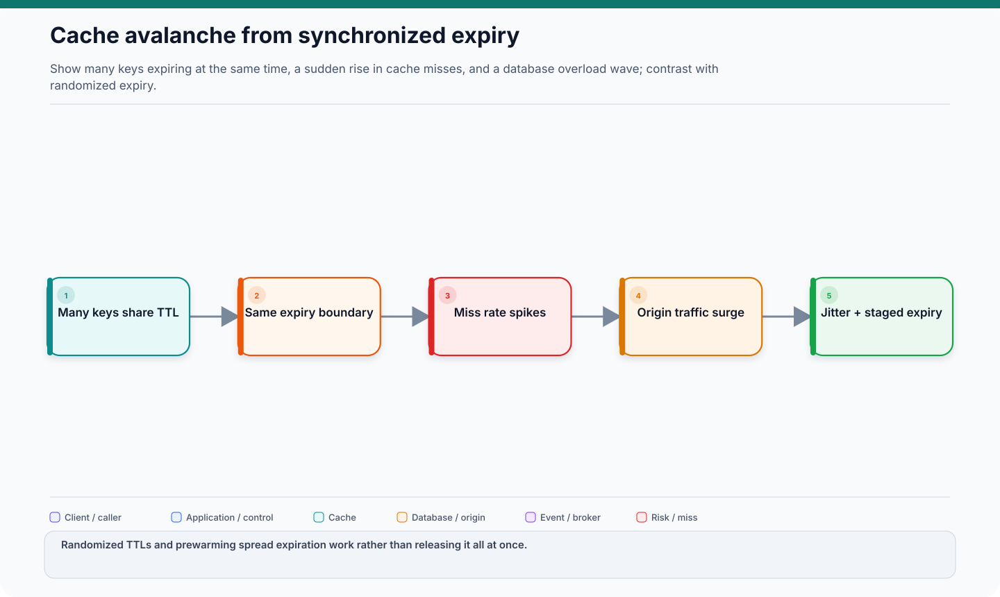

## 7.4 Cache outage and cascading failure

If Redis becomes unavailable, requests may fall through to the database. That can exhaust database connection pools and CPU. Applications then retry, increasing load; timeouts keep threads occupied; upstream gateways retry too; and the system enters a cascading failure.

Protect the system with:

- **Circuit breakers:** stop repeatedly calling an unhealthy cache or origin and allow controlled probes for recovery.
- **Bulkheads:** isolate cache and database connection pools and bound concurrent work.
- **Load shedding:** reject or degrade low-priority requests before the database collapses.
- **Rate limiting:** cap fallback QPS and protect the authoritative store.
- **Stale responses:** serve a previously cached value when the business policy permits.
- **Local fallback:** use a bounded local cache for selected data; avoid uncontrolled per-instance memory growth.
- **Retry budgets and backoff:** do not retry every failure immediately; use jitter and idempotency.
- **Graceful degradation:** disable recommendations or nonessential personalization while preserving core checkout/account operations.

A cache should not become a single point of failure. The service needs a defined behavior for cache timeout, cache unavailable, cache data loss, partial shard outage, and recovery warm-up. “Fallback to the database” is incomplete without a concurrency limit and capacity model.

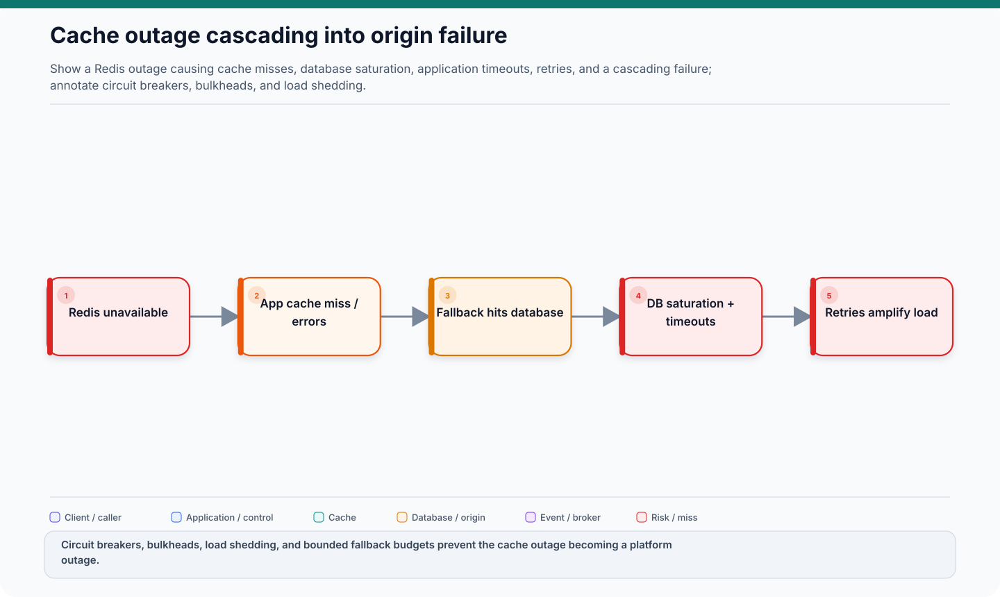

## 7.5 Comparison

| Failure | Trigger | Request shape | Main risk | Primary mitigations |
|---|---|---|---|---|
| Stampede | One/few hot keys expire or disappear | Many concurrent requests for same key | Duplicate origin work | Single-flight, refresh lock, stale-while-revalidate, jitter |
| Penetration | Requested records do not exist | High cardinality of absent keys | Cache cannot retain a positive value | Negative cache, Bloom filter, validation, rate limiting |
| Avalanche | Many keys or cache tier fail together | Broad miss surge | Origin overload across many objects | TTL spread, prewarm, multi-level cache, load shedding |
| Cache outage cascade | Cache service unavailable/slow | Large fraction of requests fall through | Database and application collapse | Fallback budgets, breakers, bulkheads, stale serving |

---

# 8. Distributed Caching Architecture

## 8.1 Why local memory alone stops being sufficient

A local cache is attached to one process. It becomes insufficient when the application scales horizontally, because each instance sees only part of the traffic and maintains an independent copy. If instance A updates a value, instance B may continue to serve its old copy. New instances also start cold, and a load balancer can send consecutive requests to different instances.

Local caches remain valuable for tiny, very hot, low-risk objects. At scale they are usually paired with a shared cache or a reliable invalidation mechanism. The decision is not “local or distributed” in every case: an L1 local cache plus L2 shared cache is common.

## 8.2 Shared cache architecture

A distributed cache typically has:

- **Client library:** serializes commands, manages connections, routes keys, handles timeouts, and may maintain a topology view.
- **Cache nodes:** own key/value data in memory and perform commands.
- **Membership/discovery:** tells clients which nodes exist and what role or partition each owns.
- **Replication:** maintains copies for availability or read scaling, depending on the product.
- **Partitioning:** divides the keyspace across nodes to scale memory and throughput.
- **Monitoring/control plane:** detects failures, moves partitions, manages configuration, and exposes metrics.

The cache client is an architectural component, not merely a thin socket. Its routing behavior, retry logic, topology refresh, connection pools, and handling of redirections affect correctness and latency.

## 8.3 Partitioning and replication

**Partitioning (sharding)** assigns different keys to different nodes. If node 1 owns keys A–F and node 2 owns G–M, their memory contributes to one logical dataset. Partitioning increases aggregate capacity and can increase throughput, but introduces hot-shard risk and makes multi-key operations more difficult.

**Replication** copies data from one node to another. A primary may accept writes and replicate them to replicas, often asynchronously. Replication can support failover and sometimes read scaling, but it consumes memory and network bandwidth. Asynchronous replication can lose recently acknowledged writes during failover, depending on the system's guarantees and failure timing.

A distributed cache can partition without replication, replicate a whole dataset, or partition each shard and replicate it. These designs have different availability, capacity, consistency, and cost profiles.

## 8.4 Discovery, connection pools, and network costs

Clients need to know how to reach the responsible node. Discovery may use static configuration, DNS, a proxy, Sentinel-like control plane, or cluster metadata. Clients should refresh topology after node changes and handle moved-key responses without retry loops.

Connection pools reduce repeated connection setup but can become a bottleneck. Too few connections create queueing; too many create server file-descriptor pressure, context switching, and connection-management overhead. Pool size should be based on concurrency, command latency, multiplexing behavior, and server capacity—not copied from another service.

Network placement matters. A cache in another region can be slower than a database replica close to the application. Prefer low-latency zones and measure actual round-trip latency. Avoid a design in which every user request triggers multiple serial cache calls; pipelining or batching can reduce round trips when commands are independent.

## 8.5 Cache topologies

| Topology | Data placement | Benefits | Trade-offs |
|---|---|---|---|
| Distributed / partitioned | Different key ranges or hash slots on different nodes | Aggregate memory and throughput scale with nodes | Hot partitions, resharding, cross-partition operations |
| Replicated | Copies of the same dataset on several nodes | High availability; potentially local reads | Duplicate memory; replication lag; write coordination |
| Primary-replica per shard | Each partition has a primary and one or more replicas | Capacity plus failover | Async replication risks, failover complexity |
| Multi-level | Local L1 plus shared L2 and possibly regional L3 | Saves network trips for hot data | Invalidation and stale-copy complexity |

A **distributed cache** is a general shared cache service; a **replicated cache** emphasizes copies of the same data; a **partitioned cache** divides the keyspace; a **multi-level cache** places caches at different distances from the caller. A real system can be partitioned and replicated while also participating in a multi-level hierarchy.

## 8.6 Consistency across application instances

A shared Redis write does not automatically invalidate local L1 copies. Options include:

1. Avoid L1 for mutable data.
2. Use very short L1 TTLs and accept bounded staleness.
3. Publish invalidation events to every application instance.
4. Store versions and verify the current version before serving.
5. Use a cache library that supports near-cache invalidation and explicitly understand its delivery guarantees.

If an instance misses an invalidation event while disconnected, it must not serve its old value forever. Use bounded TTLs, version reconciliation, or a full local-cache flush after reconnect.

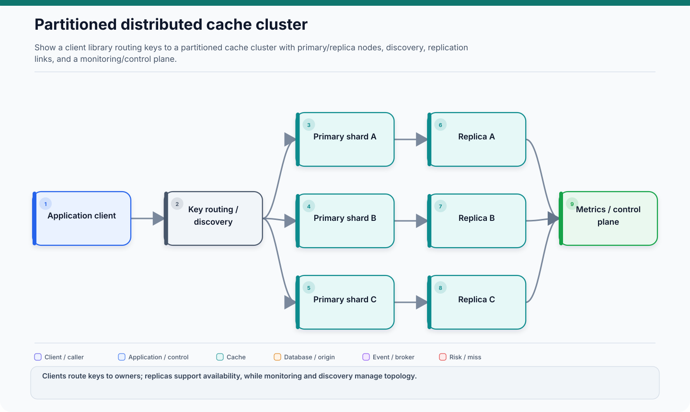

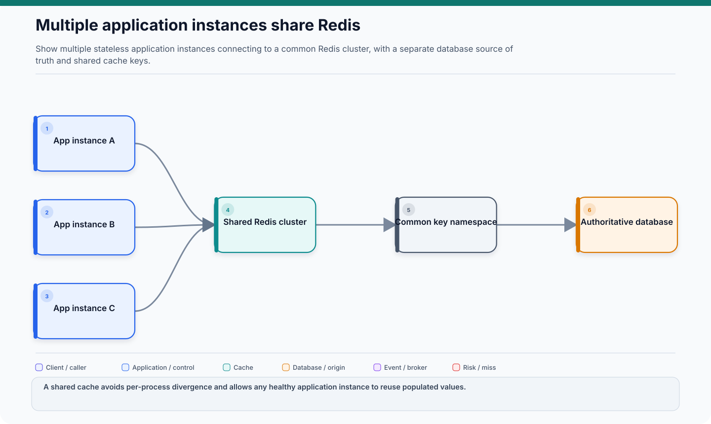

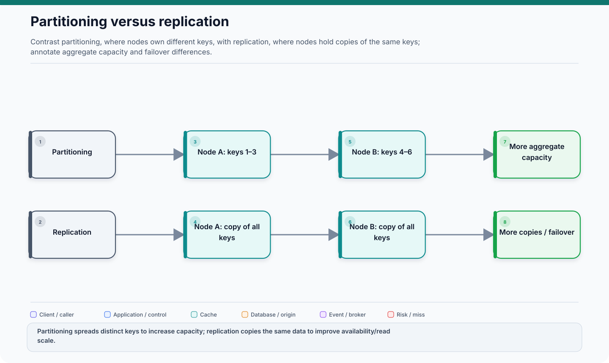

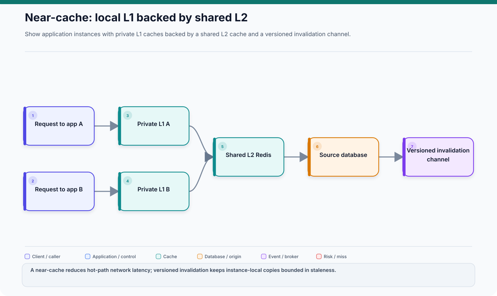

---

# 9. Redis Architecture and Redis Cluster

Redis is an in-memory data structure server commonly used for caching, session storage, queues, rate limiting, leaderboards, and other low-latency data services. It is more capable than a simple string key/value cache, but that capability also means operators must understand persistence, replication, eviction, and workload isolation.

## 9.1 Redis fundamentals

### In-memory data model

Redis stores keys mapped to typed values. Most primary data is held in RAM, which avoids disk seeks for normal operations. Data structures have specialized encodings and internal representations; the memory footprint is not just the payload bytes supplied by the application.

### Command execution and event loop

Redis command execution has traditionally been predominantly single-threaded: one command is processed atomically by the main execution path, making individual commands and many data-structure operations straightforward to reason about. Modern Redis versions can use I/O threads for parts of network read/write processing, and background threads/processes participate in tasks such as persistence. Do not infer that every aspect of Redis is single-threaded or that one Redis process can use every CPU core for arbitrary command execution. A CPU-heavy command can still delay unrelated clients on the same shard.

### Why access is fast

- Data is memory-resident rather than fetched from disk for each command.
- Many commands are constant-time or logarithmic in relevant collection size.
- The server uses an event-driven network model.
- Commands execute in a serialized order on a shard, simplifying atomicity for a single command or script.
- Pipelining can amortize network round trips.

Low latency is not guaranteed. Large values, expensive collection operations, Lua scripts, key scans, persistence forks, network queueing, hot keys, and CPU saturation can all increase latency.

### Expiration and atomicity

Keys can have expiration deadlines. Redis can expire keys lazily when accessed and through active expiry work. Commands such as increment, set-if-absent, and collection updates are atomic at the command level. A Lua script or supported function can group several Redis-side operations atomically, but long-running scripts block normal command processing on that shard and should be kept bounded.

## 9.2 Redis data structures and architectural uses

| Type | Concept | Practical example | Design caution |
|---|---|---|---|
| String | Byte/string value; may represent counter or serialized object | Cached JSON, session token, atomic counter | Large JSON values require full serialization and transfer |
| Hash | Field/value map under one key | User profile fields, product attributes | Large hashes can create big-key and serialization costs |
| List | Ordered sequence | Simple work queue or recent activity list | Blocking/list queue patterns need failure and acknowledgement design |
| Set | Unique unordered members | User interests, tags, membership | Large set operations can be CPU-intensive |
| Sorted set | Members ordered by score | Leaderboard, ranked feed, delayed schedule | Hot leaderboard keys and large range reads need care |
| Stream | Append-oriented log with consumer groups | Event ingestion, work distribution | Not a replacement for a full durable event platform without matching durability/retention settings |
| Bitmap | Bit-level operations over offsets | Daily active flags, compact membership by numeric ID | Sparse large offsets can still have memory implications |
| HyperLogLog | Approximate distinct count | Unique visitors per day | Approximate only; not suitable for exact billing or entitlements |
| Geospatial | Coordinates with radius/nearby queries | Nearby stores or delivery drivers | Geospatial operations and result size must be bounded |

Choose a data structure based on the operation, not because it is available. For example, sorted sets support leaderboard rank queries; storing a leaderboard as a JSON array would force the application to rewrite and transfer a large object for small score changes.

## 9.3 Persistence: RDB and AOF

A cache may be disposable and need no persistence if the database can rebuild it. Redis persistence becomes important when Redis holds sessions, queues, ephemeral state, or data whose recovery time matters.

- **RDB snapshots:** Redis produces point-in-time dataset snapshots. They are compact and can load efficiently, but writes after the latest snapshot may be lost if the process fails before another snapshot.
- **AOF (Append Only File):** Redis records write operations for replay during restart. Durability depends on the configured fsync policy; syncing every operation costs more, while syncing periodically creates a potential loss window.
- **AOF rewrite:** the log can be rewritten into a more compact representation of the current dataset rather than growing forever with every historical command.
- **Hybrid approaches:** a deployment may combine snapshots and AOF to balance recovery time, file size, and durability.

RDB and AOF have different recovery and I/O characteristics. Persistence itself consumes resources and may trigger copy-on-write memory overhead during background save operations. Size memory with persistence, replication buffers, and failover headroom—not only data bytes.

A cache-only Redis deployment can disable persistence when data is safely reconstructable and fast warm-up is available. A Redis instance holding valuable state should have an explicit RPO (acceptable data-loss window), RTO (acceptable recovery time), backup, restore test, and replication plan.

## 9.4 Replication and high availability

Redis replication commonly uses a primary with one or more replicas. Replication is generally asynchronous: the primary processes a write and streams updates to replicas. A replica can lag if the network is slow or it is busy. Full synchronization may transfer a snapshot; partial synchronization can use a replication backlog when the replica reconnects within the retained history window.

Asynchronous replication means a primary can acknowledge a write before every replica has received it. If the primary fails immediately, a newly promoted replica may not contain the last acknowledged writes. This is a durability/consistency trade-off, not a defect that Sentinel alone fixes.

### Redis Sentinel

Sentinel monitors non-clustered Redis primary/replica deployments, detects failures, coordinates failover, and provides service discovery to clients that understand Sentinel. It does **not** shard the dataset. A primary failure can cause a replica to be promoted; clients must discover the new primary and reconnect. Network partitions can complicate failure judgments, so quorum and deployment topology matter.

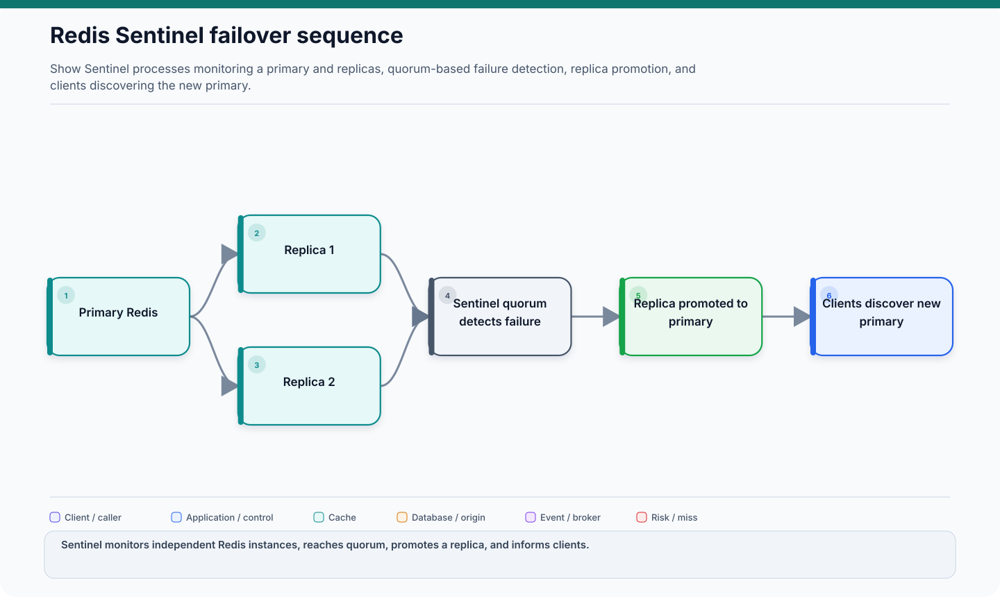

### Failover sequence

1. Sentinels exchange health information.
2. A quorum of Sentinels agrees the primary is unavailable according to configured rules.
3. A leader Sentinel coordinates selection and promotion of a suitable replica.
4. The promoted replica becomes primary.
5. Other replicas are reconfigured to follow it.
6. Clients refresh topology and retry according to bounded policy.

Failover causes a brief interruption and may expose replication lag. Test client reconnection behavior, DNS or Sentinel discovery, command idempotency, and application timeout budgets.

## 9.5 Redis Cluster

Redis Cluster horizontally partitions the keyspace. It defines **16,384 hash slots**. Each key maps to a slot using a CRC16-based calculation modulo 16,384, with hash-tag rules allowing a chosen substring inside braces to determine the slot. Cluster nodes own ranges or sets of slots. Each primary owns some slots and may have replicas.

### Key-to-slot mapping and hash tags

A key such as `product:1042` hashes to one slot. If an application needs a multi-key command over keys that must be colocated, it can use a hash tag, such as `cart:{user-17}:items` and `cart:{user-17}:total`. The substring inside braces is used for slot calculation. This makes same-slot multi-key operations possible but can create a hot slot if the tag groups too much traffic.

### Client-side routing and redirections

Cluster-aware clients maintain a slot map and send a command directly to the node that owns the key's slot.

- **MOVED:** the key's slot is now served by another node; the client should update its slot map and retry against the owner.
- **ASK:** during migration, a key is temporarily being moved. The client should send `ASKING` to the target node and then issue the command, without treating the redirect as a permanent slot-map change in the same way as MOVED.

### Resharding and topology changes

During resharding, hash slots are moved between primaries to balance capacity. Clients may receive redirections while slots migrate. Rebalancing should consider memory, request rate, key size, and hotness—not simply equal slot counts. A node can own the same number of slots as another yet carry far more bytes or QPS.

### Gossip and cluster bus

Nodes exchange cluster-state information over a dedicated cluster communication channel often called the cluster bus. This membership and failure-detection communication helps nodes learn about peers, slot ownership, and failures. The cluster specification describes asynchronous replication and an availability design with trade-offs: it aims to remain useful under node failures but does not provide a general strong-consistency guarantee for all acknowledged writes.

### Why partition instead of full replication?

If every node stored the entire dataset, adding nodes would increase copies and potential read capacity but not aggregate unique data capacity; memory cost would multiply by the number of nodes. Partitioning lets each primary own a portion of the keyspace, so total primary capacity grows with the number of shards. Replicas provide copies for failover, usually doubling or otherwise multiplying storage needs depending on replica count.

### Cross-slot limitations and hot keys

A multi-key operation generally requires involved keys to be in the same slot. Cross-slot requests can fail or require the application to split work. Hash tags help only when the key distribution and load profile tolerate colocation. A hot key remains hot even if the rest of the cluster is balanced; add application-level local caching, key replication/sharding, request coalescing, or read replicas where semantics permit.

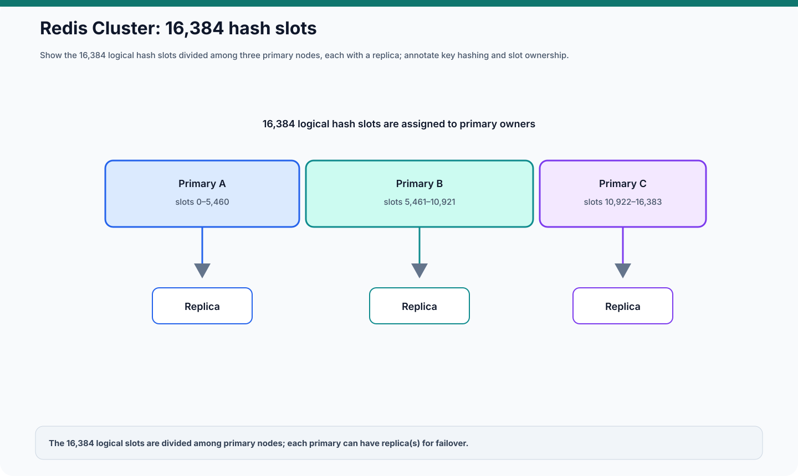

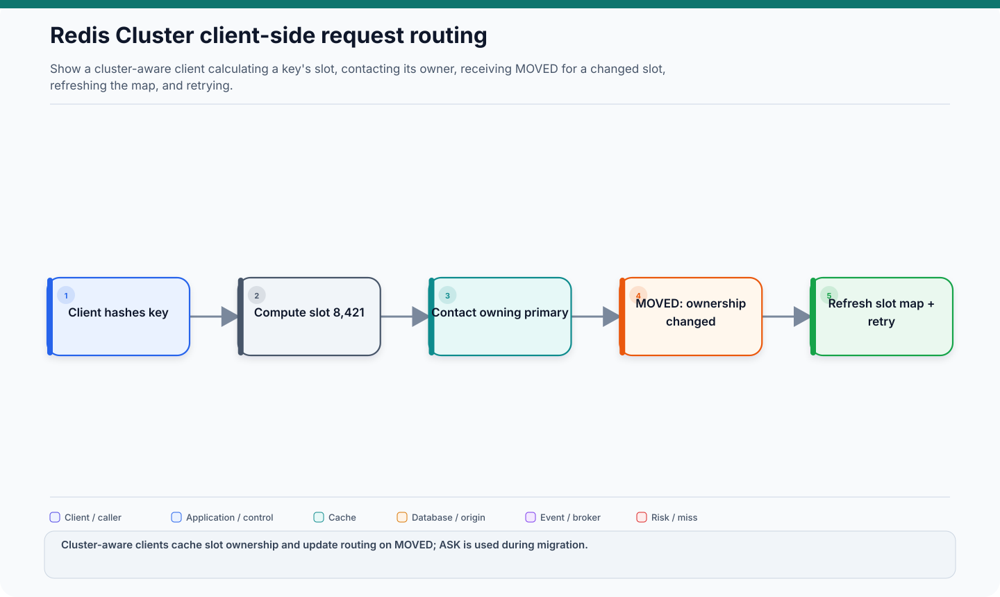

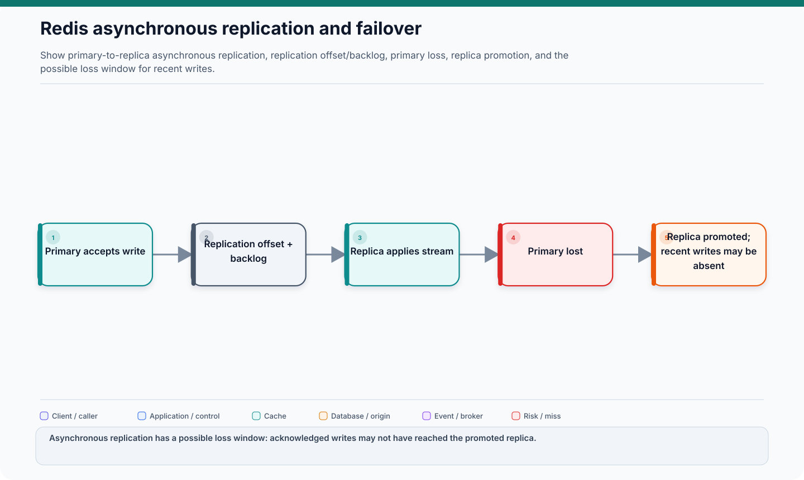

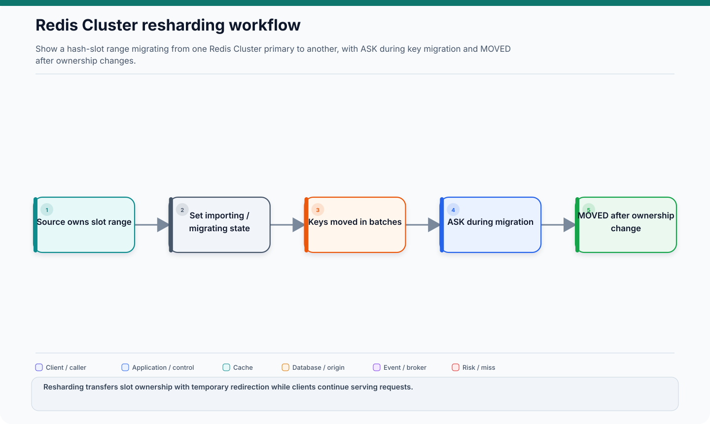

## 9.6 Redis memory management and eviction

The `maxmemory` setting places a ceiling on the memory Redis uses for the dataset, but total process memory also includes buffers, replication backlog, client output buffers, allocator fragmentation, persistence overhead, and other allocations. Do not set `maxmemory` equal to physical RAM. Reserve room for the operating system, fork copy-on-write overhead, replicas, and workload spikes.

Common Redis OSS eviction-policy families include:

| Policy | Behavior |
|---|---|
| `noeviction` | Rejects commands that would grow memory beyond the limit; existing keys remain |
| `allkeys-lru` | Evicts least-recently-used keys across the dataset (approximation) |
| `volatile-lru` | LRU-style eviction among keys with an expiration set |
| `allkeys-lfu` | Evicts least-frequently-used keys across the dataset (approximation) |
| `volatile-lfu` | LFU-style eviction among expiring keys |
| `allkeys-random` | Randomly evicts any key |
| `volatile-random` | Randomly evicts keys with an expiration set |
| `volatile-ttl` | Prefers keys with the shortest remaining TTL among expiring keys |

**Expiration** is caused by a TTL deadline. **Eviction** is caused by memory pressure and policy. A key with an hour left on its TTL can be evicted immediately if the chosen policy selects it. Conversely, an expired key can be deleted even when memory usage is low.

## 9.7 Redis production design practices

### Connection management and pipelining

Use connection pooling or multiplexing appropriate to the client library. Set connect, command, and pool-acquisition timeouts. Avoid creating a new TCP connection per operation. Pipelining sends multiple independent commands without waiting for each round trip; it can raise throughput but increases in-flight work and response buffering. Keep batches bounded.

### Hot-key mitigation

A hot key can saturate one shard even when aggregate cluster CPU is low. Mitigate with local L1 caches, read replicas (where consistency permits), request coalescing, key sharding (for counters or aggregations), precomputation, and careful API pagination. Splitting one key into multiple counters reduces write contention but requires aggregation and eventual reconciliation.

### Big keys and large collections

Large values increase serialization time, network transfer, memory fragmentation, and latency for commands that traverse them. Identify big keys with sampling or offline diagnostics; use bounded collection operations and avoid unbounded `KEYS`-style scans in production. Prefer incremental scan APIs when enumerating keys, understanding that a scan is not a snapshot of a stable dataset.

### Naming and schema

Use readable, versioned namespaces such as `catalog:v4:product:1042`. Include tenant identity where required, encode data-version changes, keep keys bounded, and define TTL by data class. Document ownership and invalidation semantics. Avoid one giant JSON value if small fields have different update rates or read patterns.

### Monitoring

Watch per-node ops/s, CPU, latency distributions, memory, fragmentation ratio, evictions, expirations, rejected writes, connected clients, blocked clients, network bytes, replication lag, failovers, keyspace hits/misses, and cluster slot balance. Use application-level metrics to link Redis symptoms to endpoint p95/p99 and database QPS.

### Security and recovery

Use network isolation, TLS where required, authentication and ACLs with least privilege, protected administrative commands, secret rotation, backups where appropriate, and restore drills. Avoid exposing Redis directly to untrusted networks. Keep cache data classified: session tokens and personal data require stronger controls than public catalog metadata.

### Common application use cases

- **Sessions:** key by a random session identifier; use TTL and revocation/version controls.
- **Product catalog:** cache public product summaries with versioned keys and event invalidation.
- **Leaderboards:** sorted sets with bounded range queries and hot-key planning.
- **Rate limiting:** atomic counters or token-bucket state with time windows; use scripts or atomic operations.
- **Shopping carts:** hash or structured representation; enforce read-your-writes and protect against lost updates.
- **API response caching:** include all response-varying dimensions in key and avoid caching unauthorized responses.

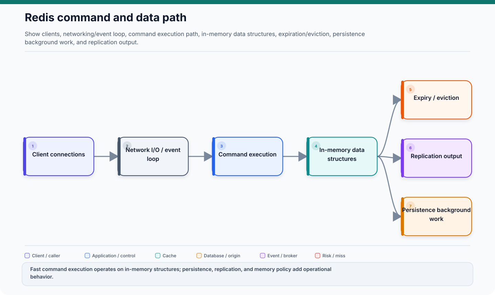

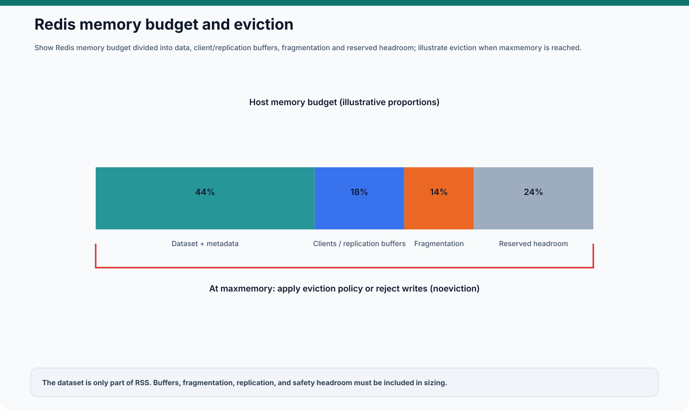

---

# 10. Memcached Architecture

## 10.1 Overview

Memcached is a distributed, in-memory key/value cache designed for simple, high-throughput object caching. It intentionally provides a narrower feature set than Redis. A common deployment runs multiple Memcached servers and lets clients distribute keys among them. The servers generally do not coordinate a shared cluster topology or replicate every key automatically; the client-side routing strategy is central to the design.

## 10.2 Slab allocator and memory organization

Memcached commonly uses a slab allocator. Memory is divided into pages, pages into chunks, and chunks are grouped into slab classes according to size. An object is placed in a class whose chunk can hold it. This reduces general-purpose allocator fragmentation and makes allocation predictable for many cache workloads.

The trade-off is internal waste: if an object is slightly larger than a chunk size, it may occupy a larger class and leave unused bytes. Slab-class imbalance can occur when one class is full while other classes have free chunks. Modern Memcached versions include mechanisms such as slab reassignment/automove to improve utilization, but operators should still observe per-class item counts, evictions, and free chunks.

## 10.3 Expiration and eviction

Items can have expiration times. Expired items become unavailable; memory is reclaimed as the implementation processes them. When a slab class needs space, Memcached may evict older items from that class according to its LRU-oriented item management. Since allocation is class-specific, a full class can evict items even when another class has free memory.

## 10.4 Multi-threaded request handling

Memcached is designed around a multi-threaded event-driven architecture. It can use multiple worker threads to process client connections and commands, which can be useful on multi-core machines. Performance still depends on key distribution, network, object size, lock/contention behavior, and workload. A multi-threaded server is not automatically faster for every data shape.

## 10.5 Client-side consistent hashing

A client library typically maps each key to a server using a distribution algorithm such as consistent hashing or a related modern hashing scheme. When a node is added or removed, consistent hashing aims to remap only a fraction of keys rather than almost every key. Some clients use a continuum/ring; others use different hash-distribution methods. The exact behavior is client-library-specific.

If a node fails, requests mapped to it become misses or errors. Clients may route to a fallback node, but the data usually is not there unless it was separately replicated. When a node returns or topology changes, keys may remap and the cache may experience a cold period. Applications must treat misses as expected and protect the origin during rewarming.

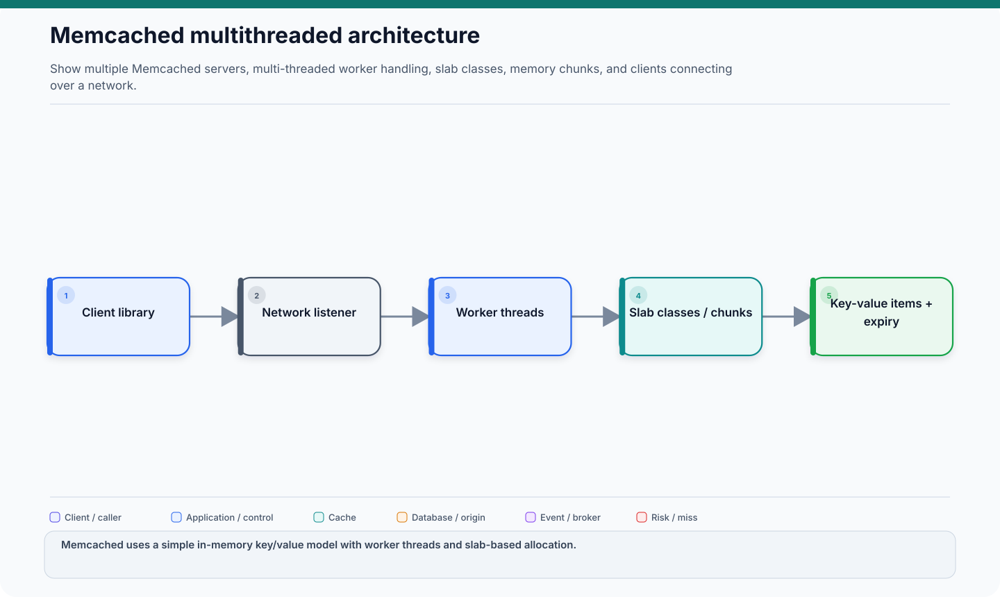

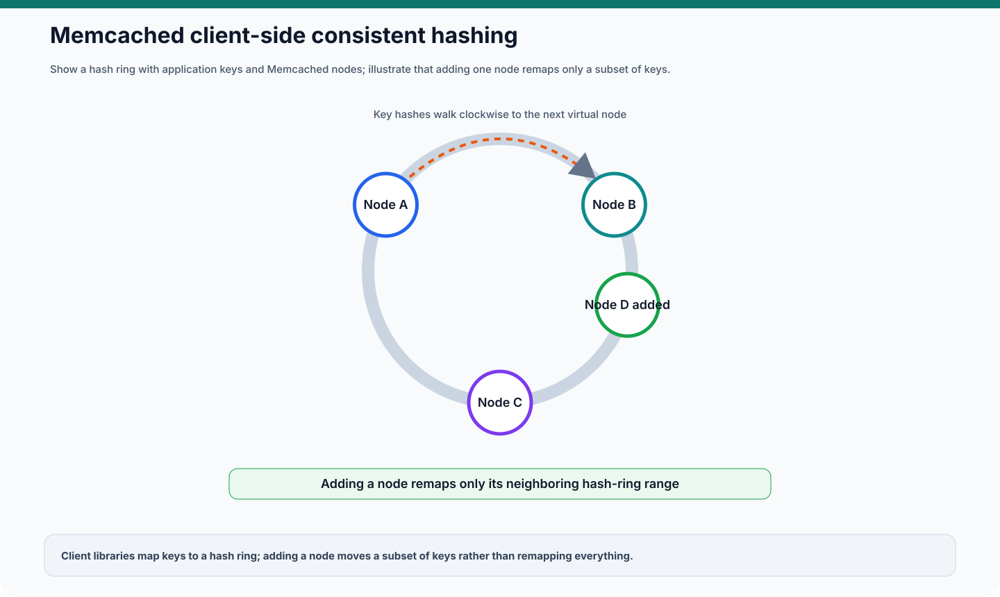

## 10.6 Redis versus Memcached

| Dimension | Redis | Memcached |
|---|---|---|
| Data model | Strings and rich structures such as hashes, sets, sorted sets, streams | Primarily opaque key/value items |
| Persistence | Optional RDB/AOF persistence | Generally treated as ephemeral cache; no comparable built-in durable dataset persistence model |
| Replication / HA | Primary-replica replication; Sentinel; Redis Cluster | Common deployments rely on client routing and application-level recovery; replication is not the core server model |
| Partitioning | Redis Cluster hash slots with cluster-aware clients | Commonly client-side key distribution/consistent hashing |
| Threading | Command execution primarily serialized per shard; I/O threading options | Multi-threaded request handling |
| Memory allocation | Redis object/allocator model; can use specialized encodings | Slab allocator and size classes |
| Eviction | Configurable policies including LRU/LFU approximations and TTL-based choices | LRU-oriented eviction with slab-class behavior |
| Atomic operations | Rich atomic commands and server-side scripting/functions | Basic item operations and counters; narrower data manipulation model |
| Pub/sub and streams | Pub/Sub and Streams capabilities | Not a comparable native general-purpose stream platform |
| Operational complexity | Higher when using advanced structures, persistence, cluster, and HA | Often simpler for a basic disposable object cache |
| Typical fit | Sessions, counters, leaderboards, queues, rate limits, structured cache data | Simple cached objects, rendered fragments, read-heavy key/value workloads |

### When to choose Redis

Choose Redis when the workload benefits from atomic counters, sets, sorted sets, hashes, streams, scripts, persistence, or integrated high-availability/cluster features. It is also useful when a team wants one low-latency data structure service for several carefully isolated use cases.

### When to choose Memcached

Choose Memcached when the problem is simple object caching, the application already owns routing and invalidation, persistence and advanced data structures are unnecessary, and a lightweight multi-threaded key/value service fits the operational model. It can be a good fit for disposable cached render fragments or serialized API objects.

Neither is automatically the faster choice. Benchmark the actual payload sizes, key distribution, connection behavior, serialization, hit rate, and concurrency. A Redis deployment can be slower if misconfigured; Memcached can be a poor fit if the application needs atomic multi-key structures or built-in sharding semantics that it does not provide.

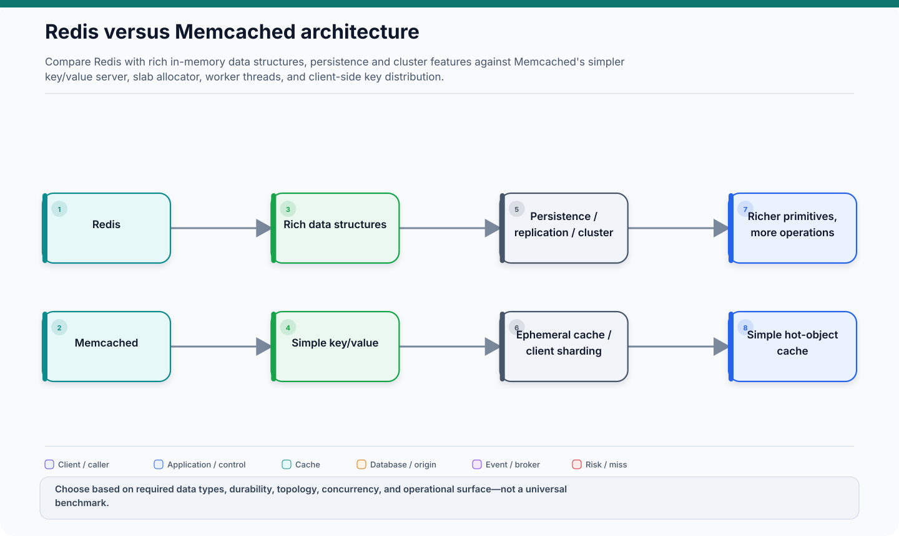

---

# 11. Content Delivery Networks (CDNs)

## 11.1 CDN fundamentals

A **content delivery network (CDN)** is a geographically distributed system of edge servers and related infrastructure that delivers content closer to users. It commonly acts as a reverse proxy in front of an origin. CDNs are especially effective for static assets, downloads, media segments, and public responses that can be safely reused across viewers.

An origin-only architecture forces users in distant regions to fetch data over long network paths. Even if the origin application is fast, propagation delay, congestion, and cross-continent routing increase end-to-end latency. A CDN caches content at **points of presence (PoPs)** and can serve cache hits from a nearby location.

Terminology varies by provider, but a typical hierarchy includes:

- **Origin:** the source server or object store that owns the canonical response.
- **Edge location / PoP:** a network site close to users that terminates requests and may serve cached content.
- **Regional cache / parent cache:** a larger cache layer that can reduce repeated origin fetches from several edge locations.
- **Origin shield:** a designated intermediary cache layer that consolidates origin-bound misses.
- **Edge compute:** code executed near the viewer for routing, header manipulation, lightweight personalization, or request processing.

## 11.2 Request routing

A user request is routed to a suitable CDN edge using mechanisms that may include DNS-based steering, Anycast IP routing, provider network topology, health, and load. These mechanisms are provider-specific and not identical. DNS may choose a destination based on resolver location and health; Anycast advertises the same IP prefix from multiple sites and relies on network routing to deliver the packet to a nearby reachable location. “Nearest” is not always geographic distance; path quality and network topology matter.

The CDN terminates TLS, applies security and cache policies, and checks its cache. A hit returns the cached object. A miss may go to a parent/regional cache or directly to origin. If the upstream response is cacheable, the CDN stores it according to policy and returns it to the viewer.

## 11.3 CDN request lifecycle

1. Viewer requests `/assets/app.8c2a.js`.
2. DNS or routing directs the viewer to a suitable edge PoP.
3. Edge derives the cache key from the configured request fields.
4. If a valid object exists, edge returns it.
5. On miss, edge requests a parent cache or origin.
6. The response's status, headers, TTL policy, and CDN configuration determine whether it can be cached.
7. Edge stores the object and returns it.
8. Future requests with the same cache key can be served from that edge or another cache tier.

### Origin shielding and tiered caching

Without shielding, many edge PoPs can independently miss and request the same object from origin. An origin shield or tiered cache creates an aggregation layer: many edge misses converge on fewer upstream requests. This reduces origin connection count and duplicate transfers. It also creates another cache tier whose availability, location, and freshness behavior must be understood.

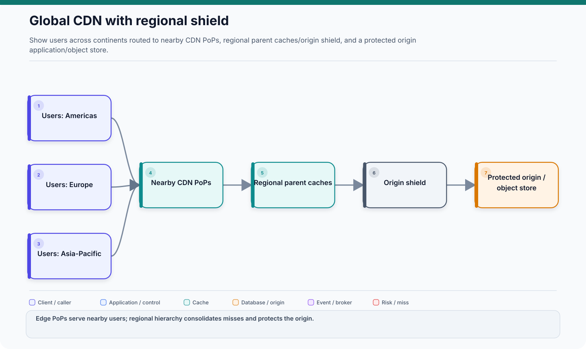

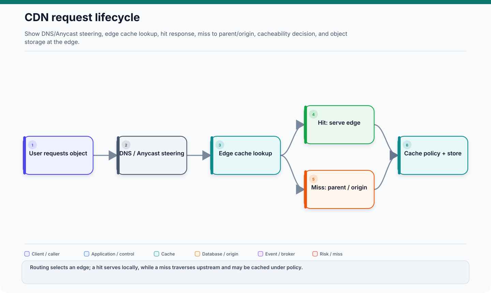

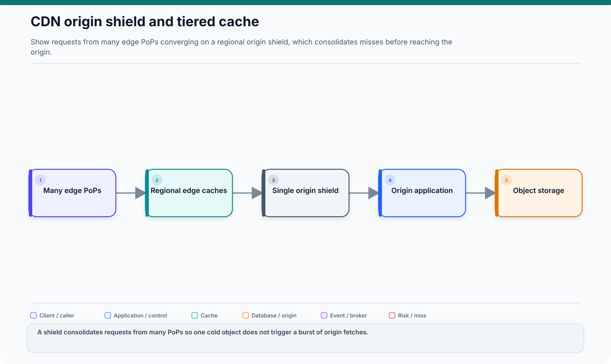

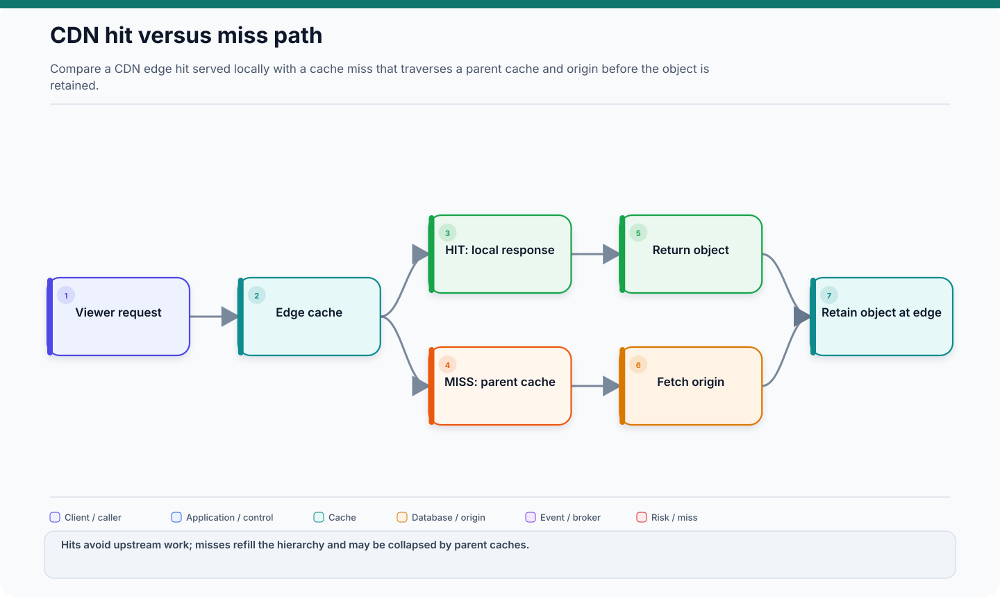

## 11.4 HTTP cache policy

CDN caches commonly honor or combine origin headers with configured behavior. Important directives and validators include:

| Header/directive | Purpose | Architectural implication |
|---|---|---|
| `Cache-Control: max-age` | Freshness for private/browser caches and, absent overrides, shared caches | Defines time before revalidation/expiry |
| `s-maxage` | Shared-cache freshness lifetime | Lets CDN freshness differ from browser freshness |
| `public` | Allows shared caching when other constraints permit | Do not use for user-specific content |
| `private` | Forbids shared-cache storage | Appropriate for personalized response where browser caching is acceptable |
| `no-cache` | Store but revalidate before reuse | Can save transfer but still contacts an upstream validator |
| `no-store` | Do not store | Use for sensitive or non-cacheable responses |
| `Expires` | Absolute freshness time | Legacy-compatible freshness metadata |
| `ETag` | Entity validator | Enables conditional revalidation |
| `Last-Modified` | Modification timestamp validator | Enables time-based conditional request |
| `stale-while-revalidate` | Permit stale serve while refreshing | Smooths refresh for data whose staleness budget allows it |
| `stale-if-error` | Permit stale serve during errors | Can protect origin outage for safe content |

A CDN may also have minimum, default, and maximum TTL settings. Provider configuration can override some origin directives, so test the effective behavior rather than reading headers in isolation.

## 11.5 Cache-key design

The cache key decides whether two requests are considered equivalent. It may include scheme, host, path, query parameters, selected headers, cookies, or normalized values. Every request field that can change the response must either be represented in the cache key or handled so that the response is not shared.

For example, if `/offers` returns different content by country, locale, and currency, the key must encode those dimensions or the URL should canonicalize them, such as `/en-IN/inr/offers`. If a tracking query parameter does not affect content, including it may fragment the cache into needless variants. If `Authorization` changes the response, a shared public cache should generally not reuse the representation across users.

**Cache fragmentation** occurs when too many request variants produce separate objects. **Cache poisoning** occurs when an attacker manipulates a request or unkeyed header so that a harmful or inappropriate response is stored and later served to other requests. Cache-key design is therefore both a performance and security control.

Query-string policy must be deliberate: ignore tracking parameters where safe, include content-changing filters/sorts, and normalize parameter order/encoding if the CDN supports it. Cookies should not be included wholesale unless every cookie is response-significant; per-session cookies can create nearly one cache object per viewer.

## 11.6 Purging and invalidation

CDNs may support:

- **Full purge:** invalidate the entire zone/distribution cache; simple but causes a large cold cache and origin burst.
- **URL purge:** invalidate specific paths.
- **Tag/surrogate-key purge:** invalidate all objects associated with a content tag.
- **Prefix/host purge:** invalidate a group of objects by path or host.
- **Soft purge:** mark content stale or require revalidation while possibly retaining the object for controlled stale serving.
- **Hard purge:** remove content so the next request must fetch a new representation.

Purge propagation takes time and may involve multiple edge and parent layers. Bulk purges can create an origin surge. Prefer **versioned asset URLs** for immutable content: change `app.js` to `app.8c2a.js` and allow the old object to age out naturally. For mutable content, use targeted tags or URL invalidation and protect origin refresh capacity.

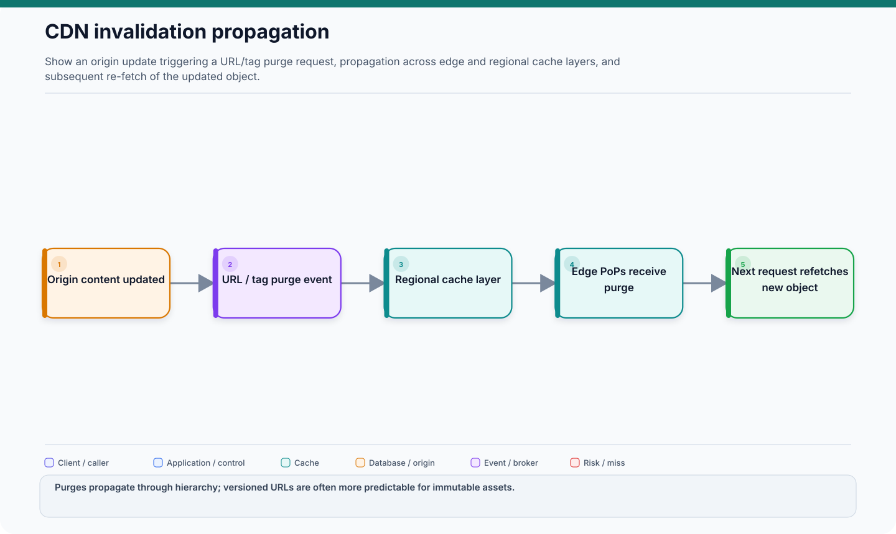

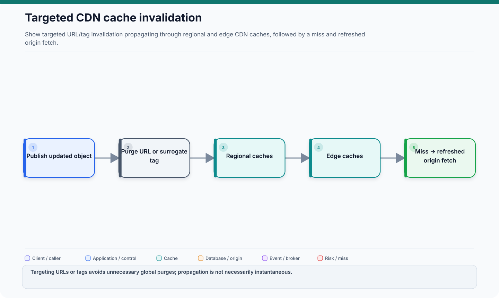

## 11.7 Static, dynamic, personalized, and streaming content

| Content | Cache approach | Key concerns |
|---|---|---|
| Static versioned assets | Long TTL, often immutable | URL versioning and deployment order |
| Public product/category pages | Moderate TTL plus tag/event purge | Price/stock freshness and variant dimensions |
| Dynamic HTML | Cache only if response can be shared safely | Cookies, headers, user-specific fragments |
| API responses | Endpoint-specific policy | Authorization, query parameters, schema version, error responses |
| Personalized content | Usually private or carefully segmented | User/tenant isolation, authorization, cache-key cardinality |
| Video/audio segments | Long-lived segment caching | Segment naming, bitrate variants, regional demand, origin shielding |
| Large downloads | Range requests and object caching | Partial-object behavior, authorization, bandwidth and egress |

Do not cache an authenticated response as public simply because it is expensive. If caching is necessary, include a safe tenant/user scope and permission version, or cache only public components and assemble personalized fragments after retrieval.

## 11.8 Provider examples and roles

The following products all offer CDN-related capabilities, but their service boundaries, routing, cache controls, edge compute, security integrations, and operational models differ. Do not assume internal implementations are identical.

- **Cloudflare:** provides a global reverse-proxy/CDN platform with caching, security, traffic controls, edge compute, and cache purge/invalidation APIs. Its cache behavior depends on zone rules, cache keys, origin headers, and product configuration.
- **Amazon CloudFront:** integrates with AWS origins and cache behaviors/policies. Operators configure which query strings, headers, and cookies participate in the cache key and can use origin request policies for values sent upstream but not used as key dimensions.
- **Akamai:** provides a large distributed edge platform and configurable property-based delivery/security behavior for media, web, and API use cases.
- **Fastly:** offers programmable edge delivery and cache controls, including surrogate-key-oriented invalidation patterns in common architectures.
- **Google Cloud CDN:** integrates with Google Cloud load balancing and origin services, with cache keys and HTTP caching behavior controlled by configuration and response metadata.

CDNs commonly integrate TLS termination, WAF rules, DDoS mitigation, bot controls, origin access restrictions, and analytics. Security policies must be deployed consistently with cache rules: a cache hit should not bypass authorization that would otherwise apply to the response.

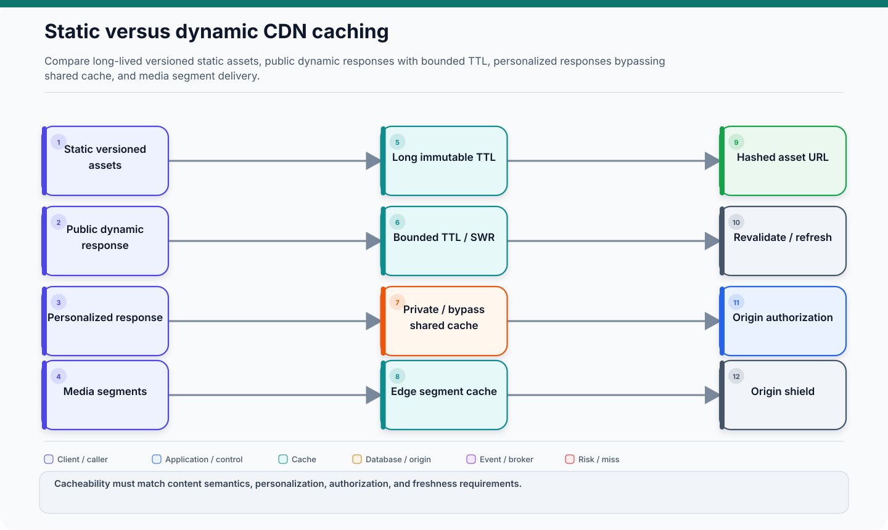

---

# 12. Probabilistic Data Structures for Caching

Probabilistic structures trade exact answers for compact memory and bounded error. They are valuable when the exact set or count is too large or expensive to store, transmit, or query. They complement ordinary caches; they do not replace the authoritative database or a cache of full values.

## 12.1 Bloom filters

### Structure and operations

A Bloom filter is a bit array of size \(m\), initially all zero, combined with \(k\) hash functions. To insert an element, hash it with all functions and set the resulting bit positions to 1. To query membership, compute the same positions:

- If any required bit is 0, the element is **definitely absent** (under the normal no-deletion Bloom-filter model and assuming the filter was built correctly).
- If every required bit is 1, the element is **possibly present**. It may be a false positive because different inserted elements can set the same bits.

A standard Bloom filter has false positives but no false negatives under its assumptions: once an item is inserted, its bits remain set, so querying it finds all required bits set. False negatives can appear if items are deleted incorrectly, the filter is stale/incomplete relative to the source, or implementation/hash parameters are inconsistent.

### False-positive probability

After inserting \(n\) elements, the approximate probability that a particular bit remains zero is \((1-1/m)^{kn}\), often approximated by \(e^{-kn/m}\). The probability that all \(k\) queried bits are 1 for an absent element is therefore:

\[
P(\text{false positive}) \approx \left(1-e^{-kn/m}\right)^k
\]

where:

- \(m\) = number of bits in the filter;
- \(n\) = number of inserted elements;
- \(k\) = number of hash functions.

For fixed \(m\) and \(n\), the approximate optimal number of hash functions is:

\[
k = \frac{m}{n}\ln 2
\]

At this optimum, approximately half the bits are set. A commonly used sizing relation for target false-positive rate \(p\) is:

\[
m = -\frac{n\ln p}{(\ln 2)^2}
\]

### Worked sizing example

Suppose a service needs to represent 10 million product IDs with a target false-positive rate of 1% (\(p=0.01\)).

\[
m = -\frac{10{,}000{,}000\times\ln(0.01)}{(\ln2)^2}
\approx 95{,}850{,}000 \text{ bits}
\]

That is approximately 11.98 MB in decimal megabytes, before implementation metadata and operational overhead. The optimal hash count is:

\[
k = \frac{95{,}850{,}000}{10{,}000{,}000}\ln2 \approx 6.64
\]

So use about 7 hash functions. The actual false-positive rate depends on implementation, hash quality, and whether the filter is overfilled; size it for expected growth and rebuild/scale when necessary.

### Use cases

- **Database storage engines:** test whether an SSTable or disk block can contain a partition/key before performing an expensive disk lookup. A negative result can skip I/O; a positive result proceeds to the real lookup.
- **Cache penetration:** reject IDs that definitely are not present before querying a database.
- **URL deduplication:** avoid repeated expensive existence checks during large crawls.
- **Distributed membership:** transmit a compact approximation of a large set.

### Deletion and variants

A standard Bloom filter cannot safely delete an item because multiple items may share bits. Clearing a bit could create a false negative for another item. A **counting Bloom filter** replaces bits with small counters and decrements on deletion, at additional memory and overflow/underflow complexity. A **scalable Bloom filter** adds successive filters as the set grows while managing an overall error budget.

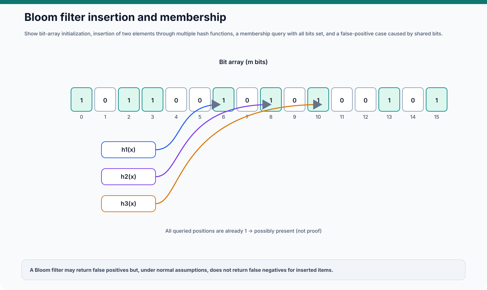

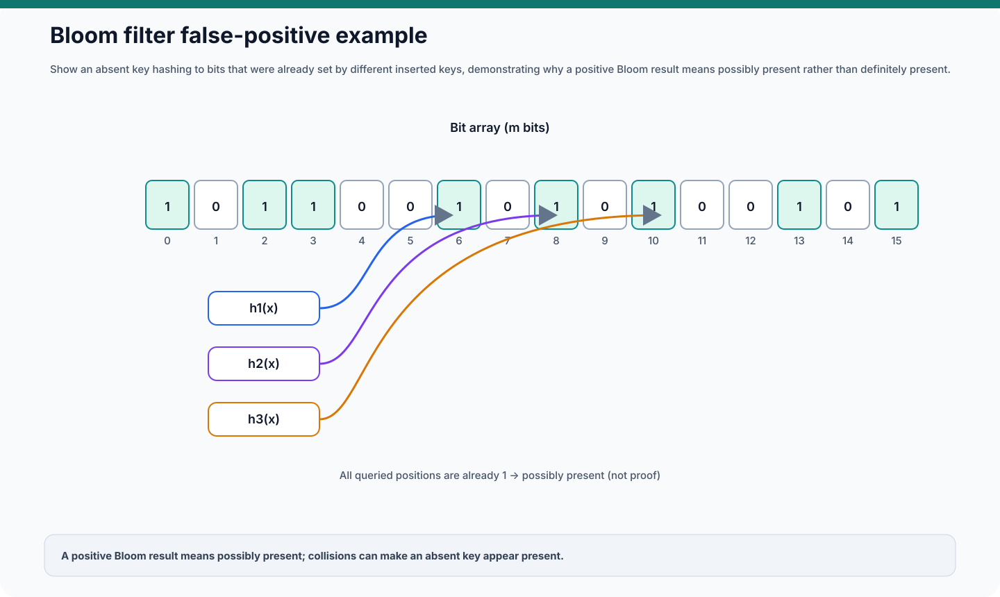

## 12.2 HyperLogLog

HyperLogLog estimates the **cardinality** (number of distinct elements) of a stream using a compact set of registers. Exact distinct counting needs a set of all unique identifiers or an equivalent exact structure, which can be expensive at billions of elements. HyperLogLog hashes each item, uses a portion of the hash to select a register, and observes the position of leading zeros in the remaining hash bits. Rare long runs of zeros suggest a large underlying cardinality.

The algorithm aggregates register observations using a harmonic-mean-style estimator and applies corrections for small- and large-range behavior. The classic relative standard error is approximately:

\[
RSE \approx \frac{1.04}{\sqrt{m}}
\]

where \(m\) is the number of registers. Increasing the register count reduces relative error but increases memory. Many implementations use packed registers and implementation-specific bias corrections.

### Distributed aggregation example

Suppose an application runs in three regions. Each region hashes user IDs into its local HyperLogLog during the day. At reporting time, compatible sketches are merged, producing an estimate of global unique visitors without transferring every ID. Duplicate users appearing in two regions are naturally accounted for by the sketch's union/merge behavior. The result is suitable for dashboards and trends, not exact invoicing or access control.

Redis provides HyperLogLog operations as a memory-efficient approximate distinct counter. Understand the configured precision and implementation behavior before using the result as a business metric.

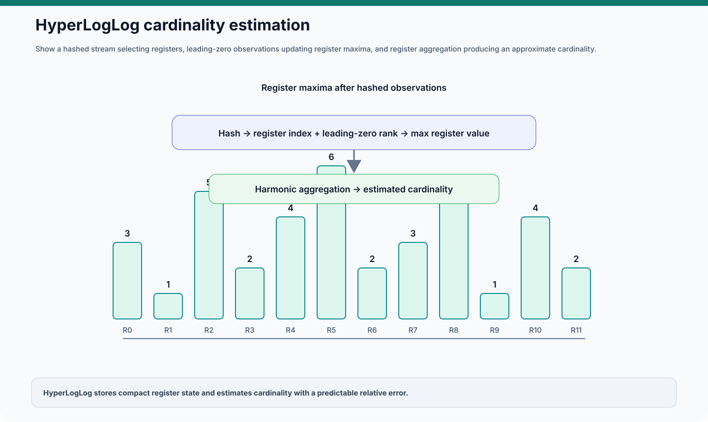

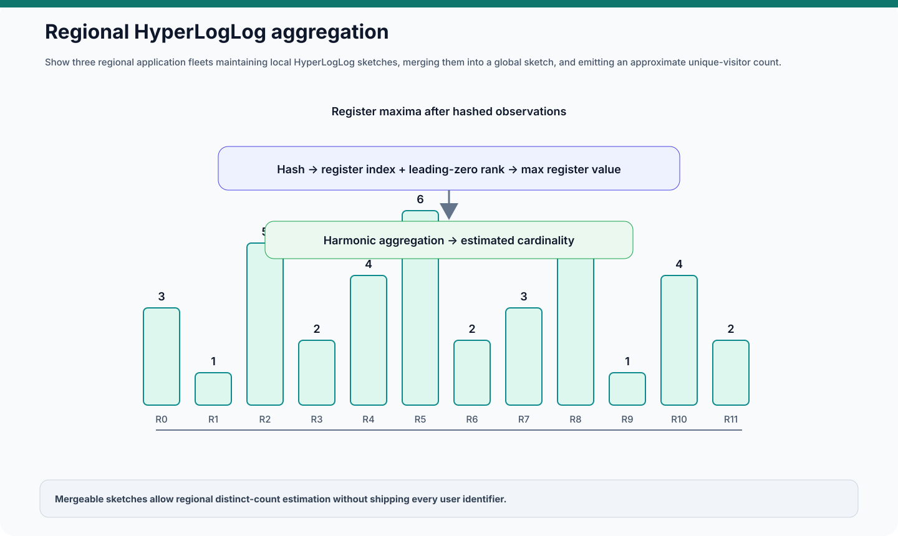

## 12.3 Count-Min Sketch

Count-Min Sketch estimates the frequency of items in a stream using a two-dimensional array of counters with \(d\) rows and \(w\) columns. Each row has an independent hash function. To increment item \(x\), increment one counter in each row. To query \(x\), take the minimum of the counters selected by the row hashes.

Because collisions can only add counts to a counter, the standard Count-Min Sketch estimate **overestimates or equals** the true frequency (assuming no counter overflow and standard nonnegative updates). It does not generally underestimate. The minimum across rows reduces collision error.

A common parameterization for additive error \(\epsilon N\) with failure probability at most \(\delta\) uses:

\[
w = \left\lceil\frac{e}{\epsilon}\right\rceil,
\qquad
 d = \left\lceil\ln\frac{1}{\delta}\right\rceil
\]

where \(N\) is the total stream weight/count. With probability at least \(1-\delta\), the query estimate is no more than the true frequency plus \(\epsilon N\). The practical interpretation is that memory can be tuned to bound the additive overcount; heavy hitters can often be identified without storing every key.

Use cases include popular URL estimation, trending topics, approximate per-customer request counts, network flow analysis, and identifying candidate hot keys. It is not a replacement for exact counters when a threshold determines payment, quota enforcement, or legal compliance.


## 12.4 Other approximate structures

| Structure | Problem solved | How it helps | Important caveat |
|---|---|---|---|
| Cuckoo filter | Approximate membership with deletion | Stores compact fingerprints in buckets and can delete entries | Insertions can fail when relocation budget/capacity is exhausted; false positives remain |
| Quotient filter | Approximate membership | Stores remainders in compact clustered metadata and can support merging/extension variants | Operational details and false-positive behavior depend on variant |
| Top-K / frequent-items sketch | Finds most frequent elements | Tracks candidates likely to dominate a stream without storing all keys | Candidate selection is approximate; validate before critical action |
| Reservoir sampling | Uniform sample from an unknown-length stream | Maintains a fixed-size sample with each item having equal inclusion probability | A sample is not a full dataset; weighted samples need a different algorithm |
| MinHash | Estimates Jaccard similarity | Compares compact signatures to detect similar sets/documents | Similarity estimate has sampling error; tokenization choices matter |
| Theta sketch | Approximate set cardinality and set operations | Supports unions/intersections/differences in a mergeable framework | More expressive than simple HLL but with different size/accuracy trade-offs |

## 12.5 Comparison and when to use each

| Structure | Primary purpose | Approximation behavior | Typical use |
|---|---|---|---|
| Bloom filter | Membership | False positives; normally no false negatives | Avoid unnecessary storage/database lookups |
| HyperLogLog | Cardinality | Approximate distinct count | Unique visitors, distinct IDs |
| Count-Min Sketch | Frequency | Overestimates counts | Heavy hitters, popular URLs |
| Cuckoo filter | Membership with deletion | False positives | Mutable approximate membership sets |
| MinHash | Similarity | Approximate Jaccard similarity | Duplicate document detection |
| Top-K sketch | Frequent items | Approximate candidates/ranking | Trending topics and popular keys |
| Reservoir sampling | Sampling | Random subset, not an estimate of membership | Stream inspection and analytics |
| Theta sketch | Cardinality/set operations | Approximate cardinalities and set expressions | Multi-set analytics |

These structures complement caching. A Bloom filter can prevent a cache miss from reaching storage for definitely absent data; HyperLogLog can summarize visitors; Count-Min Sketch can identify popular keys that deserve cache space. None stores the full authoritative value or guarantees exact answers.


---

# 13. Multi-Level and Hierarchical Caching

## 13.1 Why multiple levels are useful

A single shared cache is not always the lowest-cost place to serve every request. A local cache can answer in process; a regional cache can avoid cross-region traffic; a CDN edge can avoid reaching the application at all. Production systems therefore use multiple levels when the workload has sufficient reuse and the consistency costs are acceptable.

A conceptual hierarchy is:

- **L1:** in-process application memory, smallest and fastest, scoped to one instance.
- **L2:** shared distributed cache such as Redis or Memcached, shared by a service fleet.
- **L3:** regional cache or regional data service, shared across several application clusters.
- **L4:** CDN/edge cache, geographically close to viewers and typically governed by HTTP semantics.
- **Origin:** database, object store, or authoritative service.

These labels are conventions, not a universal standard. Some platforms call a CDN their L1 or use “L1/L2” differently. Always name the concrete component and scope in architecture documents.

## 13.2 Lookup, promotion, and writes

A common read sequence is:

1. Look up in L1.
2. On L1 miss, look up in L2.
3. On L2 miss, fetch from origin or a regional cache.
4. Populate L2 with the canonical representation.
5. Promote to L1 with a shorter TTL or local validity bound.
6. Return the data.

Promotion should not blindly copy every large or rarely reused object into every local process. L1 admission can be selective based on frequency, object size, or endpoint criticality. If all instances cache every object, aggregate memory usage may be much larger than the shared dataset.

Writes need a deliberate path. A database commit can publish an event; L2 invalidates or updates; L1 instances receive a versioned invalidation. A CDN can receive a tag/URL purge or rely on immutable versioned URLs. Some systems do not eagerly invalidate every tier; they use short TTLs and version checks to provide bounded staleness.

## 13.3 Coherence across layers

Suppose a product object exists in browser cache, CDN, L1, Redis, and the database. Deleting the Redis key does not remove copies from a browser or CDN. Every layer has its own cache key and expiration/validation behavior. A freshness objective must account for the slowest layer that can still serve the old representation.

Useful techniques include:

- Version identifiers in URLs or data keys.
- Event-based invalidation with consumer acknowledgements.
- Short local TTLs combined with a longer shared TTL.
- A version endpoint or entity-version pointer.
- Purge tags for groups of CDN objects.
- Stale-while-revalidate for noncritical public content.
- Reconciliation jobs that compare expected versions and evict obsolete copies.

Near-caches should have a maximum stale interval and a reconnect behavior. If an application instance misses invalidations while partitioned from the event bus, it should flush or revalidate after reconnect rather than assume its local copy is current.

## 13.4 Global e-commerce walkthrough

A global retailer has users in Asia, Europe, and North America. A product detail page includes immutable JS/CSS/image assets, public catalog data, region-specific currency, and live inventory.

- The browser caches versioned assets for a year with immutable URLs.
- The CDN caches public product JSON by product ID and locale/currency variant, with a short bounded TTL and tag invalidation on product edits.
- The application L1 caches very hot product metadata for a few seconds.
- Redis L2 stores broader product representations for several minutes, keyed by product/version/locale.
- Regional catalog read replicas or regional service caches reduce long-haul reads.
- The primary catalog database owns product data.
- Inventory availability is fetched from a dedicated inventory service and revalidated at reservation/checkout; a page cache is not the inventory authority.

A cache miss in Singapore should not require a cross-Atlantic round trip if a regional read replica or parent cache can serve the object. Regional data freshness and failover policy must be defined. Product updates use CDC or an outbox to invalidate Redis and CDN tags. Inventory reservations remain transactional at the inventory boundary.


---

# 14. Cache Warming, Preloading, and Refresh

## 14.1 Cold starts

A cold cache contains few or none of the objects needed by incoming traffic. It occurs after deployment, restart, failover, scale-out, regional activation, bulk invalidation, or a provider migration. The system may technically be healthy while the origin suddenly receives a large volume of cache misses.

**Cache warming** populates selected keys before they are needed. **Preloading** is proactive insertion of a chosen dataset. **Background refresh** refreshes an existing key before or after its expiry. **Prefetching** predicts future requests based on access behavior or known navigation patterns.

## 14.2 Choosing what to warm

Do not attempt to load the entire database into cache by default. Choose entries with a combination of:

- Recent and historical access frequency.
- Expected campaign/event traffic.
- Cost of a miss (query CPU, latency, fan-out).
- Object size and memory cost.
- Freshness requirement and update rate.
- Geographic popularity.
- Business criticality.

A ranking score can combine estimated request rate, miss cost, and object size. For example, prioritize a 20 KB product object receiving 5,000 requests/s over a 5 MB object with a handful of daily views. Maintain allowlists or snapshots for critical configuration that must exist before an application accepts traffic.

## 14.3 Warming strategies

- **Deployment-time warming:** a job reads a known hot-key list and prepopulates a new cache namespace before traffic shifts.
- **Scheduled warming:** refreshes predictable datasets before peak hours or scheduled sales.
- **Regional warming:** populates each region independently to avoid one region's cache being cold after failover.
- **Restart recovery:** uses a durable hot-key inventory or usage log to rebuild likely useful values.
- **Predictive prefetching:** predicts likely next reads, such as the next video segment or related product page.
- **Lazy warming:** allows normal requests to fill cache, but protects origin with rate limits and coalescing.

Warming traffic must be throttled. If a warm-up job issues one million parallel queries, it can overload the origin before customer traffic begins. Use bounded concurrency, batch reads, randomized scheduling, per-region quotas, and an explicit warm-up completion gate.

## 14.4 Background refresh and stale serving

A cache can refresh a key when it is near expiry while continuing to serve the old value within an allowed stale window. This reduces latency spikes and stampedes. The refresh job needs single-flight/coalescing, version checks, failure backoff, and a hard maximum stale age. A stale-serving rule that is acceptable for a news article may be unacceptable for an authorization policy or price quote.

## 14.5 Examples

- **Product catalog before a sale:** build a hot-product list from prior campaigns and prewarm product metadata and category pages; do not preload mutable stock as the authoritative value.
- **News during a breaking event:** warm the homepage, article body, and image variants; use stale-while-revalidate and origin shielding.
- **Configuration:** warm feature flags and service configuration during startup; refuse unsafe defaults if the required configuration cannot be loaded.
- **Application startup:** a readiness check can distinguish “process started” from “critical cache warm-up completed,” but avoid making all noncritical keys a hard startup dependency.


---

# 15. Cache Capacity Planning and Performance Engineering

Capacity planning combines the working set, object sizes, traffic distribution, hit ratio, memory overhead, replication, network bandwidth, and failover headroom. The calculations below are first-order estimates; production sizing must be verified with real object distributions and load tests.

## 15.1 Memory estimation inputs

Estimate:

1. Number of resident keys.
2. Average and percentile value sizes (the mean alone can hide large-object costs).
3. Key length and metadata/object overhead.
4. Allocator/internal fragmentation.
5. Client buffers, replication backlog, and persistence overhead.
6. Replica count and whether the stated memory is per node or total.
7. Operational headroom for growth, failover, and rebalancing.
8. Eviction reserve and target memory utilization.

A simplified single-copy formula is:

\[
M_{raw}=N\times(S_v+S_k+S_m)
\]

where \(N\) is entry count, \(S_v\) value size, \(S_k\) key size, and \(S_m\) per-entry metadata/allocator overhead. Add a multiplier for fragmentation and headroom, then account separately for replicas and process overhead.

## 15.2 Example A: 10 million keys

Assume:

- 10,000,000 keys;
- average value = 1 KB = 1,024 bytes;
- key plus metadata overhead = 150 bytes per entry;
- 30% additional memory overhead and operational headroom.

Per entry:

\[
1{,}024+150=1{,}174\text{ bytes}
\]

Base dataset estimate:

\[
10{,}000{,}000\times1{,}174=11{,}740{,}000{,}000\text{ bytes}
\]

That is about **11.74 GB decimal** or **10.93 GiB**. Adding 30%:

\[
11.74\text{ GB}\times1.30=15.262\text{ GB}
\]

A rough planning estimate is therefore **15.3 GB for one copy**, before any additional replication, client buffers, persistence/fork overhead, or OS reserve not already included in the 30%. With one replica per primary, data memory roughly doubles across the fleet. Do not assume all vendor-reported memory metrics mean the same thing; distinguish dataset memory, process RSS, and total cluster provisioned RAM.

Why raw payload size is insufficient: the 10 million keys also consume key strings, object headers, allocator classes, pointers, expiry metadata, dictionaries, and fragmentation. A real benchmark with representative keys and values is the best way to derive a per-entry multiplier.

## 15.3 Example B: cache hit ratio at 200,000 requests/s

Assume 200,000 requests/s and 97% request hit ratio. Each miss causes one backend request.

\[
H=200{,}000\times0.97=194{,}000\text{ hits/s}
\]
\[
M=200{,}000\times0.03=6{,}000\text{ misses/s}
\]

The database receives approximately 6,000 requests/s rather than 200,000, avoiding 194,000 requests/s, or 97% of this request class. If each cache miss requires three SQL queries, the database sees 18,000 queries/s, not 6,000; model fan-out explicitly.

## 15.4 Example C: six Redis nodes with 16 GB each, replication factor 2

Assume six physical nodes, each provisioned with 16 GB, and one replica for each primary shard. If the six nodes are evenly split into three primaries and three replicas:

- Total raw RAM across nodes: \(6\times16=96\) GB.
- Primary-side configured memory capacity: \(3\times16=48\) GB.
- Replica copy capacity: another 48 GB.
- The unique dataset is therefore bounded by the primary capacity, not 96 GB.

If the design reserves 25% per primary for overhead/headroom, approximate production-safe dataset target is:

\[
48\text{ GB}\times0.75=36\text{ GB}
\]

This is a planning simplification. Actual usable memory depends on `maxmemory`, buffers, persistence, operating system, fragmentation, failover behavior, cloud-service accounting, and whether each node can safely host a promoted replica. If six nodes instead means six primaries plus six replicas, the arithmetic is different. Always state node count and replica topology.

## 15.5 Example D: expected average access latency

Assume Redis hit latency is 1 ms, database miss latency is 20 ms, hit ratio is 95%, and ignore network, queueing, serialization, and variance.

\[
E[L]=0.95(1\text{ ms})+0.05(20\text{ ms})
=0.95+1.00=1.95\text{ ms}
\]

The expected average is approximately **1.95 ms**. This is a weighted average, not a p95/p99 guarantee. Since 5% of requests take the database path, p95 may be near or above the miss latency; queueing during a miss surge can make tail latency much higher. Include cache network and application processing to estimate real end-to-end latency.

## 15.6 Little's Law and concurrency

Little's Law states:

\[
L=\lambda W
\]

where \(L\) is average number of items in a stable system, \(\lambda\) is average throughput (arrivals per second), and \(W\) is average time in the system (seconds). If a cache handles 20,000 operations/s and average service time is 2 ms (0.002 s), the average in-flight work is:

\[
L=20{,}000\times0.002=40\text{ operations}
\]

This is not a direct connection-pool sizing prescription; queueing, burstiness, client multiplexing, and tail latency matter. But it helps sanity-check concurrency and buffer assumptions.

## 15.7 Queueing and tail latency

As utilization approaches saturation, queueing delay can rise sharply. A cache that has enough average CPU may still have a p99 problem due to uneven key distribution, large commands, network pauses, background persistence, or a few hot shards. Maintain spare capacity and load-test burst patterns, not only steady averages.

## 15.8 Network bandwidth

Approximate outbound payload bandwidth as:

\[
B_{out}=R\times S\times8
\]

where \(R\) is responses/s and \(S\) is average response bytes. At 50,000 responses/s with average 2 KB (2,048 bytes):

\[
50{,}000\times2{,}048\times8=819{,}200{,}000\text{ bits/s}
\]

That is about 819 Mbps before protocol overhead, retransmissions, replication, and cross-zone traffic. Large values can saturate network links even when command CPU is low.

## 15.9 Load testing and benchmarks

A credible cache benchmark should include realistic key popularity (often Zipf-like), read/write mix, object-size distribution, TTL behavior, hot-key concentration, connection count, TLS, serialization, failover, and cold-cache startup. Run long enough to reach steady state and include burst tests. Validate application-level p95/p99 and origin QPS, not only the raw cache benchmark's ops/s.

---

# 16. Real-World Architecture Case Studies

The following are production-style reference designs, not claims that a named company uses these exact internal architectures. Each case identifies the business constraint, architecture, and trade-offs that a design review should make explicit.

## 16.1 Case study 1 — E-commerce product catalog

**Business problem and requirements.** Millions of shoppers read product pages, category listings, seller information, and prices. Read volume is much higher than catalog-write volume, while product descriptions and images are relatively stable. Inventory and promotion eligibility can change quickly.

**Initial architecture.** Browser requests reach an application fleet, which queries a relational catalog database for product, category, and seller data. Images are stored in object storage. Under a campaign, repeated database joins consume CPU and connection-pool capacity.

**Caching architecture and pattern.** Use CDN caching for versioned images, JS/CSS, and public cacheable page fragments; Redis L2 for product summaries and category metadata; optional in-process L1 for very hot immutable fields. Use cache-aside for read-heavy catalog objects. Build keys with product ID, representation version, locale, and currency where they change the response.

**Eviction and expiration.** Use LFU/LRU-style policy based on observed workload, with TTLs of several minutes for descriptions and shorter TTLs for volatile promotional data. Use jitter. Avoid treating inventory as a normal long-lived product attribute.

**Invalidation.** Catalog writes commit to the database and publish an outbox/CDC event with product ID and version. Consumers invalidate Redis and local L1; CDN objects use surrogate tags or versioned URLs. Reconciliation checks event lag and stale versions.

**Failure scenarios and performance.** A Redis outage must not send every product read to the database. Use local bounded fallback, request coalescing, stale public catalog data, and a database fallback budget. Prewarm top products before sales. Inventory is validated/reserved at the authoritative inventory service during checkout.

**Trade-offs and lessons.** Separate static catalog attributes from dynamic price/stock. A single large cache object is simpler but can cause unnecessary invalidation; split objects according to update frequency and read pattern. Measure miss QPS during campaign peaks, not only the average hit ratio.


## 16.2 Case study 2 — Social media feed

**Business problem and requirements.** A social platform must generate a personalized feed from posts by followed accounts. Some users have millions of followers, some users follow thousands of accounts, and feed freshness is important but can tolerate small delays.

**Initial architecture.** Each feed request queries posts from all followed accounts and ranks them on demand. High-follower accounts cause expensive fan-out and query amplification.

**Caching architecture and pattern.** Use a hybrid of **fan-out on write** and **fan-out on read**. For ordinary users, a new post is pushed into follower inbox/feed caches asynchronously. For celebrity/high-fan-out accounts, store the post once and merge it at read time. Cache feed IDs in Redis sorted sets or compact lists keyed by user and feed version; hydrate post bodies through a separate post cache.

**Eviction and TTL.** Keep only a bounded recent window per user (for example, latest several hundred or thousand IDs); older items can be fetched from durable storage or omitted from the hot feed. Use short refresh windows and eviction based on recent access.

**Invalidation.** Post deletion, privacy changes, and account blocks require stronger invalidation than a normal new-post event. Include post versions/visibility state and invalidate affected feed fragments. Access control must be checked on read or encoded safely into feed materialization.

**Failure scenarios and performance.** A celebrity post can create a fan-out storm. Queue work with quotas, prioritize active users, coalesce updates, and use read-time merge for large fan-out accounts. If Redis fails, retrieve a limited feed from durable storage rather than rebuilding every user's complete history synchronously.

**Trade-offs and lessons.** Fan-out-on-write gives fast reads at the cost of write amplification and storage. Fan-out-on-read saves write work but creates read-time complexity. Hybrid selection based on follower count and active readership is often better than one global rule.


## 16.3 Case study 3 — Global news website

**Business problem and requirements.** A news publisher experiences large spikes when a story breaks. Most article content is public and identical for all readers, but headlines, live modules, and regional editions can update quickly.

**Initial architecture.** Every viewer reaches application servers and the origin database/object store. A sudden traffic burst overwhelms application workers and origin bandwidth.

**Caching architecture and pattern.** Place a CDN in front of the site. Cache article HTML/API representations, images, fonts, and scripts. Use origin shield/tiered caching so misses from many PoPs converge. Add regional application caches for personalized but broadly reusable modules. Use cache-aside at the origin and CDN HTTP freshness at the edge.

**Eviction and expiration.** Use long TTLs for immutable assets, short TTLs for live content, and stale-while-revalidate for safe public article text. News homepages may use a small TTL with active refresh. Keep old article versions available where editorial and legal policy permits.

**Invalidation.** Publishing workflow emits an event with article ID and tags such as `section:world`. Targeted tag purge updates article and section pages. Avoid full-zone purges during breaking news; prewarm the new story at important regions.

**Failure scenarios and performance.** Origin failure can be mitigated by stale-if-error for public articles. A full purge can create a miss avalanche, so purge selectively and use origin shield. Cache-key mistakes involving region or language can serve the wrong edition.

**Trade-offs and lessons.** Public article bodies are excellent CDN candidates; live score widgets or user-specific subscriptions should be separately cached or dynamically fetched. Keep the cache key small but semantically complete.


## 16.4 Case study 4 — Video streaming platform

**Business problem and requirements.** Users stream video globally with low startup time and minimal buffering. Video is split into small segments at several bitrates/resolutions. Popular content can receive millions of repeated segment requests.

**Initial architecture.** Clients request media segments from a central origin or object store. Long-distance transfers and repeated origin reads become costly.

**Caching architecture and pattern.** Use a CDN with edge and regional caches. Media segments use immutable, content-addressed or versioned URLs. A manifest identifies segment URLs and bitrate variants. Origin shield reduces repeated object-store fetches. Regional caches retain popular content that may not fit at every edge.

**Eviction and freshness.** Immutable segments can have long TTLs and be evicted by recency/frequency under capacity pressure. Manifests may have shorter TTLs when live streams change. Live media windows require careful handling of segment availability and playlist refresh.

**Invalidation.** Versioned URLs are preferred to purging immutable segments. A manifest update points clients to new segment IDs. For takedowns or rights changes, purge and authorization controls must remove access quickly; CDN purge is not a substitute for access policy.

**Failure scenarios and performance.** A sudden hit for a new release can overload origin if segments are not pre-positioned. Use scheduled prewarming, regional demand prediction, request collapsing, and origin shielding. Monitor byte hit ratio, not only request hit ratio, because large segments dominate bandwidth.

**Trade-offs and lessons.** Cache placement should follow audience demand and segment popularity. Personalized DRM/license responses are different from public media segments and should not be cached as if they were identical objects.


## 16.5 Case study 5 — Banking or financial application

**Business problem and requirements.** A banking application needs low-latency account dashboards but must preserve ledger correctness, authorization, and auditability. Users may expect balances to reflect recent transactions.

**Initial architecture.** Each dashboard read queries account and transaction services. High read volume can stress downstream systems, but stale or cross-user data is unacceptable for important operations.

**Caching architecture and pattern.** Cache low-risk reference data such as branch metadata, public product definitions, exchange-rate display snapshots with timestamps, and non-sensitive UI configuration. A dashboard may cache a derived display summary briefly with account scope and user authorization context. The ledger and payment authorization path remains authoritative. Writes to balances are committed through the ledger/transaction service; cache is updated or invalidated only as a read optimization.

**Eviction and TTL.** Use short TTLs for display summaries and no shared public caching for private account responses. Session and token material use explicit expiration/revocation policies. Sensitive data can be excluded from cache entirely where risk outweighs latency benefit.

**Invalidation and consistency.** Ledger events or transactional outbox records invalidate account summaries. A user can be shown an “as of” timestamp; read-your-writes may be achieved by bypassing the cache after a transaction or using a versioned account snapshot. Authorization revocation and account status changes need immediate checks at the authoritative boundary.

**Failure scenarios and performance.** Redis failure should degrade to a bounded authoritative read path; never bypass ledger controls. A stale dashboard balance must not authorize a withdrawal. Cache keys must include tenant/account identity and a representation/security version.

**Trade-offs and lessons.** Cache presentation data, not financial truth. Strong consistency is a property of the operation's authoritative service, not something created by adding Redis. Privacy and authorization correctness take priority over hit ratio.


## 16.6 Case study 6 — API gateway and distributed rate limiting

**Business problem and requirements.** An API platform enforces per-user, per-tenant, and per-IP limits across many gateway instances. A limit must remain consistent enough that clients cannot multiply their quota by reaching different gateways.

**Initial architecture.** Each gateway uses a local counter. With ten gateways, a client can send traffic to each and receive roughly ten times the intended quota.

**Caching architecture and pattern.** Store shared rate-limit state in Redis. For a fixed window, use atomic increment plus expiry. For a token bucket or sliding window, use a short Lua script or data structure operation that atomically checks and updates state. Key by tenant/user/route and time bucket as needed. The cache is a coordination state store, not a general response cache.

**Eviction and TTL.** Rate-limit keys should expire after their window plus safety margin. Avoid eviction of active counters where possible; a memory-pressure eviction could reset a quota. Isolate rate-limit state from disposable response cache data or use a `noeviction`-style policy with capacity and failure planning when quota integrity requires it.

**Invalidation.** Counters naturally expire; policy changes can be versioned into the key or distributed through configuration updates. A new quota policy should not accidentally reuse counters with different semantics.

**Failure scenarios and performance.** If Redis is unavailable, choose fail-open or fail-closed by endpoint risk. Public search may fail open with conservative local emergency limits; payment or authentication endpoints may fail closed or use a strict fallback. Avoid retry storms and measure hot tenants/keys.

**Trade-offs and lessons.** Fixed windows are simple but permit boundary bursts. Token bucket supports controlled bursts; sliding-window log is more precise but memory-heavy; sliding-window counter approximates with less state. Atomicity across gateways is more important than a high cache hit ratio.


## 16.7 Case study 7 — Analytics platform

**Business problem and requirements.** A platform ingests billions of events and needs near-real-time unique visitor counts, popular URL estimates, and trending dimensions. Exact per-event aggregation in a relational store would be expensive.

**Initial architecture.** Every event is inserted into exact aggregate tables with high-cardinality keys. Write amplification and storage growth become dominant.

**Caching/approximation architecture.** Stream processors maintain HyperLogLog sketches for distinct visitors and Count-Min Sketch structures for URL frequencies. Partitioned regional sketches are merged periodically. A Top-K sketch tracks candidate trending URLs; exact source events remain available for audits or recomputation.

**Eviction and retention.** Maintain sketches per time bucket (hour/day) and expire old bucket state according to retention. Store checkpointed sketch snapshots and the event log in durable storage if rebuild is required. Limit cardinality dimensions to prevent one sketch per arbitrary user-supplied label.

**Invalidation and consistency.** Analytics are approximate and eventually consistent. Late events can update recent buckets; corrections may require replay/rebuild. Sketch merges must use compatible parameters and hash seeds. A late correction cannot always be applied to a simple sketch without replay.

**Failure scenarios and performance.** Processor restart resumes from a checkpoint/offset. Duplicate events require idempotent or deduplicated ingestion before sketch updates if duplicates would distort counts. Monitor consumer lag, sketch memory, and approximation error through sampled exact comparisons.

**Trade-offs and lessons.** Approximation is appropriate for dashboards and ranking, not billing or legal reporting. Separate exact event retention from approximate query acceleration.


## 16.8 Case study 8 — Distributed database storage engine

**Business problem and requirements.** A distributed LSM-tree database stores data in immutable sorted-string tables (SSTables). A read may need to inspect several files or disk blocks, and random storage I/O is expensive.

**Initial architecture.** A point lookup checks in-memory structures and then probes SSTables. Without filters, the engine may perform unnecessary disk reads for files that cannot contain the key.

**Caching and probabilistic architecture.** Use Bloom filters per SSTable or data partition to test whether a candidate file may contain the key. A negative filter result skips a disk lookup; a positive result triggers the real index/data read. Cache index blocks, data blocks, and recently read pages in an operating-system or database block cache. The storage engine can use block-level caches and metadata caches separately.

**Eviction and lifecycle.** Use block-cache policies based on recency/frequency and reserve memory for indexes and metadata. SSTable Bloom filters are tied to immutable files and are discarded when compaction replaces those files. Compaction creates new files and new filters; old filters are reclaimed with old file metadata.

**Consistency and invalidation.** Immutable SSTables simplify cache coherence: a block's content does not change in place. A cache key can include file identity and block offset; when compaction creates a new file identity, old block-cache keys become unreachable and expire. Memtable and commit-log paths handle recent writes separately.

**Failure scenarios and performance.** Bloom filters can be overfilled or use too high a false-positive rate, increasing disk reads. Underprovisioned block cache increases read amplification; overprovisioning can starve other memory needs. Monitor filter false-positive rate, disk IOPS, block-cache hit ratio, compaction backlog, and read latency.

**Trade-offs and lessons.** Bloom filters are a cheap negative test, not proof that a key exists. The storage engine still performs an exact lookup after a positive result.


---

# 17. Failure Scenarios and Troubleshooting

A cache incident should be diagnosed from user impact inward: application latency/errors, cache metrics, network, cache node/shard health, and origin behavior. Distinguish an **outage** (requests cannot use the cache) from **degradation** (requests succeed but latency, hit ratio, or freshness is worse). Both can cause backend overload, but the immediate evidence differs.

## 17.1 Operational troubleshooting matrix

| Scenario | Symptoms and likely causes | Metrics / diagnosis | Immediate mitigation | Long-term prevention |
|---|---|---|---|---|
| Sudden hit-ratio drop | Increased DB QPS and p99; deployment changed keys/TTL, cache flush, traffic mix changed, or one tier is cold | Segment hit ratio by namespace/region/version; inspect deploys, key cardinality, TTL and miss rate | Roll back bad key change; warm hot keys; cap origin fallback | Versioned key migrations, canary, hit-rate SLOs and warm-up plan |
| Redis memory exhaustion | Writes rejected or evictions spike; dataset exceeds budget or fragmentation/buffers grew | `used_memory`, RSS, fragmentation, maxmemory, buffers, per-shard memory | Remove noncritical data, scale/reshard, reduce admission, protect OS headroom | Capacity model with representative payloads; isolate workloads; alert on growth |
| Frequent eviction | Hot values repeatedly miss; working set too large or wrong policy/TTL | Eviction rate by shard, memory, key distribution, object sizes | Increase capacity or reduce low-value entries; change policy cautiously | Admission control, right-sized TTLs, LFU/LRU testing, workload segmentation |
| Hot-key overload | One shard CPU/network high; latency isolated to a small set of keys | Per-key sampled QPS, command latency, shard utilization, big-key reports | Local L1, request coalescing, read replication, key sharding for aggregations | Hot-key design reviews, traffic sampling, proactive load tests |
| Cache node failure | Connection errors, MOVED/ASK or timeouts, sudden miss increase | Node health, cluster state, replication lag, client topology | Fail over/re-route; apply fallback budget and circuit breaker | Replica/HA tests, topology-aware clients, zonal redundancy |
| Cluster resharding issues | Elevated latency, redirections, cross-slot errors, uneven shards | Slot ownership, migration state, client redirect rate, memory/QPS skew | Pause migration; reduce batch size; fix client routing | Rebalance by bytes and QPS; test client compatibility; schedule maintenance |
| Replication lag | Replica reads stale; failover may lose recent state | Replication offset/lag, network, replica CPU and backlog | Route consistency-sensitive reads to primary; reduce replica load | Capacity for replicas; lag SLOs; understand asynchronous durability |
| Stale cache data | Users see old values after update | Entity version, event lag, TTL age, invalidation success and consumer offsets | Targeted invalidate or bypass cache; repair version pointer | Outbox/CDC, idempotent consumers, version checks, reconciliation |
| Cache stampede | DB QPS spikes for one key and many requests wait | Misses by key, loader concurrency, origin query fan-out | Single-flight, serve bounded stale value, temporary TTL extension | Jitter, background refresh, coalescing and load tests |
| DB overload after cache outage | Database connections/CPU spike; application timeouts | Cache error rate correlated with DB QPS and pool wait | Circuit-breaker fallback budget, shed low-priority reads | Failure-mode capacity planning, local fallback, cache HA |
| CDN miss spike | Origin bandwidth/QPS increases; edge hit ratio falls | Cache status, key variations, TTL, purge/deploy history, PoP breakdown | Restore cache policy; use origin shield; warm objects | Immutable URLs, cache-key tests, staged purges, synthetic probes |
| Incorrect cache key | Wrong variant or many duplicate objects | Compare request fields, key-generation logic, hit ratio by variant | Disable caching for affected route; correct key or bypass | Contract tests for locale, auth, cookies, query and headers |
| Cache poisoning | Unexpected content served across requests; attacker-controlled header/query | Compare origin and edge response, cache key, unkeyed inputs, logs | Purge affected objects; disable unsafe caching; apply WAF/validation | Canonicalization, key completeness, request-smuggling defenses, security testing |
| Cache fragmentation | High memory and low reuse despite many entries | Key cardinality, per-object hit counts, cookie/query/header diversity | Normalize keys; remove irrelevant dimensions | Cache-key review; bounded variants; use URL canonicalization |
| Expiration synchronization | Many keys expire together; periodic backend spikes | Expiration histogram, write batches, TTL distribution | Add jitter; refresh key groups gradually | Randomized TTL defaults, scheduled refresh with rate limits |
| Connection-pool exhaustion | Pool wait/timeouts despite cache nodes healthy | Pool pending count, active/idle, connect rate, command duration | Increase pool within safe server limit; fix leaked connections; reduce concurrency | Pool sizing, multiplexing, backpressure, timeout discipline |
| Network partition | Some nodes/clients unreachable; inconsistent topology view | Packet loss, zone routing, cluster state, client reconnects | Route to healthy zone; limit retries; fail over only per topology design | Multi-zone design, fault injection, clear partition policy |
| Cache warm-up overload | Startup/recovery drives high origin QPS | Warm job concurrency, origin QPS, cache fill rate, queue depth | Pause/throttle warm-up; prioritize hot/critical keys | Warm manifests, budgets, staged activation, bounded concurrency |

## 17.2 Practical diagnostic sequence

1. **Confirm user impact.** Check endpoint error rate, p50/p95/p99, region, tenant, and request class.
2. **Separate cache outage from degradation.** Are connections failing, or are cache calls succeeding slowly? Is only one shard affected?
3. **Correlate origin behavior.** Compare cache misses/errors with DB QPS, CPU, I/O, connection-pool wait, and query latency.
4. **Check recent change.** Deploy, key version, TTL policy, cache purge, topology change, traffic campaign, or secret/ACL rotation.
5. **Find concentration.** Is the issue one hot key, one namespace, one shard, one region, or a global event?
6. **Mitigate safely.** Use bounded fallback, stale data where permitted, targeted invalidation, traffic shedding, or rollback.
7. **Recover deliberately.** Warm gradually, verify replication/consistency, and watch for delayed retry or queue storms.
8. **Prevent recurrence.** Add a test, dashboard, runbook, capacity reserve, or architectural control tied to the root cause.

## 17.3 Graceful degradation design

Define fallback behavior per data class:

- Public article: serve stale content for a limited interval.
- Product description: serve local or stale catalog metadata; mark inventory/price freshness clearly if needed.
- Recommendation module: omit or use a default result.
- Session: use a secure, bounded fallback only if session semantics permit; otherwise require reauthentication.
- Rate limiter: fail open or closed according to endpoint risk and abuse impact.
- Account balance: query the authoritative ledger or fail safely; never use an unbounded stale value for financial authorization.

The fallback path needs a traffic budget. A cache circuit breaker that simply sends all requests to the database is not graceful degradation—it is a load transfer that may cause a larger failure.


---

# 18. Cache Security and Multi-Tenant Concerns

## 18.1 Cache poisoning and key manipulation

Cache poisoning happens when an attacker causes a cache to store a response that should not be served for other requests. One cause is a mismatch between the fields used by the origin to construct a response and the fields included in the cache key. For example, the origin trusts an unkeyed header to generate a redirect, but the CDN keys only by path; an attacker may cause a harmful redirect to be cached for everyone requesting that path.

Normalize request inputs, reject ambiguous or malformed headers, keep cache keys aligned with response variation, and use allowlists for headers/cookies/query parameters. Purge poisoned objects and inspect origin and edge logs after an incident.

## 18.2 Cross-user data leakage

Imagine an endpoint `/api/profile` returns the authenticated user's profile based on a session cookie. If the CDN cache key includes only the URL path and caches the response as public, the first user's response could be served to another user. The correct design is usually to mark this response private/no-store and bypass shared caching. If a shared cache is intentionally used, the key must include a safe tenant/user scope and authorization version, and authorization must still be checked appropriately.

A cache key is not an authorization mechanism. Possession of a cache key must never grant access. Treat cache hits as data retrieval that occurs only after the security boundary has been enforced.

## 18.3 Tenant isolation and namespace design

For multi-tenant services, namespace keys by tenant and environment, such as `tenant:acme:profile:v2:42`. Avoid user-supplied raw strings that can create ambiguous keys or escape namespace conventions. Enforce maximum key lengths and canonical encoding. Keep high-risk tenants isolated by separate cache pools or resource quotas if one tenant could monopolize memory or QPS.

Tenant isolation needs more than a prefix: enforce network and ACL boundaries, validate tenant identity from authenticated context, apply per-tenant rate limits, and prevent cross-tenant invalidation operations.

## 18.4 Identity, authorization, locale, and representation dimensions

A cached response may vary by:

- Authenticated principal or tenant.
- Authorization scope or role.
- Permission/policy version.
- Locale, currency, or region.
- API version and representation format.
- Content-negotiation headers such as `Accept` or `Accept-Language`.
- Feature-flag cohort.
- Experiment assignment.

Include only dimensions that actually change the response, but include every dimension that does. Prefer canonical URLs for locale/format instead of high-cardinality raw headers when practical. When authorization can be revoked, use short TTLs or a version/revocation check that prevents a stale cache entry from bypassing the new policy.

## 18.5 Sensitive data and access control

Classify cached data. Passwords, long-lived secrets, payment credentials, and highly sensitive personal data should generally not be cached unless there is a reviewed need and appropriate controls. For session tokens, use short expiration, secure transport, least privilege, and revocation/version mechanisms. Cache storage can be exposed through diagnostics, backups, memory dumps, or misconfigured network access.

For Redis, use network isolation, TLS where appropriate, authentication, ACLs scoped by key patterns and commands, secret rotation, and restricted administrative commands. For Memcached, do not rely on a cache service being harmless because it is “only memory”; keep it on private networks and control access. For CDNs, restrict origin access and make sure cache policy and WAF/authentication behavior agree.

## 18.6 HTTP intermediary and request-smuggling risks

HTTP request smuggling can exploit discrepancies in how frontends and backends parse message boundaries. When intermediaries disagree, one request's bytes may be interpreted as another request, potentially poisoning cache entries or confusing routing and authorization. Keep proxy, gateway, and origin parsing behavior aligned; patch intermediaries; reject ambiguous framing; normalize headers; and test edge-to-origin paths.

Cache invalidation itself can be abused. An attacker who can trigger broad purges can convert a warm cache into an origin overload. Protect purge APIs with least-privilege credentials, rate limits, audit logs, and scope restrictions.

---

# 19. Technology and Architecture Comparison

This section consolidates common design decisions. The best option depends on data semantics, traffic shape, tolerance for stale reads, failure objectives, team operations, and measured workload.

## 19.1 Redis vs Memcached

| Dimension | Redis | Memcached |
|---|---|---|
| Core difference | In-memory data structure server | Simple in-memory key/value object cache |
| Performance | Excellent for low-latency data structures; command complexity and shard hot spots matter | Excellent for simple object caching; multi-threaded request handling can suit multicore hosts |
| Consistency | Single-command atomicity; cluster replication is asynchronous; application still owns cross-system invalidation | Cache entries are ephemeral and client-routed; application owns invalidation and recovery |
| Failure behavior | Sentinel/Cluster replication and failover options; possible lag/lost recent writes | Failed-node keys become misses/errors unless application has another copy |
| Operations | Richer features but more operational choices | Often simpler for disposable key/value caching |
| Ideal use | Counters, leaderboards, sessions, structured objects, streams, rate limit state | Serialized objects, page fragments, simple read-through values |
| Unsuitable when | Team cannot operate cluster/persistence safely or workload is simple and cost-sensitive | Application requires rich atomic structures, built-in persistence, or Redis-style cluster semantics |

## 19.2 Local cache vs distributed cache

| Dimension | Local | Distributed |
|---|---|---|
| Core difference | Data stored inside one process | Data stored in a shared service or cluster |
| Performance | Fastest lookup; no network | Network hop and serialization |
| Consistency | Copies diverge across instances | Shared copy reduces instance divergence, but replicas and upstream source can still be stale |
| Failure | Lost on process restart; memory isolated | Independent service failure and network partition risks |
| Operations | Simple but per-process memory control | Capacity, network, cluster, ACL, and HA operations |
| Ideal use | Small hot immutable data, short-lived computations | Shared sessions, common product objects, large working sets |
| Unsuitable when | Many instances need an instantly shared mutable value without invalidation | Tiny cache would cost more in network/operations than it saves |

## 19.3 Cache-aside vs read-through

Cache-aside makes the application explicitly check, load, and populate; read-through delegates miss loading to a cache abstraction. Both can have similar hit/miss latency. Read-through centralizes loaders but introduces dependency on the provider's loader semantics. Cache-aside is transparent and flexible but can lead to duplicated loading/invalidation code. Choose read-through when a common abstraction is reliable; choose cache-aside when application control and explicit service logic are more valuable.

## 19.4 Write-through vs write-back

Write-through waits for the backing-store operation as part of the write path, which improves immediate cache visibility but adds latency. Write-back acknowledges from cache and persists asynchronously, improving burst handling but creating a durability window and replay complexity. Use write-through for ordinary durable updates where latency is acceptable; use write-back only for workloads with a defined loss/replay contract and durable buffering.

## 19.5 LRU vs LFU

LRU measures recency; LFU measures frequency. LRU adapts quickly to shifting access patterns but can be polluted by scans. LFU retains stable popular data but can overvalue yesterday's hot keys unless frequency decays. LRU is a reasonable general default; LFU/TinyLFU is useful for skewed high-cardinality workloads after measurement. Both are approximations in many production implementations.

## 19.6 TTL vs explicit invalidation

TTL is simple, bounded, and self-healing, but freshness is delayed until expiry and synchronized TTLs can create bursts. Explicit invalidation can make updates visible quickly but requires reliable propagation, retries, versioning, and race handling. A robust design often combines them: event invalidation for prompt updates plus TTL as a safety bound.

## 19.7 Redis Cluster vs Redis Sentinel

| Dimension | Redis Cluster | Redis Sentinel |
|---|---|---|
| Primary purpose | Horizontal partitioning plus replication/failover | Monitoring and failover for a non-clustered primary/replica deployment |
| Data layout | 16,384 hash slots distributed across primaries | One logical dataset on primary, copied to replicas |
| Capacity | Adds primary shards for aggregate dataset capacity | Replicas duplicate dataset; does not shard it |
| Client behavior | Cluster-aware routing; MOVED/ASK handling | Sentinel-aware primary discovery and reconnect |
| Multi-key behavior | Same-slot constraints | No hash-slot constraint in the same way, subject to single-server command semantics |
| Failure | Shard-level failover; availability depends on cluster state/quorum | Promotes replica after failure detection/quorum |
| Choose when | Dataset/throughput exceeds a single primary's capacity | Dataset fits one primary and HA is the main goal |

Sentinel is not a smaller Redis Cluster and does not provide horizontal sharding. Redis Cluster is not simply “Sentinel with more servers”; its partitioning changes key routing and multi-key operation constraints.

## 19.8 CDN caching vs application caching

CDN caching serves content close to viewers and can prevent requests from reaching the application. Application caching speeds origin computation and database access but requests still reach the application. CDN caching is ideal for shared HTTP representations and large media; application caching is better for internal objects, authorization-aware data, and computations that do not map cleanly to HTTP cache semantics. A private API should not be made public-cacheable merely to improve hit ratio.

## 19.9 Origin caching vs edge caching

Origin/regional cache is close to the source and can centralize reuse across multiple PoPs. Edge cache is close to users and reduces long network paths. Edge has broader geographic distribution and typically more fragmented demand per location; origin shield consolidates edge misses. A tiered design balances latency, origin offload, and cache duplication.

## 19.10 Exact counting vs HyperLogLog

Exact counting tracks every distinct identifier or relies on an exact distinct query/index; it is correct but can require substantial memory/CPU and network transfer. HyperLogLog provides compact approximate cardinality with a known error scale and mergeability. Use exact counting for billing, compliance, and entitlements; use HLL for large-scale analytics and dashboards when small statistical error is acceptable.

## 19.11 Exact membership vs Bloom filters

Exact membership gives a definitive yes/no answer but requires an exact set/index or a lookup to the source. Bloom filters use far less memory and can prove absence under normal assumptions, but positive results may be false positives. Use Bloom filters to skip expensive negative lookups, never as final proof of authorization or existence.

## 19.12 Exact frequency counting vs Count-Min Sketch

Exact counters maintain one counter per key and can grow with key cardinality. Count-Min Sketch aggregates into fixed-size arrays and provides approximate upper-biased frequencies with bounded error parameters. Use exact counters for quotas and billing; use sketches for ranking, monitoring, candidate hot-key discovery, and approximate trends.

---

# 20. System Design Exercises

Each design below is a reference solution outline. In an interview, clarify assumptions, sketch APIs/data models, estimate traffic and memory, identify the source of truth, and explain what happens when the cache fails.

## 20.1 Design a global e-commerce caching architecture

**Functional requirements:** serve product details, category listings, images, localized price display, and inventory availability. **Non-functional requirements:** low global latency, high read throughput, bounded catalog staleness, accurate checkout inventory, tenant/seller isolation.

**Traffic assumptions:** 100,000 product reads/s peak, 5% write/update rate relative to reads at the catalog entity level, 10 regions, highly skewed product popularity. **Data model:** product metadata keyed by product ID and version; representation variants by locale/currency; inventory maintained separately with SKU/location/quantity and reservation version.

**Architecture:** browser HTTP cache for versioned assets → CDN for public pages/images → regional API → L1 local cache → Redis Cluster L2 → catalog DB/read replica. Inventory service remains authoritative and is called for reservation/checkout. Use cache-aside for product metadata; read-through may be used via a shared repository abstraction.

**Eviction/TTL/invalidation:** LFU-like policy for catalog data; short L1 TTL, longer Redis TTL with jitter; outbox/CDC invalidates product keys and CDN tags. Inventory page display may be short-lived; checkout performs atomic reserve. Prewarm top SKUs before campaigns.

**Failure and capacity:** at 97% hit ratio, 100k requests/s creates 3k misses/s under one-query-per-miss assumption. If average cached object is 1.2 KB and 5 million hot products are resident, raw value bytes are roughly 6 GB; add key/metadata, fragmentation, replicas, and headroom. During Redis outage, cap DB fallback, serve bounded stale metadata, and shed recommendations.

**Trade-offs:** broad caching gives high offload, but too many variants fragment the cache. Avoid using the product-detail cache for purchase-critical inventory.

## 20.2 Design a CDN for a global media platform

**Requirements:** deliver VOD and live segments, manifest updates, low startup time, high bandwidth efficiency, content protection, and rights-based takedown. **Traffic:** globally distributed viewers, high read/byte skew toward new releases and live events.

**Architecture/data model:** origin object storage holds immutable segments named by content/version/bitrate/segment number. CDN edge caches segments; regional parent caches/origin shield consolidate misses. Manifests have short freshness; media segments have long TTL. DRM/license requests use a separate protected path and are not shared as public media objects.

**Pattern/eviction:** CDN pull-on-miss; prewarm release assets in expected regions; LRU/frequency-based edge eviction. Use content-addressed URLs so segment changes produce new keys.

**Invalidation/failure:** manifest version changes reference new segments. For urgent takedown, purge and enforce authorization/deny policy. On origin outage, serve already cached segments where rights and policy permit. Capacity-test live event spikes and warm regional tiers.

**Capacity:** estimate byte throughput as viewers × average bitrate; at 500,000 concurrent viewers with 4 Mbps average, egress is about 2 Tbps before protocol/overhead. Edge distribution and origin shield are essential; measure byte hit ratio and origin egress.

## 20.3 Design a distributed session store

**Requirements:** create, read, refresh, revoke user sessions across multiple application instances; low latency and secure expiry. **Non-functional:** no cross-user leakage, high availability, bounded revocation delay.

**Model:** random session ID → user ID, issued-at, expiry, device metadata, auth/session version. Store only necessary claims; avoid storing long-lived raw secrets where possible.

**Architecture:** application instances use Redis primary/replica or Cluster depending on capacity. Cache-aside is less suitable for session writes; session state is directly stored in the shared session service. Use TTL aligned with session expiration and explicit revocation/version checks.

**Eviction/invalidation:** eviction must not silently extend or resurrect a session. Size for active sessions and use a policy that matches semantics; if eviction is possible, treat missing session as unauthenticated. Logout deletes/revokes the session and increments user/session version where necessary.

**Failure/capacity:** if Redis is unavailable, fail closed for protected operations or use a secure signed-token design with explicit revocation trade-offs. Estimate 5 million sessions × 1 KB payload ≈ 5 GB values; add metadata, key bytes, replicas, and memory headroom. Shard by session ID and test failover.

## 20.4 Design a cache for a social media feed

**Requirements:** generate personalized, ranked feeds with freshness and pagination. **Traffic:** high fan-out and high read concentration on active users.

**Model:** post ID, author ID, timestamp, visibility version; per-user ordered feed entries; separate post body and media metadata. **Architecture:** hybrid fan-out-on-write for ordinary authors, fan-out-on-read for celebrity authors; Redis sorted sets/lists hold bounded recent feed IDs; post cache hydrates details.

**Pattern:** write-through/event-driven materialization for feed IDs; cache-aside for post bodies. **Eviction:** retain recent N feed IDs or TTL by activity. **Invalidation:** deletion/privacy/block events invalidate post and feed entries; version checks enforce visibility.

**Failure/capacity:** if feed cache is down, return a limited timeline from durable indexes or degrade recommendations. Estimate active user feeds × retained IDs × bytes per ID, then add Redis overhead and replication. Avoid rebuilding all followers after a celebrity post; throttle fan-out and merge at read time.

## 20.5 Design a high-throughput API rate limiter

**Requirements:** enforce per-tenant, per-user, and route limits across gateway instances; support bursts; return retry timing. **Traffic:** 50,000 requests/s across many gateways.

**Model:** key = tenant + principal + route + policy version; token count and last-refill time or window counters. **Architecture:** Redis for shared state with atomic command/script. Token bucket: refill tokens by elapsed time up to capacity, consume one on request, allow if enough tokens remain.

**Eviction/TTL:** keys expire after inactivity; active rate-limit keys should not be evicted unexpectedly. Isolate quota state from disposable cache entries. **Invalidation:** policy version included in key or policy pushed through config events.

**Failure:** define fail-open/closed by endpoint; local emergency limit can protect origin during Redis outage. Avoid unbounded retries. **Capacity:** 50k ops/s plus burst; test hot tenant behavior and shard distribution. Use multiple keys or local aggregation only if exact shared enforcement is not required.

## 20.6 Design an inventory caching layer

**Requirements:** show approximate stock on product pages but prevent overselling at checkout. **Model:** SKU, warehouse, available-to-promise, reserved quantity, inventory version, reservation ID.

**Architecture:** cache read-only inventory snapshots with short TTL for browse; authoritative inventory service uses transactional/atomic reservation. Do not implement checkout by decrementing a stale cached integer. Use cache-aside for display snapshots and event updates from inventory service.

**Eviction/TTL:** short TTL and explicit invalidation; exclude inventory keys from arbitrary eviction if they are needed for operational signals, but missing cache must not impact correctness. **Failure:** when cache unavailable, query inventory service with rate limits or display “availability updating”; reservation still uses authoritative transactional path.

**Capacity:** model SKU-location pairs and update rate; hot SKUs in flash sales require local coalescing and per-SKU reservation capacity design. **Trade-off:** freshness for display is approximate; purchase correctness belongs to reservation service.

## 20.7 Design a global configuration and feature-flag cache

**Requirements:** deliver config/flags rapidly to many services, support rollout cohorts, versioning, rollback, and emergency kill switches. **Model:** config key, value, version, environment, tenant/cohort, activation time, signature/owner.

**Architecture:** authoritative config service publishes signed, versioned snapshots to a regional distribution layer; applications hold local immutable snapshots with periodic refresh and push invalidation. Cache-aside at startup plus background refresh.

**Eviction/TTL:** configuration should have bounded stale age; critical flags can require fail-closed or safe-default semantics. Keep the last-known-good snapshot but expose its version/age. **Invalidation:** ordered version events, monotonic compare, and periodic full reconciliation.

**Failure/capacity:** config outage should not make every service call origin on every request; local snapshot keeps service running. Emergency security flags need a faster, separately monitored propagation path. Estimate snapshots by service count × version size; compression and delta updates can reduce network.

## 20.8 Design distributed analytics counters using probabilistic structures

**Requirements:** approximate unique visitors, URL frequency, and trends from high-volume event streams. **Model:** event ID, user hash, URL hash, timestamp, region, dimension set.

**Architecture:** event broker → regional stream processors → HLL per time bucket for distinct users, Count-Min Sketch for URL counts, Top-K for trending candidates → merge service → query API. Durable raw events/checkpoints retained for replay.

**TTL/retention:** retain sketches for hourly/daily windows; age out old buckets. **Consistency:** eventual, approximate results; expose error/freshness metadata. **Failure:** checkpoint state and broker offsets; deduplicate upstream when duplicates would bias counts. Periodically compare to exact sampled data.

**Capacity:** HLL memory is set by register count rather than raw visitor count; CMS memory is width × depth × counter size per sketch. Estimate number of dimensions and buckets carefully because many independent sketches multiply memory.

## 20.9 Design a cache resilient during Redis outages

**Requirements:** preserve critical read paths without overloading databases if Redis becomes unavailable. **Model:** data classes tagged by staleness tolerance, origin cost, and criticality.

**Architecture:** L1 local cache for safe hot objects; Redis L2 for shared cache; circuit breaker and bounded database fallback; stale-while-revalidate for public data; request coalescing and per-endpoint concurrency budget. Database has a reserved capacity budget for cache-failure reads.

**Patterns/TTL:** cache-aside with jitter; hot-key refresh; local fallback TTL shorter than central cache. **Failure behavior:** classify requests into serve stale, bounded origin read, degraded response, or reject. Never let all pods independently stampede origin.

**Recovery:** restore Redis/cluster, warm only high-value keys, then gradually open traffic. Monitor cache errors, DB utilization, and fallback queue. Test failover and full-cache-loss game days.

## 20.10 Design multi-region caching with controlled staleness

**Requirements:** users in multiple regions read local cache data, updates propagate within a specified time, and a regional outage does not cause total unavailability. **Model:** entities with monotonic version, source region/owner, update timestamp, and conflict policy.

**Architecture:** region-local Redis clusters; local application caches; asynchronous event replication from the write region or database CDC. Read local for public bounded-stale data; route strongly consistent operations to authoritative region/service. Use per-entity version checks and tombstones for deletes.

**TTL/invalidation:** local TTL provides a safety ceiling; event propagation improves freshness. On partition, serve only data within staleness budget or reject. Reconcile after healing and prevent old events overwriting newer versions.

**Capacity/failure:** budget duplicate data per region plus replica overhead; account for failover warm-up. Cross-region cache replication is not automatically a globally linearizable database. State the staleness objective and conflict resolution explicitly.

---

# 21. Interview Preparation — 150 Questions with Answers

Answers emphasize reasoning and trade-offs. In interviews, state assumptions before choosing a pattern: data correctness, traffic shape, staleness budget, origin capacity, and failure behavior.

## 21.1 Beginner (1–40)

### 1. What is a cache?
A cache is a faster storage layer that keeps a reusable copy or computed result so a later request avoids repeating expensive work. It is normally an optimization, not the authoritative source of truth.

### 2. Why do distributed systems use caching?
Remote calls and database reads incur network, queueing, CPU, and storage costs. Caching serves repeated data closer to callers, reducing latency and backend load.

### 3. What is a cache hit?
A hit occurs when the requested key is present and valid under the cache's freshness rules. A hit avoids the next, slower layer but can still be slow if the cache is overloaded or remote.

### 4. What is a cache miss?
A miss occurs when a key is absent, expired, evicted, or otherwise unusable. The request usually falls through to a backing store or loader, which makes miss rate important for origin capacity.

### 5. How do you calculate hit ratio?
Divide hits by total lookups: \(H/(H+M)\). Specify whether the denominator counts requests, bytes, keys, or operations because those measures answer different questions.

### 6. What is cache locality?
Locality is the tendency for requests to reuse data that was accessed recently or data near what was just accessed. Temporal and spatial locality explain why a finite cache can serve a large fraction of traffic.

### 7. What is temporal locality?
Recently used items are likely to be used again soon. LRU and short-term access windows exploit this property.

### 8. What is spatial locality?
Items near a requested item are likely to be requested next. Examples include adjacent file blocks, neighboring video segments, or related products in a browsing session.

### 9. What is a working set?
The working set is the collection of data actively reused within a relevant time window. If it fits in cache, hit ratio can be high; if it greatly exceeds capacity, eviction churn increases.

### 10. What is the difference between hit ratio and miss ratio?
Hit ratio is the share of lookups served by the cache; miss ratio is the share that fall through. They sum to one when measured over the same lookup population.

### 11. What is cache-aside?
The application checks the cache, reads the database on a miss, then populates the cache. It is simple and flexible, but the application owns invalidation and concurrent miss behavior.

### 12. What is read-through caching?
The application requests a key from a cache abstraction, which loads from the backing store when absent. It centralizes miss loading but depends on a reliable loader integration.

### 13. What is write-through caching?
Writes pass through the cache layer to the backing store, often acknowledging only after persistence succeeds. It can keep recent data warm but adds write latency and still needs partial-failure handling.

### 14. What is write-back caching?
The cache acknowledges a write and persists it asynchronously later. It improves write throughput but needs durable buffering, replay, idempotency, and an explicit data-loss policy.

### 15. What is TTL?
Time-to-live is the allowed lifetime of a cache entry. TTL controls freshness/expiry; it is not the same as a memory-pressure eviction policy.

### 16. What is LRU?
Least Recently Used removes the item whose last access was furthest in the past. It works well when recent reuse predicts future access but can be polluted by large scans.

### 17. What is LFU?
Least Frequently Used removes items with low access frequency. It can preserve stable hot keys but needs aging to avoid retaining items that were popular only in the past.

### 18. What is FIFO eviction?
First In, First Out evicts the oldest inserted item regardless of how often it was used. It is simple but may discard a hot key merely because it is old.

### 19. What is cache invalidation?
Invalidation makes a cached value unavailable or unusable after the source changes. It is difficult because database writes and cache operations are usually not one atomic transaction.

### 20. Why is cache invalidation difficult?
Updates must propagate to every relevant copy, and messages can be delayed, lost, duplicated, or reordered. Concurrent readers can also repopulate an old value after invalidation.

### 21. What is a cache stampede?
Many requests miss the same popular key at once and all load it from the origin. Request coalescing or single-flight loading ensures that one loader refreshes the key for many waiters.

### 22. What is cache penetration?
Requests repeatedly ask for nonexistent keys, so each request misses and reaches the database. Negative caching, Bloom filters, validation, and rate limiting reduce this traffic.

### 23. What is cache avalanche?
Many keys expire or a cache tier fails at once, producing a broad miss surge. TTL jitter, warming, tiering, and origin admission control reduce the impact.

### 24. What is a distributed cache?
It is a shared cache service backed by multiple nodes or processes, so multiple application instances can reuse data. It adds network, routing, partitioning, replication, and availability concerns.

### 25. Why is a local cache faster than Redis?
A local cache avoids network transport and serialization between processes. Redis offers shared visibility and larger aggregate capacity, so the design often uses local L1 plus distributed L2.

### 26. What is Redis?
Redis is an in-memory data structure server supporting strings, hashes, lists, sets, sorted sets, streams, and other data types. It can also provide persistence, replication, scripting, and cluster features.

### 27. Why is Redis fast?
Its data is primarily memory-resident, many commands use efficient data structures, and its event-driven command path avoids disk access on ordinary operations. Large commands, hot keys, queueing, and network effects can still make it slow.

### 28. What is Memcached?
Memcached is a distributed in-memory key/value cache typically used for disposable objects. Clients commonly distribute keys across servers, and the service focuses on simple high-throughput caching.

### 29. What is the main difference between Redis and Memcached?
Redis offers rich data structures and persistence/replication options; Memcached focuses on simple object storage with a multi-threaded server architecture. The correct choice depends on required operations and operational needs, not a universal performance ranking.

### 30. What is a CDN?
A content delivery network serves cached content from geographically distributed edge locations. It reduces distance to viewers and lowers origin bandwidth for cacheable content.

### 31. What is a CDN edge location?
It is a point of presence near users where the CDN terminates requests and can serve cached objects. A request may go to a parent cache or origin on an edge miss.

### 32. What is an origin server?
The origin is the authoritative upstream server or object store from which the CDN retrieves content. Origin shielding reduces how many edge misses reach it.

### 33. What does `Cache-Control: max-age` do?
It specifies how long a response can be considered fresh for the relevant cache. Shared caches may use `s-maxage` for a different freshness lifetime.

### 34. What is an ETag?
An ETag is a validator identifying a representation version. A client can send `If-None-Match` so the server can return `304 Not Modified` when the content has not changed.

### 35. What is negative caching?
Negative caching stores a short-lived result for a missing resource, such as a 404. It prevents repeated misses from hitting the origin while keeping the TTL short enough for newly created data to appear.

### 36. What is a Bloom filter?
A Bloom filter is a compact probabilistic membership structure. A negative result means definitely absent under normal assumptions; a positive result means possibly present because false positives are possible.

### 37. What is HyperLogLog used for?
HyperLogLog estimates the number of distinct elements in a stream using small memory. It is appropriate for large analytics counts but not exact billing or authorization decisions.

### 38. What is Count-Min Sketch used for?
It estimates item frequencies using a compact two-dimensional counter array and multiple hash functions. Collisions cause overestimation, so it is useful for approximate heavy-hitter discovery rather than exact quotas.

### 39. What is a hot key?
A hot key receives a disproportionately large share of requests and can overload one cache node or shard. Local caching, coalescing, replication, or sharded aggregation can spread the load.

### 40. Why should a cache not be the source of truth?
Caches may evict, expire, restart, or lose data during failover. Durable business state belongs in a system with the required transactional and recovery guarantees.

## 21.2 Intermediate (41–90)

### 41. How do you choose a TTL?
Start with the business staleness budget, update frequency, miss cost, and origin capacity. Validate with age-of-data and miss-rate measurements; add jitter and use events when freshness must be faster than TTL.

### 42. What is the difference between lazy and active expiration?
Lazy expiry checks the deadline when a key is accessed; active expiry periodically searches for expired keys to reclaim memory. Many systems combine both so unused expired entries do not remain forever.

### 43. How can you prevent a cache stampede?
Use per-key single-flight loading, background refresh, stale-while-revalidate, TTL jitter, and carefully designed distributed coordination if multiple processes must elect a loader. Add origin concurrency limits because no single mitigation covers every failure.

### 44. When would you use a distributed lock for cache refresh?
Use one when multiple independent processes might refresh the same expensive key and duplicate work is harmful. Use leases/fencing or version checks so an expired lock holder cannot overwrite a newer result.

### 45. What is probabilistic early expiration?
It refreshes a key before its hard expiry with a probability that rises as the remaining lifetime shrinks and load cost increases. It spreads refreshes over time and reduces synchronized misses for popular keys.

### 46. How does negative caching help against penetration?
A short-lived “not found” result turns repeated requests for the same absent key into cache hits. For random unique IDs, combine it with validation, rate limits, or a Bloom filter because negative caching alone may still create many entries.

### 47. How does a Bloom filter avoid false negatives?
Insertion sets every bit associated with an element's hash functions; those bits are never cleared in a standard filter. A query for an inserted element therefore sees all bits set, assuming no incorrect deletion and matching hash parameters.

### 48. Can you delete from a standard Bloom filter?
Not safely, because a bit may be shared by multiple elements. A counting Bloom filter uses counters so deletions can decrement counts, at additional memory and correctness complexity.

### 49. What does a Bloom-filter false positive mean operationally?
The filter says an element may exist when it does not. The service performs an unnecessary authoritative lookup, which costs performance but does not return incorrect data if the source is still checked.

### 50. What does HyperLogLog's error formula mean?
The relative standard error is approximately \(1.04/\sqrt{m}\), where \(m\) is the register count. More registers consume more memory but reduce typical relative error.

### 51. Why does Count-Min Sketch overestimate?
Different keys can hash to the same counter positions, so a queried key's counters include contributions from collisions. Taking the minimum across rows reduces but does not eliminate this positive collision error.

### 52. How would you detect cache-key fragmentation?
Look for high key cardinality, low hits per key, many keys differing only by tracking parameters/cookies/header variants, and high memory with poor reuse. Normalize or remove request dimensions that do not change the response.

### 53. What causes cache poisoning?
A mismatch between request fields used by the origin to generate a response and fields included in the cache key can let an attacker store a response for other users. Validate inputs, canonicalize requests, include all response-varying dimensions, and restrict cacheability.

### 54. What is `stale-while-revalidate`?
It permits a cache to serve a stale response during a configured window while it refreshes in the background. It smooths latency for data where bounded staleness is acceptable.

### 55. What is `stale-if-error`?
It permits a cache to serve stale content when the upstream request fails, within an allowed interval. It can improve availability for public content but must not be used for data where stale values are unsafe.

### 56. What is origin shielding?
It routes cache misses from many edge locations through a shared upstream cache layer before reaching origin. This consolidates requests and reduces duplicate origin fetches.

### 57. Why use versioned asset URLs?
A new content version receives a new URL, so old objects can remain cached safely without a global purge. It improves deployment reliability and reduces purge-induced miss spikes.

### 58. What is a CDN cache key?
It is the identity used to determine whether two requests can reuse the same cached response. Include every request dimension that changes the representation and exclude irrelevant dimensions that only fragment the cache.

### 59. When should a CDN cache a personalized response?
Only when the response can be safely partitioned by the correct identity/tenant/authorization scope and the cache behavior is explicitly designed and tested. Most sensitive responses should be private or bypass shared caching.

### 60. What is the difference between `no-cache` and `no-store`?
`no-cache` permits storage but requires revalidation before reuse; `no-store` tells caches not to store the response. The names are counterintuitive, so test effective CDN behavior.

### 61. What is Redis Sentinel?
Sentinel monitors a non-clustered Redis primary/replica deployment, coordinates failover, and helps clients discover the current primary. It does not partition/shard the keyspace.

### 62. What is Redis Cluster?
Redis Cluster partitions the keyspace into 16,384 hash slots distributed across primaries, with replicas for failover. Clients route keys to slot owners and handle redirections during topology changes.

### 63. What is a Redis hash slot?
It is a logical partition identifier derived from the key using CRC16-based mapping modulo 16,384, with hash-tag behavior for selected substrings. The slot determines which primary owns the key.

### 64. What is a Redis hash tag?
A substring inside braces in a key that is used for slot calculation. It can colocate related keys for multi-key operations, but overusing one tag can create a hot shard.

### 65. What is the difference between MOVED and ASK?
MOVED indicates the slot should now be served by a different node and the client should refresh its slot map. ASK is a temporary redirection during migration; the client sends `ASKING` to the target for that operation.

### 66. Why are cross-slot multi-key operations restricted in Redis Cluster?
Keys in different slots may live on different primaries, and a single atomic command cannot generally execute across independent shards. Use hash tags when related keys must be colocated, or redesign the operation as separate steps with explicit consistency semantics.

### 67. What is Redis replication lag?
It is the delay between a primary's writes and their application on a replica. Replica reads can be stale, and failover may promote a replica that has not received the latest writes.

### 68. Can Redis replication lose acknowledged writes?
With asynchronous replication, a primary can acknowledge a write before the replica receives it. If the primary fails in that interval, the promoted replica may lack the write; understand the durability requirements and available mitigations.

### 69. What is Redis persistence used for?
RDB snapshots and AOF logging help reconstruct a dataset after restart. A disposable cache may not need them, but sessions or valuable ephemeral state may require persistence and tested recovery objectives.

### 70. What is an AOF rewrite?
It compacts the append-only history into a representation of the current dataset rather than preserving every historical mutation. This controls log growth and can reduce replay work.

### 71. What is a Redis big-key problem?
A very large value or collection can increase serialization, network transfer, memory fragmentation, and command execution time. Use bounded structures, split data by access pattern, and inspect payload-size distributions.

### 72. Why should `KEYS`-style full scans be avoided on a busy Redis node?
A full keyspace scan can block or consume significant work on the command path. Prefer incremental scan patterns with bounded work and understand that they are not a transactional snapshot.

### 73. What is Redis pipelining?
It sends multiple commands without waiting for each response, reducing round-trip overhead. Bound batch size and in-flight responses so throughput gains do not create memory or latency spikes.

### 74. What is a hot shard?
It is a partition that receives more QPS, memory, or CPU work than others. Slot counts alone do not ensure balance; key popularity and object size must be considered.

### 75. How do you mitigate a hot Redis key?
Use a local near-cache, request coalescing, precomputation, replica reads where safe, or split aggregations across several keys and combine them. A normal product object may be replicated across local caches; a counter requires careful aggregation semantics.

### 76. How does Memcached distribute keys?
The client library hashes each key to a server, often using consistent hashing or another distribution algorithm. The server typically does not coordinate global key placement with every other server.

### 77. What happens when a Memcached node is removed?
The client remaps some keys to other servers, and those entries are likely misses because there is no automatic copy unless the application built one. Protect the origin and allow gradual cache rewarming.

### 78. What is a slab class in Memcached?
It is a group of fixed-size chunks allocated for objects within a size range. This makes allocation predictable but can waste space when object sizes do not fit chunks efficiently.

### 79. What is cache promotion?
When an item is found in a lower/shared cache, it is copied to a closer cache such as L1. Promotion reduces future lookup latency but increases duplicate memory and adds invalidation complexity.

### 80. What is a near-cache?
A near-cache is a local cache maintained near the application and backed by a shared cache. It improves hot-read latency but needs bounded staleness through TTL, invalidation, or version checks.

### 81. How do you handle cache invalidation across multiple application instances?
Publish versioned invalidation events or use very short local TTLs and periodic reconciliation. A disconnected instance must flush or validate its local data after it misses events.

### 82. What is a transactional outbox?
It writes an event record in the same database transaction as the business update, then publishes it asynchronously. This prevents a process crash after DB commit from silently losing the cache invalidation event.

### 83. How does CDC help cache invalidation?
CDC reads committed changes from the database log and publishes them to cache consumers. It captures writes from multiple code paths but adds event lag, ordering, schema evolution, and replay concerns.

### 84. What is an invalidation race?
A reader begins loading old data, a writer updates the DB and deletes the key, then the reader writes its old value into the empty cache. Version-checked cache population or compare-and-set can prevent the stale write.

### 85. How can versioned keys improve invalidation?
Readers include the current entity version in the cache key, so old values become unreachable after version advancement. The version pointer must itself be updated reliably and old versions need eventual cleanup.

### 86. What is a cache hit ratio's limitation as a KPI?
It ignores correctness, freshness, cost, object size, and latency. A 99% hit ratio can be harmful if hits are stale or if the remaining 1% overwhelms the database.

### 87. What is byte hit ratio?
It measures bytes served from cache divided by total requested bytes. It is important for CDN/media delivery because a few large objects can dominate bandwidth even when request hit ratio looks good.

### 88. How do you test cold-cache behavior?
Start with an empty or isolated cache, replay realistic traffic with representative key skew and object sizes, and observe origin load and p99 latency. Include coalescing, warm-up, and failover scenarios rather than only a steady-state benchmark.

### 89. What is a cache consistency SLO?
It specifies how quickly a committed source update becomes visible through cache layers, such as 99% within 30 seconds. It is more meaningful than quoting a TTL alone because propagation and retry delays are included.

### 90. Why is a cache miss not necessarily a failure?
A cache is intentionally incomplete and may evict entries; a miss is a normal path. It becomes an incident when miss rate or miss cost exceeds origin capacity or a latency/freshness objective.

## 21.3 Advanced (91–130)

### 91. How would you design caching for a multi-region application?
Use region-local caches for latency, replicate invalidation/version events, and keep a clear authoritative write region or conflict policy. State the staleness bound and route strongly consistent operations to the authority.

### 92. What happens during a network partition in a distributed cache?
Some clients may lose access to nodes or see divergent topology information. Decide whether reads can use stale replicas, writes are rejected, or local fallback is allowed; do not assume availability and strong consistency can both be maintained without trade-offs.

### 93. How do you avoid an origin overload during Redis failover?
Use circuit breakers, bounded fallback concurrency, stale serving, load shedding, and per-endpoint budgets. Warm Redis gradually after recovery rather than releasing all cold traffic simultaneously.

### 94. How do you choose between replication and partitioning?
Replication provides copies and can aid availability/read scaling but consumes memory; partitioning increases unique-data capacity and distributes command load. Large systems often combine them, using one or more replicas per primary shard.

### 95. How do you rebalance a Redis Cluster safely?
Measure per-shard memory, QPS, CPU, and hot-key distribution; plan slot movement; use clients that handle MOVED/ASK; migrate in controlled batches; and monitor latency/errors throughout. Do not balance only by slot count.

### 96. How do you reason about Redis Cluster availability guarantees?
Understand primary/replica placement, failure detection, quorum, network partitions, and asynchronous replication windows. Cluster aims for useful availability and scalability, not general linearizable durability for every acknowledged write.

### 97. When would you use a cache admission policy?
Use it when admitting every miss causes scan pollution or high-cardinality churn. A TinyLFU-style estimator can compare the incoming key's estimated frequency to a victim before consuming cache space.

### 98. Explain Window TinyLFU conceptually.
It keeps a small recency window for new arrivals and a larger main region protected by frequency comparison. This handles bursts of new items while preserving long-term popular objects better than pure LRU in many workloads.

### 99. What is cache pollution?
A stream of low-reuse entries displaces useful hot values. Sequential scans, unique tracking parameters, or attacker-generated keys can cause it; admission control and key normalization help.

### 100. How would you estimate a working set?
Collect key access frequency and object sizes over representative windows, then simulate candidate cache capacities and policies. Include seasonal peaks, region variation, and long-tail objects rather than extrapolating from a single hour.

### 101. How do you size a Redis cluster with replicas?
Estimate the unique primary dataset using measured per-entry overhead, add buffers and headroom, then multiply storage for replica count. Capacity per primary is constrained by its node's safe memory, and a failover must fit on the intended replica.

### 102. How do you prevent memory fragmentation from causing instability?
Measure RSS versus dataset memory, understand allocator behavior, avoid uncontrolled large-object churn, reserve process headroom, and plan safe restart/defragmentation procedures. Do not interpret `used_memory` alone as total RAM requirements.

### 103. What is a cache warm-up storm?
Many keys are loaded concurrently after a restart or failover, overwhelming the origin. Use a hot-key manifest, throttled staged warming, single-flight, and a readiness/traffic-shift gate.

### 104. How do you design a cache for mutable authorization data?
Treat permission changes and revocations as high-priority invalidations. Include policy version/tenant/principal dimensions where needed, enforce bounded TTL, and ensure a cache hit never bypasses a current authorization check where strong revocation is required.

### 105. How do you avoid cross-tenant leakage in a shared cache?
Derive tenant identity from authenticated context, namespace keys by tenant, enforce ACL and resource quotas, and include every response-varying tenant/security dimension. Test adversarial access across tenants; a prefix alone is not an authorization boundary.

### 106. What is a cache stampede caused by a failed node rather than expiry?
A node loss makes many keys unavailable at once, and clients all reload them. Use replica failover, local fallback, origin budgets, staged warming, and traffic shaping; expiry jitter alone will not solve a whole-node loss.

### 107. How do you decide whether to serve stale data?
Classify by business impact and maximum safe staleness. Public article text can often be stale; account authorization, inventory reservation, and balances used for decisions usually need authoritative validation.

### 108. How do you support read-your-writes with caching?
Return the committed version and let subsequent reads bypass cache or request at least that version. Alternatively update the cache synchronously after commit and use version checks to reject older replicas.

### 109. How would you handle out-of-order invalidation events?
Include monotonic entity versions and only apply an event if it is newer than the cached/current version. Idempotency and per-key sequencing reduce duplicate and reordered effects; periodic reconciliation catches missed events.

### 110. What is the difference between cache invalidation and cache refresh?
Invalidation removes or marks a cached value unusable; refresh loads a newer value. Invalidation is safer when derived representations are complicated, while refresh avoids a cold miss when a loader can safely compute the new value.

### 111. How would you design CDN caching for multiple locales?
Use canonical locale paths or a normalized locale dimension in the key. Avoid varying on raw `Accept-Language` strings with many equivalent permutations; ensure the origin returns the same locale that the cache key represents.

### 112. How do you keep authenticated content from leaking through a CDN?
Mark responses private/no-store or bypass shared caching, and do not include a session cookie in a shared object key unless the design intentionally creates secure per-user entries. Enforce authorization at the service boundary and test cross-user cache reuse.

### 113. How does origin shield help with a cache miss storm?
It aggregates requests from many edges so fewer upstream fetches reach the origin. Request collapsing and parent caching can further reduce duplicate work for the same object.

### 114. What is the difference between full purge and versioned URLs?
Full purge invalidates many objects and can make the origin cold; versioned URLs let new content use new keys while old assets expire naturally. Versioning is usually preferable for immutable static assets; purge remains useful for mutable or emergency content.

### 115. How do you protect a CDN cache from poisoning?
Align the cache key with every origin response input, normalize request framing and headers, restrict untrusted overrides, and test edge/origin parsing. A safe default is to disable shared caching for routes with complex authorization or content variation.

### 116. How do you calculate Bloom filter memory for target error?
Use \(m=-n\ln p/(\ln2)^2\), then compute optimal \(k=(m/n)\ln2\). Add metadata, growth reserve, and implementation overhead, and rebuild or scale when insertion count exceeds the design target.

### 117. When is a counting Bloom filter useful?
When elements must be removed and approximate membership is still acceptable. Its counters use more memory than a bit array and need careful overflow/underflow behavior.

### 118. How do you merge HyperLogLog sketches?
Merge compatible register sets using the sketch's merge operation, typically taking register-wise maxima. Ensure compatible precision/encoding and hash behavior; the result estimates the union of observed identifiers.

### 119. Why is HyperLogLog not appropriate for billing?
It returns an estimate with statistical error and does not retain exact membership. Billing generally needs exact, auditable event or account-level records.

### 120. How do you select Count-Min Sketch width and depth?
Choose width based on desired additive error \(\epsilon N\) and depth based on failure probability \(\delta\), commonly \(w=\lceil e/\epsilon\rceil\) and \(d=\lceil\ln(1/\delta)\rceil\). Memory is proportional to width × depth × counter size.

### 121. What causes p99 cache latency when average latency is low?
Hot shards, large values/commands, queueing, garbage/allocator behavior, persistence work, network retransmission, connection-pool wait, and failover redirects can affect a small request subset. Measure histograms per node and command type, not only cluster averages.

### 122. How do you apply Little's Law to a cache service?
Use average throughput times average time in system to estimate average in-flight operations. It helps validate concurrency assumptions but does not replace tail-latency, burst, and queueing analysis.

### 123. What is request collapsing at a CDN?
When multiple requests for the same uncached object arrive together, the CDN can let one upstream fetch run and share the result with waiters. It reduces duplicate origin requests, but behavior depends on provider configuration and cache-key equivalence.

### 124. How do you cache a large object efficiently?
Consider chunking, range requests, compression, object immutability, and streaming rather than loading the full object into an application cache. Measure transfer bandwidth and memory pressure; a small hit ratio improvement may not justify retaining huge objects.

### 125. How would you design caching for feature flags?
Distribute versioned snapshots to local application caches and refresh them through ordered events plus periodic reconciliation. Keep a last-known-good snapshot with visible age, and define safe defaults for emergency/security flags.

### 126. How should a cache be isolated from durable state?
Separate deployments, memory policies, credentials, and capacity pools when eviction or outage risk differs. Mixing disposable cache entries with sessions/queues or durable state can make an eviction policy violate business expectations.

### 127. How do you handle cache topology changes in a client library?
Refresh routing metadata, handle redirects, use bounded retries and reconnect backoff, and avoid retrying non-idempotent writes blindly. Test node addition/removal and resharding with production-like client versions.

### 128. What is a fencing token in distributed coordination?
It is a monotonically increasing token issued with a lease/lock so a downstream resource can reject writes from an older lock holder. It protects against a paused worker continuing after its lease expired.

### 129. How do you validate a cache consistency design?
Run concurrent read/write tests, reorder/drop invalidation events, pause loaders, partition clients, and verify version invariants. Measure maximum stale interval and make it an explicit SLO.

### 130. How do you choose what not to cache?
Avoid caching low-reuse data, rapidly changing values whose miss cost is low, highly personalized responses with unsafe keys, or data whose staleness risk is unacceptable. A cache is useful only when reuse and saved cost outweigh memory, invalidation, and correctness costs.

## 21.4 Scenario-based (131–150)

### 131. Hit ratio drops from 98% to 60%. How do you investigate?
Check miss rate per second and origin QPS first, then segment by namespace, endpoint, region, and key version. Review recent deployment/TTL/purge/topology changes, compare key cardinality and traffic mix, and mitigate with rollback, warming, or bounded fallback.

### 132. Redis is unavailable, but the application must remain operational. What do you do?
Open a circuit breaker, cap database fallback concurrency, serve stale data for safe classes, and shed noncritical work. Critical operations use authoritative paths or fail safely; after recovery, warm gradually rather than sending every cold request to Redis and origin at once.

### 133. A popular key receives 50,000 requests per second. How do you protect it?
Use local L1 replication and request coalescing so a single Redis read/refresh serves many callers. For counters or mutable aggregates, shard updates across keys and periodically combine them; do not assume ordinary Redis Cluster hashing distributes one key.

### 134. A DB update succeeds, but users see stale cached data. How do you troubleshoot?
Inspect entity version, invalidation event publication/consumer lag, L1 caches, CDN cache key and purge status, and any in-flight loader that may have repopulated an old value. Apply targeted invalidation/bypass, then add version checks and reconciliation to close the root race.

### 135. How would you design caching for a global application?
Use CDN for public static/shared content, regional distributed caches for structured data, and local near-caches for very hot keys. Propagate versioned invalidation across regions, route strong-consistency operations to authority, and define bounded staleness during partitions.

### 136. How do you prevent private user data from being shared through a CDN?
Do not cache private responses in shared caches unless the design intentionally uses a safe per-user/tenant key and authorization enforcement. Prefer `private`/`no-store`, avoid caching authenticated error/redirect responses, and test cross-user requests through real edge paths.

### 137. How do you estimate memory for a Redis cluster?
Measure representative entry footprint, multiply by resident key count, add allocator fragmentation and buffers, then account for replicas and headroom. Verify per-primary safe capacity and model failover, not just aggregate RAM across the fleet.

### 138. How do you design a cache for a product catalog during a flash sale?
Prewarm top products, use CDN and Redis caches for public metadata, coalesce hot-key refreshes, and jitter TTLs. Keep live stock and reservations on an authoritative inventory service, and cap origin fallback during cache failure.

### 139. A Redis replica is behind by several seconds. What do you do?
Stop using it for reads whose staleness budget is tighter than its lag and inspect network, replica CPU, persistence, and command backlog. Reduce load or add capacity; do not promote a stale replica without understanding possible data loss.

### 140. A full CDN purge is requested during peak traffic. What risks do you explain?
The purge may turn a warm cache cold across many PoPs and create a large origin miss wave. Prefer targeted tag/URL purge or versioned paths; if a full purge is unavoidable, use origin capacity controls, shielding, staged warm-up, and a maintenance plan.

### 141. A new feature adds a cookie to every request and hit ratio collapses. Why?
The CDN or application may now create a separate cache variant for each cookie value. Remove irrelevant cookies from the key or canonicalize the response variation; only include a cookie if it changes the representation.

### 142. Database CPU spikes even though cache hit ratio is 95%. What do you check?
Calculate absolute miss QPS and database queries per miss, inspect expensive misses and query fan-out, and segment by hot keys/region. A five-percent miss rate can still exceed DB capacity, especially during bursts or if one miss triggers many queries.

### 143. An attacker sends random IDs to a product endpoint. What is your defense?
Validate ID syntax, rate-limit callers, use short negative caching for repeat misses, and consider a Bloom filter for large known-ID sets. Monitor high-cardinality not-found patterns and avoid unbounded negative-cache growth.

### 144. A deployment changes cache key format. How do you roll it out?
Use a versioned namespace and dual-read or staged population if necessary; canary the new key path and observe misses/origin load. Avoid mass deletion of the old namespace at peak traffic; expire old keys after the migration window.

### 145. A regional cache is partitioned from the event bus. Can it keep serving data?
Only within a clearly defined staleness budget and only for data classes that tolerate it. Mark the cache as potentially stale, use authoritative reads for critical decisions, and flush/reconcile versions when event connectivity returns.

### 146. One Redis shard has high CPU while others are idle. What might be wrong?
A small number of hot keys may map to that shard, or a large collection/script may be expensive. Inspect per-shard QPS, hot-key samples, command latency, slot ownership, and value sizes; use L1, key splitting, or data rebalancing as appropriate.

### 147. Cache warming overloads the database after a failover. How do you fix it?
Stop or throttle the warm job, prioritize only high-value keys, and bound concurrent source reads. Resume by region/key tier with jitter and single-flight, while observing origin load and cache fill rate.

### 148. A stale cache value overwrites a newer one after an update. What control is missing?
The loader is not validating source version at cache-write time. Store monotonic versions and use compare-and-set/atomic script logic so an old in-flight reader cannot replace a newer cache value.

### 149. You need exact rate-limit enforcement but Redis can fail. What do you do?
Define the security posture: fail closed for abuse-sensitive operations or use a conservative local emergency limit with bounded uncertainty. Keep the shared atomic limiter as the normal path and do not silently allow unlimited traffic when the state store is unavailable.

### 150. When would you remove a cache instead of optimizing it?
If data has little reuse, the backing store is already fast, cache maintenance causes correctness incidents, or total network/serialization/invalidation cost exceeds saved work. Compare end-to-end latency and origin cost with and without the cache under representative load.

---

# 22. Common Mistakes and Anti-Patterns

At least 30 mistakes are listed below. The prevention should be encoded in service design, tests, dashboards, and runbooks rather than left as tribal knowledge.

| # | Mistake | Why it happens / why harmful | Prevention |
|---:|---|---|---|
| 1 | Treating cache as source of truth | Cache eviction/restart can lose data and break business correctness | Keep durable state in authoritative storage; document cache rebuild path |
| 2 | Picking TTL arbitrarily | TTL may be too short (origin load) or too long (stale reads) | Derive TTL from freshness SLO, update rate, and miss cost |
| 3 | Using hit ratio as the only success metric | Ignores stale data, p99, miss volume, and backend cost | Track freshness, miss QPS, origin load, availability, and latency |
| 4 | Ignoring invalidation | Updates remain hidden behind stale copies | Define TTL plus write/event/version invalidation |
| 5 | Giving every key the same TTL | Synchronized expiration creates avalanches | Use data-class TTLs and randomized jitter |
| 6 | Ignoring hot keys | One shard or process becomes a bottleneck | Monitor skew; use L1, coalescing, sharding, or replicas |
| 7 | No stampede protection | Concurrent misses duplicate expensive loads | Single-flight, background refresh, stale-while-revalidate |
| 8 | Caching personalized responses publicly | Can leak one user's data to another | Use private/no-store or safe identity-aware caching and auth checks |
| 9 | Omitting authorization from cache design | A cache hit can bypass changed permissions | Enforce authorization and version/revocation checks |
| 10 | Using write-back without durability planning | A cache crash can lose acknowledged writes | Durable log, replay, idempotency, and explicit RPO |
| 11 | Treating Redis and Memcached as interchangeable | Their structures, HA, routing, and persistence differ | Select by workload and document failure semantics |
| 12 | Ignoring key/metadata overhead | Memory estimates are too low | Benchmark real entries and include allocator overhead |
| 13 | Ignoring replication lag | Replica reads/failover may be stale | Monitor lag and route consistency-sensitive reads to primary |
| 14 | Purging too many CDN objects | Creates a cold-cache origin spike | Use targeted tags/URLs or versioned asset names |
| 15 | Poor CDN cache-key design | Fragments cache or serves wrong variants | Include necessary dimensions; normalize irrelevant inputs |
| 16 | Using sketches where exactness matters | Estimates can violate quotas, billing, or eligibility | Use exact authoritative records for decisions requiring exactness |
| 17 | Assuming probabilistic structures are exact | Bloom/HLL/CMS have distinct error modes | Understand false positives, overestimation, and RSE |
| 18 | No cache outage plan | All traffic falls through and overloads DB | Fallback budgets, breakers, local/stale paths, load shedding |
| 19 | Unbounded retries | Amplifies outages into retry storms | Exponential backoff with jitter and retry budgets |
| 20 | Using long TTL for security state | Revoked sessions/permissions remain effective | Short validity, version checks, and authoritative enforcement |
| 21 | Ignoring cache warming after deploy | Cold cache causes DB spikes | Warm hot keys with bounded concurrency before full traffic |
| 22 | Full key scans on hot Redis nodes | Long scans consume command resources | Incremental scans and bounded diagnostic jobs |
| 23 | Storing huge values | Serialization and network transfer dominate latency | Split by access pattern, paginate, compress, or use object storage |
| 24 | One Redis instance for all workloads | Noisy neighbor and incompatible eviction semantics | Isolate by workload, memory policy, and criticality |
| 25 | Assuming cluster slot balance means load balance | Key popularity and object sizes are skewed | Rebalance using QPS, bytes, CPU, and hot keys |
| 26 | Failing to handle MOVED/ASK | Client routing breaks during cluster topology changes | Use compatible cluster-aware clients and test resharding |
| 27 | No TTL jitter | Bulk-loaded keys expire together | Add random offsets and stagger refresh |
| 28 | Negative caching with an excessive TTL | Newly created data remains invisible | Use short negative TTL and invalidate on creation |
| 29 | Caching authorization decisions without policy version | A role change may not take effect | Version keys and use a bounded revocation path |
| 30 | No cache-key schema version | Deploys can deserialize incompatible objects | Namespace keys with schema/version and roll out safely |
| 31 | Relying on L1 invalidation without reconnect recovery | Disconnected instances miss events and serve stale data | Flush/reconcile after disconnect; use max L1 TTL |
| 32 | Warm-up with unlimited parallelism | Warm job overloads origin | Rate-limit and prioritize warm keys |
| 33 | Ignoring byte hit ratio for media | Large objects dominate bandwidth despite high request hit ratio | Track bytes served and origin egress |
| 34 | Assuming persistence equals safe durability | Snapshot/AOF settings and replication can still have loss windows | Define RPO/RTO and test restore/failover |
| 35 | Running cache and origin in one failure domain | One zone/route outage can take both down | Spread across failure domains and test partition scenarios |
| 36 | Using cache as a lock without lease/fencing semantics | Expired lock holder can still write | Use fencing tokens, idempotency, or a dedicated coordination design |
| 37 | Caching unbounded query parameters | Each variant produces a new object | Whitelist content-changing parameters and canonicalize URLs |
| 38 | Not testing stale-repopulation races | Old in-flight loads can undo invalidation | Add version-checked writes and concurrent regression tests |
| 39 | Not reserving memory headroom | Persistence, buffers, or failover can cause OOM | Reserve memory and monitor RSS/fragmentation |
| 40 | Treating cache fallback as free | DB capacity may be far below cache-served traffic | Model fallback budget and shed requests before origin saturation |

---

# 23. Revision and Quick Reference

## 23.1 One-page revision sheet

### Cache patterns

- **Cache-aside:** application checks cache; on miss reads source and populates cache.
- **Read-through:** cache abstraction loads from source on a miss.
- **Write-through:** write passes through cache and backing store; acknowledgement follows configured persistence condition.
- **Write-back:** cache acknowledges first and persists asynchronously; needs durable buffering and replay.

### Eviction and expiration

- **LRU:** discard least recently accessed; good temporal locality, vulnerable to scans.
- **LFU:** discard least frequently used; preserves stable popularity, needs aging.
- **FIFO/random:** simpler policies that ignore some locality information.
- **TTL:** validity deadline; separate from memory-pressure eviction.
- **TinyLFU/SLRU/ARC:** admission/adaptive strategies to reduce scan pollution and churn.

### Invalidation and consistency

- TTL is a fallback freshness bound; events or write-based invalidation improve update visibility.
- Use outbox/CDC for reliable change propagation across multiple writers.
- Add entity versions to reject out-of-order events and stale in-flight loaders.
- Choose strong, eventual, bounded-stale, or read-your-writes behavior based on the business operation.

### Failure modes

- **Stampede:** many requests reload one hot key; coalesce and refresh in background.
- **Penetration:** repeated absent keys; negative cache, Bloom filter, validation, rate limits.
- **Avalanche:** many keys fail together; TTL jitter, staged warming, origin protection.
- **Cache outage:** use fallback budgets, stale serving, circuit breakers, bulkheads, and load shedding.

### Redis / Memcached / CDN

- Redis: rich structures, persistence choices, replication, Sentinel, Cluster hash slots.
- Redis Sentinel: HA/failover for a non-sharded primary/replica topology.
- Redis Cluster: 16,384 slots, partitioning, cluster-aware routing, MOVED/ASK.
- Memcached: simple key/value, slab allocator, multi-threaded handling, usually client-side consistent hashing.
- CDN: public/shared HTTP objects at edge; correctness depends on cache key, HTTP freshness, and safe authorization behavior.

### Probabilistic structures

- Bloom filter: membership; false positives, normally no false negatives.
- HyperLogLog: approximate distinct count; RSE roughly \(1.04/\sqrt{m}\).
- Count-Min Sketch: approximate frequencies; overestimates due to collisions.
- Cuckoo filter: membership with deletion; MinHash: similarity; Top-K: frequent candidates.

### Capacity and operational rules

- Size resident working set plus key/value metadata, fragmentation, buffers, replicas, and headroom.
- Measure miss QPS and backend queries per miss, not just hit-ratio percentage.
- Track p95/p99, staleness, per-shard skew, eviction, replication lag, and origin impact.
- Cache failure must be a designed mode, not an undocumented database fallback.

## 23.2 Important formulas

### Cache hit and miss ratio

\[
\text{Hit Ratio}=\frac{H}{H+M},\qquad
\text{Miss Ratio}=\frac{M}{H+M}=1-\text{Hit Ratio}
\]

Here \(H\) is hits and \(M\) is misses over one consistent measurement window. Convert ratios to absolute hits/s and misses/s to understand backend demand.

### Expected access latency

For a two-path cache with hit latency \(L_h\), miss-path latency \(L_m\), and hit probability \(p\):

\[
E[L]=pL_h+(1-p)L_m
\]

This is an idealized average. It ignores variance, queueing, network overhead, cache lookup failures, and correlation between misses and congestion; it does not predict p99.

### Cache memory estimation

\[
M_{base}=N(S_v+S_k+S_m)
\]

where \(N\) is resident entries, \(S_v\) average value bytes, \(S_k\) key bytes, and \(S_m\) per-entry metadata/allocator overhead. A practical estimate adds fragmentation, buffers, persistence overhead, replicas, and headroom. Use measured per-entry memory where possible.

### Bloom filter false-positive probability

\[
P(fp)\approx\left(1-e^{-kn/m}\right)^k
\]

where \(m\) is bit count, \(n\) is inserted elements, and \(k\) is hash count. The formula assumes a well-behaved hashing model and standard insertion behavior.

### Optimal Bloom filter hash count

\[
k=\frac{m}{n}\ln2
\]

The optimum minimizes approximate false-positive probability for fixed \(m\) and \(n\). Round to a practical integer and leave capacity for growth.

### Bloom filter bits for target false-positive rate

\[
m=-\frac{n\ln p}{(\ln2)^2}
\]

where \(p\) is the target false-positive probability. Convert bits to bytes and include implementation overhead.

### HyperLogLog relative standard error

\[
RSE\approx\frac{1.04}{\sqrt{m}}
\]

Here \(m\) is register count. The relationship is the classic asymptotic estimate; implementation corrections and small-cardinality behavior can differ.

### Count-Min Sketch error parameters

For additive error \(\epsilon N\) and failure probability \(\delta\), a standard setting is:

\[
w=\left\lceil\frac{e}{\epsilon}\right\rceil,\qquad d=\left\lceil\ln\frac{1}{\delta}\right\rceil
\]

where \(N\) is total stream weight, \(w\) is width, and \(d\) is depth. With probability at least \(1-\delta\), the estimate is at most the true frequency plus \(\epsilon N\), under the standard nonnegative-update model.

### Little's Law

\[
L=\lambda W
\]

where \(L\) is average in-flight work, \(\lambda\) is throughput/arrival rate, and \(W\) is average time in the system. It applies to stable systems and helps estimate concurrency, but should be paired with burst and tail-latency analysis.

## 23.3 Decision trees

### Choosing a cache pattern

```text
Is the workload predominantly read-heavy?
├─ Yes → Can the application own miss loading and invalidation?
│  ├─ Yes → Cache-aside
│  └─ No  → Does the cache abstraction provide a reliable loader?
│     ├─ Yes → Read-through
│     └─ No  → Build an explicit repository/loader boundary first
└─ No → Are writes required to update the backing store before acknowledgement?
   ├─ Yes → Write-through or DB-first update + cache update/invalidation
   └─ No  → Can acknowledged-write loss be tolerated or replayed durably?
      ├─ Yes → Consider write-back with durable log, idempotency, and recovery
      └─ No  → Do not use ephemeral write-back as the durability boundary
```

### Selecting an eviction policy

```text
Does expiry represent business freshness?
├─ Yes → Set TTL independently of memory eviction
└─ No  → Is recent access a good predictor of reuse?
   ├─ Yes → LRU / approximate LRU
   └─ No  → Is stable frequency more predictive?
      ├─ Yes → LFU / TinyLFU with aging
      └─ No  → Consider FIFO/random or cost-aware policy
Then ask: can one-time scans pollute the cache?
├─ Yes → Add admission control / segmented policy
└─ No  → Validate with trace-based simulation and load test
```

### Choosing Redis vs Memcached

```text
Need rich data structures, atomic counters, sorted sets, streams, scripts, persistence, or HA options?
├─ Yes → Redis (choose Sentinel vs Cluster based on capacity and topology)
└─ No → Is the workload simple disposable key/value object caching?
   ├─ Yes → Memcached is a strong candidate
   └─ No → Compare a purpose-built store and benchmark real workload
```

### Deciding whether to use CDN caching

```text
Is the response shared across many viewers and safe to reuse?
├─ No → Private/bypass cache; consider application/local caching after auth
└─ Yes → Is it static or immutable?
   ├─ Yes → CDN with long TTL and versioned URL
   └─ No → Can freshness and purge be defined?
      ├─ Yes → CDN with bounded TTL, complete cache key, and invalidation
      └─ No → Do not shared-cache until response semantics are clarified
```

### Selecting a probabilistic data structure

```text
Need to answer “might this item exist?”
├─ Need deletion? → Cuckoo/counting filter
└─ No deletion needed → Bloom filter
Need approximate number of distinct elements? → HyperLogLog (or a set sketch for set operations)
Need approximate frequency of each item/heavy hitters? → Count-Min Sketch / Top-K sketch
Need approximate similarity of two sets/documents? → MinHash
Need a bounded random sample of a stream? → Reservoir sampling
```

## 23.4 Glossary — 70 important terms

1. **Admission policy:** Rule deciding whether a newly requested object should enter the cache.
2. **Anycast:** Routing technique advertising the same IP prefix from multiple locations so network routing selects a reachable site.
3. **AOF:** Append Only File; a Redis persistence log of write operations.
4. **Availability:** Ability of a service to respond successfully when requested.
5. **Backend/origin:** Authoritative database, object store, or service behind a cache.
6. **Bloom filter:** Probabilistic data structure for compact membership testing.
7. **Bounded staleness:** A guarantee or objective limiting how old served data may be.
8. **Cache-aside:** Pattern where application explicitly checks cache and loads it on miss.
9. **Cache avalanche:** Broad miss spike caused by many expirations or cache-tier failure.
10. **Cache coherence:** Coordination that keeps multiple data copies consistent with updates.
11. **Cache hit:** Lookup satisfied by a valid cached entry.
12. **Cache invalidation:** Making a cached value unusable after a source change.
13. **Cache key:** Identifier used to retrieve an object and determine request equivalence.
14. **Cache miss:** Lookup not satisfied by cache.
15. **Cache penetration:** Repeated requests for nonexistent objects that bypass a positive cache.
16. **Cache poisoning:** Causing a cache to store or serve an unintended/malicious response.
17. **Cache stampede:** Concurrent misses trigger duplicate expensive loads.
18. **Cache warming:** Prepopulating keys before expected demand.
19. **Cardinality:** Number of distinct elements in a set or stream.
20. **CDC:** Change Data Capture; publishing committed database changes to downstream consumers.
21. **CDN:** Content Delivery Network; geographically distributed content-serving infrastructure.
22. **Circuit breaker:** Control that stops calls to an unhealthy dependency after failure thresholds.
23. **Client-side hashing:** Client maps keys to cache nodes using a hash function.
24. **Cold cache:** Cache with few useful resident entries, often after restart or deployment.
25. **Consistency model:** Rules describing which versions of data reads may observe.
26. **Count-Min Sketch:** Probabilistic frequency estimator using a matrix of counters.
27. **Cross-slot:** Redis Cluster operation involving keys assigned to different hash slots.
28. **Eviction:** Removing entries to reclaim memory.
29. **ETag:** HTTP entity validator for conditional requests.
30. **Eventual consistency:** Replicas/caches converge after updates stop and propagation completes.
31. **Expiration:** Making an entry unusable after its TTL/deadline.
32. **False positive:** Probabilistic membership structure reports “possibly present” for an absent item.
33. **Fan-out on read:** Assemble a feed/query by fetching source data at read time.
34. **Fan-out on write:** Precompute or push updates to recipients when a source write occurs.
35. **Fencing token:** Monotonic token that prevents an expired lock holder from committing stale work.
36. **Fragmentation:** Memory waste from allocation patterns or cache-key variants that reduce reuse.
37. **Hash slot:** Redis Cluster logical partition selected by key hashing.
38. **Hash tag:** Redis key substring used to force related keys into one hash slot.
39. **Hit ratio:** Fraction of cache lookups served from cache.
40. **Hot key:** Key receiving unusually high request volume.
41. **HyperLogLog:** Compact approximate distinct-count structure.
42. **Idempotency:** Property that repeating an operation has the same effect as performing it once.
43. **Invalidation event:** Message indicating a source object changed and cached copies should be updated/removed.
44. **L1 cache:** Closest/fastest cache layer, often in-process.
45. **L2 cache:** Shared cache behind L1, often a distributed service.
46. **Lazy expiration:** Remove/ignore expired data when it is accessed.
47. **LFU:** Least Frequently Used eviction policy.
48. **Linearizability:** Strong consistency model where operations appear to occur atomically in real-time order.
49. **Little's Law:** Relationship \(L=\lambda W\) between in-flight work, throughput, and average time.
50. **Locality:** Tendency for accesses to cluster in time or address/key space.
51. **LRU:** Least Recently Used eviction policy.
52. **Maxmemory:** Redis configuration limiting memory used for the dataset/eviction behavior.
53. **Memcached slab:** Fixed-size memory class used to allocate cache items.
54. **MOVED:** Redis Cluster redirection indicating a slot's owner.
55. **Negative caching:** Caching an absent/not-found result for a bounded time.
56. **Origin shield:** Intermediate CDN cache that consolidates requests before origin.
57. **p99 latency:** Latency below which 99% of measured requests complete.
58. **Partitioning/sharding:** Splitting data across nodes.
59. **PoP:** Point of Presence; a CDN/network location serving traffic.
60. **Probabilistic early expiration:** Refreshing before hard expiry according to a probability rule.
61. **Read-through:** Cache abstraction loads backing data on a miss.
62. **Read-your-writes:** A client sees its own successful update on subsequent reads.
63. **Replication lag:** Delay before a replica applies primary writes.
64. **RDB:** Redis snapshot persistence format.
65. **Resharding:** Moving partitions/hash slots between nodes to rebalance.
66. **RPO:** Recovery Point Objective; acceptable data-loss interval.
67. **RTO:** Recovery Time Objective; acceptable time to restore service.
68. **Single-flight:** Coalescing concurrent requests so only one loader fetches a key.
69. **Stale-while-revalidate:** Serve stale data within a permitted window while refreshing it.
70. **TTL:** Time-to-live; how long a cached value remains valid.

---

# 24. SVG Diagram Plan

Phase 1 intentionally contains placeholders only. Phase 2 should generate all SVGs as standalone, readable files in `diagrams/`, replace the corresponding placeholder with a relative Markdown image reference, validate every file, and preserve the chapter text. Use a consistent visual system: blue for clients/application, purple for cache, dark gray for databases/origins, green for successful/hit paths, orange for miss/refresh paths, and red for failure/risk paths. Use directional arrows, concise labels, and a landscape canvas suitable for VS Code and GitHub rendering.

| # | Exact filename | Purpose and required content |
|---:|---|---|
| 1 | `cache-hierarchy.svg` | CPU, OS page cache, database buffer pool, application cache, distributed cache, regional cache, and CDN; show latency and scope. |
| 2 | `cache-hit-miss-flow.svg` | Application cache lookup with hit return and miss-to-database/population branches. |
| 3 | `multi-layer-cache-architecture.svg` | Browser, CDN, API, L1, Redis, database, and return paths. |
| 4 | `cache-aside-pattern.svg` | Application-owned cache check, DB miss load, cache fill, response. |
| 5 | `read-through-pattern.svg` | Cache invokes loader on miss and returns loaded value. |
| 6 | `write-through-pattern.svg` | Write traverses cache to backing DB; acknowledgement after configured persistence. |
| 7 | `write-back-pattern.svg` | Cache-first acknowledgement, dirty queue, async flush, retry/dead-letter. |
| 8 | `lru-eviction.svg` | Capacity-three access sequence and least-recent victim. |
| 9 | `lfu-eviction.svg` | Frequency counters, aging, and least-frequent victim. |
| 10 | `ttl-expiration.svg` | Absolute/sliding TTL and lazy/active expiration timeline. |
| 11 | `cache-invalidation-flow.svg` | DB commit, outbox/CDC, broker, consumers, Redis/L1 invalidation. |
| 12 | `cache-invalidation-race-condition.svg` | Old reader repopulates after a writer invalidates; version-check prevention. |
| 13 | `cache-stampede.svg` | One hot key expires and thousands of requests hit origin. |
| 14 | `cache-penetration.svg` | Missing IDs bypass positive cache; negative cache and Bloom filter paths. |
| 15 | `cache-avalanche.svg` | Synchronized expiry causes broad miss surge; contrast TTL jitter. |
| 16 | `distributed-cache-architecture.svg` | Client libraries, partitioned nodes, replicas, discovery, monitoring. |
| 17 | `redis-internal-architecture.svg` | Redis clients, event loop/command path, data structures, expiry, persistence, replication. |
| 18 | `redis-sentinel-failover.svg` | Sentinel quorum detection, replica promotion, clients discovering new primary. |
| 19 | `redis-cluster-hash-slots.svg` | 16,384 slots distributed across primaries and replicas; key mapping. |
| 20 | `redis-cluster-request-routing.svg` | Cluster client slot routing and MOVED/ASK handling. |
| 21 | `memcached-architecture.svg` | Client connections, worker threads, slab allocator, memory classes. |
| 22 | `redis-vs-memcached.svg` | Redis rich data structures/HA versus Memcached simple key/value/slab/client routing. |
| 23 | `global-cdn-architecture.svg` | Global user groups, CDN PoPs, regional caches/origin shield, protected origin. |
| 24 | `cdn-request-lifecycle.svg` | DNS/Anycast routing, edge hit/miss, upstream fetch, object cache. |
| 25 | `cdn-origin-shield.svg` | Multiple PoPs converging misses on a shared shield before origin. |
| 26 | `cdn-cache-invalidation.svg` | URL/tag purge propagation, edge invalidation, next request refill. |
| 27 | `bloom-filter.svg` | Bit array, hash functions, insertion and membership lookup. |
| 28 | `hyperloglog.svg` | Hash-to-register mapping, leading-zero observations, approximate count. |
| 29 | `count-min-sketch.svg` | Multiple hash rows, counters, update, min-counter query and overestimate. |
| 30 | `hierarchical-cache-architecture.svg` | Four-level L1/L2/regional/CDN cache plus origin, with lookup path. |
| 31 | `cache-warming.svg` | Hot-key manifest, throttled warm-up, regional population, readiness gate. |
| 32 | `cache-failure-recovery.svg` | Cache outage detection, breaker, bounded fallback/stale path, gradual recovery and warm-up. |

The chapter includes a placeholder at the relevant discussion point for each of the 32 exact filenames above. Additional illustrative placeholders appear in the text for more detailed examples; they do not replace or reduce this required 32-diagram set.

---

# 25. References and Further Reading

The principles in this chapter are general distributed-systems design concepts. Exact behavior, feature names, defaults, and service boundaries vary by product version and managed-service offering. Consult the documentation for the deployed release before changing production settings.

## Official documentation

1. **Redis — Key eviction:** https://redis.io/docs/latest/develop/reference/eviction/ — memory limits and eviction policy behavior.
2. **Redis — Cluster specification:** https://redis.io/docs/latest/operate/oss_and_stack/reference/cluster-spec/ — hash slots, routing, failure detection, replication, and cluster design trade-offs.
3. **Redis — Persistence:** https://redis.io/docs/latest/operate/oss_and_stack/management/persistence/ — RDB and AOF concepts and configuration.
4. **Redis — Replication:** https://redis.io/docs/latest/operate/oss_and_stack/management/replication/ — primary/replica behavior and synchronization.
5. **Redis — Sentinel:** https://redis.io/docs/latest/operate/oss_and_stack/management/sentinel/ — monitoring, failover, and client discovery.
6. **Amazon CloudFront — Understand the cache key:** https://docs.aws.amazon.com/AmazonCloudFront/latest/DeveloperGuide/understanding-the-cache-key.html — cache-key dimensions and hit-ratio implications.
7. **Amazon CloudFront — Control the cache key with a policy:** https://docs.aws.amazon.com/AmazonCloudFront/latest/DeveloperGuide/controlling-the-cache-key.html — cache policy configuration.
8. **Cloudflare — Cache documentation:** https://developers.cloudflare.com/cache/ — cache behavior, rules, and platform-specific controls.
9. **Cloudflare — Purge cached content API:** https://developers.cloudflare.com/api/resources/cache/methods/purge/ — URL, tag, host, prefix, and full purge operations.
10. **Memcached documentation:** https://docs.memcached.org/ — server behavior, configuration, protocols, and operational guidance.
11. **Apache DataSketches:** https://datasketches.apache.org/ — probabilistic sketches, HLL, frequent-items, Theta, sampling, and filters.
12. **Apache Cassandra documentation:** https://cassandra.apache.org/doc/latest/ — storage engine, SSTables, and database operational behavior.
13. **HTTP Semantics, RFC 9110:** https://www.rfc-editor.org/rfc/rfc9110 — HTTP semantics and validators.
14. **HTTP Caching, RFC 9111:** https://www.rfc-editor.org/rfc/rfc9111 — HTTP cache behavior, freshness, validation, and shared/private caches.

## Foundational papers and books

1. **P. Flajolet et al., “HyperLogLog: the analysis of a near-optimal cardinality estimation algorithm” (2007).** Foundational analysis of HLL cardinality estimation.
2. **B. H. Bloom, “Space/Time Trade-offs in Hash Coding with Allowable Errors” (1970).** Foundational Bloom filter paper.
3. **G. Cormode and S. Muthukrishnan, “An Improved Data Stream Summary: The Count-Min Sketch and its Applications” (2005).** Foundational frequency-sketch algorithm and applications.
4. **A. Einziger, R. Friedman, and B. Manes, “TinyLFU: A Highly Efficient Cache Admission Policy” (2017).** Frequency-based admission for high-performance caches.
5. **N. Megiddo and D. S. Modha, “ARC: A Self-Tuning, Low Overhead Replacement Cache” (FAST 2003).** Adaptive replacement for storage/cache workloads.
6. **J. D. C. Little, “A Proof for the Queuing Formula: L = λW” (1961).** Foundational queueing relationship.
7. **Martin Kleppmann, *Designing Data-Intensive Applications*.** Distributed data systems, consistency, logs, replication, and stream processing.
8. **Alex Xu, *System Design Interview* (Volumes 1 and 2).** Practical architecture patterns and interview-oriented system design.
9. **D. Karger et al., “Consistent Hashing and Random Trees” (1997).** Foundational consistent-hashing techniques.

## Reading guidance

For a production Redis design, read the Redis Cluster, replication, Sentinel, persistence, and eviction documentation together; no single feature page provides the entire failure model. For a CDN, combine the provider's cache-key and purge documentation with RFC 9111 and an application-specific privacy review. For probabilistic structures, use the original papers or Apache DataSketches documentation to understand parameterization and error behavior rather than relying only on a short API description.

---

## Final Phase 1 validation checklist

- [x] Sections 1–25 are present, including all requested caching and content-delivery topics.
- [x] Cache patterns include request/write flows and a decision table.
- [x] LRU, LFU, TTL, FIFO, random, and hybrid policies include worked explanations.
- [x] Invalidation races and consistency guarantees are explained.
- [x] Stampede, penetration, avalanche, and cascading failure are distinguished.
- [x] Distributed cache, Redis Sentinel, Redis Cluster, and Memcached architectures are covered.
- [x] CDN routing, cache keys, invalidation, dynamic content, and provider examples are covered.
- [x] Bloom filters, HyperLogLog, Count-Min Sketch, and other sketches include formulas and use cases.
- [x] Capacity planning includes all requested numerical examples and latency calculation.
- [x] Eight production-style case studies are included.
- [x] Ten system design exercises include reference architectures and trade-offs.
- [x] Interview bank contains 150 numbered questions with answers.
- [x] Forty common caching mistakes and prevention guidance are included.
- [x] Revision sheet, formulas, decision trees, and 70-term glossary are included.
- [x] All 32 required SVG filenames have descriptive placeholders and a diagram plan.
- [x] No actual SVG files are generated in Phase 1.
- [x] Markdown uses GitHub-compatible headings, tables, fenced pseudocode/decision trees, and LaTeX formulas.

