# Chapter 13: Load Balancing and Traffic Management

> **Purpose.** A practical, architecture-first reference for distributing requests, controlling admission, routing traffic across regions, protecting dependencies, and operating resilient distributed applications.
>
> **Scope note.** Vendor products evolve. The architectural principles below are general; product-specific behavior should be checked against the linked official documentation and the deployed product/version. Numerical scenarios are illustrative engineering examples, not vendor performance guarantees.

## Table of Contents

- [1. Introduction to Load Balancing](#1-introduction-to-load-balancing)
- [2. Load Balancing Architecture and Components](#2-load-balancing-architecture-and-components)
- [3. Layer 4 vs Layer 7 Load Balancing](#3-layer-4-vs-layer-7-load-balancing)
- [4. Load-Balancing Algorithms](#4-load-balancing-algorithms)
- [5. Session Persistence and Sticky Sessions](#5-session-persistence-and-sticky-sessions)
- [6. Global Server Load Balancing (GSLB)](#6-global-server-load-balancing-gslb)
- [7. Rate Limiting and Traffic Admission Control](#7-rate-limiting-and-traffic-admission-control)
- [8. API Gateways](#8-api-gateways)
- [9. Reverse Proxies](#9-reverse-proxies)
- [10. Service Mesh Architecture](#10-service-mesh-architecture)
- [11. Traffic Management Patterns](#11-traffic-management-patterns)
- [12. Kubernetes Load Balancing and Traffic Routing](#12-kubernetes-load-balancing-and-traffic-routing)
- [13. Real-World Load Balancing Technologies](#13-real-world-load-balancing-technologies)
- [14. Production Capacity Planning and Performance Engineering](#14-production-capacity-planning-and-performance-engineering)
- [15. Observability and Monitoring](#15-observability-and-monitoring)
- [16. Failure Scenarios and Troubleshooting](#16-failure-scenarios-and-troubleshooting)
- [17. Security and Reliability Considerations](#17-security-and-reliability-considerations)
- [18. Real-World Architecture Case Studies](#18-real-world-architecture-case-studies)
- [19. Technology and Architecture Comparisons](#19-technology-and-architecture-comparisons)
- [20. System Design Exercises](#20-system-design-exercises)
- [21. Interview Preparation](#21-interview-preparation)
- [22. Common Mistakes and Anti-Patterns](#22-common-mistakes-and-anti-patterns)
- [23. Revision and Quick Reference](#23-revision-and-quick-reference)
- [24. SVG Diagram Plan](#24-svg-diagram-plan)
- [References](#references)

---

# 1. Introduction to Load Balancing

## 1.1 What load balancing does

A **load balancer** is a component that accepts traffic at a stable entry point and distributes eligible connections or requests across a set of backend targets. A target may be a virtual machine, container, pod, process, service endpoint, regional site, or appliance. The balancer uses routing policy and health information to choose a target and usually maintains enough connection state to forward traffic and return responses correctly.

A single machine has finite CPU, memory, file descriptors, network bandwidth, connection capacity, and downstream capacity. Vertical scaling (adding CPU, memory, or faster storage to one host) can postpone the limit, but it eventually meets hardware, cost, or failure-domain constraints. Horizontal scaling adds independent instances and spreads work among them. A load balancer gives clients one logical service endpoint while the implementation behind that endpoint can change as instances join, leave, fail, or move.

Consider an e-commerce application serving 12,000 concurrent shoppers. Instead of directing all requests to one web process, traffic can enter through a highly available frontend and be distributed among several stateless application instances. Separate pools can serve catalog, search, checkout, and image operations. The design increases aggregate capacity and allows one failed instance to be removed without requiring clients to know its address.

## 1.2 Basic request lifecycle

1. A client resolves the service name and opens a connection to the advertised address.
2. The frontend listener accepts the connection (or receives a packet in a non-proxy design).
3. The load balancer identifies the applicable listener, protocol, policy, and eligible backend pool.
4. Health and eligibility data exclude targets that should not receive new work.
5. A selection algorithm chooses a backend, possibly considering weights, active connections, latency, locality, or a hash key.
6. The balancer forwards packets or proxies the request to the selected target.
7. The target processes the work and returns a response through the selected network path.
8. The balancer records telemetry and continues, drains, or closes connection state according to protocol and policy.

A load balancer must itself be redundant. Common designs use a managed distributed frontend, active-active instances behind an anycast or virtual IP, or an active-passive pair with health detection and address takeover. Redundancy must cover more than the process: consider availability zones, network interfaces, power, control plane, configuration store, DNS, certificates, and the provider's management plane. Two balancers in one rack are not independent failure domains.

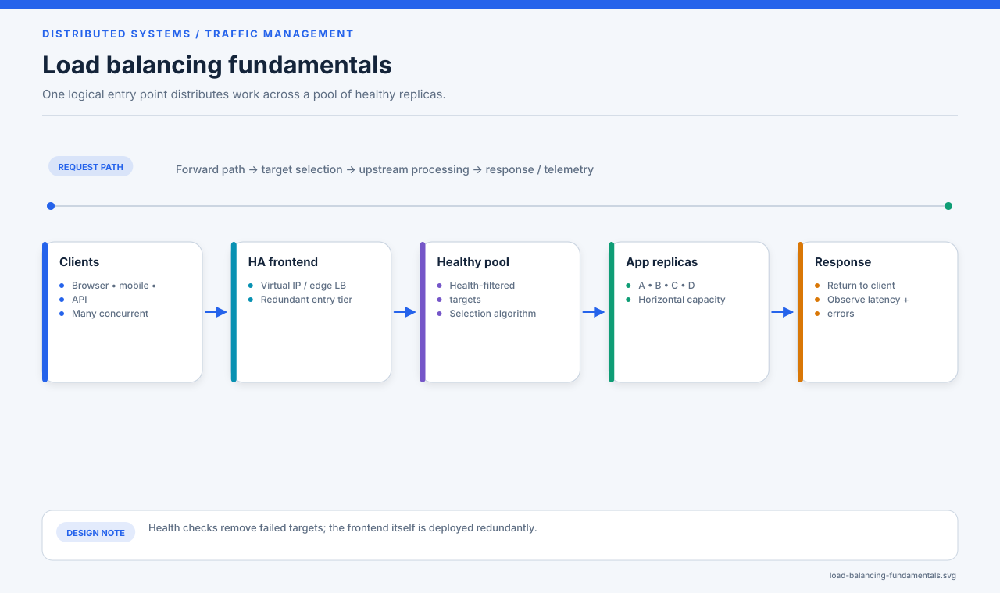 

## 1.3 Stateless and stateful services

A **stateless** request can be processed by any suitable replica because durable user state is carried in the request (for example, a signed token) or stored in a shared system. Statelessness makes horizontal distribution and failover easier.

A **stateful** service retains session or workflow state locally, owns a partition, or maintains a long-lived connection. The balancer may need affinity, consistent hashing, partition-aware routing, or a shared state store. Affinity can improve locality but creates uneven load and complicates failover. It does not make local state durable: a failed host may still lose a session.

A shopping cart stored only in application-process memory is fragile. Better options include storing the cart in a shared durable database/cache keyed by user or cart ID, or using a stateless signed reference to externally stored state. A sticky cookie can keep requests on one instance temporarily, but a restart or scale-in event still needs a recovery strategy.

## 1.4 Load balancing is not admission control

These terms solve related but different problems:

| Concept | Primary question | Typical mechanism |
|---|---|---|
| Load balancing | Which eligible target should handle this work? | Round robin, least connections, hashing, locality |
| Traffic routing | Which service, region, version, or path should receive it? | DNS, host/path rules, weights, geography |
| Rate limiting | How quickly may a client or tenant send work? | Token bucket, fixed/sliding window |
| Traffic shaping | How should admitted traffic be paced? | Queue with controlled drain rate |
| Traffic policing | Should traffic exceeding a rule be dropped or marked? | Hard rate/burst enforcement |
| Admission control | Can the system safely accept this work now? | Capacity checks, concurrency caps, queue bounds |
| Congestion control | How does a sender adapt to network congestion? | TCP congestion-control algorithms |
| Load shedding | What work should be rejected to protect critical work? | Priority-aware rejection, overload responses |

A balancer can distribute 50,000 requests per second perfectly evenly and still overload every backend if the fleet can process only 20,000. Distribution is not capacity creation. Admission control, bounded queues, scaling, and graceful degradation must complement balancing.

## 1.5 Single-server versus pool architecture

A single-server deployment is operationally simple but has a hard throughput ceiling and a single host failure can remove the service. A backend pool offers aggregate capacity, maintenance flexibility, and replica-level fault isolation. It also introduces coordination work: service discovery, health detection, configuration rollout, connection management, observability, and consistent state handling.

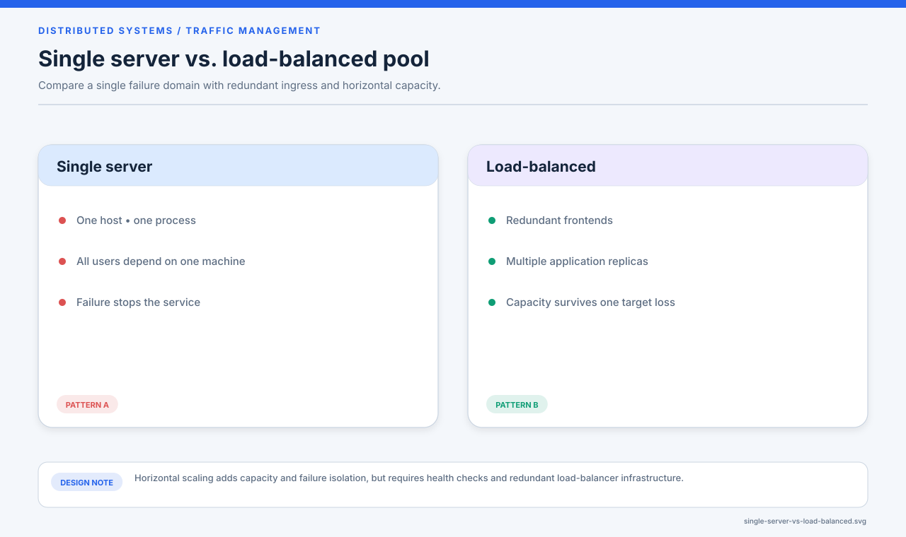 

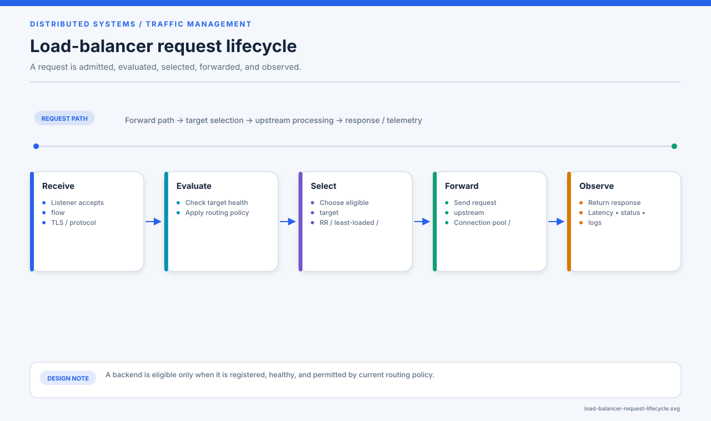 

## 1.6 Availability and fault tolerance

**Availability** describes whether a service is usable when requested. **Fault tolerance** is the ability to continue operating despite specified failures. **Failover** moves new work away from a failed component. **High availability** combines redundancy, failure detection, and recovery procedures to reduce disruption.

A load balancer improves availability only if its dependencies and backend design are also resilient. If all replicas share one database that is down, routing around a dead application host does not restore the user journey. Design around end-to-end dependencies and explicit failure budgets.

---

# 2. Load Balancing Architecture and Components

## 2.1 Main components

- **Frontend listener:** Binds an IP address/port and accepts a protocol such as TCP, UDP, HTTP, or HTTPS. It may own a certificate and TLS policy.
- **Backend pool / target group:** Logical set of destinations with shared protocol, health, and routing configuration.
- **Target:** A VM, container, pod IP, instance port, or service endpoint.
- **Routing table / rules:** Maps listeners, hosts, paths, headers, or other keys to target groups.
- **Health subsystem:** Determines whether targets should receive new work.
- **Connection manager:** Tracks frontend/backend connections, keep-alive sessions, timeouts, and pools.
- **Session-affinity mechanism:** Optionally maps a client/session key to a target.
- **TLS subsystem:** Terminates, passes through, or re-encrypts encrypted traffic.
- **Configuration/control plane:** Publishes listeners, target membership, policies, certificates, and health settings.
- **Observability subsystem:** Exposes request counts, connection counts, latency, errors, target health, and resource use.

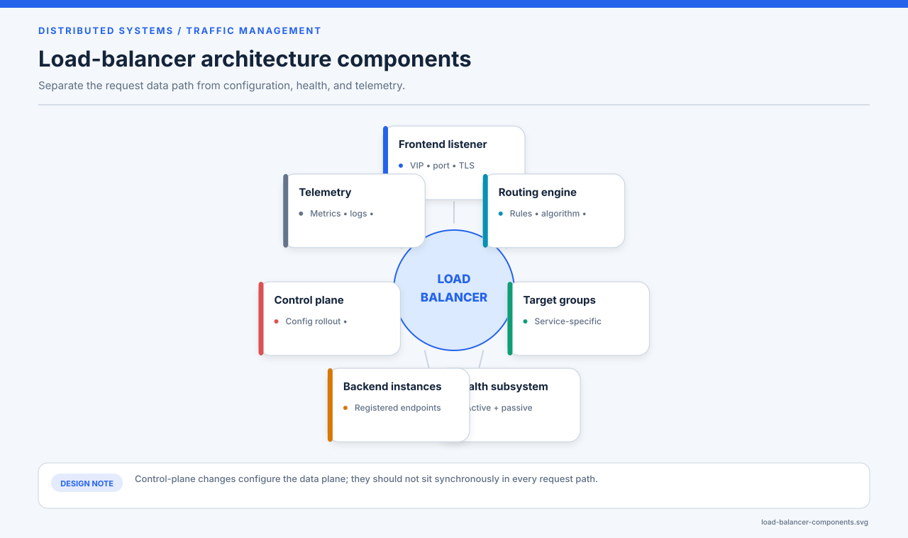 

## 2.2 Active and passive health checks

**Active checks** are probes initiated by the balancer or an external health system. They can be TCP connect checks, TLS checks, HTTP requests, or application-specific checks. They detect failure even when no user traffic arrives, but the probe can be shallower than the real request path and can create probe load.

**Passive checks** infer health from live traffic: connection failures, resets, timeouts, consecutive 5xx responses, or latency thresholds. They reflect real workload behavior but cannot detect an idle failure until a request is attempted. They can also confuse a bad request, an overloaded dependency, or a client timeout with a dead backend.

A robust setup uses a meaningful readiness endpoint, bounded active probing, and passive signals where supported. Avoid making every health probe perform an expensive full business transaction.

## 2.3 Liveness, readiness, and application health

- **Liveness:** Is the process alive, and should an orchestrator restart it if not?
- **Readiness:** Can this instance safely receive new requests now?
- **Startup:** Has initialization completed sufficiently to begin liveness/readiness evaluation?
- **Deep dependency health:** Are critical dependencies available? This should be interpreted carefully; making an entire fleet unready because one optional dependency is degraded may worsen an outage.

A process may be alive but still loading a model, warming a cache, running database migrations, or waiting for a required connection pool. Sending traffic too early produces avoidable errors. Conversely, a readiness check that synchronously depends on every downstream service can cause all replicas to be removed during a shared dependency outage, eliminating useful degraded functionality.

## 2.4 Protocols and thresholds

A TCP check proves that a TCP handshake completed, not that the HTTP handler can serve the checkout API. An HTTP check can validate a path and expected status code. An application check can validate a narrowly selected invariant. Set a probe interval, timeout, healthy threshold, and unhealthy threshold based on failure-detection goals and probe cost.

For example, with a 5-second interval and an unhealthy threshold of 3, a target may require roughly 10–15 seconds of consecutive failed observations to be removed, depending on scheduling and timeout. Faster detection reduces exposure but increases sensitivity to transient loss. Health checks are distributed in some managed products; do not assume exactly one probe per interval. AWS documents target health-check settings and notes that distributed checks can result in multiple probes [AWS target health checks](https://docs.aws.amazon.com/elasticloadbalancing/latest/gateway/health-checks.html).

## 2.5 Backend lifecycle and connection draining

When a target is deregistered for a rolling deployment, the balancer should stop assigning it new requests while allowing eligible in-flight requests to complete. This is **connection draining** (also called deregistration delay or graceful draining). The application should first stop accepting new work, finish or safely cancel active work, close keep-alive connections as appropriate, and then terminate.

Example rolling deployment:

1. Add new instance B to the pool.
2. Wait for B to pass startup and readiness checks.
3. Shift a small amount of traffic to B and inspect latency/error metrics.
4. Mark old instance A as draining; do not assign new requests to A.
5. Allow existing HTTP requests, streaming responses, and WebSockets to finish within a documented grace period. Long-lived connections may require application-level reconnect handling.
6. At the deadline, terminate remaining connections deliberately and record affected work.
7. Remove A and repeat for the next instance.

Draining time should be compatible with request deadlines and connection lifetimes. Infinite draining lets stuck connections block deployments; too-short draining interrupts work. A safe rollout also requires backward-compatible database/schema changes (expand, migrate, contract).

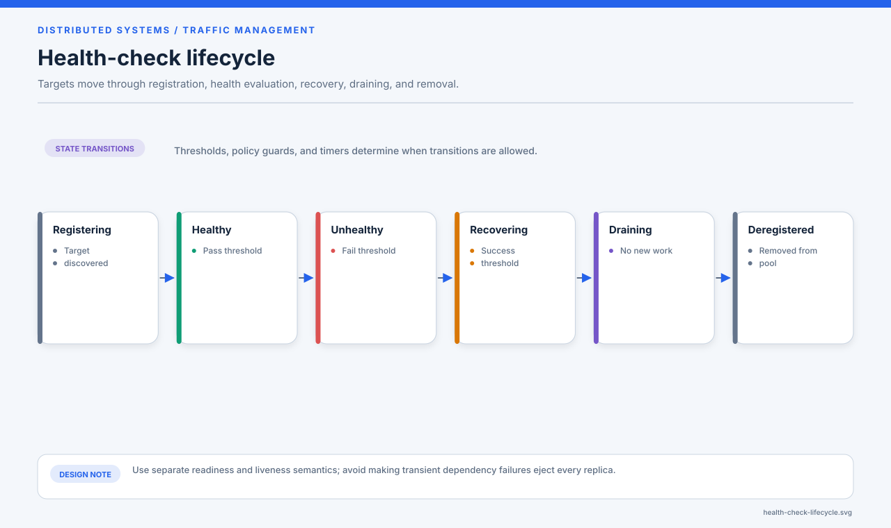 

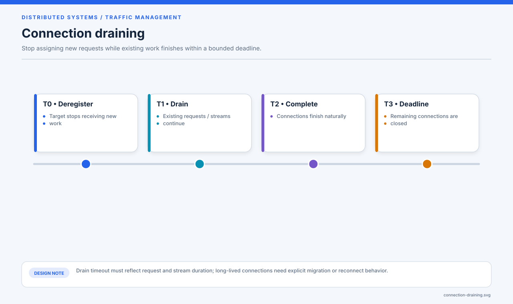 

## 2.6 Backend state transitions

| Event | New traffic | Existing traffic | Operator concern |
|---|---|---|---|
| New target joins | Only after registration/readiness policy | None initially | Warm-up and safe ramp-up |
| One target unhealthy | Move to remaining healthy targets | Often allowed to fail/timeout or drain according to product | Check spare capacity |
| Several targets unhealthy | Remaining pool may be overloaded; fail closed/open depends on policy | May continue to fail | Avoid sending traffic to known-bad targets; provide explicit fallback |
| Slow but healthy target | May still receive traffic under basic health checks | Latency grows | Use latency/circuit-breaker signals without flapping |
| Deployment begins | Stop new assignment to old target | Finish in-flight work | Grace period, idempotency, reconnects |
| Target recovers | Re-admit after success threshold | New connections resume | Ramp traffic to avoid cold-cache shock |

A target is not simply “up” or “down.” Production systems often need states such as warming, healthy, degraded, draining, and unhealthy. Health should be a routing input, not a substitute for service-level monitoring.

---

# 3. Layer 4 vs Layer 7 Load Balancing

## 3.1 Networking fundamentals

The OSI model is a conceptual framework. In common internet stacks, the IP network layer routes packets, TCP/UDP provide transport, and HTTP operates at the application layer. The model is useful for reasoning even though real implementations do not always map perfectly to seven separate boxes.

- **IP address:** Identifies a network interface/address used for packet delivery.
- **Port:** Identifies a transport endpoint on a host (for example, TCP 443).
- **TCP:** Connection-oriented byte stream with sequence numbers, acknowledgements, retransmission, and congestion control.
- **UDP:** Datagram transport without TCP's connection and reliability semantics; applications may add their own reliability.
- **TCP handshake:** SYN, SYN-ACK, ACK establish transport state.
- **TLS handshake:** Negotiates cryptographic parameters and authenticates endpoints before protected application data is exchanged. TLS may be terminated at a proxy or passed through.
- **HTTP request/response:** Application messages such as method, authority/host, path, headers, body, status, and response body.
- **Packet versus request:** One HTTP request may span many TCP segments; a persistent TCP connection may carry many HTTP requests. HTTP/2 multiplexes streams on a connection, and HTTP/3 maps HTTP semantics onto QUIC over UDP.

The client does not necessarily open a direct connection to an application server. A full proxy can accept the client connection and establish a separate upstream connection. A transparent/direct-server-return design handles packet delivery differently. Therefore, “one client connection equals one backend request” is not a safe general assumption.

## 3.2 Layer 4 load balancing

An L4 balancer makes decisions primarily using transport/network metadata such as source/destination IP, source/destination port, protocol, and connection state. It can distribute TCP or UDP flows without parsing HTTP paths or application payloads. Depending on design, it may be a full proxy, a NAT device, or a direct-server-return dispatcher.

**NAT-based forwarding:** The balancer rewrites destination (and sometimes source) addresses/ports so packets reach the selected backend. Connection tracking ensures response packets can be mapped back to the client-facing flow. Symmetric routing matters: an unexpected return path can bypass state required to reverse the translation.

**Direct Server Return (DSR):** The balancer selects a real server for inbound traffic, while the server replies directly to the client using a configured virtual address. This can reduce outbound bandwidth through the balancer, but requires careful network and host configuration and can complicate observability and security controls.

**TLS passthrough:** The balancer forwards encrypted TCP traffic without decrypting TLS. It can route by IP/port and, in some implementations, limited handshake metadata such as SNI, but cannot inspect encrypted HTTP paths, cookies, or bodies. The application endpoint performs TLS termination.

Strengths include low parsing overhead, protocol independence, and suitability for long-lived TCP or UDP flows. Limitations include less application-aware routing, less convenient request-level policy, and connection-level distribution that may not reflect the number or cost of requests on multiplexed connections.

## 3.3 Layer 7 load balancing

An L7 balancer understands an application protocol such as HTTP. It often terminates client TLS, parses the request, applies routing and policy, and proxies to an upstream. It can route using host, path, method, headers, cookies, query parameters, or authenticated identity.

Examples:

- `GET /api/users/42` → user service.
- `POST /api/payments` → payment service, with stricter timeout and authorization policy.
- `/images/*` → image service or cache origin.
- `admin.example.com` → administrative frontend, possibly behind stronger identity controls.
- Requests with header `X-Experiment: v2` → controlled experiment version.

L7 capabilities include TLS termination/re-encryption, request/response header manipulation, redirects, authentication integration, request-size limits, caching, compression, WebSocket upgrades, request buffering, and per-route metrics. Parsing and proxying introduce CPU and memory costs. TLS decryption and re-encryption add cryptographic work. HTTP/2 multiplexing means a proxy may manage many logical requests over fewer TCP connections.

## 3.4 L4 and L7 compared

| Dimension | L4 | L7 |
|---|---|---|
| Layer | Transport/network metadata | Application protocol |
| Typical inputs | IP, port, protocol, flow state | Host, path, method, headers, cookies, identity |
| Decision unit | Usually flow/connection/datagram | Request/stream, sometimes connection |
| Application awareness | Limited | High for supported protocols |
| TLS | Passthrough or TLS-aware options depending on product | Commonly terminate and optionally re-encrypt |
| Routing flexibility | Coarse, fast, protocol-oriented | Fine-grained content and policy routing |
| Overhead | Usually lower parsing overhead | More parsing, buffering, policy, and TLS work |
| Protocol support | Broad transport protocols | Specific application protocols understood by proxy |
| Long-lived connections | Natural flow-level affinity | Supported, but request policies and draining require care |
| Common uses | TCP services, databases, UDP, high-throughput ingress | HTTP APIs, websites, routing by path/host, auth and rate policies |
| Operational complexity | Network and connection-state concerns | Routing rules, certificates, HTTP semantics, policy interactions |

### Using both layers

A layered design can use an L4 frontend to accept high-volume transport traffic and distribute it to redundant L7 proxies. The L7 tier then routes by host/path to service pools. This separates network-level exposure from application policy and can scale each tier independently. It also adds another hop and failure domain, so measure the latency and make both layers redundant.

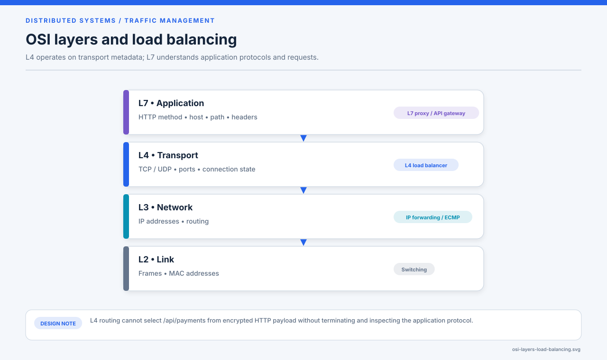 

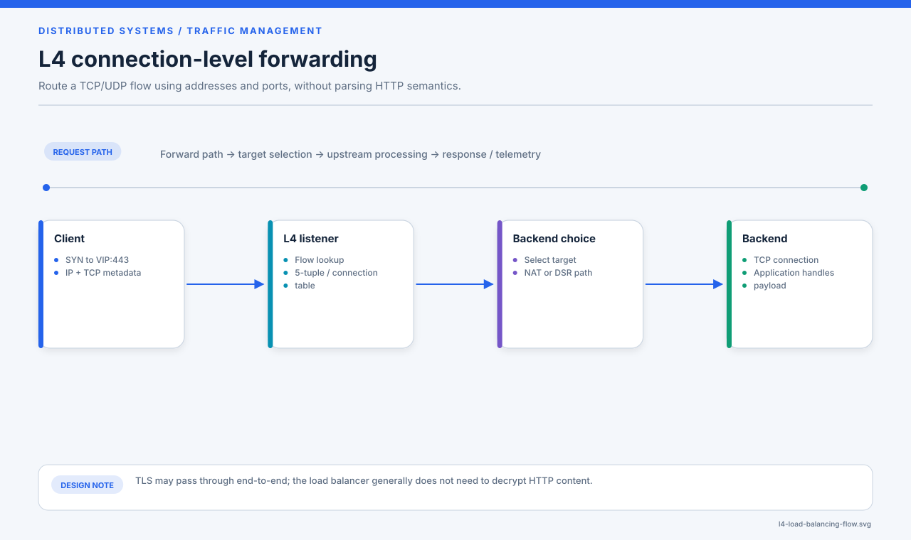 

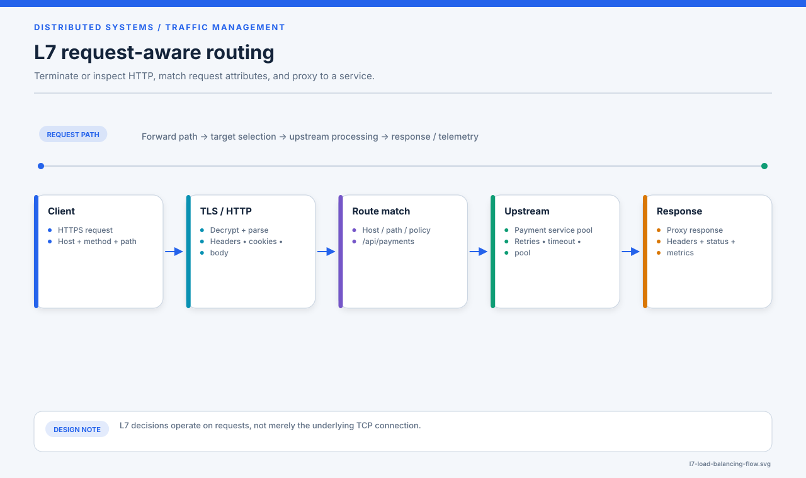 

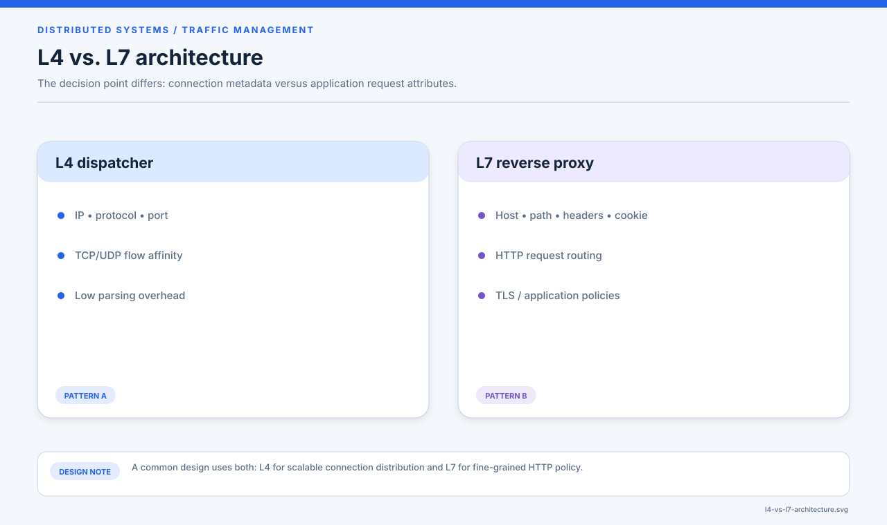 

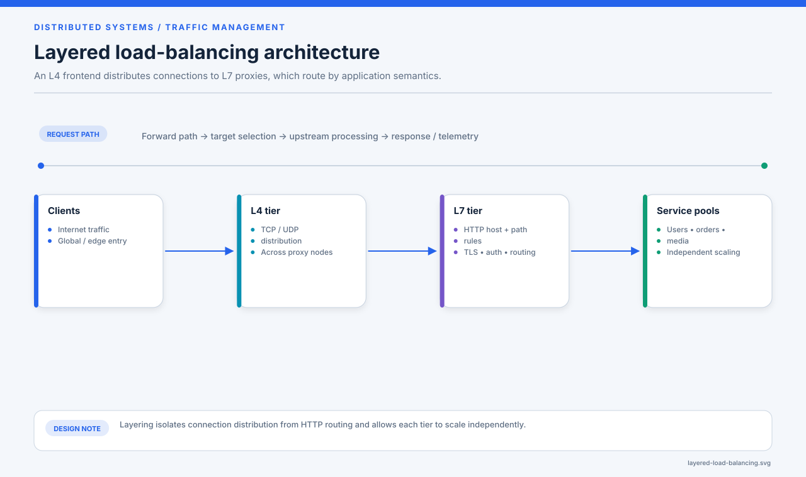 

---

# 4. Load-Balancing Algorithms

No selection algorithm can compensate for bad capacity information, pathological workloads, or insufficient fleet capacity. The algorithm determines *where* eligible work goes; it does not determine whether the system should accept the work.

## 4.1 Round robin

Round robin advances through an ordered backend list and sends the next eligible request/connection to the next target. With three equal servers A, B, C, twelve independent selections produce A/B/C repeated four times: A=4, B=4, C=4.

It is simple, deterministic, and has little state. It assumes targets have similar capacity and work items have similar cost. If A has twice the CPU and memory capacity of B, equal assignment underuses A and can overload B. If one request performs a large export while another reads a small record, equal request counts do not imply equal work. Some products implement round robin per connection rather than per HTTP request, which changes the behavior for keep-alive or multiplexed protocols.

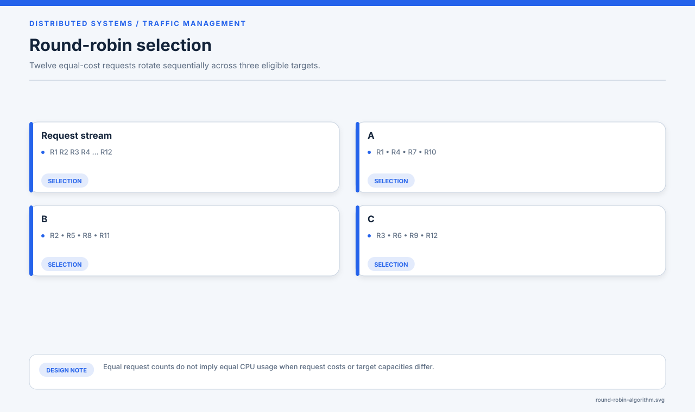 

## 4.2 Weighted round robin

Weighted round robin assigns a positive weight to each backend. A weight expresses relative desired share, not necessarily a direct CPU measurement. With weights 5:3:2, the approximate shares are 50%, 30%, and 20%. For 100 evenly distributed selections, A receives about 50, B 30, and C 20. For 20 selections, an illustrative schedule may allocate 10, 6, and 4.

Weights can reflect measured sustainable throughput, instance size, licensing limits, or a controlled canary percentage. Re-measure after configuration or workload changes. Static weights do not automatically adapt to temporary queue depth or degraded performance.

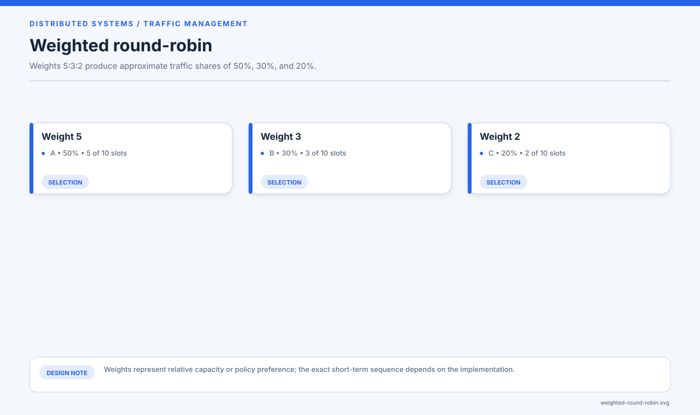 

## 4.3 Least connections

Least connections selects the eligible target with the fewest active connections. It can outperform round robin when connection duration varies: a backend with many long-lived sessions is less likely to receive additional connections. Example: A has 40 active connections, B has 18, and C has 25; the next new connection goes to B.

It is an approximation of load, not a measurement of CPU work. A server with ten expensive database queries may be more loaded than one with fifty idle keep-alive connections. Counts can be stale or local to one load-balancer node; multiple balancers making independent choices may observe different views. With HTTP/2, a small number of connections can carry many concurrent streams. Use request-aware concurrency or latency signals when the workload requires them.

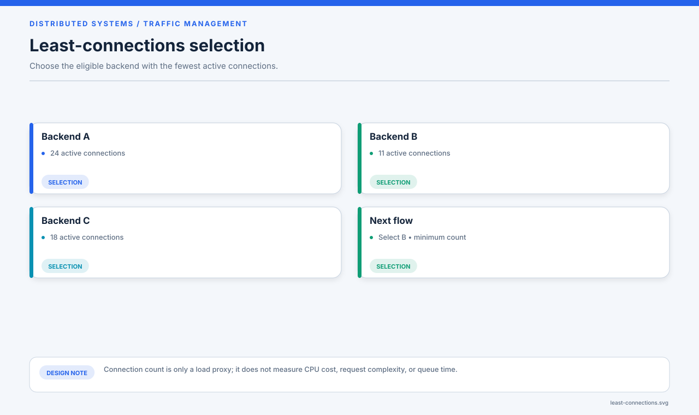 

## 4.4 Weighted least connections

Weighted least connections adjusts observed connection count by server weight. A common conceptual score is:

\[
S_i = \frac{C_i}{w_i}
\]

where \(C_i\) is active connections and \(w_i\) is relative capacity; select the smallest score. If A has 40 connections and weight 4, B has 18 and weight 1, and C has 30 and weight 2, scores are 10, 18, and 15. A is selected even though it has the most raw connections because its configured capacity is larger. Actual products may use different formulas and tie-breaking.

## 4.5 Least response time

A latency-aware balancer estimates backend response time, sometimes combining active connections and observed latency, then favors a fast target. It can route away from a slow dependency or noisy neighbor. The estimate must be smoothed over a measurement window; a single slow sample should not cause an abrupt traffic shift.

Feedback can become unstable: traffic moves away from a slow server, the remaining servers become slow, then traffic moves again. Use bounded movement, smoothing, health thresholds, and capacity headroom. Track p95/p99 as well as averages; a backend with a low mean but frequent tail spikes can damage user experience.

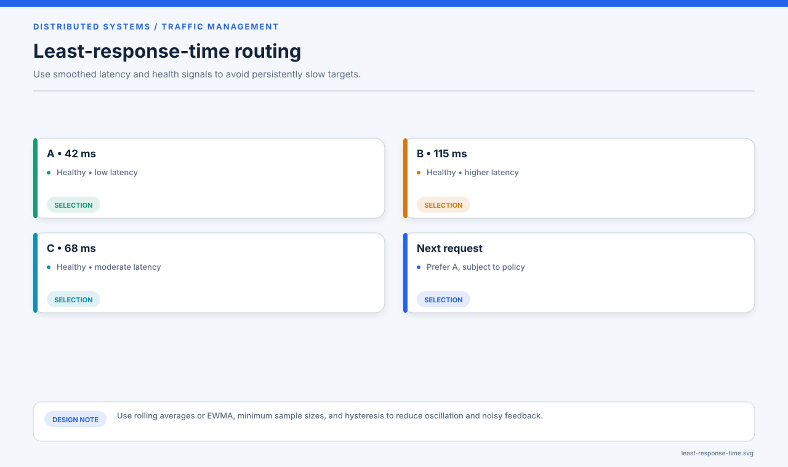 

## 4.6 IP hash

IP hash maps a client IP (or a normalized key derived from it) to a backend. This can make repeated requests from one apparent client land on the same instance. However, thousands of users behind a corporate NAT may share one public IP and overload one target. Mobile clients may change IPs. Reverse proxies can make every client appear to have the proxy address unless trusted client-IP propagation is configured.

## 4.7 Consistent hashing

A consistent hash ring maps both keys and backend nodes into a circular hash space. A key is assigned to the first node encountered clockwise. Adding or removing a node changes ownership for only a fraction of keys rather than remapping nearly all keys as a naive `hash(key) mod N` scheme can.

Virtual nodes give each physical backend multiple ring positions, improving balance when nodes have heterogeneous distribution. Consistent hashing supports cache locality, partition-aware routing, and stateful sharding. It does not guarantee uniform load: hot keys can create hotspots, and key popularity may be skewed. Use replication, hot-key splitting, adaptive load, and monitoring where needed. The hash function, node identity, membership changes, and routing configuration must be consistent across balancers.

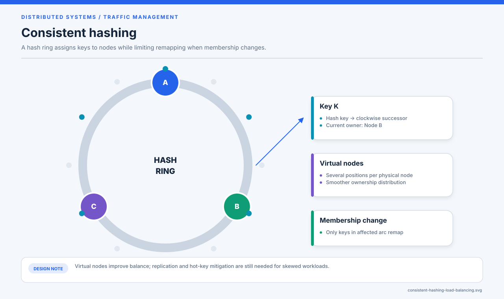 

## 4.8 Power of two choices

The power-of-two-choices method samples two eligible backends at random, compares a load signal (for example active requests or queue length), and chooses the less-loaded one. It avoids the cost of globally finding the least-loaded server while often distributing load much better than choosing one server uniformly at random. The theoretical benefit depends on assumptions about independent arrivals, comparable service rates, and a useful load signal; it is not a guarantee for every production workload.

Example: among 100 servers, a request samples servers 17 and 62. If their active-request counts are 14 and 5, it chooses 62. The next request samples 8 and 62; if counts are 2 and 6, it chooses 8. Only two load observations are needed per choice.

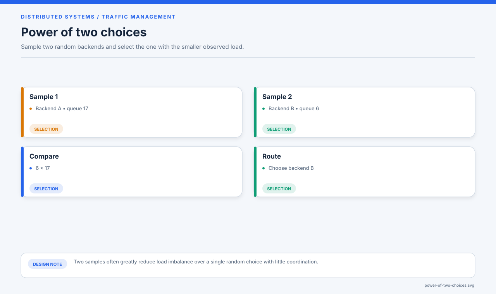 

## 4.9 Random selection

Random selection chooses a target uniformly at random. It is stateless and easy to distribute across multiple balancers. With a large request population, counts tend to even out statistically, but short windows can be uneven and small pools may see noticeable imbalance. Random selection can be combined with power-of-two choices.

## 4.10 Algorithm comparison

| Algorithm | State needed | Load-aware? | Heterogeneous capacity | Affinity | Typical fit / caution |
|---|---|---|---|---|---|
| Round robin | Rotation index | No | Poor without weights | No | Similar stateless replicas and similar work |
| Weighted round robin | Weights + rotation | Capacity by static weight | Better | No | Predictable capacity ratios; slow to react to transient load |
| Least connections | Active-flow counts | Coarse proxy | Moderate | Connection-level | Variable connection duration; misleading for multiplexed or unequal-cost work |
| Weighted least connections | Counts + weights | Coarse + static capacity | Better | Connection-level | Different-sized nodes; requires meaningful weights |
| Least response time | Latency samples | Yes | Potentially | No | Latency-sensitive pools; feedback instability risk |
| IP hash | Hash key | No | Not inherently | Yes | Client affinity where IP stability is meaningful |
| Consistent hashing | Hash ring/membership | No by itself | Via virtual nodes | Key affinity | Cache/shard locality; hot-key risk |
| Power of two choices | Sampled load observations | Yes, approximate | With normalized load scores | No | Large pools; scalable approximate balancing |
| Random | Random generator | No | No | No | Stateless simple pools; statistical imbalance |

A reasonable default for homogeneous stateless HTTP replicas is round robin or a product's adaptive equivalent. Variable-duration connections may favor least connections. Unequal instance sizes call for weights. Cache/shard ownership may require consistent hashing. Large pools may use power of two choices. The right decision follows workload measurements, request-cost distribution, connection semantics, and failure behavior.

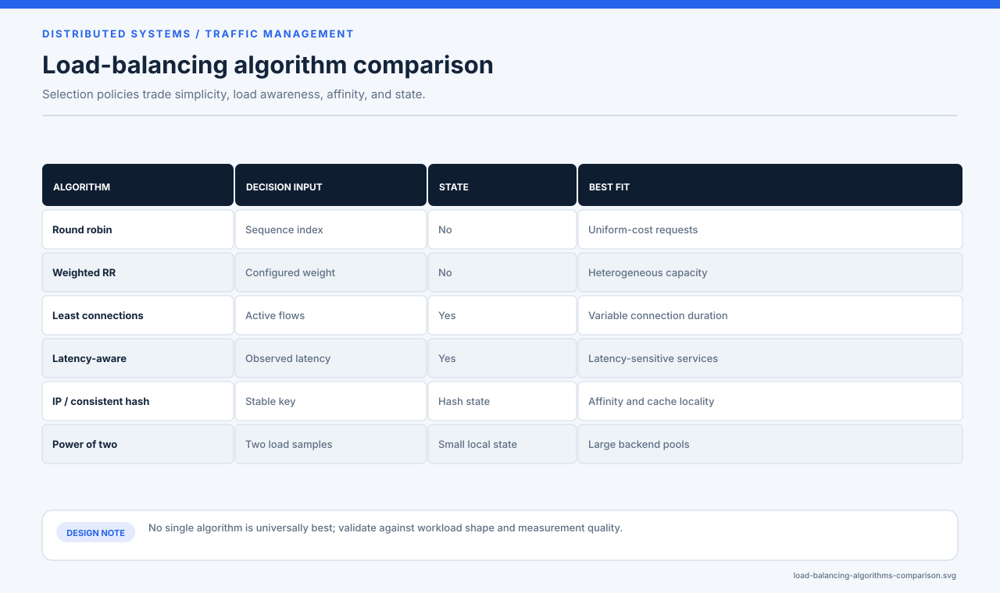 

---

# 5. Session Persistence and Sticky Sessions

## 5.1 Why affinity is used

Some applications store user state in process memory or rely on local caches. A **sticky session** attempts to route requests sharing a session identifier, cookie, or source address to the same backend. Cookie-based affinity is usually more precise than source-IP affinity because many users may share an IP and one user may change networks.

A shopping journey may include login, cart updates, address selection, and checkout. If the cart exists only in server A's memory, routing the next request to B may make the cart appear empty. Sticky routing can hide this architectural weakness, but it does not protect against A crashing or being replaced.

## 5.2 Three common approaches

| Design | Where state lives | Benefits | Failure/scaling trade-off |
|---|---|---|---|
| Sticky sessions | Local backend memory, affinity maps client to backend | Locality; minimal code changes for legacy apps | Backend failure loses state; uneven load; draining and scaling are harder |
| Shared session store | Redis or database keyed by session ID | Any replica can serve the request; easier failover | Store becomes a dependency; adds network latency and needs its own HA/capacity plan |
| Stateless token | Signed token carries identity/claims; mutable state remains external | No server-side session lookup for stable claims; easy horizontal routing | Revocation, token size, key rotation, and mutable workflow state still need design |

A robust modern design commonly stores carts, workflow state, and session revocation data in shared systems, while a short-lived signed token carries identity and authorization claims. Do not put secrets or large mutable state directly into a client-held token.

## 5.3 Trade-offs and failure cases

- **Uneven load:** A busy tenant or NAT address can pin many users to one target.
- **Backend failure:** Affinity cannot resurrect memory that existed only on a failed host.
- **Deployment:** Draining a node may require a temporary affinity remap or session migration.
- **Scaling:** New servers may receive less traffic while old affinity mappings persist.
- **Security:** Session identifiers must be unpredictable, protected from theft, and scoped appropriately.
- **Cache locality:** Affinity can improve warm-cache hit rate, but the benefit should be measured against the availability cost.

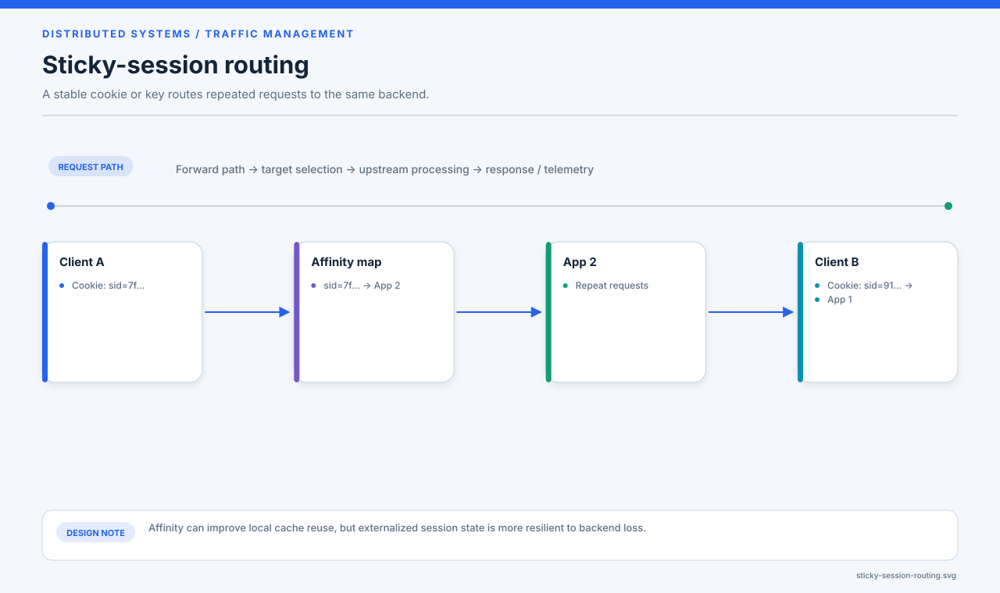 

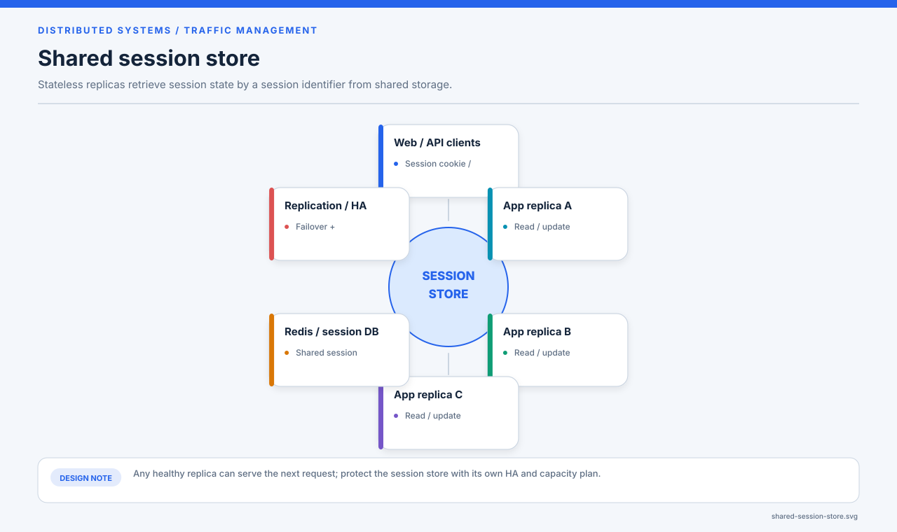 

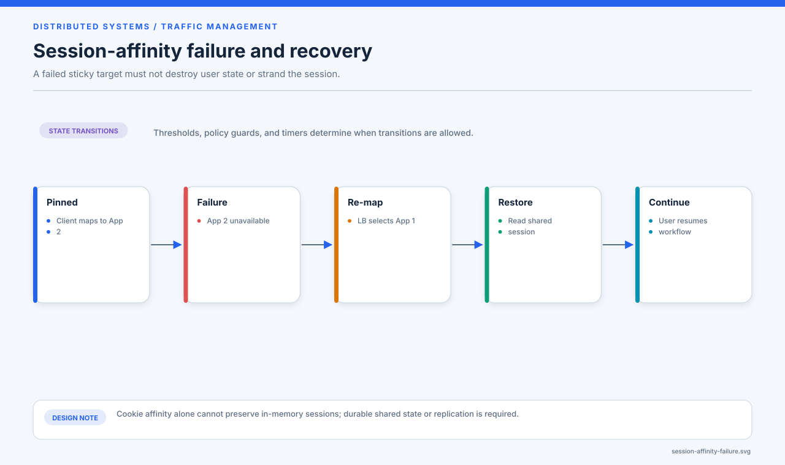 

---

# 6. Global Server Load Balancing (GSLB)

## 6.1 Regional versus global balancing

A **regional load balancer** distributes traffic among targets within one region or failure domain. A **global traffic manager / GSLB** selects a region or site for a client or request using health, latency, geography, capacity, weights, policy, or compliance constraints. A global decision does not itself replicate data. **Data replication** copies state between locations; **traffic failover** redirects requests. Both must be designed together.

Global architecture typically has a CDN/edge layer, a global entry mechanism, regional frontends, regional application pools, and replicated or partitioned data systems. Availability zones provide local resilience; regions address larger geographic or provider-level failures.

## 6.2 DNS-based global routing

A typical DNS lookup proceeds from a client stub resolver to a recursive resolver, which may use cache or query authoritative DNS. Authoritative DNS returns A/AAAA records, CNAMEs, or policy-selected answers. GeoDNS, weighted DNS, latency-based DNS, and health-aware DNS choose among regional endpoints.

Example: A user in Singapore asks for `shop.example.com`. The recursive resolver queries authoritative DNS. The traffic manager estimates a suitable region and returns a Singapore-region frontend. The client connects to that address. The resolver may cache the answer according to TTL; the client's actual network path and resolver location can differ from the end user's physical location.

DNS failover is not instantaneous. Recursive resolvers, operating systems, browsers, and applications can cache answers for different durations; some clients keep established connections open after TTL expiry. DNS health checks also have detection intervals. A low TTL reduces some cache delay but increases query load and still does not forcibly move existing connections. Failover time is the combination of detection, decision, cache expiry/refresh, client reconnection, and application recovery.

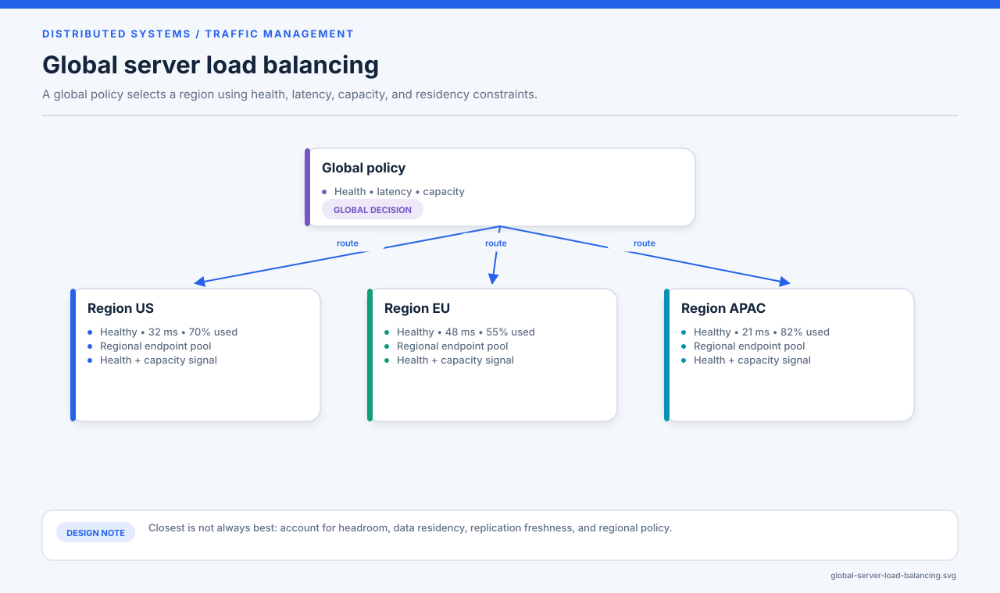 

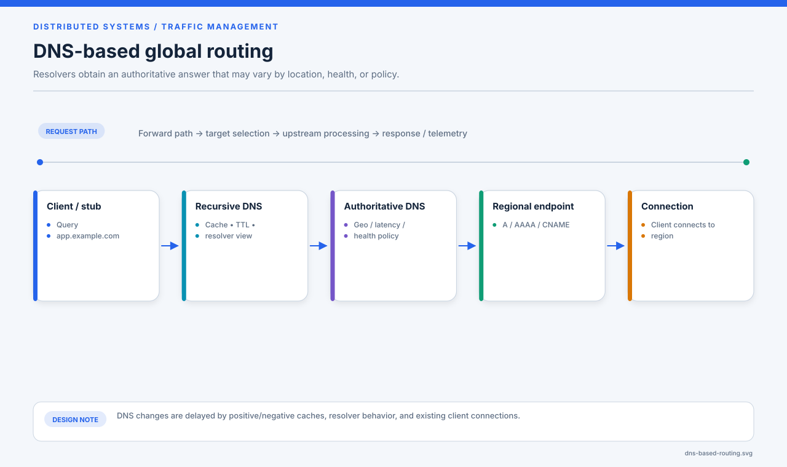 

## 6.3 Anycast routing

With **Anycast**, multiple network locations advertise the same IP prefix using BGP. Internet routing selects a path according to routing policy and topology, often reaching a nearby point of presence in network terms. “Nearest” means preferred network path, not necessarily shortest geographic distance or lowest application latency.

Anycast is common for globally distributed edge services, DNS, and DDoS absorption. If one location withdraws its route, traffic can converge toward other locations, subject to BGP propagation and network convergence. Existing TCP connections can break when traffic moves to a different site because connection state may not exist there. Stateless edge services or replicated connection state are better suited than arbitrary stateful services.

Anycast and DNS solve different parts of global entry. DNS returns names/addresses and can select policy-based endpoints; Anycast uses routing to select a network destination for a shared IP. They can be combined: DNS selects a service address, while Anycast takes the packet to an appropriate edge location.

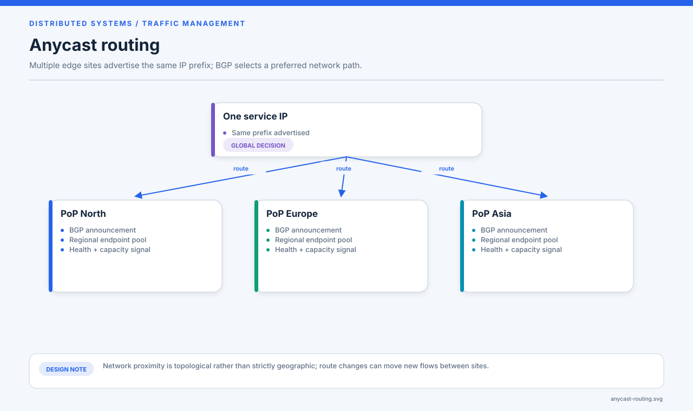 

## 6.4 Global traffic policies

- **Geographic:** Route based on the apparent client/resolver region, useful for locality or residency but imperfect behind VPNs and recursive resolvers.
- **Latency-based:** Choose the region with the best measured or estimated network latency; estimates may not reflect current congestion or service latency.
- **Weighted:** Allocate configured fractions, useful for capacity balancing and controlled migrations.
- **Failover:** Prefer a primary site and use a secondary when health policy declares the primary unavailable.
- **Proximity:** Prefer sites near a client, often with policy overrides.
- **Capacity-aware:** Include regional saturation and queue/capacity signals.
- **Health-aware:** Remove unhealthy regions, but avoid flapping on transient errors.

The closest region may be overloaded, have stale data, lack a required feature, or violate data-residency requirements. A slightly farther healthy region may provide lower end-to-end latency.

## 6.5 Active-active and active-passive regions

**Active-active** serves traffic from multiple regions concurrently. It improves utilization and may reduce latency, but needs data ownership/consistency design, conflict handling, session continuity, and protection from split-brain. It is easiest when requests are stateless or data is partitioned by tenant/account with clear ownership.

**Active-passive** sends most traffic to a primary region and keeps a secondary ready for failover. It can simplify writes and consistency but costs spare capacity and requires tested promotion, replication-lag checks, and a defined recovery point objective (RPO) and recovery time objective (RTO).

A banking design may use active-active read frontends while keeping account writes single-writer per account partition. A flash-sale e-commerce system may route catalog reads globally but send inventory reservation to an authoritative regional/partition owner to avoid overselling.

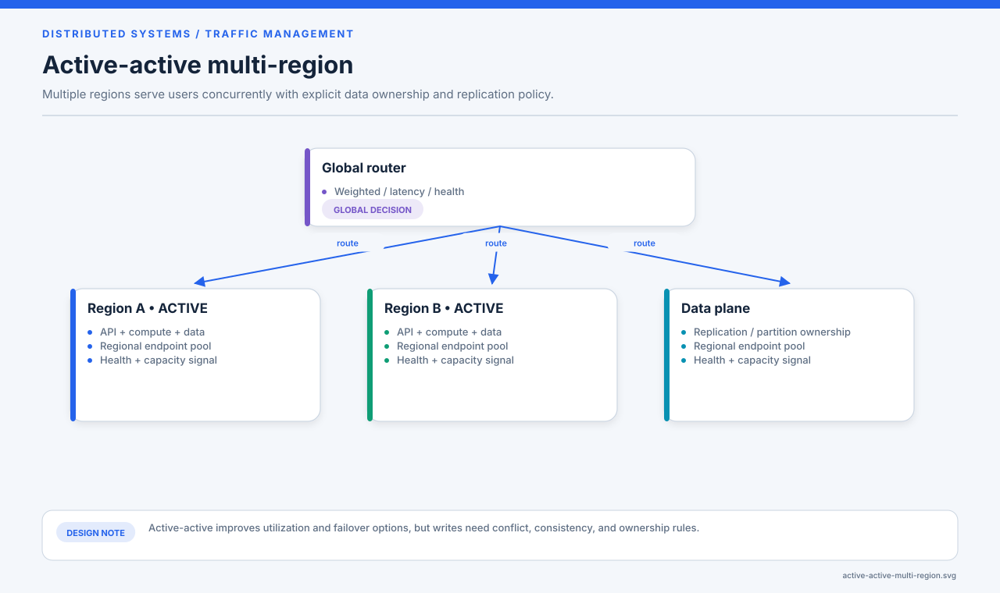 

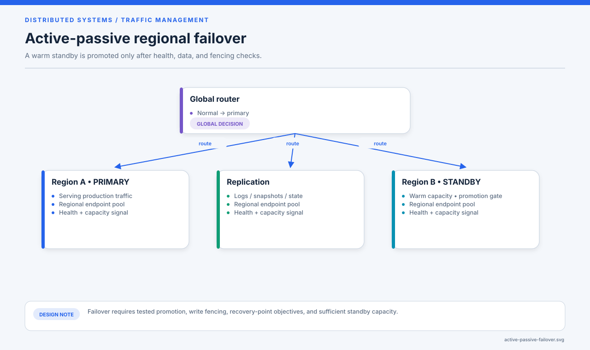 

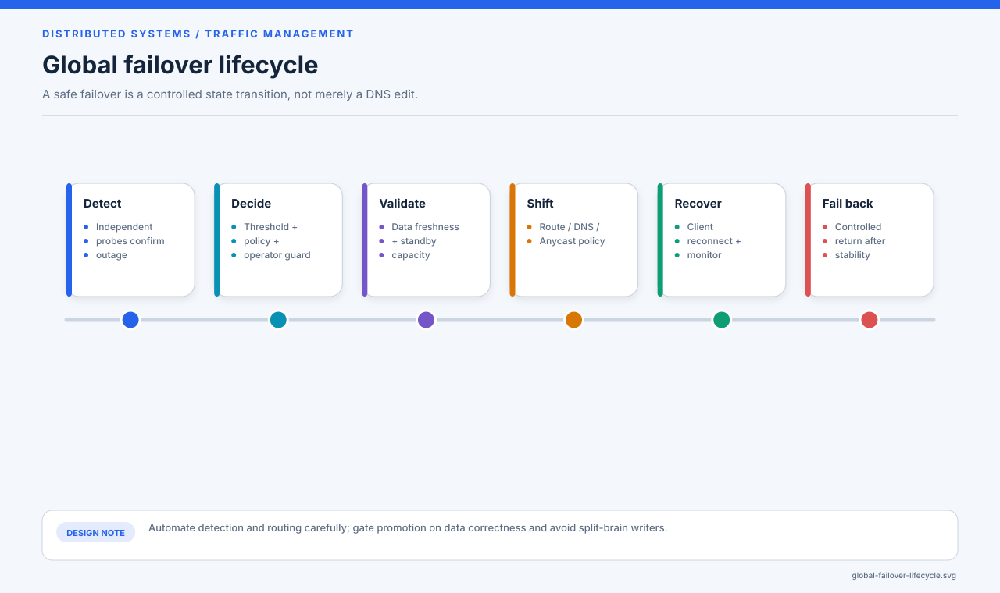 

---

# 7. Rate Limiting and Traffic Admission Control

## 7.1 Why load balancing is not enough

A load balancer spreads work; a rate limiter constrains how much work enters. Without limits, one abusive client, buggy retry loop, flash sale, or bot fleet can consume all available capacity. Admission control also needs concurrency limits and bounded queues because request rate alone does not capture how long work occupies resources.

A service can enforce limits by IP, authenticated user, API key, tenant, endpoint, region, or globally. Each identity choice has consequences: IP limits are easy but unfair behind NAT; user limits require authentication; tenant limits align with SaaS contracts; endpoint limits protect expensive operations; global limits protect the fleet.

## 7.2 Rate, concurrency, bandwidth, and quotas

- **Requests per second (RPS):** Number of requests admitted during a second or averaged interval.
- **Requests per minute:** A coarser quota; bursts can occur inside a minute unless a burst policy is defined.
- **Concurrent requests:** Number of in-flight operations. A small RPS of slow operations can exhaust workers.
- **Connections:** Open transport sessions; not necessarily the same as in-flight requests.
- **Bandwidth:** Bytes per second; protects network capacity, not CPU or database work.
- **Quota:** Total allowance over a larger period (for example, 1 million API calls/month).
- **Burst allowance:** Short-term excess above a sustained rate.

Rate limiting should be paired with concurrency controls, request deadlines, bounded queues, and cost-aware admission for expensive endpoints.

## 7.3 Token bucket

A token bucket has capacity \(C\), refill rate \(r\) tokens/second, and current token count \(T\). Tokens refill continuously or in discrete intervals up to capacity. Each request consumes one or more tokens; a request is admitted when enough tokens exist. The bucket permits bursts up to its stored tokens while enforcing a long-run average near the refill rate.

\[
T(t)=\min\left(C,\ T(t_0)+r(t-t_0)\right)
\]

Assume capacity 100, refill 10 tokens/s, initially full, and incoming demand 30 requests/s. During the first second, 30 requests arrive and consume 30 tokens; 10 refill during that second (implementation timing matters), leaving about 80 tokens if all events are processed over the interval. Sustained demand exceeds refill by 20/s, so the bucket empties after roughly five seconds from full under a continuous approximation. Once empty, only the refill rate (about 10/s) is admitted; the rest are rejected or delayed. A full bucket permits an immediate burst of up to 100 requests.

**Advantages:** simple, burst-friendly, intuitive per-identity quotas. **Trade-offs:** distributed token accounting requires atomic updates or carefully bounded local allocations; clock/refill calculations and network partitions must be considered.

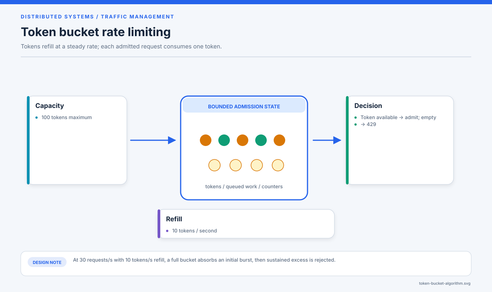 

## 7.4 Leaky bucket

A leaky bucket used for shaping places admitted requests in a bounded queue and drains them at a fixed rate. It smooths bursts into a steadier output. If arrivals exceed the queue capacity, new work is rejected (or another explicit overflow policy applies). Example: a queue holds 40 requests and drains 10/s. A burst of 30 arrives at once; all fit, and the queue drains over about three seconds if no new requests arrive. A burst of 55 exceeds capacity by 15, so 15 are dropped/rejected immediately.

A token bucket controls permission to send while allowing bursts; a shaping leaky bucket controls departure timing and smooths traffic. The phrase “leaky bucket” is used for more than one formal algorithm; document the exact implementation.

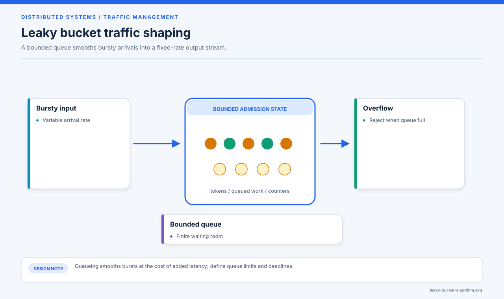 

## 7.5 Fixed-window counter

A fixed window counts requests in discrete intervals. For a policy of 100 requests/minute, the counter resets at the minute boundary. Boundary problem: a user sends 100 requests at 12:00:59.9 and another 100 at 12:01:00.1. The user can send 200 requests in approximately 0.2 seconds while satisfying both fixed windows.

Fixed windows are cheap and easy, but boundary bursts may violate the intended rolling rate. Randomized window alignment or a burst token bucket can reduce surprise, but sliding-window approaches are more accurate.

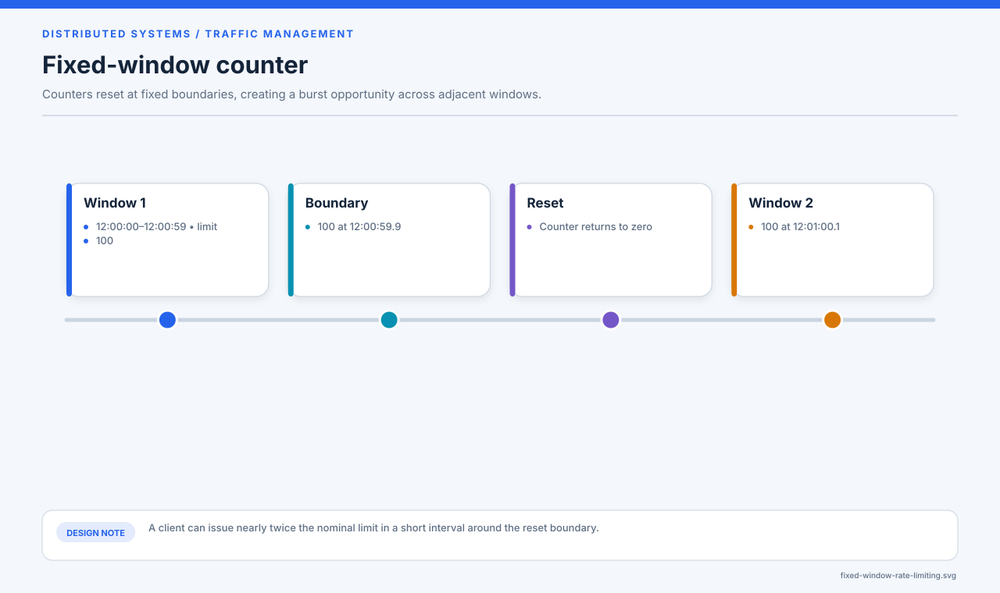 

## 7.6 Sliding-window log

Store the timestamp of each accepted request. For a rolling interval \(W\), discard timestamps older than `now - W`, count the remaining entries, and admit only if below the limit. For a 100-request/60-second policy, this tracks the exact number of accepted requests in the trailing 60 seconds (subject to clock and atomicity behavior).

It is accurate but can use memory proportional to request volume and requires synchronized mutation per identity. At high cardinality, retaining every timestamp can be expensive.

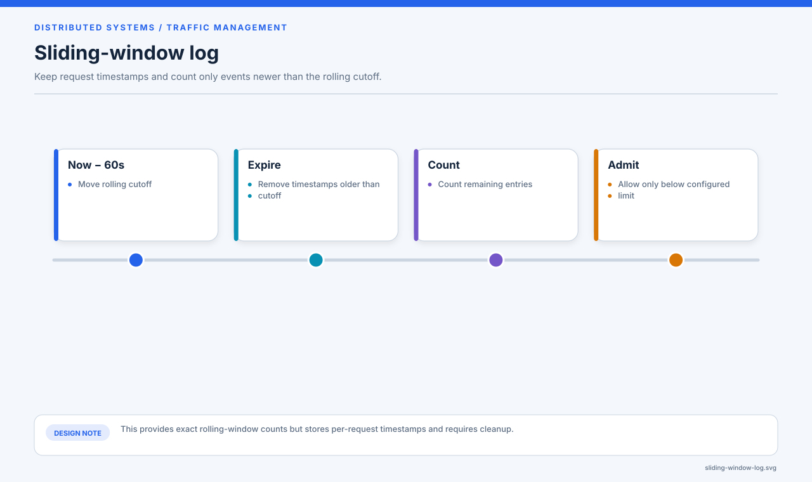 

## 7.7 Sliding-window counter

A weighted sliding-window counter approximates a rolling interval using the current and previous fixed-window counters. Let `current` be the count in the current window and `previous` the count in the prior window. If the current window is 25% complete, estimate the trailing window as:

\[
E = current + previous \times (1-0.25)
\]

If previous=80 and current=30, then \(E=30+80\times0.75=90\). Under a limit of 100, another request may be admitted. This method uses far less memory than a full timestamp log, but assumes requests were roughly uniform within the previous window; it is an approximation.

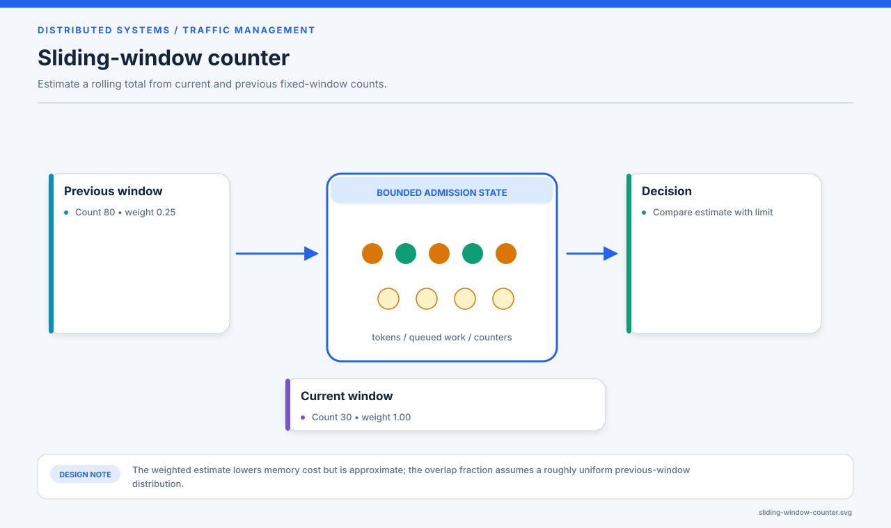 

## 7.8 Concurrency limiting

A concurrency limiter caps the number of active operations, often per route, worker pool, tenant, or dependency. A request acquires a permit before starting and releases it on completion or cancellation. A bounded waiting queue may hold additional work; once both slots and queue are full, reject early.

For example, a report-generation service has 20 workers and allows at most 20 simultaneous reports, with a queue of 10. The 31st request is rejected or receives a retryable overload response. A 5 RPS limit alone would not stop 20 reports that each run for 60 seconds from occupying all workers.

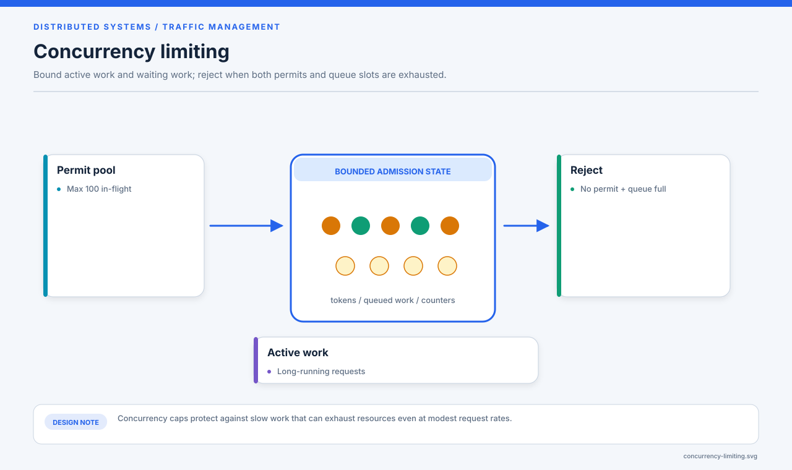 

## 7.9 Distributed rate limiting

Suppose ten API gateway instances each maintain a local limit of 100 requests/minute for the same user. If traffic is evenly distributed, the user may receive up to 1,000 requests/minute globally. Local limits are useful as coarse overload guards, but they do not enforce one shared quota.

A shared Redis counter or token bucket can enforce global limits. The read/check/update must be atomic; otherwise concurrent requests can all observe remaining capacity and over-admit. A Lua script or server-side transaction can conceptually perform refill, check, decrement, and TTL update as one operation. This introduces a network dependency and a new availability/latency trade-off.

Alternatives include sharding identities to a rate-limit owner, allocating token leases to gateways, or accepting bounded overshoot through approximate decentralized enforcement. Leases reduce per-request central coordination but complicate unused-token reclamation and quota correctness. Define what happens during Redis outage or network partition: fail closed (protect backend, reduce availability), fail open (preserve user availability, risk overload), or use a conservative local fallback.

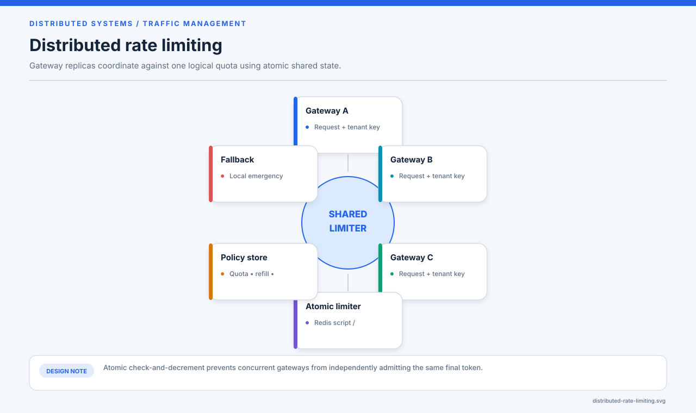 

## 7.10 Policies, status codes, and retry behavior

Typical dimensions include per-IP, per-user, per-API key, per-tenant, per-endpoint, global service, premium-tier, and burst limits. Use authenticated identity for tenant fairness, and avoid trusting arbitrary client-supplied identity headers.

When a client exceeds a request rate, HTTP `429 Too Many Requests` is the standard response. A `Retry-After` header may tell the client when to retry; RFC 6585 defines 429 and its optional Retry-After behavior, while RFC 9110 describes Retry-After semantics [RFC 6585](https://www.rfc-editor.org/rfc/rfc6585.html) · [RFC 9110](https://www.rfc-editor.org/rfc/rfc9110.html). Clients should apply exponential backoff with jitter, respect the server's delay, cap attempts, and avoid retrying non-idempotent operations unless an idempotency key makes replay safe. Synchronized retries can create a retry storm.

## 7.11 Algorithm comparison

| Mechanism | Burst handling | Accuracy | Memory/state | Best use | Main weakness |
|---|---|---|---|---|---|
| Token bucket | Allows configured burst | Good long-run rate/burst control | Small per identity | API quotas with burst tolerance | Distributed atomicity/overshoot |
| Leaky bucket shaper | Queues and smooths | Fixed drain rate | Queue per identity/class | Smooth downstream load | Queue latency and overflow |
| Fixed window | Boundary bursts possible | Coarse | One counter/window | Cheap coarse quotas | Boundary double-burst |
| Sliding log | Exact rolling interval | High | One timestamp per request | Strict low-volume quotas | Memory/write cost |
| Sliding counter | Approximate rolling interval | Moderate-high | Few counters | High-scale practical quotas | Assumes intra-window distribution |
| Concurrency limiter | Limits in-flight work, not RPS | Exact permit count | Active permits + bounded queue | Expensive/slow endpoints | Needs reliable cancellation/release |

---

# 8. API Gateways

## 8.1 Purpose and responsibilities

An **API gateway** is an API-oriented entry point that centralizes cross-cutting concerns for client-to-service traffic. It commonly performs request routing, TLS termination, authentication, authorization integration, rate limiting, quota checks, request validation, protocol mediation, response transformation, API version routing, caching, logging, and telemetry. It can also hide internal service topology from external clients.

A gateway is not automatically a business-logic layer. Keep domain decisions in domain services unless there is a clear cross-cutting reason to centralize them. A gateway that accumulates business rules becomes a tightly coupled distributed monolith and can be difficult to deploy independently.

## 8.2 Request lifecycle

1. The client connects to the public gateway endpoint.
2. The gateway negotiates TLS and validates the connection/certificate policy.
3. It parses the request and establishes a request ID/trace context.
4. It authenticates the caller (for example, validates a token or delegates to an identity provider) and derives trusted identity/tenant context.
5. It authorizes the requested operation or delegates resource authorization to the service where domain context is required.
6. It applies rate, quota, body-size, and concurrency controls.
7. It validates schema and may normalize or transform headers/body.
8. It selects a route and upstream pool based on host, path, version, tenant, or policy.
9. It forwards through a bounded connection pool with deadlines and retry rules.
10. It maps upstream responses/errors into the public API contract, records metrics/logs/traces, and returns the response.

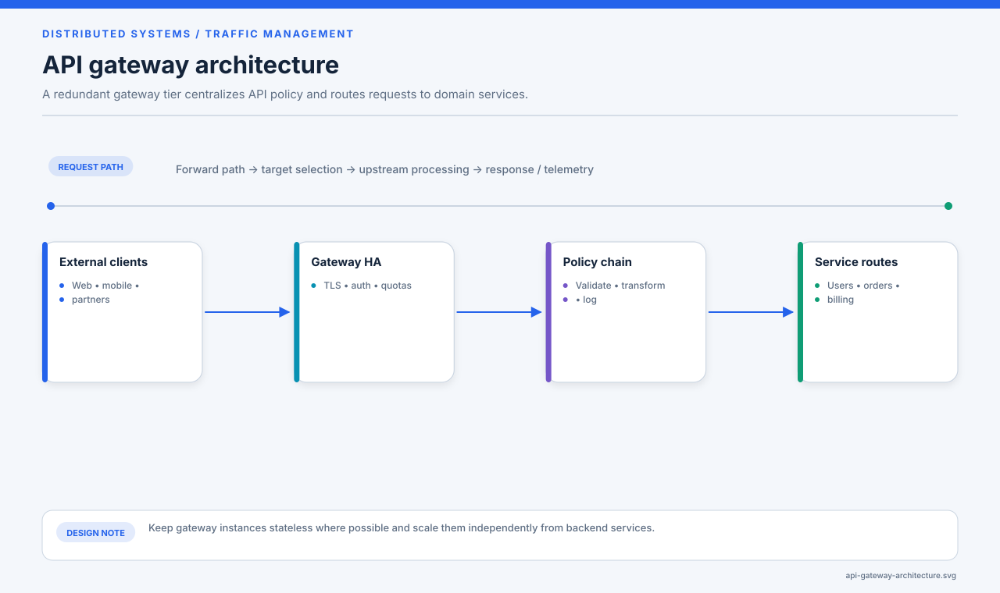 

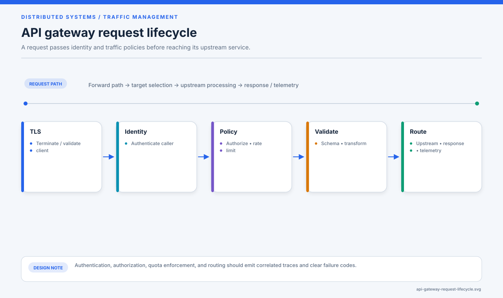 

## 8.3 Architecture patterns

- **Centralized gateway:** One logical entry point for multiple services. Easy to govern, but can become a bottleneck or change-control bottleneck.
- **Per-domain gateways:** Separate gateways for domains such as payments, customer APIs, and partner APIs. Isolates scale and ownership but can duplicate policy.
- **Backend for Frontend (BFF):** A gateway tailored to a client type (mobile, web, partner) that composes or adapts backend responses. It improves client-specific experience but must avoid duplicating domain logic.
- **External gateway:** Handles north-south traffic from users/partners into the platform.
- **Internal gateway:** Provides controlled entry between internal trust zones or shared platforms. It is not a replacement for service-to-service authorization.
- **North-south traffic:** Enters/leaves a cluster or environment.
- **East-west traffic:** Moves between internal services.

 

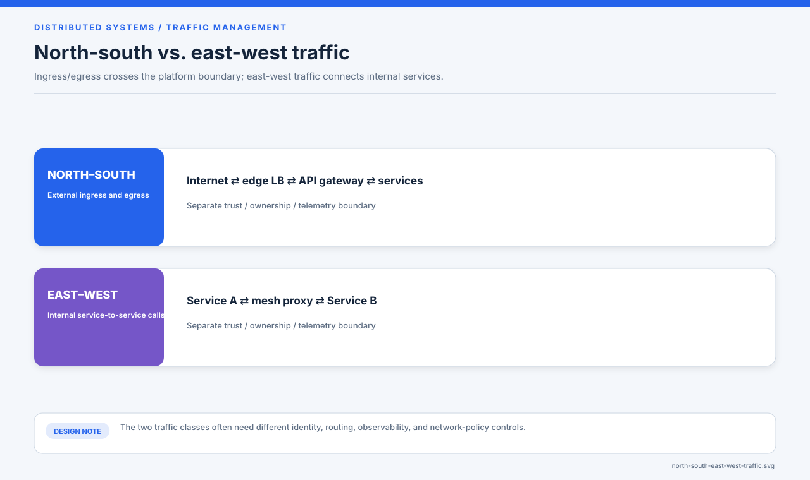 

## 8.4 Gateway versus adjacent components

A reverse proxy forwards traffic on behalf of a client and may not implement API product features. A load balancer distributes connections/requests among targets. An API gateway adds API-facing identity, quota, validation, transformation, version, and policy capabilities. An ingress gateway is an edge proxy in a service-mesh or cluster environment; it can implement API gateway functions, but the terms describe different architectural roles.

A system may combine roles in one product or layer them. The critical question is not product naming; it is which component owns a policy, where that policy is enforced, and how redundant and observable the enforcement point is.

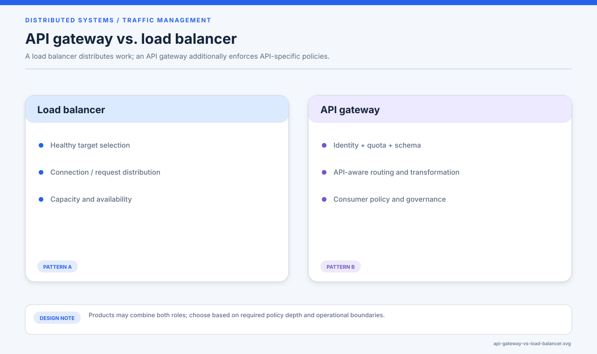 

## 8.5 Scaling and failure

A gateway can become a throughput bottleneck due to TLS handshakes, JWT verification, body buffering, request transformations, logging, or slow upstreams. Deploy stateless replicas across failure domains, keep configuration rollout safe, use bounded upstream pools, and monitor queueing and CPU. Authentication keys and policy data should be cached safely with rotation and expiry.

During overload, the gateway should reject early rather than accept unlimited work and consume memory while waiting for upstreams. Apply request deadlines, route-specific concurrency budgets, backpressure, load shedding, and circuit breakers. Keep health endpoints lightweight and independent enough to distinguish gateway liveness from upstream availability.

## 8.6 Technology roles

| Technology | Architectural role (high level) | Typical strengths | Caution |
|---|---|---|---|
| Amazon API Gateway | Managed API front door and API management | Managed scaling/integration, authentication and throttling options | Features, quotas, latency, and pricing vary by API type/region |
| Kong | API gateway built around a proxy/plugin architecture | Extensible policies, plugins, control-plane patterns | Plugin lifecycle and configuration complexity need governance |
| NGINX | Web server/reverse proxy with load-balancing capabilities; can be configured for API edge roles | Efficient proxying, routing, TLS, caching, ecosystem | Full API product-management capabilities depend on edition/modules/integration |
| Envoy Gateway | Gateway API-oriented control plane using Envoy data plane | Kubernetes-native configuration and Envoy policy ecosystem | Version/API maturity and supported features must be checked |
| Apigee | API management platform | API product, developer, analytics, policy capabilities | More than a simple proxy; platform governance and cost matter |
| HAProxy | High-performance proxy/load balancer with L4/L7 behavior | Connection management, ACLs, health checks, traffic distribution | API lifecycle/product capabilities may require other components |

---

# 9. Reverse Proxies

## 9.1 Forward proxy versus reverse proxy

A **forward proxy** represents clients as they access external servers. It can enforce outbound access policy, filtering, caching, and identity controls. A **reverse proxy** represents one or more origin servers to clients. Clients connect to the proxy; the proxy selects and contacts an upstream service.

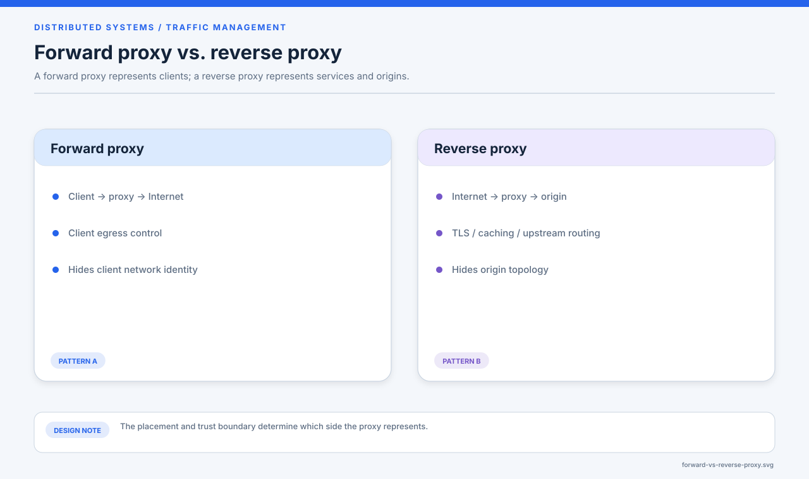 

## 9.2 Reverse proxy architecture and behavior

A reverse proxy commonly has a client-facing listener, TLS configuration, virtual hosts/routes, one or more upstream pools, connection pools, health checks, request/response filters, and observability. It may perform:

- **TLS termination:** Decrypt client traffic at the proxy; optionally establish a separate encrypted connection to the backend.
- **TLS passthrough:** Forward encrypted traffic without application decryption, sacrificing HTTP content inspection.
- **Compression:** Reduce response bytes at the cost of CPU; avoid compressing already compressed media.
- **Caching:** Serve cacheable responses without contacting the origin, with explicit freshness, authorization, and invalidation rules.
- **Request buffering:** Read a request before forwarding; helps decouple client speed from upstream but consumes memory/disk and delays streaming.
- **Response buffering:** Buffer upstream output before sending; may improve flow control but can harm streaming and large downloads.
- **Keep-alive and pooling:** Reuse upstream connections to reduce handshake overhead; configure pool sizes and idle timeouts to avoid exhausting backend sockets.
- **WebSocket proxying:** Preserve upgrade/tunnel semantics and configure idle/read timeouts for persistent connections.
- **Header rewriting:** Set host, request ID, trace context, and trusted forwarding headers.
- **Access control:** Restrict methods, paths, IP ranges, or authenticated identities.

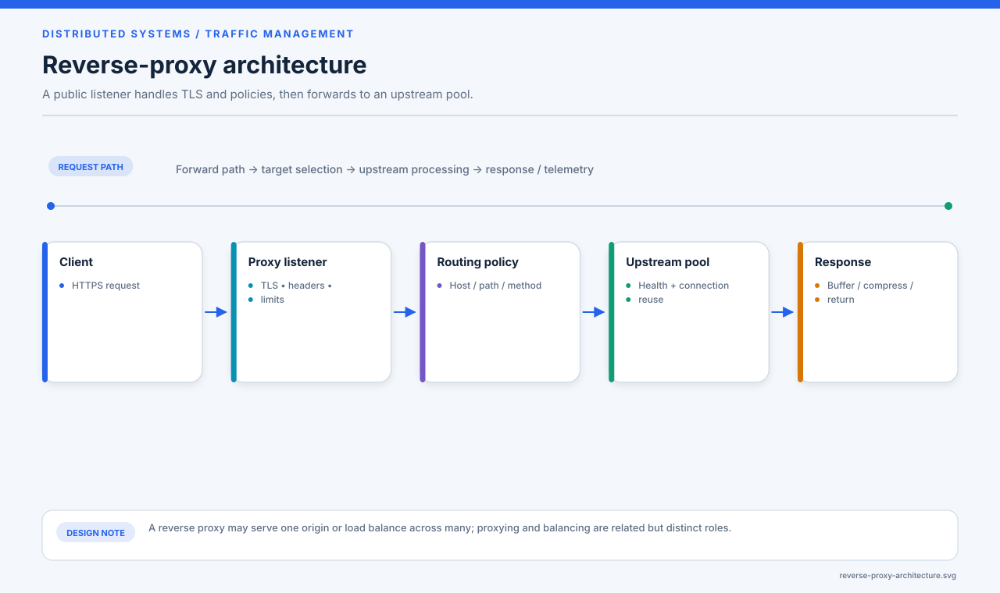 

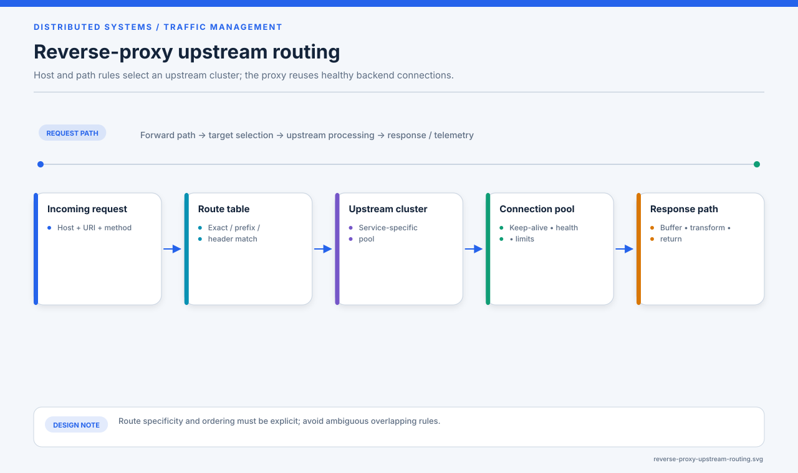 

## 9.3 Reverse proxy versus load balancer

A reverse proxy can target one backend and still provide TLS termination, caching, header rewriting, and access control. A load balancer's defining responsibility is distributing traffic among targets. Many products perform both roles, especially when a reverse proxy has a multi-server upstream pool. The role is determined by architecture, not by the product label.

## 9.4 TLS termination and passthrough

With termination, the proxy owns the server certificate and sees HTTP content. It may re-encrypt to the backend, which protects the internal hop but creates two TLS sessions. With passthrough, TLS terminates at the application, preserving end-to-end TLS but limiting the proxy to connection-level and handshake metadata. A service may choose termination at the edge and mTLS between internal workloads.

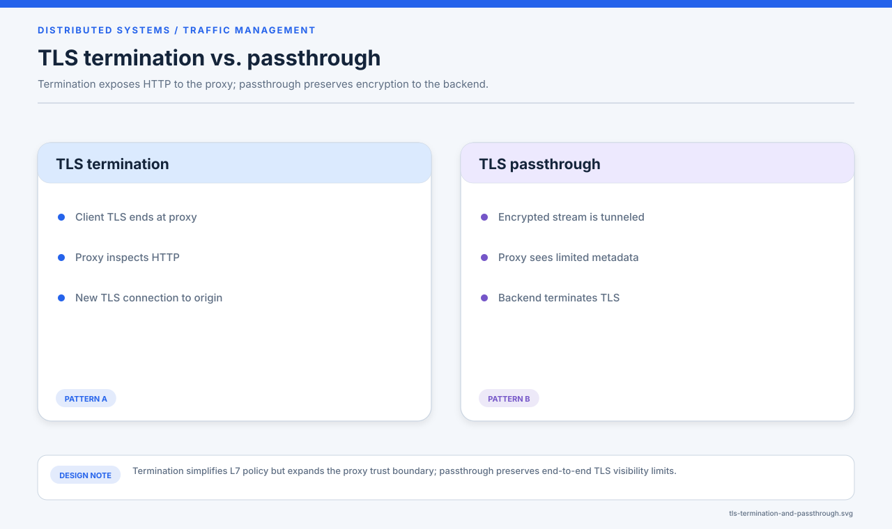 

## 9.5 Common technologies

- **NGINX:** Commonly used as a web server, reverse proxy, cache, and HTTP/TCP/UDP proxy. Its upstream and proxy modules support multiple routing patterns; feature availability depends on the edition and modules.
- **HAProxy:** A proxy/load balancer focused on high-performance connection handling and advanced L4/L7 traffic rules, health checking, and observability.
- **Envoy:** A modern proxy with listener/filter/cluster architecture, dynamic configuration, and strong integration with service mesh and cloud-native traffic management.
- **Apache HTTP Server:** A mature web server with reverse-proxy modules, rewrite rules, TLS modules, and a broad module ecosystem.

---

# 10. Service Mesh Architecture

## 10.1 Why service meshes emerged

A microservice platform may have hundreds of services making calls to one another. Each service needs timeouts, retries, circuit breakers, service discovery, identity, encryption, telemetry, and traffic policy. Implementing those capabilities independently in every language and service creates duplicated libraries, inconsistent defaults, and uneven operational maturity.

A **service mesh** moves many communication concerns into a dedicated infrastructure layer. It normally includes a data plane that handles service traffic and a control plane that distributes identity and traffic configuration. A mesh does not remove the need for application-level correctness: business idempotency, transaction boundaries, schema compatibility, and domain authorization remain application responsibilities.

## 10.2 Data plane and control plane

- **Data plane:** Proxies or node-level components that observe, route, encrypt, and collect telemetry for actual service traffic.
- **Control plane:** Discovers workloads, manages identities/certificates, validates policy, and distributes configuration to data-plane components.
- **Sidecar:** A proxy deployed alongside each application instance/pod and used for inbound/outbound traffic interception.
- **Service identity:** Cryptographic identity assigned to a workload, often used for mutual TLS and authorization policy.

A service-to-service call from A to B may flow as: application A → outbound proxy beside A → encrypted network hop → inbound proxy beside B → application B. The control plane configures endpoints, routes, certificates, and policies, but normally does not sit in the packet path for every request.

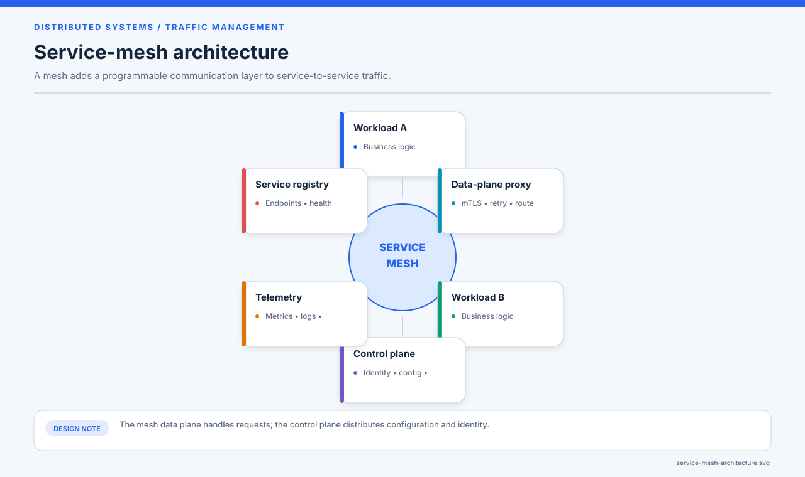 

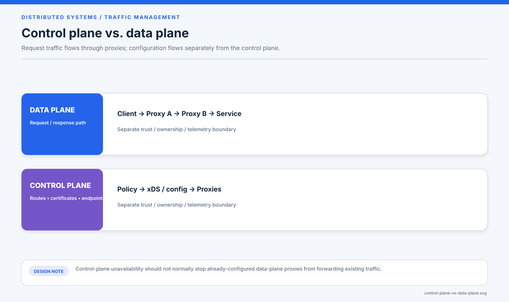 

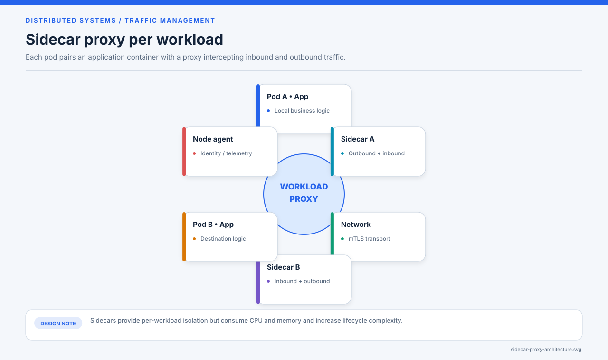 

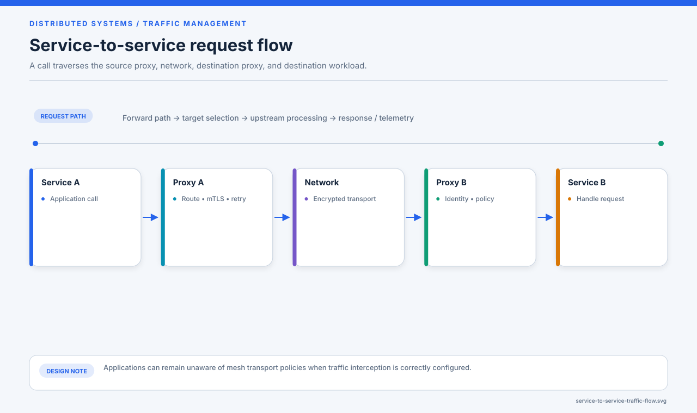 

## 10.3 Sidecar trade-offs

Sidecars provide per-workload policy enforcement and clear traffic interception, but add CPU, memory, file descriptors, startup coordination, upgrade management, and hops. At very large pod counts, proxy resource consumption can be material. Debugging becomes harder because application, proxy, network, and policy failures overlap. Sidecar injection must be consistent and safe during rollout.

## 10.4 Ambient and sidecarless approaches

In Istio ambient mode specifically, a per-node `ztunnel` provides the secure L4 overlay, while optional Envoy-based waypoint proxies provide L7 routing, authorization, telemetry, and other HTTP-aware features. This layered model can reduce per-pod proxy overhead, but changes policy attachment and failure domains: a node-level component affects multiple workloads, and L7 capabilities require traffic to traverse a waypoint. Do not assume every “sidecarless” mesh provides identical protocol awareness, security, or feature parity with sidecar proxies ([Istio ambient overview](https://istio.io/latest/docs/ambient/overview/), [ambient data plane](https://istio.io/latest/docs/ambient/architecture/data-plane/)).

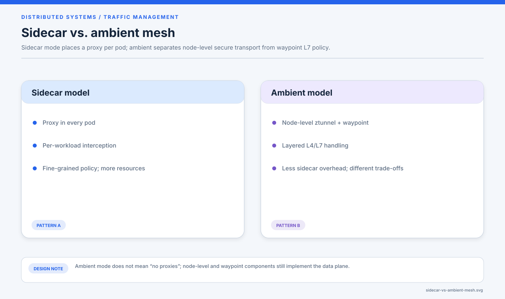 

## 10.5 Envoy architecture

Envoy is a proxy that can operate at L4 and L7. Its central concepts include:

- **Listener:** Accepts connections on an address/port.
- **Filter chain:** Selects a sequence of network filters for a connection.
- **Network filter:** Operates on connection-level data (for example, TCP proxy or TLS inspection).
- **HTTP connection manager / HTTP filters:** Parses HTTP and applies route, authentication, compression, or telemetry filters.
- **Route configuration:** Maps requests to virtual hosts and routes based on authority/path/headers.
- **Cluster:** Logical upstream group with load-balancing and connection-pool configuration.
- **Endpoint:** Concrete upstream address/port.
- **Health checking:** Determines upstream availability.
- **Circuit breaking:** Caps resources such as connections, pending requests, and retries.
- **Retries/timeouts:** Bound request duration and selected retry conditions.
- **xDS APIs:** Dynamic discovery/configuration APIs (for example, listener, route, cluster, endpoint, secret resources) through which a control plane can update Envoy without static file replacement.

A typical HTTP request enters a listener, matches a filter chain, is decoded by the HTTP connection manager, traverses HTTP filters, matches a virtual host/route, selects an upstream cluster and endpoint, and is sent using an upstream connection pool. The response travels back through filters and is encoded to the client. Filter ordering matters: an authentication filter must run before a filter that relies on trusted identity.

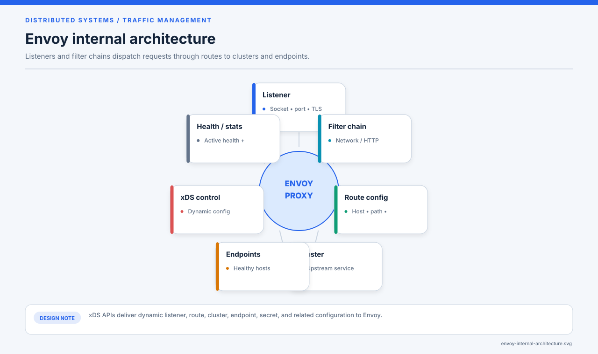 

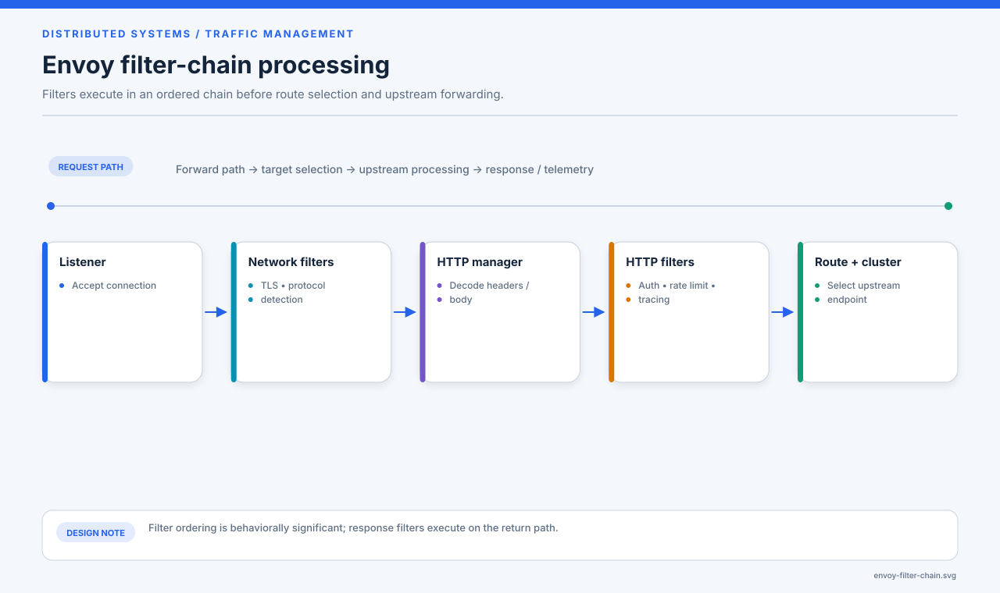 

## 10.6 Istio architecture

Istio provides service-mesh capabilities and commonly uses Envoy as a data-plane proxy. **Istiod** is the control-plane component that integrates service discovery, configuration, and certificate/identity management. In sidecar mode, proxies are injected into workloads; Istio configuration is translated into proxy configuration and distributed through xDS mechanisms.

Important policy/configuration objects include:

- **Gateway:** Configures traffic entering or leaving the mesh at an edge proxy; it is not itself a workload-level route policy.
- **VirtualService:** Defines routing rules, destinations, match conditions, retries, timeouts, and traffic splits.
- **DestinationRule:** Defines destination subsets and policies such as connection pools, load balancing, and outlier detection.
- **ServiceEntry:** Adds external or otherwise non-registry services to the mesh service registry.
- **PeerAuthentication:** Defines workload-to-workload mTLS behavior.
- **RequestAuthentication:** Validates request credentials such as JWTs; authentication and authorization are distinct.
- **AuthorizationPolicy:** Defines which authenticated principals or attributes may perform an action.
- **Telemetry:** Configures telemetry behavior for supported metrics/logs/traces.

For a 90/10 canary split, a VirtualService can distribute 90% of matched traffic to subset v1 and 10% to v2, while a DestinationRule defines which pod labels compose those subsets. The split is probabilistic over a request population, not a guarantee for every short time window. Sticky cohorts or consistent hashing may be needed for experiments that require stable user assignment.

Other common mesh policies include per-route timeout, limited retry on selected transient conditions, outlier detection, fault injection for controlled tests, and mTLS between workloads. Aggressive retries can multiply load; set retry budgets and deadlines. Istio's supported modes and feature behavior evolve; use the current [Istio documentation](https://istio.io/latest/docs/) for the deployed release.

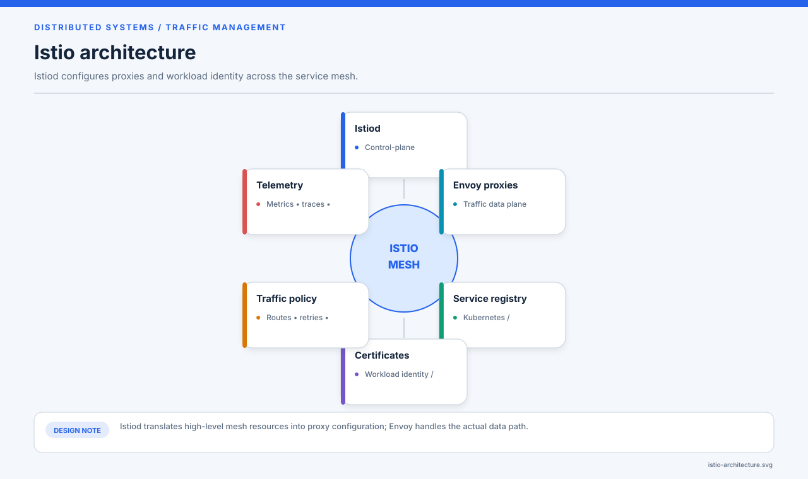 

 

 

## 10.7 Service mesh versus libraries and gateways

| Approach | Main location of policy | Strength | Cost / limitation |
|---|---|---|---|
| Application libraries | Each service process | Low extra hop; application-aware logic | Language/runtime duplication and inconsistent behavior |
| API gateway | Client/edge entry | Central public API controls | Does not automatically manage all east-west calls |
| Sidecar mesh | Per-workload proxy | Consistent L4/L7 policies and identity | Per-pod resources and operational complexity |
| Ambient/sidecarless mesh | Node/shared proxy plus optional waypoint | Less per-pod overhead | Different policy isolation and L7 attachment model |

A mesh is useful when service count, security requirements, traffic policy, or observability needs justify its operational cost. A small system with a few services may be better served by application libraries, an API gateway, and strong platform defaults. Adding a mesh just because it is fashionable increases failure modes.

---

# 11. Traffic Management Patterns

## 11.1 Canary releases

A canary sends a small fraction of production traffic to a new version while most users remain on the stable version. Start with a low percentage, verify correctness and service-level indicators, then increase exposure in stages. Define rollback criteria before rollout: error rate, p95/p99 latency, saturation, business conversion, and correctness signals. Rollback must be fast and should not require a database rollback if the schema migration is backward compatible.

 

## 11.2 Blue-green deployment

Maintain two production-like environments: blue is active, green contains the candidate. Deploy and test green, then switch routing. Rollback can switch back to blue quickly if data and schemas remain compatible. Resource usage can nearly double during the transition. Database schema changes, external side effects, queued jobs, and user sessions can make rollback more complex than changing a traffic pointer.

 

## 11.3 Weighted traffic splitting

Weights assign a proportion of traffic to versions, regions, or backends. A 70/20/10 split routes approximately those fractions over a sufficiently large sample. Small samples vary, and sticky identity assignment may make per-minute observed shares differ from configured weights. Weighting is useful for canaries, migrations, capacity balancing, and gradual geographic expansion.

 

## 11.4 A/B testing

An experiment assigns a user/session to a stable cohort and compares outcomes. Assignment should be deterministic for the chosen identity (for example, hash of user ID plus experiment ID) so the same user does not oscillate between variants. Ensure cohorts are comparable, define one primary metric, check sample size and duration, account for seasonality, and guard against interference between users. Traffic splitting alone does not make a statistically valid experiment.

## 11.5 Shadow traffic and mirroring

Shadow traffic duplicates production requests to a candidate service for observation while returning only the primary response to the client. It can expose real request distributions and performance differences before a rollout. The shadow service must not repeat side effects: writes may need to be blocked, redirected to isolated data, or converted into read-only simulation. PII and authorization boundaries still apply.

 

## 11.6 Circuit breakers

A circuit breaker has three conceptual states:

- **Closed:** Requests flow. Failures are measured.
- **Open:** Once a threshold is exceeded, calls fail fast or use fallback rather than continually calling an unhealthy dependency.
- **Half-open:** After a cool-down, a limited number of probes test recovery. Success can close the circuit; failure reopens it.

Thresholds may use consecutive failures, error percentage over a rolling window, slow-call ratio, or a combination. A circuit breaker is not a substitute for timeouts. Its scope matters: one global breaker can overreact to a single tenant or endpoint, while per-instance breakers may not coordinate. Tune recovery probes to avoid overwhelming a just-recovered dependency.

 

## 11.7 Timeouts, retries, backoff, and jitter

Distinguish connection timeout, TLS handshake timeout, request/response timeout, idle timeout, and total deadline. Every downstream call should have a deadline compatible with the caller's remaining time. A retry is another attempt, not free reliability. Retry only errors plausibly transient, cap attempts, use exponential backoff with jitter, and respect idempotency.

If each of three layers makes up to three retries (four attempts per layer), one user action can create up to \(4^3=64\) attempts at the deepest dependency. This is retry amplification. Put a retry budget around the service, choose one layer to own retries where possible, and avoid retrying overloaded responses indiscriminately. Google SRE guidance explains how retries and cascading failures interact [Addressing Cascading Failures](https://sre.google/sre-book/addressing-cascading-failures/).

 

## 11.8 Load shedding and priority traffic

When demand exceeds safe capacity, reject selected work early to preserve the most important operations. A commerce platform may preserve checkout and payment authorization while disabling recommendations, reviews, personalized ranking, or expensive analytics. Priority classes should be explicit, fair, and bounded so low-priority work cannot accumulate indefinitely. Graceful degradation is preferable to a total outage when product semantics allow it.

 

---

# 12. Kubernetes Load Balancing and Traffic Routing

## 12.1 Service abstraction

A Kubernetes Pod has an ephemeral IP. A **Service** gives a stable virtual endpoint for a set of matching Pods. EndpointSlices represent the backend endpoints and readiness/serving/terminating conditions. As Pods scale or roll, controllers update EndpointSlices and the data plane updates forwarding behavior.

- **ClusterIP:** Internal virtual IP reachable within the cluster/network model.
- **NodePort:** Exposes a service on a port of each node, often as a building block for external load balancing.
- **LoadBalancer:** Requests an external load-balancer integration from the cluster/cloud environment.
- **Headless Service:** Does not allocate a ClusterIP; DNS can return individual endpoint addresses, useful for peer discovery and stateful systems.
- **EndpointSlice:** Scalable representation of service endpoints.

 

## 12.2 kube-proxy and networking implementations

`kube-proxy` traditionally programs node networking rules to implement Service virtual IP behavior. Depending on mode, it may use iptables or IPVS. Some Kubernetes networking implementations use eBPF to provide service routing and policy functions, sometimes replacing kube-proxy's data-plane role. Exact behavior depends on CNI, Kubernetes version, kernel, and cluster configuration.

A simplified path is: client Pod → Service virtual IP → node-level service rules → selected endpoint Pod IP → destination Pod. Depending on topology and implementation, traffic may cross nodes and can be source-NATed. Debug service routing by inspecting DNS, service selectors, EndpointSlices, network policy, node rules/eBPF state, and Pod readiness.

## 12.3 Ingress and Gateway API

**Ingress** is a Kubernetes API for HTTP(S) routing intent, implemented by an Ingress controller. The Ingress resource itself does not proxy packets. Controller implementations differ in annotations and features.

**Gateway API** is a more expressive Kubernetes networking API with resources such as GatewayClass, Gateway, HTTPRoute, TCPRoute, TLSRoute, and backend references (exact supported resources vary by implementation/version). It separates infrastructure ownership from application route ownership more explicitly than the original Ingress model.

A cloud LoadBalancer Service exposes a service via provider integration; an Ingress/Gateway controller usually manages L7 routing; a service mesh governs service-to-service traffic. These are related but distinct layers and can be combined.

 

 

 

## 12.4 Readiness and rolling deployments

Readiness probes determine whether a Pod should be included as a normal Service endpoint. A Pod can be running but not ready. During termination, endpoint conditions and controller behavior should prevent new traffic while existing work drains. Configure `terminationGracePeriodSeconds`, preStop behavior, application shutdown hooks, proxy drain settings, and request deadlines coherently.

Common pitfalls include a readiness endpoint that reports healthy before initialization, an overly aggressive probe that flaps, missing graceful shutdown, selector mismatch, stale controller state, and a mesh policy that routes to a subset with no healthy endpoints.

---

# 13. Real-World Load Balancing Technologies

## 13.1 NGINX

NGINX is used as an HTTP server and reverse proxy, and can proxy TCP/UDP traffic with the relevant modules. Its documented HTTP upstream methods include round robin, least-connected, IP hash, and least-time; weights can influence distribution. The open-source documentation describes passive in-band health checks, while active health checks and some advanced dynamic management capabilities depend on NGINX Plus or external controllers. It is common at web edges and as an ingress component ([NGINX load-balancing documentation](https://nginx.org/en/docs/http/load_balancing.html)).

## 13.2 HAProxy

HAProxy supports TCP and HTTP proxying, connection management, health checks, ACL-based routing, stick tables, and multiple balancing strategies. Its behavior and defaults can vary by release: HAProxy documentation states that version 3.3 and later use a random-two-candidates/less-loaded default when no algorithm is configured, whereas 3.2 and earlier use weighted round robin. Explicitly configure the intended algorithm rather than relying on a version default. It is frequently chosen for high-performance load balancing and detailed connection-level controls ([HAProxy backend algorithms](https://www.haproxy.com/documentation/haproxy-configuration-tutorials/proxying-essentials/configuration-basics/backends/), [health checks](https://www.haproxy.com/documentation/haproxy-configuration-tutorials/reliability/health-checks/)).

## 13.3 Envoy

Envoy is a programmable proxy used at service edges and inside service meshes. Its filter architecture, dynamic xDS configuration, observability, health checking, and traffic-management features suit cloud-native platforms. It is commonly operated under a control plane rather than manually configuring every proxy independently.

## 13.4 AWS Elastic Load Balancing

AWS Elastic Load Balancing includes distinct load-balancer families rather than one identical product:

- **Application Load Balancer (ALB):** HTTP/HTTPS-oriented L7 routing, host/path rules, and target groups.
- **Network Load Balancer (NLB):** High-performance L4-oriented handling for TCP/UDP/TLS use cases, with product-specific preservation and proxy behaviors.
- **Gateway Load Balancer (GWLB):** Integrates virtual network appliances into traffic paths using the GWLB design.

A target group contains registered targets and its own protocol/port/health-check configuration; listener rules select a target group and forward matching traffic to healthy targets. Cross-zone load balancing determines whether a load-balancer node can send traffic to targets in other enabled Availability Zones. For ALB, cross-zone balancing is enabled at the load-balancer level, though target-group attributes can override behavior; for NLB, the default behavior is zonal unless cross-zone balancing is enabled. Cross-zone settings influence failure isolation, uneven per-zone capacity, latency, and inter-zone data transfer. Target types, deregistration delay, and health-check semantics also matter. Do not assume ALB and NLB have identical source-IP, TLS, protocol, or health behavior; consult current [AWS ELB documentation](https://docs.aws.amazon.com/elasticloadbalancing/latest/userguide/what-is-load-balancing.html), [ALB cross-zone behavior](https://docs.aws.amazon.com/elasticloadbalancing/latest/application/edit-target-group-attributes.html), and [NLB health checks](https://docs.aws.amazon.com/elasticloadbalancing/latest/network/target-group-health-checks.html).

## 13.5 Google Cloud Load Balancing

Google Cloud provides Application Load Balancers for HTTP(S) use cases and Network Load Balancers for transport-layer use cases, with global, regional, internal, external, proxy, and passthrough variants. Some global frontend designs use a single anycast IP and distribute traffic across backends in multiple regions; product choice determines whether traffic is proxied at L7, L4, or passed through. See the [Cloud Load Balancing overview](https://docs.cloud.google.com/load-balancing/docs/load-balancing-overview) and [selection guide](https://docs.cloud.google.com/load-balancing/docs/choosing-load-balancer).

## 13.6 Cloudflare

Cloudflare operates a global edge network and offers reverse proxying, anycast entry, caching, DDoS mitigation, WAF/security features, and load-balancing/traffic-steering products. Its edge network can terminate traffic near users and route to origin pools. Health-monitor, steering, proxy, and DNS behaviors depend on configuration and product plan; verify current [Cloudflare Load Balancing documentation](https://developers.cloudflare.com/load-balancing/).

## 13.7 Kubernetes and Istio

Kubernetes Services distribute traffic to cluster endpoints; Ingress and Gateway API express north-south routing; CNI/data-plane implementations provide packet forwarding and policy. Istio configures service-mesh proxies for east-west communication and can also provide ingress gateways. They solve different layers of the traffic architecture.

## 13.8 Technology comparison

| Technology | Primary role | L4/L7 | Global/regional | Health/discovery | Dynamic config | Typical use |
|---|---|---|---|---|---|---|
| NGINX | Web/reverse proxy | L7 HTTP plus TCP/UDP proxy modules | Usually deployed regionally; global via DNS/edge | Upstream checks/features depend on edition/integration | Config reload/API varies by edition | Web edge, ingress, caching |
| HAProxy | Proxy/load balancer | L4 and L7 | Usually local/regional; can be composed globally | Health checks, service discovery integrations | Runtime/config management | High-throughput proxying |
| Envoy | Programmable proxy | L4/L7 | Local proxy; global via control plane/network | Active/passive checks and endpoint discovery | xDS | Mesh, gateway, edge |
| AWS ALB | Managed application LB | L7 HTTP(S) | Regional service with supported multi-AZ target patterns | Target groups and health checks | Managed AWS control plane | Web/API ingress |
| AWS NLB | Managed network LB | L4-oriented | Regional service | Target groups and health checks | Managed AWS control plane | TCP/UDP/TLS entry |
| AWS GWLB | Appliance insertion | L3/L4 traffic steering pattern | Product/network topology dependent | Appliance target health | Managed AWS control plane | Firewalls/inspection appliances |
| Google Cloud LB | Managed global/regional family | L4 and L7 variants | Global and regional options | Backend services/health checks | Managed control plane | Global or internal app networking |
| Cloudflare | Global edge/security/routing | Edge L7 plus transport/network services | Global edge | Monitors and steering | Managed platform | Edge proxy, CDN, DDoS, origin routing |
| Kubernetes Service | Cluster service abstraction | Primarily transport endpoint routing | Cluster scope | EndpointSlices/readiness | API controllers/data plane | Internal service access |
| Istio | Service mesh | Proxy L4/L7 features | Workload/cluster/mesh scope | Service registry and proxy health | Istiod/xDS | East-west policy and identity |

---

# 14. Production Capacity Planning and Performance Engineering

## 14.1 What to measure before sizing

Capacity planning starts with a workload model, not an instance-size guess. Gather:

- Average and peak requests/second, burst duration, and seasonal growth.
- New TCP/TLS connections per second, concurrent connections, HTTP/2 streams, WebSocket sessions, and connection duration.
- Request/response size distributions and network throughput.
- CPU time, memory footprint, file descriptors, thread/worker limits, and garbage-collection behavior.
- Backend dependency limits: database connections, cache throughput, queue partitions, third-party API quotas.
- Latency distribution (p50, p95, p99) and error rate per route/tenant.
- Target failure assumptions: one host, one zone, one region, or one network path unavailable.
- Operational headroom for deployment, warm-up, uneven traffic, and noisy neighbors.

A load balancer can be CPU-bound by TLS, memory-bound by buffering/connections, network-bound by throughput, or limited by connection tracking. Backend capacity can be limited by CPU, database, lock contention, storage, or a downstream API. Measure each layer under representative load tests and production traffic.

## 14.2 Example A: backend capacity

Assume five application servers can each safely sustain 2,000 requests/s at the required latency/error SLO. Expected peak load is 8,000 requests/s.

- Aggregate safe capacity = \(5 \times 2,000 = 10,000\) requests/s.
- Peak utilization = \(8,000/10,000 = 0.80 = 80\%\).
- Remaining capacity = 2,000 requests/s, or 20% of installed capacity.
- If one server fails, remaining capacity = \(4 \times 2,000 = 8,000\) requests/s.
- The system is then at 100% of the measured safe capacity and has no headroom for bursts, deployments, or measurement error.

This shows why “it survives one failure” is weaker than “it survives one failure while retaining headroom.” If the desired post-failure ceiling is 80%, four surviving servers would support only \(4\times2,000\times0.8=6,400\) requests/s. To serve 8,000 at 80% after one failure, each of the four survivors would need 2,500 safe RPS, or the fleet must be larger/faster.

Do not operate routinely at 100% CPU or 100% throughput. Queueing delay often rises sharply near saturation; small workload variation can create large tail latency. Headroom must be based on measured latency/throughput curves, not a universal percentage.

## 14.3 Example B: least connections versus weighted least connections

Assume three servers with active connections and capacity weights:

| Server | Active connections | Weight |
|---|---:|---:|
| A | 40 | 4 |
| B | 18 | 1 |
| C | 30 | 2 |

Pure least connections chooses B because 18 is the smallest count. Weighted least connections using score \(C_i/w_i\) gives A=10, B=18, C=15, so it chooses A. The weighted decision assumes the 4:1:2 weights represent meaningful relative capacity. If A's connections are much longer or its CPU is already saturated, the weighted choice may still be wrong; use live request concurrency/latency or queue depth when reliable.

## 14.4 Example C: token bucket burst

Assume a token bucket is initially full with capacity 500, refills at 50 tokens/s, and receives an instantaneous burst of 800 one-token requests. Under the stated assumption that the burst is processed before meaningful refill occurs:

- 500 requests are admitted immediately.
- 300 requests are rejected or delayed.
- Refill of 50 tokens/s restores capacity; after 6 seconds, another 300 requests could be admitted if there is no new consumption and token capacity allows it.

If the 800 requests arrive over a longer interval, some refill occurs during the burst. The actual result depends on request timing, token accounting, and whether rejected requests are queued. The clean calculation assumes one instantaneous burst and an initially full bucket.

## 14.5 Example D: regional failover

Region A carries 60% of normal traffic; Region B carries 40%. Region A fails. Region B initially has 50% spare capacity relative to its current 40% traffic. Let normal total demand be 100 units:

- Region B current load = 40 units.
- 50% spare relative to current load = 20 additional units.
- Region B can therefore support approximately 60 units total under this interpretation.
- Failover requires it to serve 100 units, leaving a shortfall of 40 units (or a required load of 2.5 times its original traffic).

The 60 units is not enough for full failover. The architecture needs more standby capacity, demand shedding, partial service, queueing, or partitioned traffic with alternate regions. Be precise about what “50% spare” means; 50 percentage points of fleet capacity and 50% above current load are different assumptions.

## 14.6 Example E: Little's Law and connections

Little's Law:

\[
L = \lambda W
\]

where:
- \(L\) is average number of items in the system,
- \(\lambda\) is average arrival/completion rate (items per second),
- \(W\) is average time in the system (seconds).

If an API receives 2,000 requests/s and average request time is 0.15 s, average in-flight requests are approximately \(2,000\times0.15=300\). If latency rises to 0.6 s while arrival rate stays constant, in-flight work becomes approximately 1,200.

This is a statement about average items in a stable system. It does not directly calculate persistent TCP connections: one HTTP/2 connection can carry many streams; one WebSocket may remain open while idle; a connection can exist without a request in progress. Model request concurrency and connection concurrency separately.

## 14.7 Example F: load-balancer redundancy

Suppose two proxy instances each handle 50% of peak traffic and each is sized for only 60% of total service load. Losing one leaves the survivor needing to carry 100% while rated for 60%, causing overload. Active-active is not enough if each node lacks N+1 capacity. An active-passive pair has the same issue if standby is undersized or stale.

Distribute nodes across zones, test failure of a whole zone, validate health/route propagation, and check connection draining. Ensure the public address, DNS, certificates, and configuration are available after a node or zone loss. Managed load balancers still need application and dependency redundancy behind them.

## 14.8 Additional sizing relationships

- **Approximate throughput:** completed requests divided by observation duration; use successful and attempted counts separately.
- **Per-instance load:** total admitted rate divided by eligible instances only when distribution is approximately uniform.
- **Utilization:** arrival/work rate divided by sustainable service capacity; measure at each bottleneck.
- **Failure capacity:** sum of safe capacities of instances remaining after the specified failure.
- **Headroom:** (safe capacity − expected load) / safe capacity.
- **Queue growth:** if arrival rate \(\lambda\) exceeds service rate \(\mu\), queue length grows roughly at \(\lambda-\mu\) per second until bounded by a limit or memory exhaustion.
- **Availability (series dependencies):** if all components must be up and failures are independent, end-to-end availability is approximately the product of component availabilities. Independence is often false in real systems.

---

# 15. Observability and Monitoring

## 15.1 Load-balancer signals

Monitor request rate, active/new connections, protocol errors, TLS handshake failures, bytes in/out, backend distribution, healthy/unhealthy target counts, queue depth, rejected requests, connection resets, upstream connection failures, response codes, and backend response time. Break down by listener, route, target group, region, tenant, and protocol where cardinality is controlled.

A backend distribution graph is essential: an apparently healthy fleet can hide one hot target. Compare configured weights with actual traffic and compare traffic share with CPU, queue depth, and p95/p99 latency.

## 15.2 Rate-limit and gateway metrics

For rate limiting, record admitted/rejected requests, remaining quota, policy/identity dimension, throttling rate, token/burst utilization, and shared-store latency/errors. Do not put raw user IDs or API keys into metric labels; cardinality and privacy risks are high. Use logs/traces with carefully governed identifiers for investigation.

For API gateways, monitor authentication/authorization failures, route latency, upstream latency, 4xx/5xx, body-size rejections, timeout/retry counts, TLS handshakes, cache hits, and per-tenant usage. Distinguish gateway-generated 5xx from upstream 5xx.

## 15.3 Service mesh metrics and tracing

Measure request volume, success rate, latency, retries, timeouts, circuit-breaker trips, connection-pool saturation, mTLS handshake/certificate errors, and service dependency health. Mesh metrics are powerful but can generate high cardinality. Define service, namespace, workload, route, and response-code dimensions deliberately.

Distributed tracing should carry trace context across edge, gateway, proxy, and services. Correlation/request IDs help logs connect to a trace. Redact tokens, secrets, and sensitive payloads. A trace should show which hop consumed time: DNS/connect/TLS, gateway processing, proxy queue, upstream connect, service execution, or downstream wait.

## 15.4 RED and USE methods

- **RED (request-driven services):** Rate, Errors, Duration. Useful for request-serving services and routes.
- **USE (resource-driven components):** Utilization, Saturation, Errors. Useful for CPU, memory, disk, network, connection tables, queues, and worker pools.

Both views are necessary. A high error rate without saturation may indicate a bad deployment, routing bug, or dependency failure. High saturation with growing duration indicates queueing or capacity pressure.

## 15.5 Tooling

- **OpenTelemetry:** Vendor-neutral instrumentation and collection conventions for traces, metrics, and logs.
- **Prometheus:** Time-series metrics collection and querying, often with alerting rules.
- **Grafana:** Dashboards and alert visualization across data sources.
- **Jaeger:** Distributed tracing backend/UI.

These tools do not create observability automatically. Instrument proxy and application paths, propagate context, define service-level objectives, and establish actionable alerts. Avoid paging on every transient 5xx or a single unhealthy target if capacity and user experience remain healthy.

 

 

 

---

# 16. Failure Scenarios and Troubleshooting

Use a consistent incident workflow: confirm user impact and scope, identify the first failing hop, compare control-plane state with data-plane behavior, inspect metrics/logs/traces, apply a low-risk mitigation, then preserve evidence and fix the root cause. Avoid changing several routing policies at once; that makes causality difficult to establish.

| # | Symptoms and likely causes | Metrics / diagnostics | Immediate mitigation | Long-term prevention |
|---:|---|---|---|---|
| 1. One backend unhealthy | Target disappears from pool; connection errors or readiness failures. Could be process crash, resource exhaustion, bad deployment, or network path issue. | Target health reason, host CPU/memory, app logs, probe path, TCP connect, dependency latency. | Drain/remove target; verify remaining capacity; roll back bad version. | Readiness design, capacity headroom, canary deployment, crash-loop and dependency alerts. |
| 2. All backends unhealthy | Service returns 503/no healthy targets. Could be shared dependency failure, bad health-check configuration, expired certificates, or common network partition. | Compare app direct health vs LB probe, DNS, security group/firewall, certificate expiry, common dependency. | Restore correct health rule or network path; use safe degraded fallback; avoid blindly routing to dead targets. | Independent health endpoints, config validation, dependency isolation, regional fallback test. |
| 3. Load balancer bottleneck | LB CPU, connection table, TLS, queue, or bandwidth saturated while backends have headroom. | Frontend CPU/memory, new connections/s, TLS handshake rate, drops, latency at each hop. | Scale LB tier or enable capacity; reduce expensive inspection/buffering; shift traffic carefully. | Load test frontend, redundant scale-out, TLS sizing, edge caching, N+1 capacity. |
| 4. Uneven distribution | One target hot, others idle. Could be sticky policy, per-connection balancing, poor hash, stale membership, or heterogeneous request cost. | Traffic per target, active streams, request cost, affinity keys, weights, route policy. | Disable unintended stickiness, rebalance weights, remove hot target only if safe. | Choose algorithm from workload; monitor per-target saturation; test keep-alive/HTTP2 behavior. |
| 5. One backend receives most traffic | Hot key or client-IP hash collision; proxy forwarding headers misread; target membership mismatch. | Hash key distribution, source IP cardinality, backend selection logs, endpoint list. | Re-key or rebalance; add replicas for hot partition if possible. | Consistent hashing with virtual nodes, hot-key controls, trusted client identity, skew alerts. |
| 6. Healthy servers marked unhealthy | Probe endpoint depends on optional service, timeout too short, probe overload, wrong path/host, or thresholds too aggressive. | Probe logs from multiple locations, direct requests, timeout and status matcher, app latency. | Correct path/host/status or relax thresholds; protect probe endpoint. | Separate liveness/readiness/deep dependency health; config tests and staged rollout. |
| 7. Sticky sessions cause uneven load | Large user cohort pinned to one instance or affinity map persists after scale change. | Session counts, traffic by cookie/IP, per-target CPU and queue. | Shorten affinity lifetime or rebalance selected cohorts; preserve shared session state. | Move mutable session state to shared store; avoid source-IP affinity where NAT exists. |
| 8. DNS failover too slow | Clients continue connecting to failed region. Caches, long TTL, resolver policy, or existing connections delay move. | Authoritative answer, recursive resolver answer, TTL, client resolver, connection persistence. | Use alternate app-level endpoint or edge routing where available; communicate expected recovery. | Test resolver behavior, low but sensible TTL, client reconnect strategy, non-DNS fallback. |
| 9. Anycast reaches overloaded location | One PoP has high latency/drops despite global service healthy. BGP path preference or local capacity issue. | PoP-level load, route announcements, network path, per-region error/latency. | Withdraw/steer traffic from unhealthy PoP if policy supports; expand capacity. | Capacity-aware edge steering, route monitoring, PoP isolation and failover drills. |
| 10. Regional failover overloads survivor | Secondary region receives full demand without enough spare capacity. | Regional RPS, queue, CPU, DB capacity, replica lag, admission rejects. | Shed low-priority traffic, cap failover share, activate additional region. | N+1 regional capacity model, tested degraded mode, explicit RTO/RPO, load-shed plan. |
| 11. Legitimate users rate-limited | Shared NAT, bad identity key, clock issue, duplicate gateway counters, or policy too strict. | 429 by identity dimension, tenant/IP distribution, policy logs, counter state. | Temporarily adjust affected policy and allow support override. | Use authenticated tenant/user limits, tiered budgets, shadow policy validation. |
| 12. Distributed limits inconsistent | Gateways admit too much or reject unfairly due to local counters, non-atomic update, partition, or stale config. | Per-instance allowed/rejected counts, shared-store latency/errors, script atomicity, clock skew. | Apply conservative local guardrail; restore shared store; reduce global admission. | Atomic shared state, token leases with known overshoot, consistency tests and outage policy. |
| 13. Retry storm | Backend receives far more attempts than user requests; repeated timeouts and synchronized retries. | Original requests vs attempts, retry counts by layer, backoff timing, dependency saturation. | Disable/limit retries, add jitter, shed traffic, increase timeout only when justified. | Retry budget, single retry owner, idempotency, deadline propagation, overload-aware client behavior. |
| 14. API gateway unavailable | All APIs fail despite healthy services. Could be shared gateway config/cert/identity dependency or saturation. | Gateway replicas, config sync, CPU, TLS errors, auth dependency, deployment diff. | Roll back config, route through standby gateway, disable noncritical filters carefully. | Multi-AZ replicas, config canary, certificate rotation tests, independent management plane. |
| 15. Reverse proxy connection exhaustion | New client/upstream connections rejected; file descriptors or ephemeral ports exhausted. | Open sockets, FD limits, conntrack, upstream pool, TIME_WAIT, per-destination limits. | Increase safe limits, close leaks, tune keep-alive/pools, scale proxy fleet. | Capacity-test connection churn, pool limits, OS tuning, protect against slow clients. |
| 16. Envoy configuration inconsistent | Some proxies route old destinations or reject xDS updates. | Config version, ACK/NACK state, xDS logs, endpoint/route dump, control-plane health. | Roll back bad resource; restore control-plane reachability; restart only when needed. | Versioned config rollout, validation, canary proxies, xDS observability and compatibility tests. |
| 17. Mesh adds latency | Extra proxy hops, filters, TLS, telemetry, CPU contention, or connection churn. | App-only versus mesh latency, proxy CPU, filter timing, TLS handshake, p99. | Disable unnecessary filters/telemetry temporarily; scale proxy resources. | Benchmark sidecars, minimize hops, tune pools, use ambient where justified, budget overhead. |
| 18. mTLS certificate expiry | Service-to-service handshake fails at expiry or rotation issue. | Certificate expiry, SDS status, identity mismatch, proxy logs, time synchronization. | Restore valid certificates or safe rotation; do not broadly disable mTLS. | Automated rotation, expiry alerts, trust-bundle overlap, clock monitoring, rotation drills. |
| 19. Kubernetes endpoints stale | Service routes to terminating/unready Pod or has no endpoints. Could be selector/controller/network policy issue. | EndpointSlices, Pod readiness, service selector, events, kube-proxy/CNI state. | Fix selector/readiness; restart affected controller only when evidence supports it; remove bad endpoint safely. | Test endpoint lifecycle, rollout hooks, controller alerts, CNI conformance tests. |
| 20. Rolling deployment interrupts long-lived connections | WebSockets/streams reset when old Pod exits or drain deadline expires. | Connection age, drain timeouts, termination events, reconnect rate, client error logs. | Extend drain within safe bounds; roll back or slow rollout; support client reconnect. | Graceful shutdown, connection migration/reconnect protocol, rollout-aware clients, planned max session lifetime. |

## 16.1 Classifying the failing layer

- **Network failure:** TCP handshake, packet loss, route, firewall, DNS, MTU, or conntrack issue. Compare connect time, retransmissions, route state, and direct reachability.
- **Backend application failure:** Process accepts connections but returns errors, hangs, or violates protocol. Inspect app logs, thread/worker pools, dependency calls, and request traces.
- **Load-balancer failure:** Listener unavailable, proxy saturation, config/health-state issue, or connection table exhaustion. Compare frontend telemetry with direct backend access.
- **Routing configuration failure:** Wrong host/path/port/target group, stale endpoints, invalid rule priority, or bad policy. Inspect effective configuration and the actual selected route.
- **Capacity exhaustion:** Queue growth, CPU/memory/FD/network saturation, or downstream limit. Use USE and RED metrics.
- **Admission-control failure:** Incorrect quotas, non-atomic counters, over-broad identity, or concurrency permits not released. Inspect policy decision logs and state consistency.

A disciplined diagnostic sequence starts at the client-visible symptom, then checks DNS, edge, regional listener, gateway, proxy, service, and dependency in order. Correlate by timestamp and request ID; do not infer the failing layer from a single 502/503 response.

---

# 17. Security and Reliability Considerations

## 17.1 TLS and identity

TLS termination at the edge allows HTTP-aware policy and simplifies certificate management, but creates a trust boundary: traffic from the proxy to the backend must be protected according to the threat model. Re-encrypt with TLS or mTLS, validate backend certificates, rotate keys, and protect private-key access. Mutual TLS authenticates both peers and can bind service identity to authorization policy.

Certificate rotation needs overlap: distribute new trust before switching leaf certificates, verify all proxies/workloads can validate the new chain, then retire old trust. Monitor expiry and clock skew. An expired or mismatched certificate can turn a healthy service into a connectivity outage.

## 17.2 Source IP and forwarding headers

A reverse proxy may add `X-Forwarded-For`, `X-Forwarded-Proto`, or `Forwarded` to describe the original client and scheme. These headers are client-controlled unless a trusted proxy overwrites or sanitizes them. If an application blindly trusts a supplied `X-Forwarded-For`, an attacker can spoof client IP and bypass IP-based rate limits, access controls, or audit trails.

Configure explicit trusted proxy hops/ranges. Strip untrusted inbound forwarding headers at the public edge, append the observed source address, and ensure the application only interprets values added by trusted proxies. Where appropriate, use the standardized Proxy Protocol between trusted network components; validate who can send it because it changes the apparent source address.

## 17.3 Network and application attacks

- **DDoS:** Distributed volume or application-level requests exhaust network, connection, or compute capacity. Use upstream DDoS scrubbing, edge capacity, rate limits, caching, and request classification.
- **SYN flood:** Exhausts connection-handshake resources. Use SYN protection, provider mitigation, backlog tuning, and stateless/syn-cookie techniques where appropriate.
- **Connection exhaustion:** Many open/idle connections consume descriptors, memory, or NAT state. Set limits and idle timeouts; distinguish legitimate long-lived clients from abuse.
- **Slowloris-style attacks:** Slow request headers/bodies tie up connections. Enforce header/body timeouts, minimum data rates where suitable, and bounded buffering.
- **Oversized requests:** Large bodies/headers can consume memory or parser resources. Apply size limits at edge and application layers.
- **API abuse:** Credential stuffing, scraping, expensive query abuse, or automated retries can consume capacity. Combine authentication, per-identity quotas, cost limits, and anomaly detection.
- **Rate-limit bypass:** Rotating IPs, spoofed headers, multiple API keys, and weak tenant identity defeat poorly chosen keys. Use authenticated principal/tenant controls plus coarse network protections.

## 17.4 Layered security architecture

A typical design places DDoS protection and CDN/WAF at the edge, followed by global/regional load balancing, an API gateway for authentication and quotas, internal network policies, service identity/mTLS, and application-level authorization. An identity provider issues credentials; gateway and service validate them. A WAF inspects web request patterns but does not replace authentication or business authorization. A load balancer distributes traffic but is not a security policy by itself.

Trusted source identity must survive the layers through controlled headers or Proxy Protocol. Every hop should define which metadata it trusts, which certificates it validates, and which logs are retained.

---

# 18. Real-World Architecture Case Studies

The following are production-style reference designs, not claims about a specific company's internal architecture. Numbers and technologies are illustrative. Each case study follows the same reasoning: business need → workload → requirements → design → routing → limits → failures → telemetry → trade-offs.

## 18.1 Case study 1 — Global e-commerce platform

**Business problem.** Serve shoppers in several continents, handle catalog/search bursts, and protect inventory and checkout during sales. **Traffic.** Read-heavy catalog traffic, personalized API calls, bursty checkout, image delivery, and concentrated flash-sale demand.

**Requirements.** Low latency for browse paths; durable checkout; no overselling; regional failure tolerance; tenant/bot protection; graceful degradation. **Initial architecture.** One region with a web tier and database; traffic growth makes it a bottleneck and outage domain.

**Reference architecture.** CDN/WAF at the edge → global DNS/anycast entry → regional L7 frontend → API gateway → domain services behind Kubernetes Services/mesh. Catalog/search data is replicated and cacheable. Inventory reservation is routed to an authoritative partition/region or transactional service. Checkout and payment have separate concurrency budgets. Images are served from edge caches.

**Routing algorithm.** Geo/latency/capacity-aware global selection; weighted regional traffic for migration; weighted round robin or least-request/least-connection within homogeneous service pools. Consistent hashing can route cache keys, but hot-key handling is required. **Rate limit.** Per-account and per-IP coarse limits, per-tenant quotas, endpoint-specific token buckets, strict concurrency limits for inventory/checkout, bot/WAF controls, and a global overload budget.

**Failure scenarios.** If one app replica fails, readiness removes it. If a region fails, traffic shifts only after the surviving region's capacity and data ownership are validated. If inventory becomes slow, circuit breakers and queue limits protect checkout; recommendations/search may be shed. If a hot SKU causes key skew, shard or serialize reservation by SKU and queue fairly.

**Monitoring.** Edge cache hit ratio, regional traffic, route/tenant RPS, target distribution, p95/p99 latency, inventory reservation success, checkout conversion, payment errors, rate-limit rejections, queue depth, replication lag, and failover state.

**Trade-offs and lessons.** Do not treat every route alike. Catalog reads can tolerate stale replicated data; inventory writes need authoritative ownership. Global routing without spare capacity is not disaster recovery. Protect checkout by degrading optional features rather than accepting unbounded requests.

## 18.2 Case study 2 — Video streaming platform

**Business problem.** Deliver video globally with high bandwidth, low startup delay, and resilience to popular live events. **Traffic.** Large static/media segments, manifest requests, authentication calls, and persistent player sessions; enormous regional bandwidth spikes.

**Requirements.** High cache hit ratio, fast edge selection, origin shielding, secure entitlements, and robust live-event surge handling. **Initial architecture.** Regional origin servers deliver all segments, creating bandwidth and latency pressure.

**Reference architecture.** Client DNS resolves to a CDN/anycast edge; edge caches media segments and manifests; cache misses go through regional origin shields to replicated origin pools. API gateway serves authentication and entitlement checks, separate from high-volume media delivery. Video segments are immutable/versioned to simplify caching. Adaptive bitrate logic chooses media quality based on player throughput.

**Routing algorithm.** Anycast/edge network path selects a PoP; DNS/traffic steering may select among CDN providers or origins. Regional origins use weighted/least-connection balancing depending on request behavior; cache-key hashing preserves locality. **Rate limit.** Per-account concurrent-stream limits, tokenized media URLs, per-IP request anomaly limits, origin request budgets, and bandwidth quotas.

**Failure scenarios.** If an edge PoP fails, route convergence directs new connections elsewhere; existing sessions reconnect. If origin shield saturates, stale-while-revalidate or cached content can preserve playback. If manifests fail, player retry/backoff must be jittered. If a live-event origin overloads, use additional origins and controlled request collapsing at caches.

**Monitoring.** Startup time, rebuffer ratio, CDN cache hit, origin offload, bytes/s per PoP, manifest 4xx/5xx, edge-to-origin latency, concurrent streams, player error codes, and regional path quality.

**Trade-offs and lessons.** L4 balancing alone does not solve content placement. CDN caching and origin hierarchy are primary traffic-management tools. Anycast route proximity is not identical to best media quality; measure actual player QoE.

## 18.3 Case study 3 — Banking API infrastructure

**Business problem.** Expose account and payment APIs with strict security, auditability, and availability. **Traffic.** Lower average volume than consumer media, but transaction paths are sensitive, bursty at salary/payment periods, and have strict correctness requirements.

**Requirements.** Strong authentication, tenant/customer isolation, non-repudiable audit, controlled write ownership, encryption, predictable latency, fraud/abuse throttling, and failover that preserves transaction correctness. **Initial architecture.** Application servers exposed directly, with inconsistent authentication and rate limiting.

**Reference architecture.** DDoS/WAF edge → redundant API gateway → identity provider/token validation → regional L7 routing → service mesh with mTLS → account/payment services. Writes route to authoritative account partitions; reads may use replicas within freshness constraints. A ledger/event log records transactions; idempotency keys protect client retries.

**Routing algorithm.** Least request/weighted routing among homogeneous replicas; partition-aware routing for account writes; active-passive or controlled active-active across regions depending on data ownership. **Rate limit.** Per-customer, per-device, per-API-key, per-endpoint token buckets; strict concurrent transaction cap; separate limit classes for login, read, and payment operations.

**Failure scenarios.** On region loss, do not promote a replica until ledger/replication safety is established. On identity provider outage, define token-validation cache policy and fail-closed behavior for sensitive operations. On overload, preserve payment status lookup and critical authorization while shedding analytics.

**Monitoring.** Authorization success/failure, fraud signals, transaction latency, duplicate/idempotency conflicts, ledger lag, gateway 429/5xx, certificate expiry, mTLS failures, audit completeness, regional health, and RPO/RTO drills.

**Trade-offs and lessons.** Availability does not justify accepting ambiguous write outcomes. Use idempotency and authoritative data ownership. The gateway enforces coarse access policy; domain services still authorize account-level actions.

## 18.4 Case study 4 — Multi-region SaaS application

**Business problem.** Provide a SaaS application to tenants in multiple geographies with regional performance and disaster recovery. **Traffic.** Tenant-heavy API traffic, long-running reports, background jobs, webhooks, and uneven tenant sizes.

**Requirements.** Tenant isolation, regional routing, data residency, low p99 latency, controlled noisy-neighbor effects, and recoverable tenant state. **Initial architecture.** One global application/database region.

**Reference architecture.** Global DNS/traffic manager → regional gateway/LB → stateless API replicas → tenant-aware service layer → region-local data stores. Tenant home region is stored in a control-plane registry. Some global metadata is replicated; tenant business data remains resident in its assigned region. Background workers and webhook dispatch are regional and use bounded queues.

**Routing algorithm.** Global tenant-home routing with health and residency constraints; within-region weighted least connections or power-of-two choices based on active requests/queue. **Rate limit.** Per-tenant quotas, plan-tier token buckets, per-route concurrency caps for reports, and global regional admission limits.

**Failure scenarios.** A region outage should fail over only tenants with a supported data replica and clear write ownership. A tenant generating excessive reports is throttled without degrading other tenants. Control-plane unavailability should not block already-routed data-plane traffic beyond a bounded cache TTL.

**Monitoring.** Tenant-level traffic/saturation, per-region p99, queue depth, cross-region calls, replication lag, noisy-neighbor alerts, webhook delivery delay, and policy decision metrics.

**Trade-offs and lessons.** Global entry does not require every tenant's data to be globally active-active. Tenant home-region routing often simplifies residency and consistency. Cache control-plane routing data carefully and define stale-policy behavior.

## 18.5 Case study 5 — Kubernetes microservices platform

**Business problem.** Operate approximately 200 services across multiple product teams with uniform service identity, traffic policy, and observability. **Traffic.** High east-west call volume, mixed synchronous APIs and async messaging, frequent deployments.

**Requirements.** Service discovery, mTLS, per-route timeout/retry policy, canary releases, workload authorization, trace propagation, and manageable proxy overhead. **Initial architecture.** Each service uses custom client libraries, resulting in inconsistent retry and TLS behavior.

**Reference architecture.** External clients → managed L7 LB → Kubernetes Gateway/Ingress → API gateway/edge proxy → services. Kubernetes Services/EndpointSlices provide endpoint discovery. Istio/Envoy data plane manages east-west calls; Istiod distributes config and identity. Messaging remains explicit and uses broker-level auth and consumer backpressure.

**Routing algorithm.** Kubernetes endpoint distribution for basic service routing; Envoy cluster load balancing (round robin/least request or configured policy) for service traffic; subset labels support version routing. **Rate limit.** Gateway-level external quotas plus per-service local and shared limits for expensive operations; concurrency caps per dependency.

**Failure scenarios.** Bad xDS config can affect many workloads; use staged config and proxy ACK/NACK monitoring. Mesh control-plane loss should not immediately remove last-known-good data plane config. Sidecar CPU overhead may require resource tuning or ambient evaluation. mTLS trust rotation needs overlap and alerting.

**Monitoring.** Request volume/error/latency per service, proxy CPU/memory, xDS sync status, mTLS status, retries, circuit-breaker trips, config versions, and deployment health.

**Trade-offs and lessons.** A mesh improves consistency but increases platform responsibility. Start with a small set of well-understood policies and prove value before universal rollout. Avoid retries at both client and proxy without an end-to-end retry budget.

## 18.6 Case study 6 — High-throughput public API

**Business problem.** Offer a public API used by thousands of customers with predictable quotas and protection from abusive clients. **Traffic.** High RPS, many API keys, bursty batch clients, endpoints with very different computational cost.

**Requirements.** Fair quotas, low gateway overhead, precise limits for costly routes, stable availability when the quota store degrades, and clear client feedback. **Initial architecture.** One shared gateway with local counters only.

**Reference architecture.** Edge DDoS/WAF → horizontally scaled gateway fleet → route-specific service pools. Authenticated API key resolves to account/tenant policy. A shared rate-limit service maintains token buckets; gateways also have local emergency concurrency guards. Expensive routes run in bounded worker pools and may return asynchronous job IDs.

**Routing algorithm.** Round robin/least request for homogeneous API replicas; power of two choices for large dynamic pools; route to specialized pools for CPU-heavy workloads. **Rate limit.** Distributed token bucket with atomic updates for contractual quotas; local token leases for performance with explicitly bounded overshoot; per-route concurrency caps.

**Failure scenarios.** If the shared counter is unreachable, low-risk reads may use conservative local limits while sensitive or expensive writes fail closed. If one tenant floods, tenant-aware budgets isolate them. Retry-After and idempotency keys control client retries.

**Monitoring.** Per-tenant allow/reject, rate-limit service latency, gateway CPU, route-level p99, active requests, queue depth, error causes, token lease usage, and quota-store partitions.

**Trade-offs and lessons.** Exact globally shared quotas cost coordination. Token leasing trades exactness for throughput. Separate rate quotas from concurrency budgets and document outage semantics.

## 18.7 Case study 7 — Real-time multiplayer platform

**Business problem.** Host multiplayer sessions with low latency and persistent connections. **Traffic.** Long-lived WebSockets or UDP-based game traffic, frequent small updates, matchmaking bursts, highly stateful room membership.

**Requirements.** Keep players in the same game region/room, preserve low jitter, support reconnect, avoid overloaded game hosts, and handle node failure without corrupting match state. **Initial architecture.** Stateless HTTP load balancer in front of game servers, with local room state.

**Reference architecture.** Anycast/GeoDNS front door → regional matchmaking service → room allocator selects a game host with capacity → L4 proxy or direct connection to host → persistent TCP/WebSocket or UDP session. Session directory maps room/session IDs to hosts; state is replicated/checkpointed according to game semantics. Matchmaking and gameplay traffic use separate pools.

**Routing algorithm.** Least connections is a useful first approximation when connection duration is long, but room capacity and CPU/packet rate should also be considered. Consistent hashing by room ID can preserve ownership. **Rate limit.** Per-account matchmaking limits, connection-attempt limits, per-session message rate/size checks, and per-host concurrent room/player caps.

**Failure scenarios.** A host failure disconnects sessions; clients reconnect and room ownership is reassigned only if authoritative state is recoverable. Regional failure requires players to rematch or migrate. A single hot match should not overload unrelated rooms.

**Monitoring.** Concurrent players, connection age, reconnect rate, packet loss/jitter, tick duration, room CPU, match allocation latency, regional capacity, and disconnect reasons.

**Trade-offs and lessons.** HTTP request balancing is not enough for persistent real-time flows. Design reconnection and session-state semantics explicitly. Separate control-plane matchmaking from data-plane gameplay.

## 18.8 Case study 8 — Product launch / flash sale

**Business problem.** Launch a limited product with demand far above normal traffic and protect checkout, inventory, and core site availability. **Traffic.** A sharp arrival spike, bot traffic, repeated refreshes, hot SKU keys, and a high ratio of low-value browsing to scarce inventory writes.

**Requirements.** Prevent overselling, provide fair access, protect payment paths, keep the rest of the site responsive, and recover gracefully when demand exceeds supply. **Initial architecture.** All requests enter the same API pool, causing queue growth and database saturation.

**Reference architecture.** Edge bot protection and waiting room → global/regional traffic policy → gateway with tenant/user identity → admission queue with signed position/token → catalog cache → inventory reservation service with per-SKU serialization/atomic conditional update → checkout/payment pool. Background recommendations and noncritical analytics are shed first.

**Routing algorithm.** Weighted regional steering based on actual capacity, least-request among gateway/service replicas, and partition-aware SKU routing. **Rate limit.** Token bucket for browsing/API quotas; strict per-account reservation limits; concurrency limits on checkout; queue capacity and arrival-rate admission; per-SKU reservation caps.

**Failure scenarios.** If the queue grows beyond the maximum wait budget, reject with a clear status rather than hold unbounded connections. If inventory DB slows, stop admitting reservations while cached catalog stays available. If one region fails, do not send all traffic to another unless it can sustain it; use a waiting room and staged re-entry.

**Monitoring.** Queue length/wait time, accepted/rejected/duplicate reservation rates, SKU-level contention, checkout conversion, inventory consistency, database lock/connection pressure, bot score, and region utilization.

**Trade-offs and lessons.** Queueing is useful only when bounded and fair. A waiting room converts a traffic spike into controlled admission. Protect scarce state-changing operations separately from cheap reads.

---

# 19. Technology and Architecture Comparisons

The following tables summarize choices. The correct decision depends on the protocol, workload, failure model, security boundary, and operating team's ability to run the selected system.

## 19.1 Routing and load-balancing comparisons

| Comparison | Core difference | Performance / scale | Failure behavior | Best fit | Unsuitable when |
|---|---|---|---|---|---|
| L4 vs L7 | Flow metadata vs application request semantics | L4 usually lower parsing cost; L7 offers richer routing at added cost | L4 has coarse failover; L7 can route per request if proxy healthy | L4 for TCP/UDP; L7 for HTTP policy | Need HTTP routes but only have opaque L4 forwarding, or need non-HTTP protocol awareness from L7 proxy |
| Round robin vs least connections | Rotation vs active-connection count | Both cheap; least connections needs state | Round robin can keep sending to a slow target; least connections may avoid long-lived backlogs | Similar request costs vs variable connection durations | Multiplexed connections or connection count unrelated to work |
| Least connections vs power of two choices | Global/local minimum vs sample two and choose lower | P2C scales with small observation cost; LC can need shared accurate counts | P2C tolerates imperfect local state; LC can be stale across balancers | Large dynamic pools | P2C when load signal is poor; global LC when state coordination is too costly |
| Weighted RR vs weighted least connections | Static capacity shares vs capacity-normalized live connection counts | Both low overhead; WLC needs live counts | Static WRR may ignore temporary overload; WLC responds approximately | Stable heterogeneous nodes vs nodes with varying connection occupancy | Weights are uncalibrated or connections poorly represent load |
| DNS vs Anycast | Name resolution policy vs network route to shared IP | DNS cache/TTL; Anycast depends on routing infrastructure | DNS changes are cache-delayed; Anycast route convergence may move new flows | DNS for policy selection; Anycast for global edge ingress | Need instant per-request failover or stable stateful connections without state replication |
| Regional vs global LB | Pool within region vs choose region/site | Regional has simpler locality; global spans larger topology | Global failover requires capacity/data readiness | Multi-region apps and disaster recovery | Data ownership and survivor capacity are undefined |
| Active-active vs active-passive | Multiple regions serve vs standby waits | Active-active uses capacity but needs consistency; passive has idle cost | Active-active can split-brain; passive needs promotion | Partitioned/stateless workloads vs single-writer systems | No conflict/replication strategy or standby capacity |

## 19.2 Admission-control comparisons

| Comparison | Core difference | Performance / accuracy | Failure behavior | Best fit | Unsuitable when |
|---|---|---|---|---|---|
| Token vs leaky bucket | Burst allowance vs paced output queue | Token bucket is constant-state; leaky shaping adds queue latency | Token exhaustion rejects; queue overflow rejects/drops | API bursts vs downstream smoothing | Need strict fixed departure rate but only use token bucket; cannot tolerate queue delay |
| Fixed vs sliding window | Discrete reset vs rolling approximation/exact count | Fixed window cheapest; sliding log accurate but heavier; sliding counter compact approximate | Clock/window boundary affects fixed; atomic state affects all | Coarse quotas vs strict rolling quota | Fixed window where boundary burst is unacceptable |
| Rate vs concurrency limit | Arrivals per time vs in-flight work | Rate protects throughput; concurrency protects occupancy | Slow work can fill all permits despite low RPS | Public API quotas plus expensive routes | Using RPS alone for slow operations, or concurrency alone for high request churn |
| Local vs distributed rate limit | Per-instance counters vs shared/leased global policy | Local is fast, may overshoot by number of instances; shared adds network/coordination | Local diverges; shared store is dependency | Emergency guard vs contract quota | Contractual global limit enforced only locally |

## 19.3 Edge and service infrastructure comparisons

| Comparison | Core difference | Performance / scale | Failure behavior | Best fit | Unsuitable when |
|---|---|---|---|---|---|
| API gateway vs reverse proxy | API policy/management vs generic request proxy | Gateway adds identity, quota, validation work | Gateway failure can affect all APIs | Public/partner API management vs general proxying | Domain business logic is pushed into gateway |
| API gateway vs load balancer | API cross-cutting policy vs target distribution | Can coexist in one product or layers | Gateway can bottleneck; LB may not understand API identity | API entry plus pool selection | Expect simple L4 LB to enforce authorization/quotas |
| Load balancer vs service mesh | Entry/target distribution vs service-to-service communication policy | Mesh adds proxy overhead but standardizes east-west behavior | Mesh control/data plane introduces config dependencies | Edge ingress vs large microservice fleet | Small system with no need for mesh-wide identity/policy |
| Sidecar vs sidecarless mesh | Per-pod proxy vs node/shared proxy model | Sidecar consumes per-pod resources; ambient reduces that class of overhead | Node-level failure blast radius may differ | Strong per-workload isolation vs reduced per-pod overhead | Assuming feature parity without checking implementation |
| NGINX vs HAProxy vs Envoy | Web server/reverse proxy ecosystem vs LB focus vs programmable cloud-native proxy | All can be performant; workload/configuration matters | Reload/config/control-plane model differs | Choose by required filters, operations, ecosystem | Benchmarking on synthetic throughput alone |
| Ingress vs Gateway API | Older focused HTTP routing API vs extensible role-oriented API | Depends on controller support | Controller capability and migration maturity matter | Existing simple ingress vs richer multi-team routing | Assuming API resource names guarantee identical implementation |
| App retries vs proxy retries | Logic in service code vs infrastructure layer | App sees semantic errors; proxy sees transport/status signals | Duplicate retries can multiply attempts | App retries for business-aware/idempotent behavior; proxy for transport policy | Both retry independently without a budget |

## 19.4 Decision guide

1. Start with the protocol and decision key. If traffic is opaque TCP/UDP, use an L4 path; if host/path/identity matters, use an L7 proxy.
2. Decide where state lives. If a key must stay on one shard, use partition-aware routing or consistent hashing and define recovery.
3. Model overload separately from routing. Choose rate, concurrency, queue, and load-shedding policies.
4. Define failure domains and N+1 capacity before claiming high availability.
5. Put identity and authorization at explicit trust boundaries; do not infer security from network location.
6. Add a service mesh only after quantifying the east-west policy/identity/observability need.

---

# 20. System Design Exercises

Each design below is a worked reference architecture. In an interview, first clarify workload shape, SLO, data ownership, failure assumptions, and security before choosing products.

## 20.1 Design a global load-balancing architecture for e-commerce

**Functional requirements:** browse catalog, search, cart, checkout, inventory reservation, payment. **Non-functional:** low p99 browse latency, durable checkout, regional resilience, no oversell. **Traffic assumptions:** 30,000 peak browse RPS, 3,000 checkout RPS, read-heavy, 2 regions plus edge cache.

**Architecture and flow:** CDN/WAF → global traffic manager → regional L7 LB → API gateway → stateless service pools; catalog/search cached and replicated; inventory writes routed to an authoritative SKU partition; checkout has a dedicated pool and payment integration. Requests carry trace ID and idempotency key.

**Balancing:** latency/capacity-aware region selection; round robin/least request inside homogeneous stateless pools; consistent hashing for cache locality; partition routing for SKU ownership. **Health:** regional and target health, application readiness, synthetic checkout probe with non-mutating test account. **Rate limits:** per-account token bucket; checkout concurrency limit; flash-sale waiting room; per-SKU reservation cap. **Failure:** fail over reads freely within freshness bounds; writes only after authoritative ownership is confirmed; shed recommendations before checkout. **Capacity:** with 30k RPS and 2 regions at 50% each, each region must be able to handle at least 30k in the chosen failover model or admission must shed/queue. **Observability/security:** route latency, cache hit, inventory contention, payment errors, mTLS internal, OAuth/token validation, trusted client IP. **Trade-off:** active-active browse, carefully controlled write authority.

## 20.2 Design a highly available API gateway

**Requirements:** stable API entry, JWT validation, routing, quotas, 99.95% availability target, graceful overload. **Traffic:** 20k RPS, 2–4 KB request average, burst 3×.

**Architecture:** anycast/managed edge → two-zone gateway fleet in each region → upstream service pools. Gateways are stateless; config/cert/route changes are versioned and rolled out progressively. Shared rate-limit service stores global quotas; local guards protect gateway CPU/connection pools.

**Routing:** route by host/path/version; least request or round robin upstream. **Health:** listener liveness and upstream readiness; do not declare gateway unhealthy merely because one backend fails. **Rate limits:** token bucket per API key and tenant, concurrency cap by route. **Capacity:** 20k RPS × 3 burst = 60k burst; size the gateway tier for TLS/JWT CPU and use load tests. For 2-zone tolerance, each surviving zone can carry the full admitted load or enforce shedding. **Failure:** shared policy store outage uses documented fail-open/closed tier; gateway config rollback; upstream circuit breaker. **Observability/security:** auth failures, p99 per route, xDS/config version, TLS expiry, audit logs; strip untrusted forwarding headers. **Trade-off:** centralized policy is consistent but becomes a critical dependency; replicate and cache safely.

## 20.3 Design a distributed rate limiter for a public API

**Requirements:** enforce 1,000 requests/minute per API key across 100 gateway instances; allow bursts of 100; low overhead. **Architecture:** gateways authenticate key → map to tenant policy → atomic shared token-bucket service partitioned by key hash; gateways cache immutable policy but not authoritative balances. Use Redis or dedicated rate-limit service with atomic script/transaction.

**Routing:** quota owner determined by key shard; gateway can call owner or service endpoint. **Health:** rate-limit store quorum/availability and shard health. **Failure:** local emergency cap if shared system fails; define per-endpoint fail-open vs fail-closed. **Capacity:** 100 instances do not multiply the global quota because tokens are shared; request-rate budget for limiter itself equals API decision rate, so batch/lease only where bounded overshoot is accepted. **Observability:** allow/reject by policy, shared-store latency, skew, fail-open count. **Security:** hash API keys at rest/logs; authenticated key-to-tenant mapping. **Trade-off:** exact atomic quota has coordination cost; token leases trade strictness for performance.

## 20.4 Design a multi-region active-active SaaS platform

**Requirements:** regional latency, tenant residency, tenant failover for eligible data, noisy-neighbor isolation. **Traffic:** 50k RPS, 10k tenants, highly skewed tenant sizes.

**Architecture:** global DNS/edge → regional gateway → tenant-home routing registry → regional services and tenant data shards. Stateless control-plane config is replicated; business data has defined writer/ownership by tenant. **Algorithm:** global tenant-home region; internal power of two choices on queue depth normalized by capacity. **Health:** regional service health plus data-replica freshness/eligibility. **Limits:** per-tenant token buckets and report concurrency. **Failure:** only fail over tenants whose replica meets RPO; use bounded routing cache TTL. **Capacity:** plan each region for assigned tenant load plus required failover share, not equal regional averages. **Security/observability:** tenant context signed by gateway, mTLS, per-tenant saturation and audit. **Trade-off:** active-active compute does not imply multi-writer database semantics.

## 20.5 Design traffic management for video streaming

**Requirements:** global content delivery, high cache hit, live-event surge, player QoE. **Traffic:** media bandwidth dominates; manifests/auth calls are smaller but latency-sensitive.

**Architecture:** player → CDN anycast edge → cache → origin shield → regional origins; API gateway separately handles identity/entitlements. **Algorithm:** edge route from network conditions; origin LB weighted/least connections; hash cache keys to preserve locality. **Health:** edge PoP probes, origin readiness, synthetic segment playback. **Limits:** concurrent streams/user, tokenized URLs, origin request budgets. **Failure:** stale cache, multi-origin fallback, player jittered retries; avoid a single origin failover burst. **Capacity:** bytes/s and cache-miss rate govern origin; estimate origin bandwidth as edge miss fraction × total media bandwidth. **Observability/security:** startup/rebuffer rate, bytes per PoP, signed URL validation, WAF. **Trade-off:** cache invalidation and content freshness vs hit ratio.

## 20.6 Design load balancing for persistent WebSocket connections

**Requirements:** keep long-lived sessions stable, route session messages to correct worker, support reconnect and draining. **Traffic:** 100k concurrent sockets, low average messages but bursts per room.

**Architecture:** L4/L7 websocket-aware edge → regional connection gateways → session directory → room/game workers; shared pub/sub may fan out events. **Algorithm:** least connections normalized by CPU/room count, or room-ID consistent hashing. **Health:** readiness plus active-session capacity; do not use HTTP request rate alone. **Limits:** max sockets/host, per-user connection cap, message rate/size, queue depth. **Failure:** graceful close with reconnect token; clients reconnect with backoff; room ownership transferred by lease/epoch. **Capacity:** estimate memory per connection × 100k plus buffers and TLS state; test connection churn and new-connections/s. **Security:** authenticate upgrade, origin check, message validation. **Trade-off:** proxying all bytes simplifies policy but adds bandwidth/CPU.

## 20.7 Design a service mesh for 200 microservices

**Requirements:** mTLS, service discovery, uniform timeouts/retries, canary routing, observability. **Architecture:** Kubernetes Services/EndpointSlices + Istio control plane + Envoy data plane; use sidecars in initial critical services, assess ambient/sidecarless mode for broad rollout. **Routing:** service discovery and subset routes; 90/10 canary using version labels. **Health:** Kubernetes readiness plus outlier detection; control plane reports xDS ACK/NACK. **Limits:** circuit breakers and per-route concurrency; avoid retry multiplication. **Failure:** preserve last-known-good config if control plane unavailable; use staged policy rollout. **Capacity:** proxy CPU/memory per pod × replica count and control-plane scale; benchmark p99 added latency. **Security:** workload identities, PeerAuthentication, AuthorizationPolicy, certificate rotation. **Trade-off:** consistent controls at cost of operating proxies/control plane.

## 20.8 Design a high-availability Kubernetes ingress architecture

**Requirements:** external HTTPS, multiple teams, route ownership, multi-zone availability, safe rollout. **Architecture:** cloud L4/L7 frontend → Gateway API controller replicas in multiple zones → Gateway/HTTPRoutes → Services → EndpointSlices/Pods. Keep controller and gateway data plane redundant; use PDBs and topology spread. **Algorithm:** gateway balances endpoints using configured policy. **Health:** Pod readiness, Gateway health, synthetic host/path check. **Limits:** edge WAF/rate limits plus route concurrency and request-body caps. **Failure:** controller loss should not immediately terminate existing data plane; stale config behavior must be understood. **Capacity:** each zone's ingress capacity should support required failover traffic; measure TLS handshake/new connection rate. **Observability/security:** route-level metrics, cert expiry, RBAC ownership, trusted proxy config. **Trade-off:** Gateway API is expressive but controller support varies.

## 20.9 Design traffic routing for a flash sale

**Requirements:** fair access, no oversell, protect checkout, degrade optional features. **Traffic:** unpredictable 10× burst over baseline, hot SKU and bot risk.

**Architecture:** WAF/waiting room → admission gateway → cached catalog → inventory reservation queue/partition → checkout/payment. **Algorithm:** weighted region steering by capacity; least request in stateless pools; SKU ownership route. **Health:** reservation service has readiness plus queue/DB saturation guard. **Limits:** per-account reservation token, global waiting room capacity, concurrency ceiling, bot controls. **Failure:** shed recommendation/review; queue bounded; return clear retry time; failover only within SKU data-owner protocol. **Capacity:** if baseline 5k RPS and spike 50k, decide admitted fraction from measured safe capacity, not expected demand. **Monitoring:** queue wait, SKU lock contention, conversion, rejected traffic. **Trade-off:** users may wait/reject, but system stays correct and usable.

## 20.10 Design an intelligent latency- and health-aware load balancer

**Requirements:** adapt to uneven latency/capacity while avoiding oscillation. **Architecture:** L7 proxy with per-target EWMA latency, active request count, health state, and circuit breaker. **Algorithm:** power of two choices using normalized score such as `EWMA_latency × (1 + active_requests / capacity_weight)`; smooth updates and minimum sample counts. **Health:** active probes plus passive failures; slow target moves to degraded state rather than immediately unhealthy. **Limits:** global concurrency ceiling and queue bounds. **Failure:** freeze algorithm changes during partial telemetry loss; fall back to stable weighted round robin. **Capacity:** benchmark score sensitivity and sample freshness under target churn. **Observability:** decision reason, score distribution, target latency percentiles. **Security:** avoid tenant-specific routing bypass and ensure health endpoints are protected. **Trade-off:** adaptive routing improves response in many cases but increases complexity and feedback risk.

## 20.11 Design a disaster-recovery traffic failover system

**Requirements:** regional outage recovery with defined RTO/RPO and auditable promotion. **Architecture:** global traffic manager → primary/secondary region; data replication/backup; health controller checks application and data readiness; failover runbook with operator approval for writes. **Algorithm:** primary preference, weighted standby warm-up, then full shift if safe. **Health:** network, application, storage, and replication-lag checks. **Limits:** admission control during recovery to protect warming services. **Capacity:** standby must handle target failover share or shed explicitly. **Failure:** avoid split-brain with fencing/epoch tokens and a single writer. **Observability:** recovery timeline, replication lag, traffic shift, data loss, RTO/RPO. **Security:** break-glass access, signed change log. **Trade-off:** automated failover is faster but unsafe without strong writer fencing and tested data promotion.

## 20.12 Design a secure banking API traffic-management architecture

**Requirements:** authenticate every caller, isolate customer data, prioritize critical transactions, protect write correctness. **Architecture:** DDoS edge/WAF → HA API gateway → identity provider/token validation → regional LB → mTLS service mesh → transaction services/ledger. **Algorithm:** least request among identical stateless API replicas; account partition routing for writes. **Health:** synthetics plus readiness, ledger status, and replica lag. **Limits:** customer/API-key quotas, login attempt throttles, transaction concurrency, global admission. **Failure:** idempotency keys on payment, fail closed for sensitive writes if identity/ledger trust is unavailable, preserve read-only status when safe. **Capacity:** size gateway crypto and ledger connections independently; N+1 across zones. **Observability/security:** full audit trail, correlation IDs, certificate rotation, trusted proxy headers, fraud signals. **Trade-off:** stronger consistency and fail-closed controls can reduce availability, but protect financial correctness.

---

# 21. Interview Preparation

The answers emphasize why a design works and where it breaks. In an interview, state assumptions, identify the failure domain, and explain what you would measure before claiming a solution is correct.

## 21.1 Beginner (1–40)

**1. What is load balancing?**  
Load balancing distributes incoming connections or requests across multiple eligible targets. It improves aggregate capacity and availability when the backend pool is redundant, healthy, and sized for the workload; it does not create capacity by itself.

**2. Why is a single application server a risk?**  
It has a finite throughput ceiling and is a single host failure domain. A pool allows horizontal scale and maintenance, provided shared dependencies are also redundant.

**3. What is horizontal scaling?**  
Horizontal scaling adds more instances and distributes work among them. It generally improves fault isolation but requires service discovery, routing, state management, and coordination.

**4. What is vertical scaling?**  
Vertical scaling increases resources on one machine, such as CPU or memory. It is operationally simple but constrained by machine limits and does not remove the single-host failure risk.

**5. What is a backend pool?**  
A logical collection of targets that serve the same route or service. The load balancer uses pool membership and health state to decide where new work can go.

**6. What is a health check?**  
A probe or observation used to determine whether a target should receive new traffic. A useful check represents readiness to serve, not just process existence.

**7. What is the difference between liveness and readiness?**  
Liveness asks whether the process should be restarted; readiness asks whether it should receive traffic. A running process can be alive but not ready while warming caches or waiting for initialization.

**8. What is failover?**  
Failover redirects work away from an unavailable component to a surviving target. It only works if the survivor has capacity and required state/dependencies.

**9. What is high availability?**  
A design approach that reduces service interruption through redundancy, health detection, and recovery. HA must cover the load balancer, network, configuration, and shared dependencies—not only application replicas.

**10. What is fault tolerance?**  
The ability to continue a defined level of operation despite specified failures. The failure model and degraded behavior must be explicit.

**11. What is the difference between L4 and L7 balancing?**  
L4 routes using network/transport information such as addresses, ports, and protocol; L7 can inspect application requests such as HTTP host/path/headers. L7 offers finer policy at the cost of parsing, proxying, and often TLS processing.

**12. What information does an L4 load balancer use?**  
Typically source/destination IP, ports, protocol, and connection state. It generally does not understand HTTP paths or application semantics.

**13. What information does an L7 load balancer use?**  
It can use host, URL path, method, headers, cookies, query parameters, and authenticated identity when available. It can route `/payments` separately from `/catalog`.

**14. What is a reverse proxy?**  
A server-side proxy that accepts client traffic and forwards it to origin servers. It can also terminate TLS, cache, rewrite headers, and provide access controls.

**15. What is a forward proxy?**  
A proxy that represents clients when they access external servers. It commonly enforces outbound access, filtering, or caching policies.

**16. What is round robin?**  
A sequential algorithm that rotates through eligible targets. It is simple but assumes capacity and work costs are similar unless weights are added.

**17. What is weighted round robin?**  
Round robin with relative target weights. A 5:3:2 ratio aims for about 50%, 30%, and 20% of selections over a sufficiently large sample.

**18. What is least connections?**  
It chooses the target with the fewest active connections. It helps when connection durations differ, but connection count may not represent CPU or request cost.

**19. When is least connections misleading?**  
When HTTP/2 multiplexes many requests over few connections, when connections are mostly idle, or when request processing costs vary greatly. Use request concurrency, queue depth, or normalized load where available.

**20. What is session affinity?**  
A policy that routes related requests to the same backend using a cookie, session ID, or client address. It can preserve local state/cache but risks uneven distribution and does not survive backend loss by itself.

**21. What is a sticky session?**  
A session-affinity mechanism that keeps a client mapped to one target for a period. A shared session store is usually more resilient than relying on local memory.

**22. What is TLS termination?**  
The proxy/load balancer decrypts the client's TLS connection and processes plaintext application traffic. It may create a second encrypted connection to the backend.

**23. What is TLS passthrough?**  
The load balancer forwards encrypted TLS traffic without decrypting it. This preserves backend TLS termination but limits HTTP-aware routing and inspection.

**24. What is connection draining?**  
Stopping new traffic to a target while allowing existing work to finish within a grace period. It reduces deployment interruption, especially for long requests and persistent connections.

**25. What is a target group?**  
A configured set of backend targets with common routing and health-check behavior. Listeners or rules select a target group for a request/connection.

**26. What is DNS-based load balancing?**  
Authoritative DNS returns one or more endpoint records according to policy such as geography, latency, weight, or health. Caching means DNS changes do not immediately move all clients.

**27. What is Anycast?**  
Multiple network locations advertise the same IP prefix, and routing directs traffic along a preferred network path. It provides global edge entry but does not inherently replicate connection state.

**28. What is a rate limiter?**  
A component that constrains how much traffic an identity or service can send during an interval. It protects capacity and enforces fairness/quotas.

**29. What is a token bucket?**  
A bucket refilled at a configured rate and capped at a burst capacity; each request consumes tokens. It allows bounded bursts while controlling long-run rate.

**30. What is a leaky bucket?**  
A queue drained at a controlled rate, smoothing bursts. A bounded queue must reject or drop work when full.

**31. What is HTTP 429?**  
`429 Too Many Requests` indicates rate limiting. A `Retry-After` header can tell clients when to try again, and clients should avoid synchronized retry storms.

**32. What is an API gateway?**  
An API-facing entry point that can centralize authentication, authorization integration, quotas, validation, transformation, version routing, and telemetry. It should not become a repository for all business logic.

**33. What is a Kubernetes Service?**  
A stable virtual endpoint for a set of Pods. The cluster data plane routes traffic to ready endpoints represented through EndpointSlices.

**34. What is Kubernetes Ingress?**  
An API resource describing HTTP(S) routing intent, implemented by an Ingress controller. The resource alone does not proxy traffic.

**35. What is a service mesh?**  
An infrastructure layer for service-to-service communication policies such as discovery, encryption, retries, and telemetry. It commonly uses proxies and a control plane.

**36. What are data plane and control plane?**  
The data plane processes actual traffic; the control plane distributes configuration, identity, and policy. Keeping configuration management out of the per-request path improves separation but requires last-known-good behavior.

**37. What is Envoy?**  
A programmable proxy with listeners, filters, routes, clusters, endpoints, health checks, and dynamic configuration interfaces. It is widely used in gateways and service meshes.

**38. What is Istio?**  
A service-mesh platform that configures data-plane proxies and provides traffic, security, and telemetry policies. It commonly integrates Envoy and Istiod.

**39. What is a canary deployment?**  
A staged rollout that sends a small fraction of production traffic to a new version and increases exposure after metrics are healthy. It needs explicit rollback thresholds.

**40. What is a circuit breaker?**  
A stateful guard that stops calling a failing dependency after a threshold, then probes recovery after a cool-down. It reduces cascading failures but requires careful scope and thresholds.

## 21.2 Intermediate (41–80)

**41. How does weighted least connections differ from least connections?**  
It normalizes connection count by configured capacity, so a larger target can accept more concurrent connections. The result depends on weight accuracy and whether connections approximate workload.

**42. Why use consistent hashing?**  
It limits key remapping when nodes join or leave, preserving cache/shard locality. It still needs hotspot handling because popular keys can dominate a node.

**43. What are virtual nodes in consistent hashing?**  
Each physical backend receives multiple positions on the hash ring, improving distribution and reducing variance. Virtual nodes do not eliminate hot keys or poor key distribution.

**44. Explain IP hash limitations.**  
Many clients may share one NAT IP, and a mobile user's IP may change. Behind a proxy, all users may appear to have the proxy address unless a trusted client identity is propagated.

**45. What is power of two choices?**  
Randomly sample two backends and send work to the less-loaded one. It obtains much better balance than a single random choice in many settings without globally finding the minimum.

**46. Why can least response time oscillate?**  
Traffic shifts change each backend's load, which changes measured latency and can trigger the next shift. Smoothing, bounded movement, and headroom reduce unstable feedback.

**47. How should health-check thresholds be selected?**  
Balance detection speed against transient failure sensitivity and probe overhead. Test the actual detection/recovery time under packet loss, slow dependencies, and deployment conditions.

**48. Why is a process-alive probe insufficient?**  
The process may be unable to serve because it is not initialized, worker pools are exhausted, or required resources are unavailable. Readiness should represent ability to accept new work.

**49. How does connection draining help rolling deployment?**  
It stops new assignments to the old target while in-flight requests complete. The grace period must align with request deadlines and persistent-connection behavior.

**50. What is the difference between regional and global load balancing?**  
Regional balancing distributes among targets in a region; global balancing chooses a region/site and often coordinates with regional balancing. Global traffic routing does not replicate data.

**51. Why is DNS failover delayed?**  
Resolvers and clients cache answers, existing connections persist, and health detection/route propagation take time. TTL is one component, not a hard guarantee of immediate switchover.

**52. How does GeoDNS differ from latency-based DNS?**  
GeoDNS uses geographic mapping; latency-based DNS estimates network performance to endpoints. Both can be inaccurate due to recursive resolver location, VPNs, congestion, or policy constraints.

**53. Why does Anycast not always choose the geographically nearest site?**  
BGP route selection is based on routing policy and topology, not straight-line distance. The selected path may be longer geographically but preferred by network policy.

**54. What is active-active multi-region architecture?**  
Multiple regions serve requests at the same time. It improves utilization and locality but needs data ownership, conflict resolution, and split-brain protection.

**55. What is active-passive architecture?**  
A primary region serves traffic while a standby is prepared for failover. It can simplify writes but requires standby capacity, promotion procedure, and tested replication lag.

**56. What is RTO?**  
Recovery Time Objective is the target maximum duration to restore a service after disruption. Traffic routing alone cannot meet RTO if data promotion or dependency recovery takes longer.

**57. What is RPO?**  
Recovery Point Objective is the maximum acceptable data loss measured in time. It is determined by replication/backup behavior and write acknowledgment policy.

**58. How do token bucket and fixed window differ?**  
Token bucket limits sustained rate while allowing a defined burst at any time; fixed window resets a counter at boundaries and can allow double bursts around reset. Token bucket is usually more natural for API traffic shaping.

**59. Why does fixed-window counting permit boundary bursts?**  
A client can use the full allowance just before the reset and again immediately after it. The two counts are valid in separate windows despite a very high short-period rate.

**60. What is a sliding-window log?**  
It stores request timestamps and counts those still within a rolling interval. It is accurate but memory and write cost scale with request volume.

**61. What is a sliding-window counter?**  
It combines current and previous fixed-window counts with a weighting approximation. It uses little state but assumes a reasonable distribution of requests within the previous window.

**62. Why is rate limiting not enough for slow requests?**  
A small request rate can create many concurrent operations if each lasts a long time. Concurrency limits and bounded queues protect worker occupancy.

**63. Why must distributed rate-limit updates be atomic?**  
Concurrent gateways could all read the same remaining token count and over-admit. A transaction/script should perform refill, check, and decrement as one operation.

**64. What is the risk of local-only limits across 10 gateways?**  
If each allows 100 requests/minute for one identity, a user can potentially consume 1,000 requests/minute across the fleet. Local limits are coarse guards, not shared quotas.

**65. What is token leasing in distributed rate limiting?**  
A central service grants chunks of tokens to gateways so they can make local decisions. It reduces coordination but can create bounded overshoot and stranded unused tokens.

**66. When should a limiter fail open versus fail closed?**  
Fail closed protects backend capacity/security but can deny legitimate requests during limiter failure; fail open preserves availability but risks overload or quota violation. Choose per endpoint, risk, and fallback policy.

**67. What is backpressure?**  
A signal or mechanism that slows upstream production when downstream capacity is constrained. Bounded queues, concurrency permits, and streaming flow control are common forms.

**68. What is load shedding?**  
Rejecting selected work under overload to preserve critical service paths. Priority must be explicit and queues must remain bounded.

**69. Why does `Retry-After` matter?**  
It gives clients a server-selected wait interval after 429 or some 503/redirect responses. Clients should honor it with jitter and a retry cap to avoid synchronized recovery spikes.

**70. What is a retry budget?**  
A cap on retries relative to original requests or per service/time window. It prevents retries from consuming unbounded capacity during failure.

**71. Why can retries at multiple layers multiply traffic?**  
If every layer independently retries, attempts multiply down the call chain. Three layers with four total attempts each can generate up to 64 deepest-layer attempts from one original call.

**72. What is a BFF?**  
A Backend for Frontend is an API layer tailored to a particular client, such as mobile or web. It can compose responses and reduce client round trips but should not duplicate domain authority.

**73. How does API gateway differ from ingress gateway?**  
An API gateway emphasizes API management and cross-cutting policies; an ingress gateway is the edge entry proxy for a cluster/mesh. One component may perform both roles, but ownership and policy scope differ.

**74. Why is a reverse proxy useful even with one backend?**  
It can terminate TLS, normalize headers, buffer requests, cache responses, enforce limits, and hide the origin address. Those functions do not require multiple backends.

**75. What is request buffering's trade-off?**  
Buffering protects upstreams from slow clients and can retry before sending to an origin, but uses memory/disk and can delay streaming. It must be bounded by request size and timeout.

**76. What is the difference between HTTP/1.1 keep-alive and HTTP/2 multiplexing for balancing?**  
Keep-alive reuses a connection for sequential or pipelined requests; HTTP/2 multiplexes concurrent streams over one connection. Connection-level algorithms may not reflect HTTP/2 request concurrency.

**77. What is an Envoy cluster?**  
A logical upstream group with endpoint discovery, load-balancing, health, and connection-pool policy. Routes select clusters, and clusters select concrete endpoints.

**78. What is xDS?**  
A family of discovery/configuration APIs used to dynamically configure Envoy resources such as listeners, routes, clusters, endpoints, and secrets. Control planes publish versioned resources and proxies ACK/NACK updates.

**79. What is a VirtualService in Istio?**  
It defines how requests are routed to destinations using matches, weights, timeouts, and retry rules. Destination subsets/policies are commonly declared separately in a DestinationRule.

**80. What does a DestinationRule do?**  
It defines destination subsets and traffic policies such as load balancing, connection pools, and outlier detection. It complements route selection rather than replacing it.

## 21.3 Advanced (81–120)

**81. How would you design multi-region failover without split-brain?**  
Use clear writer ownership, fencing/epochs or a lease with strong authority, and validate replica freshness before promotion. Traffic should shift only after the new writer is authoritative and the old writer is fenced.

**82. Why is active-active difficult for financial writes?**  
Concurrent writes to replicated state can conflict or violate ordering. Partition ownership, consensus, or a single-writer-per-account model is usually required for correctness.

**83. How can regional failover overload a surviving region?**  
The survivor receives traffic beyond its designed headroom, increasing queueing and failure probability. Capacity plans must test the largest specified region/zone loss and include admission shedding.

**84. How do you calculate post-failure capacity?**  
Sum the safe sustainable capacities of all surviving targets, then compare against peak admitted traffic and the desired utilization ceiling. Theoretical nameplate capacity is not enough; use measured latency-safe capacity.

**85. Why can closest-region routing be wrong?**  
The closest site may be congested, undersized, stale, or disallowed by data residency. Include health, capacity, application latency, and policy constraints.

**86. How do you prevent a global traffic manager from flapping regions?**  
Use health thresholds, hysteresis, dampening windows, minimum hold-down time, and gradual traffic shifts. Separate transient degradation from hard unavailability.

**87. How would you route around a hot key?**  
Measure key skew, split or replicate hot-key reads, shard by a secondary dimension, or serialize writes through a dedicated owner/queue. Consistent hashing alone does not split one hot key.

**88. Why can consistent hashing still produce hotspots?**  
A key can be far more popular than others, and hash placement does not account for request cost or popularity. Replication, virtual nodes, hot-key detection, and load-aware fallback may be needed.

**89. How should a latency-aware balancer avoid feedback instability?**  
Use smoothed latency, bounded traffic movement, minimum samples, normalized capacity scores, and hold-down periods. Keep a stable fallback policy if telemetry is missing.

**90. How would you balance multiplexed HTTP/2 traffic?**  
Do not rely only on TCP connection count. Use request/stream concurrency, per-endpoint queue depth, or adaptive request load balancing at an L7 proxy; retain limits on connection and stream resources.

**91. How does TLS termination affect capacity?**  
It adds cryptographic CPU and handshake state at the proxy, especially during connection churn. Benchmark new connections/s, resumption rate, certificate/key algorithms, and re-encryption overhead.

**92. How do you preserve client IP securely through proxies?**  
Strip untrusted inbound forwarding headers at the public edge, append observed source data, and configure downstream components to trust only known proxy hops. Never accept arbitrary client-supplied `X-Forwarded-For` as authoritative.

**93. What is the Proxy Protocol used for?**  
It conveys original connection metadata between trusted proxy hops when network proxying obscures source information. It must be enabled only on trusted listeners because forged metadata can spoof client identity.

**94. How would you design a gateway's high availability?**  
Deploy stateless replicas across zones, scale for full required load after one-zone loss, version configuration, and keep certificates/policies available. Monitor gateway-specific saturation and test failure of its identity/config dependencies.

**95. How can an API gateway become a bottleneck?**  
TLS, authentication, transformations, logging, buffering, and slow upstream connections consume CPU/memory or queue slots. Measure per-filter time and separate routes/pools where workloads differ.

**96. How do circuit breakers differ from health checks?**  
Health checks determine target eligibility, often before a request; circuit breakers react to observed call failures/latency and fail fast for a dependency. Both are complementary but can overreact if thresholds are poorly scoped.

**97. What is outlier detection?**  
A proxy temporarily ejects endpoints that exhibit abnormal failures or latency relative to policy. Ejection needs bounds and recovery to avoid shrinking the pool too aggressively.

**98. What is the danger of aggressive retries with circuit breakers?**  
Retries can raise load before the breaker opens, while many breakers may open/close in sync. Use deadlines, retry budgets, jitter, and scoped breakers.

**99. How do you handle non-idempotent retry safely?**  
Use a stable idempotency key and durable deduplication/result record, and retry only when the service can prove duplicate execution is safe. Otherwise surface an unknown outcome and reconcile rather than blindly resubmit.

**100. How does a service mesh obtain endpoints?**  
It integrates platform/service discovery (such as Kubernetes service data) and distributes endpoint/cluster config to proxies through a control plane. Data-plane proxies can keep last-known-good configuration during transient control-plane loss.

**101. What happens if Istiod becomes unavailable?**  
Existing Envoy proxies generally continue using their last accepted configuration, but new config, endpoint updates, and certificate operations may be delayed. The exact behavior depends on resource expiry, certificate lifetime, and deployment/version.

**102. How does Istio configure Envoy?**  
Istiod translates mesh resources and registry state into xDS resources and sends them to Envoy proxies. Proxies ACK/NACK versions and use the accepted listener/route/cluster/endpoint/secret configuration.

**103. Explain a 90/10 Istio canary.**  
A VirtualService sends 90% of matched requests to a v1 subset and 10% to v2; a DestinationRule defines subsets from workload labels. Observe metrics before raising v2 weight; percentages are statistical over a request sample.

**104. How would you secure service-to-service traffic?**  
Use workload identities and mTLS, then apply authorization policy based on principal and request attributes. Encryption without authorization still permits an authenticated but unauthorized caller.

**105. What is the risk of sidecar injection failure?**  
A pod may run without expected mesh policy, mTLS, or telemetry and create a bypass path. Admission policy, injection status, and workload conformance checks should detect it.

**106. When might ambient mesh be preferable?**  
When per-pod sidecar overhead and lifecycle management are material and its node-level/waypoint model meets requirements. Validate policy granularity, L7 needs, failure blast radius, and feature maturity first.

**107. How do Kubernetes EndpointSlices affect routing?**  
They represent current service endpoints and conditions, allowing data-plane components to update target membership as Pods become ready or terminate. Stale slices, selectors, or CNI programming can lead to bad routes.

**108. Ingress versus Gateway API: what is the practical difference?**  
Ingress provides a relatively narrow HTTP(S) routing API; Gateway API separates infrastructure and route ownership and supports more expressive attachment. Actual feature support depends on the controller, not only the API version.

**109. How would you do zone-aware load balancing?**  
Prefer local zone endpoints when healthy and capacity allows, but retain cross-zone fallback. Monitor imbalance and account for the possibility that one zone's demand shifts to remaining zones.

**110. How should a balancer handle a slow but not failed backend?**  
Use bounded latency/circuit-breaker signals and gradually reduce new work rather than relying only on binary health. Ensure one slow request does not eject an entire target prematurely.

**111. What is graceful degradation?**  
Serving a reduced but useful feature set under stress. For example, cache catalog data and disable recommendations while preserving checkout or read-only account status.

**112. How would you choose what to shed?**  
Rank requests by business criticality, resource cost, and dependency impact; define explicit priority classes and fair limits. Protect critical paths while avoiding starvation and uncontrolled low-priority queues.

**113. How do you estimate in-flight request concurrency?**  
Apply Little's Law, \(L=\lambda W\), using average request rate and average time in system. Validate against actual concurrent metrics and note that persistent connections are a different quantity.

**114. Why does queueing latency rise near saturation?**  
Small fluctuations make arrivals temporarily exceed service capacity, causing queues to accumulate. Utilization near 100% leaves little ability to absorb bursts; tail latency grows disproportionately.

**115. What is the difference between throughput and concurrency?**  
Throughput is completed work per unit time; concurrency is work in progress at a moment. Long service time can increase concurrency without increasing throughput.

**116. How would you test load-balancer resilience?**  
Run representative load while killing targets, zones, listeners, dependencies, and control-plane connectivity. Measure detection time, redistribution, error budget consumption, and survivor saturation.

**117. How do you avoid config rollout as a global failure?**  
Validate configuration offline, stage to a small proxy cohort, check ACK/NACK and synthetic traffic, then progressively promote with automatic rollback. Keep last-known-good config available.

**118. What metrics show retry amplification?**  
Compare user-level original request count with proxy/application attempt count, retries by route and layer, and downstream RPS. A rise in attempts per original request during errors is a warning.

**119. How would you enforce tenant isolation in traffic management?**  
Derive tenant identity from authenticated credentials, then apply per-tenant quotas, concurrency, routing, and telemetry. Do not trust a client-supplied tenant header without validation.

**120. How do you combine WAF, gateway, LB, and service mesh?**  
WAF/DDoS filters threats at the edge; LB distributes traffic; API gateway enforces public API policy; service mesh secures and manages east-west calls. Define ownership to avoid duplicate or contradictory rules.

## 21.4 Scenario-based (121–150)

**121. Your load balancer distributes traffic unevenly. How do you investigate?**  
Compare actual request counts, connection counts, stream concurrency, weights, health, affinity, hashes, and per-target cost. Check whether balancing is per connection or per request, then run a controlled test with stickiness disabled or a different algorithm.

**122. One region becomes unavailable. What do you do?**  
Confirm it is a regional failure rather than a shared control-plane issue, validate survivor data freshness and capacity, then shift traffic gradually. Shed optional work and fence the old writer before promoting stateful writes.

**123. Design a rate limiter shared across 100 gateways.**  
Partition keys to a shared atomic quota service or use centrally leased token buckets with a bounded overshoot. Cache policy, not authoritative quota balance, unless the approximation is explicitly accepted.

**124. Why can least connections fail for CPU-heavy requests?**  
Connection count does not reflect work cost; one active request may consume all CPU while many connections are idle. Use request concurrency, queue depth, CPU, or cost-weighted admission signals.

**125. How do you handle long-lived WebSocket connections during deployment?**  
Mark the instance draining, stop new upgrades, allow existing sessions a bounded grace period, and have clients reconnect with jitter and resume tokens. Persist room/session state outside local process memory if recovery is required.

**126. DNS records change during a regional outage. What happens?**  
Resolvers may continue returning cached records until TTL/refresh, and existing connections remain bound to old addresses. The client must reconnect and resolve again; design TTLs and connection retry logic accordingly.

**127. How do you prevent retry storms?**  
Set a total deadline, cap attempts, use exponential backoff with jitter, honor Retry-After, apply a retry budget, and choose one layer to own retries. Shed load rather than retrying overload responses aggressively.

**128. An API gateway becomes the bottleneck. What do you inspect?**  
Check TLS handshakes, auth/JWT validation, body buffering, filter time, logging, connection pools, CPU, memory, and upstream waits. Scale the gateway or optimize expensive filters while keeping route-specific overload controls.

**129. How does Istio configure Envoy?**  
Istiod turns service registry and mesh resources into xDS listener/route/cluster/endpoint/secret configuration. Envoy ACKs accepted resources; inspect NACKs and proxy config when routing differs from intent.

**130. How would you migrate a monolith to a service mesh?**  
First split bounded services and stabilize service discovery, identity, and tracing. Introduce mesh in stages, start with observability/mTLS in permissive or controlled modes as appropriate, then add routing/retries only after behavior is measured.

**131. All backends are healthy, but users see 503s. What next?**  
Check route rules, listener-to-target mapping, upstream connection pools, proxy circuit breakers, and gateway-generated responses. Correlate a failing request through each hop and distinguish no healthy target from upstream timeout/overload.

**132. One backend is slow but passes health checks. How do you protect it?**  
Add latency-aware routing or outlier detection, reduce its assigned weight, cap per-target concurrency, and inspect the cause. Do not make the probe so sensitive that normal tail latency ejects the target repeatedly.

**133. A Redis rate-limit store is unavailable. What policy do you choose?**  
Choose by endpoint risk: fail closed or conservative local allowance for expensive/sensitive operations, and potentially fail open for low-risk reads. Alert on fallback mode and avoid silently treating local counters as global quota enforcement.

**134. A NAT gateway causes many users to hit one IP limit. What is the fix?**  
Use authenticated user or tenant identity for contractual quotas and retain a higher coarse IP-level abuse limit. Do not remove all network-level protection; separate fairness from bot-defense policy.

**135. A canary has higher p99 but normal average latency. Promote it?**  
Not until the tail-latency regression is explained against the SLO and workload mix. Inspect route, tenant, dependency, and resource distributions; roll back or hold weight if user-visible tail risk is material.

**136. A blue-green switch succeeds, but rollback fails due to database schema changes. Why?**  
The new version likely made an irreversible or incompatible schema change. Use expand-migrate-contract migrations and keep both application versions compatible during the rollback window.

**137. Anycast traffic reaches a distant or overloaded PoP. What do you inspect?**  
Inspect BGP path selection, announced prefixes, PoP capacity, provider network topology, and application latency from the affected clients. Geographic distance alone does not predict BGP path or end-to-end latency.

**138. A service-mesh upgrade increases latency. How do you isolate it?**  
Compare app-only and proxied baselines, proxy CPU, filter timing, TLS handshake, connection reuse, telemetry sampling, and sidecar version. Roll out to a small cohort and revert or tune the expensive filter/hop.

**139. mTLS rotation breaks one workload. What do you do?**  
Inspect workload identity, trust bundle, certificate validity, SAN, time, and proxy secret-discovery status. Restore overlapping trust/cert distribution; do not globally disable mTLS as the default mitigation.

**140. A Kubernetes Service has no endpoints. What do you check?**  
Check Pod readiness, Service selector labels, EndpointSlices, namespace, rollout events, and controller state. Then inspect CNI/network policy and service data-plane programming if endpoints exist but connectivity fails.

**141. A region is healthy but lacks enough capacity after failover. What is the immediate response?**  
Throttle admission, shed optional routes, use a waiting room, and shift to any other verified region with capacity. Do not keep retrying failed requests into an already saturated region.

**142. A new backend joins and receives a sudden traffic spike. Why?**  
The balancing algorithm may distribute immediately, but the instance may have cold caches, uninitialized pools, or low warm-up capacity. Use readiness only after warm-up and ramp traffic gradually.

**143. Health checks are causing production load. How do you reduce it?**  
Use lightweight endpoints, sensible intervals/timeouts, jittered probe schedules where supported, and avoid expensive dependency checks per target. Understand whether the managed balancer distributes probes across multiple observers.

**144. A proxy reports high active connections but low request RPS. Is that bad?**  
Not necessarily; WebSockets, HTTP keep-alive, and idle persistent connections can remain open without active requests. Inspect connection age, in-flight streams, memory per connection, and resource limits.

**145. A traffic split configured 90/10 shows 70/30 for one minute. Is it broken?**  
Not necessarily; weighted routing is probabilistic over finite samples and affinity may skew short windows. Increase the sample window and inspect identity stickiness, retries, and request weighting.

**146. A flash sale causes inventory DB lock contention. What should change?**  
Use a bounded admission queue, per-SKU serialization/partitioning, atomic conditional reservation, and rate limits by account/SKU. Keep catalog reads cacheable and shed noncritical features before inventory correctness is compromised.

**147. Client IP-based security decisions are wrong behind proxies. Why?**  
The application may see the proxy address or trust spoofed forwarding headers. Configure trusted proxy ranges, sanitize headers at the edge, and use authenticated identity for user-level decisions.

**148. All service-mesh traffic fails after control-plane outage. What does that suggest?**  
The data plane may depend too strongly on live control-plane availability, or certificates/config expired. Verify last-known-good behavior, xDS resource TTL, and certificate lifetimes; design control-plane failure tests.

**149. A 429 response creates a larger outage. Why?**  
Clients may retry immediately or synchronously, amplifying load. Return Retry-After, require exponential backoff with jitter, cap retries, and consider a clear overload response that clients treat as non-immediate retry.

**150. How do you prove a traffic-management design is production-ready?**  
Load-test realistic request/connection mixes, inject target/zone/region/control-plane failures, verify capacity and SLOs, test retry/rate-limit behavior, validate security boundaries, and rehearse recovery. Document measured evidence and remaining failure modes instead of relying on architecture diagrams alone.

---

# 22. Common Mistakes and Anti-Patterns

Each anti-pattern below includes why it happens, the harm it causes, and a practical prevention.

1. **Treating load balancing as capacity planning.** Why: an even distribution looks healthy on a graph. Harm: every backend can be equally overloaded. Avoid: measure sustainable capacity, model peak demand, and use admission control.
2. **Running one load balancer as a single point of failure.** Why: the proxy is initially small and easy to overlook. Harm: the entire service disappears when it fails. Avoid: redundant instances/managed frontends across failure domains and tested failover.
3. **Running active-active balancers without N+1 capacity.** Why: each node is sized for half the traffic. Harm: one failure overloads the survivor. Avoid: size surviving capacity for the stated failure model.
4. **Using round robin for highly heterogeneous backends without weights.** Why: equal request counts appear fair. Harm: smaller instances saturate first. Avoid: calibrate capacity weights or use load-aware selection.
5. **Assuming connection count equals CPU load.** Why: it is easy to measure. Harm: idle keep-alives and expensive requests are treated the same. Avoid: monitor active requests, queue depth, CPU, and latency.
6. **Ignoring HTTP/2 multiplexing.** Why: balancing is configured around TCP connections. Harm: one connection can carry many requests and skew distribution. Avoid: use request-aware balancing and stream/concurrency limits.
7. **Ignoring long-lived connections.** Why: tests contain only short HTTP calls. Harm: deployments and scale-in abruptly disconnect WebSockets or streams. Avoid: drain, bound connection lifetime, and design reconnect/resume.
8. **Misconfiguring health checks.** Why: checks are copied from a generic template. Harm: healthy servers flap or broken servers stay eligible. Avoid: model readiness and test failure detection with realistic delays.
9. **Making health probes perform expensive business transactions.** Why: engineers want an end-to-end signal. Harm: probe traffic increases load and shared dependency failure can remove every target. Avoid: keep liveness/readiness checks cheap and use separate synthetics.
10. **Using sticky sessions unnecessarily.** Why: it hides local-state bugs. Harm: uneven traffic and fragile failover. Avoid: externalize session state or use stateless tokens where appropriate.
11. **Storing critical session state only in process memory.** Why: local reads are fast. Harm: a restart loses cart/workflow state. Avoid: use shared durable storage and define cache semantics.
12. **Assuming DNS failover is instantaneous.** Why: TTL is mistaken for a forced update. Harm: clients remain on the failed endpoint. Avoid: test recursive/client caching and add reconnect/edge fallback strategies.
13. **Treating geographic distance as the only routing signal.** Why: close appears equivalent to fast. Harm: traffic can land in an overloaded or noncompliant region. Avoid: include latency, health, capacity, replication, and residency.
14. **Ignoring regional capacity during failover.** Why: standby existence is mistaken for readiness. Harm: the secondary region collapses under full traffic. Avoid: run region-loss capacity tests and define shedding limits.
15. **Using retries without jitter.** Why: synchronized retries are simple to implement. Harm: clients retry together and create a second traffic spike. Avoid: exponential backoff, random jitter, Retry-After, and retry budgets.
16. **Retrying non-idempotent requests blindly.** Why: a timeout is interpreted as “operation did not happen.” Harm: duplicate payments/orders. Avoid: idempotency keys, deduplication, and outcome reconciliation.
17. **Enabling retries at every layer.** Why: each team wants local resilience. Harm: attempts multiply down the call chain. Avoid: choose a retry owner and propagate total deadlines.
18. **Applying rate limits only per instance.** Why: local counters are easy. Harm: global quota is multiplied by the number of gateway replicas. Avoid: shared atomic policy or bounded token leases.
19. **Using fixed windows without understanding boundary bursts.** Why: implementation is cheap. Harm: a user can burst on both sides of reset. Avoid: token bucket or sliding-window method for stricter rolling policies.
20. **Ignoring concurrency limits.** Why: RPS is treated as a complete load metric. Harm: a few slow requests occupy all workers. Avoid: cap in-flight work and bound queues.
21. **Allowing unbounded queues.** Why: queuing seems more user-friendly than rejection. Harm: memory grows, latency becomes useless, and timeouts propagate. Avoid: bounded queue, deadline-aware admission, and early rejection.
22. **Putting every route through one overloaded gateway pool.** Why: centralization is mistaken for simplicity. Harm: expensive reports starve small reads. Avoid: route isolation, separate worker pools, and per-route budgets.
23. **Ignoring TLS handshake capacity.** Why: steady-state request throughput is measured only. Harm: connection churn overwhelms crypto CPU. Avoid: test new connections/s, session resumption, and re-encryption costs.
24. **Trusting client-supplied `X-Forwarded-For`.** Why: the header appears to contain the user IP. Harm: attackers spoof identity and bypass IP policies. Avoid: sanitize at trusted edge and configure trusted proxy hops.
25. **Using a service mesh without a clear operational need.** Why: mesh is perceived as a default architecture. Harm: proxy overhead, control-plane complexity, and debugging cost. Avoid: quantify requirements and start with a narrow rollout.
26. **Ignoring circuit-breaker behavior.** Why: a breaker is enabled with defaults and forgotten. Harm: false opens or synchronized recovery probes. Avoid: monitor state transitions and tune thresholds by dependency/route.
27. **Deploying without connection draining.** Why: rollouts are tested only with short requests. Harm: long downloads and WebSockets are terminated. Avoid: coordinate proxy, orchestrator, and application shutdown deadlines.
28. **Canarying without rollback metrics.** Why: traffic percentage is mistaken for safety. Harm: bad releases continue despite user impact. Avoid: define service and business rollback criteria before promotion.
29. **Assuming Ingress and Gateway API are interchangeable.** Why: both appear to route traffic. Harm: unsupported resources/semantics cause hidden gaps. Avoid: verify controller support and migration behavior.
30. **Ignoring proxy resource overhead.** Why: the proxy is treated as free plumbing. Harm: CPU/memory/FD exhaustion at high pod counts. Avoid: benchmark sidecars/filters and budget resources.
31. **Making all readiness checks depend on every optional dependency.** Why: “healthy” is interpreted as fully functional. Harm: a partial dependency outage ejects the entire fleet. Avoid: define critical readiness separately from degraded functionality.
32. **Reintroducing traffic to a recovered backend all at once.** Why: health flips directly from bad to good. Harm: cold cache and pool warm-up create a new spike. Avoid: staged ramp-up and warming state.
33. **Using static weights indefinitely.** Why: initial benchmarks are assumed permanent. Harm: workload and hardware changes make ratios wrong. Avoid: remeasure and monitor weight share versus saturation.
34. **Failing open for every rate-limit store outage.** Why: availability is prioritized uniformly. Harm: a dependency can be overwhelmed or abuse becomes unrestricted. Avoid: classify endpoints and use bounded local fallback.
35. **Declaring disaster recovery complete after a DNS test.** Why: entry redirection is easy to demonstrate. Harm: data promotion, writer fencing, queue replay, and capacity may still fail. Avoid: full game-day test through user workflows and data correctness.

---

# 23. Revision and Quick Reference

## 23.1 One-page revision sheet

- **L4:** Routes flows by IP/port/protocol and connection state; good for TCP/UDP and opaque traffic.
- **L7:** Understands HTTP and can route by host/path/header/cookie/identity; richer policy with added proxy/TLS cost.
- **Algorithms:** Round robin = simple rotation; weighted RR = static capacity ratio; least connections = connection occupancy; least response time = latency feedback; IP hash = affinity; consistent hash = minimal key remapping; power of two = scalable approximate load-aware choice.
- **Health:** Liveness means restart decision; readiness means traffic eligibility; active checks probe; passive checks infer from requests.
- **Lifecycle:** Add → warm → healthy → drain → deregister → terminate. Drain existing work and stop new assignments before shutdown.
- **Sessions:** Prefer shared state/stateless identity over sticky sessions for resilience; affinity is a locality aid, not durability.
- **Global routing:** DNS selects endpoint records but caches delay updates; Anycast routes a shared prefix via BGP; neither replicates application data.
- **Regions:** Active-active requires data ownership/consistency; active-passive requires spare capacity, promotion, RPO/RTO, and writer fencing.
- **Rate limiting:** Token bucket allows controlled burst; leaky bucket shapes departure; fixed window has boundary bursts; sliding log is accurate/heavy; sliding counter is compact/approximate.
- **Admission:** Use request rate, concurrency, queue bounds, backpressure, and load shedding together.
- **API gateway:** API-specific identity, quota, validation, transformation, and routing at the edge.
- **Reverse proxy:** Server-side forwarding, TLS, caching, buffering, headers, connection pooling.
- **Service mesh:** Data plane handles service traffic; control plane distributes policy/identity; proxies add resource/latency overhead.
- **Traffic rollout:** Canary gradually exposes a new version; blue-green switches environments; shadow traffic is non-authoritative; circuit breakers and bounded retries protect dependencies.
- **Kubernetes:** Service selects Pod endpoints; EndpointSlices describe targets; Ingress/Gateway API express edge routes; a service mesh manages east-west policies.
- **Operations:** Monitor RED for requests and USE for resources; trace every hop; test zone/region/control-plane failures.

## 23.2 Important formulas and assumptions

### Utilization

\[
\rho = \frac{\lambda}{\mu}
\]

Here \(\lambda\) is arrival/work rate and \(\mu\) is sustainable service capacity in the same units. For one server, \(\rho<1\) is required for a stable queue in the simple model. Real workloads vary, and safe operation usually requires headroom below 1. For a heterogeneous pool, do not divide by one instance's capacity; sum the capacities of eligible instances only when work is comparable and distributable.

### Little's Law

\[
L = \lambda W
\]

\(L\) is average work in progress, \(\lambda\) average throughput/arrival rate, and \(W\) average time in system. Use consistent units and a stable observation period. It estimates concurrent requests, not necessarily open TCP connections.

### Token bucket balance

\[
T(t)=\min\left(C,\ T(t_0)+r(t-t_0)\right)
\]

\(T\) is tokens available, \(C\) capacity, and \(r\) refill tokens per unit time. A request consumes its configured token cost; the formula assumes continuous refill and must be adapted to discrete implementations.

### Weighted distribution

\[
P_i=\frac{w_i}{\sum_j w_j}
\]

A target with weight \(w_i\) receives approximately this fraction of selections over a sufficiently large population, assuming all targets are eligible and no affinity or per-request policy changes the result.

### Throughput

\[
X = \frac{N_{\text{completed}}}{\Delta t}
\]

Count completed operations over a defined interval. Report successful and failed completions separately when measuring useful throughput.

### Backend utilization

\[
\rho_i = \frac{\lambda_i}{\mu_i}
\]

Use the arrival rate and sustainable service capacity of the same backend and workload class. Different routes may need separate capacity models.

### Effective capacity after failure

\[
C_{\text{survivors}} = \sum_{i\in S_{\text{healthy}}} C_i
\]

The set \(S_{\text{healthy}}\) contains targets remaining after the specified failure. Use safe, latency-compliant capacity, not maximum benchmark throughput.

### Headroom

\[
H = \frac{C_{\text{safe}}-\lambda_{\text{expected}}}{C_{\text{safe}}}
\]

This expresses remaining safe capacity as a fraction of safe capacity. If expected load exceeds capacity, headroom is negative.

### Queue growth under overload

\[
\frac{dQ}{dt} \approx \lambda-\mu \quad \text{when } \lambda>\mu
\]

This simplified relation assumes approximately constant rates and no drops. A bounded queue stops growing at its limit and then must reject, shed, or backpressure new work.

### Availability of independent serial dependencies

\[
A_{\text{end-to-end}} \approx \prod_{k=1}^{n} A_k
\]

This approximation assumes every component is required and failures are independent. Common-cause failures, retries, degraded modes, and redundancy change the actual result.

### Approximate connection/request concurrency

\[
N_{\text{in-flight}} \approx \text{RPS} \times \text{average duration in seconds}
\]

This is Little's Law applied to requests. Persistent idle connections and multiplexed streams should be measured separately.

## 23.3 Decision trees

### Choosing L4 versus L7

```text
Do you need to inspect HTTP host/path/header/cookie or apply request policy?
├── Yes → L7 proxy/load balancer; budget for TLS, parsing, and proxy resources.
└── No
    ├── Need TCP/UDP or opaque protocol forwarding? → L4 load balancer.
    └── Need both coarse transport distribution and HTTP routing? → Layer L4 in front of redundant L7 proxies.
```

### Selecting a load-balancing algorithm

```text
Is backend selection keyed to a shard/cache/session?
├── Yes → Consistent hashing / partition-aware routing; add hot-key controls.
└── No
    ├── Are targets similar and work costs similar? → Round robin or random.
    ├── Are targets heterogeneous but capacities known? → Weighted round robin.
    ├── Do connection durations vary meaningfully? → Least connections (validate concurrency semantics).
    ├── Is queue/load signal available in a large pool? → Power of two choices or adaptive policy.
    └── Is latency the key SLO? → Smoothed latency-aware routing with hysteresis and stable fallback.
```

### Choosing DNS routing versus Anycast

```text
Need to choose among named regional endpoints using geography/weights/health?
├── Yes → DNS traffic steering; account for resolver/client caching.
└── Need a globally advertised IP delivered to a nearby network PoP?
    ├── Yes → Anycast; account for BGP path and stateful connection behavior.
    └── Need both? → DNS selects service; Anycast routes to the edge network.
```

### Selecting a rate-limiting algorithm

```text
Need a sustained average rate with a controlled burst?
├── Yes → Token bucket.
└── Need to smooth output to a fixed rate?
    ├── Yes → Bounded leaky-bucket queue.
    └── Need a rolling-window quota?
        ├── Exact timestamps affordable? → Sliding-window log.
        ├── Approximation acceptable? → Sliding-window counter.
        └── Very low-cost coarse quota acceptable? → Fixed window, understand boundary burst.
Also cap concurrent work for long-running operations.
```

### Is an API gateway required?

```text
Do external/partner APIs need centralized auth, quotas, validation, versioning, or developer policy?
├── Yes → API gateway or API-management layer.
└── No → A reverse proxy/load balancer may be sufficient.
Keep domain authorization and business rules in services.
```

### Is a service mesh justified?

```text
Do many services need consistent workload identity, mTLS, traffic policy, and telemetry?
├── No → Prefer simpler libraries, gateway, and platform defaults.
└── Yes
    ├── Need per-workload L7 policy/isolation? → Sidecar mesh may fit.
    └── Want lower per-pod proxy overhead and platform supports it? → Evaluate ambient/sidecarless model.
Prove operational value and benchmark overhead before broad rollout.
```

### Active-active versus active-passive

```text
Can writes be partitioned or coordinated safely across regions?
├── Yes → Active-active may improve utilization and latency; design conflict/ownership rules.
└── No → Prefer single-writer or active-passive for writes.
Can standby meet RTO and required failover capacity?
├── No → Increase standby capacity or define explicit admission shedding.
└── Yes → Test promotion, fencing, replication lag, and failback.
```

## 23.4 Glossary (80 terms)

1. **Admission control** — Deciding whether new work can safely enter the system.
2. **Anycast** — Advertising one network prefix from multiple locations so routing chooses a path.
3. **API gateway** — API-oriented entry layer for routing and cross-cutting policies.
4. **Availability** — Probability/proportion of time a service is usable.
5. **Backend pool** — Set of targets eligible for a logical route.
6. **Backpressure** — Mechanism that slows upstream work when downstream capacity is constrained.
7. **BGP** — Border Gateway Protocol, used to exchange routing information between networks.
8. **Blue-green deployment** — Two parallel environments with a controlled traffic switch.
9. **Canary release** — Gradual exposure of a new version to a small traffic fraction.
10. **Capacity headroom** — Safe capacity remaining above expected demand.
11. **CDN** — Content Delivery Network that caches/distributes content near users.
12. **Circuit breaker** — Guard that stops calls to a failing dependency and probes recovery.
13. **ClusterIP** — Kubernetes Service virtual IP for internal access.
14. **Connection draining** — Stop new assignments while existing connections/work finish.
15. **Connection pool** — Reusable set of connections to an upstream service.
16. **Consistent hashing** — Hash-based key assignment designed to minimize remapping after membership change.
17. **Control plane** — Components that manage configuration, identity, and policy.
18. **Concurrency limit** — Maximum number of simultaneous in-flight operations.
19. **DDoS** — Distributed denial-of-service attack using traffic/requests to exhaust resources.
20. **Data plane** — Components that process actual network/application traffic.
21. **DNS TTL** — Time a DNS response may be cached.
22. **DestinationRule** — Istio resource defining destination subsets and traffic policies.
23. **Direct Server Return** — Design where backend replies directly to client rather than returning through the balancer.
24. **East-west traffic** — Internal service-to-service communication.
25. **EndpointSlice** — Kubernetes API object representing endpoints for a Service.
26. **Envoy** — Programmable L4/L7 proxy used in gateways and service meshes.
27. **Failover** — Redirecting work after a component/site failure.
28. **Fault domain** — Set of components likely to fail from one event.
29. **Forward proxy** — Proxy representing clients for outbound requests.
30. **Gateway API** — Kubernetes networking API for role-oriented gateway and route resources.
31. **GeoDNS** — DNS response selection based on geographic mapping.
32. **Global server load balancing** — Policy-driven selection among geographically separate sites/regions.
33. **Graceful degradation** — Preserving core functionality while disabling noncritical features.
34. **Health check** — Probe/observation used to determine target eligibility.
35. **Headless Service** — Kubernetes Service without a ClusterIP, often returning endpoint addresses through DNS.
36. **HTTP/2 multiplexing** — Multiple concurrent streams carried over one connection.
37. **Idempotency key** — Identifier that lets a server deduplicate repeated operation attempts.
38. **Ingress** — Kubernetes resource describing HTTP(S) ingress routing intent.
39. **Istiod** — Istio control-plane component.
40. **Jitter** — Random variation added to retry delays to prevent synchronization.
41. **kube-proxy** — Kubernetes component traditionally programming Service networking rules.
42. **L4 load balancing** — Routing based mainly on network/transport flow information.
43. **L7 load balancing** — Routing based on application protocol content such as HTTP.
44. **Leaky bucket** — Queue/drain model that smooths bursty traffic.
45. **Least connections** — Selection of target with the fewest active connections.
46. **Least response time** — Routing policy that favors targets with lower measured latency.
47. **Load shedding** — Rejecting lower-priority work during overload.
48. **Load balancer** — Component distributing connections/requests across eligible targets.
49. **Liveness probe** — Signal used to decide whether a process should be restarted.
50. **Little's Law** — Relation \(L=\lambda W\) among average work in system, throughput, and time.
51. **mTLS** — Mutual TLS, where both peers authenticate with certificates.
52. **NAT** — Network Address Translation, rewriting packet addresses/ports.
53. **North-south traffic** — Traffic entering/leaving a cluster or environment.
54. **Outlier detection** — Identifying and temporarily ejecting abnormal upstream endpoints.
55. **Power of two choices** — Sample two targets and select the less-loaded one.
56. **Proxy Protocol** — Metadata format carrying original connection information between proxies.
57. **Readiness probe** — Signal whether an instance should receive new traffic.
58. **Regional load balancer** — Balancer distributing traffic within a region/failure domain.
59. **Request buffering** — Storing request data before forwarding to an upstream.
60. **Reverse proxy** — Server-side proxy forwarding client requests to origin servers.
61. **Retry amplification** — Extra downstream load created by retries across layers.
62. **Retry budget** — Bound on retry attempts/volume for a service or interval.
63. **RPO** — Recovery Point Objective; acceptable data-loss window.
64. **RTO** — Recovery Time Objective; target time to restore service.
65. **Session affinity** — Routing related requests to the same backend.
66. **Service mesh** — Infrastructure layer managing service-to-service communication.
67. **Sidecar proxy** — Proxy deployed alongside an application instance/pod.
68. **SNI** — Server Name Indication, TLS handshake extension identifying requested hostname.
69. **Sticky session** — Affinity policy persisting a client-to-backend mapping.
70. **Target group** — Configured backend targets sharing routing/health policy.
71. **TCP handshake** — SYN/SYN-ACK/ACK sequence establishing a TCP connection.
72. **TLS termination** — Ending a TLS connection at a proxy/application endpoint.
73. **Token bucket** — Rate limiter with refill rate and burst capacity.
74. **Traffic shaping** — Controlling the pace/queue of admitted traffic.
75. **Traffic policing** — Enforcing a traffic rule by dropping/marking excess.
76. **Virtual node** — Additional hash-ring position representing a physical backend.
77. **VirtualService** — Istio route rules for matching and directing traffic.
78. **WAF** — Web Application Firewall inspecting HTTP requests for application-layer threats.
79. **Weighted round robin** — Rotation among targets according to relative weights.
80. **xDS** — Envoy discovery/configuration API family for dynamic proxy resources.

---

# 24. SVG Diagram Plan

## 24.1 Visual conventions

All diagrams should use a consistent architecture-documentation style: landscape canvas, readable sans-serif labels, neutral background, restrained accent colors, consistent component shapes, solid arrows for request/response traffic, dashed arrows for control-plane/health/telemetry paths, and a small legend where symbols are not self-explanatory. Label protocol and direction on important arrows. Show failure boundaries, trust boundaries, and data stores explicitly where relevant. Keep text editable as SVG text rather than rasterizing labels.

**Phase 1 rule:** the entries below are placeholders only. No actual SVG files are generated in this phase, and no placeholder is replaced with Mermaid. The chapter's section-level placeholders are retained near their explanatory content.

## 24.2 Planned diagram inventory

| # | Filename | Purpose and required visual content |
|---:|---|---|
| 1 | `load-balancing-fundamentals.svg` | Clients, redundant load-balancer entry, healthy backend pool, health-check path, request/response arrows. |
| 2 | `single-server-vs-load-balanced.svg` | Side-by-side single host versus redundant horizontally scaled backend pool; show capacity and failure-domain distinction. |
| 3 | `load-balancer-request-lifecycle.svg` | Listener reception, health filtering, algorithm selection, forwarding, backend processing, response, and metrics. |
| 4 | `load-balancer-components.svg` | Frontend listener, routing table, target groups, instances, configuration control plane, health subsystem, telemetry. |
| 5 | `health-check-lifecycle.svg` | Registering, healthy, unhealthy, recovery thresholds, draining, and deregistered target states. |
| 6 | `connection-draining.svg` | Stop new assignments to an old target while existing requests/streams finish; show deadline and forced close. |
| 7 | `osi-layers-load-balancing.svg` | IP/network, transport, and application layers with L4/L7 observation points and protocol examples. |
| 8 | `l4-load-balancing-flow.svg` | TCP SYN/ACK and flow metadata; forwarding/NAT or proxy path to selected backend without HTTP inspection. |
| 9 | `l7-load-balancing-flow.svg` | TLS termination, HTTP parsing, host/path/header match, route selection, upstream request and response. |
| 10 | `l4-vs-l7-architecture.svg` | Side-by-side L4 flow-level decision and L7 request-level routing with decision inputs. |
| 11 | `layered-load-balancing.svg` | L4 frontend distributing traffic to redundant L7 reverse proxies, then service-specific pools. |
| 12 | `round-robin-algorithm.svg` | Sequential 12-request rotation over three equally weighted backends. |
| 13 | `weighted-round-robin.svg` | 5:3:2 weighted distribution over a sample request batch. |
| 14 | `least-connections.svg` | Active-connection counts on backends and next selection to minimum count. |
| 15 | `least-response-time.svg` | Smoothed backend response-time signal and chosen healthy low-latency target. |
| 16 | `consistent-hashing-load-balancing.svg` | Hash ring, physical nodes, virtual nodes, key ownership, and limited remapping after membership change. |
| 17 | `power-of-two-choices.svg` | Two random samples, observed load values, and selection of the lower-load candidate. |
| 18 | `load-balancing-algorithms-comparison.svg` | Visual decision-input matrix comparing rotation, weight, connections, latency, hashing, and sampling. |
| 19 | `sticky-session-routing.svg` | Session cookie/key maps repeated requests to one backend while another client maps elsewhere. |
| 20 | `shared-session-store.svg` | Multiple stateless app replicas read/write shared session records by session ID. |
| 21 | `global-server-load-balancing.svg` | Global policy service selecting regional frontends based on health, latency, capacity, and residency. |
| 22 | `dns-based-routing.svg` | Stub resolver, recursive resolver, authoritative DNS, TTL cache, health-aware answer, regional endpoint. |
| 23 | `anycast-routing.svg` | Multiple edge PoPs advertise one prefix through BGP; packets follow different preferred network paths. |
| 24 | `active-active-multi-region.svg` | Two active regions, traffic split, data replication/ownership, regional frontends, and failover. |
| 25 | `active-passive-failover.svg` | Primary active region, warm standby, replicated data, promotion/fencing, and traffic switch. |
| 26 | `global-failover-lifecycle.svg` | Failure detection, threshold decision, capacity/data validation, route/DNS shift, reconnect, failback. |
| 27 | `token-bucket-algorithm.svg` | Bucket capacity, token refill rate, request consumption, accepted requests, rejected excess. |
| 28 | `leaky-bucket-algorithm.svg` | Bursty arrivals, bounded queue, fixed-rate drain, and overflow. |
| 29 | `fixed-window-rate-limiting.svg` | Consecutive windows and boundary burst across reset. |
| 30 | `sliding-window-log.svg` | Timestamp log, rolling cutoff, expiry, and count of requests still in interval. |
| 31 | `sliding-window-counter.svg` | Previous/current counters and elapsed-time weighting for rolling approximation. |
| 32 | `distributed-rate-limiting.svg` | Multiple API gateways using an atomic shared quota/token service with local fallback. |
| 33 | `concurrency-limiting.svg` | Permit pool, active work, bounded queue, and rejection after saturation. |
| 34 | `api-gateway-architecture.svg` | External clients, redundant gateway, identity/policy functions, and service routes. |
| 35 | `api-gateway-request-lifecycle.svg` | TLS, auth, authorization, quota, validation, route, upstream, response, logs/metrics. |
| 36 | `forward-vs-reverse-proxy.svg` | Client-side forward proxy versus server-side reverse proxy in front of origins. |
| 37 | `reverse-proxy-architecture.svg` | Listener, TLS, routing, upstream pool, connection reuse, cache/buffer, response path. |
| 38 | `service-mesh-architecture.svg` | Application workloads, data-plane proxies, control plane, identity, policies, and telemetry. |
| 39 | `control-plane-vs-data-plane.svg` | Actual request path through proxies separated from configuration and identity distribution. |
| 40 | `sidecar-proxy-architecture.svg` | Application container plus sidecar in each pod with inbound/outbound traffic interception. |
| 41 | `service-to-service-traffic-flow.svg` | Service A outbound proxy, network/mTLS hop, service B inbound proxy, destination app. |
| 42 | `envoy-internal-architecture.svg` | Listener, filter chains, HTTP connection manager, route, cluster, endpoints, health, xDS. |
| 43 | `envoy-filter-chain.svg` | Network and HTTP filters in order, route match, upstream selection, response filters. |
| 44 | `istio-architecture.svg` | Istiod and Envoy proxies, registry/configuration, certificate distribution, mesh workloads. |
| 45 | `istio-traffic-splitting.svg` | VirtualService directing weighted traffic to v1/v2 subsets defined by DestinationRule. |
| 46 | `istio-mtls-communication.svg` | Two workloads exchanging certificates and mutually authenticated encrypted proxy traffic. |
| 47 | `sidecar-vs-ambient-mesh.svg` | Per-pod sidecar data plane compared with node-level ambient handling and optional waypoint. |
| 48 | `canary-deployment.svg` | Stable v1 and low-percentage v2 traffic with metric-based promotion and rollback. |
| 49 | `blue-green-deployment.svg` | Parallel blue/green environments, traffic switch, and rollback path. |
| 50 | `circuit-breaker-states.svg` | Closed/open/half-open states, thresholds, fast-fail path, probes, recovery. |
| 51 | `retry-backoff-and-jitter.svg` | Synchronized retries contrasted with exponential backoff, jitter, deadlines, and retry budget. |
| 52 | `load-shedding.svg` | Overload detection, priority tiers, rejected low-priority work, protected critical paths. |
| 53 | `kubernetes-service-load-balancing.svg` | Service selector, Pods, EndpointSlices, and selected ready endpoints. |
| 54 | `kubernetes-ingress-architecture.svg` | External load balancer, Ingress controller, host/path rules, Service, and Pod endpoints. |
| 55 | `kubernetes-gateway-api.svg` | GatewayClass, Gateway, HTTPRoutes, role ownership, and Service backends. |
| 56 | `traffic-observability-architecture.svg` | CDN/global/regional LB/gateway/mesh/app telemetry feeding metrics, logs, and traces. |
| 57 | `distributed-request-tracing.svg` | One trace spanning edge, global/regional routing, gateway, mesh proxies, and services. |

> **Specification count note:** The supplied prompt labels the diagram set as “56” but its numbered filename inventory contains 57 entries when counted. This chapter preserves every named filename rather than silently dropping one. The prompt also asks for a load-balancer monitoring dashboard in the observability section; that additional section-level placeholder is retained below.

## 24.3 Additional section-level placeholders

These additional diagrams were explicitly requested in section-level requirements even though they are not in the numbered 57-file inventory above:

- ``
- ``
- ``
- ``
- ``
- ``
- ``

---

# 25. Quality Checklist and Phase 1 Completion

- [x] L4 and L7 load balancing explained with packet/request behavior and trade-offs.
- [x] Major balancing algorithms described with numerical examples and comparison.
- [x] Health checks, readiness, lifecycle, and connection draining covered.
- [x] Sticky sessions and shared session state compared.
- [x] DNS routing, Anycast, GSLB, active-active, and active-passive distinguished.
- [x] Token bucket, leaky bucket, fixed window, sliding log, sliding counter, distributed limits, and concurrency limits covered.
- [x] API gateway, reverse proxy, Envoy, Istio, and Kubernetes routing architectures covered.
- [x] Eight production-style architecture case studies included.
- [x] Capacity planning includes worked calculations and stated assumptions.
- [x] Twelve system-design exercises include reference designs and trade-offs.
- [x] Interview preparation contains 150 numbered questions and answers.
- [x] Thirty-five anti-patterns include why/harm/prevention.
- [x] All named SVG placeholders are included; actual SVG generation is deferred.
- [x] Markdown headings and TOC links are GitHub/VS Code compatible.

**Phase 1 deliverable:** This Markdown chapter is the complete Phase 1 artifact. Actual SVG files, placeholder replacement, path validation, and ZIP packaging belong to Phase 2 and must wait for an explicit request.

---

# References

The following official specifications and product documentation are useful for validating version-specific details. General architectural guidance in this chapter is deliberately separated from product-specific implementation behavior.

## Standards and protocols

- [RFC 6585 — Additional HTTP Status Codes (429 Too Many Requests)](https://www.rfc-editor.org/rfc/rfc6585.html)
- [RFC 9110 — HTTP Semantics (including Retry-After)](https://www.rfc-editor.org/rfc/rfc9110.html)
- [RFC 8446 — The Transport Layer Security (TLS) Protocol Version 1.3](https://www.rfc-editor.org/rfc/rfc8446.html)
- [RFC 9293 — Transmission Control Protocol (TCP)](https://www.rfc-editor.org/rfc/rfc9293.html)
- [RFC 4271 — A Border Gateway Protocol 4 (BGP-4)](https://www.rfc-editor.org/rfc/rfc4271.html)

## SRE and reliability engineering

- [Google SRE Book — Addressing Cascading Failures](https://sre.google/sre-book/addressing-cascading-failures/)
- [Google SRE Book — Handling Overload](https://sre.google/sre-book/handling-overload/)
- [Google SRE Book — Service Best Practices](https://sre.google/sre-book/service-best-practices/)
- [Google SRE Workbook](https://sre.google/workbook/table-of-contents/)

## Proxy, load-balancer, and cloud documentation

- [NGINX — Using NGINX as an HTTP Load Balancer](https://nginx.org/en/docs/http/load_balancing.html)
- [HAProxy Documentation](https://www.haproxy.com/documentation/haproxy-configuration-tutorials/)
- [HAProxy — Backend Load-Balancing Algorithms](https://www.haproxy.com/documentation/haproxy-configuration-tutorials/proxying-essentials/configuration-basics/backends/)
- [HAProxy — Health Checks](https://www.haproxy.com/documentation/haproxy-configuration-tutorials/reliability/health-checks/)
- [Envoy Documentation](https://www.envoyproxy.io/docs/envoy/latest/)
- [AWS Elastic Load Balancing — User Guide](https://docs.aws.amazon.com/elasticloadbalancing/latest/userguide/)
- [AWS Gateway Load Balancer Target Health Checks](https://docs.aws.amazon.com/elasticloadbalancing/latest/gateway/health-checks.html)
- [AWS ALB — Cross-Zone Load Balancing Attributes](https://docs.aws.amazon.com/elasticloadbalancing/latest/application/edit-target-group-attributes.html)
- [AWS NLB — Target Group Health Checks](https://docs.aws.amazon.com/elasticloadbalancing/latest/network/target-group-health-checks.html)
- [Google Cloud Load Balancing Overview](https://docs.cloud.google.com/load-balancing/docs/load-balancing-overview)
- [Google Cloud — Choosing a Load Balancer](https://docs.cloud.google.com/load-balancing/docs/choosing-load-balancer)
- [Cloudflare Load Balancing](https://developers.cloudflare.com/load-balancing/)

## Kubernetes and service mesh

- [Kubernetes — Services, Load Balancing, and Networking](https://kubernetes.io/docs/concepts/services-networking/)
- [Kubernetes — EndpointSlices](https://kubernetes.io/docs/concepts/services-networking/endpoint-slices/)
- [Kubernetes — Ingress](https://kubernetes.io/docs/concepts/services-networking/ingress/)
- [Kubernetes Gateway API](https://gateway-api.sigs.k8s.io/)
- [Istio — Traffic Management](https://istio.io/latest/docs/concepts/traffic-management/)
- [Istio — Ambient Mesh Overview](https://istio.io/latest/docs/ambient/overview/)
- [Istio — Ambient Data Plane](https://istio.io/latest/docs/ambient/architecture/data-plane/)
- [Istio Documentation](https://istio.io/latest/docs/)
- [OpenTelemetry Documentation](https://opentelemetry.io/docs/)
- [Prometheus Documentation](https://prometheus.io/docs/)
- [Grafana Documentation](https://grafana.com/docs/)
- [Jaeger Documentation](https://www.jaegertracing.io/docs/)

## Foundational concepts

- [The Tail at Scale — Jeffrey Dean and Luiz André Barroso](https://research.google/pubs/the-tail-at-scale/)
- [The Power of Two Choices in Randomized Load Balancing](https://www.cs.cmu.edu/~avrim/Papers/loadbalancing.pdf)
- [Consistent Hashing and Random Trees — Karger et al.](https://people.csail.mit.edu/karger/Papers/web.pdf)

