# Chapter 14: Fault Tolerance and Reliability

**Filename:** `14-fault-tolerance-and-reliability.md`  
**Domain:** Distributed Systems, Site Reliability Engineering, Cloud Infrastructure  
**Purpose:** A practical reference for designing, operating, and recovering reliable distributed services.

> **Central principle:** Distributed systems cannot eliminate every fault. They can be designed to detect abnormal behavior, contain its blast radius, preserve critical functions, and recover within explicitly defined limits.

## How to Use This Chapter

This chapter moves from failure semantics and detection to containment patterns, redundancy, reliability mathematics, service objectives, disaster recovery, chaos engineering, and production operations. Read Sections 1–9 to establish the reliability model; Sections 10–16 explain recovery and operation; Sections 17–22 provide applied designs and revision material. The diagrams are intentionally represented as descriptive placeholders during Phase 1.

## Table of Contents
- [1. Introduction to Fault Tolerance and Reliability](#1-introduction-to-fault-tolerance-and-reliability)
- [2. Failure Models in Distributed Systems](#2-failure-models-in-distributed-systems)
- [3. Failure Detection in Distributed Systems](#3-failure-detection-in-distributed-systems)
- [4. Failure Isolation and Fault Containment](#4-failure-isolation-and-fault-containment)
- [5. Retry Strategies and Failure Amplification](#5-retry-strategies-and-failure-amplification)
- [6. Graceful Degradation and Resilient Service Behavior](#6-graceful-degradation-and-resilient-service-behavior)
- [7. Redundancy and High Availability](#7-redundancy-and-high-availability)
- [8. Reliability Mathematics and Availability Engineering](#8-reliability-mathematics-and-availability-engineering)
- [9. SLA, SLO, and SLI](#9-sla-slo-and-sli)
- [10. Disaster Recovery](#10-disaster-recovery)
- [11. Chaos Engineering](#11-chaos-engineering)
- [12. Cascading Failures](#12-cascading-failures)
- [13. Metastable Failures](#13-metastable-failures)
- [14. Autoscaling and Reliability](#14-autoscaling-and-reliability)
- [15. Production Incident Management and Reliability Operations](#15-production-incident-management-and-reliability-operations)
- [16. Observability for Reliability Engineering](#16-observability-for-reliability-engineering)
- [17. Real-World Reliability Architecture Case Studies](#17-real-world-reliability-architecture-case-studies)
- [18. Technology and Architecture Comparisons](#18-technology-and-architecture-comparisons)
- [19. System Design Exercises](#19-system-design-exercises)
- [20. Interview Preparation](#20-interview-preparation)
- [21. Common Mistakes and Anti-Patterns](#21-common-mistakes-and-anti-patterns)
- [22. Revision and Quick Reference](#22-revision-and-quick-reference)
- [23. SVG Diagram Plan](#23-svg-diagram-plan)
- [24. References and Further Reading](#24-references-and-further-reading)
---

# 1. Introduction to Fault Tolerance and Reliability

## 1.1 Core Concepts

**Reliability** is the ability of a system to perform its required function without failure for a stated period and under stated conditions. It is time- and workload-dependent: a service may be reliable at normal load but unreliable during a flash sale.

**Fault tolerance** is the ability to continue delivering an acceptable service despite faults in components or dependencies. It is not the same as preventing faults. A fault-tolerant service anticipates failures and has a defined behavior when they occur.

**Resilience** is the broader ability to absorb disturbance, adapt, recover, and continue operating. Fault tolerance is one mechanism contributing to resilience. **Availability** describes whether a service is usable when needed. **Durability** describes whether committed data remains preserved. **Recoverability** describes how reliably and quickly a system can be returned to a correct operating state.

| Concept | Main question | Example |
|---|---|---|
| Reliability | Does it keep working over time? | A worker processes jobs correctly for a month |
| Availability | Can users use it now? | The checkout endpoint responds successfully |
| Fault tolerance | Can it keep serving through a fault? | Another replica serves when one host crashes |
| Resilience | Can it absorb and recover from disruption? | The platform degrades recommendations but preserves checkout |
| Durability | Will acknowledged data survive? | A committed payment record remains after a disk failure |
| Recoverability | Can service be restored within targets? | A region is restored within the RTO |
| Redundancy | Is there an alternate component or path? | Two independent application instances exist |
| Graceful degradation | Can useful reduced functionality remain? | Product pages work without personalized recommendations |
| Fault isolation | Can a fault be confined? | A slow fraud provider cannot consume all checkout threads |

## 1.2 Fault, Error, Failure, Incident, and Outage

These terms describe different stages and scopes:

- A **fault** is the underlying defect or abnormal condition: a failed disk, a race condition, an invalid configuration, or a broken network route.
- An **error** is an incorrect internal state caused by a fault: a corrupted in-memory value, a failed database call, or a missed deadline.
- A **failure** occurs when externally observable behavior deviates from the service contract.
- An **incident** is an operational event requiring response because service, data, security, or business operations are threatened.
- An **outage** is a period in which a service or important capability is unavailable. A service can be degraded without being completely down.
- **Recovery** is the process of restoring correct service and validating that it is stable.

A fault can remain latent. For example, one replica may contain a bad configuration but receive no traffic. When traffic shifts to it, the latent fault produces request errors. The user-visible failure is the final stage:

\[
\text{Fault} \rightarrow \text{Internal Error} \rightarrow \text{Externally Visible Failure}
\]

A reliable architecture tries to detect faults before they become failures, contain internal errors, and limit the duration and scope of incidents.

## 1.3 Why Failures Are Inevitable

Distributed systems depend on independent processes, machines, networks, storage devices, control planes, cloud services, and people. Any of these can fail independently or together. Important failure sources include:

| Source | Typical fault | Possible user impact |
|---|---|---|
| Hardware | Disk, memory, NIC, power supply failure | Lost capacity, unavailable data |
| Software | Bug, deadlock, memory leak | Crash, incorrect result, slow response |
| Network | Packet loss, route withdrawal, partition | Timeouts, partial reachability |
| Storage | Full volume, controller failure, corruption | Write failure or data unavailability |
| Power/site | Facility power or cooling event | Multiple hosts disappear together |
| Cloud region | Regional control-plane or data-plane disruption | Broad regional outage |
| Configuration | Wrong route, policy, secret, or rollout | Large-scale failure despite healthy hardware |
| Human operation | Incorrect command or change | Accidental deletion or outage |
| Dependency | Payment, identity, DNS, or SaaS outage | Dependent workflows fail |
| Capacity | Saturated CPU, memory, connections, queues | Latency and errors increase |
| Security | DDoS, credential theft, destructive action | Availability, integrity, or confidentiality impact |

### Running example: e-commerce checkout

A shopper loads a product page. The product service reads the catalog database, a recommendation service supplies optional suggestions, and the checkout service calls inventory and payment providers. A useful reliability design does not treat every dependency equally:

- If recommendations fail, omit the recommendations and keep the product page usable.
- If catalog reads are slow, serve bounded-staleness cached product descriptions where permitted.
- If inventory cannot be verified, do not promise stock that has not been confirmed.
- If a payment request times out after submission, reconcile its outcome using an idempotency key before retrying.
- If the primary region fails, route only after the secondary region's data and critical dependencies are ready.

The objective is not “nothing ever fails.” It is to define what should happen when each important failure occurs.

## 1.4 Single Points of Failure and Failure Domains

A **single point of failure (SPOF)** is a component whose failure can prevent a required end-to-end capability from operating. A database primary without a viable failover path, one shared DNS resolver, a single network egress gateway, or a shared secret-management service can become a SPOF.

A **failure domain** is a boundary within which one fault can affect multiple components. Typical levels are process, container, host, rack, availability zone, data center, region, cloud provider, and external dependency. Replicas provide meaningful resilience only when their placement and dependencies reduce the relevant correlated-failure risk.

A single process replica duplicated four times on the same host is not host-level redundancy. Four hosts in one availability zone do not protect against a zone-level event. Two regions that share the same identity provider or deployment pipeline may still share a common-mode failure.

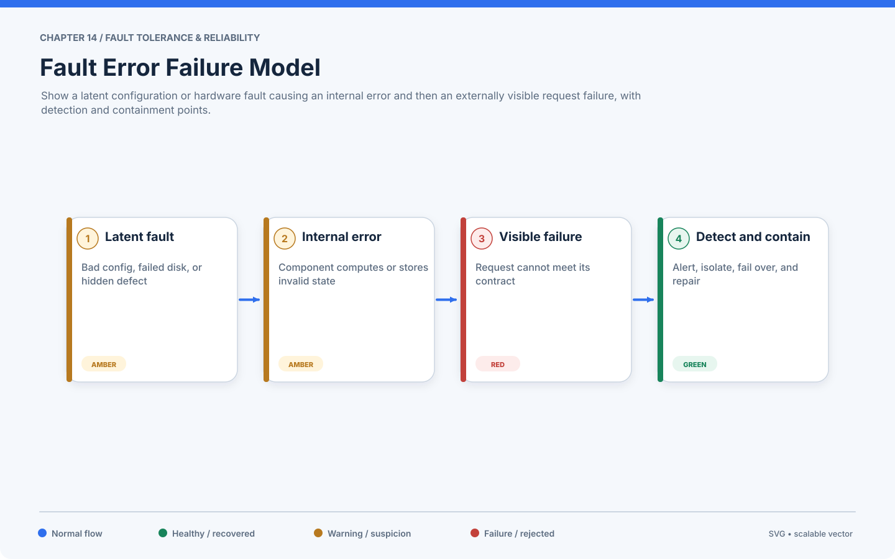

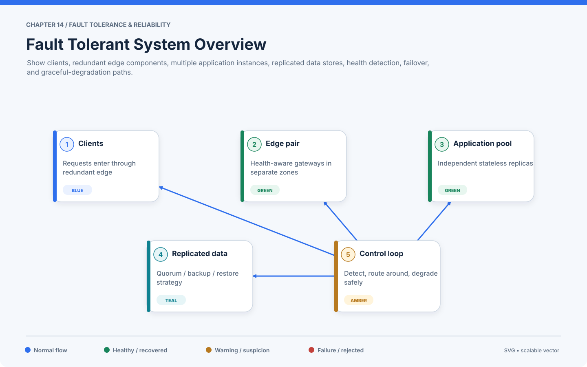

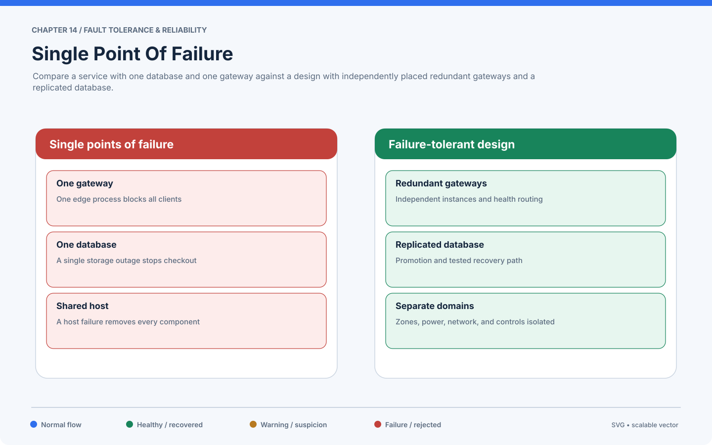

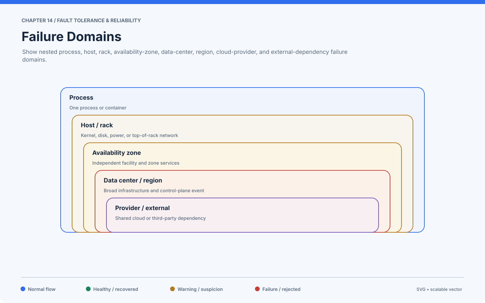

---

# 2. Failure Models in Distributed Systems

A failure model states how a component may behave when something goes wrong. It determines what evidence can be observed and which recovery mechanisms are safe. A timeout strategy suitable for a crashed process may be unsafe for a partitioned payment service.

## 2.1 Crash Failures

A **crash failure** occurs when a process or machine stops taking steps. Causes include an operating-system crash, process termination, hardware failure, out-of-memory kill, or power loss. Volatile state is lost; durable state may survive if storage is intact.

The recovery sequence usually includes detecting the crash, removing the node from service or membership, restarting or replacing it, replaying durable logs, catching up replicas, and rejoining only after validation. A restart is not automatically safe: a process can restart with stale data, incomplete migrations, or a bad configuration.

Crash-stop models assume a process that crashes never returns. Crash-recovery models allow it to restart, potentially with stable storage preserved and volatile state lost. Real systems commonly need crash-recovery behavior.

## 2.2 Omission Failures

An **omission failure** means a message or operation is not delivered or emitted. A sender may fail to send; the network may drop a packet; a receiver may be unable to process an incoming request; or a response may be lost after the operation ran.

The most important ambiguity is **unknown outcome**. A client sends `POST /payments`, the server commits the payment, and the response packet is lost. The client sees a timeout, but the operation may have succeeded. Blindly retrying can charge the customer twice. Idempotency keys, durable operation identifiers, and reconciliation resolve this ambiguity.

Omission failures can be temporary or persistent. Retries help only when the failure is transient and retrying is safe. Repeated retries against a partition can increase load without improving delivery.

## 2.3 Timing Failures

A **timing failure** occurs when an operation completes outside its required time bound. A slow response can be caused by CPU scheduling, garbage collection, queueing, disk latency, network congestion, lock contention, or a slow downstream service.

In an asynchronous system, a slow process and a crashed process can look identical to a remote observer: both may fail to respond before a timeout. Timeouts therefore express a decision policy, not a mathematical proof of death. The system chooses how long to wait before treating a request as failed or a node as suspicious.

Timing failures are especially harmful because they consume resources while appearing partly functional. A slow dependency can occupy connection pools and request threads until unrelated work also fails.

## 2.4 Byzantine Failures

A **Byzantine failure** is arbitrary behavior: a node may send contradictory messages, return corrupted values, behave maliciously, or selectively lie. It is stronger than a crash failure. Ordinary replication and heartbeat checks do not make a system Byzantine fault tolerant.

Byzantine fault-tolerant protocols use stronger assumptions and quorum rules. In a classical model with authenticated communication and suitable synchrony assumptions, tolerating \(f\) Byzantine replicas often requires at least \(3f+1\) replicas. This is a protocol-specific lower bound, not a universal deployment recipe. BFT is relevant in adversarial consensus, some blockchain systems, and environments where nodes cannot be assumed honest. Most enterprise applications primarily design for crash, omission, and timing failures, while addressing malicious behavior through security controls.

## 2.5 Network Partitions

A **network partition** divides nodes into groups that cannot communicate reliably. Nodes may still be running and serving local clients. A partition can be asymmetric: A can reach B while B cannot reach A. It can also be partial, affecting only one route, port, protocol, or subset of hosts.

A partition creates a membership problem: each side may suspect the other has failed. If both sides continue accepting conflicting writes, split brain can occur. Consensus systems typically require a quorum to commit operations; a minority partition may remain alive but cannot safely make progress. This is a deliberate consistency/availability trade-off.

Partition recovery requires more than restoring connectivity. The system may need to reconcile divergent state, elect or confirm a leader, fence an old primary, catch up replicas, and resume writes under a single authority.

## 2.6 Partial Failures

A **partial failure** affects some operations or paths while other parts continue. Examples include:

- One application instance cannot reach the database while peers can.
- One zone is isolated from a message broker.
- A node passes a TCP health check but returns application errors.
- A replica is reachable but several minutes behind.
- Reads succeed while writes fail.

Partial failures are the defining operational challenge of distributed systems. Monitoring must be scoped by caller, zone, dependency, operation, and user impact rather than relying on a single global “healthy” bit.

## 2.7 Failure Classification

| Model | Observable symptoms | Detection | Typical recovery | Consistency / availability concern |
|---|---|---|---|---|
| Crash | Process stops, connection closes | Heartbeat, process supervisor, health probe | Restart, replace, fail over | Volatile state lost; replay may be required |
| Send omission | Request never leaves sender | Sender metrics, network telemetry | Retry if safe; inspect transport | Operation may not have started |
| Receive omission | Receiver never handles request | Receiver counters, tracing gaps | Retry with deduplication | Unknown delivery state |
| Response omission | Server may have processed request but client times out | Trace and operation-status lookup | Query outcome, idempotent retry | Duplicate side effects risk |
| Timing | High latency, deadline exceeded | Histograms, timeout and queue metrics | Bound work, shed load, isolate | Slow work can consume resources |
| Byzantine | Contradictory or invalid values | Cross-checking, signatures, quorum logic | Quarantine, BFT protocol | Integrity and trust risk |
| Partition | Different groups lose contact | Peer probes, quorum symptoms | Quorum/fencing, reconcile | Split brain versus loss of progress |
| Partial | Some callers or operations fail | Per-zone/per-dependency telemetry | Isolate affected path | Global averages can hide impact |

A recovery strategy must match the failure model. Restarting a partitioned primary without fencing can create two writers; retrying an unknown payment outcome can duplicate a transaction; routing to a lagging replica can serve stale state.

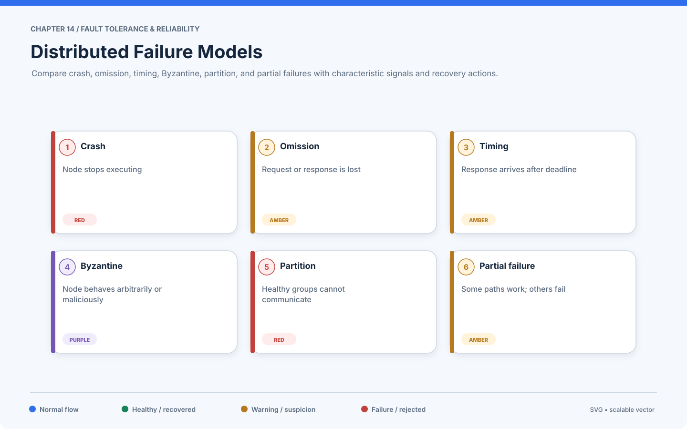

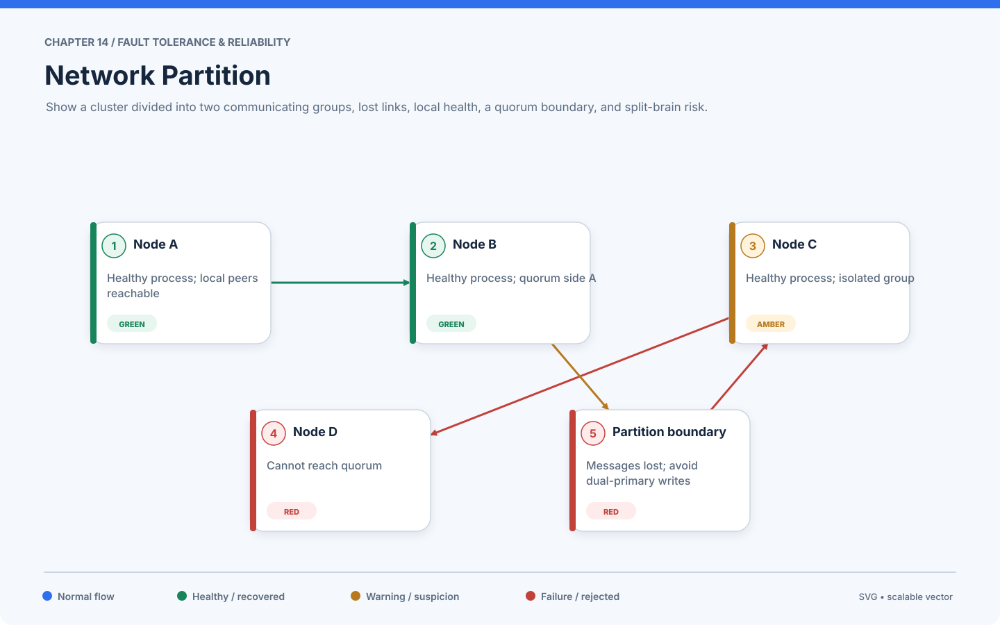

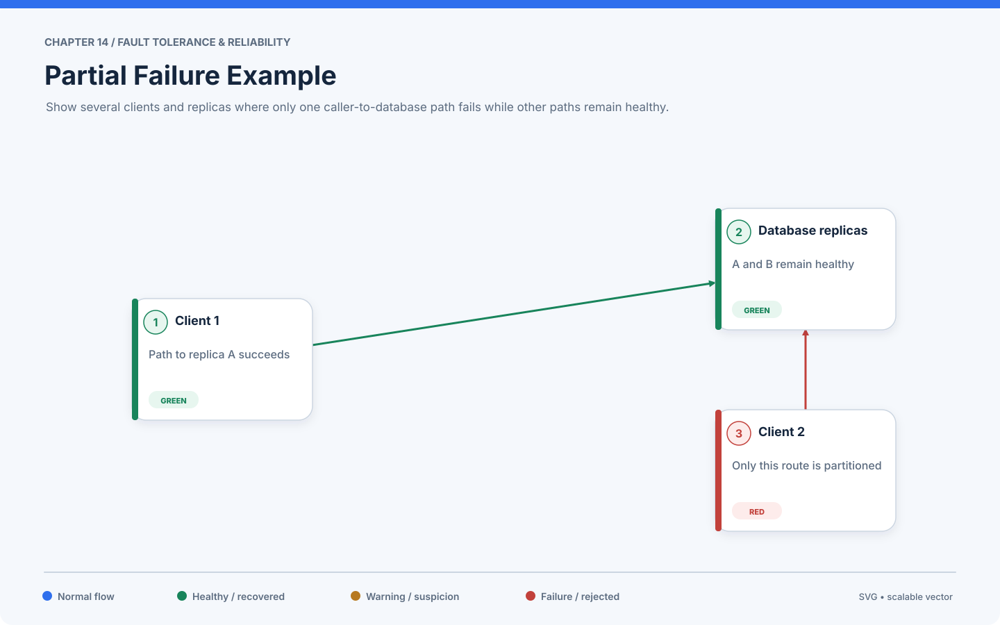


---

# 3. Failure Detection in Distributed Systems

## 3.1 What a Failure Detector Can and Cannot Know

A failure detector gathers evidence and assigns a status such as healthy, unreachable, suspected, or failed. It may observe process health, service health, network reachability, or end-to-end user-visible behavior. These are different signals:

- **Process health:** Is the operating-system process alive?
- **Node health:** Is the host responsive and resourced adequately?
- **Network reachability:** Can the observer exchange packets with the node?
- **Service health:** Can the service perform its required operation?
- **Readiness:** Should the instance receive new traffic now?

A process can be alive but deadlocked. A TCP port can accept connections while requests fail. An HTTP health endpoint can return success while the database is unusable. Health checks should reflect the intended decision: liveness checks determine whether restart may help; readiness checks determine whether to send new traffic; dependency probes reveal downstream health but must not cause restart loops for shared external failures.

Two failure-detector properties are useful concepts:

- **Completeness:** Eventually, failed processes are suspected or detected.
- **Accuracy:** Healthy processes are not incorrectly suspected.

In a fully asynchronous network, no detector can guarantee both perfect accuracy and bounded-time completeness under all conditions. Practical systems choose a trade-off using timeouts, historical latency, and operational thresholds.

## 3.2 Timeouts and Deadlines

Timeouts bound how long a caller waits. Common types include connection, TLS handshake, request, read, write, idle, heartbeat, and end-to-end deadline timeouts. A timeout should be tied to a specific operation and resource; one global timeout for every dependency often creates poor behavior.

A request deadline is an end-to-end budget. For example, a 900 ms checkout deadline may allocate 100 ms to queueing and gateway work, 250 ms to inventory, 350 ms to payment, and 100 ms to response assembly, leaving a reserve. Each downstream call receives only the remaining budget. It should not start another retry when the remaining time is too small to complete meaningfully.

Timeouts should be informed by latency distributions, not averages alone. If p99 latency is 700 ms, a 100 ms timeout will classify ordinary tail behavior as failure. If a timeout is set to many seconds for a user-facing call, threads and connections can remain occupied while the caller has already abandoned the request. Use separate budgets for connection establishment and processing, and validate them under load.

## 3.3 Heartbeat-Based Detection

A heartbeat is a periodic message indicating that a process or peer is responsive. A detector tracks the last successful heartbeat and raises suspicion after a configured threshold.

**Worked example:** A cluster sends one heartbeat every 2 seconds and suspects a node after 3 consecutive missed heartbeats. If the failure happens immediately after a successful heartbeat, the nominal detection delay is approximately:

\[
T_{detect} \approx 3 \times 2s = 6s
\]

This is an approximation. Scheduling delay, network latency, heartbeat queueing, detector polling, and whether the implementation counts the first missed interval all affect the actual value. A 6-second threshold does not guarantee that the node is dead; it means the detector has waited long enough to take a configured action.

**Centralized monitoring** is simple to reason about but can create a bottleneck or a monitoring-service dependency. **Peer-to-peer heartbeats** distribute work but increase communication complexity. **Gossip-based dissemination** spreads membership observations among peers and scales well for large groups, at the cost of eventual convergence and temporary disagreement.

Heartbeat design must avoid synchronized spikes. Use jitter in probe schedules, bound concurrency, and prevent an outage from causing every node to probe every other node aggressively.

## 3.4 Phi-Accrual Failure Detector

A fixed threshold makes a binary decision: after a given number of seconds, mark a node failed. A phi-accrual detector instead reports a continuously increasing suspicion level based on the observed distribution of heartbeat arrival intervals.

\[
\phi(t) = -\log_{10}(1-F(t))
\]

where:

- \(t\) is the elapsed time since the last heartbeat.
- \(F(t)\) is the estimated cumulative probability that a heartbeat interval is at or below \(t\).
- \(1-F(t)\) is the estimated tail probability of seeing a delay at least this large.
- \(\phi(t)\) is a logarithmic suspicion score, not proof of a crash.

Interpretation: if an observed delay is common, tail probability is large and phi is small. If a delay is extremely unusual, tail probability is tiny and phi grows. A score of 1 corresponds to a tail probability of 0.1; 2 corresponds to 0.01; 3 corresponds to 0.001 under the fitted model.

**Conceptual example:** Suppose a peer's learned heartbeat history indicates that a delay beyond 1.5 seconds occurs in about 1% of intervals. Then \(1-F(t)=0.01\), so \(\phi=2\). If a later delay has estimated tail probability 0.0001, phi becomes 4. An operator might choose a threshold of 8 for a highly conservative suspicion policy, but thresholds depend on the cluster, network, failure cost, and protocol. The score communicates unusualness; it does not prove the peer is dead.

Advantages include adaptive behavior under variable heartbeat intervals and a tunable suspicion policy. Limitations include dependence on the quality of the statistical model, changing network regimes, cold-start history, and non-stationary delays. Implementations differ in their distribution estimators and configuration. Apache Cassandra is a well-known example of a system using an accrual-style failure detector; implementation behavior should be checked against the deployed release documentation.

## 3.5 Gossip-Based Failure Detection

In gossip membership, nodes periodically exchange their local view of membership, heartbeat counters, and suspicion information with a small number of peers. Over repeated rounds, information spreads through the cluster. The exact propagation algorithm may use random peer selection, bounded fan-out, infection-style dissemination, or protocol-specific membership rules.

Gossip reduces dependence on a central observer and can scale to large clusters. It is not instantaneous: during convergence, two nodes may disagree about a peer. A node can be suspected by one group and considered healthy by another. Systems must define when suspicion leads to removal, how false suspicions are refuted, and how a rejoining node catches up.

## 3.6 Detector Comparison

| Mechanism | Evidence | Strength | Main risk | Good fit |
|---|---|---|---|---|
| Fixed timeout | No response before deadline | Simple and easy to configure | False positives under tail latency | Bounded RPC calls |
| Heartbeat threshold | Missed periodic messages | Simple liveness signal | Fixed timing poorly matches variable networks | Small/medium clusters |
| Phi-accrual | Statistical heartbeat delay | Adaptive suspicion level | Model mismatch or poor history | Membership systems with variable latency |
| Gossip | Peer-shared membership | Scales without central monitor | Eventual, temporarily inconsistent view | Large clusters |
| Active health probe | Synthetic operation | Tests actual service capability | Probe load and incomplete coverage | Readiness and service monitoring |

A production architecture often combines local process supervision, readiness probes, network-level checks, end-to-end synthetic transactions, and a cluster membership detector. Each signal should have a clearly defined action and should not be treated as interchangeable.

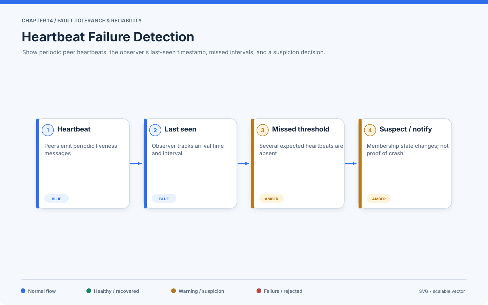

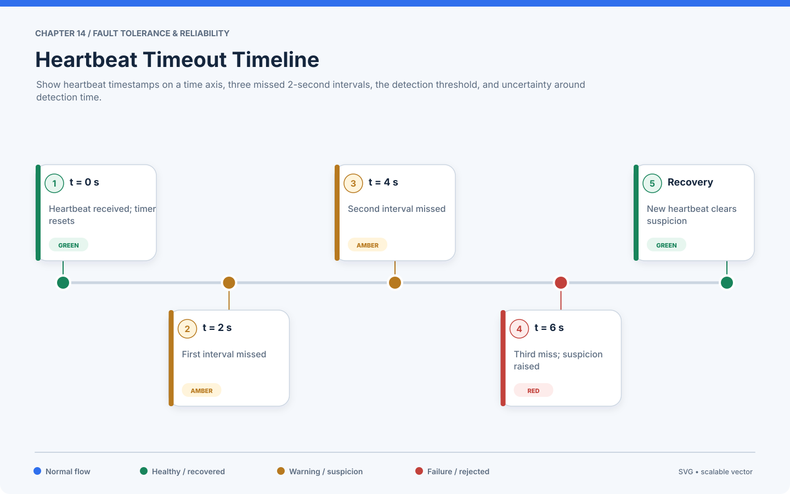

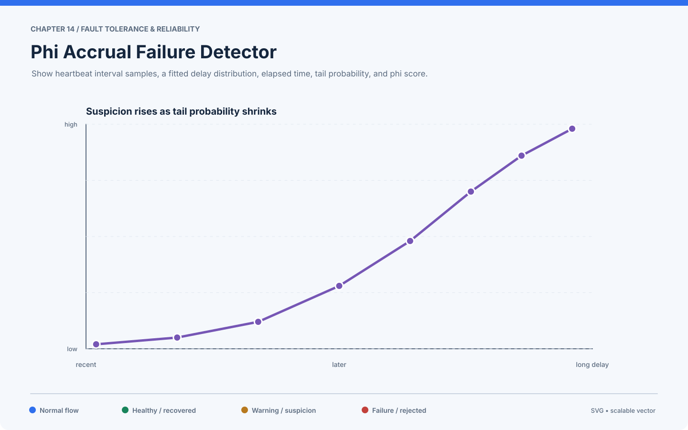

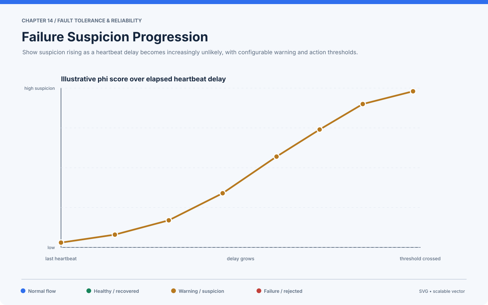

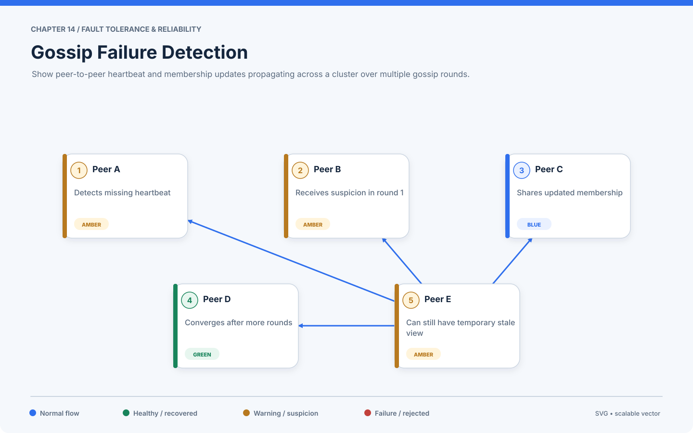

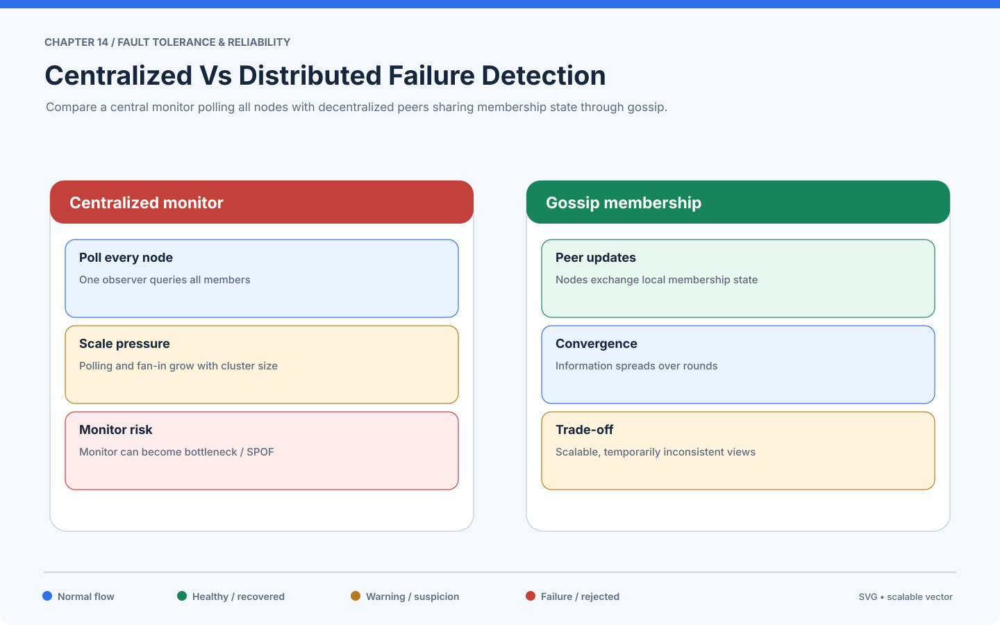

---

# 4. Failure Isolation and Fault Containment

A distributed application is a dependency graph. A fault becomes dangerous when it crosses a boundary and consumes resources or corrupts state in components that were otherwise healthy. Fault isolation limits that propagation.

## 4.1 Dependency Chains and Resource Exhaustion

Consider checkout calling payment. If payment becomes slow, checkout threads wait. Once enough threads are blocked, checkout stops serving unrelated requests. Gateway queues grow, client deadlines expire, and retries add traffic. A localized payment incident has now become a platform-wide outage.

The relevant resources are not only CPU and memory. They include request threads, event-loop slots, connection pools, file descriptors, queue capacity, database connections, retry tokens, and downstream concurrency. Reliability design should put explicit bounds around each resource.

## 4.2 Bulkheads

The **bulkhead pattern** partitions resources so one dependency or workload cannot consume everything. Common boundaries include:

- Separate thread or task pools for independent downstream dependencies.
- Separate connection pools for payment, catalog, inventory, and analytics.
- Per-tenant concurrency and queue limits.
- Separate worker groups for critical and background jobs.
- Dedicated capacity for control-plane and recovery operations.

**Numerical example:** A checkout service has 120 outbound worker slots. It reserves 40 for inventory, 40 for payment, and 20 for identity, while 20 remain as protected capacity for local checkout work and recovery. If payment stalls, it can occupy at most its 40 allocated slots rather than all 120. The cost is possible underutilization: idle inventory capacity cannot automatically be borrowed by payment unless the design deliberately supports a safe shared overflow pool.

Bulkhead sizing should reflect dependency latency and concurrency. Little's Law provides a first estimate: at 80 requests per second and 0.25 seconds average occupancy, average in-flight work is \(L=80\times0.25=20\). Headroom is needed for bursts and tails, but arbitrarily large pools can amplify downstream overload.

## 4.3 Circuit Breakers

A circuit breaker controls calls to a dependency based on recent outcomes. It has three common states:

1. **Closed:** Requests flow normally; failures and slow calls are measured.
2. **Open:** Calls are rejected quickly or handled by a fallback, avoiding further pressure on the dependency.
3. **Half-open:** After a wait period, a limited number of probes are allowed. Successful probes close the breaker; failures reopen it.

A breaker may use consecutive failure counts, a failure percentage over a rolling window, slow-call percentage, or combinations. It also needs a minimum sample count; otherwise a tiny number of failures can cause noisy transitions. Half-open probe volume must be small enough not to overload a recovering service.

**Request sequence:** healthy dependency → failures rise → threshold reached → breaker opens → calls fail fast or use a fallback → open duration expires → limited probes run → success closes breaker, failure reopens it.

Circuit breakers are often local to an application instance. Therefore, 30 instances may have 30 different breaker states. This is usually desirable because one instance's network path may be unhealthy while another is healthy. A globally coordinated breaker introduces its own dependency and coordination overhead. Treat circuit-breaker state as an operational control signal, not as a distributed consensus decision.

A circuit breaker differs from a retry: a retry makes another attempt; a breaker decides whether attempts should be made at all. Retries can be useful for brief transient errors, while a breaker prevents persistent failures from being repeatedly invoked.

## 4.4 Load Shedding

Load shedding deliberately rejects work when the system approaches saturation. The purpose is to preserve high-value requests and avoid uncontrolled queue growth. Policies can classify traffic by operation, tenant, priority, deadline, or business criticality.

- Reject low-priority requests before they occupy expensive resources.
- Bound queue length and queue wait time.
- Preserve health, authentication, and recovery operations.
- Prefer fast, explicit rejection over a timeout after a long wait.
- Use `429 Too Many Requests` for caller-specific quotas and `503 Service Unavailable` for temporary service overload where appropriate.
- Include `Retry-After` only when a meaningful retry time can be provided; clients still need exponential backoff and jitter.

Never shed work blindly where correctness or safety depends on it. For example, dropping an inventory reservation after a payment has been captured may create a financial inconsistency. Design a state machine and compensation/reconciliation path for critical workflows.

## 4.5 How Isolation Patterns Complement One Another

| Mechanism | Primary control | What it prevents | What it does not solve alone |
|---|---|---|---|
| Timeout | Bounds waiting | Indefinite resource occupation | Retry amplification or duplicate writes |
| Bulkhead | Partitions resources | One dependency exhausting shared pools | A dependency remaining unavailable |
| Circuit breaker | Stops calls after failure signal | Repeated load on an unhealthy dependency | Initial overload or stale data correctness |
| Rate limiter | Bounds request arrival rate | Excessive caller/request rate | Long-lived in-flight work by itself |
| Concurrency limiter | Bounds simultaneous work | Too many expensive in-flight operations | Arrival bursts if queues are unbounded |
| Load shedding | Rejects low-priority work | Queue collapse and total outage | Root cause or capacity deficit |
| Process isolation | Separates execution/resource domains | Some memory/process-level propagation | Shared infrastructure and dependency failure |

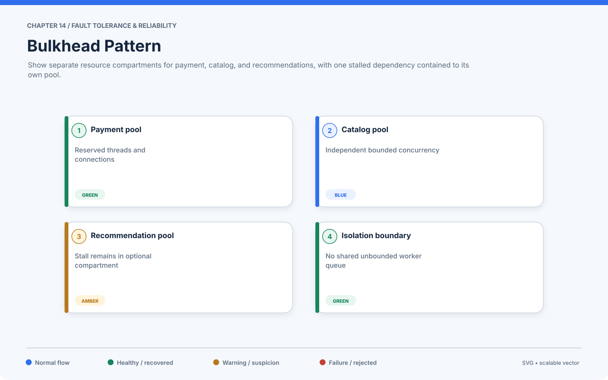

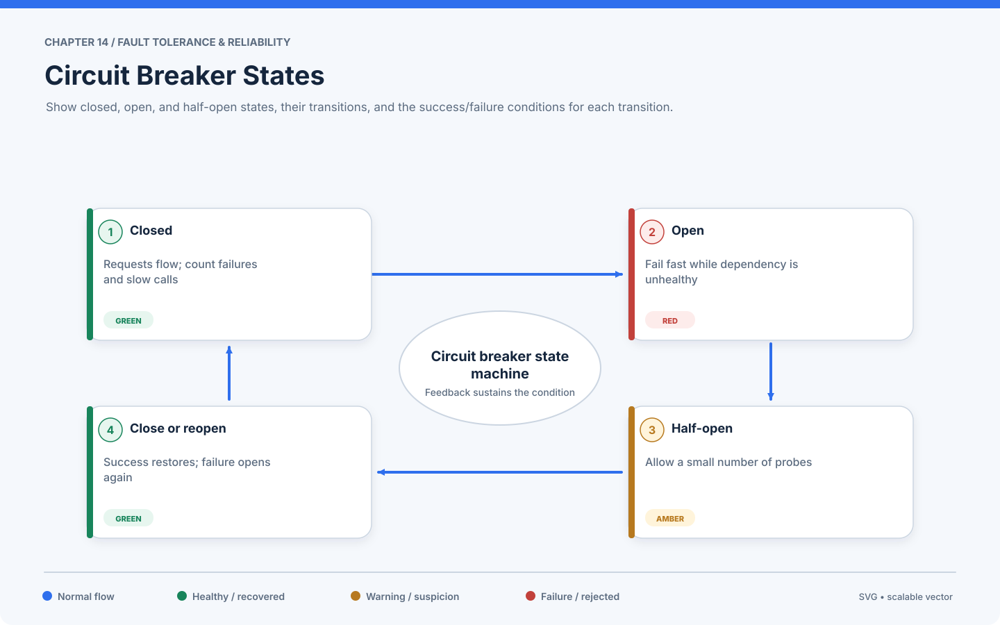

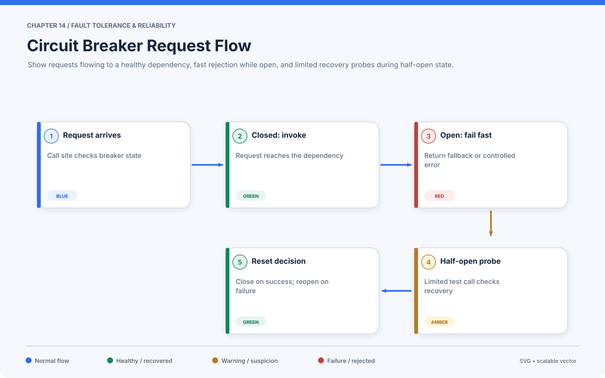

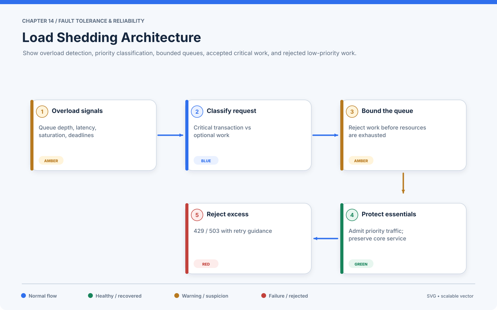

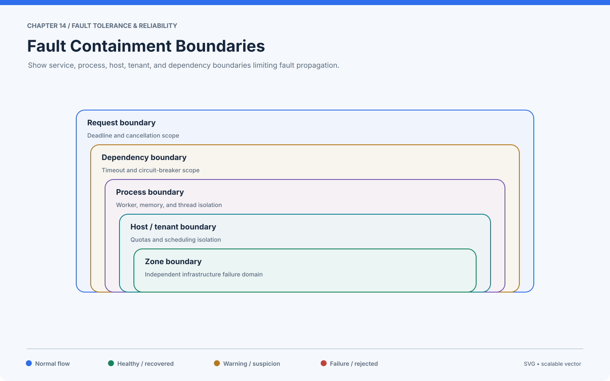

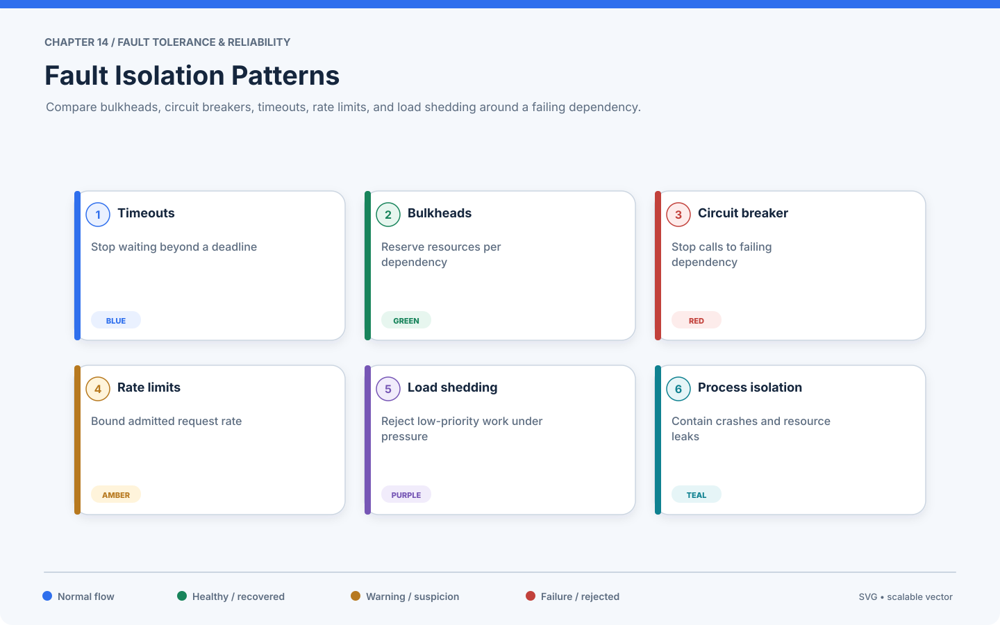

---

# 5. Retry Strategies and Failure Amplification

Retries can hide brief transient failures, but they are not a substitute for failure isolation or recovery. Every retry consumes capacity, adds latency, and can duplicate side effects.

## 5.1 Retry Classification and Ownership

Before retrying, classify the failure:

- **Potentially transient:** connection reset, temporary overload, leader transition, or a retryable server error.
- **Likely permanent:** invalid request, authorization failure, unsupported operation, or deterministic validation error.
- **Unknown outcome:** request may have completed but response was lost.

Retry only errors explicitly considered retryable. Assign retry ownership to one layer where possible. If an HTTP client, service client, API gateway, and message consumer all retry independently, attempts multiply.

## 5.2 Backoff Strategies

A fixed delay waits the same interval between attempts. Linear backoff increases delay by a fixed amount. Exponential backoff multiplies delay after each failure:

\[
d_k = \min(d_{max}, d_0 \cdot 2^k)
\]

where \(d_0\) is the initial delay, \(k\) is the retry index, and \(d_{max}\) caps the delay. Random jitter spreads clients across time and reduces synchronization.

**Example:** With an initial delay of 100 ms, uncapped exponential delays are 100, 200, 400, and 800 ms. Full jitter samples each wait uniformly between zero and the corresponding capped exponential delay. Equal jitter keeps half the delay fixed and randomizes the other half. Decorrelated jitter uses the previous delay to choose the next interval. Exact formulas vary by implementation; the objective is to avoid clients retrying together.

## 5.3 Retry Storms and Amplification

A retry storm is a positive feedback loop:

1. A dependency becomes slow or unavailable.
2. Requests time out.
3. Clients issue retries.
4. Retry traffic competes with recovery work.
5. Queueing and latency increase.
6. More requests time out and retry.

**Numerical example:** A service normally receives 1,000 requests/s. If 30% fail and each failed request is retried twice, the original attempt rate is 1,000/s plus 300 first retries/s plus 300 second retries/s if all second retries are triggered by the same failed cohort: up to 1,600 attempts/s. In a multi-layer system the multiplier can be much larger. If three layers each permit three total attempts, a single logical operation can result in up to \(3^3=27\) downstream attempts in the worst case.

Mitigations include retry budgets, maximum attempts, deadlines, jitter, circuit breakers, load shedding, and explicit cancellation propagation. A retry budget limits retry traffic as a fraction of successful or original traffic, preventing retries from dominating normal work.

## 5.4 Idempotency and Unknown Outcomes

An operation is **idempotent** when repeating it has the same intended effect as performing it once. A `GET` is generally intended to be safe and idempotent; a payment capture is not naturally idempotent. API semantics matter more than HTTP verb names alone.

An **idempotency key** is a caller-generated operation identifier persisted by the server. The server associates the key with request parameters and a durable outcome. Repeated requests with the same key return the recorded result rather than performing the side effect again. The system must define key scope, expiration, collision handling, payload mismatch behavior, and durability of the idempotency record.

For payment processing, a safe flow is: client creates a unique checkout operation ID → payment service records intent → provider call uses a stable idempotency key → response or provider status is reconciled → final transaction state is persisted. A timeout should trigger status lookup or deduplicated retry, not a new unrelated payment operation.

## 5.5 Deadline and Retry Budget Example

Suppose an upstream request has a 1,000 ms total deadline. Gateway processing has already used 100 ms and queueing used 100 ms. A payment attempt is allowed 500 ms. If it fails after 450 ms, only 350 ms remain including response assembly. A retry needing another 500 ms cannot meet the deadline and should not begin. Propagate deadlines so downstream services can cancel work when the caller has abandoned it.

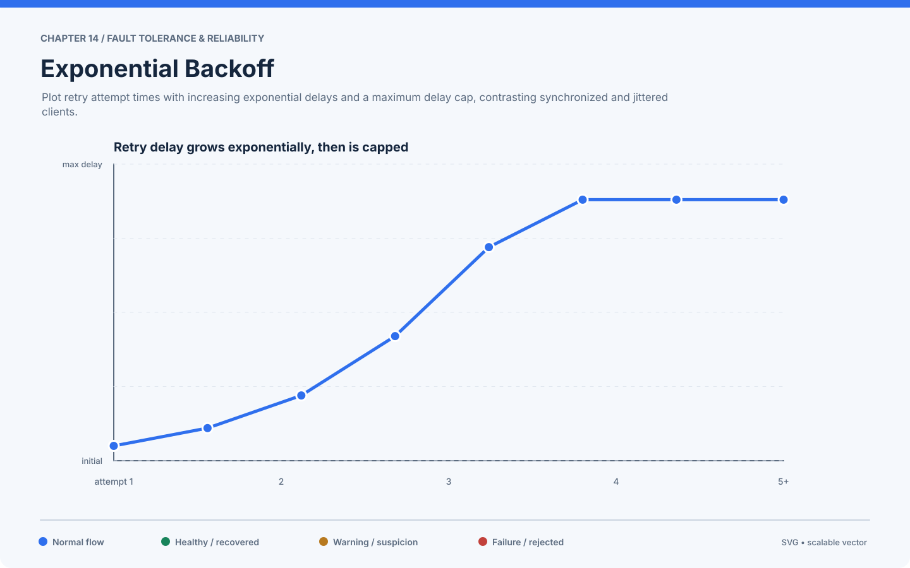

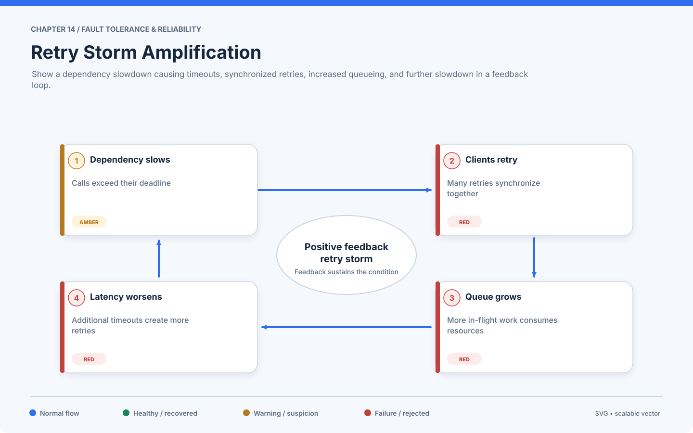

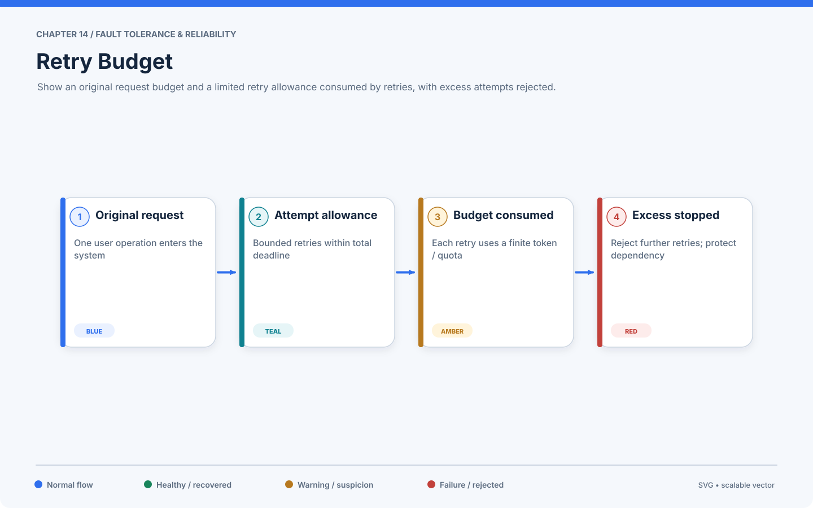

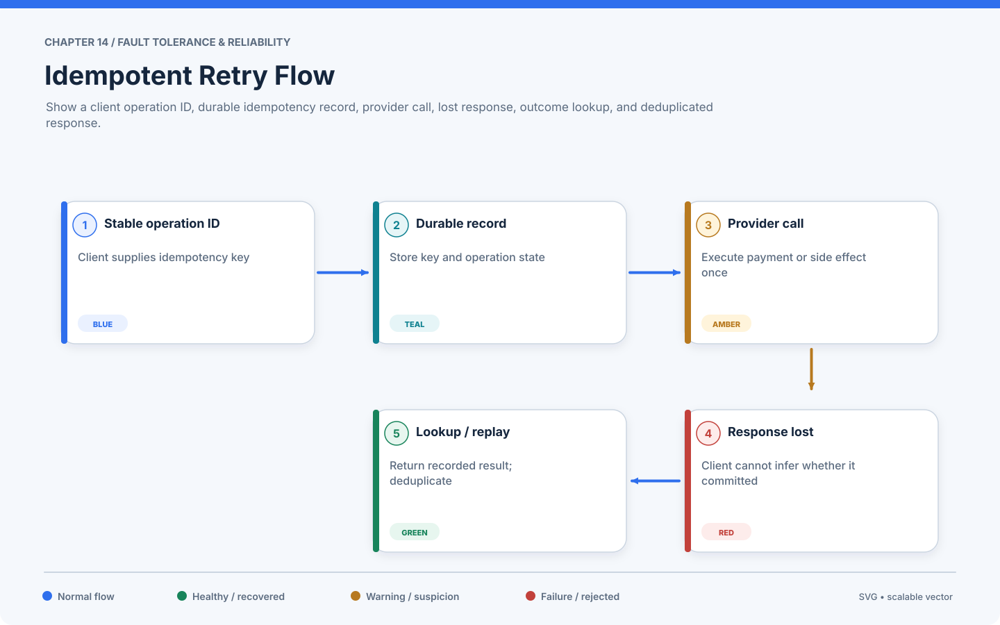

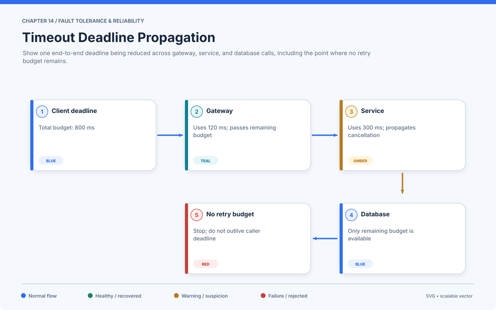

---

# 6. Graceful Degradation and Resilient Service Behavior

Graceful degradation means preserving the most important user value when some components are impaired. It requires deciding in advance which capabilities are optional, which data may be stale, and which operations must fail safely.

## 6.1 E-Commerce Degradation Matrix

| Dependency failure | Possible degraded behavior | What must remain strict |
|---|---|---|
| Recommendations | Hide recommendations or use cached popular items | Do not block product details or checkout |
| Reviews | Show cached reviews or omit review panel | Do not fabricate ratings or review counts |
| Search | Serve cached popular/category pages; expose search as unavailable | Do not claim complete search results if index is stale beyond policy |
| Payment provider | Disable that payment method or offer an approved alternative | Never mark an unconfirmed charge as paid |
| Inventory | Stop promising immediate availability; allow only a safe reservation workflow | Do not oversell when stock cannot be verified |
| User profile | Allow limited guest browsing or use cached non-sensitive preferences | Do not bypass authorization or expose another user's data |
| Analytics | Buffer or drop noncritical telemetry | Do not block core transaction processing |

The right fallback depends on correctness, legal requirements, and user expectations. A fallback is not automatically safe merely because it improves availability.

## 6.2 Fallback Strategies

- **Static fallback:** A curated default page or configuration used when dynamic computation fails.
- **Cached fallback:** Previously computed data served within a declared freshness limit.
- **Default value:** A neutral value where absence is safe and unambiguous.
- **Alternative provider:** A second provider, requiring compatible contracts and independent failure domains.
- **Read-only mode:** Allow reads while disabling writes that cannot be safely committed.
- **Asynchronous processing:** Accept durable intent and complete work later, with status tracking and idempotency.
- **Feature disablement:** Turn off optional behavior through a controlled feature flag.

Never present stale or fallback data as fully current. Show appropriate freshness metadata when it matters. Never use fallback to bypass authentication, authorization, fraud controls, or critical business invariants.

## 6.3 Stale Data and Cache Semantics

**Stale-while-revalidate** serves a cached response while refresh happens in the background. **Stale-if-error** serves cached data when the origin fails. **Bounded staleness** specifies the maximum age tolerated by the business operation.

Cached product descriptions and recommendations may tolerate minutes of staleness. Account balances, inventory reservations, and payment status often require stronger guarantees. Define the freshness requirement per field and per workflow rather than per application.

## 6.4 Fail-Open versus Fail-Closed

Fail-open allows an operation when a control dependency is unavailable; fail-closed denies it. The choice is a security and business decision:

| Control | Typical default | Reasoning |
|---|---|---|
| Authentication | Fail closed | Identity cannot be established safely |
| Authorization | Fail closed | Missing policy result must not grant access |
| Fraud screening | Policy-specific; often fail closed for high-risk actions | Bypass may create unacceptable losses |
| Personalization | Fail open | Noncritical feature can be omitted |
| Recommendation | Fail open | Default product experience remains useful |
| Rate limiting | Depends on risk; bounded local fallback may be used | Unrestricted traffic can create outage or abuse |
| Availability estimate | Fail closed for promises; provide uncertainty | Do not claim a resource is available without evidence |

If a security service fails open, the decision should be explicit, narrowly scoped, time-limited, audited, and approved for the relevant risk class.

## 6.5 Critical and Noncritical Dependencies

A reliability review should label dependencies as critical-path, conditionally critical, or optional. Critical dependencies need strong availability, bounded latency, and tested recovery. Optional dependencies should be isolated so their absence does not block primary workflows.

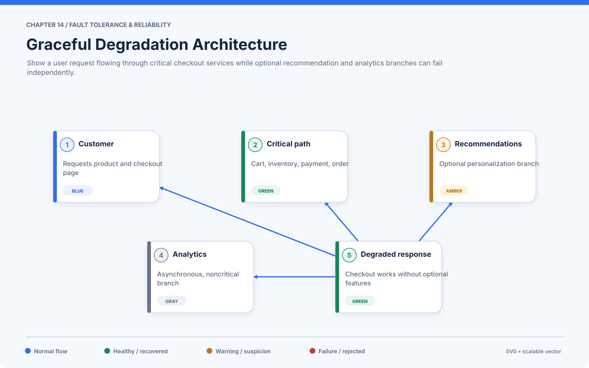

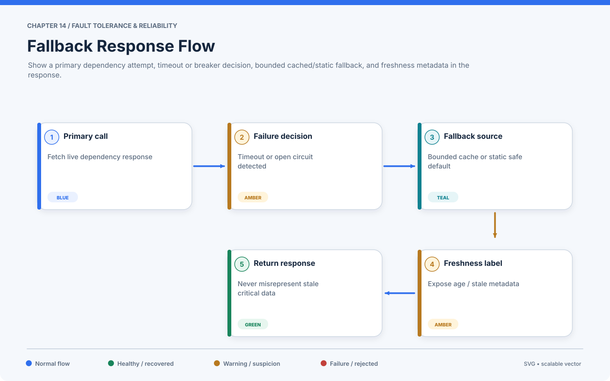

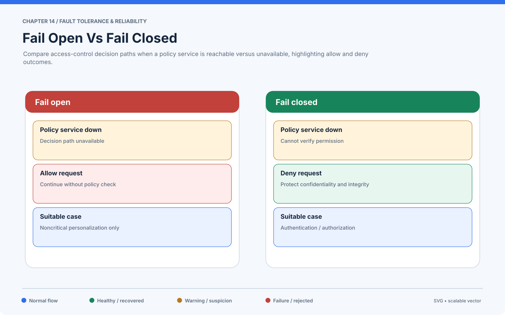

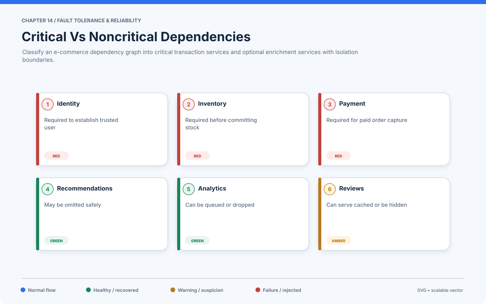

---

# 7. Redundancy and High Availability

Redundancy provides alternate components, paths, or capacity. Its value depends on independence: two replicas that share a power source, network path, credential, configuration, or operator mistake may fail together.

## 7.1 Redundancy Models

| Model | Behavior | Benefit | Cost / risk |
|---|---|---|---|
| Active-active | Multiple instances serve simultaneously | Utilizes capacity and handles instance loss | State coordination, traffic redistribution, consistency concerns |
| Active-passive | Primary serves; standby takes over | Clear writer role and simpler state ownership | Standby capacity cost; promotion delay |
| Primary-secondary | Primary handles writes; secondary replicates and may serve reads | Common database model | Replication lag and promotion correctness |
| Hot standby | Fully running and ready | Low recovery time | High ongoing cost and operational complexity |
| Warm standby | Reduced but running environment | Balanced cost and recovery time | Scale-up and validation delay |
| Cold standby | Infrastructure is provisioned or restored after event | Low idle cost | Longer recovery time |
| N+1 | One extra unit beyond normal required capacity | Tolerates one unit failure | Extra capacity must be truly independent |
| N+2 | Two extra units | Tolerates two unit losses under assumptions | Greater cost and complexity |

## 7.2 N+1 Worked Example

A service requires 8 application instances to meet peak load. With N+1 design, it runs 9 instances. If each instance safely supports 1,000 requests/s, the normal safe capacity is 9,000 requests/s; after one instance fails, 8,000 requests/s remain. The target peak must be no greater than the remaining safe capacity, and additional headroom may be needed for burstiness and uneven placement. Running 9 instances but placing all of them on one host does not provide host-level N+1 redundancy.

For heterogeneous components, compute capacity after the specific failure, not merely the number of replicas. A zone-level event may remove multiple instances at once, so zone failure requires enough capacity across surviving zones.

## 7.3 Failure Domains and Correlated Failures

Redundant components should be distributed across the failure domain relevant to the threat model. Consider:

- Process replicas across distinct hosts.
- Hosts across racks and availability zones.
- Data replicas across independent zones or regions.
- Network paths through separate switches, links, and egress gateways.
- Control-plane access that does not depend on the data plane being recovered.
- Secrets, certificates, deployment systems, and identity dependencies that remain available during a site event.

**Correlated failures** invalidate the assumption that component failures are independent. A bad rollout can crash every replica. A shared schema migration can make all versions incompatible. A compromised credential can affect every region. A cloud control-plane incident can impair provisioning even while running instances remain healthy. Design for common-mode failure through staged rollouts, independent change paths, quorum/fencing, backup isolation, and explicit failure-domain placement.

## 7.4 High-Availability Reference Architecture

A common multi-zone pattern has a redundant global or regional entry point, zone-local load balancers, stateless application pools in multiple zones, replicated database storage, asynchronous background processing, centralized telemetry, and tested backups. The database topology must match consistency needs: synchronous replication can reduce data loss but increases write latency and may reduce availability when quorum is lost; asynchronous replication improves latency and regional independence but permits lag and potential data loss during failover.

High availability does not replace disaster recovery. HA handles component or zone failures within an architecture designed for fast failover. DR handles larger destructive events, regional loss, data corruption, and restoration from protected backups.

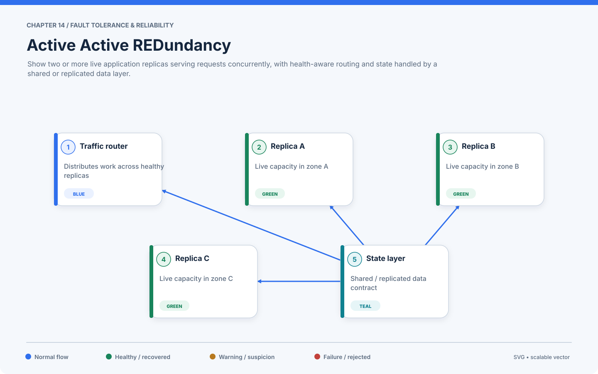

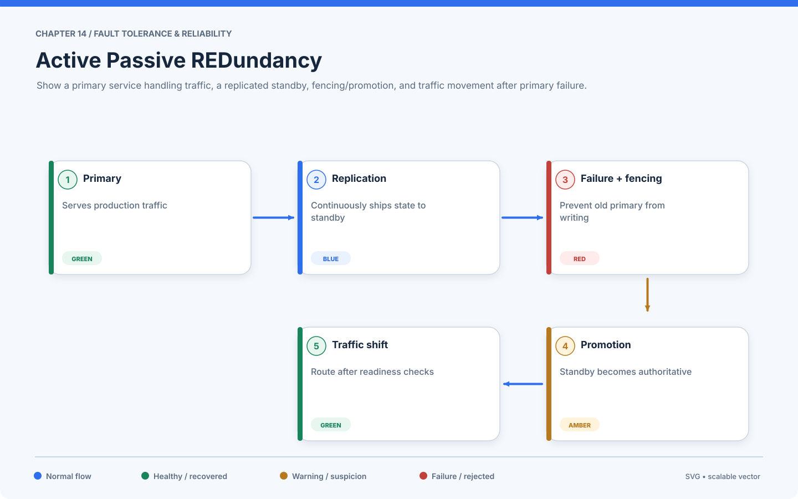

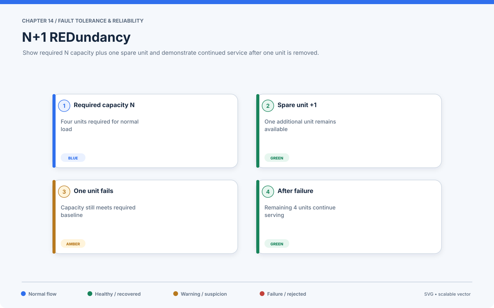

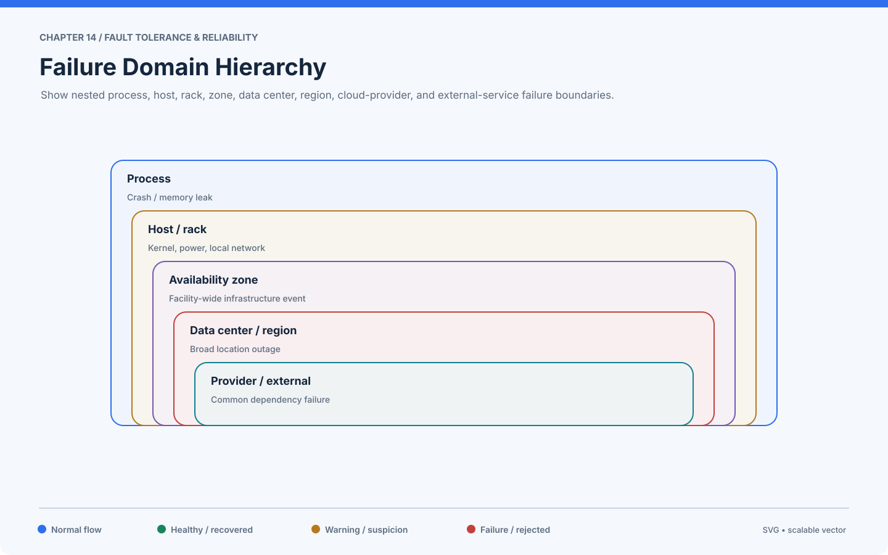

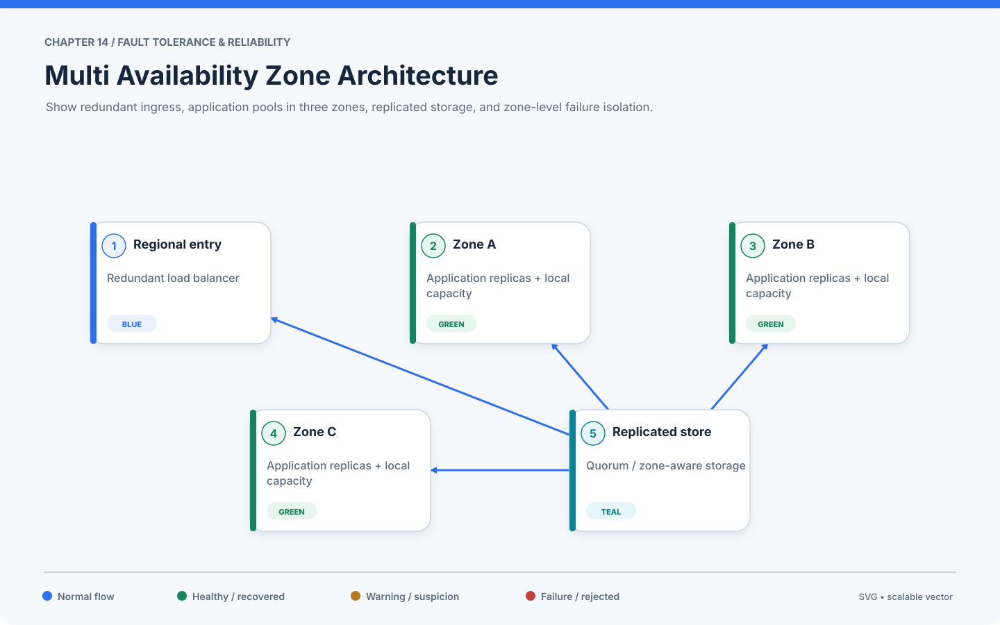

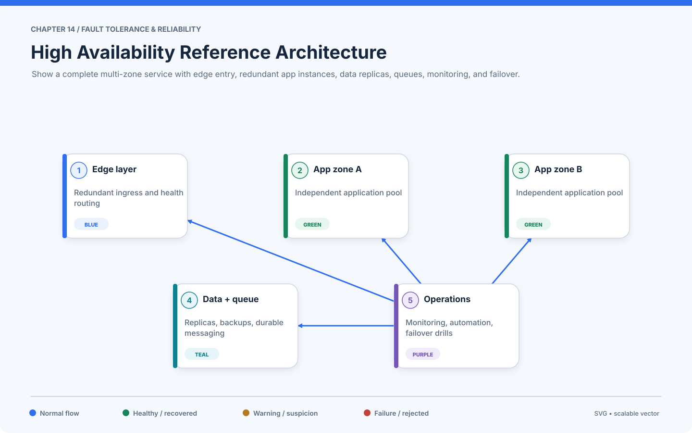

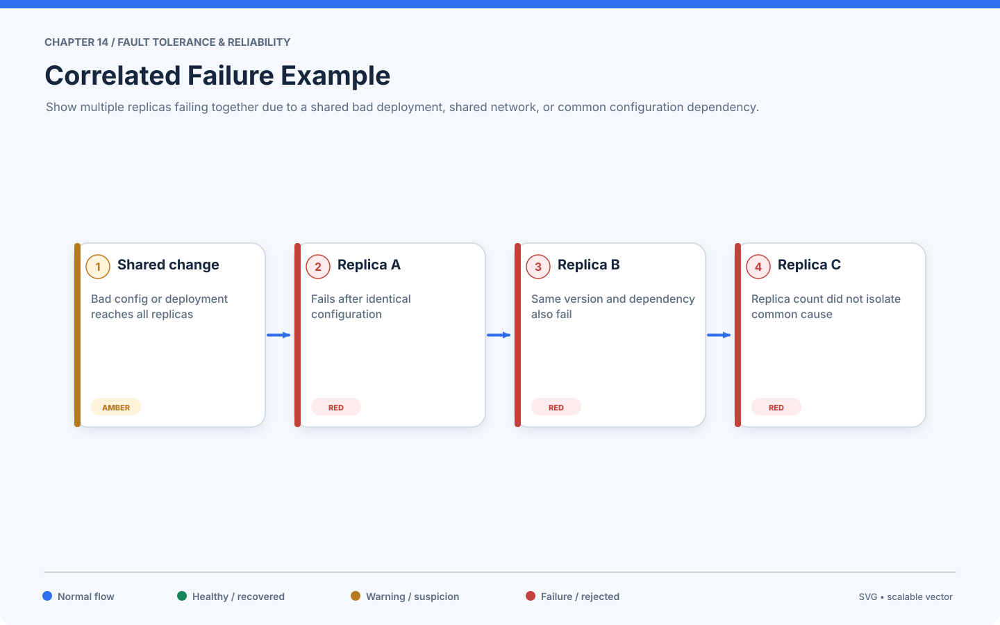

---

# 8. Reliability Mathematics and Availability Engineering

Reliability formulas provide a structured way to reason about failure, repair, and redundancy. Most textbook calculations assume independent failures, stable rates, and well-defined operating states. Production systems often violate these assumptions; state them explicitly.

## 8.1 Availability, MTBF, and MTTR

For a repairable system under a simplified alternating up/down model:

\[
A = \frac{MTBF}{MTBF + MTTR}
\]

where:

- **MTBF** is mean time between failures (or, depending on convention, mean operating time between failures).
- **MTTR** is mean time to repair or restore service. In SRE practice, clarify whether it means repair, recovery, or restoration.
- \(A\) is long-run steady-state availability under the model.

**Example:** MTBF = 2,000 hours and MTTR = 2 hours:

\[
A = \frac{2000}{2000+2}=0.999001 \approx 99.9001\%
\]

Reducing restoration from 2 hours to 30 minutes gives:

\[
A = \frac{2000}{2000+0.5}=0.999750 \approx 99.9750\%
\]

The example shows why fast detection and recovery materially improve availability. It does not imply failures arrive uniformly or that every production service follows an exponential model.

## 8.2 Downtime Allowed by Uptime Targets

The table assumes continuous calendar time and a 365-day year; the month column uses 30 days as requested. Actual SLA windows may use different exclusions and measurement definitions.

| Availability target | Downtime/year | Downtime/30-day month | Downtime/week | Downtime/day |
|---:|---:|---:|---:|---:|
| 99% | 3 days 15 h 36 m | 7 h 12 m | 1 h 40 m 48 s | 14 m 24 s |
| 99.9% | 8 h 45 m 36 s | 43 m 12 s | 10 m 4.8 s | 1 m 26.4 s |
| 99.95% | 4 h 22 m 48 s | 21 m 36 s | 5 m 2.4 s | 43.2 s |
| 99.99% | 52 m 33.6 s | 4 m 19.2 s | 1 m 0.48 s | 8.64 s |
| 99.999% | 5 m 15.36 s | 25.92 s | 6.048 s | 0.864 s |

Each additional nine can require disproportionate investment in redundancy, operational maturity, dependency control, capacity, testing, and organizational response. Availability targets should reflect user impact and business value rather than a desire to maximize nines without a cost model.

## 8.3 Series Systems

If every component is required for a transaction and failures are independent, series availability is:

\[
A_{system}=\prod_{i=1}^{n} A_i
\]

**Example:** An API gateway has availability 99.99%, application service 99.95%, and database 99.9%. Then:

\[
A_{system}=0.9999\times0.9995\times0.999 \approx 0.998401
\]

or approximately 99.8401%. Even individually reliable dependencies can yield a lower end-to-end availability when every dependency is mandatory. Real dependencies may be correlated, and user-visible availability should be measured end to end rather than inferred solely from component dashboards.

## 8.4 Parallel Redundancy

For two independent components where either one can provide the function:

\[
A_{parallel}=1-(1-A_1)(1-A_2)
\]

For \(n\) independent components:

\[
A_{parallel}=1-\prod_{i=1}^{n}(1-A_i)
\]

If each of two independent replicas has availability 99%, then:

\[
A_{parallel}=1-(0.01\times0.01)=0.9999=99.99\%
\]

This result assumes failures are independent and failover succeeds. Shared software defects, common power, load balancer failure, correlated network paths, and failed failover logic reduce the real benefit.

## 8.5 Reliability Function and Failure Rate

Under a constant hazard-rate or exponential failure model:

\[
R(t)=e^{-\lambda t}
\]

where \(R(t)\) is the probability of surviving without failure through time \(t\), and \(\lambda\) is a constant failure rate. The mean time to failure is \(MTTF=1/\lambda\) under this model. The constant-rate assumption is often unrealistic for hardware with infant-mortality or wear-out phases, and for software failures driven by releases, traffic, or workload patterns.

For a simple repair model, if failure rate is \(\lambda\) and repair rate is \(\mu\), a common two-state model gives steady-state availability \(A=\mu/(\lambda+\mu)\). This is equivalent to MTBF/(MTBF+MTTR) when the exponential assumptions and definitions align.

## 8.6 Fault Tree Analysis

Fault Tree Analysis (FTA) starts with a top-level undesired event and decomposes it into causes using logic gates:

- **OR gate:** The top event occurs if any child event occurs.
- **AND gate:** The top event occurs only if all child events occur.
- **Minimal cut set:** A smallest combination of basic events sufficient to cause the top event.

**API outage example:** The top event “checkout unavailable” may occur if (A) the API gateway is unavailable OR (B) all application capacity is unavailable OR (C) the database write path is unavailable and no safe degraded flow exists. Application capacity loss may itself be an AND of “zone A unavailable” and “remaining zones lack capacity,” or an OR of “all replicas fail from a bad rollout” and “shared identity dependency blocks all requests.” The tree exposes common-mode assumptions and suggests test cases.

When probabilities are small and independent, an OR event probability can sometimes be approximated by the sum of child probabilities; exact Boolean probability should be used when dependencies overlap. Never multiply probabilities that are correlated as if they were independent.

## 8.7 Failure Mode and Effects Analysis (FMEA)

FMEA is a structured risk review. For each failure mode, record its cause, local effect, system/user effect, detection method, existing controls, and recommended action. A traditional Risk Priority Number (RPN) is often calculated as:

\[
RPN = Severity \times Occurrence \times Detectability
\]

Scales and scoring conventions vary. RPN is a prioritization aid, not a precise probability or universal risk metric; a catastrophic low-frequency event should not be dismissed merely because its numerical product is modest.

**Database outage example:** Failure mode: primary database becomes unavailable. Effects: write requests fail, checkout cannot confirm orders. Causes: storage failure, network isolation, exhausted connections, accidental configuration change. Detection: write canary, replication/role metrics, connection errors, and end-to-end transaction SLI. Controls: multi-zone replica, backups, fencing, tested promotion, bounded retry policy. Actions: quarterly failover test, backup restore validation, connection-pool caps, and a runbook.

## 8.8 Practical Capacity and Availability Caveats

- Availability at component level is not the same as transaction success rate.
- Maintenance windows and planned downtime may or may not count toward an SLA.
- A dependency that is “up” but too slow can be unavailable from the user's perspective.
- Failover capacity must be sufficient after the specific failure, not merely before it.
- Parallel redundancy assumes the failover mechanism is itself reliable.
- Durability requires analysis of replication, write acknowledgment, backup isolation, and recovery—not just uptime.

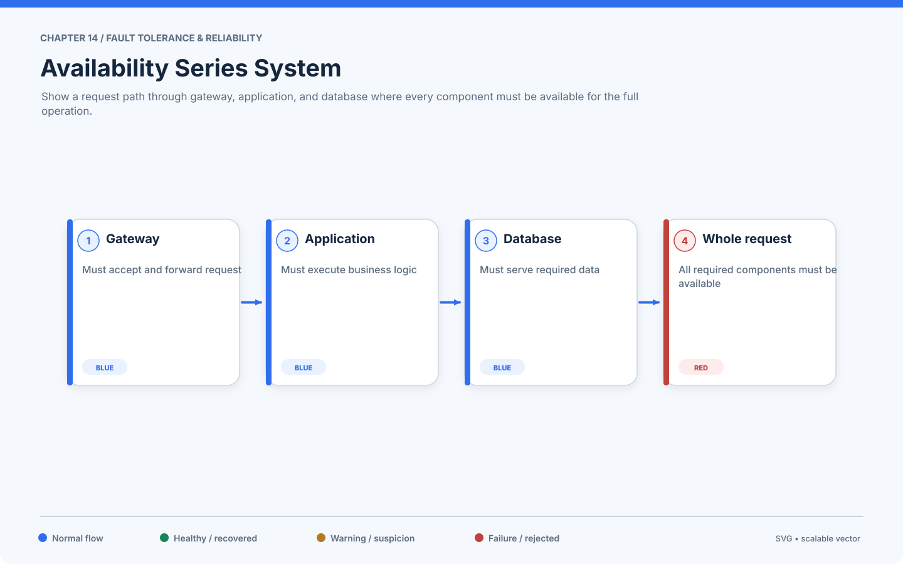

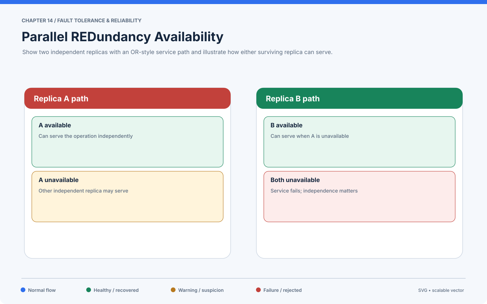

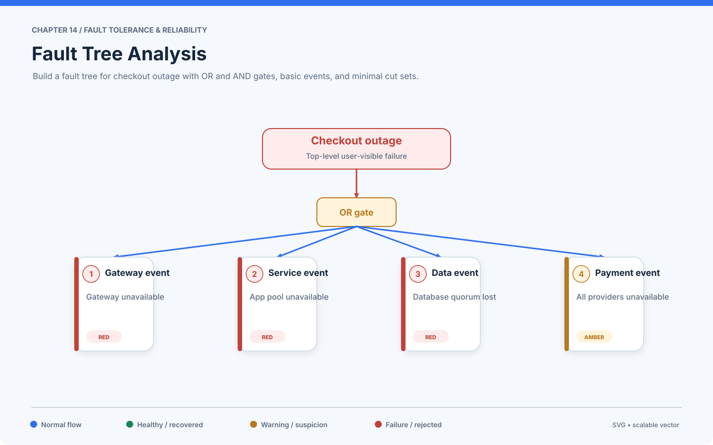

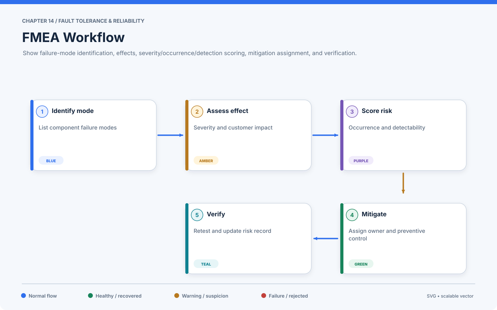

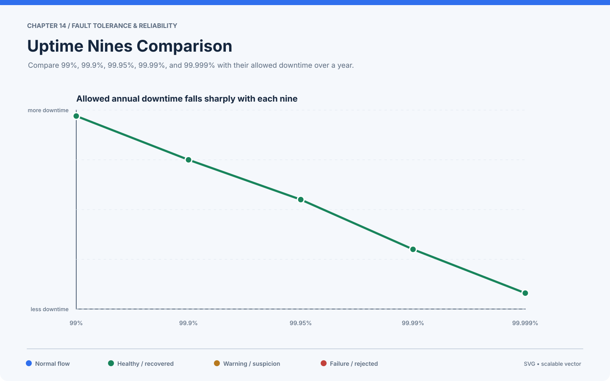

---
# 9. SLA, SLO, and SLI

Reliability targets need measurable definitions. “Highly available” is not an actionable engineering requirement until the team specifies what is measured, how it is measured, over what window, and what happens when the target is missed.

## 9.1 Service-Level Indicator (SLI)

A **Service-Level Indicator** is a quantitative measure of a user-relevant aspect of service behavior. Common examples include:

- **Availability SLI:** successful eligible requests divided by total eligible requests.
- **Latency SLI:** fraction of eligible requests completed below a defined threshold.
- **Error-rate SLI:** failed eligible requests divided by total eligible requests.
- **Throughput SLI:** completed useful operations per unit time.
- **Durability SLI:** probability or measured fraction of acknowledged data retained and recoverable.
- **Freshness SLI:** proportion of records or responses updated within a specified age.

For a request-based availability SLI, a basic form is:

\[
SLI_{availability}=\frac{\text{good requests}}{\text{eligible requests}}\times100\%
\]

The denominator matters. Excluding slow or failed requests from the denominator can make a service look healthier than it is. Define how to treat client cancellations, invalid requests, health probes, retries, and traffic from synthetic monitors. Prefer an SLI that reflects what a user experiences rather than a proxy such as CPU utilization.

## 9.2 Service-Level Objective (SLO)

A **Service-Level Objective** is an internal target for an SLI over a measurement window. It should reflect user expectations, business criticality, and the team's ability to operate the system.

Examples:

- At least 99.9% of eligible checkout requests succeed over a rolling 30-day window.
- At least 95% of product-page requests complete within 200 ms over a rolling 28-day window.
- At least 99.99% of critical transaction requests complete successfully, excluding only explicitly defined invalid client requests.

SLOs should define eligibility, measurement location, window, aggregation, exclusions, and ownership. Multiple SLOs may be needed: availability, latency, data freshness, and durability are distinct user promises.

## 9.3 Service-Level Agreement (SLA)

A **Service-Level Agreement** is an external or contractual commitment. It may specify the service, measurement method, exclusions, support obligations, remedies, and service credits. An SLA is generally a business/legal agreement, not merely a dashboard target. The internal SLO is commonly stricter than the SLA to create room for detection and response before contractual limits are breached.

## 9.4 SLI vs SLO vs SLA

| Dimension | SLI | SLO | SLA |
|---|---|---|---|
| Meaning | Measurement | Internal target | External commitment |
| Audience | Engineering and product | Service team and stakeholders | Customer/contracting parties |
| Purpose | Describe observed behavior | Guide reliability work and release decisions | Set contractual expectation and remedy |
| Example | 99.94% successful requests | Target 99.9% over 30 days | 99.5% monthly availability with stated exclusions |
| Enforcement | Data quality and review | Error-budget policy | Contract terms and possible service credits |
| Risk | Misleading metric | Unachievable or misaligned target | Legal/business exposure |

## 9.5 Error Budgets

An **error budget** is the amount of unreliability permitted by an SLO. For an availability target:

\[
Error\ Budget = 1-SLO\ Target
\]

For a 99.9% monthly SLO over a 30-day month, the error fraction is 0.1%. Total minutes are \(30\times24\times60=43,200\). The time-equivalent budget is:

\[
43,200\times0.001=43.2\text{ minutes}
\]

For a request-based SLO with 10 million eligible requests, the budget is 10,000 bad requests. A service may track both request-based and time-based reliability, but should not equate them when traffic volume varies substantially.

Error budgets help teams balance feature delivery and reliability. When the budget is healthy, the team may accept more release risk. When the budget is depleted or burning rapidly, the team may pause risky releases, invest in resilience, reduce change size, and prioritize corrective work. An error budget is not permission to intentionally consume user trust; it is a decision framework.

## 9.6 Burn Rate and Alerting

Burn rate measures how quickly the service consumes error budget relative to the rate allowed by the SLO. A burn rate of 1 consumes the budget at exactly the pace that would exhaust it by the end of the SLO window. A burn rate of 10 consumes it ten times faster.

\[
Burn\ Rate=\frac{Observed\ error\ rate}{Allowed\ error\ rate}
\]

For a 99.9% SLO, allowed error rate is 0.1%. If the observed error rate is 2%, burn rate is 20. An alert can combine a short window for fast incidents and a longer window to avoid paging on noise. Multi-window burn-rate alerting is more useful than relying on a single instantaneous threshold.

Good alerts are actionable and tied to user impact. Infrastructure alerts remain valuable for diagnosis and early warning, but not every CPU or memory fluctuation should page an on-call engineer.

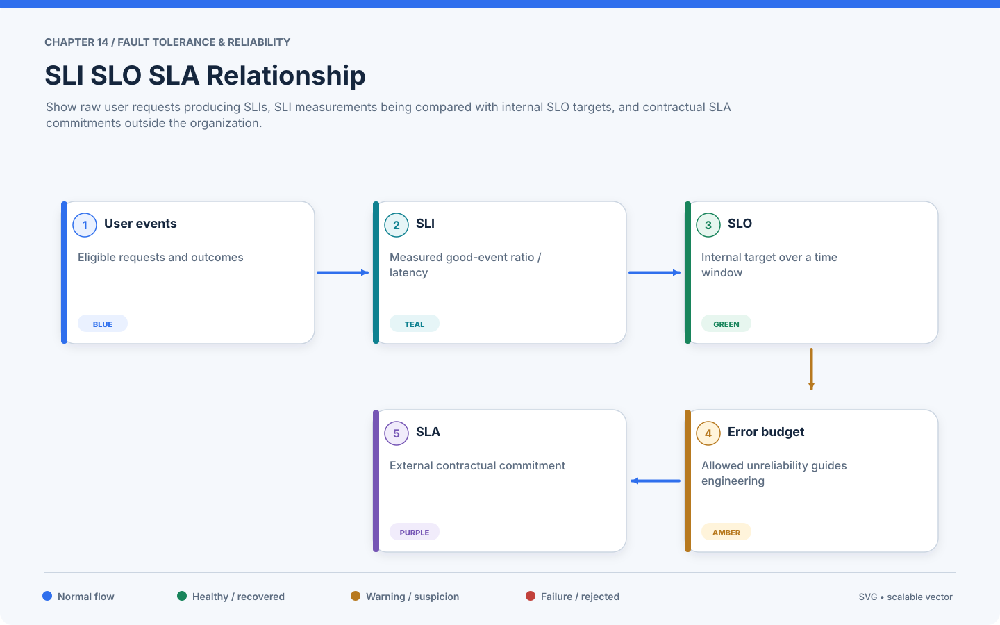

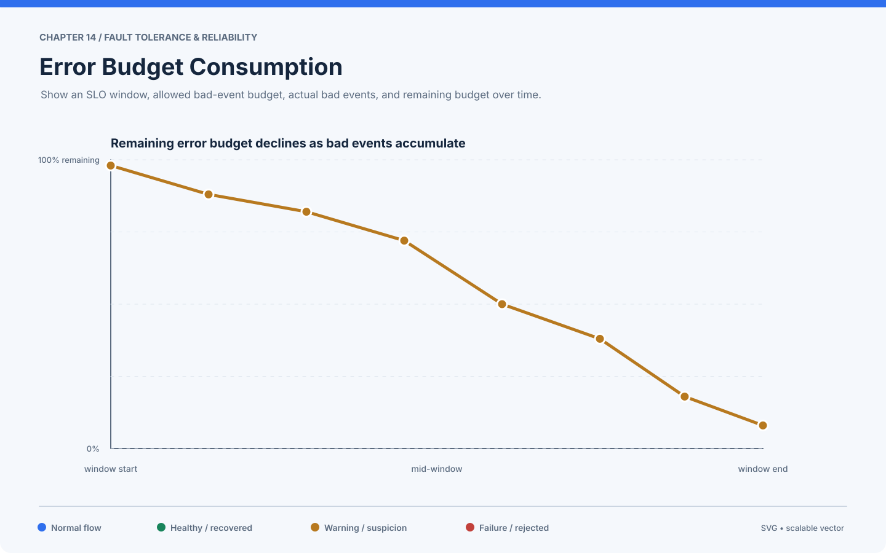

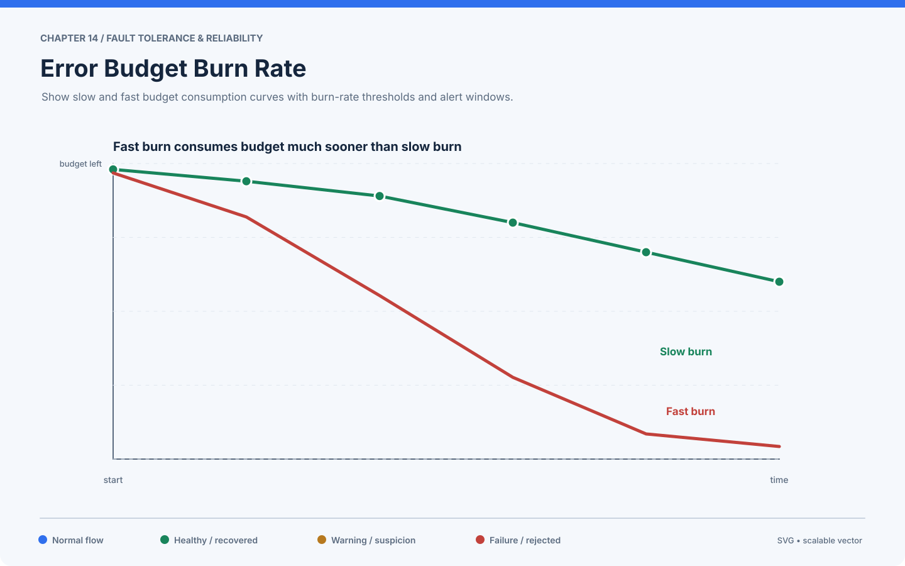

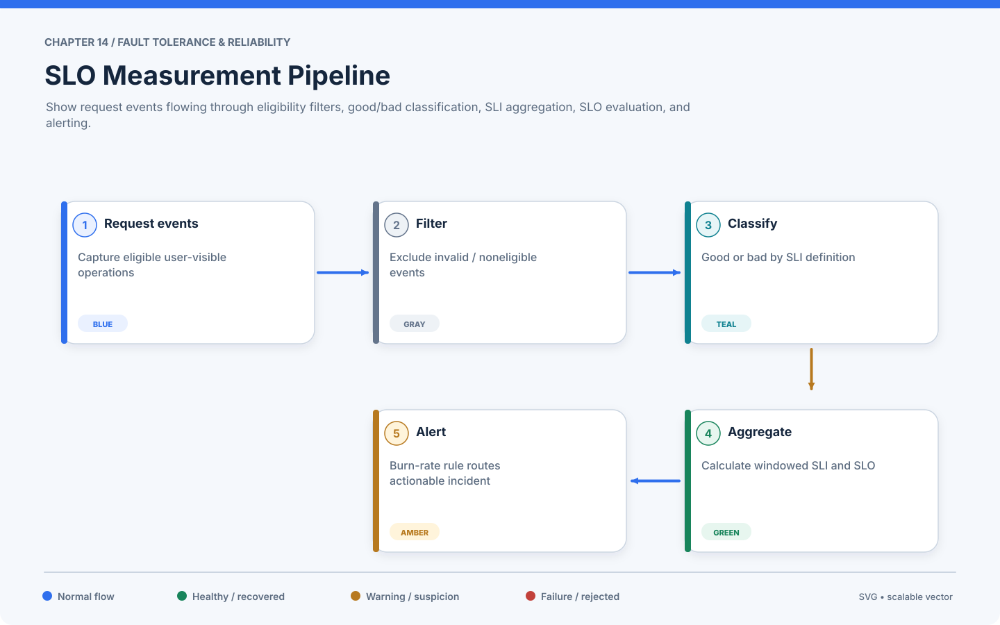

---

# 10. Disaster Recovery

Disaster recovery (DR) is the planned restoration of systems and data after a major disruptive event. High availability usually handles routine component failures; DR addresses large-scale events such as region loss, destructive data corruption, ransomware, accidental deletion, or a prolonged control-plane outage. Business continuity includes the broader people, process, customer, and business operations needed to continue or resume critical work.

## 10.1 Recovery Point Objective (RPO)

**RPO** is the maximum acceptable amount of data loss measured in time. An RPO of five minutes means that, after a disaster, the business is willing to lose at most the most recent five minutes of acknowledged or accepted updates, as defined by the system's contract.

Suppose a database replicates asynchronously to a secondary region with a measured lag of 90 seconds. If the primary region is destroyed, the secondary may be missing recent committed writes. A five-minute RPO can be met only if the measured and worst-case replication gap remains within the target and the failover procedure can safely identify the recovery point. Average lag is not enough; tail and outage behavior matter.

Synchronous replication can reduce acknowledged-write loss, but may increase latency and can block commits when the replica or quorum is unavailable. Asynchronous replication reduces coupling but introduces a nonzero data-loss window. Backups protect against some corruption and deletion events that replication copies faithfully; replication is not a backup.

## 10.2 Recovery Time Objective (RTO)

**RTO** is the maximum acceptable duration from the defined disaster start or declaration to restoration of the service at an acceptable level. State exactly when the clock starts and what “restored” means.

A 30-minute RTO might be decomposed as:

| Step | Target time | Cumulative time |
|---|---:|---:|
| Detect and validate incident | 3 min | 3 min |
| Declare disaster and authorize failover | 2 min | 5 min |
| Fence old primary and validate recovery point | 5 min | 10 min |
| Promote secondary database | 5 min | 15 min |
| Start/scale application dependencies | 5 min | 20 min |
| Run smoke tests and verify critical flows | 4 min | 24 min |
| Shift traffic gradually | 3 min | 27 min |
| Observe stability and communicate recovery | 3 min | 30 min |

These values are a planning example, not guaranteed timing. An RTO is achieved only when the entire critical path is ready, including identity, secrets, DNS/global routing, queues, schemas, network policies, and third-party dependencies.

## 10.3 DR Strategies

| Strategy | Standby state | Relative cost | Typical recovery behavior | Main limitation |
|---|---|---:|---|---|
| Backup and restore | Backups only; rebuild on demand | Low | Restore infrastructure and data | Long RTO; restore speed and backup quality matter |
| Pilot light | Minimal core services and replicated data foundations | Low–medium | Provision/scale the remaining stack | Activation and compatibility steps take time |
| Warm standby | Reduced-capacity environment continuously running | Medium | Scale up and shift traffic | Scaling, validation, and replication lag |
| Hot standby | Full or near-full capacity ready | High | Promote and switch traffic | Higher operating cost and state coordination |
| Multi-site active-active | Multiple sites serve live traffic | Very high/complex | Continue on surviving site, rebalance | Conflict handling, consistency, and split-brain risk |

Choose a strategy from business RPO/RTO, workload consistency, recovery complexity, cost, and operational maturity. A system with strict transaction ordering may prefer active-passive with a well-defined primary. A globally distributed read-heavy service may use active-active for reads while coordinating writes through a single authority or partitioned ownership model.

## 10.4 Multi-Region DR Workflow

A region failover is a coordinated state transition, not merely a DNS change. A safe sequence is:

1. Detect regional impairment and validate that the problem is not a local observer issue.
2. Declare the event and identify the decision authority.
3. Fence or isolate the failed primary so it cannot continue accepting writes.
4. Identify the recovery point and verify replication status.
5. Promote the secondary database or activate the selected recovery mode.
6. Verify schema version, secrets, identity, queues, storage, and external dependencies.
7. Run synthetic critical transactions and data-integrity checks.
8. Shift a small percentage of traffic, then increase it while monitoring.
9. Keep a record of data divergence and reconcile where needed.
10. Plan failback only after the original region is healthy and synchronization is complete.

**Split brain** occurs when two regions both accept writes as primary. Prevent it with fencing, leases/epochs, quorum, a single-writer authority, or a protocol suited to the data model. DNS or global traffic routing alone does not prevent split brain.

## 10.5 Failover and Failback

Failover moves service to the recovery environment. Failback returns service to the preferred environment after recovery. Failback can be riskier than initial failover because writes may have accumulated in the secondary. The procedure must reverse replication safely, reconcile divergent state, fence the active writer, validate the primary, and move traffic gradually. Do not fail back merely because the old region appears healthy.

## 10.6 DR Runbook Structure

A runbook should state: triggering signals; declaration authority; incident roles; scope and customer impact; prerequisites; fencing procedure; recovery-point selection; database promotion; application activation; secret and identity checks; traffic-shifting controls; test transactions; customer communication; failback conditions; and post-recovery evidence. Include exact commands only when they are maintained and tested for the current environment. Runbooks should be versioned with the infrastructure and exercised regularly.

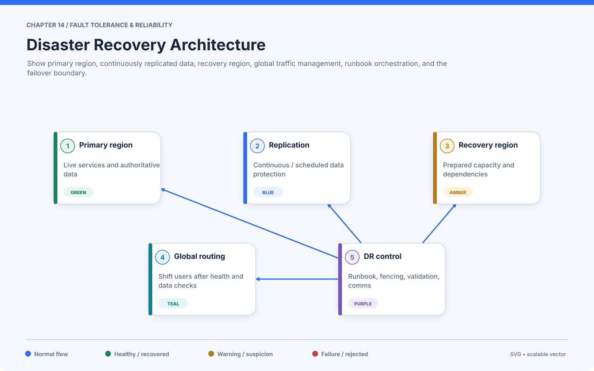

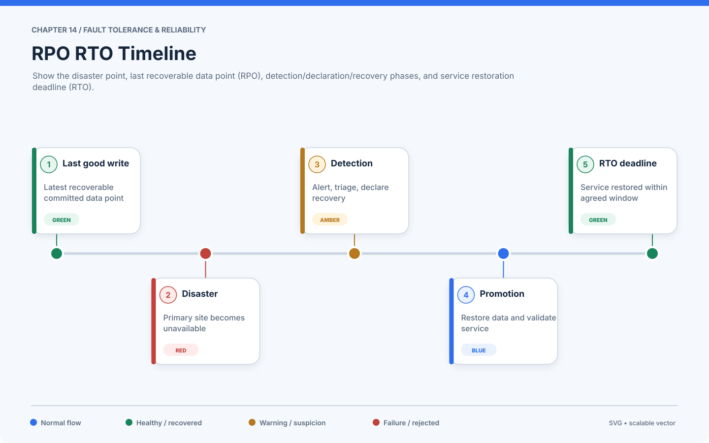

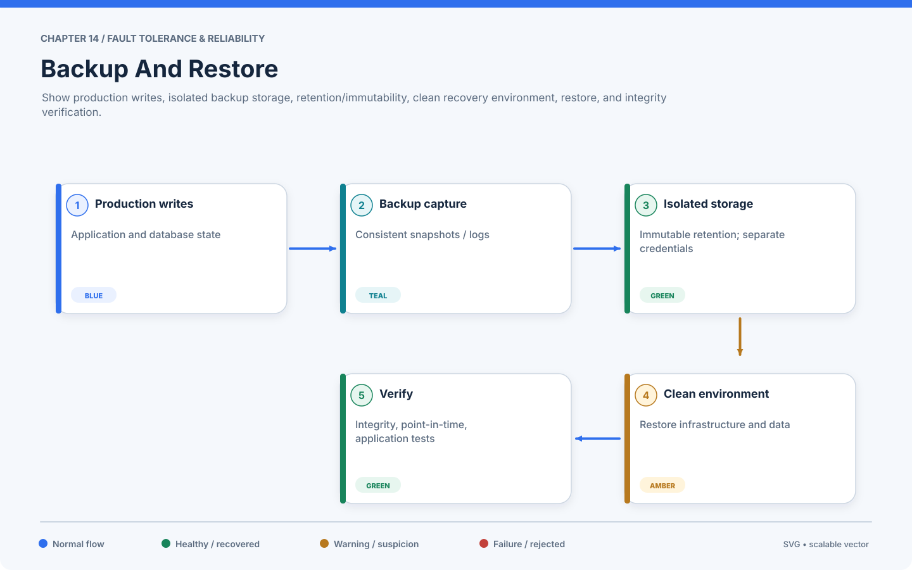

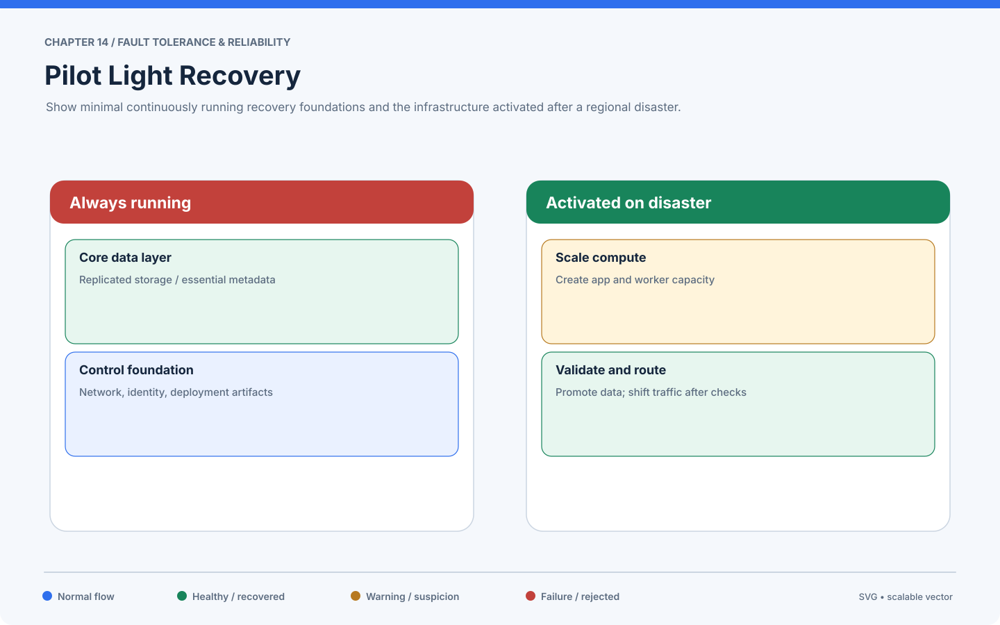

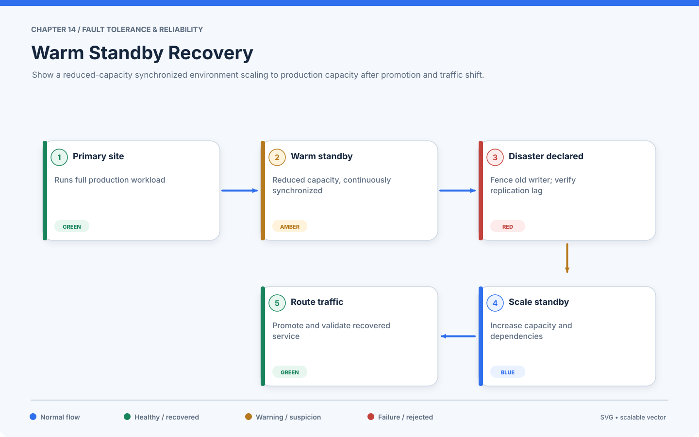

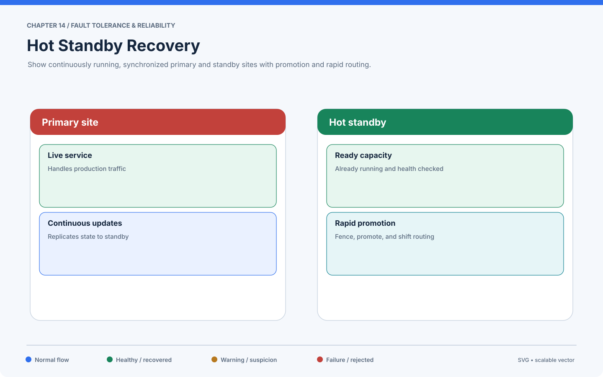


---

# 11. Chaos Engineering

Chaos engineering is a disciplined, hypothesis-driven practice for learning how a system behaves under realistic failure conditions. It is not random destruction. Experiments should be scoped, observable, reversible, approved, and designed to test a concrete reliability hypothesis.

## 11.1 Principles and Workflow

1. **Define steady state:** Identify user-facing signals such as successful transaction rate, latency, data correctness, and queue age.
2. **Form a hypothesis:** Example: “If one application pod is terminated, checkout success remains above 99.9% and p99 latency stays below 500 ms.”
3. **Choose a realistic variable:** Pod termination, packet delay, dependency error injection, zone isolation, or disk pressure.
4. **Limit blast radius:** Start with a noncritical service, test environment, small canary, or one zone.
5. **Set abort conditions:** Define exact thresholds that stop the experiment automatically or manually.
6. **Run the experiment:** Make one controlled change at a time where possible.
7. **Observe:** Compare steady-state signals and expected recovery behavior.
8. **Remediate:** Record gaps, assign owners, and verify fixes.
9. **Repeat:** Expand only when controls and confidence justify it.

Chaos engineering differs from load testing (capacity under workload), stress testing (behavior near or beyond limits), fault injection (the technique of introducing faults), resilience testing (broader validation of recovery behavior), and DR testing (restoration after major disaster). The practices can overlap.

## 11.2 Experiment Catalog

| Category | Example | Expected learning |
|---|---|---|
| Process/compute | Kill one application process or pod | Is traffic removed and rescheduled safely? |
| Host/zone | Terminate an instance or isolate one zone | Is remaining capacity sufficient? |
| Network | Add latency, packet loss, bandwidth restriction, or partition | Do deadlines, retries, and quorum behave safely? |
| DNS | Delay or fail a resolver path | Are cached answers and fallback resolvers understood? |
| Database | Deny connections, promote a replica, or add latency | Are pools bounded and recovery safe? |
| External dependency | Inject 500s, slow responses, or throttling | Do breakers, fallbacks, and retries behave as designed? |
| Resource | CPU, memory, disk, thread, or file-descriptor pressure | Are resource limits and alerts effective? |
| Configuration/security | Expired test certificate, stale discovery, invalid canary config | Are rollout validation and rollback effective? |
| Queue/stream | Pause consumer or increase lag | Does backpressure protect brokers and storage? |

## 11.3 Tools and Scope

- **Chaos Monkey / Simian Army concepts:** Randomized termination and broader failure experiments associated with Netflix's historical resilience practices. The name refers to a family of concepts rather than one universal standard tool.
- **LitmusChaos:** Kubernetes-native chaos experimentation and workflows.
- **Chaos Mesh:** Kubernetes-focused fault-injection platform covering selected network, pod, stress, and other experiments.
- **Gremlin:** Commercial reliability testing platform with infrastructure and application failure experiments.
- **AWS Fault Injection Service:** Managed fault-injection experiments for supported AWS resources and scenarios.
- **Kubernetes failure-injection tools:** A broad category of tools and test mechanisms; capabilities vary.

Check the current product documentation for supported resources, permissions, safety checks, and version-specific behavior. Do not assume every tool can simulate a complete region failure or a Byzantine fault.

## 11.4 Safe Experiment Design

Before a production experiment, require an owner, authorization, customer-impact assessment, scope, steady-state dashboard, abort control, rollback plan, on-call coverage, and data-integrity safeguards. Avoid experiments during migrations, critical business events, or active incidents unless explicitly approved as part of incident response. Start outside production and progressively increase realism. Never inject destructive data corruption into real customer data as a casual experiment.

## 11.5 Sample Game Day: Regional Database Failure

**Objective:** Validate that a service can recover from primary-region database unavailability within a 20-minute RTO and a 2-minute RPO.

**Roles:** Incident commander, database lead, application lead, network/cloud operator, observability lead, communications lead, and note-taker.

**Preparation:** Confirm backups, replication lag, recovery credentials, fencing procedure, traffic controls, and rollback. Notify stakeholders and define a stop condition if data integrity cannot be established.

**Execution:** Announce the simulated failure; verify alerts; declare the event; fence the primary; read the replication point; promote the standby; verify schema and secrets; run read/write smoke tests; shift a small traffic cohort; observe SLO, latency, errors, and replication; then complete controlled restoration or document failback as a separate exercise.

**Success criteria:** Measured RPO/RTO within target, no split brain, critical business operations valid, and runbook steps complete without undocumented manual intervention. Record every delay and ambiguity as an action item.


---

# 12. Cascading Failures

A **cascading failure** occurs when the failure or degradation of one component causes dependent components to fail, which then affects further components. The propagation follows dependency edges and resource coupling.

## 12.1 End-to-End Failure Chain

Consider a platform where product requests call recommendations synchronously:

1. Recommendation service latency rises from 40 ms to 2 seconds.
2. Product service waits for recommendations before returning.
3. Product-service threads and outbound connections remain occupied.
4. Its request queue grows and its own p99 latency increases.
5. API gateway deadlines expire and client-visible 5xx/timeout rates rise.
6. Clients retry, increasing traffic to product and recommendations.
7. CPU, memory, and connection pressure increase.
8. Other product operations share the same pools and also fail.
9. Autoscaling may add product instances, each opening more connections to the already overloaded recommendation service or shared database.

A localized latency issue becomes a system-wide outage because the architecture allowed waiting, retries, queueing, and shared resources to propagate the problem.

## 12.2 Positive Feedback Loops

A positive feedback loop occurs when the system's response to degradation makes the degradation worse. Common loops include:

- **Retries:** failures create additional attempts, which increase load and create more failures.
- **Queue accumulation:** growing queues increase wait time, causing deadlines to expire and wasting work.
- **Resource contention:** more queued work consumes memory and scheduler time, reducing useful throughput.
- **Garbage collection pressure:** allocation and queue growth create more frequent pauses, increasing timeouts.
- **Health-check storms:** overloaded nodes respond slowly, causing more probes or restarts, which add work.
- **Autoscaling feedback:** new instances overwhelm a shared database or cache, reducing total throughput.

## 12.3 Prevention and Containment

Use bounded queues, concurrency limits, per-dependency bulkheads, short and meaningful deadlines, retry budgets, jitter, circuit breakers, load shedding, nonblocking optional work, capacity headroom, and controlled autoscaling. Keep recovery operations from competing with ordinary user traffic. Make dependency graphs visible and identify high-centrality shared services such as identity, DNS, configuration, secrets, and databases.

## 12.4 Dependency Graph Analysis

A dependency graph records which service calls or relies on another service, database, queue, or external API. Mark edges as synchronous/asynchronous, critical/optional, and read/write. Identify:

- Critical paths that must complete for a transaction.
- Shared dependencies whose failure affects many services.
- Fan-out points that turn one request into many downstream calls.
- Cycles that create deadlocks or retry loops.
- Recovery dependencies needed to restore the service itself.

A service with many dependents may be a high-impact failure point even if its own traffic is modest.


---

# 13. Metastable Failures

A **metastable failure** is a degraded operating state that sustains itself through feedback mechanisms even after the original trigger has disappeared. The system may be unable to return to normal simply because incoming load has returned to baseline.

## 13.1 Example: Overload That Persists After a Traffic Spike

1. A traffic spike overloads a service.
2. Requests begin timing out.
3. Clients retry and add more work.
4. Queues accumulate stale or no-longer-useful requests.
5. Autoscaling adds instances.
6. Each new instance increases the number of database connections.
7. The shared database becomes slower and connection pools fill.
8. Application retries continue while queue age grows.
9. The original traffic spike ends, but the service remains overloaded because retries, queues, and dependency pressure persist.

Removing the original trigger does not remove the internal state created by the feedback loop. Recovery requires an intervention that reduces amplification, drains or discards work safely, and restores critical dependencies in a controlled sequence.

## 13.2 Triggers and Enabling Conditions

Triggers include retry storms, cache stampedes, connection exhaustion, mass pod restart, bad autoscaling policy, a failed deployment, or temporary regional congestion. Enabling conditions include unbounded queues, no retry budget, shared resource pools, excessive connection fan-out, slow scale-in, health checks coupled to overloaded dependencies, and recovery work competing with production traffic.

## 13.3 Prevention and Recovery

Prevention:

- Bound queue length and maximum queue age.
- Use backoff and jitter, with explicit retry budgets.
- Limit in-flight work and database connections.
- Use circuit breakers and bulkheads.
- Stabilize autoscaling with sensible windows and rate limits.
- Avoid mass restarts and simultaneous reconnects.
- Reserve capacity for health, control, and recovery operations.

Recovery:

1. Stop amplification by reducing or disabling retries that are not useful.
2. Shed low-priority new work and apply strict concurrency limits.
3. Drain, expire, or discard queued work according to business semantics; do not blindly purge financial or durable jobs.
4. Restore the shared dependency and its connection capacity first.
5. Reintroduce application capacity gradually, limiting connection fan-out.
6. Prioritize critical operations and let stale background work expire.
7. Confirm queue age, latency, saturation, and error rates stabilize before lifting protections.

Aggressively restarting all nodes can make a metastable state worse by triggering synchronized initialization, cache misses, TLS handshakes, database reconnects, and replay workloads.

## 13.4 Cascading vs Metastable Failure

| Dimension | Cascading failure | Metastable failure |
|---|---|---|
| Core behavior | A fault propagates across dependencies | System settles into self-sustaining degraded state |
| Trigger | Initial component/dependency failure | Often overload or a transient trigger plus feedback |
| Propagation | Dependency graph and resource coupling | Positive feedback and retained internal work/state |
| After trigger disappears | May recover when dependency recovers | May remain degraded until feedback is actively broken |
| Key defenses | Isolation, timeouts, breakers, independent dependencies | Bounded queues, retry budgets, controlled scaling, recovery prioritization |
| Relationship | Can cause a cascade | Can be created by a cascade; both can coexist |


---

# 14. Autoscaling and Reliability

Autoscaling changes capacity in response to observed or predicted demand. It helps with variable load and some instance failures, but it is not an immediate substitute for spare capacity, admission control, or architecture that contains failures.

## 14.1 Scaling Modes

- **Horizontal scaling:** Add or remove instances, pods, or workers.
- **Vertical scaling:** Increase or decrease CPU, memory, or other resources of an instance.
- **Reactive scaling:** Change capacity after a metric crosses a threshold.
- **Predictive scaling:** Add capacity based on forecasts or known patterns.
- **Scheduled scaling:** Apply capacity changes at known times.
- **Metric-based scaling:** Use CPU, memory, request rate, latency, or custom metrics.
- **Queue-based scaling:** Scale workers using queue depth, message age, or lag.

Kubernetes Horizontal Pod Autoscaler adjusts pod replica counts using configured metrics. Cluster Autoscaler (or a cloud-specific node autoscaler) changes node capacity when pods cannot be scheduled or nodes are underutilized. Cloud auto scaling groups provide analogous instance-level policies. Queue-based worker scaling should consider message age and per-worker throughput, not just queue length.

## 14.2 Delays and Stabilization

Autoscaling is delayed by metric collection, control loops, scheduling, image pulls, startup, readiness checks, cache warming, and connection establishment. Scale-out that begins only after saturation may arrive too late. Maintain a minimum capacity floor and headroom for expected bursts and failure scenarios.

Scale-in requires stabilization to avoid removing capacity during a transient dip. Set minimum/maximum replicas, scale-out rate limits, scale-in windows, cooldowns, startup/readiness gates, and protection for long-running jobs. Hysteresis reduces oscillation by using different thresholds or delay windows for adding and removing capacity.

## 14.3 Autoscaling Can Amplify an Outage

If each new application instance opens 200 database connections, adding 20 instances can add 4,000 connections. If the database's safe connection budget is 2,000, scaling the application worsens the database outage. Similar amplification occurs when new instances cold-start and stampede a cache, replay queued jobs, or trigger synchronized health checks.

Scale on the true bottleneck. Use connection budgets, pool limits, queue-based scaling with downstream capacity controls, backpressure, and staged rollout. More instances increase concurrency; they do not necessarily increase end-to-end throughput if the database, broker, or external provider is the bottleneck.

## 14.4 Queue-Based Worker Scaling

A queue-based scaler should observe queue depth, oldest-message age, arrival rate, and completion rate. Approximate time to drain can be estimated as:

\[
T_{drain}\approx\frac{Q}{N\times\mu}
\]

where \(Q\) is queued work, \(N\) is active workers, and \(\mu\) is safe per-worker completion rate. This is an approximation that assumes homogeneous tasks and stable service time. Long-tail jobs, retries, and downstream limits require more sophisticated control.


---

# 15. Production Incident Management and Reliability Operations

Reliability is an operational discipline as much as an architecture property. During an incident, the goal is to reduce user impact safely, maintain shared situational awareness, preserve evidence, and restore service without creating a second failure.

## 15.1 Incident Response Lifecycle

1. **Detection:** SLO alerts, customer reports, synthetic probes, or operational alarms reveal abnormal behavior.
2. **Triage:** Establish symptoms, scope, timeline, affected regions, and user-facing impact.
3. **Declaration:** Assign severity and activate an incident response structure.
4. **Containment:** Stop propagation through isolation, traffic controls, feature disablement, or load shedding.
5. **Mitigation:** Restore a useful service path even if the root cause is not yet fixed.
6. **Recovery:** Repair the underlying dependency, promote replicas, roll back a change, or restore data.
7. **Validation:** Run critical synthetic transactions, data integrity checks, and observe SLO metrics.
8. **Communication:** Provide accurate status to customers, stakeholders, and responders.
9. **Post-incident review:** Reconstruct events, identify systemic contributors, and assign verifiable actions.

Mitigation and root-cause correction are different. It may be safer to roll back a change than to debug it live. Avoid risky changes during an incident unless their expected benefit and rollback path are understood.

## 15.2 Incident Roles

| Role | Responsibility |
|---|---|
| Incident Commander (IC) | Sets priorities, assigns work, maintains shared plan, and controls incident scope |
| Operations/technical lead | Directs diagnosis and mitigation across responders |
| Communications lead | Maintains internal and customer-facing updates |
| Service owner | Supplies domain knowledge and validates service-specific behavior |
| Scribe | Maintains timeline, decisions, hypotheses, and actions |
| Responders | Execute bounded diagnostic and mitigation tasks |

In small teams, one person may temporarily fill multiple roles, but command, technical work, and communications should be separated when incident complexity grows.

## 15.3 Runbooks and Playbooks

A runbook provides tested operational steps for a known condition. A playbook provides a decision framework for a class of incidents. Useful content includes entry criteria, prerequisites, commands or links, expected outputs, decision points, stop conditions, rollback instructions, escalation contacts, and evidence to capture. Automate deterministic low-risk steps; keep explicit human approval for destructive or high-impact changes.

## 15.4 Blameless Postmortems

A postmortem should include:

- Impact: affected users, duration, regions, and business functions.
- Timeline: detection, decisions, changes, mitigation, recovery, and communications.
- Root cause and contributing conditions, not just the first visible symptom.
- Detection gaps: why alerts or dashboards did not reveal the problem earlier.
- Containment/recovery gaps: why the blast radius or duration was larger than expected.
- Corrective actions with owners, due dates, and verification criteria.

Blameless does not mean accountability-free. It means analyzing conditions, incentives, tooling, and system design instead of assuming an individual intended to cause harm. A corrective action should change a system property, not merely tell someone to “be more careful.”

## 15.5 Reliability Reviews

Architecture and operational readiness reviews should examine failure models, failure domains, capacity, dependency graphs, SLO definitions, retry ownership, isolation, backup restoration, DR runbooks, deployment safety, observability, and chaos/game-day evidence. Review risk in relation to business criticality and record accepted residual risks explicitly.


---

# 16. Observability for Reliability Engineering

Observability is the ability to infer internal system behavior from outputs such as metrics, logs, traces, events, and profiles. Reliability operations require enough context to distinguish a failed component from a slow dependency, routing problem, capacity issue, or invalid configuration.

## 16.1 Four Golden Signals

| Signal | Meaning | Example question |
|---|---|---|
| Latency | Time to serve requests, ideally split by success and failure | Are successful requests slower, or are failures returning quickly? |
| Traffic | Demand placed on the system | Did request rate, message rate, or connection count change? |
| Errors | Rate of failed or incorrect operations | Which route, region, tenant, or dependency is failing? |
| Saturation | How close a constrained resource is to its limit | Are threads, connections, queues, CPU, memory, or storage saturated? |

Latency should be measured with histograms/percentiles. Averages can hide tail behavior. Separate successful and failed request latency because fast failures can make an overall latency average look deceptively good.

## 16.2 RED and USE

**RED** applies to services: Rate (requests per second), Errors (failed requests), and Duration (latency distribution). **USE** applies to resources: Utilization, Saturation, and Errors. A service dashboard should combine RED with dependency and resource signals; an infrastructure dashboard should combine USE with workload and user-impact context.

## 16.3 Reliability Metrics

Useful measurements include availability SLI, error rate, p50/p95/p99 latency, MTTR, MTBF, error-budget burn rate, failover success rate, recovery duration, replication lag, queue depth and age, retry rate, circuit-breaker openings, dependency success rate, rejected requests, and data-integrity checks. Define metric labels carefully to avoid high-cardinality explosions caused by raw user IDs or request IDs.

## 16.4 Logs, Traces, and Dependency Maps

Structured logs provide event context; distributed traces connect spans across services; metrics show aggregate trends. Correlation IDs and trace IDs should be propagated through gateways and downstream calls. A trace should include useful error status, dependency name, timeout/retry attributes, and region/zone context without exposing secrets or sensitive payloads.

Dependency maps help identify shared services and critical paths. They should be validated against real traffic because static architecture diagrams often omit runtime dependencies and failover paths.

## 16.5 Alerting

Prefer symptom-based alerts that indicate user impact or imminent SLO exhaustion. Cause-based alerts are valuable for diagnosis, but should be prioritized according to actionability. Multi-window burn-rate alerts can page on rapid budget consumption while slower trends create tickets. Alerts should state the affected service, observed symptom, scope, relevant dashboard, and immediate runbook.

## 16.6 Reliability Tooling Roles

| Tool | Common role |
|---|---|
| Prometheus | Metrics collection and query model, commonly with pull-based scraping |
| Grafana | Dashboards and visualization across metrics/logs/traces sources |
| OpenTelemetry | Vendor-neutral instrumentation and telemetry collection/export standards |
| Jaeger | Distributed tracing backend and trace analysis |
| Alertmanager | Alert grouping, deduplication, routing, and inhibition in Prometheus ecosystems |
| CloudWatch | AWS monitoring, metrics, logs, and alarms |
| Datadog | Hosted observability across metrics, logs, traces, and infrastructure |
| New Relic | Application and infrastructure observability platform |

Tool capabilities and deployment models change over time; choose by data requirements, scale, privacy, integration, operational burden, and cost rather than brand familiarity alone.


---
# 17. Real-World Reliability Architecture Case Studies

The following are production-style hypothetical designs. Numerical values are illustrative assumptions for engineering exercises, not claims about a named company's private architecture or measured production performance.

## 17.1 Case Study 1 — E-Commerce Platform During a Flash Sale

**Business problem:** A retailer expects a short launch window with demand several times normal traffic. Product browsing is important, but checkout correctness and payment integrity are more important than optional personalization.

**Traffic and requirements:** Assume 25,000 requests/s at peak, with 15% reaching checkout APIs. Product-page p99 target is 500 ms; checkout success target is 99.9% for eligible requests. Avoid overselling and duplicate payment capture.

**Architecture:** CDN and edge cache serve static assets; global routing directs users to healthy regions; regional gateways authenticate and apply per-user/per-IP quotas. Stateless product services run across zones. Catalog reads use bounded-stale caches. Checkout uses inventory reservation, a payment orchestration service, idempotency keys, durable order state, and asynchronous reconciliation. Queues absorb noncritical email, analytics, and fulfillment notifications.

**Failure model and detection:** Expect timing failures from cache/database overload, omission failures from payment-provider timeouts, and zone-level crash failures. Monitor end-to-end checkout success, p99 latency, cache hit rate, database connections, queue age, payment outcome ambiguity, and per-zone health.

**Containment and recovery:** Bulkhead payment/inventory pools; set strict deadlines; use circuit breakers on optional recommendations and noncritical providers; shed low-priority browsing enrichment; queue durable background work. If payment outcome is unknown, query by idempotency key before retry. Preserve inventory safety even if checkout becomes temporarily unavailable.

**Rate/traffic strategy:** Edge rate limits and flash-sale waiting-room admission protect origin capacity. Concurrency limits protect inventory and payment. Weighted regional routing accounts for capacity; it must not send more traffic to a region whose database is already saturated.

**Trade-offs and lessons:** Caching improves read capacity but does not solve write contention or inventory correctness. A waiting room may reduce conversion in the short term but is better than total overload. Recovery must preserve order and payment consistency.

## 17.2 Case Study 2 — Global Banking Platform

**Business problem:** A banking platform must protect transaction integrity and provide access to critical services through infrastructure disruptions. Incorrect balances or duplicate transfers are worse than temporary inability to transact.

**Requirements:** Strongly controlled write ownership, auditability, strict authorization, durable transaction records, defined regional RPO/RTO, and carefully tested failover. Illustrative target: 15-minute RTO and near-zero loss for acknowledged ledger commits where the selected synchronous quorum model can support it.

**Architecture:** External traffic enters through redundant edge protection and API gateways. Identity and authorization are mandatory dependencies. Transaction services use durable command handling and a ledger database with a clear primary/quorum authority. Read replicas serve appropriate noncritical queries. The DR region receives protected replication and immutable backups. A fencing/epoch mechanism prevents two regions from simultaneously accepting writes.

**Detection:** Monitor synthetic login and transaction flows, quorum health, replication lag, commit latency, certificate expiry, audit-log continuity, and regional dependency health. Do not treat a green host check as proof that a ledger commit is safe.

**Recovery:** If a region is suspected partitioned, stop or fence the old writer before promoting the secondary. Verify the last committed transaction position and audit log. Reconcile unknown transaction outcomes using immutable transaction IDs. Only then shift write traffic. If the RPO cannot be proven, keep writes disabled until state is reconciled.

**Trade-offs:** Synchronous replication improves acknowledged-write durability but may reduce write availability during partitions. Read-only service may remain available while writes are unavailable. Fail-closed authorization and fraud controls can reduce availability but protect customers and the institution.

## 17.3 Case Study 3 — Multi-Region SaaS Platform

**Business problem:** A multi-tenant SaaS product serves customers in multiple geographies and must continue during a regional outage without allowing one tenant to overload shared infrastructure.

**Requirements:** Tenant isolation, regional placement, data residency, defined recovery objectives, and controlled traffic evacuation. Assume 12,000 API requests/s globally, partitioned across three regions.

**Architecture:** Global routing uses health and capacity signals. Each region has stateless API and worker pools across zones. Tenant routing maps a tenant to a home region or data partition. Data replication policy depends on tenant consistency requirements. A shared control plane distributes configuration but has a separate recovery path.

**Detection:** Region-level synthetic transactions, tenant-level error and latency, replication lag, queue age, and control-plane health. A region is not considered ready solely because its compute fleet is running; data, identity, keys, and queues must be ready.

**Containment/recovery:** Apply per-tenant concurrency and queue quotas. On region loss, evacuate only eligible tenants whose data is available at the destination. Avoid indiscriminate failover that would overload the surviving region. Use explicit ownership epochs to prevent dual writes. After recovery, perform controlled data reconciliation and failback.

**Trade-offs:** Active-active compute does not imply active-active writes. Tenant-aware placement helps locality and isolation but complicates migration and disaster recovery. Regional capacity must include the expected evacuated load plus operational headroom.

## 17.4 Case Study 4 — Payment Processing System

**Business problem:** A payment orchestration service depends on external processors that can return errors, throttle, or time out after a transaction has been accepted.

**Traffic/requirements:** Assume 3,000 payment attempts/s during peak. No duplicate captures; every attempt must have a traceable final state such as pending, authorized, captured, declined, reversed, or unknown/reconciling.

**Architecture:** API gateway validates authentication and request shape. Payment orchestration persists an operation record before dispatch. Provider adapters isolate provider-specific contracts and use dedicated connection/concurrency pools. An outbox or durable queue carries status updates and reconciliation jobs. Idempotency keys and provider references link attempts.

**Failure handling:** A timeout after request submission creates an unknown outcome, not an automatic decline. The orchestrator queries provider status or retries using the provider's idempotency mechanism. Circuit breakers isolate a failing provider. Traffic may be shifted to an alternate provider only when payment method, region, merchant agreement, and duplicate-processing semantics are compatible.

**Observability:** Track authorization/capture success, unknown-outcome age, provider latency, duplicate suppression, reconciliation backlog, and reversal rate. Alert on aged pending states, not merely raw HTTP errors.

**Trade-offs:** A durable state machine and reconciliation add complexity but make financial side effects recoverable. Retrying blindly can create double charges; failing closed may reduce conversion but protects integrity.

## 17.5 Case Study 5 — Microservices Platform

**Business problem:** A platform with dozens of services suffers when one dependency becomes slow and shared thread pools turn a local issue into a platform outage.

**Architecture:** Service-to-service calls have explicit deadlines, typed retry policies, bounded concurrency, and circuit breakers. Critical dependencies use isolated pools. Noncritical enrichment runs asynchronously or is omitted. Distributed tracing records dependency latency, retry attempts, and cancellation. A service mesh may provide consistent mTLS, telemetry, and traffic policy, but application-level business fallbacks remain in service code.

**Failure scenarios:** A slow search service, Redis outage, overloaded identity provider, or bad rollout. Detect through RED metrics per route and dependency, pool saturation, timeout rate, and SLO burn.

**Recovery:** Disable optional feature flags, open breakers, shed low-priority requests, and restore dependency capacity. Avoid retrying at both application and mesh layers without a combined budget. Use canaries and automated rollback for configuration changes.

**Trade-offs:** A service mesh standardizes transport behavior but adds proxy resources and operational complexity. A mesh does not automatically make a service resilient if it has unbounded queues or unsafe business retries.

## 17.6 Case Study 6 — Distributed Database Cluster

**Business problem:** A replicated database cluster must detect unreachable nodes, maintain membership, and preserve a safe write quorum.

**Architecture:** Multiple nodes maintain membership and replication state. Heartbeat/accrual-style suspicion and gossip disseminate liveness information. The consensus or replication protocol defines which nodes can commit writes. Snapshots and logs support node replacement and repair.

**Failure model:** Node crash, network partition, delayed messages, slow disk, and asymmetric reachability. A node may be alive but too slow to participate in quorum.

**Detection/recovery:** Use heartbeat history and suspicion thresholds to trigger investigation or membership transition, but use the database protocol's quorum and ownership rules for safe writes. Replace a node only after fencing and membership rules are satisfied. Rebuild from a valid snapshot/log and monitor repair bandwidth so recovery does not saturate the cluster.

**Observability:** Peer latency, phi/suspicion score where exposed, quorum health, commit latency, compaction, disk latency, replication lag, repair progress, and pending hints/logs.

**Trade-offs:** Aggressive detection improves failover speed but risks false suspicion; conservative detection slows recovery. Replication increases fault tolerance but creates repair and consistency costs.

## 17.7 Case Study 7 — Cloud Storage Platform

**Business problem:** Storage must preserve acknowledged data through device, host, and zone failures while keeping reads/writes available within an explicit service contract.

**Architecture:** Data is partitioned into objects or extents and stored using replication or erasure coding across failure domains. Metadata is separately replicated and protected. Immutable backups and integrity checks protect against logical corruption and malicious deletion. Reads can use healthy replicas; writes follow a commit/acknowledgment policy.

**Failure behavior:** A disk failure triggers reconstruction; a host failure removes one placement; a zone failure may trigger degraded reads or write restrictions. A corrupted object may be replicated unless checksums and repair validation detect it.

**Recovery:** Use checksums, scrub jobs, versioning, repair queues, rate-limited reconstruction, and restore drills. Protect repair traffic from overwhelming foreground I/O. Set a durability objective and validate actual failure-domain placement.

**Trade-offs:** Replication consumes more storage but can be simpler and faster to repair. Erasure coding improves storage efficiency but adds CPU/network cost and may have different recovery characteristics. Backups are required for logical deletion and corruption; replication alone copies mistakes.

## 17.8 Case Study 8 — Video Streaming Platform

**Business problem:** Streaming demand is highly variable and media delivery uses long-lived connections and large amounts of bandwidth. Origin failure should not interrupt all active playback.

**Architecture:** A CDN/edge network serves cached media segments. Global routing directs clients to suitable edge locations. Multiple regional origins store replicated media; packaging and metadata services have separate failure domains. Playback APIs use bounded retries and session tokens; client players can select alternate bitrates and retry segments.

**Detection:** Edge cache hit rate, origin error rate, segment fetch latency, rebuffering ratio, regional bandwidth, and playback start success. Synthetic playback verifies the full user path.

**Recovery:** Use alternate origins, stale manifests only where safe, pre-positioned hot content, and adaptive bitrate reduction. Avoid sending every cache miss to one origin during recovery. Rate-limit origin revalidation and protect metadata services.

**Trade-offs:** CDN caching reduces origin dependence but invalidation and freshness are harder. Lower bitrate preserves continuity but reduces quality. Edge availability is not the same as account, entitlement, or billing availability.

## 17.9 Case Study 9 — High-Throughput Messaging System

**Business problem:** A message broker must remain available through broker failures and protect producers/consumers when processing slows.

**Architecture:** Partitioned topics span broker replicas with leader/follower roles and configured acknowledgment policy. Producers use bounded retries and idempotence where available. Consumers track offsets and processing state. Dead-letter and retry topics isolate poison messages. Consumer groups scale within broker and downstream capacity limits.

**Failure scenarios:** Broker crash, leader election, network partition, consumer lag, poison message, downstream database outage, and disk saturation.

**Recovery:** Detect broker and partition health; elect a safe leader; maintain producer retry limits; throttle consumers when downstream storage is saturated; preserve offsets and avoid acknowledging before durable processing. Replay must be idempotent or deduplicated.

**Monitoring:** Under-replicated partitions, request latency, producer retry rate, consumer lag/age, disk usage, leader changes, and dead-letter count.

**Trade-offs:** Stronger acknowledgment policies improve durability but increase latency and reduce availability during replica loss. At-least-once processing is common and requires idempotent consumers; exactly-once claims must be scoped to the specific transactional boundary.

## 17.10 Case Study 10 — Hypothetical Large-Scale Cloud Service Outage

**Scenario:** A shared configuration dependency becomes slow. Health checks depend synchronously on it and begin marking healthy services unready. Orchestrators restart instances, which all reconnect simultaneously. Client libraries retry configuration reads. Autoscaling adds instances, increasing connections to the already saturated shared dependency. Multiple services lose readiness even though their local application logic is healthy.

**Timeline:** At T+0, configuration latency rises. At T+3 minutes, readiness failures rise. At T+5 minutes, mass restarts increase connection pressure. At T+8 minutes, retry traffic and autoscaling push the dependency beyond its safe connection budget. At T+12 minutes, unrelated services report errors because they cannot refresh configuration. At T+18 minutes, responders disable nonessential refreshes and restore cached last-known-good configuration for approved keys. At T+25 minutes, connection admission is bounded and restart automation is paused. At T+40 minutes, configuration service recovers and instances rejoin gradually.

**Root causes and contributors:** Health checks coupled to an external control dependency; no stale last-known-good mode; unbounded reconnect/retry behavior; simultaneous restarts; autoscaling without dependency capacity awareness; insufficient separation between control plane and data plane.

**Recovery:** Stabilize the configuration store; block retry amplification; pause disruptive automation; restore critical services from validated cached configuration; gradually resume refresh traffic; verify configuration version and integrity; then re-enable scaling and health checks in stages.

**Corrective actions:** Separate liveness from dependency readiness, cache validated configuration, use jitter and request coalescing, impose connection limits, add control-plane isolation, test shared dependency failure in game days, and add SLOs for configuration fetch success and age.

---

# 18. Technology and Architecture Comparisons

These comparisons describe general architectural trade-offs. Implementations differ, and exact defaults should be verified in the product/version being deployed.

## 18.1 Detection and Isolation

| Comparison | Core difference | Strength | Failure/recovery trade-off | Suitable use |
|---|---|---|---|---|
| Heartbeat vs phi-accrual | Fixed missed-message threshold vs statistical suspicion score | Heartbeat is simple; phi adapts to observed delay | Phi can be misled by shifting distributions; neither proves failure | Cluster membership with variable latency |
| Centralized vs gossip detection | One observer vs peer dissemination | Centralized is easy to inspect; gossip avoids one monitor bottleneck | Central monitor is a dependency; gossip converges gradually | Small controlled fleets vs large clusters |
| Circuit breaker vs retry | Stop calls after a failure signal vs try again | Breaker protects dependency; retry masks transient faults | Excess retries amplify load; breaker can reject during recovery | Combine short safe retries with breaker policies |
| Circuit breaker vs bulkhead | Call admission state vs resource partition | Breaker reduces calls; bulkhead limits resource consumption | Breaker does not isolate all resources; bulkhead does not restore dependency | Dependency-heavy services |
| Bulkhead vs load shedding | Isolate resources vs reject selected work | Bulkhead bounds blast radius; shedding preserves capacity | Bulkhead may underutilize; shedding can reduce functionality | Multi-dependency platforms under overload |
| Fail-open vs fail-closed | Permit vs deny when a control is unavailable | Fail-open favors availability; fail-closed favors control integrity | Incorrect choice can create security or availability incident | Per-control risk analysis, never one global policy |

## 18.2 Redundancy and Recovery

| Comparison | Core difference | Strength | Failure/recovery trade-off | Suitable use |
|---|---|---|---|---|
| Active-active vs active-passive | Multiple sites serve vs standby takes over | Active-active uses capacity; passive simplifies write ownership | Active-active has conflict/consistency complexity; passive has promotion delay | Global stateless/read-heavy vs single-writer critical state |
| Hot vs warm vs cold standby | Readiness and capacity at disaster site | Hot is fastest; cold is cheapest | Cost and RTO move in opposite directions | Choose from RTO/RPO and budget |
| HA vs DR | Routine fault handling vs major restoration | HA reduces common interruption; DR handles site/data disasters | HA can replicate corruption; DR may take longer | Both are needed for critical services |
| Reliability vs availability vs durability | Failure-free operation vs usable now vs data preserved | Separates different quality attributes | A system can be available but lose data, or durable but unavailable | Service and data architecture reviews |
| Backup/restore vs pilot light vs warm standby | Restore everything vs minimal core vs reduced live environment | Different cost/recovery profiles | Backup restore has long RTO; warm standby needs ongoing sync | Match business RTO/RPO |
| Synchronous vs asynchronous replication | Commit waits for replica/quorum vs lag allowed | Sync limits acknowledged data loss; async reduces coupling | Sync can reduce write availability/raise latency; async risks loss | Critical ledgers vs latency-sensitive replicas |
| Redundant replicas vs independent domains | Count of copies vs failure independence | Independent placement reduces common-mode loss | Many co-located replicas provide weak resilience | Multi-zone and multi-region design |

## 18.3 Reliability Operations and Scaling

| Comparison | Core difference | Strength | Failure/recovery trade-off | Suitable use |
|---|---|---|---|---|
| SLI vs SLO vs SLA | Measure vs internal target vs external contract | Clear roles align teams and customers | Poor metric or target can hide user pain | Service ownership and contracts |
| Chaos vs traditional testing | Controlled realistic failures vs predefined correctness/performance tests | Chaos discovers system-level assumptions | Unsafe chaos can cause real harm; unit tests are more deterministic | Mature systems with safeguards |
| Cascading vs metastable | Dependency propagation vs persistent self-sustaining degraded state | Cascade analysis maps edges; metastability analysis maps feedback | One can create the other | Complex dependency and overload analysis |
| Reactive vs predictive scaling | Respond to observed load vs forecast demand | Reactive follows current demand; predictive prewarms | Reactive has lag; prediction may be wrong | Workloads with bursts or patterns |
| Local vs global health monitoring | Per-instance evidence vs end-to-end/regional view | Local checks pinpoint component; global checks capture user impact | Local green can hide path failure; global synthetic may lack detail | Combine both, with distinct actions |

## 18.4 Detailed Decision Notes

### Heartbeat versus phi-accrual

Use a fixed heartbeat threshold when cluster size and network conditions are stable and simplicity is valuable. Use an accrual detector where heartbeat delays vary and a suspicion score is more useful than a binary status. Both need an action policy: suspicion may trigger traffic avoidance, but membership removal or leader replacement should follow protocol-specific safety rules.

### Circuit breaker versus retry

Retries are bounded attempts to recover from transient faults; breakers are admission control after recent evidence of persistent failure. A common policy is one retry for a narrowly defined transient error within the request deadline, with jitter and an idempotency guarantee, while the breaker stops calls when the dependency's rolling failure/slow-call rate exceeds a threshold.

### Active-active versus active-passive

Choose active-active when the data model can safely support concurrent service and the organization can operate multi-site state. Choose active-passive where single-writer semantics, simpler recovery, or strict transaction ordering matter more than full resource utilization. A nominal active-active deployment with a single shared database or shared control-plane dependency is not independently resilient.

### DR tiers

Select backup/restore for low-criticality workloads with longer tolerable recovery; pilot light for moderate RTO; warm standby for faster recovery with some scale-up; hot standby for short RTO; active-active when continuous regional service justifies the consistency and operational complexity. Validate through restore and failover tests, not architecture diagrams alone.

### Chaos versus traditional tests

Traditional tests validate known cases; chaos experiments validate assumptions about emergent system behavior. Chaos complements unit, integration, load, security, and DR testing. It does not replace them.

---
# 19. System Design Exercises

Each exercise is a reference direction, not the only valid design. In an interview, state assumptions, estimate load and failure domains, draw the critical path, identify consistency requirements, and explain what happens when each dependency fails.

## 19.1 Design a Highly Available E-Commerce Platform

**Functional requirements:** Browse catalog, search, manage cart, reserve inventory, pay, create order, and receive status updates.  
**Non-functional requirements:** Multi-zone availability, 99.9% checkout success target, bounded p99 latency, no duplicate charges, durable orders.  
**Assumptions:** 20,000 peak requests/s, 10% checkout conversion, 3 regions with one home region per customer for writes.

**Reference architecture:** CDN → global routing → regional multi-zone gateway → stateless catalog/cart/checkout services → cache/search index → transactional inventory/order database → payment adapter → durable event queue. Use outbox/event publication to avoid losing events between database commit and message publication. Use idempotency keys for checkout and provider calls.

**Failure detection and containment:** Readiness probes and synthetic checkout tests; per-dependency timeouts and bulkheads; recommendation/search circuit breakers; payment and inventory concurrency caps; regional health plus replication lag. Load-shed optional personalization before critical checkout.

**Capacity and recovery:** Maintain enough surviving-zone capacity for peak critical traffic after one zone loss. Use bounded cache warming and staged traffic shift. Define database RPO/RTO explicitly; do not fail over writes until old primary is fenced and the recovery point is validated.

**Security/observability/trade-offs:** Authenticate and authorize every order; audit payments; monitor conversion, checkout success, duplicate suppression, stock reservation, DB saturation, and queue age. Stronger consistency on stock/ledger paths costs latency and may reduce availability during partition; catalog reads can tolerate bounded staleness.

## 19.2 Design a Multi-Region Banking Service with DR

**Requirements:** Secure login, balance reads, transfers, audit history, fraud controls, immutable transaction references, tested DR. Assume one active write region and one recovery region with a 15-minute RTO.

**Architecture:** Global edge and WAF → API gateway → identity/authorization → transaction service → single-writer ledger with synchronous quorum across a carefully selected fault domain → asynchronous read projections → protected DR replica and immutable backups. Use transaction IDs and durable state transitions.

**Detection/containment:** Synthetic login and low-value test transaction, quorum monitoring, commit latency, replication position, certificate status, and control-plane reachability. Fail closed for identity and authorization. Read-only degraded service is permitted only when its source data is trustworthy.

**Recovery:** Declare incident → fence old writer → validate last committed log sequence → promote recovery database → verify audit and transaction invariants → shift reads/writes in stages → reconcile ambiguous in-flight transactions. No promotion if split-brain prevention cannot be verified.

**Trade-offs:** Synchronous replication across regions may add WAN latency. A regional primary with synchronous local quorum and asynchronous remote DR may improve latency but creates a defined remote RPO window. Make the risk explicit and approved.

## 19.3 Design a Fault-Tolerant Payment Processor

**Requirements:** Process authorization/capture/refund, support provider outages, prevent duplicate side effects, reconcile unknown outcomes, and retain audit history.

**Architecture:** API gateway → payment command API → durable operation store → provider-specific adapters → external processors. A transactional outbox feeds reconciliation workers and notifications. Every logical operation has a stable idempotency key; provider idempotency and status lookup are used when available.

**Failure detection:** Per-provider latency/error/timeout metrics, open-breaker state, pending-operation age, and reconciliation lag. Distinguish declined, failed-before-send, and unknown-after-send states.

**Containment/recovery:** Separate provider pools; bound concurrency; retry only safe transient outcomes; do not retry a non-idempotent capture without status reconciliation. Fail over only to a compatible provider and ensure one logical operation cannot be captured by two providers.

**Capacity/security:** Reserve capacity for reconciliation. Store sensitive payment data according to applicable security requirements; avoid logging secrets or full payment credentials. Monitor duplicate suppression and pending-state aging.

## 19.4 Design a Distributed Service with Phi-Accrual Detection

**Requirements:** Membership for a cluster of 100 nodes, tolerant of variable network delay, rapid but safe member suspicion, and recovery after node restart.

**Architecture:** Each node sends periodic heartbeat metadata to peers. Nodes maintain recent arrival intervals, calculate suspicion, gossip membership changes, and expose local/cluster views. A consensus or database protocol—not phi alone—decides safe leader/replica ownership.

**Detection policy:** Estimate heartbeat-delay distribution over a moving history. Configure a phi threshold based on false-positive cost and desired detection latency. Require corroborating evidence or a grace state before destructive membership actions when workload permits.

**Failure recovery:** Suspected peers may be avoided for new noncritical routing. A quorum protocol controls writes. On rejoin, the node is authenticated, state is reconciled, and data is repaired before it receives normal responsibility.

**Trade-offs:** Lower thresholds improve speed but increase false suspicions. Short heartbeat intervals increase overhead. Cold-start peers have limited history; thresholds should account for bootstrap and network regime changes.

## 19.5 Design Microservices Resilient to Dependency Outages

**Requirements:** 40 services, each with 2–8 downstream dependencies, bounded request deadlines, and graceful degradation of optional features.

**Architecture:** Service catalog and tracing, standard RPC libraries with deadline propagation, per-dependency connection pools, concurrency limits, circuit breakers, retry budgets, and async queues for noncritical work. Service mesh may centralize mTLS and telemetry.

**Failure handling:** Classify calls as critical or optional. Critical calls return explicit failure when correctness cannot be maintained; optional calls use cache/default/omit behavior. Avoid retries at both client and proxy layers without a shared budget.

**Observability:** RED metrics per route/dependency, resource saturation, breaker transitions, queue age, and trace-level deadline consumption. Test dependency outages through game days.

**Trade-offs:** Standard libraries reduce policy drift but require adoption and version management. A mesh adds consistency at the cost of proxy overhead and operational burden.

## 19.6 Design a System That Survives Redis and Database Failures

**Requirements:** User sessions, cached catalog data, durable orders, and a critical write path. Redis is a performance dependency, not the sole source of truth for durable orders.

**Architecture:** Durable relational database for orders; Redis for cache/session acceleration with explicit session durability semantics; application-level cache fallback; queue/outbox for deferred events. Circuit breakers and separate pools isolate cache and database calls.

**Failure handling:** On Redis failure, degrade cache reads to the database only under a bounded fallback concurrency limit, or serve stale safe catalog data. Do not let every request stampede the database. If database writes fail, queue only commands that are safe to accept durably elsewhere; otherwise return an explicit unavailable response. Never acknowledge order creation without a durable record.

**Capacity:** Estimate worst-case database load when cache hit rate falls to zero. Use request coalescing, cache warming, read replicas, and concurrency caps. Monitor cache hit rate, DB pool use, lock/IO latency, and fallback traffic.

## 19.7 Design Active-Active SaaS Across Three Regions

**Requirements:** Global low-latency reads, tenant isolation, selected active-active workloads, regional failover, and residency policies.

**Architecture:** Global traffic manager → regional gateways → stateless services → tenant home-region routing. Use partitioned tenant ownership or conflict-aware data models. Replicate read models asynchronously. Keep control-plane configuration replicated and recoverable.

**Failure handling:** If one region fails, redirect only tenants whose data and dependencies are present in surviving regions. Use ownership epochs to avoid dual writers. Capacity-plan for evacuating a region; throttle noncritical tenants before critical workloads are saturated.

**Trade-offs:** Multi-master writes add conflict and reconciliation complexity. Home-region tenancy simplifies writes but may increase cross-region latency for traveling users. Data residency can constrain failover destinations.

## 19.8 Design DR for a Distributed Database

**Requirements:** Recover from region loss and logical corruption, define RPO/RTO, and validate consistency before reopening writes.

**Architecture:** Replicated database cluster across zones, remote asynchronous replica or log shipping, snapshots, immutable backup account/storage, key backup, and documented restore environment. Monitoring tracks replication lag and backup completion.

**Recovery:** Isolate failed primary; determine whether event is infrastructure loss or logical corruption; choose replica promotion or point-in-time restore accordingly; fence old writers; validate checksums, schema, row counts, and business invariants; reopen traffic gradually.

**Trade-offs:** Replication is fast for infrastructure failure but copies logical corruption. Backups recover prior states but may be slower. Use both and test restore regularly.

## 19.9 Design a Service with Strict RPO and RTO

**Requirements:** RPO ≤ 1 minute, RTO ≤ 10 minutes for a critical transactional service.

**Design method:** First identify commit semantics, durable acknowledgment, and failure domain. Select synchronous or near-synchronous replication only if the latency and partition policy are acceptable. Keep warm/hot application capacity, pre-provision identity/network/secrets, and automate fencing/promotion with validation. Define exact RPO measurement from replicated log position.

**Recovery budget:** Example: detect/declaration 1 minute, fencing 1 minute, promotion/replay 2 minutes, dependency validation 2 minutes, synthetic transaction 1 minute, traffic shift 1 minute, stabilization 2 minutes. Every step must be demonstrated in a timed game day.

**Trade-offs:** Strict RPO may reduce write availability under partition. Strict RTO requires ongoing cost and automation. If objectives cannot coexist with consistency requirements, escalate the trade-off rather than claiming a target that the architecture cannot meet.

## 19.10 Design a Resilient Messaging Platform

**Requirements:** Durable publishing, consumer retry, ordering within a key/partition, consumer-group scaling, and recovery from broker or consumer failure.

**Architecture:** Multi-broker replicated log, partitioned topics, acknowledgment policy, producer idempotency where supported, consumer offsets, transactional or outbox integration, retry and dead-letter topics. Use per-key ordering and avoid global ordering unless required.

**Failure handling:** Broker leader loss triggers protocol-controlled election. Consumer failures cause reassignment and replay. Downstream database outage pauses or slows consumers rather than allowing unbounded retry loops. Poison messages are isolated after bounded attempts.

**Observability:** Under-replicated partitions, ISR/quorum status where applicable, consumer lag/age, publish latency, retry/DLQ rates, and disk capacity. Replays must be idempotent or deduplicated.

## 19.11 Design a System That Prevents Cascading and Metastable Failures

**Requirements:** 30 services, bursty traffic, multiple shared dependencies, predictable overload behavior, and controlled recovery.

**Architecture:** Explicit end-to-end deadlines; bounded request/worker queues; per-dependency bulkheads; concurrency and rate limits; retry budgets; circuit breakers; load shedding by priority; autoscaling with connection budgets and stabilization; cached fallback for optional reads; protected control/recovery plane.

**Failure handling:** Map dependency graph and identify high fan-out nodes. During overload, reduce incoming work before scaling. Break retry feedback; drain only safe queues; restore shared bottlenecks; scale gradually. Avoid mass restarts.

**Validation:** Run network, dependency, resource, and zone failure experiments. Measure queue age, retry amplification, p99, useful throughput, and time to return to steady state—not simply whether pods restart.

## 19.12 Design a Chaos Engineering Program for Kubernetes

**Requirements:** Safely validate pod/node/zone resilience, network behavior, resource limits, and recovery runbooks.

**Program:** Establish service ownership and SLOs; define steady-state dashboards; build experiment templates; begin in staging; choose narrow production canaries only after safety review. Use namespace/label scope, experiment duration, explicit abort thresholds, RBAC, and change approval. Test pod termination, node drain, latency/loss, dependency errors, and queue consumer interruption.

**Operations:** Assign experiment commander and service owner; notify on-call; record baseline; inject one fault; watch SLO and data correctness; abort if thresholds breach; clean up and verify recovery. Maintain experiment findings as tracked engineering work.

**Trade-offs:** More experiments improve confidence but consume time and can cause impact. Prioritize high-risk failure modes and repeat after material architecture changes.

---
# 20. Interview Preparation

The question bank is organized by difficulty. Answers focus on reasoning, assumptions, and trade-offs rather than one-line definitions.
## 20.1 Beginner Questions
**Q1. What is fault tolerance?**

Fault tolerance is the ability to continue delivering an acceptable service when one or more components fail. It is achieved through mechanisms such as redundancy, isolation, timeouts, failover, and graceful degradation; it does not mean faults never occur.

**Q2. How is reliability different from availability?**

Reliability describes the probability that a system operates without failure over a specified interval. Availability describes whether it is usable at a point in time or over a measurement window. A system can have frequent short failures and reasonable availability, yet poor reliability for a long uninterrupted operation.

**Q3. What is resilience?**

Resilience is the broader ability to absorb disturbances, adapt, recover, and continue providing useful service. Fault tolerance is one part of resilience; operational learning, recovery planning, and graceful degradation also contribute.

**Q4. What is durability?**

Durability is the likelihood that data acknowledged as committed remains preserved over time. It depends on write acknowledgment rules, replication, storage integrity, backups, and recovery validation—not merely whether a database is currently reachable.

**Q5. Explain fault, error, and failure.**

A fault is the underlying defect or abnormal condition. An error is an incorrect internal state caused by that fault. A failure is externally observable behavior that violates the service contract. A latent fault may exist without producing an error until a particular request or condition exposes it.

**Q6. What is a partial failure?**

A partial failure affects only some components, callers, operations, or network paths while other parts remain operational. It is difficult because a global health indicator can hide that one zone, tenant, or dependency is impaired.

**Q7. What is a single point of failure?**

A single point of failure is a component or dependency whose failure prevents a required service path from working. Examples include one database primary without safe promotion, one network egress path, or a shared identity provider with no recovery strategy.

**Q8. What is a failure domain?**

A failure domain is a set of components that may be affected by one common event. A host, rack, availability zone, region, cloud provider, or shared control plane can each form a failure domain. Redundancy should cross the failure domain the design intends to tolerate.

**Q9. What is the difference between crash-stop and crash-recovery models?**

Crash-stop assumes a process that crashes never returns. Crash-recovery allows it to restart, usually losing volatile state while retaining some durable state. Production systems commonly need to validate a restarted node and reconcile its state before it rejoins.

**Q10. What is an omission failure?**

An omission failure occurs when a message is not sent, received, or returned. A response can be lost even after the server has processed the request, creating an unknown outcome that must be resolved safely.

**Q11. What is a timing failure?**

A timing failure occurs when an operation completes outside its expected deadline. It can be caused by congestion, scheduling delays, garbage collection, queueing, or a slow dependency. A timeout is a policy response to timing, not proof of a crash.

**Q12. What is a Byzantine failure?**

A Byzantine failure is arbitrary behavior such as conflicting, corrupted, or malicious messages. Ordinary crash-recovery replication does not automatically tolerate it; BFT protocols require stronger quorum and communication assumptions.

**Q13. What is a network partition?**

A network partition prevents reliable communication between groups of nodes even though the processes may remain alive. It can cause conflicting membership views and split-brain behavior unless quorum, fencing, or ownership rules prevent unsafe writes.

**Q14. Why is partial failure harder than a single-machine failure?**

A local program can often observe its own process state directly. A remote observer sees delayed or missing messages and cannot always distinguish a crashed node from a slow node or a broken network path. Different parts of the cluster may therefore make different but locally reasonable decisions.

**Q15. What does a timeout do?**

A timeout bounds how long a caller waits for an operation. It releases or limits occupied resources and provides a decision point, but it may leave the operation's outcome unknown. Timeout values should be based on the operation's latency distribution and end-to-end budget.

**Q16. What is a deadline and how does it differ from a timeout?**

A timeout usually limits one wait or attempt. A deadline is an absolute end time for the entire operation. Propagating a deadline prevents downstream calls from using more time than the caller has remaining.

**Q17. What is a heartbeat?**

A heartbeat is a periodic message used as evidence that a process or peer is responsive. Missing heartbeats increase suspicion, but do not prove failure because packets can be delayed or lost.

**Q18. What is a false positive in failure detection?**

A false positive occurs when a healthy node is suspected or marked failed. It can be caused by congestion, pauses, or aggressive thresholds and may trigger unnecessary failover or membership changes.

**Q19. What is a false negative in failure detection?**

A false negative occurs when a failed or unusable node is not detected promptly. It can cause requests to continue routing to a dead or stalled dependency, increasing latency and resource consumption.

**Q20. Differentiate liveness and readiness probes.**

Liveness asks whether a process should be restarted because it cannot make progress. Readiness asks whether the instance should receive new traffic. A shared downstream outage should not automatically make every application's liveness check fail and cause a restart storm.

**Q21. What is an active health probe?**

An active probe sends a synthetic request to test a component or service. It may validate more than process existence, but it consumes resources and can still miss real user paths or create load during an outage.

**Q22. How do heartbeat intervals affect detection?**

Short intervals can reduce nominal detection time but increase network and processing overhead and sensitivity to brief delays. Longer intervals reduce overhead and false suspicion but delay recovery. The correct interval depends on failure cost, latency distribution, and protocol behavior.

**Q23. What is a circuit breaker?**

A circuit breaker stops or limits calls to a dependency after evidence of repeated failure or slow responses. It protects both caller and dependency from repeated futile work and may allow limited probes later to test recovery.

**Q24. What are the three circuit-breaker states?**

Closed permits requests and records outcomes. Open rejects calls quickly or invokes fallback. Half-open permits a limited number of probes; success closes the breaker and failure reopens it.

**Q25. What is the bulkhead pattern?**

Bulkheads partition resources such as threads, connections, or queues by dependency or workload. A stalled dependency can consume only its allocated pool rather than exhausting all resources used by unrelated operations.

**Q26. What is load shedding?**

Load shedding rejects selected work when capacity is insufficient, often based on priority or deadline. It protects critical operations from being overwhelmed by accepting everything and allowing queues to grow without bound.

**Q27. Why are retries used?**

Retries can recover from transient failures such as brief connection resets or leader transitions. They should be limited by retryable-error classification, deadline, attempts, jitter, and idempotency because retries increase load and can repeat side effects.

**Q28. What is exponential backoff?**

Exponential backoff increases the delay between attempts multiplicatively, commonly doubling it up to a cap. Adding random jitter prevents many clients from retrying at the same instant.

**Q29. What is idempotency?**

An operation is idempotent when repeating it has the same intended effect as performing it once. Idempotency keys let a server recognize duplicate logical operations, which is essential when a response is lost after a side effect.

**Q30. What is an unknown outcome?**

An unknown outcome occurs when the caller cannot tell whether a request completed, usually because the response was lost or timed out. The safe response is to query operation status or retry with a stable idempotency key, not create a new operation.

**Q31. What is graceful degradation?**

Graceful degradation preserves core user value while reducing optional functionality during an outage. For example, an e-commerce site may hide recommendations but continue product browsing and checkout.

**Q32. Explain fail-open and fail-closed.**

Fail-open allows an action when a control dependency is unavailable; fail-closed denies it. Authorization usually fails closed, while recommendations can fail open. The choice must be made per control based on security and business risk.

**Q33. What is redundancy?**

Redundancy provides additional components, paths, or copies so another can perform the function after a failure. Its benefit depends on failure independence and a tested failover mechanism.

**Q34. What is active-active architecture?**

Multiple instances or sites serve traffic at the same time. It can improve capacity utilization and failover speed but requires careful state ownership, data consistency, and capacity planning after one site is lost.

**Q35. What is active-passive architecture?**

A primary serves requests while a standby is prepared to take over. It can simplify write ownership, but promotion, fencing, synchronization, and standby capacity must be tested.

**Q36. What is N+1 redundancy?**

N+1 means the system has one additional capacity unit beyond the number required for normal operation. It can tolerate one unit loss only if remaining units have enough capacity and are in independent failure domains.

**Q37. What is MTBF?**

Mean Time Between Failures is the average operating time between failures under a defined measurement convention. It is useful as an aggregate reliability metric but does not describe bursts, changing hazards, or individual failure mechanisms.

**Q38. What is MTTR?**

Mean Time To Repair or Restore is the average time to return a failed service or component to operation. Teams should define which timestamp starts and ends the measurement; detection and decision time often dominate restoration time.

**Q39. How is steady-state availability estimated from MTBF and MTTR?**

Under a simplified repairable two-state model, availability is MTBF divided by MTBF plus MTTR. It assumes stable rates and a clear up/down state. Production user availability should still be measured from eligible successful operations.

**Q40. What do SLI, SLO, and SLA mean?**

An SLI is a measurement of service behavior, an SLO is an internal target for that measurement over a window, and an SLA is an external commitment with defined terms and remedies. The internal SLO is commonly stricter than the external SLA.

## 20.2 Intermediate Questions
**Q41. Explain the phi-accrual failure detector.**

It estimates the distribution of heartbeat arrival intervals and calculates a suspicion score from the tail probability of the elapsed delay. Phi rises as the delay becomes more unusual. It is a suspicion metric, not proof of a crash, and threshold choice depends on the failure cost and network behavior.

**Q42. What does a phi score of 3 indicate?**

Under the fitted model, phi 3 corresponds to an estimated tail probability of 10^-3, or 0.1%, for a delay at least that large. It does not mean there is exactly a 99.9% probability the node is dead; the model estimates heartbeat timing, not ground truth about process state.

**Q43. How does gossip-based membership work?**

Nodes periodically exchange membership and heartbeat state with a subset of peers. Updates spread over repeated rounds, providing scalable dissemination without a single central monitor. Temporary disagreement is expected, so removal and ownership changes must follow protocol rules.

**Q44. Why can gossip be preferable to centralized polling?**

Gossip distributes communication and processing and avoids making one monitor the only source of cluster membership. Its trade-off is eventual convergence, additional peer traffic, and the need to handle temporarily inconsistent views.

**Q45. How would you tune a heartbeat threshold?**

Measure normal heartbeat interval distributions under peak load, pauses, and network impairment. Select a threshold balancing false suspicions against detection delay, then validate it in controlled failure tests. Monitor false suspicion and detection latency after changes.

**Q46. Why should liveness checks avoid deep dependency probes?**

If a shared database is unavailable, every application instance could fail liveness and restart, adding load and removing otherwise healthy processes. Liveness should generally test local ability to make progress; readiness can account for dependencies needed to serve the relevant traffic.

**Q47. How do you size a bulkhead pool?**

Estimate expected concurrency using arrival rate times average occupancy, then add measured burst and tail-latency headroom while respecting downstream capacity. Set a hard cap, observe queue and rejection metrics, and test dependency slowdown. An oversized pool can overwhelm the dependency.

**Q48. What should a circuit breaker measure?**

It may measure failures, slow-call percentage, consecutive failures, or a combination over a rolling window. Include a minimum sample count, open duration, and limited half-open probes. Tune against user-visible latency and dependency recovery behavior rather than using arbitrary constants.

**Q49. Why should circuit breakers often be local rather than globally coordinated?**

Different callers can have different network paths and may observe different health. Local breakers isolate the caller's experience without requiring a central coordination dependency. The cost is that different instances can temporarily make different decisions.

**Q50. How do retries at multiple layers multiply?**

If three layers each allow three total attempts, one logical operation can create up to 27 attempts at the deepest dependency. The exact number depends on which layers retry and on failure timing. Assign retry ownership and propagate a common deadline/budget.

**Q51. What is a retry budget?**

A retry budget caps retry work relative to original traffic or successful operations over a window. It prevents retries from becoming a dominant source of load during failure and forces clients to fail or shed work when the budget is exhausted.

**Q52. When is full jitter useful?**

Full jitter randomly selects a delay from zero to the current exponential backoff cap. It spreads clients across the interval and reduces synchronized retry spikes. It is especially useful when many clients experience the same dependency event.

**Q53. How do idempotency keys prevent duplicate payments?**

The server persists a unique logical operation key and its request/result association. A repeated request with the same key returns or resumes the original operation rather than initiating another charge. The key record must be durable and scoped correctly.

**Q54. Why can a timeout after a payment call not be treated as a decline?**

The provider may have accepted and processed the charge while its response was lost. Treating timeout as decline and submitting a new payment can double-charge the customer. Use status reconciliation or a provider-supported idempotent retry.

**Q55. When should an application serve stale cache data?**

Serve stale data only when its business meaning remains safe within a defined age bound. Product descriptions or recommendations may tolerate staleness; balances, permissions, inventory reservations, and payment state often require fresher authoritative data.

**Q56. How do you choose fail-open or fail-closed for fraud detection?**

Classify the transaction by risk and define an explicit contingency. Low-risk or low-value operations may use a bounded degraded policy, while high-risk actions may be denied or held for review. Record and audit any bypass; do not apply one blanket choice to all actions.

**Q57. What is the difference between RPO and RTO?**

RPO is the maximum acceptable data-loss interval measured in time; RTO is the maximum acceptable time to restore service. A system may restore quickly but lose more data than allowed, or preserve data but take too long to resume service.

**Q58. Why are backups not equivalent to replication?**

Replication copies current changes and often propagates accidental deletion or logical corruption. Backups provide point-in-time recovery from a separately retained copy. A mature design uses replication for availability and isolated backups for recoverability.

**Q59. What is fencing in failover?**

Fencing prevents an old or partitioned primary from continuing to act as writer after ownership changes. It can use epochs, leases, quorum, storage-level fencing, or access revocation. Traffic routing alone does not guarantee the former primary has stopped writing.

**Q60. How can active-active systems avoid split brain?**

Use explicit ownership or partitioning, consensus/quorum, epochs/leases, or conflict-aware data models. Two regions should not independently accept conflicting writes to the same logical state unless the application has a correct conflict-resolution strategy.

**Q61. Why can synchronous replication reduce availability?**

A commit may require acknowledgment from another node or quorum. If that replica or network path is unavailable, writes may block even when the primary itself is healthy. This is a deliberate durability/consistency trade-off.

**Q62. How do you calculate the monthly error budget for a 99.9% SLO?**

For a 30-day month there are 43,200 minutes. The permitted error fraction is 0.001, so the time-equivalent budget is 43.2 minutes. For request-based SLOs, apply 0.001 to eligible requests rather than assuming time and request errors are equivalent.

**Q63. What does a burn rate of 5 mean?**

The observed error rate is five times the allowed error rate implied by the SLO. If sustained, it consumes the error budget five times faster than planned. Use short and long windows so alerts reflect both rapid incidents and sustained degradation.

**Q64. Why should SLOs use user-centric SLIs?**

Infrastructure metrics do not always represent successful user outcomes. A server can have low CPU and still fail requests because of a dependency, bad authorization, or data errors. User-centric SLIs capture the service contract more directly.

**Q65. What is a fault tree minimal cut set?**

It is the smallest combination of basic failure events sufficient to cause the top-level undesired event. Identifying minimal cut sets reveals critical single events and combinations, helping prioritize redundancy and testing.

**Q66. What is FMEA's RPN and what are its limits?**

RPN traditionally multiplies severity, occurrence, and detectability scores. It helps rank risks but is not a calibrated probability, and different score combinations can produce the same number. Catastrophic low-frequency risks should be reviewed separately.

**Q67. How should a chaos experiment define steady state?**

Use observable user outcomes such as successful transaction rate, latency percentiles, data correctness, and queue age. Define baseline ranges and thresholds before injection. Infrastructure state alone is not enough to prove the service remains useful.

**Q68. What is a chaos experiment abort condition?**

It is a pre-agreed threshold that stops the experiment or triggers rollback, such as critical SLO breach, data-integrity risk, excessive queue age, or customer impact. Abort paths must be tested and accessible during the experiment.

**Q69. How does a network partition differ from node crash?**

A crashed node stops executing; a partitioned node may continue running and serving some clients while being unreachable to others. A partition creates competing views and potential split brain, so recovery needs ownership and reconciliation rules.

**Q70. What is a cascading failure?**

A local failure propagates through dependencies or shared resources, causing additional services to fail. Timeouts, queue growth, shared pools, and retries are common propagation mechanisms. Fault isolation and bounded work limit the cascade.

**Q71. What makes a failure metastable?**

A system remains trapped in a self-sustaining degraded state after its original trigger disappears. Retries, queues, connection pressure, and autoscaling feedback can maintain overload. Recovery requires actively breaking the loop.

**Q72. Why can autoscaling worsen an outage?**

New instances may create more connections, cache misses, initialization work, or replay traffic against a shared bottleneck. Scaling should be constrained by downstream capacity and combined with admission control and connection budgets.

**Q73. How does queue age complement queue depth?**

Depth counts pending messages, while age reveals how long the oldest work has waited. A shallow queue with one very old critical message may indicate a stuck consumer; a large but rapidly draining queue may be less urgent.

**Q74. What is the difference between hot, warm, and cold standby?**

Hot standby is running and near ready, warm standby is running at reduced capacity, and cold standby requires substantial provisioning or restoration. Faster recovery generally costs more and requires more continuous operational validation.

**Q75. Why should DR failback be treated as a separate procedure?**

The recovery site may have accepted writes while the original site was down. Returning requires reverse synchronization, state reconciliation, fencing, validation, and controlled routing. A simple DNS reversal can lose or split data.

**Q76. What is a game day?**

A game day is a planned operational exercise that simulates a failure and validates people, tooling, runbooks, and architecture. It tests coordination and recovery behavior, not just whether components can be restarted.

**Q77. What is the difference between RED and USE?**

RED measures service rate, errors, and duration; USE measures resource utilization, saturation, and errors. RED is useful for request-serving services, while USE is useful for constrained infrastructure resources. Combining them helps connect user impact to resource causes.

**Q78. Why should liveness, readiness, and dependency health be separate signals?**

They drive different actions. Liveness may restart a locally stuck process, readiness removes an instance from traffic, and dependency health informs fallback or incident response. Combining them can cause mass restarts during an external outage.

**Q79. How can a deployment become a common-mode failure?**

If the same defective artifact or configuration is rolled out to every replica simultaneously, redundancy disappears. Staged canaries, independent rollback, compatibility testing, and change freezes during incidents reduce common-mode change risk.

## 20.3 Advanced Questions
**Q80. Can a failure detector be both perfectly accurate and bounded-time complete in a fully asynchronous system?**

No general detector can guarantee both under a fully asynchronous model because an arbitrarily delayed message is indistinguishable from a crashed process. Practical systems introduce timing assumptions and trade accuracy against detection delay.

**Q81. How would you reason about phi threshold selection mathematically?**

The threshold corresponds to a tail-probability boundary under the learned heartbeat-interval distribution. A larger threshold reduces suspicion under rare delays but increases detection time. Validate the distribution under load, GC pauses, packet loss, and regime changes; do not interpret phi as a posterior probability of death.

**Q82. What happens if heartbeat latency distribution changes suddenly?**

The model may classify normal new delays as anomalous or may adapt too slowly. Use bounded history, monitor distribution drift, test under changing conditions, and treat suspicion as one input to membership or routing decisions.

**Q83. How do you prevent false failure detection from triggering split brain?**

Separate suspicion from ownership. A timeout or phi threshold can trigger investigation or traffic avoidance, but writer promotion must require quorum, fencing, an epoch/lease, or another safe ownership protocol. The old writer must be prevented from continuing commits.

**Q84. How do you design a bulkhead for 20 dependencies?**

Classify dependencies by criticality, latency, workload, and downstream capacity. Allocate separate concurrency/connection budgets, set queue limits and deadlines, and reserve capacity for recovery. Avoid creating 20 arbitrary pools without measuring occupancy; tune from traffic and failure tests.

**Q85. What is a common-mode failure and how do you model it?**

A common-mode failure affects multiple redundant components through a shared cause such as a bad rollout, power source, network path, control plane, or credential. Include explicit common-cause events in fault trees and test independent deployment, configuration, and recovery paths.

**Q86. Why can replica count be a misleading measure of availability?**

Replicas may share a host, zone, network, database, credential, software version, or control plane. Their failures are then correlated, violating the independence assumption behind parallel availability calculations. Placement and dependency diversity matter more than raw count.

**Q87. How would you calculate effective capacity after losing one of three regions?**

Start with measured safe capacity per surviving region after accounting for its normal traffic, not theoretical maximum. Sum safe spare capacity and compare it with evacuated demand. Include network, database, cache, and third-party capacity; traffic routing cannot create capacity.

**Q88. What is the role of quorum in failover?**

A quorum provides a protocol-defined majority or required set of participants for safe decisions such as commits or leader election. It prevents a minority partition from independently making conflicting decisions, but may reduce availability when quorum is unreachable.

**Q89. How do epochs or fencing tokens prevent stale-primary writes?**

Each ownership generation receives a monotonically increasing epoch or token. Storage or downstream systems reject operations from older generations. This prevents a former primary from continuing writes after a new owner is elected, provided enforcement occurs at the resource that commits state.

**Q90. How would you build an end-to-end deadline budget across services?**

Start with a user-facing deadline, reserve time for ingress, queueing, and response, and pass the remaining absolute deadline to downstream calls. Each call has a bounded timeout and may retry only if enough time and retry budget remain. Propagate cancellation to stop abandoned work.

**Q91. Why can retries cause more damage than the initial outage?**

When many clients retry at once, they add load exactly when the dependency has least spare capacity. Retries increase queueing and latency, creating more timeouts and retries. Retry budgets, jitter, breakers, and load shedding break the positive feedback loop.

**Q92. How do you set a retry policy for a non-idempotent API?**

Do not blindly repeat the operation. Add an idempotency key or durable operation ID, persist the outcome, and reconcile unknown states with the provider or resource. If deduplication cannot be guaranteed, return an explicit unknown/pending status and require safe reconciliation.

**Q93. How should a circuit breaker handle low traffic?**

Percentage-based thresholds need a minimum sample count; otherwise one failure can open the circuit. For low-volume dependencies, combine consecutive failures, slow-call evidence, and operational probes. Make open duration and half-open probe count conservative.

**Q94. Why might a distributed/global circuit breaker be undesirable?**

It needs shared state and coordination, creating extra latency and a new dependency. Local paths can differ in health, so one global decision may reject calls from healthy instances or remain closed for unhealthy ones. Prefer local breakers unless a specific fleet-wide admission problem requires coordination.

**Q95. How do you prevent queue growth from becoming a memory outage?**

Set hard queue limits by count, bytes, and age; reject or persist overflow; classify priority; and make producers honor backpressure. Monitor oldest age and memory, not only queue depth. Never allow unbounded buffering in the hope that consumers catch up.

**Q96. How would you model correlated failures in availability math?**

Do not multiply component availabilities as if independent when they share causes. Add common-cause events to a fault tree or use a model that explicitly includes conditional dependence. Validate assumptions with failure history and architecture review.

**Q97. When does synchronous replication make sense?**

It is appropriate when acknowledged-write data loss is unacceptable and the latency/quorum availability trade-off is acceptable. The write path must define what constitutes durable acknowledgment and behavior during partition. Regional WAN latency can make synchronous replication too expensive for some workloads.

**Q98. What is the difference between durability and recoverability?**

Durability concerns whether acknowledged data remains preserved. Recoverability concerns whether the service can restore data and operation after a failure or corruption. A system can have replicated durable data but poor recoverability because no one has tested restoration or lacks keys/runbooks.

**Q99. How do you validate a backup strategy?**

Perform isolated restores, check checksums and business invariants, verify encryption keys and permissions, measure restore time, and document point-in-time coverage. A successful backup job is not proof that the backup is usable.

**Q100. How would you design a regional disaster declaration policy?**

Combine user-impacting synthetic tests, regional health, dependency availability, replication lag, and confidence from independent observers. Define decision authority and avoid triggering on one noisy signal. The policy should also prevent a failover loop between regions.

**Q101. How do you avoid split brain during automated DR?**

Use fencing, a quorum/lease/epoch mechanism, and a single authoritative writer decision. Failover orchestration must prove the old primary cannot accept commits before promotion. Global DNS or traffic routing is not a substitute for writer fencing.

**Q102. How would you design an SLO for a multi-step checkout?**

Measure successful completion of eligible checkout operations end to end, not just each service's availability. Define whether declines and invalid customer inputs count, how pending operations are treated, and the measurement window. Add latency and correctness/freshness SLIs where needed.

**Q103. Why can component SLOs fail to compose into an end-to-end SLO?**

The critical path may contain several dependencies, retries, queueing, and correlated faults. Component request denominators and exclusions may differ from the user transaction. Measure the end-to-end operation directly and use component SLOs as diagnostic controls.

**Q104. How do multi-window burn-rate alerts reduce alert fatigue?**

A short window detects fast, severe budget consumption; a longer window confirms sustained impact and avoids paging on tiny spikes. Requiring both windows to exceed thresholds balances urgency and signal quality. Thresholds should reflect the SLO window and response time.

**Q105. What makes an SLI denominator invalid?**

It is invalid when it excludes failed or slow eligible requests, double-counts retries inconsistently, mixes unrelated operations, or filters out traffic in a way that hides user impact. Eligibility and good-event rules must be documented and reviewed.

**Q106. How do you prioritize FMEA findings?**

Use severity and plausible occurrence/detectability, but do not rely only on a multiplied RPN. Escalate catastrophic events, common-mode failures, and weakly detectable risks. Assign mitigations with explicit validation evidence and owners.

**Q107. How would you design a safe chaos experiment for a shared database?**

Begin in staging or an isolated shard, define steady-state SLOs, limit target scope, protect customer data, and set automatic abort conditions for errors, lag, or integrity risk. Notify responders, test rollback, and inject one failure mode at a time before expanding scope.

**Q108. How do you distinguish a chaos test from an uncontrolled outage?**

A chaos test has an explicit hypothesis, scope, owner, approval, safety limits, observation plan, abort condition, and cleanup. If these controls are absent or the experiment exceeds scope, it should be treated as an incident and stopped.

**Q109. Why can a system remain metastable after traffic returns to normal?**

It may retain queued work, retry loops, connection storms, cache misses, or overloaded shared dependencies. Those internal feedback mechanisms can continue generating more work than the system can complete. Recovery must break the loop and restore bottleneck capacity.

**Q110. How do you recover a metastable service without causing another spike?**

First limit new and retry traffic, then protect critical operations, safely expire or drain stale work, restore shared dependencies, and add application capacity gradually. Monitor queue age and downstream connections before lifting safeguards. Avoid mass restarts.

**Q111. How would you design autoscaling when the database is the bottleneck?**

Do not scale application replicas solely on CPU or request rate. Add database connection budgets, queue/concurrency controls, caching or read replicas where valid, and scale workers based on safe downstream throughput. Autoscaling must respect the narrowest dependency capacity.

**Q112. Why is queue age often more important than queue size for SLOs?**

A large queue may be draining quickly, while a single old critical message may violate a user deadline. Age maps more directly to waiting time and backlog freshness. Track depth, arrival/completion rate, and oldest age together.

**Q113. How do you keep control-plane operations available during data-plane overload?**

Reserve separate pools, credentials, network paths, and capacity for critical control operations such as traffic shedding, configuration changes, and recovery. Avoid making emergency controls depend on the same saturated path they must repair.

**Q114. How do you design tenant isolation in a shared multi-tenant service?**

Apply per-tenant quotas for concurrency, queue size, storage, and request rates; isolate expensive workloads; and monitor tenant-level latency/errors. Prevent noisy-neighbor behavior without allowing a tenant-level fault to consume global pools.

**Q115. How would you assess a service's dependency criticality?**

Map synchronous and asynchronous edges, identify which dependencies are required for successful user outcomes, examine fan-out and shared-resource coupling, and test degradation behavior. A nominally optional service may become critical if its response is placed on the blocking path.

**Q116. What is the difference between an outage and a degraded service?**

An outage means a required capability is unavailable; degradation means some requests, users, or functionality remain served below expected quality. SLOs should capture both success and latency/quality dimensions so a partial degradation is not hidden as full availability.

**Q117. How can stale configuration create a reliability problem?**

A service may continue running with old settings that are inconsistent with new dependencies, credentials, or schemas. Validate configuration versions, cache last-known-good only within an approved policy, and make rollout/rollback atomic or staged. Monitor configuration age and adoption.

## 20.4 Scenario-Based Questions
**Q118. A service is slow but its heartbeat succeeds. What should you do?**

Treat liveness and service readiness separately. Inspect request latency, saturation, queue depth, and dependency health; reduce or remove it from traffic if it cannot meet the service contract. Do not assume heartbeat success proves it can serve useful requests.

**Q119. One node is suspected during a network delay. Should it be removed immediately?**

Not solely because of suspicion. Check quorum and protocol-specific membership rules, use a grace or corroboration policy where safe, and ensure fencing before changing writer ownership. A false removal can create unnecessary rebalancing or split brain.

**Q120. Your payment provider times out after accepting a charge. How do you recover?**

Mark the logical operation as outcome-unknown, retain its idempotency key, and query provider status or retry through the same key. Reconcile final status before creating a new charge. Alert on aging unknown transactions and preserve the audit trail.

**Q121. Checkout threads are exhausted because recommendations are slow. What do you do?**

Remove recommendations from the synchronous critical path or give them a separate bulkhead and short deadline. Open a breaker and use a safe fallback or omit the panel. Restore capacity only after the dependency is healthy; checkout should remain independent.

**Q122. A database is failing and every app instance starts retrying. How do you stop the storm?**

Reduce retry attempts and enforce a shared policy with jitter and a retry budget. Open breakers, cap database concurrency, shed optional traffic, and restore database capacity. Do not add uncontrolled replicas that create more connections.

**Q123. Two regions both believe they are primary. What is your response?**

Stop conflicting writes and establish one authoritative owner using fencing, epoch/lease, quorum, or the database protocol. Preserve logs from both sides, reconcile divergent operations, and reopen writes only after invariants and ownership are verified.

**Q124. The primary region is down. Is changing DNS enough?**

No. Verify the recovery region has required data, keys, identity, network, queues, schema, and capacity. Fence the old writer, validate RPO, promote state, run synthetic transactions, then shift traffic. DNS is only one routing step.

**Q125. A team says the service has five nines because two replicas exist. What questions do you ask?**

Ask whether replicas share host, zone, network, database, deployment, credentials, and control plane; whether failover is tested; and whether user-facing availability is measured. Two correlated replicas do not guarantee five-nines behavior.

**Q126. The system has 99.99% availability but customers report failures. How do you investigate?**

Check SLI eligibility and denominator, latency thresholds, regional/tenant segmentation, synthetic coverage, and critical transaction success. A global aggregate can hide a small but important user segment, and an availability-only SLI can ignore severe latency or incorrect results.

**Q127. A readiness check fails because a shared config service is unavailable. Pods restart repeatedly. What is wrong?**

Readiness and liveness are conflated. A dependency failure is causing restart behavior, which amplifies load and removes healthy processes. Keep liveness focused on local progress, use readiness/dependency state for traffic decisions, and serve validated last-known-good config if policy permits.

**Q128. Autoscaling added instances, but the database outage became worse. Why?**

Each application instance likely opened more database connections or generated more cache misses and initialization traffic. Bound connection pools globally, scale based on downstream capacity, and reduce incoming work rather than scaling a non-bottleneck tier.

**Q129. The queue is large, but messages are completing quickly. Should you page?**

Not solely based on depth. Inspect oldest-message age, arrival and completion rates, criticality, and whether the queue is trending upward. A large but draining backlog may be expected after a burst; a small stuck queue may be urgent.

**Q130. A backup job succeeded, but the restore fails. What reliability gap exists?**

The organization validated backup creation, not recoverability. Test restores in an isolated environment, retain keys and metadata, check integrity, measure restore time, and verify business invariants. Track restore success and RTO as service objectives.

**Q131. Your RPO is five minutes but replication lag reached eight minutes. What now?**

The system is outside its RPO readiness envelope. Alert and reduce risk, investigate replication bottlenecks, and do not claim successful failover within target. On disaster, quantify the recoverable point and obtain the appropriate business decision before promotion.

**Q132. A DR failover restored service quickly but transactions are missing. What was missed?**

RTO was achieved but RPO/data consistency was not. The runbook needs replication-position verification, explicit recovery-point selection, and post-promotion reconciliation. Track data correctness separately from service reachability.

**Q133. A zone fails and surviving zones become overloaded. What design gap is exposed?**

The system had zone redundancy but insufficient failover capacity or routing controls. Capacity-plan for the specific zone loss, keep headroom, shed low-priority work, and shift traffic progressively rather than assuming replicas alone provide resilience.

**Q134. A circuit breaker keeps opening and closing rapidly. How do you stabilize it?**

Review sample size, rolling window, open duration, half-open probe count, and dependency recovery pattern. Add hysteresis or longer windows if noisy, limit probes, and correlate breaker state with latency/errors. Avoid masking a genuinely unstable dependency.

**Q135. A breaker is open, but one application instance still succeeds. What does that suggest?**

The breaker may be local and instances may have different network paths or observations. Compare per-instance telemetry and dependency health. Do not force global coordination unless a fleet-wide admission policy is required.

**Q136. Clients retry on HTTP 400 and 401 responses. What policy is missing?**

Retry classification is too broad. Validation and authentication errors are generally non-retryable until the request or credentials change. Define error classes, max attempts, deadline, and idempotency requirements in a shared policy.

**Q137. One tenant overloads a shared service and affects everyone. What controls are missing?**

Per-tenant concurrency, rate, queue, storage, or CPU budgets are missing or ineffective. Add tenant-aware admission control and isolate expensive workloads. Track noisy-neighbor symptoms and test the effect of one tenant saturating its quota.

**Q138. A fail-open rate limiter is allowing abuse during its own outage. What should change?**

Use a bounded fallback policy such as conservative local limits, a cached policy, or fail-closed for high-risk tenants/endpoints. Make the choice risk-based, auditable, and time-limited. The rate limiter must not become an unrestricted bypass when unavailable.

**Q139. A global control plane is down, but regional services are still serving. How should the system behave?**

Separate data-plane operation from control-plane updates. Continue using validated last-known-good configuration for a bounded period if safe, protect local routing and authentication, and avoid making every request depend on the control plane. Restore management capability without mass restarts.

**Q140. A cache outage causes a database connection storm. What is the mitigation?**

Use request coalescing, bounded cache-miss concurrency, stale-if-error where permitted, read replicas, and admission control. Do not allow every caller to independently repopulate the same key. Restore cache gradually and monitor DB pool pressure.

**Q141. A node repeatedly rejoins and leaves the cluster. How do you investigate?**

Inspect heartbeat intervals, suspicion score/threshold, GC pauses, CPU scheduling, network packet loss, clock/queue behavior, and disk latency. Determine whether the node is actually unhealthy or falsely suspected. Stabilize the resource or tune detection using measured distributions.

**Q142. A database replica is alive but several minutes behind. Should it serve critical reads?**

Only if the consistency/freshness contract permits that lag. For balances or transaction status, route to an authoritative source or return a clear unavailable/pending state. Readiness should include replication freshness for workloads that require it.

**Q143. During a regional outage, the backup region lacks identity-provider connectivity. What does that reveal?**

The DR design did not include all critical dependencies. The recovery architecture must include identity, secrets, DNS, certificates, queues, external integrations, and operator access—not merely compute and database replicas.

**Q144. A deployment causes all replicas to fail simultaneously. How would you prevent recurrence?**

Use staged rollouts, canary analysis, version compatibility, health gates, automatic rollback, and independent recovery capacity. Avoid changing every replica or region at once. Test that old and new versions can coexist during rollout.

**Q145. A service is healthy by CPU and memory but has high customer latency. What do you inspect?**

Inspect queue wait, lock contention, disk/network latency, dependency calls, connection pools, GC pauses, tail percentiles, and per-route traces. Low CPU can occur when threads are blocked on I/O or a saturated dependency.

**Q146. A chaos test caused an unexpected customer outage. What should the team do?**

Stop the experiment using its abort path, treat the impact as an incident, restore steady state, and preserve evidence. Review whether scope, approval, guardrails, monitoring, or rollback were inadequate before repeating the experiment.

**Q147. A service recovers from a traffic spike but remains overloaded. How do you diagnose metastability?**

Look for continuing retry volume, old queues, reconnect storms, cache stampedes, slow shared dependencies, and autoscaling oscillations. Reduce amplification, bound work, restore the bottleneck, and scale gradually. Returning request rate to normal is not sufficient evidence of recovery.

**Q148. A region is reachable but its database is read-only after failover. Should traffic be fully restored?**

Only if the service's degraded read-only mode meets the agreed user contract. Disable write operations clearly, avoid falsely acknowledging transactions, and restore write authority only after replication, ownership, and integrity checks are complete.

**Q149. The SLO is healthy, but a critical tenant is fully down. How can that happen?**

Aggregate SLI values can conceal a small tenant or region. Segment critical SLIs by tenant class, region, operation, and priority where privacy and cardinality permit. Add targeted synthetic checks and customer-impact alerts.

**Q150. An incident commander asks for a root cause before mitigation. What is the better priority?**

First establish impact and stop propagation with safe mitigation. Root cause analysis can continue in parallel with assigned responders. During an incident, untested root-cause fixes may increase risk; choose reversible actions with clear success signals.

**Q151. A queue worker acknowledges messages before database commit and crashes. What is the likely result?**

Messages can be lost because the broker believes they completed even though durable side effects did not. Acknowledge after successful durable processing or use an atomic transaction/outbox pattern. If redelivery is possible, make processing idempotent.

**Q152. The old primary returns after DR failover and starts accepting writes. What control failed?**

Writer fencing or ownership enforcement failed. Use epochs/leases or storage-side fencing and ensure the old primary cannot commit after promotion. Reconcile any divergent state before restoring normal service.

**Q153. A recovery process creates a thundering herd of cache rebuilds. How can it be controlled?**

Use staggered warm-up, request coalescing, rate-limited prefetch, jitter, and priority-based cache population. Serve stale safe data while warming if the freshness contract allows. Protect the origin/database with hard concurrency limits.

**Q154. A service's MTTR improves but availability does not. What might explain it?**

Failure frequency may have increased, the system may have more partial degradation not counted in MTTR, or the measured MTTR may omit detection/customer-impact time. Check MTBF, incident definitions, severity mix, and user-centric availability SLIs.

**Q155. A team wants five nines without adding budget. How do you respond?**

Translate the target into an allowed downtime budget and identify required improvements in independence, capacity, dependencies, DR, observability, and operations. Explain the cost/risk trade-off and negotiate a realistic target based on user and business requirements.

**Q156. Two services each meet 99.9% SLO, but the chained workflow is below 99.9%. Why?**

Series dependencies compound availability under independence, and the workflow may include queueing, retries, and additional shared failure modes. Measure the end-to-end workflow directly and set component SLOs with enough margin.

**Q157. How do you handle a queue whose oldest message is beyond the business deadline?**

Classify the message and determine whether it is still valid. Expire or dead-letter stale work only when business semantics permit, alert on age, and prioritize current critical work; do not replay obsolete commands blindly.

**Q158. A regional recovery site is healthy but has half the normal capacity. How should traffic be restored?**

Shift traffic in stages and apply admission control based on safe spare capacity. Shed optional work, reserve capacity for critical users, monitor dependency saturation, and avoid sending the full original region load until capacity is proven.

**Q159. A service is returning HTTP 200 but producing incorrect data. Which reliability signals are missing?**

Availability and latency alone are insufficient. Add correctness/invariant checks, freshness measures, reconciliation, and synthetic transactions that validate semantic outcomes. A response can be reachable and fast while violating the service contract.

**Q160. A new chaos test passes in staging but fails in production. What should you compare?**

Compare traffic shape, data volume, dependency topology, permissions, autoscaling, network policies, and observability between environments. Reduce production blast radius, identify the missing condition, and improve staging fidelity before expanding experiments.

**Interview bank count:** 160 questions with explanatory answers.
# 21. Common Mistakes and Anti-Patterns

The following anti-patterns frequently turn a manageable component problem into a broad incident. Prevention should be verified through tests, telemetry, or runbook exercises.

| # | Mistake | Why it happens | Why it is harmful | Better approach |
|---:|---|---|---|---|
| 1 | Treating a timeout as proof of crash | Timeout is used as a binary health decision | Slow or partitioned nodes may be removed unnecessarily | Treat timeout as suspicion; combine evidence with safe ownership rules |
| 2 | Heartbeat thresholds are too aggressive | Team optimizes only for detection speed | False positives and unnecessary failovers increase | Measure latency distributions and tune under impairment |
| 3 | Ignoring false negatives | Monitoring focuses only on false alarms | Unusable nodes continue receiving traffic | Track detection delay and end-to-end synthetic success |
| 4 | Treating phi as probability of death | Score is misunderstood | Incorrectly confident membership decisions | Explain tail probability semantics and keep protocol safety separate |
| 5 | One health endpoint represents all health | Simple dashboards encourage one green/red bit | Readiness, liveness, and user-path failures are conflated | Define separate signals and actions |
| 6 | Deep dependency checks in liveness probes | Dependency health is mistaken for process health | Shared outage causes restart storms | Keep liveness local; use readiness and dependency telemetry separately |
| 7 | Retrying every error | Generic client libraries retry broadly | Permanent errors and overload are repeated | Classify errors and define retryable cases explicitly |
| 8 | Retrying without jitter | Fixed backoff is easy to implement | Clients synchronize and create retry spikes | Use randomized backoff and retry budgets |
| 9 | Retrying at multiple layers | Each team adds local resilience | Attempts multiply exponentially across layers | Assign retry ownership and propagate deadlines |
| 10 | Retrying non-idempotent operations blindly | Timeout is assumed to mean not processed | Duplicate payments, orders, or messages | Use idempotency keys, durable state, and reconciliation |
| 11 | No retry budget | Attempts are controlled only per request | Retry traffic can dominate during outage | Cap aggregate retry volume relative to original traffic |
| 12 | Circuit-breaker thresholds are arbitrary | Defaults are copied without workload context | Breaker flaps or opens too late | Tune windows, sample count, slow-call threshold, and probe rate |
| 13 | Half-open probes are too numerous | Recovery is tested with a large burst | Recovering dependency is overloaded again | Permit a small, controlled probe volume |
| 14 | Circuit breaker used as a substitute for timeout | Team assumes breaker will protect blocked calls | Individual calls can still hang and occupy resources | Combine per-attempt deadlines with breaker policy |
| 15 | One shared pool for every dependency | Pool reuse appears efficient | One slow dependency exhausts all threads/connections | Use bulkheads and bounded shared overflow if appropriate |
| 16 | Unbounded queues | Queues are viewed as harmless buffers | Memory, latency, and stale work grow without limit | Bound by count, bytes, age, and priority |
| 17 | Accepting every request during overload | Rejection is viewed as poor UX | Total service collapse replaces controlled degradation | Shed low-priority work early and return explicit responses |
| 18 | Fallback behavior is undefined | Teams focus on healthy-path functionality | Failure paths return misleading or inconsistent data | Specify fallback and correctness constraints per dependency |
| 19 | Serving stale data without freshness limits | Cache is treated as an always-safe fallback | Balances, inventory, or permissions can be wrong | Set bounded staleness per business field and workflow |
| 20 | Fail-open chosen globally | Availability is prioritized uniformly | Security and fraud controls may be bypassed | Make risk-based per-control decisions and audit exceptions |
| 21 | Replicas share a failure domain | Placement is optimized for cost or convenience | One rack/zone/credential change removes all copies | Distribute replicas across intended failure boundaries |
| 22 | Assuming replica count guarantees HA | More instances look like more resilience | Common-mode faults remain | Model shared dependencies and correlate failures explicitly |
| 23 | Active-active assumed conflict-free | Multiple sites are confused with state consistency | Dual writes create divergent state | Define ownership, partitioning, conflict handling, and fencing |
| 24 | Active-passive failover is never tested | Standby is assumed ready | Promotion, credentials, or capacity fail when needed | Run timed failover drills and verify state |
| 25 | No fencing during promotion | Traffic shift is mistaken for ownership transfer | Old primary may continue writing | Enforce epochs/leases/quorum at commit boundary |
| 26 | Replication treated as backup | Replica is assumed to preserve data | Deletion or corruption replicates everywhere | Keep isolated, versioned, immutable backups and test restore |
| 27 | Backup success treated as restore proof | Backup job reports green | Keys, metadata, or restore path may be broken | Perform regular isolated restores and integrity checks |
| 28 | RPO and RTO are conflated | Both are called recovery targets | Data-loss and downtime commitments become unclear | Define and test them separately |
| 29 | DNS change treated as complete DR | Traffic routing is visible and simple | Data, identity, capacity, or split-brain issues remain | Include fencing, promotion, dependency readiness, and validation |
| 30 | No failback procedure | Team plans only one direction | Returning to primary can lose or split writes | Design reverse sync, reconciliation, and gradual cutover |
| 31 | SLO built on misleading denominator | Metric excludes failures or cancellations | Dashboard reports health while users suffer | Document eligibility and count all relevant bad events |
| 32 | SLA and SLO treated as synonyms | Similar percentage values are used | Contractual and internal responsibilities blur | Keep external contract and internal target distinct |
| 33 | Error budget ignored | Teams track uptime only | Releases proceed despite sustained reliability risk | Tie burn rate to release and remediation policy |
| 34 | Alerting on every infrastructure metric | Metrics are easy to threshold | On-call fatigue hides important incidents | Page on actionable symptoms and SLO burn; ticket on lower urgency |
| 35 | Chaos experiments lack abort conditions | Experiment focuses on fault injection | Customer impact can expand before intervention | Define scope, owner, monitor, automatic/manual abort, and cleanup |
| 36 | Chaos testing without steady-state metrics | Team watches components, not outcomes | Experiment results do not prove resilience | Measure user-facing behavior before, during, and after injection |
| 37 | Ignoring metastable failure | Team expects recovery when trigger ends | Retry and queue feedback keeps service degraded | Bound queues, stop amplification, and recover in stages |
| 38 | Aggressive mass restart during recovery | Restart is seen as universal fix | Cache stampedes and reconnect storms worsen overload | Restart selectively and stagger recovery |
| 39 | Autoscaling on one metric only | CPU or request rate is easy to configure | Scaling can amplify downstream bottlenecks | Include queue age and dependency capacity; set connection budgets |
| 40 | No operational ownership/runbook | Reliability is treated as architecture only | Response becomes slow and inconsistent | Assign owners, maintain runbooks, exercise game days, and review incidents |

---

# 22. Revision and Quick Reference

## 22.1 One-Page Revision Sheet

| Topic | Remember |
|---|---|
| Failure model | Crash, omission, timing, Byzantine, partition, and partial failure require different responses |
| Detector | A timeout or heartbeat miss is evidence/suspicion, not proof that a remote node is dead |
| Phi accrual | \(\phi=-\log_{10}(1-F(t))\); higher phi means a more unusual heartbeat delay |
| Bulkhead | Partition pools, queues, and concurrency so one dependency cannot consume everything |
| Circuit breaker | Closed → open → half-open; stop repeated calls to a failing dependency |
| Load shedding | Reject selected work early to preserve critical operations |
| Retry | Retry only transient and safe operations; bound attempts, delay, and total deadline |
| Idempotency | Stable operation ID prevents duplicate side effects after unknown outcomes |
| Degradation | Omit optional work; never bypass correctness, authorization, or financial invariants |
| Redundancy | Copies must cross the intended failure domain and have a tested failover path |
| Availability | \(A=MTBF/(MTBF+MTTR)\) under a simplified repair model |
| Series / parallel | Required components multiply availability; independent alternatives use one-minus-product-of-failures |
| SLI / SLO / SLA | Measurement / internal target / external commitment |
| Error budget | \(1-SLO\); burn rate compares observed error rate with allowed rate |
| RPO / RTO | Maximum acceptable data-loss interval / maximum acceptable service-restoration time |
| DR | Backup, pilot light, warm standby, hot standby, and active-active have different cost and recovery profiles |
| Chaos | Hypothesis + steady state + controlled fault + blast-radius limit + abort + learning |
| Cascade | Failure propagates along dependency/resource edges |
| Metastability | Feedback keeps the system degraded after the initial trigger is gone |
| Autoscaling | Adds capacity after delay; must respect downstream limits and stabilization |
| Incident response | Detect, triage, contain, mitigate, recover, validate, communicate, learn |

## 22.2 Important Formulas

### Availability

\[
A=\frac{MTBF}{MTBF+MTTR}
\]

Applies to a simplified repairable up/down system with stable mean operating and repair times. Make the measurement definition of MTBF and MTTR explicit.

### Reliability under an exponential model

\[
R(t)=e^{-\lambda t}
\]

Here \(\lambda\) is a constant failure rate and \(t\) is the exposure interval. The formula assumes a memoryless constant hazard rate.

### Parallel redundancy

\[
A_{parallel}=1-\prod_{i=1}^{n}(1-A_i)
\]

This assumes any one of the components can perform the function and their failures are independent, with failover itself working.

### Series system

\[
A_{series}=\prod_{i=1}^{n}A_i
\]

This assumes every component is required and component states are independent. Correlated failures require a richer model.

### Phi-accrual detector

\[
\phi(t)=-\log_{10}(1-F(t))
\]

The function \(F(t)\) is the estimated CDF of heartbeat arrival intervals. Phi is a suspicion score from the tail probability, not the probability that a process has crashed.

### Error budget

\[
Error\ Budget=1-SLO\ Target
\]

For a 99.9% SLO, allowed bad fraction is 0.001. A 30-day time window contains 43,200 minutes, so time-equivalent allowance is 43.2 minutes.

### Burn rate

\[
Burn\ Rate=\frac{Observed\ Error\ Rate}{Allowed\ Error\ Rate}
\]

A burn rate of 4 means the current error rate consumes budget four times faster than the allowed pace.

### Failure and repair rates

Under exponential assumptions, \(MTTF=1/\lambda\) and \(MTTR=1/\mu\), where \(\lambda\) is failure rate and \(\mu\) is repair rate. A simple two-state steady-state model has \(A=\mu/(\lambda+\mu)\).

### Availability over a measurement window

\[
A_{window}=1-\frac{Downtime\ in\ window}{Total\ time\ in\ window}
\]

The measurement must define whether partial degradation counts as downtime and how maintenance or excluded events are handled.

### Capacity headroom

\[
Headroom=Safe\ Capacity-Expected\ Load
\]

\[
Headroom\% = \frac{Safe\ Capacity-Expected\ Load}{Safe\ Capacity}\times100\%
\]

Use safe capacity after the failure scenario under consideration, not theoretical peak throughput.

### Retry amplification

If each of \(k\) layers allows \(a_i\) total attempts, a worst-case upper bound on downstream attempts is:

\[
Attempts_{max}=\prod_{i=1}^{k}a_i
\]

This is a worst-case bound where every layer retries every failed attempt. Actual policies may be lower, but the multiplication reveals why retry ownership matters.

### N+1 capacity

If each of \(N+1\) equivalent units safely serves \(c\) requests/s, capacity after one unit loss is approximately \(N\times c\). Validate uneven traffic, per-zone placement, shared bottlenecks, and safety headroom.

### RPO and RTO

RPO is a time interval describing the maximum acceptable data loss. RTO is a time interval describing the maximum acceptable recovery duration. Neither has one universal formula; both must be decomposed into measurable system and operational steps.

## 22.3 Decision Trees

### Selecting a failure-detection mechanism

```text
Need to detect a local process failure?
  ├─ Yes: process supervisor/liveness probe
  └─ No: need remote membership or reachability?
       ├─ Small/stable cluster: heartbeat + bounded timeout
       ├─ Variable delay distribution: accrual-style suspicion + protocol rules
       └─ Large decentralized cluster: gossip membership + quorum/ownership rules

For every option: define false-positive cost, detection target, and safe action after suspicion.
```

### Circuit breaker versus retry

```text
Did the operation definitely fail before side effect?
  ├─ No / unknown outcome: query status or use idempotency key
  └─ Yes: is the error transient and retry-safe?
       ├─ No: fail with explicit error
       └─ Yes: is there deadline and retry budget remaining?
            ├─ No: stop and fail/return pending
            └─ Yes: bounded retry with jitter

If failures/slow calls persist: open circuit and protect dependency.
```

### Choosing a bulkhead boundary

```text
Can a dependency/workload consume a shared constrained resource?
  ├─ No: shared pool may be acceptable with global bounds
  └─ Yes: separate by dependency, tenant, or priority
       ├─ Critical dependency: reserve capacity and explicit concurrency cap
       └─ Optional dependency: small pool, short deadline, fallback/omit

Measure utilization and starvation; avoid arbitrary tiny pools.
```

### Active-active versus active-passive

```text
Must multiple regions accept writes concurrently?
  ├─ No: active-passive or single-writer with remote standby
  └─ Yes: can data model resolve concurrent writes safely?
       ├─ No: partition ownership or redesign write path
       └─ Yes: active-active may fit

In both cases: plan failure capacity, fencing, RPO/RTO, and failback.
```

### Selecting a DR strategy

```text
Can the business tolerate long restore time?
  ├─ Yes: backup/restore may fit
  └─ No: is minimal core infrastructure enough to meet RTO?
       ├─ Yes: pilot light
       └─ No: can reduced live capacity meet RTO after scale-up?
            ├─ Yes: warm standby
            └─ No: hot standby or active-active

Validate data consistency, capacity, dependency readiness, and cost.
```

### Setting RPO and RTO

```text
What is the maximum acceptable lost business work? -> RPO
What is the maximum acceptable service interruption? -> RTO
Can replication meet RPO under partition and peak load?
Can detection + fencing + recovery + validation meet RTO?
If not: change architecture, objective, or accepted business risk explicitly.
```

### Deciding when to shed load

```text
Is the service or a critical dependency near safe saturation?
  ├─ No: queue only within bounded latency budget
  └─ Yes: can optional work be omitted/deferred?
       ├─ Yes: shed low-priority/optional work first
       └─ No: reject new work by priority, tenant, or deadline

Preserve correctness, health, and recovery capacity.
```

### Planning a chaos experiment

```text
Is there a measurable hypothesis and steady-state baseline?
  ├─ No: do not inject a fault yet
  └─ Yes: is scope bounded and rollback/abort tested?
       ├─ No: reduce scope and add safety controls
       └─ Yes: authorize, notify, inject one fault, observe, abort if needed

Record findings and verify remediation before expanding blast radius.
```

### Diagnosing cascading versus metastable failure

```text
Is impact spreading through dependencies/resources?
  ├─ Yes: map the cascade, isolate edges, bound calls and queues
  └─ Is original trigger gone but overload persists?
       ├─ Yes: inspect retry/queue/connection/autoscale feedback (metastability)
       └─ No: continue root-cause and dependency diagnosis

Recovery: stop amplification, protect critical work, restore bottlenecks, scale gradually.
```

## 22.4 Glossary — 80 Terms

| # | Term | Definition |
|---:|---|---|
| 1 | Availability | Proportion of time or eligible operations for which a service is usable under a defined measurement method. |
| 2 | Reliability | Probability of performing required function without failure over a stated interval and conditions. |
| 3 | Fault tolerance | Ability to continue acceptable service despite component faults. |
| 4 | Resilience | Ability to absorb, adapt to, recover from, and learn from disturbance. |
| 5 | Durability | Likelihood that acknowledged data remains preserved. |
| 6 | Recoverability | Ability to restore correct service and data after disruption. |
| 7 | Fault | Underlying defect or abnormal condition. |
| 8 | Error | Incorrect internal state caused by a fault. |
| 9 | Failure | Externally observable behavior that violates a service contract. |
| 10 | Incident | Operational event requiring response due to actual or threatened impact. |
| 11 | Outage | Period when a service or required capability is unavailable. |
| 12 | Degradation | Service continues but with reduced quality or capability. |
| 13 | Failure domain | Set of components potentially affected by one common event. |
| 14 | Single point of failure | Component whose failure disables a required service path. |
| 15 | Crash failure | Process or node stops taking steps. |
| 16 | Omission failure | Message or operation is not sent, received, or returned. |
| 17 | Timing failure | Operation violates its required time bound. |
| 18 | Byzantine failure | Arbitrary or contradictory behavior by a component. |
| 19 | Network partition | Loss of reliable communication between groups of nodes. |
| 20 | Partial failure | Some components or paths fail while others remain operational. |
| 21 | Failure detector | Mechanism that estimates or suspects component failure from observations. |
| 22 | Heartbeat | Periodic message used as liveness evidence. |
| 23 | False positive | Healthy component incorrectly suspected or marked failed. |
| 24 | False negative | Failed or unusable component not detected promptly. |
| 25 | Completeness | Failure-detector property that failed processes are eventually suspected. |
| 26 | Accuracy | Failure-detector property limiting suspicion of healthy processes. |
| 27 | Phi-accrual detector | Statistical detector producing a suspicion score from heartbeat-delay distribution. |
| 28 | Gossip protocol | Peer-to-peer dissemination of membership or state updates. |
| 29 | Timeout | Maximum wait duration for a particular operation. |
| 30 | Deadline | Absolute time by which an end-to-end operation should complete. |
| 31 | Readiness probe | Check determining whether an instance should receive traffic. |
| 32 | Liveness probe | Check determining whether a process should be restarted. |
| 33 | Bulkhead | Resource partition limiting fault propagation across dependencies or workloads. |
| 34 | Circuit breaker | Call-control pattern that stops requests to a failing dependency. |
| 35 | Closed state | Circuit-breaker state where normal calls are allowed. |
| 36 | Open state | Circuit-breaker state where calls are rejected or routed to fallback. |
| 37 | Half-open state | Circuit-breaker recovery state allowing limited probes. |
| 38 | Load shedding | Deliberate rejection of selected work to preserve critical capacity. |
| 39 | Backpressure | Signal or mechanism that slows producers when consumers cannot keep up. |
| 40 | Graceful degradation | Preservation of core functionality with reduced optional capability. |
| 41 | Fail-open | Permit operation when a control dependency is unavailable. |
| 42 | Fail-closed | Deny operation when a control dependency is unavailable. |
| 43 | Retry storm | Burst or sustained amplification of requests caused by repeated retries. |
| 44 | Exponential backoff | Retry delay that increases multiplicatively after failures. |
| 45 | Jitter | Random variation added to timing to avoid synchronized behavior. |
| 46 | Retry budget | Aggregate limit on retry attempts or retry traffic. |
| 47 | Idempotency | Property where repeated execution has the same intended effect as one execution. |
| 48 | Idempotency key | Stable identifier used to recognize duplicate logical operations. |
| 49 | Unknown outcome | State where caller cannot determine whether an operation completed. |
| 50 | Redundancy | Additional components or paths that can provide the same function. |
| 51 | Active-active | Multiple live components/sites serve traffic concurrently. |
| 52 | Active-passive | Primary serves while standby waits to take over. |
| 53 | N+1 | One extra capacity unit beyond the required N units. |
| 54 | Correlated failure | Multiple components fail due to a shared cause. |
| 55 | Common-mode failure | Failure mechanism that defeats multiple redundant components together. |
| 56 | MTBF | Mean time between failures under a stated definition. |
| 57 | MTTR | Mean time to repair or restore service under a stated definition. |
| 58 | MTTF | Mean time to failure for a non-repairable item or operating interval. |
| 59 | Failure rate | Rate at which failures occur under a model or observed window. |
| 60 | Hazard rate | Instantaneous conditional failure rate given survival up to a time. |
| 61 | Fault Tree Analysis | Top-down analysis of how basic events combine to cause a top event. |
| 62 | Minimal cut set | Smallest combination of basic events sufficient for top-level failure. |
| 63 | FMEA | Failure Mode and Effects Analysis, a structured risk-identification method. |
| 64 | RPN | Risk Priority Number, often severity × occurrence × detectability. |
| 65 | SLI | Service-Level Indicator; measured value representing user-relevant behavior. |
| 66 | SLO | Service-Level Objective; internal target for an SLI over a window. |
| 67 | SLA | Service-Level Agreement; external commitment with defined terms and remedies. |
| 68 | Error budget | Allowed unreliability implied by an SLO. |
| 69 | Burn rate | Observed error rate divided by the allowed error rate. |
| 70 | RPO | Recovery Point Objective; maximum acceptable data-loss interval. |
| 71 | RTO | Recovery Time Objective; maximum acceptable service-restoration duration. |
| 72 | Disaster recovery | Procedures and infrastructure used to restore after major disruption. |
| 73 | Pilot light | Minimal recovery environment kept ready for activation. |
| 74 | Warm standby | Reduced-capacity environment continuously running for faster recovery. |
| 75 | Hot standby | Fully or near-fully ready recovery environment. |
| 76 | Fencing | Preventing an old owner or primary from continuing unsafe operations. |
| 77 | Chaos engineering | Controlled experiments that test system behavior under realistic faults. |
| 78 | Game day | Planned operational exercise simulating an incident or failure. |
| 79 | Cascading failure | Failure propagating through dependent components or shared resources. |
| 80 | Metastable failure | Self-sustaining degraded state that persists after the initial trigger disappears. |

---
# 23. SVG Diagram Plan

The complete diagram inventory contains **80 SVG diagrams**. Each diagram should use a consistent visual language: muted blue for normal flow, amber for warning/suspicion, red for failure/rejection, green for healthy/recovered state, clear directional arrows, concise labels, and readable typography at documentation scale. Diagrams should explain architecture or behavior rather than decorate the page.

| # | Filename | Purpose |
|---:|---|---|
| 1 | `fault-error-failure-model.svg` | Show a latent configuration or hardware fault causing an internal error and then an externally visible request failure, with detection and containment points. |
| 2 | `fault-tolerant-system-overview.svg` | Show clients, redundant edge components, multiple application instances, replicated data stores, health detection, failover, and graceful-degradation paths. |
| 3 | `single-point-of-failure.svg` | Compare a service with one database and one gateway against a design with independently placed redundant gateways and a replicated database. |
| 4 | `failure-domains.svg` | Show nested process, host, rack, availability-zone, data-center, region, cloud-provider, and external-dependency failure domains. |
| 5 | `distributed-failure-models.svg` | Compare crash, omission, timing, Byzantine, partition, and partial failures with characteristic signals and recovery actions. |
| 6 | `network-partition.svg` | Show a cluster divided into two communicating groups, lost links, local health, a quorum boundary, and split-brain risk. |
| 7 | `partial-failure-example.svg` | Show several clients and replicas where only one caller-to-database path fails while other paths remain healthy. |
| 8 | `heartbeat-failure-detection.svg` | Show periodic peer heartbeats, the observer's last-seen timestamp, missed intervals, and a suspicion decision. |
| 9 | `heartbeat-timeout-timeline.svg` | Show heartbeat timestamps on a time axis, three missed 2-second intervals, the detection threshold, and uncertainty around detection time. |
| 10 | `phi-accrual-failure-detector.svg` | Show heartbeat interval samples, a fitted delay distribution, elapsed time, tail probability, and phi score. |
| 11 | `failure-suspicion-progression.svg` | Show suspicion rising as a heartbeat delay becomes increasingly unlikely, with configurable warning and action thresholds. |
| 12 | `gossip-failure-detection.svg` | Show peer-to-peer heartbeat and membership updates propagating across a cluster over multiple gossip rounds. |
| 13 | `centralized-vs-distributed-failure-detection.svg` | Compare a central monitor polling all nodes with decentralized peers sharing membership state through gossip. |
| 14 | `bulkhead-pattern.svg` | Show separate resource compartments for payment, catalog, and recommendations, with one stalled dependency contained to its own pool. |
| 15 | `circuit-breaker-states.svg` | Show closed, open, and half-open states, their transitions, and the success/failure conditions for each transition. |
| 16 | `circuit-breaker-request-flow.svg` | Show requests flowing to a healthy dependency, fast rejection while open, and limited recovery probes during half-open state. |
| 17 | `load-shedding-architecture.svg` | Show overload detection, priority classification, bounded queues, accepted critical work, and rejected low-priority work. |
| 18 | `fault-containment-boundaries.svg` | Show service, process, host, tenant, and dependency boundaries limiting fault propagation. |
| 19 | `fault-isolation-patterns.svg` | Compare bulkheads, circuit breakers, timeouts, rate limits, and load shedding around a failing dependency. |
| 20 | `exponential-backoff.svg` | Plot retry attempt times with increasing exponential delays and a maximum delay cap, contrasting synchronized and jittered clients. |
| 21 | `retry-storm-amplification.svg` | Show a dependency slowdown causing timeouts, synchronized retries, increased queueing, and further slowdown in a feedback loop. |
| 22 | `retry-budget.svg` | Show an original request budget and a limited retry allowance consumed by retries, with excess attempts rejected. |
| 23 | `idempotent-retry-flow.svg` | Show a client operation ID, durable idempotency record, provider call, lost response, outcome lookup, and deduplicated response. |
| 24 | `timeout-deadline-propagation.svg` | Show one end-to-end deadline being reduced across gateway, service, and database calls, including the point where no retry budget remains. |
| 25 | `graceful-degradation-architecture.svg` | Show a user request flowing through critical checkout services while optional recommendation and analytics branches can fail independently. |
| 26 | `fallback-response-flow.svg` | Show a primary dependency attempt, timeout or breaker decision, bounded cached/static fallback, and freshness metadata in the response. |
| 27 | `fail-open-vs-fail-closed.svg` | Compare access-control decision paths when a policy service is reachable versus unavailable, highlighting allow and deny outcomes. |
| 28 | `critical-vs-noncritical-dependencies.svg` | Classify an e-commerce dependency graph into critical transaction services and optional enrichment services with isolation boundaries. |
| 29 | `active-active-redundancy.svg` | Show two or more live application replicas serving requests concurrently, with health-aware routing and state handled by a shared or replicated data layer. |
| 30 | `active-passive-redundancy.svg` | Show a primary service handling traffic, a replicated standby, fencing/promotion, and traffic movement after primary failure. |
| 31 | `n-plus-one-redundancy.svg` | Show required N capacity plus one spare unit and demonstrate continued service after one unit is removed. |
| 32 | `failure-domain-hierarchy.svg` | Show nested process, host, rack, zone, data center, region, cloud-provider, and external-service failure boundaries. |
| 33 | `multi-availability-zone-architecture.svg` | Show redundant ingress, application pools in three zones, replicated storage, and zone-level failure isolation. |
| 34 | `high-availability-reference-architecture.svg` | Show a complete multi-zone service with edge entry, redundant app instances, data replicas, queues, monitoring, and failover. |
| 35 | `correlated-failure-example.svg` | Show multiple replicas failing together due to a shared bad deployment, shared network, or common configuration dependency. |
| 36 | `availability-series-system.svg` | Show a request path through gateway, application, and database where every component must be available for the full operation. |
| 37 | `parallel-redundancy-availability.svg` | Show two independent replicas with an OR-style service path and illustrate how either surviving replica can serve. |
| 38 | `fault-tree-analysis.svg` | Build a fault tree for checkout outage with OR and AND gates, basic events, and minimal cut sets. |
| 39 | `fmea-workflow.svg` | Show failure-mode identification, effects, severity/occurrence/detection scoring, mitigation assignment, and verification. |
| 40 | `uptime-nines-comparison.svg` | Compare 99%, 99.9%, 99.95%, 99.99%, and 99.999% with their allowed downtime over a year. |
| 41 | `sli-slo-sla-relationship.svg` | Show raw user requests producing SLIs, SLI measurements being compared with internal SLO targets, and contractual SLA commitments outside the organization. |
| 42 | `error-budget-consumption.svg` | Show an SLO window, allowed bad-event budget, actual bad events, and remaining budget over time. |
| 43 | `error-budget-burn-rate.svg` | Show slow and fast budget consumption curves with burn-rate thresholds and alert windows. |
| 44 | `slo-measurement-pipeline.svg` | Show request events flowing through eligibility filters, good/bad classification, SLI aggregation, SLO evaluation, and alerting. |
| 45 | `disaster-recovery-architecture.svg` | Show primary region, continuously replicated data, recovery region, global traffic management, runbook orchestration, and the failover boundary. |
| 46 | `rpo-rto-timeline.svg` | Show the disaster point, last recoverable data point (RPO), detection/declaration/recovery phases, and service restoration deadline (RTO). |
| 47 | `backup-and-restore.svg` | Show production writes, isolated backup storage, retention/immutability, clean recovery environment, restore, and integrity verification. |
| 48 | `pilot-light-recovery.svg` | Show minimal continuously running recovery foundations and the infrastructure activated after a regional disaster. |
| 49 | `warm-standby-recovery.svg` | Show a reduced-capacity synchronized environment scaling to production capacity after promotion and traffic shift. |
| 50 | `hot-standby-recovery.svg` | Show continuously running, synchronized primary and standby sites with promotion and rapid routing. |
| 51 | `multi-region-active-active.svg` | Show two or more regions serving live traffic with partitioned ownership or conflict-aware replication. |
| 52 | `multi-region-active-passive.svg` | Show one write-primary region, a replicated recovery region, fencing, promotion, and global traffic cutover. |
| 53 | `regional-failover-and-failback.svg` | Show regional failure detection, fencing, promotion, traffic failover, recovery synchronization, and controlled failback. |
| 54 | `chaos-engineering-workflow.svg` | Show hypothesis, steady-state definition, scoped experiment, observation, abort/rollback, analysis, and remediation loop. |
| 55 | `controlled-fault-injection.svg` | Show a controlled fault applied to one bounded target while steady-state metrics and automatic abort controls are active. |
| 56 | `network-partition-experiment.svg` | Show a test cluster divided by a fault-injection network rule, with quorum behavior, observed symptoms, and cleanup. |
| 57 | `resource-exhaustion-experiment.svg` | Show controlled CPU, memory, disk, and file-descriptor pressure with resource guardrails and monitoring. |
| 58 | `chaos-blast-radius.svg` | Show a small canary experiment boundary expanding from one pod to a service/zone only after safety gates pass. |
| 59 | `game-day-execution.svg` | Show game-day roles, simulated regional database failure, decision points, failover tasks, validation, and review. |
| 60 | `cascading-failure-chain.svg` | Show recommendations latency propagating through product service, thread pools, gateway queues, retries, and unrelated user functions. |
| 61 | `dependency-failure-propagation.svg` | Show a directed dependency graph with one failing service and downstream services turning degraded. |
| 62 | `positive-feedback-overload-loop.svg` | Show failures causing retries, queue growth, saturation, more latency, and further failures as a closed feedback loop. |
| 63 | `fault-containment-dependency-graph.svg` | Show a service dependency graph annotated with bulkheads, timeouts, breaker boundaries, queue limits, and isolated critical paths. |
| 64 | `metastable-failure-feedback-loop.svg` | Show retries, queues, autoscaling, shared database pressure, and connection buildup maintaining overload after the original spike ends. |
| 65 | `metastable-overload-lifecycle.svg` | Show normal state, trigger, overload, feedback amplification, persistent degraded state, and deliberate recovery. |
| 66 | `cascading-vs-metastable-failure.svg` | Compare a dependency-by-dependency failure cascade with a self-sustaining overload state that persists after the trigger. |
| 67 | `metastable-recovery-strategy.svg` | Show stopping retries, shedding low-priority work, draining queues safely, restoring dependencies, scaling gradually, and validating stability. |
| 68 | `reactive-autoscaling.svg` | Show metrics crossing a threshold, autoscaler decision, new instances starting, readiness, and capacity increase after a delay. |
| 69 | `autoscaling-stabilization.svg` | Show scale-out and scale-in thresholds, cooldown/stabilization windows, and how hysteresis prevents oscillation. |
| 70 | `autoscaling-metastable-feedback.svg` | Show additional application replicas increasing database connections, making the database slower and triggering further scaling. |
| 71 | `queue-based-worker-scaling.svg` | Show queue arrival/completion metrics driving worker count while per-worker concurrency and downstream capacity remain bounded. |
| 72 | `incident-response-lifecycle.svg` | Show detection, triage, declaration, containment, mitigation, recovery, validation, communication, and postmortem stages. |
| 73 | `incident-command-structure.svg` | Show incident commander, technical/operations lead, communications lead, scribe, service owners, and responders. |
| 74 | `postmortem-analysis.svg` | Show incident timeline, contributing factors, detection/mitigation gaps, action ownership, and verification loop. |
| 75 | `reliability-review-cycle.svg` | Show architecture review, failure-mode analysis, reliability tests, operational readiness, production feedback, and recurring review. |
| 76 | `reliability-observability-stack.svg` | Show application instrumentation, OpenTelemetry collection, metrics/logs/traces backends, dashboards, alerting, and incident response. |
| 77 | `four-golden-signals.svg` | Show latency, traffic, errors, and saturation with representative time-series panels. |
| 78 | `red-use-monitoring.svg` | Compare RED service metrics with USE infrastructure/resource metrics and show where they complement each other. |
| 79 | `slo-alerting-workflow.svg` | Show raw SLI events, SLO window evaluation, burn-rate calculation, alert routing, and incident escalation. |
| 80 | `distributed-dependency-observability.svg` | Show a trace spanning gateway, application, cache, database, queue, and external provider with dependency health and latency annotations. |
## 23.1 Diagram Integration Rules

- Keep all files under `diagrams/` and use relative Markdown image links such as `` only in Phase 2.
- Preserve the exact filenames in the inventory.
- Each image should have a clear title, labels, directional arrows, and a legend when colors encode state.
- Avoid tiny labels, excessive crossing arrows, and unexplained acronyms.
- For complex multi-region or state-machine diagrams, use a wide landscape view. For timelines, use a horizontal time axis. For hierarchical failure domains, use nested regions.
- Validate all SVGs by rendering them to raster previews and checking that text is not clipped, arrows point to intended targets, and the viewBox includes the full drawing.

---

# 24. References and Further Reading

The following references provide foundational concepts and official product documentation. Product behavior and supported features can change; consult the version-specific documentation for the deployed release.

## 24.1 Reliability Engineering and Distributed Systems

1. **Google, Site Reliability Engineering:** <https://sre.google/sre-book/table-of-contents/> — Reliability principles, monitoring, toil, incident response, postmortems, and error budgets.
2. **Google, The Site Reliability Workbook:** <https://sre.google/workbook/table-of-contents/> — Practical SLO, alerting, and operational implementation guidance.
3. **Martin Kleppmann, Designing Data-Intensive Applications:** <https://dataintensive.net/> — Replication, consistency, partitions, distributed transactions, and fault handling.
4. **Werner Vogels, Eventually Consistent (ACM Queue):** <https://queue.acm.org/detail.cfm?id=1466448> — Distributed data and consistency trade-offs.
5. **Chandra and Toueg, Unreliable Failure Detectors for Reliable Distributed Systems:** <https://doi.org/10.1145/226643.226647> — Failure detector completeness and accuracy concepts.
6. **Hayashibara et al., The Phi Accrual Failure Detector:** <https://hdl.handle.net/10119/4784> — Accrual-style suspicion based on heartbeat arrival distributions.
7. **Leslie Lamport, Paxos Made Simple:** <https://lamport.azurewebsites.net/pubs/paxos-simple.pdf> — Consensus and safe agreement concepts.
8. **NIST, Guide for Conducting Risk Assessments (SP 800-30):** <https://csrc.nist.gov/pubs/sp/800/30/r1/final> — Structured risk analysis concepts that complement FMEA.

## 24.2 Cloud Reliability and Disaster Recovery

9. **AWS Well-Architected Framework — Reliability Pillar:** <https://docs.aws.amazon.com/wellarchitected/latest/reliability-pillar/welcome.html> — Workload reliability foundations and recovery design.
10. **AWS Disaster Recovery of Workloads on AWS:** <https://docs.aws.amazon.com/whitepapers/latest/disaster-recovery-workloads-on-aws/disaster-recovery-options-in-the-cloud.html> — Backup/restore, pilot light, warm standby, and multi-site approaches.
11. **Azure Well-Architected Framework — Reliability:** <https://learn.microsoft.com/azure/well-architected/reliability/> — Reliability design and recovery guidance.
12. **Google Cloud Architecture Framework — Reliability:** <https://cloud.google.com/architecture/framework/reliability> — Reliability practices and workload design.
13. **Google Cloud Disaster Recovery Planning Guide:** <https://docs.cloud.google.com/architecture/dr-scenarios-planning-guide> — DR strategy and recovery scenarios.

## 24.3 Kubernetes and Distributed Platform Documentation

14. **Kubernetes — Liveness, Readiness, and Startup Probes:** <https://kubernetes.io/docs/concepts/configuration/liveness-readiness-startup-probes/> — Probe semantics and configuration.
15. **Kubernetes — Horizontal Pod Autoscaling:** <https://kubernetes.io/docs/tasks/run-application/horizontal-pod-autoscale/> — HPA behavior and metrics.
16. **Kubernetes — Pod Disruptions:** <https://kubernetes.io/docs/concepts/workloads/pods/disruptions/> — Disruption budgets and voluntary disruptions.
17. **Apache Cassandra — Failure Detection:** <https://cassandra.apache.org/doc/stable/cassandra/architecture/dynamo> — Membership and failure-detection context; consult deployed-version docs for exact behavior.
18. **etcd — FAQ and Operations:** <https://etcd.io/docs/> — Quorum, membership, backup, and recovery operations.
19. **Apache Kafka — Design:** <https://kafka.apache.org/documentation/#design> — Replication, durability, producer/consumer behavior, and failure handling.

## 24.4 Chaos Engineering and Observability

20. **Principles of Chaos Engineering:** <https://principlesofchaos.org/> — Hypothesis-driven experimentation and controlled blast radius.
21. **LitmusChaos Documentation:** <https://docs.litmuschaos.io/> — Kubernetes chaos workflows and experiment concepts.
22. **Chaos Mesh Documentation:** <https://chaos-mesh.org/docs/> — Kubernetes-oriented fault injection.
23. **AWS Fault Injection Service:** <https://docs.aws.amazon.com/fis/> — Managed fault-injection experiments for supported AWS resources.
24. **OpenTelemetry Documentation:** <https://opentelemetry.io/docs/> — Instrumentation and telemetry signals.
25. **Prometheus Documentation:** <https://prometheus.io/docs/introduction/overview/> — Metrics, query, and alerting concepts.
26. **Jaeger Documentation:** <https://www.jaegertracing.io/docs/> — Distributed tracing architecture and operations.

## 24.5 How to Use References

Use foundational papers and books to understand the model; use official documentation to confirm implementation behavior, configuration defaults, supported features, and operational limits. A design should not assume a vendor feature is available in every region, tier, or release. Capture the exact product version and architecture assumptions in an implementation decision record.

---

## Phase 1 Completion Notes

This Phase 1 artifact contains the chapter content, interview bank, system-design exercises, case studies, revision material, and all 80 descriptive SVG placeholders. **No actual SVG files are generated in Phase 1.** Phase 2 should create the SVG files, replace the placeholders with relative image references, validate every path, and package the Markdown plus `diagrams/` directory into a ZIP only after an explicit request to generate SVGs.
