# Chapter 15: Scalability and Architecture Patterns

**Filename:** `15-scalability-and-architecture-patterns.md`  
**Scope:** Distributed systems, backend architecture, cloud infrastructure, SaaS platforms, and system design interviews  
**Phase:** Phase 2 — Markdown chapter with integrated SVG diagrams

> **Reading approach:** This chapter begins with the mechanics of scaling, then studies the architecture patterns that help systems grow, and finally combines those patterns in production-style designs. Numerical examples use explicit assumptions. Treat them as planning estimates, not vendor performance guarantees; validate real systems with representative load tests and production measurements.

---

## Table of Contents

1. [Introduction to Scalability](#1-introduction-to-scalability)
2. [Horizontal vs Vertical Scaling](#2-horizontal-vs-vertical-scaling)
3. [Stateless vs Stateful Services](#3-stateless-vs-stateful-services)
4. [Scaling Strategies for Different Workloads](#4-scaling-strategies-for-different-workloads)
5. [Monolithic Architecture](#5-monolithic-architecture)
6. [Microservices Architecture](#6-microservices-architecture)
7. [Monolith to Microservices Migration](#7-monolith-to-microservices-migration)
8. [Shared-Nothing Architecture](#8-shared-nothing-architecture)
9. [Sidecar Pattern](#9-sidecar-pattern)
10. [Ambassador Pattern](#10-ambassador-pattern)
11. [Back-of-the-Envelope Capacity Estimation](#11-back-of-the-envelope-capacity-estimation)
12. [Multi-Tenancy Architecture](#12-multi-tenancy-architecture)
13. [Cell-Based Architecture](#13-cell-based-architecture)
14. [Architecture Patterns and Their Interactions](#14-architecture-patterns-and-their-interactions)
15. [Real-World Architecture Case Studies](#15-real-world-architecture-case-studies)
16. [Architecture Decision Framework](#16-architecture-decision-framework)
17. [Architecture Anti-Patterns and Common Mistakes](#17-architecture-anti-patterns-and-common-mistakes)
18. [System Design Exercises](#18-system-design-exercises)
19. [Interview Preparation](#19-interview-preparation)
20. [Revision and Quick Reference](#20-revision-and-quick-reference)
21. [SVG Diagram Plan](#21-svg-diagram-plan)
22. [References and Further Reading](#22-references-and-further-reading)

---

# 1. Introduction to Scalability

## 1.1 What scalability means

**Scalability** is a system's ability to handle a changing workload by adding or reallocating resources while continuing to satisfy its performance, availability, correctness, and cost objectives. The workload may grow in request rate, concurrent users, data volume, geographic spread, tenant count, or computational complexity.

Scalability is not simply the ability to add servers. A scalable design has a credible path for expanding the constrained resources without forcing every other component to grow at the same rate. It also preserves the properties that matter to the product: acceptable latency, correct results, controlled failure behavior, and manageable operating cost.

Consider an e-commerce application. At 100 daily orders, one application process and one relational database may be sufficient. As the platform grows, its workload changes in several different ways:

- More shoppers increase page views, search requests, and catalog reads.
- More orders increase writes, inventory reservations, payment calls, and notifications.
- A flash sale creates a short-lived burst that may be many times the daily average.
- More products and order history increase database storage and index size.
- More sellers and enterprise buyers introduce tenant isolation and noisy-neighbor concerns.
- Global customers create network-latency and data-residency requirements.
- More background jobs compete with interactive requests for CPU, memory, database connections, and queue capacity.

A design that scales catalog reads but not inventory writes is only partially scalable. Capacity must be examined by workload and dependency, not summarized with one server count.

## 1.2 Scalability, performance, elasticity, availability, and reliability

These concepts are related but not interchangeable.

| Concept | Core question | Example measure | What it does not guarantee |
|---|---|---|---|
| Performance | How quickly and efficiently does the system complete work at a stated load? | p50/p95/p99 latency, throughput at a fixed configuration | Ability to sustain a much larger workload |
| Scalability | How does capacity change as resources or workload change? | Throughput gained per added node; maximum supported workload | Automatic resource changes |
| Elasticity | Can resources expand and contract as demand changes? | Scale-out time, scale-in delay, unused capacity | That scaling happens before an abrupt burst overwhelms the system |
| Availability | Can users successfully access the service when needed? | Successful request rate, uptime, error budget | Correctness or fast response under all conditions |
| Reliability | Does the system continue to behave correctly over time and recover from faults? | SLO attainment, recovery time, data-loss measures | Unlimited throughput |

A fast system can be poorly scalable: one very large machine may answer requests quickly until its memory or CPU limit is reached. A scalable system can also be slow: adding worker nodes might increase total throughput but leave each request's latency unchanged. Elasticity is a control capability layered on capacity; it cannot instantly create a database replica, warm a model, or rebalance a large partition.

## 1.3 Core workload and capacity terms

- **Throughput:** completed work per unit time, such as requests/second, orders/minute, or records/second.
- **Latency:** elapsed time between a defined start and completion point. Always state whether a number is average, percentile, or maximum.
- **Concurrency:** work in progress at a moment, such as simultaneous requests, open sessions, active jobs, or database transactions.
- **Workload:** the mix of operations presented to the system, including their arrival rate, resource cost, payload size, and burstiness.
- **Capacity:** the maximum workload a component or system can sustain while meeting stated service objectives and safety limits.
- **Utilization:** the fraction of a resource's available capacity currently in use. CPU utilization alone does not measure system capacity; memory pressure, I/O wait, locks, connection pools, and dependency saturation can dominate.
- **Bottleneck:** a constrained component that limits end-to-end throughput or latency.
- **Saturation:** the point at which additional demand causes disproportionate queueing, latency, or errors because a resource is near its usable limit.
- **Growth projection:** a forecast of future workload, including average growth and exceptional peaks.

Throughput, latency, and concurrency interact. Under stable conditions, Little's Law relates average concurrency to arrival rate and time in the system:

\[
L = \lambda W
\]

where \(L\) is average work in progress, \(\lambda\) is the average completion/arrival rate over the same stable interval, and \(W\) is average time in the system. This relationship is useful for first-order estimates; it does not imply that adding concurrency always increases throughput. Beyond a resource's saturation point, more concurrent work often means longer queues rather than more completions.

## 1.4 Why growth changes the architecture

A system that works at 100 users may fail at 100,000 because the workload does not grow uniformly. A popular product page can become a hot key; a database connection pool can exhaust before CPU is busy; a synchronous service chain can multiply tail latency; a batch import can consume the same database I/O needed by checkout.

Common workload growth dimensions include:

1. **Traffic growth:** more requests, more sessions, more concurrent connections, or larger burst factors.
2. **Data growth:** larger tables, indexes, object stores, backups, and replication streams.
3. **Complexity growth:** more expensive queries, recommendation inference, joins, authorization checks, and business rules.
4. **Geographic growth:** users farther from the origin, regional availability needs, and data residency constraints.
5. **Tenant growth:** more organizations sharing compute, storage, queues, and caches.
6. **Background work:** scheduled tasks, asynchronous workflows, streaming consumers, and data pipelines.
7. **Dependency growth:** more services, third-party APIs, message brokers, caches, and identity providers in the request path.

The relevant question is not “How many servers do we need?” It is “Which resource becomes constrained under the expected workload mix, and what architectural change increases that resource's usable capacity without moving the bottleneck somewhere worse?”

## 1.5 E-commerce architecture evolution

A practical evolution might look like this:

| Stage | Architecture | New capability | New risk to manage |
|---|---|---|---|
| 1 | One application server and one database | Small system with simple deployment | Single-machine capacity and failure domain |
| 2 | Multiple application instances behind a load balancer | Horizontal scaling of stateless request handling | Sessions, shared files, and connection-pool multiplication |
| 3 | Shared primary database with pooling and query tuning | Centralized durable state | Database becomes the shared bottleneck |
| 4 | Cache plus read replicas | Reduced repeated reads and read distribution | Staleness, replica lag, cache stampedes |
| 5 | Partitioned/sharded data and asynchronous workflows | Larger data and write capacity | Cross-partition operations and coordination |
| 6 | Domain-oriented services where justified | Independent scaling and ownership | Distributed transactions and operational overhead |
| 7 | Multi-region routing and regional data strategy | Lower geographic latency and regional resilience | Replication, residency, and failover complexity |
| 8 | Cells or deployment stamps | Bounded blast radius and tenant/workload isolation | Routing, cell balancing, and tenant migration |

This progression is not a mandatory roadmap. Many products never need every stage. A well-designed modular monolith with a strong database, caching, and background workers can support substantial traffic. Introducing a distributed boundary adds network failure, deployment, observability, and data-consistency work; it should solve a demonstrated constraint or ownership problem.

## 1.6 Why adding servers is not enough

Adding application instances can make a system worse when each new instance opens its own database connections, performs the same cache-miss query, competes for a shared lock, or increases request fan-out. A horizontally scalable web tier cannot exceed the sustainable capacity of its database, identity provider, queue, or third-party API.

A disciplined scaling exercise therefore:

1. Defines the workload mix and service objectives.
2. Measures the complete request path, including downstream dependencies.
3. Identifies the limiting resource and its queueing behavior.
4. Changes the architecture or implementation at that constraint.
5. Load-tests the new design under peak and degraded conditions.
6. Repeats the analysis because the bottleneck may move.

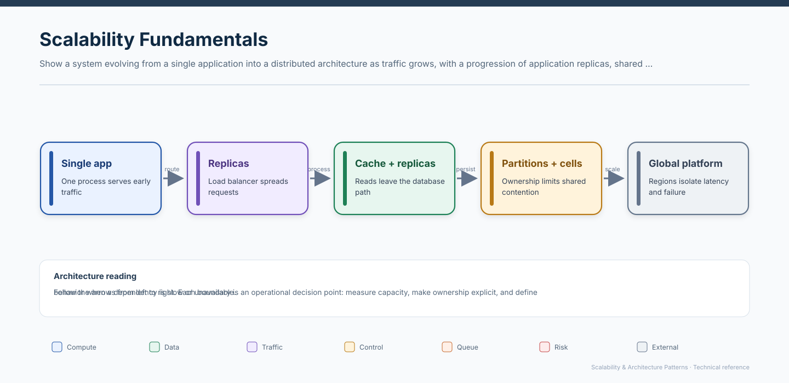  
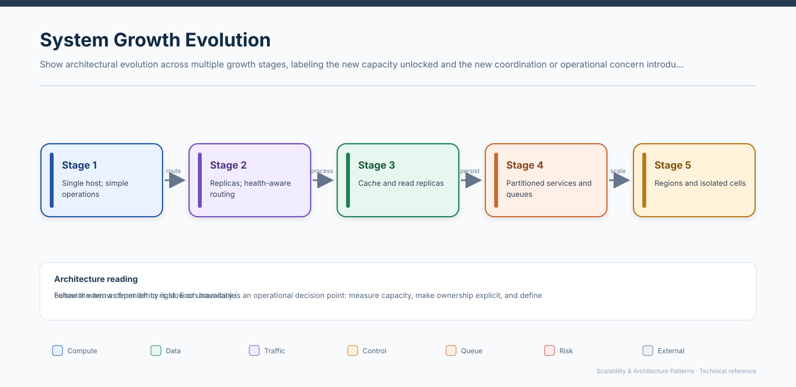  
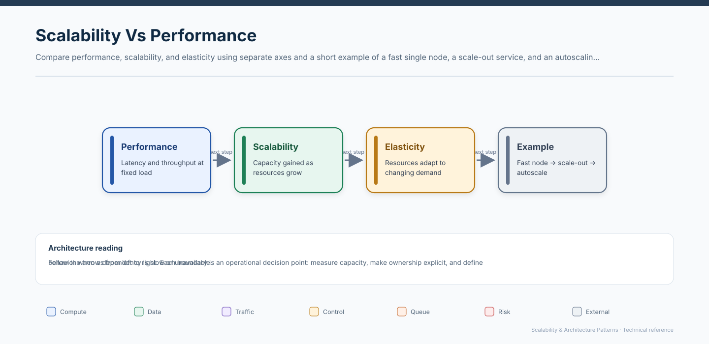  
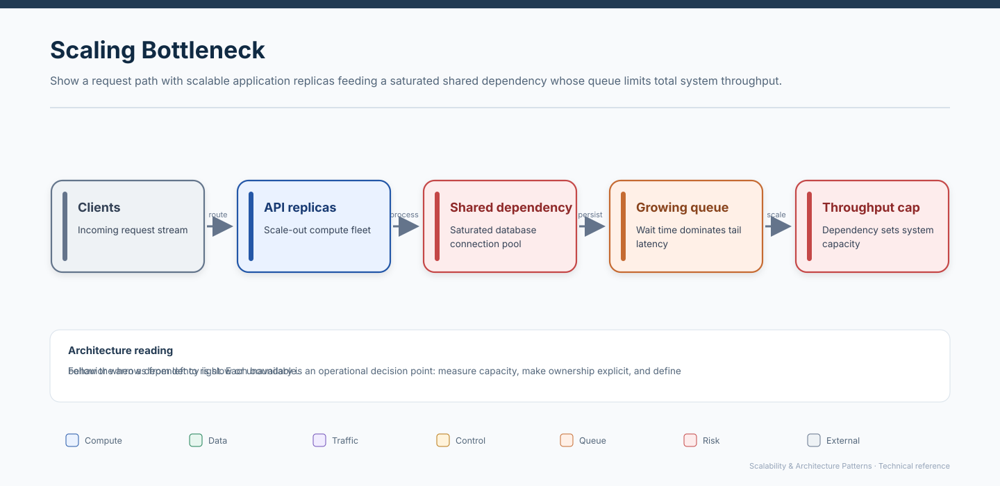

---

# 2. Horizontal vs Vertical Scaling

## 2.1 Vertical scaling — scale up

Vertical scaling increases the resources available to one machine or managed instance: CPU cores, memory, storage capacity, storage IOPS, network throughput, or specialized hardware. A database may move from a small instance to a larger memory-optimized instance; an inference process may move to a GPU with more device memory.

### Advantages

- The architecture can remain simple: fewer nodes, fewer network hops, and fewer distributed coordination paths.
- Local memory and storage access may be faster than remote access.
- Existing single-node software can benefit without being rewritten for partitioning.
- Operations such as transactions, joins, and debugging may be simpler.
- Capacity increases can be quick when a managed platform supports online resizing.

### Limits and trade-offs

- Instance sizes have ceilings; some workloads cannot grow beyond the largest supported machine.
- The cost curve can become nonlinear. A machine with twice the resources may cost considerably more than twice as much.
- A larger node concentrates failure impact. One host or instance outage can remove a larger fraction of capacity.
- Resizing can require restart, failover, data movement, or maintenance windows depending on the service.
- A single machine's memory bandwidth, network interface, storage system, or internal lock can remain the bottleneck even after CPU is increased.
- Vertical capacity may be difficult to distribute across regions or failure domains.

**Database example:** A product catalog database may first benefit from more RAM because the working set fits in memory and index reads avoid disk access. Later, storage throughput or write contention may dominate. Increasing RAM again will not solve a serialized write path.

Vertical scaling is often an excellent first response when the system is small and the bottleneck is understood. It is not a substitute for removing a fundamental serial constraint.

## 2.2 Horizontal scaling — scale out

Horizontal scaling adds independent instances or nodes and distributes work among them. A web service may add replicas behind a load balancer; a worker fleet may add consumers to a queue; a database may partition records across shards.

Typical ingredients include:

- A load balancer or router to distribute requests.
- Service discovery or a stable endpoint for healthy instances.
- Stateless request handling or explicit state ownership.
- Partitioned data or a shared state service.
- Health checks and graceful instance draining.
- Idempotency and retry-safe operations.
- Capacity-aware autoscaling and admission control.

### Advantages

- Aggregate capacity can grow by adding nodes, subject to coordination and shared-resource limits.
- Failures can be isolated to a subset of instances when redundancy is designed correctly.
- Deployments can be rolled out gradually.
- Workloads can be placed in multiple zones or regions.
- Different instance pools can be sized for different workload classes.

### Costs

- Network calls introduce latency and partial failure.
- Shared state must be externalized, partitioned, or coordinated.
- Replication and rebalancing can consume network and CPU.
- A node can fail while others remain healthy, creating partial rather than total failure.
- The load balancer, database, queue, identity provider, or storage layer can become the new bottleneck.
- Observability and debugging require correlation across instances.

**Application cluster example:** Three API replicas can process requests in parallel if requests do not depend on a session stored only in one replica. If each replica opens 500 database connections, scaling from 3 to 30 replicas may create 15,000 connections and overwhelm the database. The app tier scales, but the database connection budget does not.

## 2.3 Diagonal scaling

Diagonal scaling combines both approaches. Operators choose efficient node sizes, then add more nodes when aggregate demand grows. A database might be vertically scaled within a practical tier, then use read replicas or partitions as workload expands. A GPU inference service may choose a larger GPU for better model fit, then add more GPU workers to increase aggregate inference throughput.

The design question is often: “What is the efficient size of one node, and how many such nodes should be deployed?” Too many tiny nodes may increase per-node overhead and coordination; too few oversized nodes may concentrate risk and waste capacity during low demand.

## 2.4 Comparison

| Dimension | Vertical scaling | Horizontal scaling | Diagonal scaling |
|---|---|---|---|
| Capacity growth | Increase one node's resources | Add independent nodes | Increase node size and node count |
| Complexity | Usually lower | Usually higher | Moderate to high |
| Failure isolation | Often concentrated | Can be distributed | Depends on topology and redundancy |
| Network overhead | May remain low | Usually increases | Depends on distribution |
| Data management | Often simpler | Partitioning/replication may be needed | Depends on which tiers scale out |
| Cost behavior | Can rise sharply at upper tiers | More linear in some workloads, but coordination adds cost | Allows tuning between instance and fleet cost |
| Scaling limit | Maximum machine/service tier | Shared dependencies and partitionability | Same limits, with more options to tune |
| Best fit | Serial or stateful workloads with efficient larger nodes | Parallelizable stateless or partitioned workloads | Mixed systems with different bottlenecks |

## 2.5 Different tiers should scale differently

- **Application servers:** commonly scale horizontally because request handling can often be made stateless.
- **Databases:** often scale vertically first; read replicas, partitioning, or distributed databases are introduced when measurements justify them. Strongly transactional writes are harder to distribute than reads.
- **Caches:** may scale by adding shards, replicas, or memory per node; hot-key behavior and replication semantics matter.
- **Background workers:** scale with queue depth, arrival rate, processing time, and downstream capacity—not CPU alone.
- **Real-time gateways:** scale around concurrent connections, event-loop memory, outbound messages, and connection churn.

## 2.6 Bottlenecks and saturation

A system's useful capacity is bounded by its weakest constrained dependency for a given workload. Consider a checkout path:

`Client → API → inventory → payment provider → order database → message broker`

Even if the API tier can process 20,000 requests/second, a payment provider limited to 1,000 authorized requests/second may cap checkout. Adding API instances increases queued work and may worsen timeouts unless the system applies admission control and protects the dependency.

| Bottleneck | Common signals | Candidate response |
|---|---|---|
| CPU | High CPU, run queue, rising latency | Profile hot paths; optimize; add replicas if work is parallelizable |
| Memory | GC pauses, OOM, swapping, cache pressure | Reduce object retention; increase memory; partition; use bounded queues |
| Database | Connection waits, lock waits, I/O latency, slow queries | Tune queries/indexes; pool connections; cache; separate workload; partition if needed |
| Network | Throughput ceiling, retransmits, packet drops, high RTT | Reduce payload/fan-out; compress; move work closer; add network capacity |
| Lock contention | High wait time despite spare CPU | Shorten critical sections; partition locks; use optimistic concurrency |
| Disk I/O | Queue depth, high await, IOPS or throughput cap | Improve access pattern; provision I/O; cache; partition data |
| Thread/connection pools | Waiters rise while downstream may be idle | Right-size pools; bound concurrency; remove leaks; protect dependencies |
| Shared dependency | Many callers fail or slow together | Bulkheads, quotas, fallback, queueing, alternative capacity |

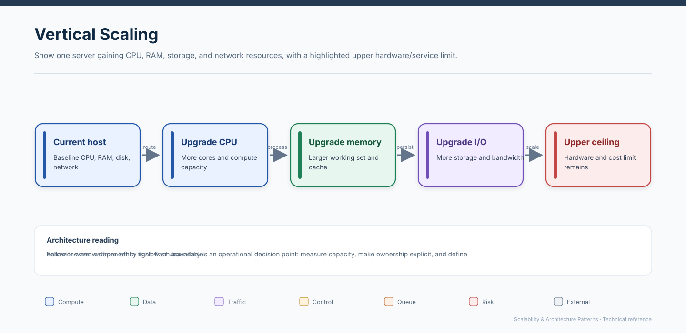  
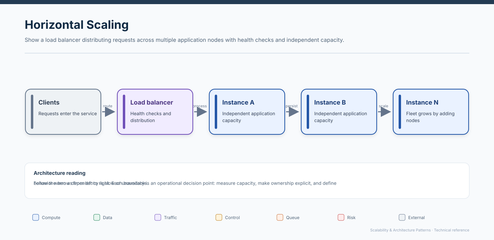  
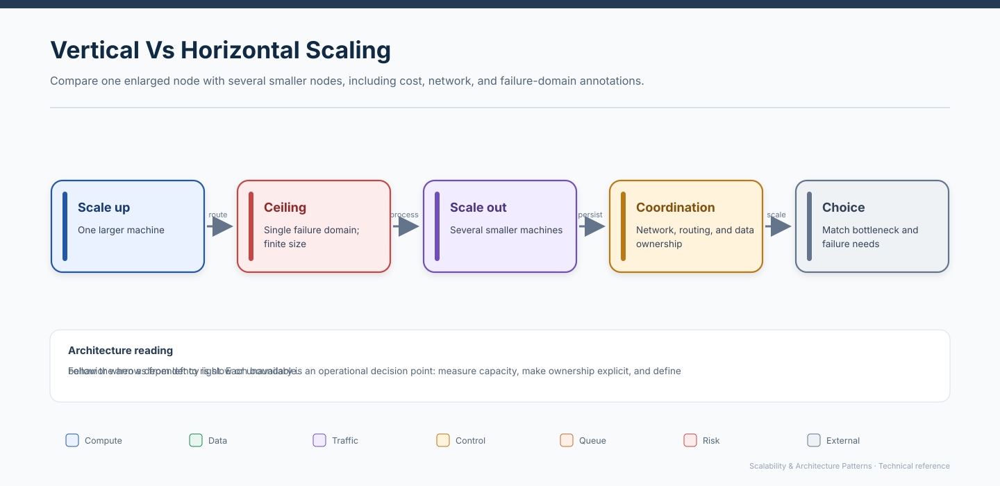  
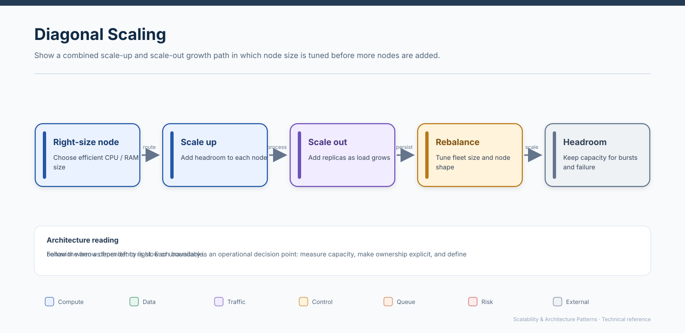  
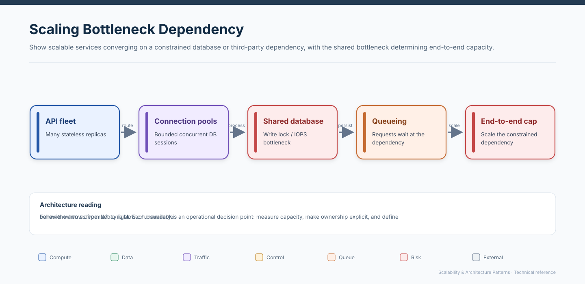

---

# 3. Stateless vs Stateful Services

## 3.1 Stateless services

A service is stateless with respect to a request when the instance does not need essential client-specific state retained only in its own process memory to handle the next request. Each request carries sufficient identity and context, or the service retrieves needed state from an external system.

This does **not** mean the application has no state anywhere. A stateless API can depend on a stateful database, cache, object store, queue, or identity system. The distinction is about where request continuity and durable state live.

### Typical characteristics

- Any healthy instance can serve a request.
- Instances can be added or removed without transferring client sessions between them.
- Load balancers can distribute requests freely, subject to affinity requirements in downstream systems.
- Failed instances can be replaced without recovering their private session memory.
- Deployments and autoscaling are easier because instances are comparatively disposable.

Examples include read-only catalog APIs, token-authenticated REST endpoints, image transformation workers, and services that keep durable workflow state in an external database.

### State externalization choices

- **Signed tokens:** carry identity and claims, reducing a session lookup. Tokens need expiration, revocation strategy, key rotation, and careful claim sizing.
- **Redis or another shared session store:** allows any application instance to retrieve session state, but introduces network latency and a dependency that must be operated.
- **Database-backed session store:** durable and familiar, but session traffic can compete with business transactions.
- **Durable workflow/event store:** appropriate when a multi-step process must resume after worker or host failure.

Externalizing state simplifies application replacement but does not make state free. It transfers responsibility to a shared system and introduces its latency, availability, cost, and consistency requirements.

## 3.2 Stateful services

A stateful service maintains state that affects future processing. State may be in local memory, local disk, a partition owned by a node, a replicated log, or a durable store associated with the service.

Examples include databases, stateful stream processors, WebSocket gateways maintaining live connection state, multiplayer game servers, and distributed coordination services.

Stateful services can scale horizontally, but they need explicit rules for:

- Which node owns a session, partition, room, or shard.
- How ownership is discovered and updated.
- How state is replicated or reconstructed.
- How work is routed to the owner.
- How state moves when nodes are added or removed.
- How writes are ordered and conflicts are resolved.
- How recovery avoids duplicate processing or data loss.

A stateful WebSocket server may own 50,000 client connections. Scaling it is not the same as adding another stateless API process: the system must decide which gateway owns each connection, route messages to that gateway, and handle reconnects or ownership transfer after failure.

## 3.3 Externalizing session state: example

Suppose a load balancer routes each request to any of three API instances. If session state lives only in API instance A's memory, a later request routed to B may not recognize the session. Sticky sessions can keep a client routed to A, but they reduce routing flexibility and do not solve A's failure.

With externalized state:

1. The client sends a session cookie or token.
2. The load balancer routes the request to any healthy API instance.
3. The instance validates identity and retrieves shared session state if required.
4. It performs business logic and persists changes to the state owner.
5. The response returns without binding future requests to that same process.

The shared session store must be sized for request rate and concurrent sessions, secured, monitored, and given explicit TTL and recovery behavior.

## 3.4 Horizontal scaling for stateful workloads

Stateful workloads use several techniques:

- **Partitioning:** assign a subset of records or sessions to each node.
- **Replication:** maintain additional copies for availability or read scaling.
- **Sharding:** divide a logical dataset across independent storage nodes.
- **Consistent hashing:** map keys to owners while limiting remapping when membership changes.
- **Ownership assignment:** maintain a directory or partition map that tells routers which node owns an item.
- **Checkpointing:** persist enough progress to resume a stream processor after failure.
- **State transfer:** move partitions or sessions from old owners to new owners during rebalancing.

Each technique introduces trade-offs. Replicas can lag; partitions can become hot; hash-ring changes can cause cache misses or data movement; checkpointing can add write overhead; state transfer can compete with live traffic.

## 3.5 Comparison

| Dimension | Stateless service | Stateful service |
|---|---|---|
| Request routing | Any healthy replica can usually serve a request | May require owner-aware routing or affinity |
| Session handling | State externalized or carried in request | State may be retained locally or by partition owner |
| Failover | Replace failed instance and retry safe work | Recover, replicate, transfer, or reconstruct state |
| Horizontal scaling | Often straightforward for compute | Requires partitioning, replication, or ownership management |
| Recovery | Recreate process; retrieve state externally | Restore/checkpoint/replicate owned state |
| Network overhead | External state lookups may add hops | State transfer and replication add traffic |
| Consistency | Depends on external state system | Must define ordering and consistency for owned state |
| Complexity | Lower at application tier, not necessarily system-wide | Higher due to ownership and recovery |

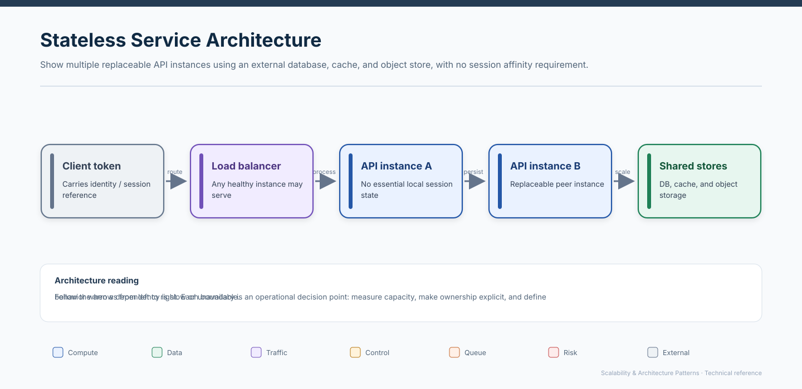  
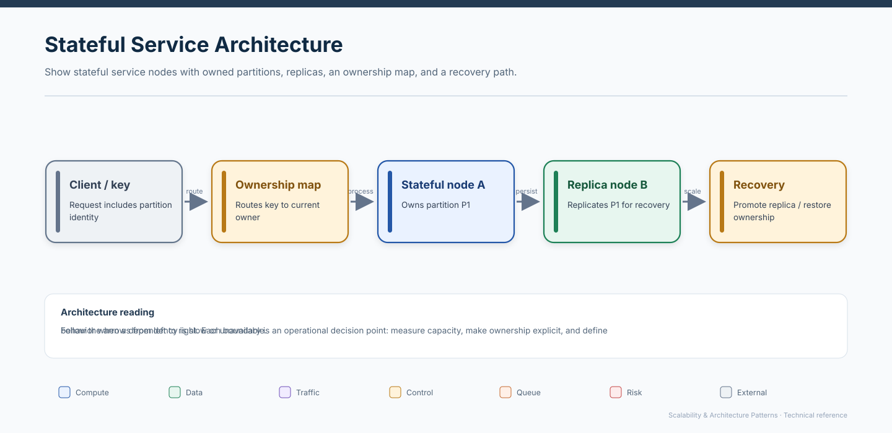  
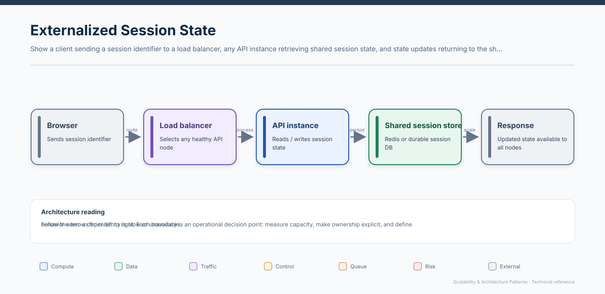  
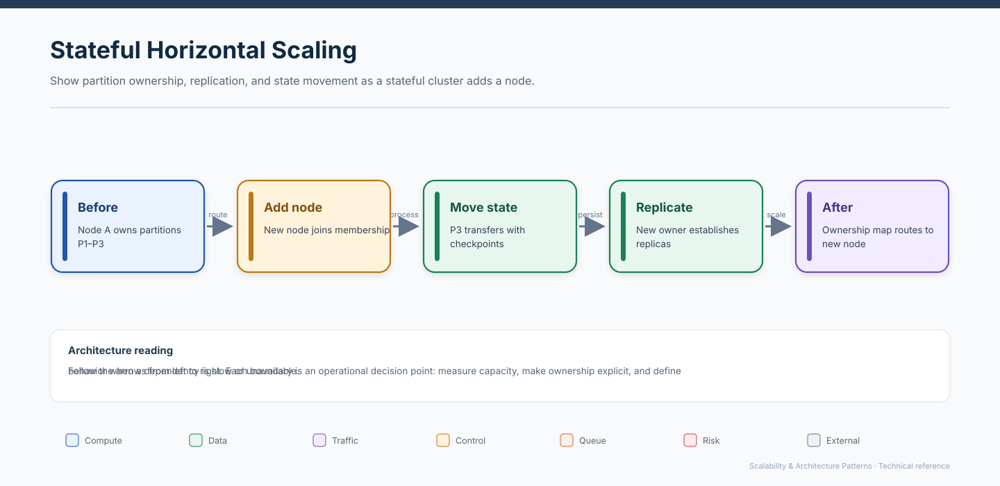  
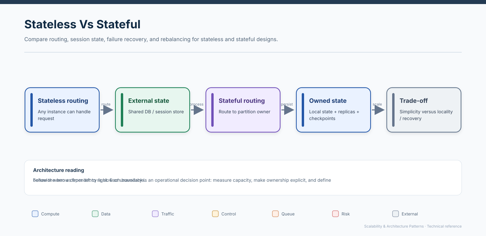

---

# 4. Scaling Strategies for Different Workloads

A scaling strategy should follow the resource profile of the workload. Applying the same autoscaling signal and instance shape to every service is rarely efficient.

## 4.1 Web and API workloads

Web/API requests are often short-lived and independently processable, making stateless replicas behind a load balancer a common design. Capacity is influenced by request CPU cost, payload size, concurrency, downstream latency, connection pools, and rate limits.

Key design practices:

- Keep request handlers stateless where practical.
- Externalize durable session and business state.
- Use bounded connection pools and timeouts for dependencies.
- Scale on a combination of request rate, latency, CPU, and queue depth rather than CPU alone.
- Use caching for repeatable reads, while defining invalidation and freshness semantics.
- Apply rate limits and admission control so overload is rejected predictably rather than converted into unbounded queues.
- Avoid excessive fan-out to many downstream services from one request.

An API tier that is at 30% CPU but has 90% of its worker threads waiting on a slow database is not healthy spare capacity. The queue and dependency waits reveal the real bottleneck.

## 4.2 Background processing

Background workers consume jobs from queues or logs. The correct scaling signal is usually the rate at which work arrives compared with the rate at which workers complete it, together with queue age and downstream capacity.

If jobs arrive at \(\lambda\) jobs/second and each worker completes \(\mu\) jobs/second under the actual workload, the idealized minimum worker count is:

\[
N_{min} = \left\lceil \frac{\lambda}{\mu} \right\rceil
\]

This leaves no recovery headroom and assumes steady arrivals and identical jobs. In practice, use a target utilization below 100%, account for job-time variation, retries, poison messages, and the capacity of downstream databases or APIs. More consumers can overwhelm a dependency and reduce total successful throughput.

Use consumer groups or partition assignment when ordering and parallelism need explicit control. Make handlers idempotent when retries can occur. Use dead-letter queues for messages that repeatedly fail, and expose queue age—not only message count—because a small number of long-running jobs can still violate an SLA.

## 4.3 Database workloads

Database scaling requires separating read and write behavior and understanding query cost:

- Tune indexes and query plans before adding infrastructure.
- Use connection pooling to bound concurrency at the database.
- Add read replicas where read traffic can tolerate replica lag.
- Separate analytical queries from latency-sensitive OLTP workloads.
- Partition or shard when a single database cannot meet the required write, storage, or isolation envelope.
- Avoid cross-shard transactions unless the domain requires them and the coordination cost is understood.
- Plan backups, replication, restore, failover, and schema migrations as capacity concerns.

Database QPS is not enough. A point lookup and an unindexed multi-table aggregation each count as one query but consume very different CPU, I/O, memory, lock time, and network bandwidth.

## 4.4 Real-time workloads

WebSockets, long polling, multiplayer games, and collaboration systems keep connections open. Scaling depends on concurrent connections, per-connection memory, heartbeat frequency, message fan-out, connection churn, and routing to state owners.

A gateway may be CPU-light but memory-heavy because each open connection consumes buffers and bookkeeping. Connection count and message rate should therefore be measured separately. A reconnect storm after a regional outage can create a burst that is much larger than normal connection establishment traffic.

Useful strategies include regional gateways, explicit ownership for rooms or sessions, bounded outbound buffers, heartbeats, backpressure, reconnect jitter, and a durable source of truth for data that must survive gateway restarts.

## 4.5 Batch workloads

Batch processing is usually parallelized by dividing input into independent partitions or tasks. Capacity depends on task duration, input/output bandwidth, data locality, scheduling overhead, and the slowest tasks (stragglers).

A 1,000-task batch does not finish ten times faster merely because ten times as many workers are launched: tasks may contend for the same storage, have uneven sizes, or depend on serialized stages. Use checkpoints for expensive restartable work, idempotent outputs, bounded concurrency, and explicit handling of partial completion.

## 4.6 AI and machine-learning workloads

Inference has distinct resource constraints:

- **CPU-bound inference:** scales with CPU cores, vectorization, model efficiency, and request concurrency.
- **GPU-bound inference:** constrained by accelerator compute, device memory, model size, batch size, and kernel utilization.
- **Batch inference:** favors throughput and can use large batches and queueing windows.
- **Online inference:** prioritizes tail latency and often uses smaller batches or bounded dynamic batching.
- **Model loading:** consumes time and RAM/VRAM; scale-out may be delayed while weights load and warm up.
- **Replica placement:** model replicas consume memory even when idle. Multiple models can fragment GPU memory.

GPU utilization is not a complete service metric. Monitor device memory, batch wait, queue age, tokens or predictions per second, request latency percentiles, model load time, and failed allocations. Keep CPU preprocessing, network transfer, and GPU execution in the capacity model. A GPU fleet may scale only in discrete hardware increments, so autoscaling can be slower and more expensive than ordinary web compute.

## 4.7 Workload comparison

| Workload | Common scaling model | Important metric | Frequent bottleneck | Critical design concern |
|---|---|---|---|---|
| Web/API | Stateless replicas | RPS, p95/p99 latency, in-flight requests | Downstream wait, CPU, connection pools | Timeouts, admission control, idempotency |
| Background jobs | Queue consumers | Queue age, arrival/completion rate | Job duration or downstream service | Retries, ordering, DLQ, backpressure |
| Database | Scale-up, replicas, partitions | Query latency, IOPS, lock/connection waits | Writes, storage I/O, hot keys | Consistency, backup, failover, rebalancing |
| Real-time | Connection gateways and partition owners | Concurrent connections, messages/sec | Memory, fan-out, connection churn | Ownership, reconnect storms, backpressure |
| Batch | Distributed tasks | Completion time, throughput, straggler time | Data locality, I/O, skew | Checkpoint, idempotency, scheduling |
| ML inference | CPU/GPU model replicas | Inferences/sec, p99, accelerator memory | GPU compute/VRAM, batching, model load | Model readiness, batch/latency trade-off |

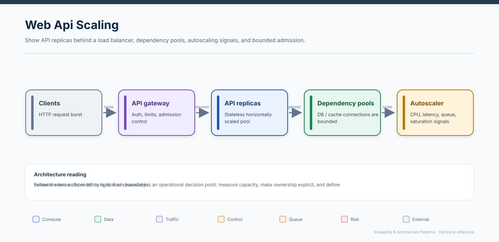  
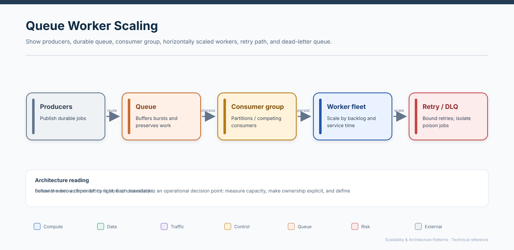  
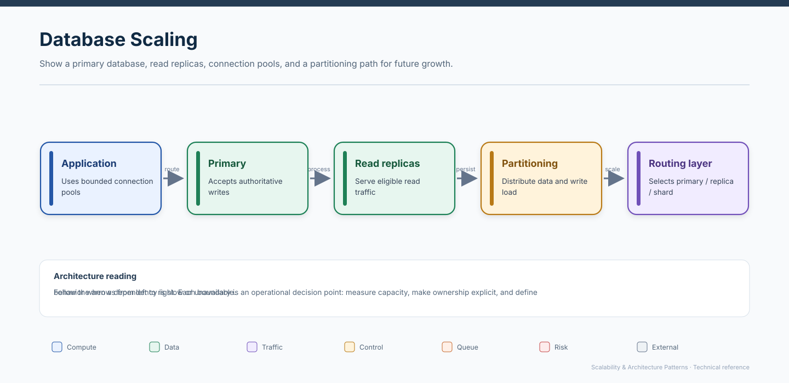  
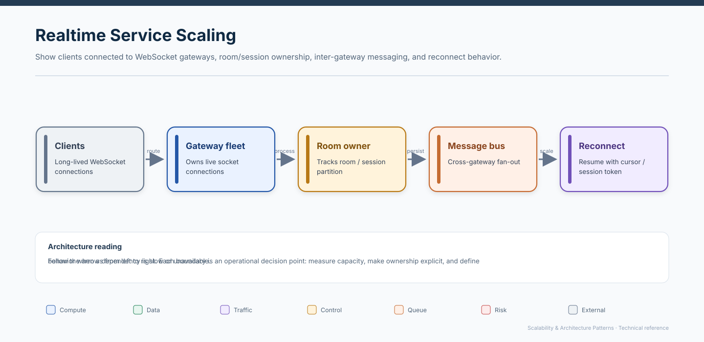  
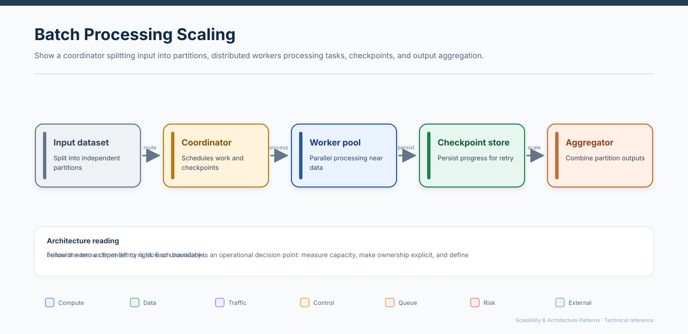  
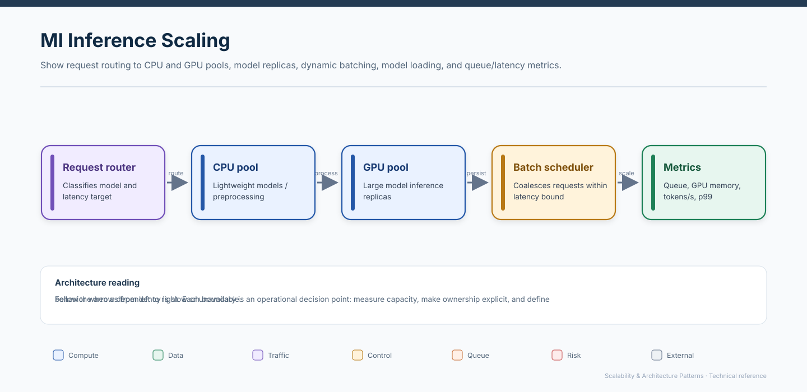

---

# 5. Monolithic Architecture

## 5.1 Definition and structure

A **monolithic application** is delivered as one deployable unit. Its modules may have clear internal boundaries, but they are built, tested, released, and usually run together. A common web monolith contains HTTP controllers, application services, domain logic, persistence components, and background-task handlers in one codebase and deployment artifact.

A monolith is not necessarily a single file, an unstructured codebase, or a single process in production. It can run multiple identical replicas. The defining property is the deployment boundary: a change to one module is normally released as part of the same application unit.

Common forms include:

- **Traditional monolith:** modules are often tightly coupled and may share internal models and tables.
- **Modular monolith:** capabilities are separated behind explicit module interfaces and dependency rules, while deployment remains unified.
- **Distributed monolith:** the code is split across services or processes, but runtime and release coupling remain high. It inherits network failure without gaining real organizational or deployment independence.

## 5.2 Advantages

A monolith has important engineering and operational advantages:

1. **Simple deployment:** one artifact and a smaller number of coordinated releases.
2. **Local calls:** function or module calls avoid network latency, timeouts, serialization, and partial network failure.
3. **Straightforward transactions:** business operations can often update multiple related records in one database transaction.
4. **Debugging and testing:** local development, stack traces, integration tests, and reproducible environments can be simpler.
5. **Lower operational overhead:** fewer service registries, pipelines, dashboards, secrets, network policies, and runtime versions.
6. **Fast product discovery:** teams can reshape a domain while requirements are uncertain without negotiating multiple service contracts.

For an early product with a small engineering team and a limited domain, a monolith often lets the team spend effort on product correctness rather than distributed infrastructure.

## 5.3 Limitations

- The whole deployable unit may need to be built and released for a small feature change.
- Scaling one hot capability may require scaling the entire application.
- A process-level memory leak or resource-heavy module can affect unrelated capabilities in the same runtime.
- Large codebases can develop unclear dependency direction and slow builds.
- Teams may conflict over ownership, release timing, and shared interfaces.
- A single database schema can become a coordination point across modules.
- Technology choices are shared across the application unless deliberately isolated.

These are not inevitable properties of every monolith. Modular boundaries, package rules, ownership, and separate worker processes can address many concerns while retaining a single core deployment.

## 5.4 Modular monolith design

A modular monolith separates business capabilities into modules such as Catalog, Orders, Inventory, Identity, and Billing. Each module owns its domain rules and exposes a narrow internal interface. Other modules should not reach into its private tables or internal classes simply because they are accessible in the same process.

A useful module contract defines:

- Public commands and queries.
- Events emitted when domain facts change.
- Data ownership and permitted read paths.
- Transaction boundaries.
- Dependency direction.
- Error and validation semantics.

Internal module calls can remain synchronous and in-process. Asynchronous events may be used where decoupling is useful, but adding a message broker is not automatically required for modularity.

A modular monolith can prepare a future extraction by clarifying ownership and reducing accidental coupling. It does not guarantee an easy microservice migration: shared transactions, shared tables, and hidden dependency cycles must still be resolved.

## 5.5 When to choose a monolith

A monolith is a strong default when the product is early, the team is small, business boundaries are still changing, most capabilities share transactional invariants, and independent scaling or deployment is not yet a demonstrated requirement.

Consider extraction only when there is evidence such as:

- A capability has a materially different scaling profile.
- A team needs independent ownership and release cadence.
- A fault domain must be isolated.
- A capability needs a distinct technology or compliance boundary.
- The module has a clear data owner and stable contract.

The goal is not to avoid microservices forever. It is to avoid paying the distributed-systems tax before receiving the benefits.

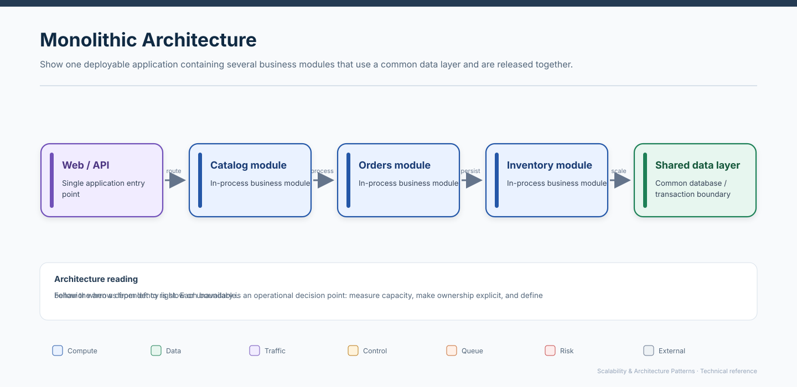  
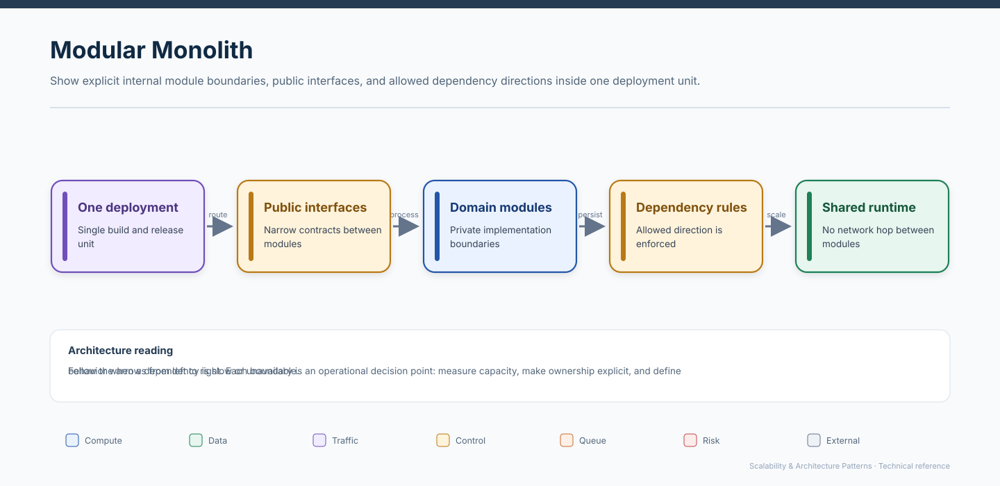  
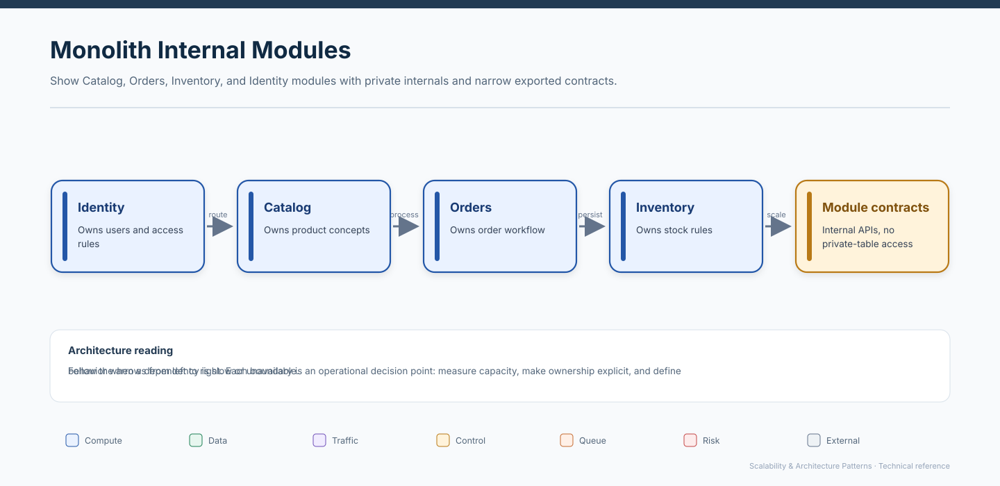  
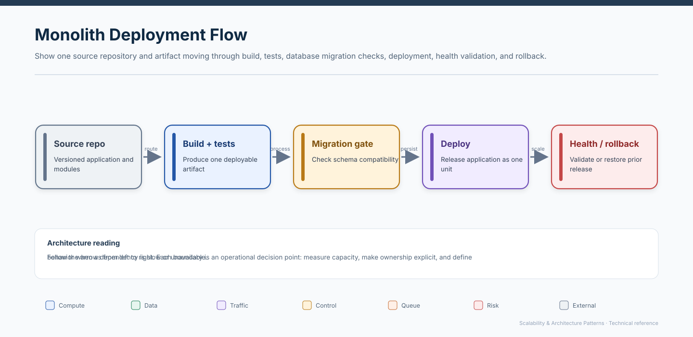

---

# 6. Microservices Architecture

## 6.1 Definition

A **microservices architecture** decomposes a system into independently deployable services organized around business capabilities or bounded contexts. Each service has a defined responsibility, a contract, an operational owner, and control over the data needed for that responsibility.

The important architectural properties are not source-code size or the number of containers. They are boundaries: independent deployment, ownership, scaling, and evolution are possible without requiring all services to release together. A collection of tiny processes that share a schema, require lockstep deployments, and make synchronous calls to one another is not meaningfully independent.

Microservices are both a technical and organizational decision. They change how teams own code, data, on-call responsibility, APIs, security, delivery pipelines, and reliability.

## 6.2 Decomposing by business capability

Good service boundaries usually reflect business capabilities and domain concepts rather than technical layers. Separating every controller into an API service, every business rule into a logic service, and every repository into a data service often creates chatty layers with no independent business ownership.

Domain-driven design provides useful language:

- A **domain** is the business area the software supports.
- A **subdomain** is a distinct problem space within that domain.
- A **bounded context** is a boundary within which a model and its terms have consistent meaning.
- A **service boundary** is an implementation and ownership boundary that may align with a bounded context, but the two are not automatically identical.

For an e-commerce platform, Catalog, Inventory, Orders, Payments, and Notifications may be distinct capabilities. The boundaries must be validated against real workflows. For example, checkout may need a coordinated inventory reservation and payment authorization; this workflow cannot be designed simply by assigning each noun a separate service.

Before extracting a service, map:

1. Business responsibilities and invariants.
2. Data read and write ownership.
3. Callers and downstream dependencies.
4. Transaction and consistency needs.
5. Independent scaling and release needs.
6. Team ownership and operational support.
7. Failure behavior when the service is unavailable.

## 6.3 Communication patterns

### Synchronous request-response

REST or gRPC is appropriate when a caller needs an immediate result and the dependency can meet the caller's latency and availability budget. Synchronous calls are easy to reason about locally, but they couple latency and availability across the call chain.

If a request calls four services sequentially, their latencies accumulate. A failure or timeout in any required dependency can fail the overall request. Retries can amplify overload unless they are bounded, jittered, and coordinated with idempotency.

### Asynchronous messaging and events

A producer writes a message or event to a broker or durable log; consumers process it independently. This decouples producer and consumer lifecycles and allows buffering during temporary slowdowns. It also introduces delayed processing, duplicate delivery possibilities, ordering constraints, schema evolution, and operational complexity.

Use **commands** to request an action (for example, `ReserveInventory`) and **events** to describe a fact that has occurred (for example, `InventoryReserved`). Consumers should handle duplicate delivery safely where the broker's delivery model permits retries.

### Choosing between them

Use synchronous communication when the caller must make an immediate decision and the dependency is part of the same user-visible operation. Use asynchronous messaging when work can complete later, must be buffered, or should not require both services to be available at the same time. Many systems use both.

## 6.4 Data ownership and database per service

A service should be the authoritative writer for the data it owns. Other services should use its API, consume its events, or maintain an explicitly derived read model. Directly modifying another service's tables creates hidden coupling: schema changes become multi-team deployments, authorization is harder to enforce, and the actual owner cannot safely evolve its data model.

“Database per service” means logical ownership, not necessarily one physical database server for every service. Several small services may share a managed database cluster while maintaining separate schemas, credentials, migrations, and access policy. The important rule is that one service does not casually write another service's private tables.

### Data duplication is sometimes intentional

Search may keep a denormalized product index; analytics may maintain aggregates; an order service may store a snapshot of item descriptions and prices so historical orders remain meaningful after catalog changes. Such duplication is acceptable when the source of truth, update mechanism, staleness tolerance, and rebuild process are explicit.

### Distributed transactions

A workflow spanning multiple service-owned databases cannot generally rely on one local ACID transaction. Options include:

- **Saga:** a sequence of local transactions with compensating actions for business rollback.
- **Transactional outbox:** write the business change and an event record in the same local database transaction; a relay publishes the event.
- **Change data capture:** publish database changes from a transaction log, with ordering and schema controls.
- **Reservation/timeout workflows:** use holds and expiration where compensation is natural.

Avoid presenting compensation as a literal reversal. A payment refund, shipment cancellation, and inventory release are new business actions with their own failure modes.

## 6.5 Independent scaling

Consider an e-commerce platform during a sale:

- Catalog and product-image delivery may be read-heavy and benefit from CDN and cache layers.
- Search may need a separate index cluster and scale with query volume.
- Inventory writes may be constrained by stock consistency and hot SKU contention.
- Checkout may be latency-sensitive and depend on payment-provider quotas.
- Notifications can be asynchronous and scale through queue consumers.
- Recommendations may be GPU/CPU intensive and scale separately from the transactional path.

Independent deployment and scaling make it possible to allocate different resources to these workloads, provided the service boundaries do not create excessive network chatter or shared bottlenecks.

## 6.6 Challenges and hidden costs

Microservices introduce or amplify:

- Network latency and partial failure.
- Service discovery, endpoint ownership, and API versioning.
- Distributed tracing and cross-service log correlation.
- Authentication and authorization between services.
- Distributed transactions and eventual consistency.
- Contract testing and integration environments.
- Deployment orchestration and configuration management.
- Schema/event evolution.
- On-call and operational ownership.
- Test data, local development, and failure simulation.

A microservice should have a clear owner, a useful operational dashboard, a service-level objective, alerting, deployment automation, secure identity, and a documented failure policy. If the organization cannot operate the additional service boundary, the architectural decomposition may be premature.

## 6.7 Monolith versus microservices

| Dimension | Monolith | Microservices |
|---|---|---|
| Deployment | One application unit | Multiple independent units when boundaries are real |
| Scaling | Often scales the whole application; separate worker processes remain possible | Per-service scaling is possible, subject to shared dependencies |
| Fault isolation | Shared process/deployable can widen impact | Service boundaries can limit failures, but synchronous dependencies can spread them |
| Data consistency | Local transactions are straightforward | Cross-service workflows require explicit consistency design |
| Development speed | Often faster for a small team and evolving domain | Can accelerate independent teams after organizational maturity |
| Operations | Fewer runtime components | More pipelines, telemetry, security policy, and on-call surfaces |
| Technology choices | Usually shared | Can vary by service, increasing support burden |
| Testing | Integration testing can be simpler | Requires contract, integration, and distributed failure tests |
| Cost | Often lower baseline infrastructure cost | Additional network, runtime, and operational cost |
| Best fit | Small/medium team, cohesive domain, shared invariants | Stable boundaries, independent scaling/ownership, capable platform operations |

Microservices do not automatically improve performance or reliability. A poorly decomposed service graph can add network hops, amplify failures, and require more resources than a monolith.

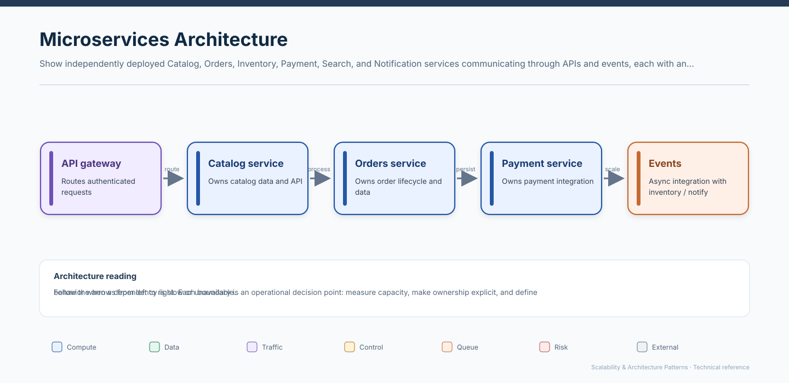  
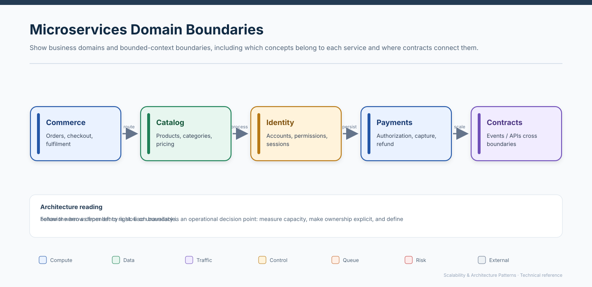  
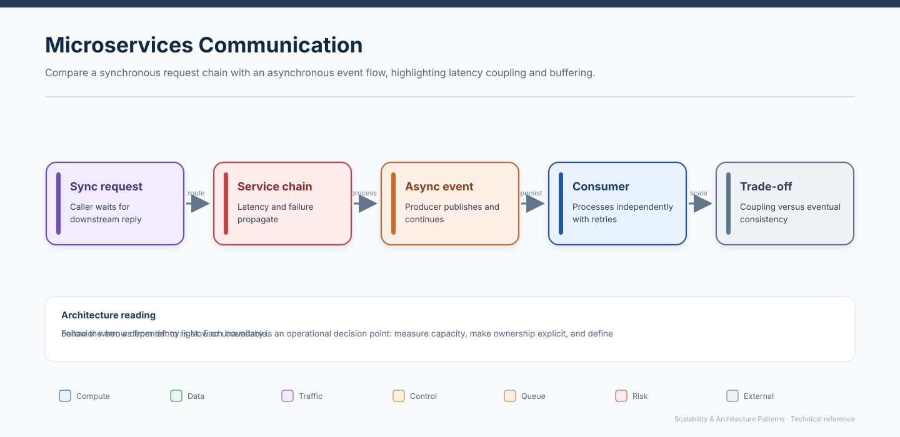  
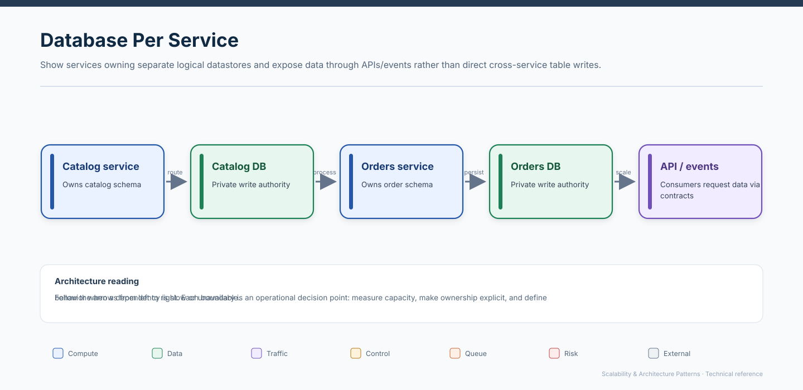  
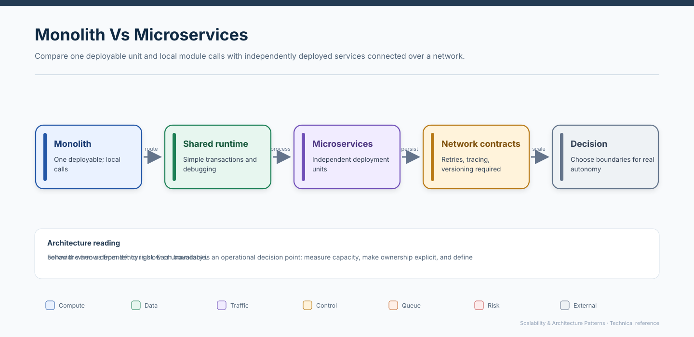  
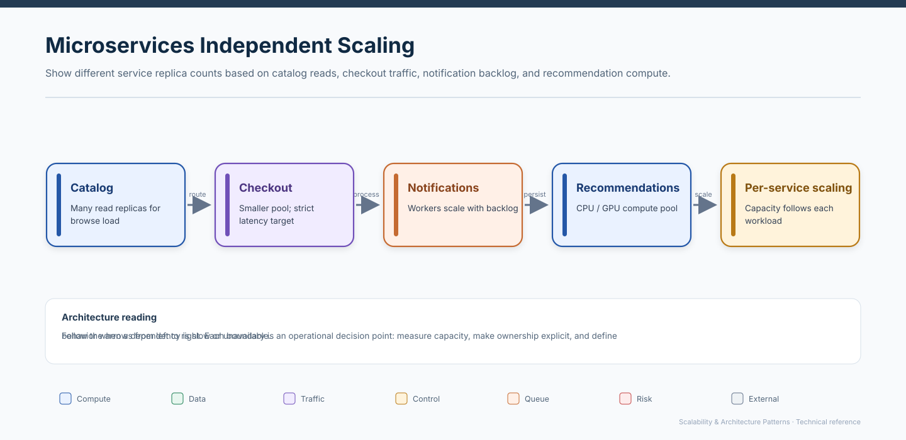

---

# 7. Monolith to Microservices Migration

## 7.1 Why migration should be incremental

A monolith-to-microservices migration changes deployment, data ownership, network behavior, failure handling, testing, and team responsibilities. Rewriting the entire system in one program of work creates a large cutover risk and delays feedback. An incremental approach keeps the existing application working while selected capabilities move behind new boundaries.

Begin with an architectural assessment rather than a technology decision. Map the critical user journeys, modules, database tables, dependencies, release coupling, performance bottlenecks, and operational pain. Identify the business capability that has a clear boundary and a measurable reason to move.

## 7.2 Strangler Fig pattern

The **Strangler Fig** pattern gradually replaces a legacy system by routing selected functionality to new implementations while the old system continues to serve the rest. A routing façade or gateway decides whether a request goes to the monolith or to an extracted service. Over time, more routes move to the new implementation and obsolete legacy code is retired.

Example: extracting order management from an e-commerce monolith.

1. Stabilize the order module and document its inputs, outputs, invariants, and database dependencies.
2. Create an Order Service API while the existing module remains authoritative.
3. Identify a data ownership strategy: dedicated database, bounded schema, or staged migration.
4. Introduce a routing layer that can direct a small subset of reads or commands to the new service.
5. Use shadow reads or comparison jobs to validate that the new implementation returns equivalent results.
6. Move traffic gradually, with health and business correctness gates.
7. Establish a clear write cutover so two systems do not both accept conflicting commands.
8. Retire old code only after traffic, scheduled jobs, reports, and integrations are proven to use the new boundary.

## 7.3 Data migration strategies

Data is often harder than code. Several safe techniques can be combined:

- **Snapshot copy:** copy a consistent initial dataset to the new store.
- **Change data capture:** capture changes after the snapshot and replay them to reduce lag.
- **Shadow reads:** query both implementations and compare without changing the user response.
- **Dual reads:** temporarily support both sources with an explicit precedence rule.
- **Dual writes:** use only with an idempotent, observable, reconcilable design; naïve dual writes can diverge when one write succeeds and the other fails.
- **Write fence/cutover:** stop or redirect writes at a defined point, reconcile outstanding changes, then switch the authoritative writer.
- **Rollback plan:** define whether rollback means routing back, restoring a snapshot, replaying an outbox, or forward-fixing. A rollback is not safe if the new service has accepted writes that the old system cannot represent.

A transactional outbox can make local database changes and event publication intent atomic. A CDC pipeline can propagate committed changes. Neither removes the need to handle schema evolution, duplicates, ordering, replay, and reconciliation.

## 7.4 Migration risks

- **Distributed monolith:** services still require coordinated releases or share internal tables.
- **Shared schema coupling:** independent deployments cannot safely change shared data structures.
- **Duplicate business logic:** old and new implementations drift in validation or domain rules.
- **Dual-write divergence:** one system accepts a change while another rejects or loses it.
- **Hidden call paths:** scheduled jobs, analytics, admin tools, or external clients bypass the new router.
- **Unbounded synchronous dependencies:** new services add request hops and failure coupling.
- **No rollback path:** the cutover accepts data the old implementation cannot process.

## 7.5 Phased migration plan

| Phase | Work | Exit condition |
|---|---|---|
| 1. Stabilize | Add tests, telemetry, module boundaries, and dependency maps | Behavior and ownership are understood |
| 2. Select capability | Choose a bounded domain with a measurable reason to extract | Clear scope, owner, and contract exist |
| 3. Establish interface | Define API/event contracts and authorization | Callers can use a stable boundary |
| 4. Extract code | Implement the new service and its persistence rules | New service passes domain and contract tests |
| 5. Move data | Snapshot, CDC/outbox, validation, and reconciliation | New store is consistent within defined lag |
| 6. Shift traffic | Shadow/canary traffic and business-level monitoring | Error rate, latency, and correctness meet gates |
| 7. Complete cutover | Switch authoritative writes and consumers | No required path depends on old module |
| 8. Retire legacy | Remove duplicate code, tables, and routing exceptions | Ownership and operations are unambiguous |

Migrating application boundaries and database ownership at the same time is risky because failures become hard to attribute. A staged plan makes each transition observable and reversible where data semantics allow.

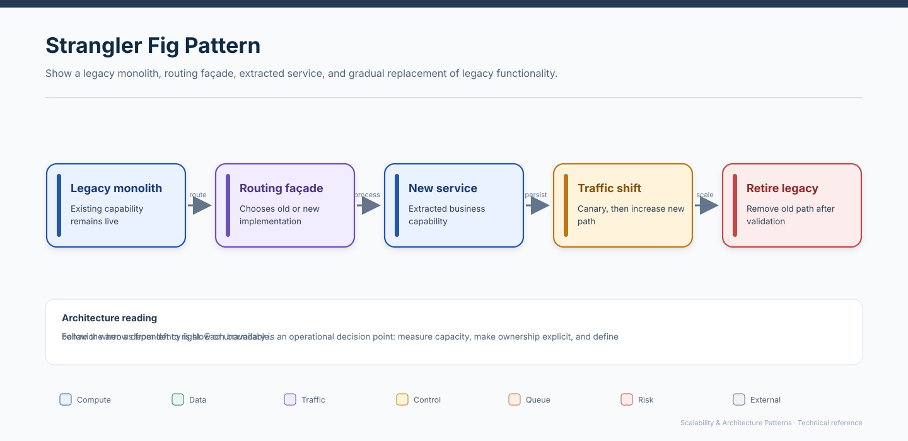  
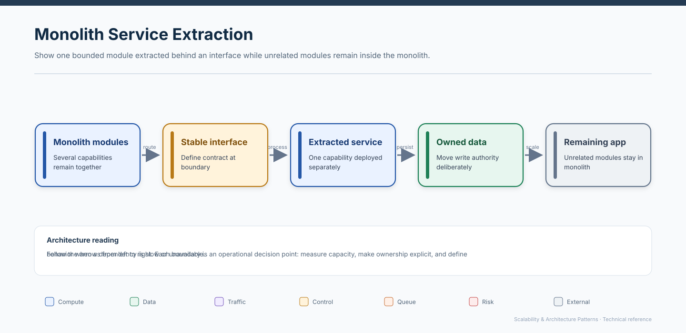  
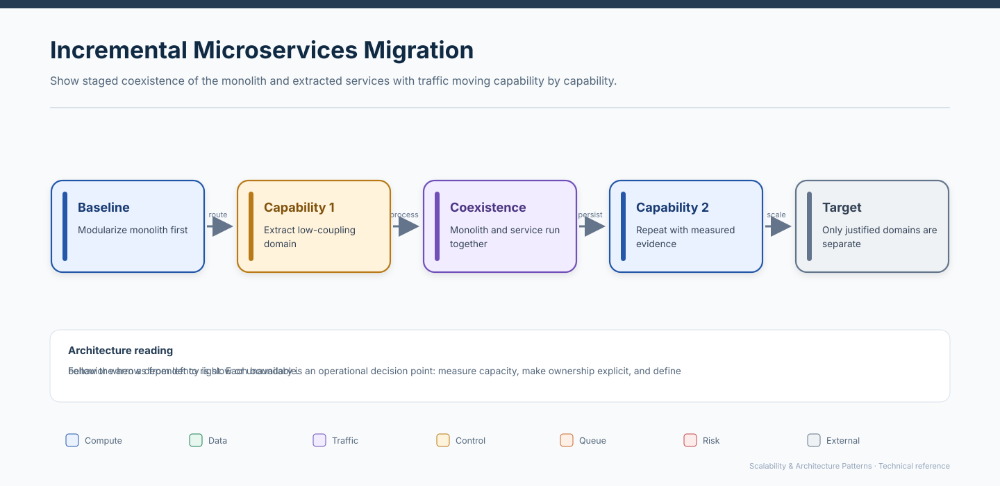  
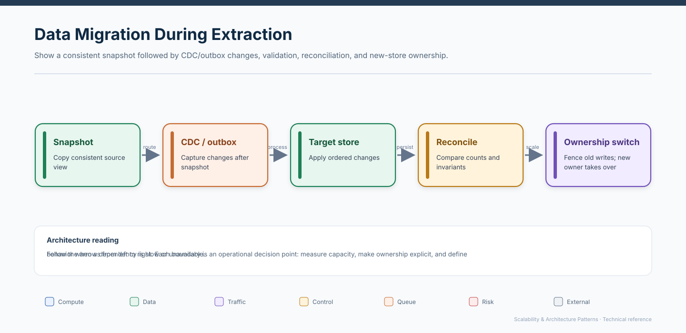  
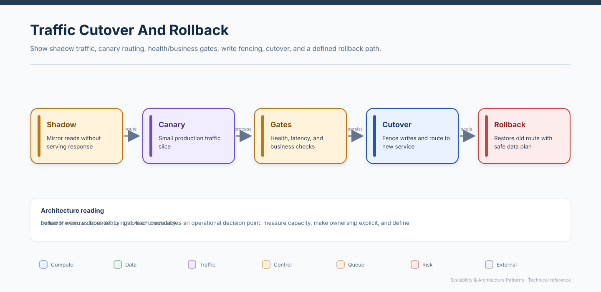

---

# 8. Shared-Nothing Architecture

## 8.1 Definition

A **shared-nothing architecture** is a distributed design in which each node owns its own CPU, memory, and usually local storage, and nodes coordinate by exchanging messages over a network. Data or work is partitioned so that each node can perform much of its assigned workload independently.

The goal is to reduce contention over shared hardware resources and allow capacity to grow by adding nodes. Shared-nothing does not mean that nodes never communicate or that the system has no replicated state. Nodes must coordinate for routing, replication, rebalancing, failure detection, and operations spanning partitions.

## 8.2 How it works

A common shared-nothing database design partitions records by a key. A router or client library maps the key to a partition owner. The owning node processes local reads and writes using its own compute and storage. Replicas may maintain additional copies for recovery or read scaling.

A well-partitioned request can be served by one node without contacting all peers. This data locality is central to efficiency. Cross-partition operations—joins, aggregations, transactions, or range scans—may require fan-out and result merging, increasing network traffic and tail latency.

## 8.3 Benefits

- **Horizontal growth:** capacity can be expanded by adding partition owners.
- **Resource isolation:** a node's memory and CPU are not directly contended by every other node.
- **Failure containment:** a node failure can affect a subset of partitions if replicas and routing are designed correctly.
- **Parallelism:** independent partitions can process work concurrently.
- **Data locality:** common operations can execute near the data they need.

## 8.4 Challenges

- **Partition-key selection:** poor keys create hot partitions or uneven distribution.
- **Cross-partition queries:** scatter-gather increases network cost and tail latency.
- **Distributed transactions:** atomic changes across nodes require coordination or application-level workflows.
- **Rebalancing:** adding/removing nodes requires partition movement and routing updates.
- **Replication:** consistency, lag, quorum behavior, and repair need explicit policies.
- **Skew:** a tenant or hot key may overload one node even when cluster-wide utilization is low.
- **Operational tooling:** schema changes, backups, upgrades, and observability must work across all nodes.

## 8.5 Data locality and partitioning example

For an order service, partitioning by `customer_id` can make a customer's order history local. It can also make one high-volume enterprise customer a hot partition. Partitioning by order ID distributes writes but makes customer-history queries fan out. A composite key or tenant-aware partition map may be needed, depending on query patterns and isolation requirements.

Partition design should begin with access patterns and invariants:

1. Identify the most frequent read/write operations.
2. Identify which records must be updated atomically.
3. Choose a partition key that distributes the actual workload.
4. Decide which queries can be partition-local.
5. Identify cross-partition operations and estimate their frequency/cost.
6. Plan online rebalancing and node-failure recovery.
7. Monitor partition-level load, not merely cluster averages.

## 8.6 Shared-nothing versus shared-disk versus shared-memory

| Architecture | Resource model | Scaling characteristic | Main benefit | Main trade-off |
|---|---|---|---|---|
| Shared-nothing | Each node owns compute, memory, and local storage | Add nodes and partition data/work | Parallelism and reduced shared-resource contention | Partitioning and cross-node coordination |
| Shared-disk | Multiple compute nodes access common storage | Compute can scale separately from storage, depending on storage design | Shared data view and node-level compute failover | Shared storage throughput and coordination can bottleneck |
| Shared-memory | Multiple processors share a common address space | Add processors within a shared memory system | Fast coordination through shared memory | Memory-bus/cache-coherence contention and physical scale limits |

These are architectural models, not exact labels for every product. Real distributed databases often combine ideas: local compute, replicated logs, shared object storage, or distributed storage layers.

## 8.7 Real-system examples and caveats

Cassandra is commonly described as a distributed, partitioned, peer-oriented database with replication across nodes; its architecture is not identical to every shared-nothing analytical platform. Elasticsearch distributes shards across nodes, but has cluster metadata and coordination components. Distributed analytical systems often use local processing and partitioned data while relying on shared object storage or a coordinator. Evaluate the actual product's data ownership, coordination, replication, and storage model instead of assuming the label implies identical behavior.

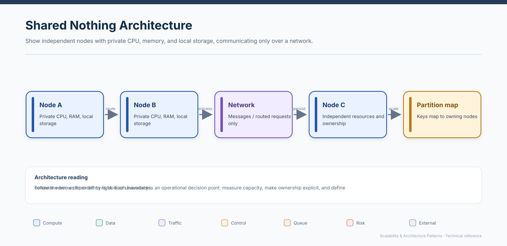  
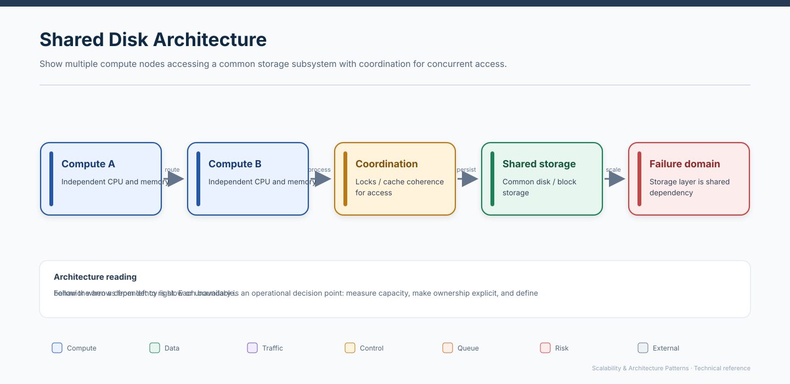  
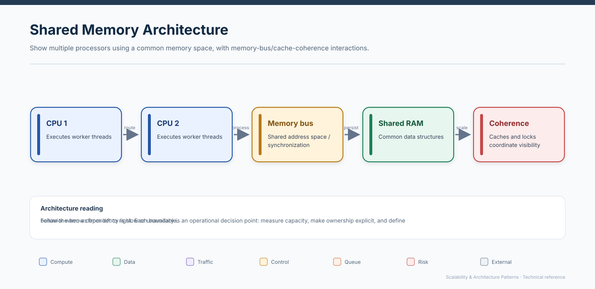  
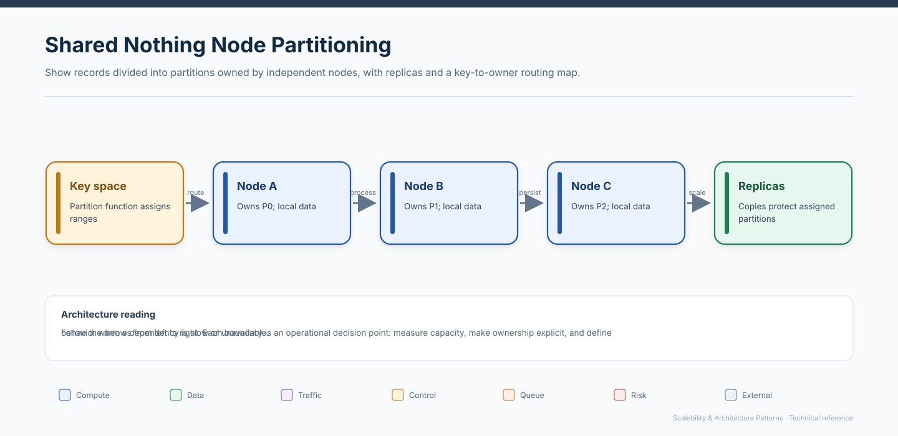  
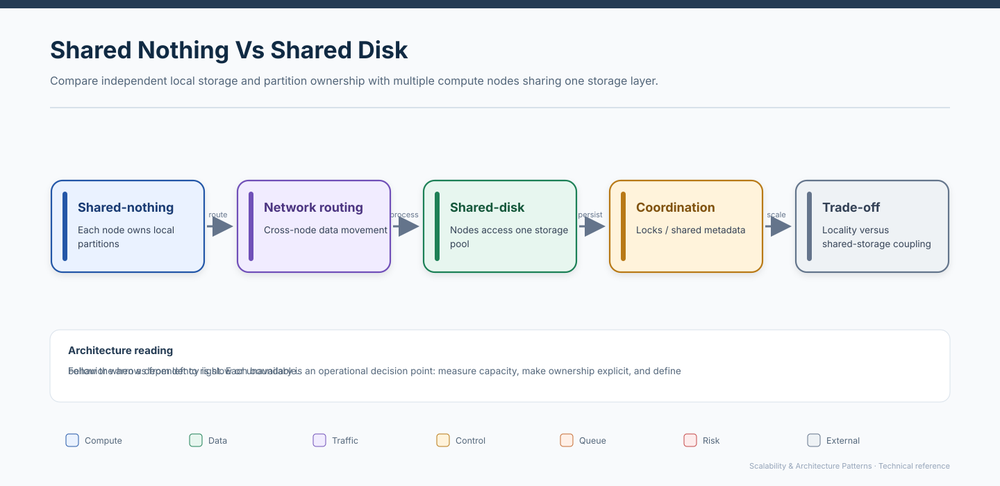

---

# 9. Sidecar Pattern

## 9.1 Definition and layout

The **sidecar pattern** deploys a supporting process or container alongside an application component. The application and sidecar share a deployment lifecycle and usually communicate over localhost, a Unix socket, or a local network interface. The sidecar performs a supporting responsibility without requiring the main application to implement that capability itself.

In Kubernetes, containers in the same Pod share the Pod network namespace and can communicate over `localhost`; depending on the Pod configuration, they can also share volumes. A sidecar is therefore colocated with its application, but it remains a separate process with its own resource consumption and failure behavior.

Typical responsibilities include:

- Proxying inbound or outbound traffic.
- Collecting logs, metrics, and traces.
- Refreshing certificates or secrets.
- Synchronizing configuration.
- Performing protocol translation.
- Providing local caching or security enforcement.

## 9.2 Request-flow example

A service sends an outbound HTTP request to a local proxy sidecar. The sidecar applies service identity, TLS/mTLS, retry policy, routing, and telemetry, then forwards the request to the remote service. The response returns through the proxy. The application does not need to implement each transport-level capability independently, although it must still understand application-level errors and deadlines.

## 9.3 Benefits

- **Separation of concerns:** infrastructure capabilities are separated from domain logic.
- **Language independence:** the sidecar can provide a consistent proxy or telemetry agent for applications written in different languages.
- **Reusable policy:** routing, authentication, and telemetry behavior can be standardized.
- **Local integration:** the application can use a simple local interface instead of embedding a complex client stack.

## 9.4 Costs and risks

- Every replica may incur extra CPU and memory for its sidecar. At hundreds or thousands of replicas, small per-Pod overhead becomes fleet-scale capacity.
- The proxy adds a hop, which can increase latency and create another queue or failure point.
- Sidecar and application versions/configuration must be compatible.
- A sidecar can become a bottleneck or restart loop that affects the colocated application.
- Debugging requires visibility into both processes and their local communication.
- Resource limits must be explicit; an unconstrained sidecar can compete with the application.

A sidecar is not automatically a network proxy. The pattern describes a colocated helper role; service-mesh proxies are one common use.

## 9.5 Sidecar resource planning

Suppose a service runs 400 replicas and each sidecar reserves 100 MiB of memory. The fleet reserves 40,000 MiB, approximately 39.1 GiB, before accounting for application memory, runtime overhead, and actual memory usage. If a sidecar also consumes 0.1 vCPU per replica, the fleet reserves 40 vCPU. These illustrative numbers show why per-instance helper overhead should be included in capacity and cost estimates.

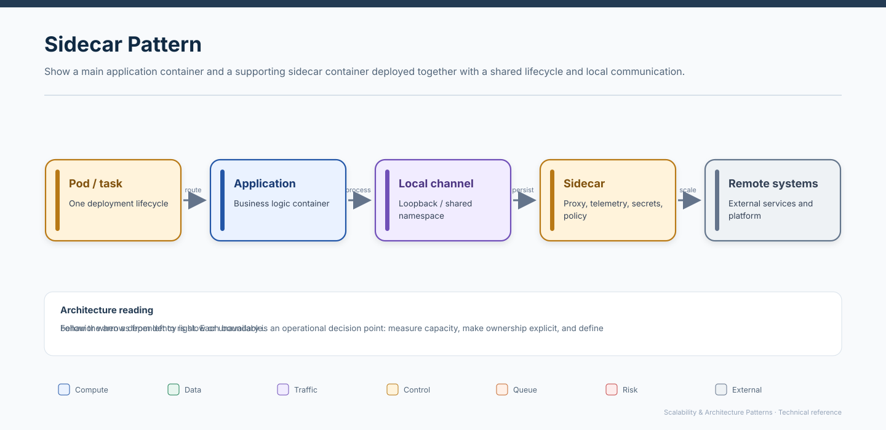  
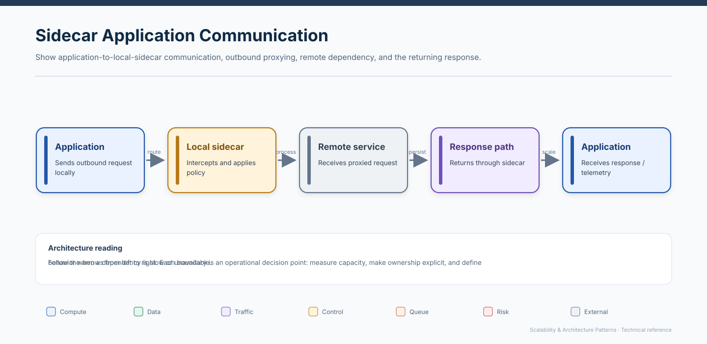  
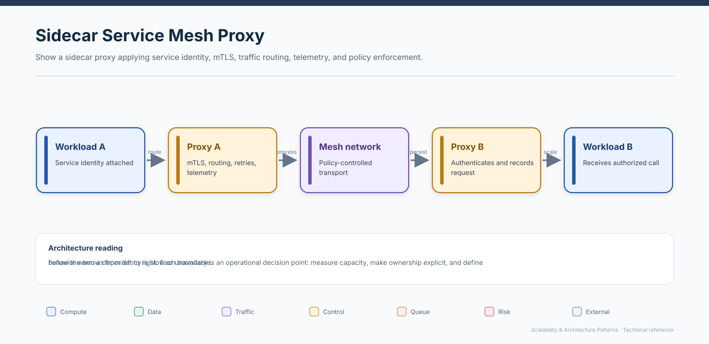  
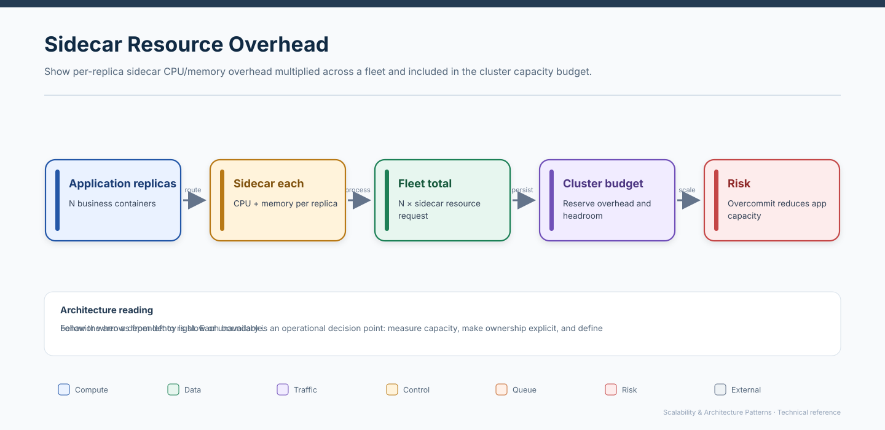

---

# 10. Ambassador Pattern

## 10.1 Definition

The **ambassador pattern** places a local proxy in front of an application's outbound communication to an external service or remote dependency. The application communicates with a nearby endpoint; the ambassador represents it on the network and can provide connection management, endpoint selection, TLS handling, retries, or protocol translation.

An ambassador is commonly deployed as a sidecar, but the patterns express different roles:

- **Sidecar** is a broad deployment relationship: a helper runs alongside an application.
- **Ambassador** is a communication role: a local intermediary represents the application when communicating with a remote system.

A sidecar can implement an ambassador, but a sidecar used only for log collection is not an ambassador.

## 10.2 Outbound request example

An application connects to `localhost` rather than directly to a legacy database endpoint. The ambassador:

1. Receives the local connection.
2. Selects a remote endpoint from configured regions or service discovery.
3. Establishes or reuses a pooled connection.
4. Applies TLS, protocol adaptation, or authentication.
5. Forwards the request and returns the response.
6. Emits connection and request telemetry.

This is useful when an application cannot easily be changed to support a new protocol, endpoint-selection strategy, or transport policy.

## 10.3 Appropriate use cases

- Connecting old applications to a remote database through a controlled proxy.
- Selecting among regional external API endpoints.
- Managing outbound TLS and certificates.
- Pooling expensive connections.
- Translating protocols between an application and an external system.
- Applying egress policy and telemetry consistently.

## 10.4 Trade-offs

The ambassador creates another process and network hop, consumes resources, and can become a single-instance failure point unless deployed with the application and managed carefully. Retrying a non-idempotent command can duplicate effects; the proxy must not blindly retry operations whose outcome is unknown. Connection pools must be sized against remote quotas, and the application must still enforce business deadlines and understand remote errors.

| Dimension | Sidecar pattern | Ambassador role |
|---|---|---|
| Main idea | Supporting process colocated with an application | Local intermediary for outbound communication |
| Scope | Broad; telemetry, logging, proxying, secrets, caching | Specifically mediates communication with remote endpoints |
| Deployment | Commonly same Pod/host/lifecycle | Commonly implemented as a sidecar, but not required by the role definition |
| Example | Log shipper, metrics agent, service-mesh proxy | Local proxy to an external API or database |
| Relationship | A deployment pattern | A communication pattern that may use a sidecar |

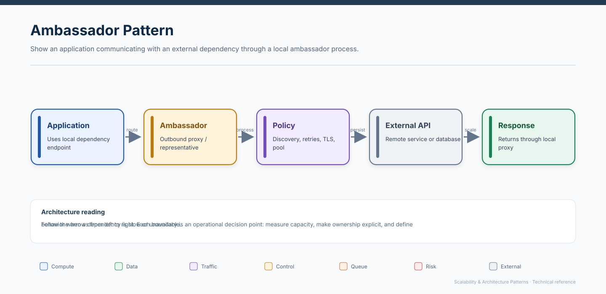  
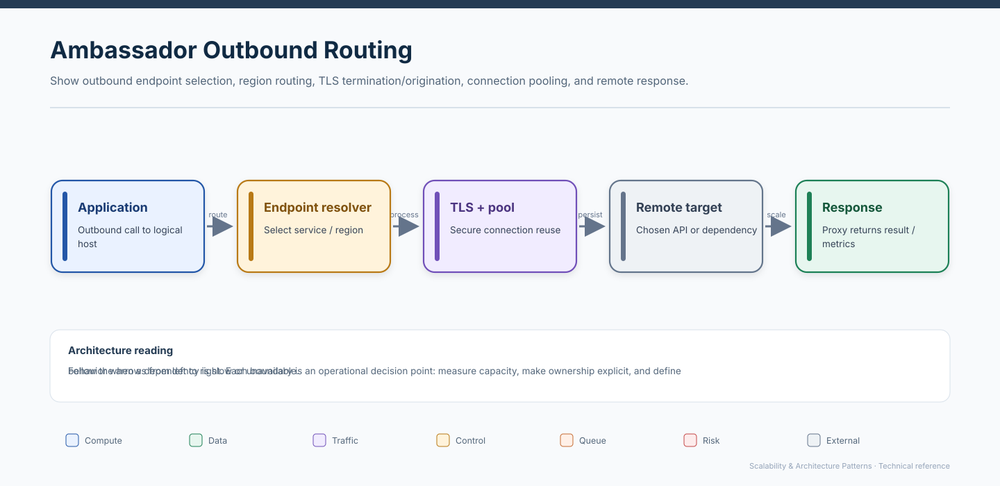  
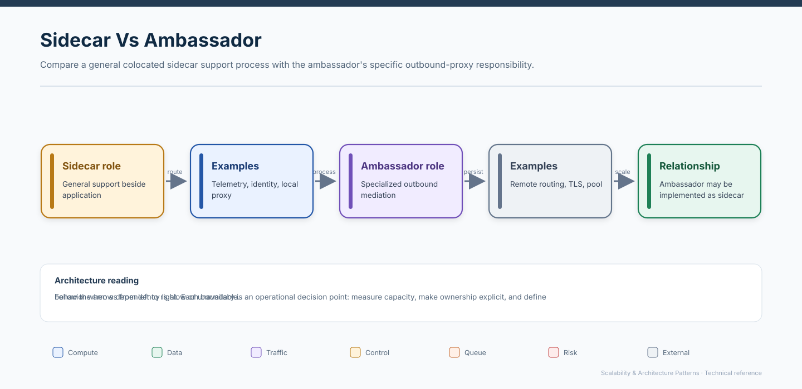

---

# 11. Back-of-the-Envelope Capacity Estimation

Capacity estimation translates business assumptions into approximate infrastructure demand. It helps identify likely bottlenecks, compare design options, and prevent obviously undersized or wasteful deployments. It is a starting model—not proof that a system will perform as estimated. Benchmarks and production measurements remain necessary.

## 11.1 Why estimate capacity

A capacity model should help answer:

- What average and peak workload should the system support?
- How many requests may be in flight at once?
- How much network bandwidth and storage will be consumed?
- What read/write mix will the database see?
- How many workers are required to keep a queue stable?
- How much cache memory is needed for the expected working set?
- What capacity remains when one node, zone, or cell is unavailable?
- What is the approximate cost of normal operation and peak headroom?

Use ranges for uncertain inputs. A point estimate such as “we will need 12 servers” can create false confidence if actual request cost, peak factor, or downstream quota is unknown.

## 11.2 Traffic estimation

Start with business measures such as daily active users (DAU), actions per user, and the number of backend requests generated by an action.

\[
QPS_{avg} = \frac{\text{Total Requests per Day}}{86{,}400}
\]

### Worked example: 10 million daily active users

Assumptions:

- DAU = 10,000,000.
- Average backend requests per user per day = 20.
- Peak-to-average factor = 5.

Daily request count:

\[
10{,}000{,}000 \times 20 = 200{,}000{,}000\ \text{requests/day}
\]

Average QPS:

\[
QPS_{avg} = \frac{200{,}000{,}000}{86{,}400} \approx 2{,}315
\]

Estimated peak QPS:

\[
QPS_{peak} = 2{,}315 \times 5 \approx 11{,}575
\]

These are aggregate requests. If one user action triggers five internal API calls, five database reads, or a search fan-out, the backend workload is larger than the external request count. Estimate each tier separately. Also model regional skew and event bursts: a campaign or live event can have a peak factor much higher than a normal day.

### Why averages are insufficient

An average of 2,315 QPS does not tell us whether requests arrive evenly or in short bursts. If a minute's traffic arrives in ten seconds, queueing and rate limits may be driven by the burst rather than the daily average. Use traffic distributions by minute/second, peak-to-average ratio, and concurrency. Model retries separately because overload can increase the arrival rate of attempted requests.

## 11.3 Concurrency estimation with Little's Law

Little's Law is:

\[
L = \lambda W
\]

where:

- \(L\) = average number of items in the system (for example, in-flight requests).
- \(\lambda\) = average arrival/completion rate in items per second.
- \(W\) = average time spent in the system in seconds.

### Worked example

Assume:

- Arrival rate = 5,000 requests/second.
- Average end-to-end processing time = 200 ms = 0.2 seconds.

\[
L = 5{,}000 \times 0.2 = 1{,}000\ \text{in-flight requests}
\]

The system has approximately 1,000 requests in progress on average under these stable conditions. This is not automatically the number of threads required: requests may be asynchronous, blocked on network I/O, multiplexed, or queued. Persistent connections are also different from in-flight requests. One WebSocket may remain open for hours while only a few messages are actively processed.

If average latency doubles to 400 ms while arrival rate remains 5,000 QPS, average in-flight work becomes 2,000. This can raise memory and thread usage and create a feedback loop if pools are unbounded.

## 11.4 Bandwidth estimation

A first-order response bandwidth estimate is:

\[
B = QPS \times \text{Average Response Size}
\]

### Worked example

Assume:

- 2,000 responses/second.
- Average uncompressed response payload = 50 KB (decimal approximation: 50,000 bytes).

\[
B = 2{,}000 \times 50{,}000 = 100{,}000{,}000\ \text{bytes/second}
\]

That is approximately 100 MB/s or 800 Mbit/s of payload egress before protocol overhead. Actual network usage depends on compression, TLS records, headers, retransmissions, request traffic, replication, and traffic distribution. A response-size distribution matters: a small number of large downloads may dominate bandwidth even when most API responses are tiny.

Consider:

- Incoming request bandwidth and outgoing response bandwidth separately.
- Compression ratio and CPU cost.
- TLS overhead and connection reuse.
- CDN offload for cacheable objects.
- Inter-service traffic and replication traffic.
- Peak network throughput and per-interface limits.
- Network headroom during failover or rebalancing.

## 11.5 Storage estimation

A basic storage estimate is:

\[
S_{raw} = N \times D \times T
\]

where:

- \(N\) = records created per period.
- \(D\) = average bytes per record.
- \(T\) = number of periods retained.

Then account separately for replication, indexes, metadata, compression, backups, and temporary migration space.

### Worked example: one year of records

Assumptions:

- 5,000,000 records/day.
- 2 KB per record, treating KB as 1,000 bytes for this estimate.
- Retention = 365 days.
- Replication factor = 3.

Daily raw data:

\[
5{,}000{,}000 \times 2{,}000 = 10{,}000{,}000{,}000\ \text{bytes} = 10\ GB/day
\]

Annual raw data:

\[
10\ GB/day \times 365 = 3{,}650\ GB = 3.65\ TB
\]

Approximate replicated data:

\[
3.65\ TB \times 3 = 10.95\ TB
\]

If indexes and metadata add an illustrative 30% overhead:

\[
10.95\ TB \times 1.30 \approx 14.24\ TB
\]

This does not include backups, snapshots, logs, compaction space, or migration headroom. Replication factor 3 means three stored copies under the assumed model; actual providers may implement durability and redundancy differently.

## 11.6 Database capacity

Estimate the database workload by separating reads, writes, and query cost.

Suppose an API receives 10,000 QPS and the workload is 80% reads and 20% writes. A naïve estimate gives 8,000 read operations/sec and 2,000 writes/sec. But the real load depends on what each request does:

- Does one request make several queries?
- Are queries indexed point lookups or wide scans?
- Are writes updating many indexes?
- Do queries contend on the same rows or hot keys?
- Does the database need to fsync durable writes?
- Are replicas serving reads, and what lag is acceptable?
- How many connections can be active without creating lock/CPU pressure?
- Does one tenant dominate the working set or write rate?

A rough connection budget can be derived from service pools. If 40 application instances each configure 100 connections, they can offer 4,000 connections to the database. That may exceed the database's useful concurrency. A pool is a queueing and concurrency control point; increasing its size is not automatically a performance improvement.

Estimate read/write capacity with representative query mixes and load tests. Measure CPU, buffer/cache hit ratio, storage IOPS/throughput, lock waits, replication lag, connection waits, transaction duration, and p95/p99 query latency. Use read replicas only for queries that can tolerate their consistency model.

## 11.7 Cache capacity

A first-order memory estimate is:

\[
M \approx K \times (V + O) \times (1 + H)
\]

where:

- \(K\) = number of cached keys.
- \(V\) = average value size.
- \(O\) = key, object, allocator, and metadata overhead per entry.
- \(H\) = fractional headroom/overhead allowance used in the estimate.

### Worked example

Assume:

- 8,000,000 keys.
- Average serialized value = 1,000 bytes.
- Estimated key and metadata overhead = 250 bytes/entry.
- Additional 30% allowance for fragmentation and operational headroom.

Base memory:

\[
8{,}000{,}000 \times (1{,}000 + 250) = 10{,}000{,}000{,}000\ \text{bytes} = 10\ GB
\]

With the 30% allowance:

\[
10\ GB \times 1.30 = 13\ GB
\]

This is a planning estimate, not a guarantee of allocator usage. Measure serialized object sizes and actual per-entry overhead on the chosen cache implementation. If the deployment replicates the full dataset, multiply memory by the replica count for fleet budgeting. In a partitioned cluster, calculate per-primary working-set requirements and then add replicas and failure headroom.

Do not fill all memory with the expected working set. Leave room for replication buffers, client buffers, fragmentation, temporary operations, failover, and bursts. The exact reserve depends on the implementation and operational model.

## 11.8 Queue and worker capacity

If a worker completes \(\mu\) jobs/second and incoming jobs arrive at \(\lambda\) jobs/second, the theoretical minimum number of workers is:

\[
N_{min} = \left\lceil \frac{\lambda}{\mu} \right\rceil
\]

### Worked example: 1,000 jobs/second

Assume each worker can process 20 representative jobs/second. The theoretical minimum is:

\[
N_{min} = \left\lceil \frac{1{,}000}{20} \right\rceil = 50\ workers
\]

At a target utilization of 70%, the approximate worker count becomes:

\[
N = \left\lceil \frac{1{,}000}{20 \times 0.70} \right\rceil = 72\ workers
\]

The 72-worker estimate leaves headroom for variation, but it does not automatically account for node failures or downstream limits. If one worker node runs 8 workers and two nodes must be tolerated as unavailable, provision enough additional nodes that the remaining fleet still sustains the target arrival rate.

Queue growth is a rate difference. If arrivals exceed completions by 100 jobs/second for 20 minutes, backlog grows by 120,000 jobs. A queue that stores those jobs is not a solution unless the system can eventually drain them within the required recovery window.

## 11.9 Cost estimation

A practical cost model separates:

- Compute: application replicas, worker fleets, control-plane services, and specialized accelerators.
- Storage: primary data, replicas, backups, snapshots, logs, and temporary migration storage.
- Network: internet egress, inter-region transfer, replication, and service-to-service traffic.
- Managed services: database, cache, queue, search, and control-plane charges.
- Observability: metrics cardinality, logs, traces, retention, and query workloads.
- Redundancy: standby capacity, multi-zone replicas, reserved headroom, and recovery environments.

Compare cost at normal traffic, peak traffic, and failure-mode traffic. The cheapest design at 40% utilization can become expensive when it must survive a zone loss or a flash sale. Include operational costs: a design that requires extensive manual work or frequent incidents has a cost beyond its cloud bill.

## 11.10 Capacity after failure

For a fleet with \(n\) identical nodes, each with sustainable capacity \(c\), normal aggregate capacity is approximately \(n c\), assuming work distributes evenly. If \(f\) nodes can fail and the system must still carry demand \(D\), the minimum condition is:

\[
(n-f)c \ge D
\]

This simplified equation ignores skew, coordination overhead, replica promotion, network capacity, and cold-start time, but it makes failure headroom explicit. For a cell-based system, apply the same reasoning at cell and fleet levels. Do not plan to route all tenants from a failed cell into a single survivor unless that survivor has proven capacity.

## 11.11 Reusable estimation checklist

1. State the user, tenant, and workload assumptions.
2. Convert daily activity into average and peak traffic.
3. Estimate fan-out from each external request to internal operations.
4. Estimate concurrency with latency and Little's Law.
5. Estimate payload bandwidth in both directions.
6. Estimate new data, indexes, replicas, retention, and backup size.
7. Split database reads/writes and characterize query cost.
8. Estimate cache working set, metadata, replication, and headroom.
9. Estimate worker count from arrival rate, processing rate, and utilization target.
10. Include dependency quotas, connection pools, and shared-resource limits.
11. Model one-node, zone, region, or cell failure as required.
12. Estimate cost at average, peak, and recovery load.
13. Validate with benchmarks and revise assumptions.

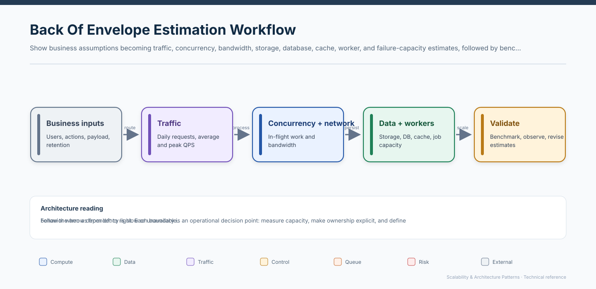  
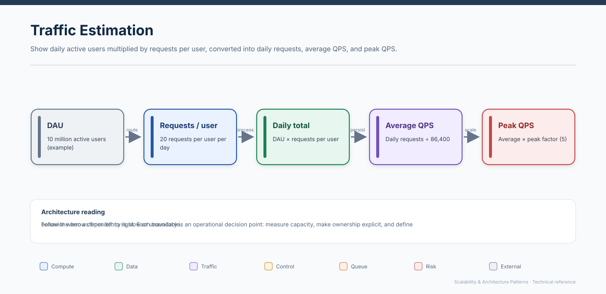  
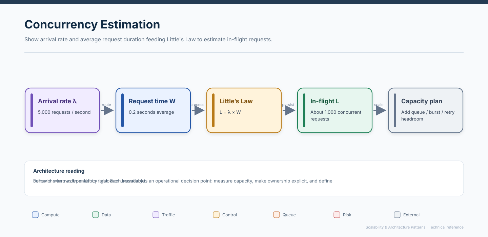  
  
  
  

---

# 12. Multi-Tenancy Architecture

## 12.1 What is a tenant?

A **tenant** is a customer, organization, account, workspace, or logical customer environment whose users and data must be separated from those of other customers. In business-to-business software, a tenant often represents an organization with many users. In consumer products, a tenant might represent an individual, family, group, or shared account. The correct tenant definition depends on identity, ownership, billing, administration, compliance, and data-sharing requirements.

A multi-tenant platform allows multiple tenants to use a shared product and some shared infrastructure while preserving defined isolation boundaries. Isolation is a spectrum rather than a single switch: compute, data, network, keys, cache, queues, and deployment can each be shared or dedicated to different degrees.

## 12.2 Isolation dimensions

A tenant-aware architecture should define isolation for:

- **Identity:** distinguish user identity from tenant identity; a user may belong to multiple tenants.
- **Authorization:** verify both the user's permission and the tenant boundary on every access path.
- **Data:** ensure queries and writes are scoped to the tenant; enforce this in more than just the UI.
- **Compute:** set per-tenant concurrency, CPU, memory, or job limits where necessary.
- **Storage:** define quota, retention, backup, deletion, and residency policies.
- **Messaging:** decide whether queues are shared, partitioned, or dedicated; protect against one tenant flooding consumers.
- **Caching:** include tenant and authorization dimensions in keys where response content differs.
- **Observability:** attribute usage, latency, errors, and cost to tenants without uncontrolled metric cardinality.
- **Operations:** support tenant-specific exports, restore, migration, support access, and deletion.

## 12.3 Data tenancy models

### Shared database, shared schema

All tenants use the same database tables. Tenant-owned records include a tenant identifier, and queries are scoped using the authenticated tenant context.

**Advantages:** high tenant density, low per-tenant infrastructure cost, straightforward fleet management, and efficient use of shared resources.

**Risks:** missing tenant filters can leak data; a large tenant can create a noisy-neighbor effect; per-tenant backup/restore or export is more complex; indexes and partitions must account for tenant access patterns; shared database outages affect many tenants.

Important safeguards include:

- Validate tenant identity at the service boundary and propagate it to data access.
- Use composite indexes that match tenant-scoped queries, such as `(tenant_id, created_at)` where appropriate.
- Consider database row-level security as defense in depth, while still testing application authorization.
- Reset tenant/session variables whenever reusing pooled connections; never rely on context left by a previous request.
- Test cross-tenant access attempts and data export paths.

### Shared database, separate schemas

Tenants share a database engine but each has a separate schema. This can improve logical organization and allow schema-level permissions, but fleet-wide schema migrations become operationally expensive as tenant count rises. Connection routing, schema version drift, and migration orchestration require automation.

### Database per tenant

Each tenant receives a separate database. This provides stronger data and operational isolation, and can simplify tenant-specific backup/restore, regional placement, and performance tuning. It increases the number of databases, credentials, connection pools, migrations, monitoring targets, and upgrade tasks. Managed database fleets and elastic pools can reduce some of this overhead, but do not eliminate it.

### Hybrid tenancy

A hybrid model places most small tenants in shared infrastructure and moves large, regulated, or high-demand tenants to dedicated databases or deployment stamps. A tenant catalog maps each tenant to its current deployment and data location. The routing layer must handle migration, version compatibility, and failure without trusting client-supplied tenant-to-database mappings.

## 12.4 Compute isolation

Data separation alone does not prevent noisy neighbors. One tenant may submit an expensive report, upload millions of records, or launch a large background import. The platform can use:

- Per-tenant rate limits and request budgets.
- Tenant-aware worker concurrency and queue quotas.
- Fair scheduling or weighted priorities.
- Dedicated worker pools for large tenants.
- Separate database pools or resource groups.
- Admission control and maximum query cost/time.
- Per-tenant storage and egress quotas.

A shared application tier with tenant-specific data stores is a valid architecture. Isolation can differ by tier based on cost, risk, and workload.

## 12.5 Noisy-neighbor problem

The noisy-neighbor problem occurs when one tenant's workload consumes shared resources and degrades service for others. Causes include high request volume, hot database keys, expensive queries, unbounded exports, queue floods, large cache footprints, and storage or bandwidth consumption.

Detection requires per-tenant and aggregate measurements. A global 50% CPU average can hide one tenant saturating a shard. Track request rate, error rate, p95/p99 latency, database time, query count, queue age, worker-seconds, cache footprint, and storage growth by tenant or tenant tier.

Mitigation should be proportional:

1. Apply limits for abusive or accidental bursts.
2. Use fair scheduling so one tenant cannot monopolize all workers.
3. Move a persistently large tenant to a dedicated database, worker pool, or cell.
4. Isolate high-cost jobs from interactive request paths.
5. Review pricing and product quotas so capacity consumption is economically sustainable.

## 12.6 Tenant-aware caching

A cache key must represent every dimension that changes the cached response. For tenant-specific data, keys should generally include tenant identity and relevant authorization scope. A key such as `dashboard:home` is unsafe if dashboards differ by tenant or user. A key such as `tenant:{tenant_id}:dashboard:{dashboard_id}:role:{role_version}` is more explicit, but the exact dimensions depend on the data and policy.

Never rely only on a tenant ID supplied in an untrusted request header. Derive tenant context from authenticated identity and verify membership and permissions. Invalidation must be scoped so one tenant's change does not accidentally invalidate or expose another tenant's data.

## 12.7 Tenant migration

Moving a tenant from a shared database to a dedicated database or another cell is a distributed data migration:

1. Create destination resources and compatible schema.
2. Take a consistent snapshot of the tenant's data.
3. Copy data while preserving relationships and tenant identifiers.
4. Capture ongoing changes using CDC or an outbox stream.
5. Validate counts, checksums, references, and application-level invariants.
6. Establish a write fence or controlled command routing cutover.
7. Switch the tenant directory/routing map to the destination.
8. Observe errors and latency; maintain a rollback plan consistent with writes accepted after cutover.
9. Retire source data only after validation, retention, and compliance requirements are satisfied.

## 12.8 Security and compliance

Threats include cross-tenant data leakage, confused-deputy authorization, shared cache mistakes, incorrect backup restore, support-tool overreach, and incomplete deletion. Use tenant-aware authorization on APIs, background jobs, scheduled tasks, exports, search, analytics, caches, and administrative tools. Encrypt in transit and at rest, audit privileged access, and define data residency, retention, and deletion policies for each deployment model.

The isolation model should be tested with adversarial cases: attempt to read another tenant's IDs, reuse object references across tenants, replay jobs with changed tenant context, query through admin/reporting endpoints, and restore data into the wrong tenant environment.

  
  
  
  
  
  
  

---

# 13. Cell-Based Architecture

## 13.1 What is a cell?

A **cell** is an independently operating instance of a workload that serves a bounded portion of the overall customer or request population. A cell should include the components needed to perform its assigned workload: application compute, data stores, caches, queues, and critical dependencies. A global router or control plane may assign tenants or work to cells, but normal cell operation should avoid unnecessary cross-cell dependencies.

The main purpose is to reduce the **scope of impact** (blast radius). A defect, hot tenant, corrupted request, or resource exhaustion event inside one cell should affect only the workload assigned to that cell, while other cells continue serving independently.

## 13.2 Cell architecture

A typical multi-tenant SaaS platform may include:

- **Global entry point:** receives requests and authenticates the caller.
- **Tenant directory:** maps tenant IDs to a cell or deployment stamp.
- **Router:** directs requests to the assigned cell and caches safe routing metadata.
- **Cells:** each has application services, database, cache, queue, and operational telemetry for its tenant subset.
- **Control plane:** manages cell registration, configuration, fleet deployments, tenant assignment, and capacity policy.
- **Data plane:** serves customer requests inside each cell.

A simplified request path is:

1. Client presents credentials and tenant context.
2. Global entry point validates identity and derives the tenant ID from trusted claims or membership context.
3. Router obtains the tenant's cell assignment from a directory or cache.
4. Request is sent to that cell's regional endpoint.
5. Cell-local services access cell-local data, cache, and queues.
6. Response returns through the entry point or directly from the cell endpoint, according to the design.

The router should perform simple, well-understood routing. Complex business workflows in the router can make it a global bottleneck and increase the impact of routing-layer failures.

## 13.3 Cell boundaries and isolation

The cell boundary is only useful if critical dependencies are isolated. If every cell writes to the same database, depends on one shared queue, or uses one overloaded global cache, the shared dependency can still create a global failure domain.

Ideal cells are independent and do not share mutable state. Full independence may not be possible in every system; unavoidable shared dependencies should be explicitly identified, capacity-managed, and treated as part of the global blast radius.

## 13.4 Blast-radius example

Suppose a platform has 10 equally sized cells, each serving 10% of the active tenants. If one cell fails completely and routing/tenant assignment do not shift load to overloaded survivors, the direct affected tenant population is approximately 10%. The other 90% may continue operating. The number is illustrative: the actual impact depends on tenant distribution, shared services, cross-cell workflows, and whether cells are truly independent.

A cell can also contain a software defect or poison-pill request. Progressive rollout to a small subset of cells can prevent a bad release from reaching the entire fleet simultaneously.

## 13.5 Cell sizing and expansion

Cells should have bounded capacity. If a cell is allowed to grow without limit, its blast radius becomes large and it may become a miniature monolith with difficult recovery. Define cell capacity in workload terms such as tenants, RPS, database storage, queue rate, active connections, and tenant skew—not only CPU.

Adding cells requires:

- A tenant-to-cell assignment strategy.
- An automated provisioning process.
- Version and configuration compatibility.
- A tenant migration mechanism from the beginning.
- Per-cell observability and capacity forecasts.
- Admission control to prevent over-assignment.

Rebalancing tenants is not merely editing a routing table. Stateful data and queued work may need to move. Use snapshot/CDC, validation, write coordination, and a controlled cutover similar to database migration.

## 13.6 Cell failure and evacuation

When a cell is unhealthy, first determine whether the failure is local or shared. Automatically moving every affected tenant to one remaining cell can overload the survivor and turn a local failure into a fleet-wide outage.

A safe evacuation process may:

1. Stop admitting new work to the failed cell.
2. Determine whether it can recover in place.
3. Calculate spare capacity across healthy cells.
4. Select tenants for staged migration based on priority and capacity.
5. Restore or replicate required data.
6. Move tenant routing after validation.
7. Apply rate limits or reduced functionality during recovery.
8. Monitor survivors and pause migration if their error rates or resource usage rise.

Cell recovery should be tested, not merely documented. Test both partial failures (database unavailable, queue lagging, cache empty) and complete cell loss.

## 13.7 Control plane versus data plane

The **control plane** manages placement, configuration, fleet lifecycle, and policy. The **data plane** handles normal user requests. Keeping these responsibilities separate avoids requiring a global control-plane call for every request.

For example, the router can cache a versioned tenant-to-cell mapping and continue using it for a bounded period if the directory service is unavailable. The system must define what happens when a tenant is newly onboarded or moved during that outage. The cache policy trades placement freshness against availability.

The control plane itself must be highly available and protected, but its failure should not necessarily stop data-plane operations that already have valid routing and configuration.

## 13.8 Traditional multi-tenancy versus cell-based design

| Dimension | Traditional shared deployment | Cell-based architecture |
|---|---|---|
| Isolation | Logical or per-tier separation within shared stack | Bounded workload stacks with local dependencies |
| Blast radius | Shared component failure can affect many/all tenants | Cell failures can be limited to assigned tenants if boundaries are real |
| Scaling | Scale shared components and manage global limits | Add or resize cells; move tenant populations |
| Operations | Fewer deployments, larger shared fleet | More deployment units and fleet orchestration |
| Cost | High resource density | Some duplication and reserved headroom |
| Tenant migration | Often data move within a shared system | Requires cell assignment and data movement |
| Best fit | Moderate scale with effective shared-resource controls | Large platforms needing strong failure isolation and bounded growth |

## 13.9 Cell-based design principles

- Keep cell dependencies local wherever possible.
- Avoid cross-cell state sharing and chatty cross-cell calls.
- Keep cell size bounded and monitor skew.
- Roll out changes progressively across cells.
- Start with more than one cell if the architecture depends on cells; this exposes operational assumptions early.
- Build tenant migration and reassignment tooling early.
- Make routing logic simple and observable.
- Model capacity after cell loss and avoid uncontrolled evacuation.

  
  
  
  
  
  
  

---

# 14. Architecture Patterns and Their Interactions

Patterns are tools that solve different problems. Production systems combine them when the combination fits the workload and the organization. They should not be adopted as a checklist of fashionable components.

## 14.1 Stateless microservices with shared state

Stateless API services can scale horizontally while storing durable state in service-owned databases, caches, and object stores. A stateless request tier does not remove the need to scale and protect those stateful systems. Connection budgets, cache consistency, data ownership, and failure handling remain essential.

A service may be stateless across HTTP requests but stateful in a workflow: a checkout process may persist a state machine in a database and resume after a worker restarts. The service instance is disposable; the workflow state is not.

## 14.2 Shared-nothing microservices

A service can be replicated horizontally and partition its owned records across independent nodes. This is useful when a large domain has partition-local operations. The partition key must match access patterns and business invariants. Avoid assuming that “microservice” implies “shared-nothing”; a microservice can use one managed relational database, and a distributed database can serve a monolithic application.

## 14.3 Sidecar and ambassador combinations

A sidecar can provide telemetry or a service proxy. When it mediates outbound calls to an external service, it is also acting in an ambassador role. Separate the concerns in configuration and operational ownership: traffic policy, certificates, endpoint selection, retries, and observability need explicit rules. A proxy should not retry non-idempotent operations without an application-level idempotency contract.

## 14.4 Strangler Fig migration into cells

An organization may first extract a bounded capability into a service, then deploy multiple isolated copies as cells for tenant groups. This creates two transitions: a code/data ownership transition and a tenant placement transition. Perform them incrementally, preserving routing and rollback control. A new service is not automatically cell-ready; it must have isolated dependencies, provisioning automation, per-cell observability, and a migration path.

## 14.5 Multi-tenant microservices

A multi-tenant service should derive tenant context from authenticated identity, enforce authorization at each boundary, include tenant scope in data access and caching, and apply per-tenant resource controls. Services may use different tenancy models: a shared database for common data, dedicated stores for regulated tenants, or cell-local stores for high isolation. The service contract must not allow callers to choose another tenant's storage route by submitting arbitrary IDs.

## 14.6 Hybrid architecture example

A practical SaaS platform could use:

- A **modular monolith** for low-volume administration and product configuration.
- **Stateless microservices** for high-volume APIs with independent ownership.
- **Shared-nothing partitions** for a high-throughput event or analytics workload.
- **Sidecars** for service identity, telemetry, and traffic policy.
- **Cell-based deployment units** for large tenants or bounded tenant populations.
- **Separate worker pools** for imports, notifications, reporting, and inference.

This is a hybrid architecture, not an endorsement to implement every component from day one. Start with the simplest architecture that satisfies current requirements. Add a pattern only when a measurable scaling, reliability, ownership, or isolation need justifies its costs.

  
  
  

---

# 15. Real-World Architecture Case Studies

The following case studies are production-style reference designs. Their workload numbers are illustrative assumptions for architecture reasoning, not claims about a named company's confidential internal implementation.

## 15.1 Case Study 1 — Early-stage e-commerce startup

**Business problem:** Launch a shopping product with a small engineering team, uncertain product-market fit, and moderate traffic. The company needs rapid feature iteration without building a platform team prematurely.

**Assumptions and requirements:** 50,000 monthly active users, 2,000 daily active users, occasional promotional bursts, relational transactions for orders and inventory, and a small operations budget. The critical journey is browse → cart → checkout → payment → order confirmation.

**Initial architecture:** A modular monolith with Catalog, Cart, Orders, Inventory, and Identity modules. One relational database stores transactional data. A CDN serves static assets; a small cache stores frequently read catalog data; a queue handles email and low-priority tasks.

**Scaling strategy:** Start with vertical scaling for the database and application host. Add two or more application replicas behind a load balancer once request handling is made stateless. Use database connection pooling, query/index tuning, and a bounded worker process for background tasks. Increase cache coverage for high-read, low-volatility catalog data.

**Patterns selected:** Modular monolith, diagonal scaling, cache-aside for catalog, queue-based background work, externalized session state.

**Illustrative capacity estimate:** At 2,000 DAU and 30 backend requests/user/day, daily requests are 60,000 and average rate is approximately 0.69 QPS. A campaign peak factor of 20 gives about 14 QPS, but checkout bursts and product hot spots require separate tests. The estimate is small enough that simplicity is likely more valuable than service decomposition.

**Failure scenarios:** Database connection exhaustion, payment provider timeout, cache outage, duplicate checkout retry, worker crash, or deployment regression.

**Mitigation and lessons:** Use idempotency keys for checkout/payment orchestration; fail open for non-critical catalog cache where safe; fail closed for business invariants; isolate worker connections; automate backups and restore tests. Keep module ownership clear so the system can evolve without prematurely splitting services.

## 15.2 Case Study 2 — Large e-commerce platform

**Business problem:** Support high traffic, large catalog size, promotions, and multiple teams owning different capabilities. Search and browsing are read-heavy; checkout and inventory require correctness; notifications can be delayed.

**Assumptions and requirements:** 5 million DAU, 20 backend requests/user/day, peak factor 6, strict checkout correctness, and separate scaling profiles for search, product detail, inventory, orders, payment, and notifications.

**Architecture:** Domain-oriented services for Catalog, Search, Inventory, Order, Payment, and Notification. Each service owns its data model. Catalog data is projected into search. Product images and static assets are delivered through a CDN. Redis-like caches hold selected hot reads. The broker carries order events and notification work. Inventory reservations and checkout orchestration use explicit state transitions and idempotency.

**Scaling strategy:** Scale Catalog/Search read capacity separately from Inventory/Order writes. Use read replicas or search indexes for read-heavy access. Keep payment calls bounded by provider quotas and use a queue for non-interactive downstream work. Add partitions where data volume or throughput requires them, based on access patterns.

**Patterns selected:** Microservices, database per service (logical ownership), event-driven projections, cache/CDN, queue workers, independent scaling.

**Capacity estimate:** 5,000,000 × 20 = 100 million requests/day. Average QPS is about 1,157; at a peak factor of 6, around 6,944 QPS. If 70% are catalog/search reads, those workloads are approximately 4,861 QPS at peak before internal fan-out. Search and product detail need separate measurements; they should not be assigned equal capacity just because both are read paths.

**Failure scenarios:** Search outage, delayed inventory projection, payment timeout, broker backlog, cache stampede on a popular item, and partial service deployment.

**Mitigation and lessons:** Keep authoritative stock decisions in the inventory owner; search results may be stale but checkout must revalidate. Apply backpressure to notification consumers. Use circuit breakers and deadlines around payment. Avoid a synchronous chain across every domain for product browsing. Microservices are justified only with clear team ownership and operational maturity.

## 15.3 Case Study 3 — Multi-tenant SaaS platform

**Business problem:** Serve hundreds or thousands of organizations using a shared workflow product, with strong logical data isolation and predictable service quality.

**Assumptions and requirements:** 2,000 tenants, 100 active users/tenant on average, large variance in usage, shared feature set, tenant-specific configuration, auditability, and per-tenant exports/deletion.

**Architecture:** Shared application tier with stateless API instances. A shared relational database uses tenant IDs in tenant-owned records and tenant-scoped access paths. Tenant context is derived from authenticated membership and propagated through request handling. A cache includes tenant and authorization scope in relevant keys. Queue jobs carry verified tenant identity and enforce quotas.

**Scaling strategy:** Use tenant-aware rate limits and worker budgets. Partition large tables by tenant or another access-aligned key only after measuring database constraints. Track per-tenant latency, query volume, and storage growth. Isolate expensive reporting into a separate worker pool.

**Patterns selected:** Shared database/shared schema, stateless services, tenant-aware cache, fair scheduling, logical isolation.

**Illustrative capacity estimate:** If 20,000 users are active concurrently and each produces one request every 10 seconds on average, the API arrival rate is about 2,000 QPS. Average workload distribution can hide a tenant that creates 25% of the queue. Capacity must be measured by tenant as well as globally.

**Failure scenarios:** Missing tenant filter, tenant context leakage through pooled database sessions, one tenant launching a costly export, shared cache key collision, and noisy-neighbor queue starvation.

**Mitigation and lessons:** Apply defense-in-depth with authorization checks and database row-level security where suitable. Reset connection-level tenant context on checkout/check-in. Use per-tenant job limits, quotas, and query budgets. Test object-ID substitution and cross-tenant access. Shared schema is efficient only when tenant context is enforced consistently in every code path.

## 15.4 Case Study 4 — Enterprise SaaS with large tenants

**Business problem:** Most customers are moderate in size, but a few large or regulated organizations require stronger performance isolation, independent restore, regional placement, or custom data-retention policies.

**Assumptions and requirements:** 8,000 tenants, 100 high-volume tenants, contractual data residency for some customers, and a shared product release train.

**Architecture:** Hybrid tenancy. Small tenants use pooled shared databases. Larger tenants are mapped to dedicated databases or deployment stamps through a tenant catalog. Application compute remains shared for some capabilities, while expensive workloads may use dedicated worker pools. Each tenant's location and deployment version are tracked in a controlled directory.

**Scaling strategy:** Move tenants based on measured resource consumption and contractual needs, not simply tenant count. Use automated provisioning and schema migration. Maintain pool-level capacity dashboards and database fleet patching automation.

**Patterns selected:** Hybrid tenancy, database-per-tenant for selected customers, tenant directory, deployment stamps, tenant migration pipeline.

**Capacity estimate:** If 100 large tenants each average 50 GB of data, they require 5 TB of tenant data before indexes, replicas, backups, and growth. The small-tenant pool may contain more tenants but less total data. Capacity planning by tenant tier is more useful than assuming equal consumption.

**Failure scenarios:** Tenant directory outage, a dedicated database failing, a migration creating inconsistent data, connection storm across the database fleet, and version skew between deployment stamps.

**Mitigation and lessons:** Cache tenant routing with version/expiry semantics and define behavior during directory outages. Automate database provisioning, backups, migrations, and patching. Use staged tenant cutover with validation and rollback rules. Hybrid tenancy trades resource efficiency for fleet-management complexity.

## 15.5 Case Study 5 — Cell-based global SaaS platform

**Business problem:** A global SaaS platform has enough tenants and criticality that one bad deployment, overloaded tenant, or database incident must not affect the full customer base.

**Assumptions and requirements:** 100,000 tenants across regions, multiple tenant tiers, high availability objectives, bounded cell size, and ability to migrate tenants between cells.

**Architecture:** A global entry layer authenticates users and routes using a tenant-to-cell directory. Each cell hosts a full workload slice: API services, cell-local database, cache, queues, and telemetry. A control plane manages cell lifecycle, assignment, configuration, and rollout. Cells deploy progressively rather than all at once.

**Scaling strategy:** Add cells when measured capacity or tenant distribution approaches a defined envelope. Assign new tenants to cells using capacity and region constraints. Move oversized tenants through a controlled migration workflow. Keep cross-cell calls rare and avoid global mutable dependencies where possible.

**Patterns selected:** Cell-based architecture, tenant directory, control-plane/data-plane separation, hybrid tenancy, progressive rollout.

**Illustrative estimate:** If a target cell is designed for 2,000 average tenants, 100,000 tenants require approximately 50 cells at full target density. This is not a hard limit: actual cell count depends on tenant skew, per-tenant resource footprint, failure headroom, region distribution, and cell overhead. If 1 cell must fail without overloading the remaining 49, spare capacity must be reserved or tenants must be shed/migrated in stages.

**Failure scenarios:** One cell's database saturation, a global router bug, bad configuration rollout, shared identity dependency outage, and overloading survivors during evacuation.

**Mitigation and lessons:** Keep cells independent, cap their size, deploy canaries to a limited number of cells, and test evacuation. A global router or identity provider can become a hidden global blast radius. The pattern only works if dependencies are isolated enough to contain faults.

## 15.6 Case Study 6 — Real-time collaboration platform

**Business problem:** Users collaborate in shared documents, whiteboards, or rooms with low-latency updates and persistent connections.

**Assumptions and requirements:** 500,000 concurrent WebSocket connections globally, room membership, per-document ordering, reconnection after gateway failure, and durable document history.

**Architecture:** Regional WebSocket gateways maintain live connections. A room/partition directory maps document IDs to a logical owner or collaboration partition. The owner sequences updates and publishes them to subscribed gateways. Durable document operations are written to a log or database; snapshots/checkpoints reduce replay cost.

**Scaling strategy:** Scale gateways by concurrent connections and memory; scale room processors by active rooms and message rate; partition large rooms or documents if fan-out becomes a hot spot. Keep persistent connection state distinct from durable document state.

**Patterns selected:** Stateful gateways, partition ownership, stateless control APIs, event log, regional routing, checkpointing.

**Capacity estimate:** If 500,000 connections emit 0.02 updates/second on average, the platform receives about 10,000 updates/second before fan-out. If each update is delivered to 8 collaborators on average, outbound deliveries may approach 80,000 messages/second. Fan-out, not just inbound event rate, is a major capacity variable.

**Failure scenarios:** Gateway process crash, room-owner failure, duplicate update delivery, reconnect storm, a very large room, and regional network partition.

**Mitigation and lessons:** Reconnect with jitter, persist sequence/version metadata, use idempotent operation IDs, and define conflict resolution. A gateway can be replaced, but room state and document history require durable ownership/recovery. Measure active connections, messages/sec, fan-out, and outbound buffer pressure separately.

## 15.7 Case Study 7 — Global media platform

**Business problem:** Serve images, articles, video segments, and API metadata to users across geographies with variable demand and large static payloads.

**Assumptions and requirements:** 20 million daily viewers, mixed static and dynamic traffic, large outbound bandwidth, low latency for popular content, and origin protection during traffic spikes.

**Architecture:** CDN edge caching for static content and cacheable media segments, regional origin shields, object storage as durable media origin, stateless APIs for metadata, and background workers for media transcoding and publishing. Personalized account endpoints bypass shared caching unless the cache key and authorization model make sharing safe.

**Scaling strategy:** Scale bandwidth and edge hit ratio through cacheable immutable assets. Keep media processing asynchronous and scale workers by queue depth and GPU/CPU requirements. Scale API compute separately from object storage and transcoding.

**Patterns selected:** CDN, regional hierarchy, stateless APIs, object storage, queue workers, immutable versioned URLs.

**Capacity estimate:** If 20 million viewers each fetch 20 media objects/day, that is 400 million object requests/day, or about 4,630 average requests/sec. At 80 KB average object size, payload egress would be roughly 370 MB/s if all requests came from origin. With an illustrative 95% edge hit rate, the origin sees 5% of those object requests, though actual bandwidth depends on object-size distribution and cache behavior.

**Failure scenarios:** CDN miss storm, origin overload, hot content after a major event, invalid cache key, regional edge failure, and transcoding backlog.

**Mitigation and lessons:** Use origin shielding, request collapsing where supported, immutable versioned URLs, prewarming for expected events, and stale content policies where business semantics allow. Do not cache user-specific responses in a shared keyspace. Edge capacity reduces origin load but does not eliminate origin failure planning.

## 15.8 Case Study 8 — High-volume analytics platform

**Business problem:** Ingest and analyze large volumes of clickstream, telemetry, or product events for dashboards and batch reports.

**Assumptions and requirements:** 500,000 events/second at peak, 1 KB average event, replayable ingestion, near-real-time aggregations, and historical query support.

**Architecture:** Ingestion gateways validate and publish events to a partitioned durable log. Stream processors consume partitions, maintain local state/checkpoints, and write aggregates to serving stores. Historical events land in object storage and are processed by distributed batch jobs. A shared-nothing execution model partitions data and compute by key/time where practical.

**Scaling strategy:** Scale ingestion by partition throughput and network bandwidth; scale consumers by partition count and processing cost; scale storage by retention and compression. Monitor partition skew and late events. Use separate serving paths for low-latency aggregates and ad hoc historical scans.

**Patterns selected:** Shared-nothing processing, partitioned log, consumer groups, data locality, batch/stream separation.

**Capacity estimate:** At 500,000 events/sec × 1 KB, raw ingest is about 500 MB/sec (decimal). Per day, that is approximately 43.2 TB raw before compression. A replication factor of 3 implies roughly 129.6 TB/day of replicated log traffic/storage under a simplified model; retention and tiering must be defined explicitly.

**Failure scenarios:** Consumer lag, one hot partition, processor crash, schema change, storage throttling, and checkpoint corruption.

**Mitigation and lessons:** Use partition keys aligned to aggregation/query needs, schema compatibility controls, checkpoint recovery, replay limits, and separate capacity for serving queries. A shared-nothing model improves parallelism only when partitions are balanced and most work is local.

## 15.9 Case Study 9 — AI model-serving platform

**Business problem:** Serve online predictions from multiple models with varying compute and memory requirements while preserving low tail latency.

**Assumptions and requirements:** 15,000 requests/sec across model families, a mix of CPU and GPU inference, model-version rollout, strict latency SLOs for online traffic, and offline batch scoring.

**Architecture:** An inference gateway routes to model-specific pools. CPU models run on horizontally scaled CPU workers; large neural models run on GPU workers with model replicas and bounded dynamic batching. Model artifacts are staged in regional storage and loaded during readiness. Batch inference uses separate queues and worker pools so offline jobs do not starve online requests.

**Scaling strategy:** Scale on queue age, request rate, accelerator utilization, GPU memory, batch size, and p99 latency. Maintain warm capacity for model-loading delays. Use model-aware routing and avoid packing models beyond VRAM capacity. Batch size is tuned against the latency budget.

**Patterns selected:** Workload isolation, CPU/GPU pools, stateless gateway, stateful model cache on workers, queue-based batch scoring, autoscaling with warm pools.

**Capacity estimate:** If a GPU worker sustains 250 inferences/sec at the target latency and should operate at 70% of measured capacity, usable planning capacity is 175 requests/sec. For 3,000 GPU-routed requests/sec, the theoretical count is 18 workers (3,000 / 175 rounded up). Add failure headroom, model replicas, regional distribution, and batch variability; the actual number must come from representative model benchmarks.

**Failure scenarios:** GPU OOM, model load failure, cold-start delay, inference timeout, traffic skew to one model, and batch queue starvation.

**Mitigation and lessons:** Separate online and offline queues, reserve warm capacity, use model-specific concurrency limits, shed low-priority work during overload, and roll out versions gradually. CPU utilization alone is not a sufficient scaling signal for inference.

## 15.10 Case Study 10 — Monolith-to-microservices transformation

**Business problem:** A mature order-management monolith is slowing team delivery and cannot independently scale a high-volume capability. A complete rewrite is too risky.

**Assumptions and requirements:** Existing monolith with several domains, growing order traffic, frequent changes to order fulfillment, and a team capable of operating a new service but not rebuilding the whole platform at once.

**Architecture:** First modularize the monolith and define an Order module interface. Extract one bounded order capability behind an API. Use a routing façade and gradual Strangler Fig migration. Move data with snapshot plus CDC/outbox, validate shadow reads, then perform an explicit write cutover. Keep other domains in the monolith until their extraction is justified.

**Scaling strategy:** Independently scale the extracted Order service and its worker pool. Keep transactional order state within the new service boundary. Retain shared infrastructure only where ownership and capacity are understood.

**Patterns selected:** Modular monolith, domain decomposition, Strangler Fig, outbox/CDC, canary traffic, independent service scaling.

**Capacity estimate:** If the order endpoint receives 1,200 peak requests/sec and each request performs two local database operations before extraction, estimate read/write mix and query cost. Do not assume service extraction doubles throughput: measure whether the original bottleneck was CPU, database locks, deployment coordination, or another dependency. The new network hop may increase latency even as deployment independence improves.

**Failure scenarios:** CDC lag, mismatched data, dual-write divergence, stale reads, router misconfiguration, and rollback after the new service has accepted writes.

**Mitigation and lessons:** Extract one capability, prove operational ownership, instrument business correctness, and define write authority. Do not retire old tables until all readers/writers and reporting jobs have moved. Architectural success is measured by reduced coupling and improved ability to meet requirements—not the number of services created.

---

# 16. Architecture Decision Framework

Architecture selection should begin with requirements and constraints, not a preferred technology. A useful decision records the options considered, reasons, risks, and conditions under which the decision should be revisited.

## 16.1 Inputs to an architecture decision

Evaluate at least:

- Team size, skill distribution, and on-call maturity.
- Domain complexity and rate of requirement change.
- Average, peak, and burst traffic.
- Data size, write rate, query pattern, and consistency needs.
- Deployment frequency and independent ownership needs.
- Availability, recovery time, and data-loss objectives.
- Tenant count, isolation, compliance, and residency needs.
- Geographic distribution and latency objectives.
- Security boundaries and identity model.
- Infrastructure budget and operational cost.
- Observability, automation, and incident-response capabilities.

## 16.2 Decision matrix

| Requirement or signal | Candidate pattern | Why it may fit | Trade-off / warning sign |
|---|---|---|---|
| Small team, evolving domain, shared transactions | Modular monolith | Low operational overhead and simple local calls | Enforce module boundaries to prevent a tangled codebase |
| One capability scales or releases independently | Extracted service/microservice | Independent resource allocation and ownership | Requires API/data contracts and distributed operations |
| Application replicas need to serve any request | Stateless service with externalized state | Flexible routing and easy replacement | Shared state store becomes a dependency |
| Live connections or partition-owned state | Stateful service | State remains near its active owner | Routing, replication, and recovery must be designed |
| One node reaches an efficient but finite limit | Vertical scaling | Low complexity and local processing | Hardware ceiling and concentrated failure risk |
| Work is parallelizable and can be partitioned | Horizontal scaling | Aggregate capacity and failure distribution | Coordination, data partitioning, and network cost |
| High-volume key-local operations | Shared-nothing/partitioned design | Data locality and parallelism | Cross-partition queries and hot partitions |
| Multiple compute nodes need one shared data view | Shared-disk model | Shared storage and compute separation | Storage throughput and coordination can bottleneck |
| General helper capability next to an app | Sidecar | Reusable support process | Per-replica resource and lifecycle cost |
| Outbound calls need local mediation | Ambassador | Endpoint, TLS, pooling, and protocol policy | Extra hop, retries, and proxy failure mode |
| Legacy system must be replaced safely | Strangler Fig | Incremental migration with coexistence | Data ownership and rollback require careful design |
| Many tenants with cost-sensitive common workload | Shared schema/pooled tenancy | High resource density | Tenant leaks and noisy neighbors require strong controls |
| Some tenants need stronger isolation | Hybrid or dedicated tenancy | Tailored performance/compliance boundaries | Fleet automation and data movement complexity |
| Large population needs bounded blast radius | Cell-based architecture | Independent workload slices | More deployments and cell orchestration |
| Worker arrival rate varies | Queue consumers with backpressure | Buffering and independent scaling | Queue age, retries, and downstream quotas must be managed |

## 16.3 Monolith versus microservices decision

Prefer a modular monolith when the domain is changing rapidly, the team is small, most operations need shared transactions, and no capability needs independent deployment or scaling. Consider extracting a service when a stable business boundary has distinct operational, team, scaling, or compliance requirements. Do not extract merely because a module has many lines of code.

A good extraction candidate has:

- A clear business responsibility.
- A small number of well-understood callers.
- Identifiable data ownership.
- A contract that can evolve independently.
- A meaningful operational reason to separate it.
- A team that can own deployments and incidents.

## 16.4 Vertical versus horizontal scaling decision

Scale vertically first when the constraint is understood, a larger node provides efficient gains, and the system can tolerate its failure domain. Scale horizontally when work is parallelizable, requests can be routed, state can be partitioned or externalized, and the shared dependencies have capacity. Use diagonal scaling when both node efficiency and aggregate capacity matter.

Warning signs for horizontal scale include rapidly growing connection counts, lock contention, a hot partition, a shared global cache, or a database that already saturates. Adding replicas without fixing these constraints increases contention rather than capacity.

## 16.5 Stateless versus stateful decision

Keep request-serving compute stateless when client continuity can be represented by tokens or external state. Keep state local when locality is essential—such as live connections or partition-owned stream state—but define ownership, replication, checkpoint, and recovery. State is not eliminated by choosing stateless services; it is moved to systems that must be sized and operated.

## 16.6 Shared-nothing versus shared storage decision

Use shared-nothing when partition-local work dominates and the domain can tolerate explicit data partitioning. Use shared storage or a shared-disk model when multiple compute nodes need access to a common dataset and the storage layer meets throughput and failure requirements. Evaluate cross-partition joins, transactions, data locality, and failure recovery before deciding.

## 16.7 Sidecar versus ambassador decision

Use sidecar to describe a supporting process colocated with an application. Use ambassador when the important responsibility is mediating outbound connections. An ambassador is often implemented as a sidecar. Do not add either if the same requirement is already handled safely and consistently by a platform gateway, library, or managed service with lower operational cost.

## 16.8 Shared versus dedicated tenancy decision

Use shared tenancy when high density and cost efficiency matter and strong logical isolation can be demonstrated. Use dedicated resources when regulatory, performance, backup/restore, or regional requirements justify the cost. A hybrid model supports different tenant tiers, but it requires a tenant directory, automated provisioning, migration tooling, and fleet operations.

## 16.9 Traditional tenancy versus cells

Consider cells when shared infrastructure creates an unacceptable blast radius, tenant count/workload is large enough to justify independent workload slices, and the organization can provision, monitor, upgrade, and evacuate cells. Avoid cells when a single shared database/queue/router remains the dominant global failure point or when cell lifecycle automation is not mature.

## 16.10 Decision record template

For every major architecture choice, record:

1. Context and workload assumptions.
2. Requirements and service-level objectives.
3. Options considered.
4. Chosen approach and reasons.
5. Consequences, including operational and cost impacts.
6. Failure modes and recovery behavior.
7. Metrics that will validate the choice.
8. Revisit triggers such as a traffic threshold, tenant tier, team growth, or SLO miss.

---

# 17. Architecture Anti-Patterns and Common Mistakes

The following mistakes frequently appear in systems that grow faster than their architecture or operating model. Each is described in terms of why it happens, why it is harmful, and how to prevent it.

| # | Anti-pattern | Why it happens | Why it is harmful | Prevention |
|---:|---|---|---|---|
| 1 | Scaling out without removing a shared bottleneck | The application tier is visible and easy to replicate | More instances increase pressure on the same database, queue, or API | Trace the full request path; size and protect shared dependencies before adding replicas |
| 2 | Vertical scaling beyond cost-effective limits | Scale-up is initially simple and avoids redesign | Hardware ceilings and steep cost can create a dead end | Track cost per unit of throughput and define a scale-out trigger before the top tier |
| 3 | Assuming stateless APIs make the entire system stateless | Stateless HTTP handlers are mistaken for a whole-system property | Databases, caches, sessions, and brokers remain stateful bottlenecks | Inventory state ownership, durability, consistency, and recovery for every tier |
| 4 | Storing sessions only in local process memory | Local memory is convenient and fast | Requests fail or become sticky when an instance restarts or traffic moves | Use signed tokens or a shared session store with explicit TTL and revocation policy |
| 5 | Splitting a monolith too early | Microservices appear to promise independent scaling and modern tooling | Network, deployment, and data coordination costs exceed benefits | Start modular; extract only a domain with measurable independent needs and a clear owner |
| 6 | Creating a distributed monolith | Services are split by code folders but retain shared schemas and lockstep releases | Network failure is added without independent evolution | Define data ownership, APIs, deployment independence, and team responsibility |
| 7 | Sharing tables between independently owned services | Direct SQL access feels simpler than API/event contracts | Schema changes and authorization become cross-team coupling | Make one service the writer; expose APIs/events or maintained read models |
| 8 | Decomposing by technical layer | Teams organize API, business logic, and persistence as separate services | Every business operation crosses multiple services, increasing latency and coupling | Decompose around business capabilities and bounded contexts |
| 9 | Overusing synchronous service calls | Request-response is intuitive and easy to trace initially | Call chains accumulate latency and spread outages | Use synchronous calls only for immediate decisions; use events/queues for deferrable work |
| 10 | Creating excessively small services | Teams equate small codebases with good boundaries | Network and operational overhead dominates the business logic | Choose boundaries by cohesion, ownership, change, and invariants—not line count |
| 11 | Ignoring service-to-service network overhead | Local development hides network delay and failure | Production requests time out or experience high tail latency | Budget deadlines, measure each hop, reduce fan-out, and test partial failure |
| 12 | Ignoring state migration | Focus is placed on stateless code extraction | Existing sessions, jobs, partitions, and durable records become stranded | Design ownership maps, checkpointing, and migration before adding nodes/services |
| 13 | Shared-nothing without cross-partition query planning | Partition-local throughput is prioritized | Scatter-gather queries and distributed joins become expensive | Align partition keys with access patterns; quantify cross-partition operations |
| 14 | Assuming sidecars are free | A proxy/agent appears small in one Pod | Per-replica CPU/memory and extra hop multiply across the fleet | Budget sidecar resources, measure latency, and compare with platform-level alternatives |
| 15 | Confusing sidecar and ambassador responsibilities | The patterns often share an implementation shape | Teams may add a proxy without a clear communication responsibility | Describe deployment relationship separately from outbound mediation role |
| 16 | Migrating code and database boundaries simultaneously | A large migration is treated as one project | Data divergence and runtime bugs become hard to isolate or reverse | Stage interface, data movement, read comparison, write cutover, and retirement |
| 17 | Estimating only average traffic | Daily averages are easy to calculate | Peak bursts overload queues, pools, and dependencies | Calculate peak-to-average factors, burst duration, concurrency, and retry amplification |
| 18 | Ignoring storage/index overhead | Raw record bytes appear sufficient | Actual disk and memory usage exceed budget | Include indexes, metadata, replicas, backups, compaction, and migration headroom |
| 19 | Treating CPU utilization as the sole capacity metric | CPU is familiar and easy to graph | I/O, locks, memory, queueing, or external quotas may saturate first | Monitor resource waits, saturation, p95/p99, queue age, and dependency limits |
| 20 | Ignoring database connection limits | Each application instance has its own pool | Adding instances multiplies open connections and can exhaust the database | Set a global connection budget, use pooling/proxies where suitable, and bound concurrency |
| 21 | Ignoring worker backlog growth | Workers appear healthy by CPU alone | Queue age and completion delay grow despite low CPU | Compare arrival and completion rates; scale on queue age and downstream capacity |
| 22 | Applying one scaling policy to all workloads | One autoscaling template is convenient | Connections, jobs, databases, and GPUs have different bottlenecks | Use workload-specific metrics, resource pools, and scaling envelopes |
| 23 | Enforcing tenant isolation only in the UI | Frontend filtering is easy to implement | Direct API, job, export, or query paths can leak other tenants' data | Enforce tenant authorization at every backend boundary and test adversarial access |
| 24 | Omitting tenant scope from cache keys | Cache keys are designed only around resource names | One tenant may receive another tenant's cached response | Include tenant and relevant authorization dimensions in keys and invalidation |
| 25 | Letting one tenant monopolize shared resources | Global limits ignore tenant skew | Noisy-neighbor behavior degrades service for all customers | Use per-tenant quotas, fair scheduling, concurrency budgets, and tier isolation |
| 26 | Using one database configuration for every tenant | Uniform operations seem simpler | Large or regulated tenants have different load and recovery needs | Use tenant tiers and hybrid tenancy where evidence justifies it |
| 27 | Giving every small tenant dedicated infrastructure | Isolation is treated as binary | Cost and fleet-management overhead grow linearly with tenant count | Pool low-volume tenants; reserve dedicated deployments for explicit requirements |
| 28 | Migrating tenants without verification or rollback | Routing change is mistaken for the whole migration | Missing rows, broken relationships, or lost writes can persist | Snapshot, CDC, counts/checksums, invariant validation, write fence, and rollback plan |
| 29 | Building cells without local dependency isolation | Only application replicas are copied | Shared database/queue/cache still creates global blast radius | Include critical stateful dependencies in cell boundaries or document global risk |
| 30 | Requiring global control-plane calls for every request | Central routing is simple to reason about | Control-plane outages or latency become data-plane outages | Cache versioned placement/configuration with bounded staleness and defined misses |
| 31 | Evacuating all tenants to one surviving cell | Failover is treated as a routing-only problem | Survivors overload and turn a local incident into fleet-wide failure | Calculate survivor headroom; stage tenant movement and apply admission control |
| 32 | Treating microservices as automatic performance improvements | Independent scaling is confused with faster execution | Extra serialization, hops, and coordination can reduce performance | Benchmark end-to-end paths and retain local calls where boundaries do not help |
| 33 | Using sticky sessions as the only state strategy | It hides missing external session storage | Instance failure still loses state and scaling becomes uneven | Externalize durable session/workflow state; use affinity only for explicit connection ownership |
| 34 | Autoscaling without warm-up or readiness gates | Replica count is assumed to equal ready capacity | Cold starts, model loads, migrations, and cache warm-up cause overload | Track ready capacity, use warm pools, and route traffic only after health checks pass |
| 35 | Unbounded retries during dependency slowdown | Retrying is treated as a reliability fix | Retry storms amplify load and keep saturated systems saturated | Use deadlines, retry budgets, jitter, circuit breakers, and idempotency keys |
| 36 | Treating a queue as infinite capacity | Queueing initially absorbs bursts | Backlog grows without a recovery plan and may exhaust storage | Define retention, maximum age, producer backpressure, and drain-rate objectives |
| 37 | Ignoring partition skew | Average shard utilization looks healthy | A hot tenant/key overloads one partition while peers are idle | Monitor per-partition load and support key splitting, migration, or dedicated placement |
| 38 | Deploying every cell simultaneously | Fleet automation prioritizes speed over blast radius | One bad release can affect the entire customer population | Roll out to a limited cell cohort, observe, then progressively expand |
| 39 | Using a global shared queue/cache in a cell design without isolation | Sharing seems cost-efficient | The shared component can negate cell blast-radius boundaries | Partition or namespace with quotas; isolate critical dependencies where justified |
| 40 | Treating architecture patterns as mandatory rules | Pattern names become checklist items | Complexity is added without matching a requirement | Record problem, alternatives, cost, and revisit trigger for each pattern |

---

# 18. System Design Exercises

These exercises are reference designs, not the only valid solutions. A strong interview or architecture review should state assumptions, calculate rough capacity, identify bottlenecks, describe failure behavior, and explain why alternatives were rejected.

## 18.1 Design an e-commerce system that scales from 1,000 to 1 million users

**Functional requirements:** browse catalog, search, cart, checkout, payments, inventory reservation, orders, shipment updates, and notifications.  
**Non-functional requirements:** correct payment/order behavior, high availability for browsing, bounded checkout latency, auditability, and safe flash-sale handling.

**Traffic assumptions:** start with 1,000 daily active users, grow to 1 million DAU. Assume 30 backend requests/user/day at scale: 30 million requests/day or about 347 average QPS. A peak factor of 8 yields approximately 2,778 QPS; model checkout separately because its write cost differs from browse traffic.

**Reference architecture:** Begin as a modular monolith with relational storage and a cache/CDN. As traffic and team ownership grow, extract Search, Inventory, Orders, Payments, and Notifications where they have independent scaling needs. Use queues for email and shipment updates. Keep payment/inventory invariants in authoritative services. Use read projections for search and catalog.

**State/scaling:** stateless API instances; externalized sessions; horizontally scaled read paths; vertically scale transactional database initially; add replicas or partitions when measured. Cache immutable catalog assets and selected metadata.

**Failure handling:** idempotent checkout, payment-provider deadlines, inventory reservation expiry, queue retries/DLQ, cache bypass with database protection, and graceful browse degradation.

**Trade-offs:** a monolith reduces early operational cost; extraction improves independent ownership later but adds distributed consistency and observability work. Do not split every noun into a service.

## 18.2 Design a multi-tenant SaaS application serving 10,000 organizations

**Requirements:** organization workspaces, users/roles, workflows, attachments, audit logs, reporting, and tenant export/deletion.  
**Assumptions:** 10,000 tenants with highly skewed usage; 1 million total users; 10% of tenants generate 70% of traffic.

**Reference architecture:** stateless API tier, tenant directory, shared database with tenant IDs for small/medium tenants, object storage with tenant-scoped paths/policies, tenant-aware cache keys, and queue-based workers. Reserve dedicated databases or worker pools for large tenants.

**Capacity:** if 100,000 users are concurrently active and each makes one request every 15 seconds, average load is roughly 6,667 QPS. Split this by API class and tenant tier; do not treat all requests as equal.

**Isolation:** derive tenant identity from authenticated membership, enforce on API and data access, reset connection-scoped tenant state in pools, rate-limit by tenant, and apply fair scheduling.

**Failure/operations:** test cross-tenant leakage, tenant-specific restore, noisy-neighbor saturation, tenant migration, and support access. Cost attribution should be based on measurable tenant resource consumption.

## 18.3 Design a cell-based architecture for a global enterprise platform

**Requirements:** regional access, tenant isolation, independent rollout, and bounded failure impact.  
**Assumptions:** 100,000 tenants distributed across three regions, large variance in tenant size, and target cells of roughly 1,000–2,000 average tenants depending on workload.

**Reference architecture:** global identity/entry layer, tenant-to-cell directory, regional routers, independent cells with app services, database, cache, and queue, and a control plane for provisioning/placement. Keep normal requests inside a cell.

**Capacity:** calculate each cell's request rate, storage, and queue budget from actual tenant distribution. Add cells before utilization reaches the point where one failure overloads survivors. Capacity planning must include cell-level failure and regional skew.

**Failure:** isolate cell, stop admission, assess recovery, evacuate selected tenants in controlled batches, and protect survivors with quotas. Do not route all affected load to one remaining cell.

**Trade-off:** cell autonomy and bounded blast radius require duplicated infrastructure and strong automation. A shared global database or queue weakens the design.

## 18.4 Design a scalable social media backend

**Requirements:** user profiles, follow graph, post creation, feed, reactions, comments, media upload, and notifications.  
**Assumptions:** 20 million DAU; feed reads dominate post writes; a small number of creators have very large follower counts.

**Reference architecture:** stateless APIs, object storage/CDN for media, profile/post services, graph storage, feed materialization workers, and a durable event stream. Use fan-out-on-write for normal users where it is economical and fan-out-on-read/hybrid strategies for celebrities or high-follower accounts.

**Capacity:** at 20 million DAU × 50 requests/user/day = 1 billion requests/day, average QPS is about 11,574. Use peak factors and separate read/write/fan-out workloads. A single post by a celebrity must not trigger an unbounded synchronous write to every follower's feed.

**State/scaling:** partition feed entries by user or feed owner; cache hot profiles; use asynchronous fan-out, idempotent consumers, and bounded backfill.

**Failures:** event lag, feed staleness, hot account partitions, duplicate fan-out, media CDN miss storm. Accept bounded feed delay but preserve post durability and authorization.

## 18.5 Design a large-scale video streaming platform

**Requirements:** upload, transcode, catalog, playback, adaptive bitrate streaming, entitlement checks, and analytics.  
**Assumptions:** 5 million concurrent viewers during peak; media segments average 4 MB and last 4 seconds for a chosen bitrate profile (illustrative only).

**Reference architecture:** object storage origin, transcoding workers, metadata APIs, entitlement service, CDN with origin shield, regional control plane, and analytics event pipeline. Use immutable versioned segment URLs where possible.

**Capacity:** 5 million viewers × 4 MB / 4 sec implies roughly 5 TB/sec at that illustrative segment/bitrate assumption—an intentionally large example showing why delivery must be served from edge networks and why bitrate distribution matters. Recalculate with actual bitrate mix, cache hit ratio, and concurrent viewer profile.

**Failures:** origin overload, CDN regional issue, entitlement service outage, transcoding backlog. Maintain fallback bitrate ladders and cache policy appropriate for content privacy/licensing.

## 18.6 Design a real-time collaboration platform

**Requirements:** rooms, shared documents, presence, cursor updates, edit history, permissions, and reconnect.  
**Assumptions:** 250,000 concurrent connections, average 0.05 update/sec per connection.

**Reference architecture:** regional WebSocket gateways, room/document partition owners, operation log, snapshots, and message fan-out. Use a document/room directory and persist durable edits before acknowledging according to the product's data-loss requirement.

**Capacity:** 250,000 × 0.05 = 12,500 inbound updates/sec. If each update reaches an average of six peers, outbound message count may reach 75,000/sec. Include connection memory and burst reconnection separately.

**Failures:** gateway crash, owner failover, duplicate update, reconnect storm, hot room. Use operation IDs, sequence/version handling, bounded buffers, and recovery from durable history.

## 18.7 Design stateless API infrastructure with horizontally scalable workers

**Requirements:** public APIs, authentication, request validation, asynchronous work, and job status.  
**Assumptions:** 8,000 API requests/sec peak; 10% enqueue background work; workers process 40 jobs/sec each on representative jobs.

**Architecture:** load balancer/API gateway → stateless API replicas → database/cache; job queue → consumer group → worker fleet; object store for large payloads. APIs validate and persist job intent before acknowledging.

**Capacity:** 800 jobs/sec / 40 jobs/sec/worker = 20 theoretical workers. At 70% target utilization, approximately 29 workers are needed before failure headroom. Check downstream quotas and job duration variance.

**Failure:** queue backlog, duplicate delivery, worker crash, API retry. Use idempotency, visibility timeouts, DLQ, queue-age alarms, and producer backpressure.

## 18.8 Design a stateful distributed game-server architecture

**Requirements:** matchmaking, session ownership, low-latency simulation, player state, reconnect, and anti-cheat logging.  
**Assumptions:** 100,000 concurrent players, 10 players per match, and 20 simulation ticks/sec.

**Architecture:** stateless matchmaking/control APIs, region-aware game-server pools, each match owned by one game-server process, session/ownership directory, and durable result store. Critical session state may be checkpointed periodically; live tick state remains local for low latency.

**Capacity:** 100,000 / 10 = 10,000 simultaneous matches. At 20 ticks/sec, the fleet performs 200,000 match ticks/sec before per-player event and network costs. Benchmark actual simulation complexity and match size.

**Failures:** host crash, player reconnect, split ownership, region outage. Use leases/fencing tokens to prevent two owners from accepting authoritative updates; decide whether a match can resume from checkpoint or must restart.

## 18.9 Design a shared-nothing distributed analytics platform

**Requirements:** ingest events, partition data, run aggregations, support dashboards and historical queries.  
**Assumptions:** 200,000 events/sec at 1.5 KB average size; 30-day hot retention and 1-year archive.

**Architecture:** partitioned event log, stream processors, object storage for immutable history, distributed query engine with partition-local scans, and aggregate serving store.

**Capacity:** raw ingest is 300 MB/sec. Per day this is about 25.9 TB before compression and replication. Thirty days imply about 777.6 TB of raw hot data if all events remain in the hot tier; define retention and compression policy.

**Failure:** hot partition, worker checkpoint loss, storage throttle, late data. Partition by key/time with attention to skew; allow replay and make aggregate writes idempotent.

## 18.10 Design a modular monolith that can later evolve into microservices

**Requirements:** multi-domain business app, rapid iteration, small team, shared transactional workflows.  
**Architecture:** one deployable app with modules for Identity, Catalog, Orders, Billing, and Reporting. Each module has a public internal interface, owned persistence abstraction, clear events, and forbidden dependency rules.

**Scaling:** scale app replicas horizontally if handlers are stateless; scale background workers separately; tune database and cache. Avoid direct access to another module's tables. Keep expensive reporting out of interactive transactions.

**Evolution path:** extract a module only after interface/data ownership is stable and independent deployment or scaling is valuable. Use the Strangler Fig pattern and measured migration gates.

## 18.11 Design a safe monolith-to-microservices migration using Strangler Fig

**Requirements:** preserve existing functionality while extracting one capability.  
**Assumptions:** Order module is the first candidate; old and new systems must coexist for several releases.

**Architecture:** routing façade, existing monolith, new Order Service, snapshot/CDC pipeline, shadow-read comparison, canary traffic, and rollback route.

**Plan:** modularize; define contract; extract logic; establish new data owner; backfill; replay changes; compare results; fence writes; move a small traffic cohort; observe; expand; remove old path.

**Failure:** CDC gap, duplicate commands, stale reads, partial write, incompatible schema. Define idempotency, reconciliation, and rollback limitations before cutover.

## 18.12 Design a multi-tenant database with shared and dedicated tiers

**Requirements:** support low-cost small tenants and stronger isolation for high-volume/regulated tenants.  
**Architecture:** tenant catalog, pooled shared database cluster, dedicated tenant databases, tenant-aware application data access, automated migration tooling, and per-tier observability.

**Decision policy:** place tenants by data size, throughput, compliance, recovery, and cost needs. Avoid placement based only on revenue or current traffic if future growth is predictable.

**Migration:** snapshot tenant rows, stream changes, validate referential integrity and checksums, fence writes, update routing, and preserve rollback/reconciliation.

## 18.13 Design a global SaaS platform with tenant-to-cell assignment

**Requirements:** global routing, bounded fault impact, cell-local data, and controlled tenant movement.  
**Architecture:** authenticated global entry, tenant directory, regional router, cells with complete critical dependencies, control plane, and fleet telemetry.

**Capacity:** size by skewed tenant load, not tenant count average alone. Reserve headroom for at least the failure scenarios in the availability objective. Use staged evacuation rather than blind failover.

**Trade-offs:** increased resource duplication and provisioning complexity buy bounded blast radius and independent rollout.

## 18.14 Design an AI inference platform with CPU/GPU separation

**Requirements:** online inference, batch scoring, multiple model versions, low p99 latency, and resource isolation.  
**Assumptions:** 4,000 online requests/sec, 1,000 batch requests/sec equivalent, CPU models average 3 ms CPU time and GPU models have measured 150 inferences/sec per GPU at chosen batch/latency.

**Architecture:** gateway routes by model/task; CPU worker pool; GPU worker pool; model registry/artifact store; warm replicas; online priority queue; separate batch queue; metrics for latency, queue age, GPU memory, and throughput.

**Capacity:** a 150/sec GPU measurement at 70% target gives 105/sec planning throughput. For 1,500 GPU-routed online requests/sec, at least 15 GPUs are needed before node-failure headroom, model duplication, regional distribution, and batch traffic. CPU sizing uses measured CPU-seconds/request and target utilization.

**Failure:** GPU OOM, slow model load, node loss, batch traffic starving online calls. Use admission control, warm pools, request shedding, and independent batch queues.

## 18.15 Design a scalable background job processing system

**Requirements:** accept jobs, schedule, retry, prioritize, track status, and guarantee eventual handling within a defined SLA.  
**Assumptions:** 2,000 jobs/sec average burst to 5,000/sec; average processing time 100 ms; jobs have three priority classes.

**Architecture:** API writes job intent and outbox record, broker partitions by job class/tenant, worker pools consume by priority, result store tracks state, DLQ handles repeated failures, and a scheduler manages delayed jobs.

**Capacity:** at 2,000 jobs/sec and 10 jobs/sec per worker, theoretical demand is 200 workers. At 70% target utilization: ceil(2,000 / 7) = 286 workers, then add node-failure and burst headroom. If the downstream API supports only 500 calls/sec, workers must be throttled to that capacity rather than launched freely.

**Operations:** expose queue age, retry rate, DLQ count, completion rate, and tenant-level consumption. Use backpressure and per-tenant fairness. Retrying a poison job indefinitely is not recovery.

---

# 19. Interview Preparation

The answers below emphasize reasoning and trade-offs. In an interview, state assumptions, identify the constrained resource, and explain what you would measure before selecting an architecture.

## 19.1 Beginner questions

### 1. What does scalability mean?
Scalability is the ability to increase supported workload by adding or reallocating resources while meeting defined latency, correctness, availability, and cost objectives. A system is not scalable merely because it can add servers; its shared dependencies must also support the increased load.

### 2. What is the difference between scalability and performance?
Performance describes how efficiently the system behaves at a stated workload, often measured through latency and throughput. Scalability describes how those measures change as workload or resources increase; a fast single node can still have a hard capacity ceiling.

### 3. What is vertical scaling?
Vertical scaling, or scale-up, increases resources on one machine or managed instance, such as CPU, RAM, storage IOPS, or network capacity. It is operationally simple but limited by hardware/service ceilings and may concentrate failure impact.

### 4. What is horizontal scaling?
Horizontal scaling, or scale-out, adds independent nodes and distributes work among them. It can provide aggregate capacity and fault isolation, but requires routing, state handling, coordination, and protection of shared dependencies.

### 5. When would you prefer vertical scaling?
Prefer it when the bottleneck is understood, a larger instance gives efficient gains, and the workload is difficult to partition. It is often a reasonable early step for a database, but should be paired with monitoring and a future scale-out plan.

### 6. What is diagonal scaling?
Diagonal scaling combines scale-up and scale-out: choose an efficient node size, then add more nodes as aggregate demand grows. It is common when very small nodes add too much overhead but one large node cannot meet the long-term capacity target.

### 7. Why does adding application servers not always increase system capacity?
The application servers may all compete for the same database, cache, queue, lock, or external API. If that dependency is saturated, additional replicas can increase queueing and connection pressure rather than successful throughput.

### 8. What is a bottleneck?
A bottleneck is a resource or dependency that limits end-to-end capacity or latency for a particular workload. It may be CPU, memory, disk, a database lock, a connection pool, a network link, or an external quota.

### 9. What is saturation?
Saturation occurs when demand approaches or exceeds a resource's usable capacity, causing queues, latency growth, or errors. It is often visible before CPU reaches 100%, for example through database lock waits or pool exhaustion.

### 10. What is a stateless service?
A stateless service does not require essential client-specific state to remain only in a particular process between requests. Any healthy instance can usually serve a request because state is carried in a token or retrieved from an external store.

### 11. Does a stateless application mean the whole system has no state?
No. The application tier may be stateless while databases, queues, caches, sessions, and workflow stores retain durable or shared state. The design must still define ownership, consistency, and recovery for those systems.

### 12. What is a stateful service?
A stateful service maintains state that affects future processing, such as live connections, room ownership, stream-processing state, or database partitions. Horizontal scaling requires ownership, routing, replication, checkpointing, or state-transfer rules.

### 13. Why are stateless application servers easier to scale?
Requests can be routed to any healthy replica and failed instances can be replaced without moving private session memory. The trade-off is that external state stores become dependencies and must be sized and protected.

### 14. What is a monolithic architecture?
A monolith is an application delivered as one deployable unit, even if it contains multiple internal modules. It can be modular and horizontally replicated; its main characteristic is a shared deployment boundary.

### 15. What is a modular monolith?
A modular monolith separates business capabilities behind internal interfaces and dependency rules while keeping one deployable artifact. It reduces accidental coupling and can be a practical stepping stone to service extraction.

### 16. What is a microservice?
A microservice is an independently deployable service organized around a business capability, with a clear contract, owner, and data responsibility. Small process size alone does not make a service a microservice if releases and data remain tightly coupled.

### 17. Are microservices always more scalable than monoliths?
No. They allow independent scaling when boundaries are meaningful, but add network hops, serialization, failure modes, and operational overhead. A monolith with good internal modularity can be more efficient for a small team or cohesive domain.

### 18. What is service decomposition?
Service decomposition divides a system into capabilities with explicit responsibilities and data ownership. Good boundaries consider business invariants, change frequency, team ownership, and independent operational needs rather than only code structure.

### 19. What is database per service?
It means each service owns the data it writes and controls its schema lifecycle. Physical database servers may still be shared; the important rule is that one service does not casually modify another service's private tables.

### 20. Why is sharing database tables between microservices risky?
It creates hidden coupling: one team's schema change can break another service, and ownership/security become ambiguous. Use service APIs, events, or explicitly maintained read models instead.

### 21. What is the Strangler Fig pattern?
It is an incremental migration approach in which a routing layer sends selected capabilities to new implementations while the legacy system continues serving the rest. The old functionality is retired gradually after data and traffic migration are validated.

### 22. Why is incremental migration safer than a complete rewrite?
It limits the amount of changed behavior at one time and allows comparison, canary traffic, and rollback at each stage. A rewrite combines code, data, operational, and user-behavior risk into one large cutover.

### 23. What is shared-nothing architecture?
Each node owns its compute, memory, and usually local storage, with data/work partitioned among nodes. Nodes communicate over the network, so partition design and cross-node coordination are central concerns.

### 24. What is the main advantage of shared-nothing design?
It supports parallelism and horizontal expansion while reducing contention over shared hardware resources. Its advantage depends on balanced partitions and data locality; cross-partition joins or transactions can be expensive.

### 25. What is a shared-disk architecture?
Multiple compute nodes access a common storage system. It can simplify shared data access and let compute scale separately, but the storage layer and its coordination may become bottlenecks.

### 26. What is a sidecar?
A sidecar is a supporting process deployed alongside an application, commonly in the same Pod or host lifecycle. It can provide logging, telemetry, proxying, secrets, or configuration without placing all that logic inside the application.

### 27. What is an ambassador pattern?
An ambassador is a local intermediary that represents an application when communicating with a remote service. It commonly handles outbound routing, TLS, connection pooling, or protocol translation and may be implemented as a sidecar.

### 28. What is the difference between sidecar and ambassador?
Sidecar describes where a helper is deployed and how it accompanies the application; ambassador describes the helper's outbound communication role. An ambassador can be a sidecar, but many sidecars are not ambassadors.

### 29. What is multi-tenancy?
Multi-tenancy allows multiple customers or organizations to use one software platform while maintaining defined identity, data, and resource isolation. Isolation can be shared, dedicated, or hybrid across compute, storage, network, and deployment tiers.

### 30. What is a noisy neighbor?
A noisy neighbor is a tenant or workload that consumes disproportionate shared resources and degrades performance for others. Rate limits, quotas, fair scheduling, per-tenant observability, and dedicated placement can reduce the impact.

### 31. What is cell-based architecture?
A cell-based architecture divides a workload into independent deployment slices, each serving a subset of tenants or requests. A failure in one cell should have a bounded impact if critical dependencies are also isolated.

### 32. What is blast radius?
Blast radius is the portion of users, tenants, or system functionality affected by a failure or bad change. Cells, bulkheads, tenant isolation, and progressive deployments aim to limit it.

### 33. What is a control plane?
The control plane manages configuration, placement, provisioning, policy, and fleet lifecycle. The data plane handles normal customer requests; separating them can let existing traffic continue during a control-plane outage if routing/configuration are safely cached.

### 34. What is a data plane?
The data plane is the part of the architecture that performs ordinary request processing or data movement. In a cell design, each cell's application and local dependencies often form a data-plane slice.

### 35. What is capacity planning?
Capacity planning estimates resources needed for expected average, peak, burst, and failure workloads. It combines workload assumptions, measurements, headroom, and cost rather than using a single server-per-user rule.

### 36. What is QPS?
Queries or requests per second measures the rate of operations arriving at a system or tier. Always define what is counted: external requests, internal calls, database queries, or successful completions.

### 37. What is Little's Law?
Little's Law states that average work in progress equals average arrival rate multiplied by average time in the system: \(L = \lambda W\). It provides a first-order concurrency estimate for a stable system but does not predict capacity under overload by itself.

### 38. How do you estimate peak QPS?
Calculate total requests over a period, divide by the period in seconds for average QPS, then apply a peak-to-average factor supported by observed or assumed traffic patterns. Also consider bursts, fan-out, retries, and regional or tenant skew.

### 39. Why should worker autoscaling use queue age?
Queue age shows how long work waits and therefore captures whether the system is meeting its processing objective. Queue depth alone can mislead when job sizes vary or consumers are processing long-running work.

### 40. What makes an architecture decision good?
A good decision is tied to explicit workload and business requirements, explains alternatives and trade-offs, and defines how success will be measured. It also records failure behavior, ownership, and conditions that would trigger reconsideration.

## 19.2 Intermediate questions

### 41. What is the difference between a traditional monolith and a modular monolith?
A traditional monolith may have weak internal boundaries and shared mutable implementation details. A modular monolith enforces capability boundaries, interfaces, and dependency direction while retaining one deployment unit.

### 42. How can a modular monolith prepare for microservices?
It establishes business ownership, stable internal contracts, and restricted data access before a network boundary is introduced. Extraction still requires handling network failure, data migration, and consistency, but fewer hidden dependencies need to be discovered.

### 43. How do you identify a good microservice boundary?
Look for a cohesive business capability with its own invariants, data ownership, change patterns, and team responsibility. A candidate that requires frequent synchronous calls and shared transactions with many other services is probably not a good independent boundary yet.

### 44. What is a bounded context?
A bounded context is a domain boundary within which a model and its terminology are consistent. It helps prevent one universal data model from being forced across business areas with different meanings and invariants.

### 45. What is the difference between a command and an event?
A command asks a component to perform an action, while an event records a fact that has already occurred. Commands may be rejected; events should describe a committed business fact and be consumed idempotently where duplicates are possible.

### 46. When should a service use synchronous communication?
Use it when the caller needs an immediate decision and the dependency can fit within the latency and availability budget. Apply deadlines, bounded retries, circuit breakers, and idempotency where appropriate.

### 47. When should a service use asynchronous messaging?
Use it when work can be deferred, needs buffering, or should proceed independently from producer availability. It improves decoupling but introduces eventual consistency, replay, duplicate delivery, ordering, and schema evolution concerns.

### 48. What is a transactional outbox?
The service writes its business change and an event/outbox record in the same local database transaction. A separate relay publishes the event, avoiding the unsafe gap where the database commits but a direct broker publish is lost.

### 49. Does an outbox guarantee exactly-once event processing?
No. Relays and brokers can publish duplicates, and consumers can crash after processing but before acknowledging. Use unique event IDs, idempotent consumers, and transactional deduplication or equivalent safeguards.

### 50. What is a saga?
A saga is a business workflow composed of local transactions across services, with compensating actions or forward recovery when later steps fail. Compensation is a new business operation, not necessarily a literal reversal of the earlier effect.

### 51. What problem does the Strangler Fig pattern solve?
It allows a legacy system to be replaced capability by capability while traffic continues to flow through a routing boundary. This limits migration scope and supports shadowing, canary rollout, and progressive retirement.

### 52. Why is a shared database a problem for microservice independence?
Direct access to shared tables couples schema evolution, data authorization, and deployment timing. Independent services need clear write ownership; a shared physical cluster can still be used if logical ownership and access controls remain separate.

### 53. What is a dual-write problem during migration?
A service writes to two systems independently, and one write may succeed while the other fails. Without reconciliation and idempotency, the copies diverge; a transactional outbox, CDC, or controlled write cutover is safer.

### 54. What is shadow reading?
The application sends a request to both old and new implementations but uses one response for the user while comparing results in the background. It helps validate behavior, but duplicate reads must not trigger side effects or overload the new system.

### 55. What is a write fence?
A write fence is a controlled point at which writes are stopped, redirected, or serialized so ownership can move safely. It prevents two systems from accepting conflicting updates during a cutover.

### 56. What is the key difference between shared-nothing and shared-disk?
Shared-nothing nodes own local compute and storage and operate on assigned partitions; shared-disk compute nodes access common storage. Shared-nothing favors partition-local parallelism, while shared-disk favors a common data view but depends on shared storage capacity and coordination.

### 57. What makes a partition key good?
It distributes actual workload, keeps common operations local, and aligns with data ownership and transaction boundaries. It should avoid hot tenants or keys and be practical for rebalancing; no single key is optimal for every query.

### 58. What is a hot partition?
A hot partition receives disproportionately high traffic or data compared with peers. Cluster averages can hide it, so monitor partition-level throughput, latency, storage, and queue depth and consider key splitting or dedicated placement.

### 59. Why are cross-partition joins difficult?
They require data to move between nodes or results to be gathered and combined, increasing network cost and tail latency. Designs often denormalize, maintain projections, or choose partition keys based on dominant access patterns.

### 60. How does consistent hashing help distributed systems?
It maps keys to nodes so adding/removing a node remaps a smaller fraction of keys than simple modulo hashing. It does not by itself solve data migration, hot keys, replication, or ownership changes.

### 61. What is a sidecar's lifecycle relationship with its application?
The sidecar is deployed and managed alongside the main application, often with a shared Pod or host lifecycle. Its readiness, resource limits, configuration, and failure behavior must be considered in the application's deployment health.

### 62. When is a sidecar useful for telemetry?
It can standardize collection and forwarding across applications written in different languages. However, per-replica CPU, memory, network, and operational overhead may become significant at fleet scale.

### 63. Give an ambassador use case.
A legacy application can connect to a local proxy that manages TLS and connection pooling to a remote database or external API. The proxy hides transport complexity but must preserve deadlines, errors, and safe retry semantics.

### 64. Can every ambassador be called a sidecar?
No. An ambassador is often deployed as a sidecar, but the ambassador term identifies the local outbound intermediary role. A sidecar may do telemetry or secrets management and have no ambassador responsibility.

### 65. How do you size a sidecar fleet?
Measure per-replica CPU, memory, network, and latency overhead, then multiply by the replica count and reserve headroom. A small 100 MiB sidecar across 1,000 replicas represents roughly 100 GiB of fleet memory reservation.

### 66. What is the difference between shared database/shared schema and database per tenant?
Shared schema uses tenant identifiers in common tables and achieves high density at the cost of stricter application/data-layer isolation. Database-per-tenant provides stronger operational and data separation but increases provisioning, migration, patching, and connection management overhead.

### 67. When is separate schema per tenant useful?
It can provide namespace and permission separation while sharing one database engine. It becomes operationally difficult at high tenant counts because migrations, schema versions, and per-tenant operations must be automated.

### 68. What is hybrid multi-tenancy?
A hybrid design pools most tenants but assigns dedicated databases, compute, or deployment stamps to tenants with stronger isolation or performance requirements. It needs a tenant catalog and safe migration tooling.

### 69. How do you prevent cross-tenant data leakage?
Derive tenant context from authenticated identity, enforce authorization in every API and background path, scope all data access, and use defense-in-depth such as row-level security. Test object-ID substitution, pooled connection context, cache keys, exports, and admin tools.

### 70. Why must pooled DB connections reset tenant context?
A connection may be reused by a different tenant after a request completes. If session variables or security context remain set, later queries may execute under the previous tenant's context; set and clear context for each checkout reliably.

### 71. How do per-tenant quotas help scalability?
They bound the share of shared resources one tenant can consume and protect interactive traffic from large background jobs. Quotas should be combined with fair scheduling and tier policies so legitimate workloads are not arbitrarily starved.

### 72. What is a cell in cell-based architecture?
A cell is an independent instance of a workload serving a bounded subset of requests or tenants. It should contain the critical compute and state dependencies needed to serve that subset without relying heavily on other cells.

### 73. What does bounded blast radius mean?
A failure, bad release, or noisy workload should affect only a limited portion of the customer population. It requires isolation of data, queues, caches, and dependencies—not merely separate application deployments.

### 74. What is a tenant directory?
It maps a tenant identity to its placement, such as region, deployment stamp, database, or cell. It should be protected from untrusted client modification and have caching/versioning behavior for directory outages.

### 75. Why should a cell router remain simple?
If the router contains business logic or requires many global dependencies, it becomes a bottleneck and a global failure domain. It should authenticate/resolve routing context and forward requests, leaving business decisions within cells.

### 76. Why is a control-plane outage not always supposed to stop data-plane requests?
The data plane may already possess valid cached configuration and placement metadata. A defined bounded-staleness policy lets existing workloads continue while new placements or administrative changes wait for control-plane recovery.

### 77. How do you plan for cell evacuation?
Calculate spare capacity in each destination cell, define tenant priority and batch size, and move only as much workload as survivors can handle. Include data movement, queue state, routing changes, and rollback.

### 78. Why is one shared queue risky in cell-based design?
A queue shared by all cells can become a global throughput or failure bottleneck and allow one cell's backlog to affect others. Partition queues, namespaces, quotas, or physically isolate them based on the required blast-radius boundary.

### 79. How do you estimate average QPS from DAU?
Multiply daily active users by average backend requests per user per day, then divide by 86,400 seconds. Apply peak-to-average and internal fan-out factors separately, and state the assumptions clearly.

### 80. How do you estimate concurrency?
Use Little's Law: average in-flight work equals arrival rate multiplied by average time in the system. Use consistent units and do not confuse requests in flight with persistent open connections.

## 19.3 Advanced questions

### 81. How do you identify whether a system is compute-bound or dependency-bound?
Correlate end-to-end latency with per-tier CPU, memory, I/O, queue depth, lock waits, pool wait time, and downstream latency. A service at low CPU but high dependency wait is not compute-bound; profiling and load tests should validate the diagnosis.

### 82. Why can more concurrency reduce throughput?
Concurrency increases pressure on shared locks, memory, connection pools, schedulers, and downstream dependencies. Beyond saturation, queueing and context switching increase while completed work per second may remain flat or decline.

### 83. How would you design overload protection for a service graph?
Set deadlines and bounded queues at each boundary, use admission control, bulkheads, retry budgets, and circuit breakers, and propagate cancellation. Shed low-priority work before queues become unbounded, and protect the most constrained shared dependency.

### 84. How do you calculate capacity after losing one of N equal nodes?
A first-order estimate is `(N - 1) × sustainable capacity per node`, then compare it with demand. Adjust for partition skew, replica promotion, routing overhead, and the additional load of recovery operations.

### 85. What makes a capacity estimate trustworthy?
It names assumptions, distinguishes averages from peaks, models workload mix and downstream calls, includes failure headroom, and is validated against representative benchmarks. An estimate without a measurement plan is only a hypothesis.

### 86. How would you model a burst rather than a daily peak?
Use arrival-rate time series at short intervals and consider burst duration, token-bucket/rate-limit behavior, queue storage, and drain rate. A short 10x spike may be buffered by a queue, but only if the backlog can be drained before its SLA expires.

### 87. What is the difference between autoscaling and elasticity?
Autoscaling is an automation mechanism that changes resource count or size based on signals; elasticity is the system's ability to adapt capacity to demand. Autoscaling can be too slow, can oscillate, or can scale the wrong tier if metrics do not reflect the real bottleneck.

### 88. Why is scaling from CPU alone dangerous?
A worker may be blocked on I/O or a queue may be aging while CPU is low; a GPU service may have VRAM pressure or batching delay despite moderate CPU. Use workload-specific signals such as queue age, connection count, p99 latency, database waits, or accelerator memory.

### 89. How do you choose between read replicas and sharding?
Read replicas help distribute read traffic when replica lag is acceptable and writes remain within primary capacity. Sharding distributes data and writes but adds routing, rebalancing, and cross-shard query complexity; choose based on measured read/write bottlenecks.

### 90. What can go wrong when horizontally scaling an API tier?
Each replica may multiply database connections, duplicate cache misses, increase downstream fan-out, or create retries that overwhelm shared services. Scale the full dependency graph and enforce global concurrency budgets.

### 91. What is the difference between a microservice boundary and a deployment boundary?
A microservice boundary implies independent ownership and a stable contract around a business capability; a deployment boundary is simply what can be released separately. A system can have multiple deployment units that are still tightly coupled and therefore behave like a distributed monolith.

### 92. How can you detect a distributed monolith?
Look for lockstep deployments, shared database writes, frequent synchronous call chains, coordinated schema changes, and teams unable to change one service independently. Measure dependency centrality and change coupling, not just service count.

### 93. What is a good approach to service data ownership?
Each service is the authoritative writer of its business data and exposes a contract for commands, queries, and events. Other services can maintain derived read models with documented staleness and rebuild procedures.

### 94. When is eventual consistency acceptable?
It is acceptable when the user or business process can tolerate bounded delay, such as search indexing, analytics, or social feeds. It is not appropriate for an invariant such as preventing overselling unless the authoritative reservation/commit path enforces correctness.

### 95. How do you design a saga for checkout?
Model the workflow as explicit states: reserve inventory, authorize payment, create order, then confirm or compensate. Every step must be idempotent and observable; compensation (release stock/refund) is itself fallible and may need retries/manual handling.

### 96. Why is the transactional outbox preferable to naïve dual writes?
The outbox stores the business mutation and the intent to publish an event atomically in one local database transaction. A relay can retry publication, while consumers deduplicate; the design still needs to handle ordering and duplicate delivery.

### 97. How do you choose a partition key for a shared-nothing system?
Start with dominant access patterns, data locality, write distribution, transaction invariants, and tenant skew. Model hot-key risk and cross-partition fan-out, then test rebalancing and growth scenarios before finalizing the key.

### 98. What is the difference between replication and partitioning?
Replication stores copies of the same data on multiple nodes to improve availability or read capacity; partitioning divides the dataset across nodes to distribute storage and work. Systems often combine them, but they solve different problems.

### 99. How do you handle rebalancing in a partitioned cluster?
Move data in bounded batches, maintain a mapping/version for ownership, replicate changes during transfer, verify checksums, and switch routing after a defined cutover. Rate-limit movement so it does not starve live traffic or overwhelm storage/network capacity.

### 100. Why can consistent hashing still create hot spots?
It distributes keys, not necessarily request cost or popularity. A single popular key or large tenant can overload one owner; use hot-key replication, key splitting, tenant placement, or request coalescing as appropriate.

### 101. How would you design idempotency across service boundaries?
Assign a stable operation ID at the boundary, persist its outcome in the owning service, and ensure retries with the same ID do not reapply side effects. Propagate the ID through messages and record deduplication state for a defined retention window.

### 102. What is the danger of retrying a payment call after a timeout?
The provider may have completed the charge even though the response was lost. Retry only with a provider-supported idempotency key or a reconciliation/query step; otherwise the user may be charged twice.

### 103. How do you plan sidecar overhead at large fleet scale?
Benchmark the sidecar with realistic request volume and policy configuration, then multiply CPU/memory/network cost by replica count. Include startup time, readiness, rolling update behavior, and the failure mode if the sidecar is unavailable.

### 104. How does an ambassador proxy affect retry semantics?
A proxy may observe transport failures without knowing whether a remote side effect committed. It should apply retries only when the operation is idempotent or the protocol provides a reliable deduplication key; otherwise surface uncertainty to the application.

### 105. When should sidecar functionality be implemented as a node agent or gateway instead?
If a capability can be centralized or shared safely without per-workload isolation, a node agent or gateway may reduce per-replica overhead. The choice depends on failure isolation, local policy, network topology, and whether traffic must be intercepted transparently.

### 106. How do you choose shared-schema tenancy versus database-per-tenant?
Compare tenant count, workload skew, isolation/compliance, per-tenant restore, regional placement, customization, cost, and operational automation. Shared schema provides density; dedicated databases provide lifecycle and resource isolation at the cost of fleet complexity.

### 107. Why is a tenant directory a critical component?
It determines where data and workload live and therefore affects routing, authorization, migration, and recovery. It needs access control, versioning, high availability, audit, and a defined behavior when it is stale or unavailable.

### 108. How do you migrate a tenant without losing writes?
Take a snapshot, capture subsequent committed changes with CDC/outbox, validate, then establish a write fence or serialized cutover. Update routing only after the destination is current; maintain reconciliation and a rollback strategy for post-cutover writes.

### 109. How do you isolate tenant background jobs?
Carry trusted tenant identity in each job, enforce per-tenant quotas/concurrency, and use fair scheduling or separate queues for large tenants. A worker must revalidate tenant context instead of trusting arbitrary message fields.

### 110. What is the difference between a cell and a shard?
A shard is usually a partition of data or work; a cell is a bounded deployment slice containing the components needed to serve its assigned workload. A cell may contain multiple shards and services, and its purpose includes failure isolation as well as capacity distribution.

### 111. What is the most important property of a cell boundary?
The boundary must contain the stateful and operational dependencies whose failures would otherwise affect all tenants. Copying application servers into several groups while sharing one overloaded database or queue may not materially reduce blast radius.

### 112. How do you determine cell size?
Use per-tenant workload distribution, maximum supported storage/throughput, recovery objectives, failure impact, operational overhead, and desired spare capacity. Smaller cells reduce blast radius but increase deployment, routing, and fleet-management cost.

### 113. How should a global router behave during directory outage?
It may continue routing using cached, versioned tenant placement for existing tenants within a defined staleness window. New onboarding or migrations may be paused; never silently route a tenant to an arbitrary cell or bypass authorization to preserve availability.

### 114. Why should cell deployment be progressive?
A defective binary or configuration can affect every cell if deployed globally at once. Roll out to a canary cell/cohort, observe correctness and resource signals, then expand in controlled stages with a fleet-wide stop mechanism.

### 115. How do you avoid cell evacuation becoming a second outage?
Calculate capacity of each destination and move tenants in batches with admission control. Prioritize critical tenants/workloads, pause on rising latency or errors, and avoid moving all traffic to one nominally healthy cell.

### 116. How do you model multi-region scaling?
Separate user routing, data placement, replication, write ownership, failover, and residency. Define whether regions are active-active or active-passive and test conflict behavior, replication lag, and dependency availability during a regional partition.

### 117. How do you estimate storage with replication and retention?
Multiply records per period by average bytes and retention periods, then account separately for replication factor, indexes, metadata, compression, backups, and compaction/migration headroom. Be explicit about decimal versus binary units and whether backups are included.

### 118. How do you estimate worker fleet size with utilization headroom?
Divide arrival rate by measured per-worker completion rate multiplied by target utilization. Then add capacity for node failure, job variation, downstream quotas, and backlog recovery; theoretical minimum workers are not a safe production count.

### 119. How do you estimate bandwidth for an API fleet?
Multiply QPS by average request/response size in bytes, separately for ingress and egress. Include protocol overhead, compression, retries, inter-service calls, replication, and peak concurrency; validate with network measurements.

### 120. Why do you need a revisitable architecture decision record?
Workload, team size, costs, and compliance requirements change. A decision record makes assumptions and revisit triggers explicit so the architecture can evolve based on evidence rather than personal preference.

## 19.4 Scenario-based questions

### 121. Your application handles 10,000 RPS but the database saturates. What do you do?
First split the request mix into reads/writes and inspect query latency, lock waits, I/O, connection-pool waits, and hot partitions. Tune queries/indexes, bound concurrency, cache safe reads, move deferrable work to queues, and consider replicas or partitioning based on the actual constraint; do not add API replicas blindly.

### 122. Why might adding application instances make performance worse?
Each new instance may create more DB connections, duplicate cache misses, add downstream calls, or increase retry volume. Compare offered load with dependency capacity and set global concurrency/admission limits before scaling the API fleet.

### 123. The team wants microservices because the monolith is large. How do you respond?
Ask which business or operational problem requires independent deployment, scaling, or ownership. First map and modularize the domain; extract one stable capability only when its boundary and data ownership are clear.

### 124. How would you extract a service without disrupting the monolith?
Introduce a stable interface and routing façade, implement the new service, backfill data, capture changes with CDC/outbox, compare shadow reads, and shift a small traffic cohort. Define write authority, validation gates, and rollback limits before cutover.

### 125. A tenant must move from shared to dedicated storage. How do you plan it?
Create the destination and schema, snapshot that tenant's records, replay changes with CDC, validate counts/checksums and business invariants, then fence writes and update tenant routing. Observe after cutover and retain a reconciliation/rollback plan that accounts for new writes.

### 126. One tenant's report jobs slow down every other tenant. What changes do you make?
Measure job resource use and tenant attribution, then enforce per-tenant concurrency and fair scheduling. Move heavy reports to isolated workers or a dedicated tenant tier if needed; cap query runtime and protect interactive database pools.

### 127. How would you design cells for 100,000 tenants?
Determine tenant workload distribution and target cell envelope, then provision cells by region and tier with a tenant directory. Each cell should include critical local dependencies, while provisioning, progressive rollout, migration, capacity forecasting, and evacuation are automated centrally.

### 128. One cell becomes unhealthy. What is the response?
Stop new admission, identify local versus shared failure, and determine whether in-place recovery is safer than evacuation. Calculate survivor headroom, restore required state, move tenants in batches, and pause if destination cells degrade.

### 129. A control-plane service is unavailable. Should the data plane stop?
Not necessarily. Existing requests can continue using cached valid configuration and tenant placement within a declared staleness window; operations requiring new placement or policy changes may be paused. The design must define expiry, authorization, and safe behavior for unknown tenants.

### 130. A stateful WebSocket tier needs horizontal scaling. What must you design?
Track connections separately from active messages, assign connection/session ownership, route room events to owners, and persist any state that must survive gateway loss. Add reconnect jitter, bounded buffers, partition-aware routing, and a recovery mechanism for room ownership.

### 131. A shared-nothing analytics platform has one hot partition. How do you respond?
Use per-partition metrics to find whether the cause is key popularity, tenant skew, or data distribution. Split the hot key/tenant where possible, add targeted parallelism or dedicated placement, and rebalance without saturating the rest of the cluster.

### 132. A cell failure takes down 20% of customers even though 10 cells exist. Is that necessarily wrong?
Not necessarily: tenant distribution may be uneven or large tenants may be concentrated, so cell count does not imply equal impact. Define the target blast-radius percentage and assign tenants with workload-aware balancing; evaluate shared dependencies and multi-cell tenant workflows.

### 133. Your queue backlog grows although workers are at 40% CPU. What do you investigate?
Inspect job wait time, blocked I/O, external API quotas, DB waits, consumer concurrency, partition assignment, and per-job duration. CPU may be irrelevant if workers are waiting; increase throughput only after identifying the limiting stage.

### 134. A GPU inference service misses p99 latency while GPU utilization is low. Why?
Potential causes include batch wait, model loading, CPU preprocessing, network transfer, queueing, serialization, memory pressure, or a single model pool's skew. Trace each stage and scale or optimize the constrained stage rather than adding GPUs based solely on utilization.

### 135. A service extraction passes tests but fails after canary deployment. What should you inspect?
Compare live traffic mix, data consistency, authorization, timeouts, connection pools, retry behavior, and schema compatibility between old and new paths. Roll back routing if the gate is crossed, preserve evidence, and fix the difference before increasing traffic.

### 136. A database-per-tenant fleet has thousands of databases. What becomes hard?
Provisioning, migration, backup, credential rotation, patching, connection management, monitoring, and cost attribution become fleet problems. Automate lifecycle operations, pool compatible tenants where safe, and consider a hybrid model rather than manual per-database administration.

### 137. How do you protect a shared database during a flash sale?
Separate read-heavy catalog traffic from transactional writes with cache/CDN and read replicas where semantics allow. Bound checkout concurrency, reserve inventory atomically, apply admission control, and protect the database with query/pool budgets; never rely on cache values as the authoritative stock decision.

### 138. A cell's local queue is delayed but its API is healthy. What do you tell users?
Define which user journeys depend on asynchronous completion and expose status/age honestly. Keep synchronous APIs available if safe, pause low-priority producers when backlog grows, and protect the queue/consumer recovery path rather than reporting an operation complete prematurely.

### 139. Your tenant directory has stale placement data. How do you prevent split routing?
Version assignments and use a controlled update protocol. A router should reject or refresh stale mappings when version/epoch rules require it; during migration, use a write fence or single authoritative route so old and new cells do not both accept conflicting writes.

### 140. A bad release is deployed to all cells and causes a global failure. What design principle was missed?
Progressive deployment and independent cell failure boundaries were not used effectively. Canary one cell/cohort, require health/business gates, pause rollout automatically on regressions, and ensure shared control-plane/configuration changes cannot silently bypass the rollout guard.

### 141. You need to choose between shared schema and separate database for a regulated tenant. What do you ask?
Clarify data residency, encryption/key ownership, audit, restore/export, performance isolation, customization, and contractual obligations. Dedicated infrastructure may be appropriate, but verify the actual regulatory requirement rather than assuming database-per-tenant alone guarantees compliance.

### 142. Can a cell-based system share a global identity provider?
It can, but the identity provider becomes a shared dependency and potential global blast radius. Use robust availability, caching of valid verification material where safe, bounded timeouts, regional design, and a clear policy for new authentication versus existing sessions during outage.

### 143. How can a service be stateless while still supporting long-running workflows?
Persist workflow state in a durable store or event log, and let any worker resume from that state. The process is replaceable even though the workflow is stateful; use leases, idempotency, and checkpointing to coordinate progress.

### 144. A new microservice needs five downstream calls for every request. What is the concern?
It may create a chatty distributed monolith with compounded latency and availability dependencies. Revisit the boundary, aggregate reads in an owned projection, use asynchronous events where possible, and define a clear latency budget across the call graph.

### 145. How would you determine whether to use vertical or horizontal database scaling?
Measure the limiting resource and operation mix. If a larger node gives cost-effective headroom and the workload is strongly transactional, scale up first; if read volume, data size, or write throughput requires distribution, add replicas or partitions with explicit lag and transaction trade-offs.

### 146. A platform must survive one availability-zone loss. How do you size it?
Estimate peak demand and calculate whether the remaining nodes/zones can sustain it after losing the specified zone. Include replica promotion, routing, storage, queue, network, and failover-time constraints; test the failure, not just the arithmetic.

### 147. A new cell is added but existing cells remain overloaded. Why?
Adding a cell does not automatically rebalance current tenants or hot workloads. New tenants may be assigned to it while older placement remains unchanged; use a controlled migration plan and observe partition/cell-specific demand.

### 148. A migration requires dual writes for two months. How do you reduce risk?
Prefer an outbox/CDC path with one authoritative writer, explicit idempotency, reconciliation, and metrics for replication lag and divergence. If true dual writes are unavoidable, document failure permutations and repair procedures, then retire the mode as soon as cutover completes.

### 149. Your average response time is low but users complain of intermittent slowness. What do you examine?
Inspect p95/p99 and time-series latency, not only averages. Correlate outliers with queueing, downstream retries, hot tenants/keys, GC pauses, connection pool waits, deploys, and regional network conditions.

### 150. How do you decide whether a pattern is worth its complexity?
State the problem, expected measurable benefit, additional failure modes, cost, operational ownership, and a simpler alternative. Adopt the pattern only when the requirement warrants it and define a metric or threshold that proves it is working.

### 151. Peak traffic doubles but request mix changes toward expensive reports. What should you do?
Recalculate capacity using a weighted workload model rather than scaling by the traffic multiplier alone. Isolate reports into a separate queue/worker or read replica/warehouse, apply per-tenant quotas, and protect interactive requests from heavy analytics.

### 152. Two regions can both accept writes to the same tenant. What must be defined?
You need an explicit multi-writer conflict and consistency model, ownership/lease rules, or a partitioning scheme that assigns data to one region. Active-active routing without a conflict strategy can create divergent state even when both regions remain available.

### 153. A shared schema uses tenant_id but one query forgets the filter. How do you reduce the risk?
Use data-access abstractions, database row-level security where appropriate, query tests, scoped repositories, and code review rules. Propagate tenant context from authenticated identity and run adversarial tests across endpoints, jobs, reports, and admin paths.

### 154. A tenant's data grows far faster than expected. How do you keep the platform stable?
Use per-tenant storage and query quotas, alert on growth rate, and evaluate partitioning or dedicated placement. Update retention and pricing policies with customer agreement; do not let one tenant silently consume unlimited shared storage or index capacity.

### 155. A cell router itself becomes a bottleneck. What can you change?
Measure whether the constraint is connection handling, directory lookups, TLS, or routing logic. Scale router replicas, cache versioned tenant assignments, simplify decision logic, and use regional entry points; preserve safe behavior for stale/unknown assignments.

### 156. A tenant is split across several cells for scale. What new problems arise?
Cross-cell workflows, data ownership, authorization, consistency, and support operations become more complex. Split only where the domain supports partitioning and define the routing key, coordination protocol, and behavior for operations spanning partitions.

### 157. How do you prove that a cell boundary limits failures?
Perform fault injection against application, database, cache, queue, network, and deployment components inside one cell. Verify other cells continue meeting their SLOs and confirm shared dependencies, global routing, identity, and control plane do not recreate a common failure path.

### 158. A service has a stable average QPS but rising p99. What is the likely class of issue?
Tail latency can rise due to queueing, hot keys, lock contention, GC pauses, retry amplification, or a slow subset of downstream dependencies. Segment the p99 by route, tenant, region, node, and dependency, then trace outliers to their constrained stage.

### 159. You need to move from a modular monolith to service ownership across three teams. What should change first?
Make module ownership and contracts explicit, restrict cross-module data access, and align teams to capabilities before introducing network boundaries. Then extract one independently deployable service with automated delivery, telemetry, security, and on-call readiness.

### 160. What is the single most important principle in scalable architecture design?
Scale the actual bottleneck while preserving correctness and limiting failure impact. Choose the least complex design that meets measured workload, isolation, availability, and cost requirements, and revisit it when assumptions change.

---

# 20. Revision and Quick Reference

## 20.1 One-page revision sheet

| Topic | Core idea | Key design question |
|---|---|---|
| Vertical scaling | Increase resources of one node | Is one larger node still cost-effective and within service limits? |
| Horizontal scaling | Add nodes and distribute work | Can the workload be partitioned/routed without a shared bottleneck? |
| Diagonal scaling | Combine node sizing and fleet growth | What is the efficient node size and safe fleet size? |
| Stateless service | No essential client state trapped in one process | Can any healthy replica serve the next request? |
| Stateful service | State has an owner and recovery requirements | How are ownership, replication, routing, and recovery managed? |
| Monolith | One deployment unit | Does the team benefit more from simpler transactions and operations? |
| Modular monolith | One deployment with enforced domain modules | Are internal boundaries clear enough to protect ownership? |
| Microservices | Independent service boundaries and ownership | Is separate deployment/scaling worth the distributed-systems cost? |
| Strangler Fig | Incremental replacement behind routing | Can capability and data ownership move safely in stages? |
| Shared-nothing | Nodes own partitions and local resources | Are operations mostly partition-local and balanced? |
| Sidecar | Colocated supporting process | Is a reusable helper worth per-replica resource and network cost? |
| Ambassador | Local outbound communication intermediary | Does the application need controlled routing, TLS, pooling, or protocol adaptation? |
| Capacity estimation | Convert workload assumptions into resource estimates | What are average, peak, burst, and failure-mode requirements? |
| Multi-tenancy | Multiple customers share some platform resources | Which dimensions are shared, isolated, authorized, and metered? |
| Noisy neighbor | One tenant degrades others through shared resource use | What quotas, fairness, observability, and placement controls exist? |
| Cell-based design | Independent workload slices bound blast radius | Are dependencies local and is tenant movement automated? |

**Interview reminder:** Start with requirements and workload assumptions. Draw the request/data path. Estimate traffic, concurrency, storage, and bandwidth. Identify the bottleneck. State where state lives and who owns it. Explain failure behavior. Compare one reasonable alternative and its trade-off.

## 20.2 Important formulas

### Requests per second

\[
QPS = \frac{\text{Total Requests}}{\text{Time in Seconds}}
\]

Count the operations at the layer being estimated. External HTTP requests, internal RPCs, SQL statements, and queue messages are different rates.

### Average daily request rate

\[
QPS_{avg} = \frac{\text{Daily Requests}}{86{,}400}
\]

This is an average over a full day. Apply peak-to-average and burst factors separately, and distinguish traffic from successful completions.

### Peak QPS estimate

\[
QPS_{peak} \approx QPS_{avg} \times P
\]

where \(P\) is a peak-to-average factor derived from traffic observations or a documented planning assumption. A campaign may require a different factor from normal weekday traffic.

### Concurrency — Little's Law

\[
L = \lambda W
\]

- \(L\): average number of concurrent/in-flight items.
- \(\lambda\): average arrival/completion rate per second.
- \(W\): average time in the system in seconds.

Use a stable observation window and the same system boundary for all three quantities. Do not substitute p99 latency for average time and interpret the result as average concurrency.

### Bandwidth

\[
B = QPS \times \text{Average Payload Size}
\]

If QPS is requests/second and payload size is bytes/request, the result is bytes/second. Calculate ingress and egress separately. Add protocol overhead, retries, replication, inter-service traffic, and headroom where relevant.

### Storage growth

\[
S_{raw} = N \times D \times T
\]

- \(N\): records created per period.
- \(D\): average record size in bytes.
- \(T\): number of periods retained.

Then estimate physical capacity by applying replication and adding indexes, metadata, compression behavior, backup/snapshot space, compaction, and migration headroom. Do not multiply backup retention and replication blindly if the provider's storage model already includes redundancy.

### Replicated storage estimate

\[
S_{replicated} \approx S_{raw} \times R
\]

where \(R\) is the number of stored copies in the assumed replication model. This is a simple logical estimate; managed services may use erasure coding, multi-zone storage, or other schemes.

### Worker capacity

\[
N_{workers} = \left\lceil \frac{\lambda_{jobs}}{\mu_{worker} \times U_{target}} \right\rceil
\]

- \(\lambda_{jobs}\): incoming jobs/second.
- \(\mu_{worker}\): measured jobs completed per worker per second.
- \(U_{target}\): target utilization fraction below 1.0.

Add spare capacity for job-time variation, node failure, retries, and backlog recovery. Do not exceed downstream API or database capacity simply because worker compute is available.

### Cache memory estimate

\[
M \approx K \times (V + O) \times (1 + H)
\]

- \(K\): expected cached key count.
- \(V\): average serialized value size.
- \(O\): estimated key and metadata overhead per entry.
- \(H\): additional fractional allowance for headroom/fragmentation.

Measure actual object overhead in the selected technology. Add replica memory and failure headroom separately when calculating fleet capacity.

### Database read/write split

\[
QPS_{read} = QPS_{total} \times r
\]

\[
QPS_{write} = QPS_{total} \times (1-r)
\]

where \(r\) is the read fraction. This only counts operations; it does not model query cost. Weight by rows scanned/updated, indexes, locks, I/O, transaction duration, and replication effects.

### Capacity after node failure

For identical nodes with sustainable capacity \(c\), \(n\) nodes total, and \(f\) failures:

\[
C_{remaining} \approx (n-f)c
\]

Require remaining capacity to exceed the target workload with safety headroom. Adjust for partition skew, failover cost, reduced cache warmth, and shared resources.

### Tenant resource allocation

A simple per-tenant budget can be modeled as:

\[
B_t = \min(B_{tier}, B_{global\_remaining})
\]

where \(B_t\) is the tenant's allowed budget and \(B_{tier}\) is the configured tier quota. In practice, quotas are multidimensional: request rate, concurrency, storage, queue throughput, and expensive-operation budgets.

### Cell capacity and headroom

For a cell with normal demand \(D_c\) and safe capacity \(C_c\), headroom is:

\[
H_c = C_c - D_c
\]

For evacuation planning, sum only the safe spare capacity of healthy destination cells and account for the demand being moved. A routing change cannot create capacity.

## 20.3 Worked quick examples

| Estimate | Assumptions | Result |
|---|---|---|
| Average QPS | 100 million requests/day | 100,000,000 / 86,400 ≈ 1,157 QPS |
| Peak QPS | Average 1,157; peak factor 6 | ≈ 6,942 QPS |
| Concurrency | 2,000 QPS; average duration 150 ms | 2,000 × 0.15 = 300 in flight |
| Bandwidth | 1,500 RPS; 40 KB response | 60 MB/s payload ≈ 480 Mbit/s |
| Storage | 2 million records/day; 3 KB; 180 days | 1.08 TB raw before replication/indexes |
| Workers | 600 jobs/sec; worker 15 jobs/sec; 75% utilization | ceil(600 / 11.25) = 54 workers |
| Cache | 4 million entries; 800 B value; 200 B overhead; 25% allowance | 4m × 1,000 B × 1.25 = 5 GB estimate |

## 20.4 Architecture decision trees

### Vertical versus horizontal scaling

1. Is the bottleneck known? If not, measure the full request path first.
2. Does a larger node efficiently increase the constrained resource? If yes, vertical scaling may be the simplest near-term choice.
3. Is the workload parallelizable and routable across independent nodes? If yes, evaluate horizontal scaling.
4. Is there a shared dependency that will saturate first? If yes, address it before adding nodes.
5. Must the system survive node or zone loss? Add redundancy and failure headroom regardless of scaling style.

### Stateless versus stateful design

1. Must the same process retain live state between messages? If no, keep request compute stateless and externalize durable state.
2. Is state locality essential (live connections, low-latency room ownership, stream state)? If yes, use stateful ownership.
3. Can the state be partitioned? Define key, ownership, replication, and rebalancing.
4. Can the state be reconstructed? Define checkpoints/logs and recovery time.
5. If state is externalized, size and protect the shared state service.

### Monolith versus microservices

1. Are domain boundaries stable and independently owned?
2. Is there a measurable need for separate deployment, scale, or isolation?
3. Can the service own its data and expose a stable contract?
4. Can the team operate its deployment, security, telemetry, and on-call?
5. If several answers are no, start with or return to a modular monolith.

### Shared-nothing versus shared storage

1. Are most operations local to a key/partition? If yes, shared-nothing may fit.
2. Are cross-partition joins or transactions central to the workload? Quantify their cost before partitioning.
3. Do multiple compute nodes need a common data view? A shared-storage model may fit if storage throughput and coordination scale.
4. How are replicas, rebalancing, and failure handled? Compare actual product semantics rather than relying on labels.

### Sidecar versus ambassador

1. Is the need a general helper colocated with the app (telemetry, secrets, proxy)? Consider sidecar.
2. Is the specific need mediation of outbound connections? Consider ambassador role, often implemented as a sidecar.
3. Could a node agent, library, gateway, or managed service meet the need with less per-replica overhead?
4. What are the extra hop, resource, retry, and failure semantics?

### Shared versus dedicated tenant infrastructure

1. Are tenants similar and cost density important? Consider pooled shared infrastructure.
2. Are there strong regulatory, data residency, restore, customization, or performance-isolation requirements? Consider dedicated resources.
3. Is the tenant population mixed? Use a hybrid model with automated placement and migration.
4. Can per-tenant usage and noisy-neighbor behavior be observed and controlled?

### Traditional multi-tenancy versus cells

1. Is the blast radius of a shared deployment acceptable?
2. Are critical dependencies capable of being isolated per cell?
3. Is there enough tenant/workload scale to justify duplicated infrastructure?
4. Can cells be provisioned, upgraded, monitored, and evacuated automatically?
5. If these capabilities are absent, strengthen shared-tier isolation and automation before adopting cells.

### Scaling strategy by workload

- Web/API: stateless replicas, bounded pools, cache, rate limits.
- Background jobs: queues, worker groups, backpressure, queue-age scaling.
- Databases: query tuning, pooling, read replicas, partitioning as workload requires.
- Real-time: connection-aware gateways, ownership mapping, reconnect control.
- Batch: task partitioning, data locality, checkpoints, straggler handling.
- ML inference: CPU/GPU pools, model-aware routing, batching, warm capacity, VRAM-aware placement.

## 20.5 Glossary

| Term | Definition |
|---|---|
| Scalability | Ability to increase supported workload while meeting defined objectives. |
| Performance | Efficiency of a system at a stated workload. |
| Elasticity | Ability to expand and contract resources as demand changes. |
| Availability | Probability or proportion of time a service can successfully serve requests. |
| Reliability | Ability to perform correctly over time and recover from faults. |
| Throughput | Amount of completed work per unit time. |
| Latency | Time taken for an operation to complete. |
| Tail latency | High-percentile latency, such as p95 or p99. |
| Concurrency | Number of operations in progress at one time. |
| Workload | Mix, rate, size, and resource cost of system operations. |
| Capacity | Maximum sustainable workload under stated constraints. |
| Utilization | Fraction of a resource currently in use. |
| Saturation | Condition in which demand approaches or exceeds useful capacity. |
| Bottleneck | Resource or dependency that constrains system performance or capacity. |
| Scale up | Increase resources on one machine or service instance. |
| Scale out | Add independent instances or nodes. |
| Diagonal scaling | Combination of scale-up and scale-out. |
| Load balancer | Component that distributes requests across available targets. |
| Service discovery | Mechanism for identifying service endpoints. |
| Stateless service | Service that does not require client-specific state in one process across requests. |
| Stateful service | Service that owns or retains state affecting future work. |
| Externalized state | State stored outside a request-serving process. |
| Session affinity | Routing a client's requests consistently to a particular instance. |
| Idempotency | Property that repeating an operation has the same intended effect as performing it once. |
| Monolith | Application delivered as one deployable unit. |
| Modular monolith | Single deployment with explicit internal module boundaries. |
| Microservice | Independently deployable service around a business capability. |
| Bounded context | Domain boundary with a consistent model and language. |
| Service contract | Defined API or event interface between components. |
| Database per service | Data ownership model in which each service controls its own writes/schema. |
| Eventual consistency | Replicas or projections converge after propagation delay. |
| Saga | Sequence of local transactions coordinated with compensating/recovery actions. |
| Transactional outbox | Pattern that records a business change and publication intent atomically. |
| Change data capture | Propagation of committed database changes from a change log or stream. |
| Strangler Fig | Incremental replacement of legacy functionality behind a routing boundary. |
| Shared-nothing | Nodes own independent compute, memory, and storage resources. |
| Shared-disk | Multiple compute nodes use a common storage layer. |
| Shared-memory | Multiple processors use a shared memory address space. |
| Partition | Subset of a dataset or workload assigned to an owner. |
| Shard | Independently managed partition in a distributed data system. |
| Partition key | Attribute used to map records to partitions. |
| Hot partition | Partition with disproportionate load or data. |
| Data locality | Processing data near where it is stored. |
| Rebalancing | Redistribution of partitions or workload across nodes. |
| Replication | Maintaining additional copies of data or service state. |
| Replica lag | Delay between an authoritative write and its visibility on a replica. |
| Sidecar | Supporting process deployed alongside an application. |
| Ambassador | Local intermediary that represents an application on outbound communication. |
| Service mesh | Infrastructure layer for service-to-service communication policy and telemetry. |
| mTLS | Mutual TLS, where both client and server authenticate certificates. |
| Multi-tenancy | Serving multiple logical customers on a shared product/platform. |
| Tenant | Customer, organization, account, or logical customer environment. |
| Tenant isolation | Controls that prevent one tenant's data or workload from affecting another. |
| Noisy neighbor | Tenant/workload that consumes shared resources and degrades others. |
| Row-level security | Database policy restricting visible or modifiable rows by context. |
| Tenant directory | Mapping from tenant identity to deployment, region, database, or cell. |
| Dedicated tenancy | Infrastructure or resource allocation dedicated to one tenant. |
| Shared tenancy | Multiple tenants use common infrastructure. |
| Hybrid tenancy | Mix of pooled and dedicated tenant resources. |
| Resource quota | Limit on a tenant or workload's allowed resource consumption. |
| Fair scheduling | Scheduling policy that prevents one workload monopolizing shared capacity. |
| Cell | Independent workload slice serving a bounded customer/request population. |
| Cell-based architecture | Architecture using multiple isolated cells to reduce failure scope. |
| Blast radius | Portion of system/users affected by a failure or change. |
| Control plane | Systems that manage placement, configuration, provisioning, and fleet policy. |
| Data plane | Systems that handle normal customer traffic or data operations. |
| Cell evacuation | Moving tenants/workloads away from an unhealthy cell. |
| Cell directory | Mapping of tenants or partitions to cell ownership. |
| Deployment stamp | Repeatable deployment unit serving a tenant group or workload segment. |
| Capacity headroom | Unused capacity reserved for spikes, failures, or recovery. |
| Peak-to-average ratio | Ratio of peak workload rate to average workload rate. |
| QPS | Queries or requests per second at a specified layer. |
| RPS | Requests per second, commonly used for HTTP request throughput. |
| Little's Law | Relation between average work in system, arrival rate, and time in system. |
| Queue age | Time the oldest queued item has waited. |
| Backpressure | Mechanism that slows or rejects producers when consumers cannot keep up. |
| Admission control | Policy that accepts work only when capacity is available. |
| Bulkhead | Isolation of resources/workloads to limit failure propagation. |
| Circuit breaker | Mechanism that temporarily stops calls to a failing dependency. |
| Retry budget | Bound on retries to prevent amplification during failures. |
| Deadline | Maximum allowed time for an operation or request. |
| Warm pool | Pre-provisioned resources ready to serve load quickly. |
| Cold start | Startup delay before a new instance/model is ready for work. |
| GPU VRAM | Memory available on a GPU for model weights, activations, and buffers. |
| Dynamic batching | Combining requests arriving close together to improve accelerator utilization. |
| Fan-out | One operation generating requests/messages to multiple recipients or partitions. |
| Fan-in | Combining results or messages from multiple sources. |
| Straggler | Task or worker that takes significantly longer than peers. |
| Checkpoint | Persisted processing state used to recover progress. |
| Poison message | Message that repeatedly causes processing failure. |
| Dead-letter queue | Separate destination for messages that cannot be processed successfully. |
| Tenant tier | Service/resource class defining limits and isolation options for a tenant. |
| Data residency | Requirement that data remain in a specified geography or jurisdiction. |
| Fencing token | Monotonically changing token used to prevent stale owners from writing. |
| Lease | Time-bounded ownership/permission granted to a node or process. |
| Availability zone | Isolated infrastructure location within a cloud region. |
| Region | Geographic cloud deployment area containing multiple zones/services. |
| SLO | Service-level objective, a target for a measurable service indicator. |
| Error budget | Allowed unreliability over a measurement window under an SLO. |
| Deployment canary | Small initial rollout used to detect problems before fleet-wide deployment. |
| Shadow traffic | Requests mirrored to a candidate system without using its response for users. |
| Write fence | Controlled transition preventing conflicting writes during ownership change. |
| Reconciliation | Process that compares systems and repairs divergence. |
| Capacity envelope | Workload and failure conditions under which the system meets its objectives. |
| Autoscaling lag | Time between detecting demand and capacity becoming ready. |
| Cost attribution | Allocation of infrastructure cost to a tenant, workload, or product capability. |

---

# 21. SVG Diagram Plan

The following **74 diagrams** are planned for Phase 2. During Phase 1, the chapter contains descriptive placeholders only. No actual SVG files are generated in this phase.

## 21.1 Complete filename and purpose inventory

1. **`scalability-fundamentals.svg`** — Show a system evolving from a single application into a distributed architecture as traffic grows.
2. **`system-growth-evolution.svg`** — Show architectural evolution across multiple growth stages.
3. **`scalability-vs-performance.svg`** — Compare performance, scalability, and elasticity.
4. **`scaling-bottleneck.svg`** — Show a saturated dependency limiting system capacity.
5. **`vertical-scaling.svg`** — Show a single node gaining CPU, RAM, storage, and network resources.
6. **`horizontal-scaling.svg`** — Show a load balancer spreading traffic across multiple nodes.
7. **`vertical-vs-horizontal-scaling.svg`** — Compare a larger node with multiple smaller nodes and failure domains.
8. **`diagonal-scaling.svg`** — Show a combined scale-up and scale-out growth path.
9. **`scaling-bottleneck-dependency.svg`** — Show a shared dependency constraining otherwise scalable services.
10. **`stateless-service-architecture.svg`** — Show replaceable API instances using shared external state stores.
11. **`stateful-service-architecture.svg`** — Show a stateful service with owned state, replicas, and recovery.
12. **`externalized-session-state.svg`** — Show API instances reading sessions from an external session store.
13. **`stateful-horizontal-scaling.svg`** — Show partition ownership, replication, and state rebalancing.
14. **`stateless-vs-stateful.svg`** — Compare request routing and recovery for stateless and stateful services.
15. **`web-api-scaling.svg`** — Show API replicas, load balancing, autoscaling metrics, and dependencies.
16. **`queue-worker-scaling.svg`** — Show producers, durable queue, consumer group, workers, retries, and DLQ.
17. **`database-scaling.svg`** — Show primary, read replicas, pooling, and partitioning.
18. **`realtime-service-scaling.svg`** — Show WebSocket gateways and partition-owned room services.
19. **`batch-processing-scaling.svg`** — Show partitioned batch tasks and distributed executors.
20. **`ml-inference-scaling.svg`** — Show CPU/GPU inference pools, model replicas, batching, and routing.
21. **`monolithic-architecture.svg`** — Show one deployable application with business modules and shared data.
22. **`modular-monolith.svg`** — Show explicit internal modules within one deployment unit.
23. **`monolith-internal-modules.svg`** — Show module interfaces and allowed dependency direction.
24. **`monolith-deployment-flow.svg`** — Show one artifact through build, test, migration, deployment, and rollback.
25. **`microservices-architecture.svg`** — Show independently deployed business services communicating via APIs and events.
26. **`microservices-domain-boundaries.svg`** — Show bounded contexts with clear business/data ownership.
27. **`microservices-communication.svg`** — Compare synchronous calls and asynchronous events.
28. **`database-per-service.svg`** — Show service-owned databases or schemas and access paths.
29. **`monolith-vs-microservices.svg`** — Compare one deployment boundary against multiple independent service boundaries.
30. **`microservices-independent-scaling.svg`** — Show services scaled to different replica counts according to demand.
31. **`strangler-fig-pattern.svg`** — Show legacy monolith, routing façade, new service, and incremental replacement.
32. **`monolith-service-extraction.svg`** — Show one module extracted behind an interface into a new service.
33. **`incremental-microservices-migration.svg`** — Show staged extraction and coexistence of old/new capabilities.
34. **`data-migration-during-extraction.svg`** — Show snapshot plus CDC and reconciliation into the new service store.
35. **`traffic-cutover-and-rollback.svg`** — Show shadow reads, canary traffic, health gates, and rollback route.
36. **`shared-nothing-architecture.svg`** — Show nodes with private compute, memory, and local storage.
37. **`shared-disk-architecture.svg`** — Show multiple compute nodes accessing common storage.
38. **`shared-memory-architecture.svg`** — Show processors sharing a common memory space.
39. **`shared-nothing-node-partitioning.svg`** — Show data partitions owned by independent nodes and replicas.
40. **`shared-nothing-vs-shared-disk.svg`** — Compare local partition ownership with a shared storage subsystem.
41. **`sidecar-pattern.svg`** — Show an application and supporting sidecar in one deployment unit.
42. **`sidecar-application-communication.svg`** — Show local communication between app and sidecar, then outbound traffic.
43. **`sidecar-service-mesh-proxy.svg`** — Show sidecar proxy applying identity, mTLS, routing, and telemetry.
44. **`sidecar-resource-overhead.svg`** — Show per-replica sidecar resource overhead at fleet scale.
45. **`ambassador-pattern.svg`** — Show an application reaching an external service through local ambassador proxy.
46. **`ambassador-outbound-routing.svg`** — Show outbound routing, regional endpoint selection, TLS, and pooling.
47. **`sidecar-vs-ambassador.svg`** — Compare sidecar deployment relationship with ambassador outbound responsibility.
48. **`back-of-envelope-estimation-workflow.svg`** — Show workload assumptions becoming estimates, headroom, benchmarks, and refinement.
49. **`traffic-estimation.svg`** — Show DAU and requests/user converted to daily requests, average QPS, and peak QPS.
50. **`concurrency-estimation.svg`** — Show arrival rate and processing time feeding Little's Law.
51. **`bandwidth-estimation.svg`** — Show QPS times payload size with compression and protocol overhead.
52. **`storage-growth-estimation.svg`** — Show record volume, size, retention, replication, and index overhead.
53. **`database-capacity-estimation.svg`** — Show read/write mix, query cost, connections, IOPS, and partition limits.
54. **`worker-capacity-estimation.svg`** — Show job arrival rate and per-worker throughput determining worker count.
55. **`multi-tenancy-overview.svg`** — Show multiple tenants sharing a platform with logical isolation boundaries.
56. **`shared-database-shared-schema.svg`** — Show tenant_id rows and row-level isolation in shared tables.
57. **`shared-database-separate-schema.svg`** — Show multiple tenant schemas inside one shared database engine.
58. **`database-per-tenant.svg`** — Show dedicated database and credentials per tenant behind a directory.
59. **`hybrid-multi-tenancy.svg`** — Show small tenants pooled and large tenants on dedicated infrastructure.
60. **`noisy-neighbor-problem.svg`** — Show one tenant consuming shared CPU, connections, and worker capacity.
61. **`tenant-resource-isolation.svg`** — Show tenant quotas, rate limits, concurrency and queue budgets.
62. **`tenant-migration-workflow.svg`** — Show snapshot, CDC, validation, write fence, routing switch, and rollback.
63. **`cell-based-architecture.svg`** — Show independent cells each containing application, database, cache, and queue.
64. **`global-router-to-cells.svg`** — Show global routing using tenant directory to select a cell.
65. **`cell-internal-components.svg`** — Show application services and cell-local dependencies.
66. **`cell-blast-radius.svg`** — Show one failed cell while other cells continue operating.
67. **`tenant-to-cell-assignment.svg`** — Show versioned tenant ID to cell ID assignment.
68. **`cell-expansion-and-rebalancing.svg`** — Show adding a cell and migrating selected tenants gradually.
69. **`cell-failure-and-evacuation.svg`** — Show detection, recovery, admission control, and staged evacuation.
70. **`control-plane-vs-cell-data-plane.svg`** — Separate global control plane from cell-local data plane.
71. **`hybrid-scalable-architecture.svg`** — Show modular monolith, microservices, partitioned data, workers, and platform layers.
72. **`multi-tenant-microservices.svg`** — Show tenant-aware requests across independently owned services and datastores.
73. **`shared-nothing-cell-architecture.svg`** — Show cells made of services with locally owned data partitions.
74. **`strangler-fig-cell-migration.svg`** — Show legacy capability extraction followed by tenant-cell deployment.

## 21.2 Visual conventions

Use a consistent palette across the set: application/compute nodes, storage, messaging, routing/control plane, external systems, and failure boundaries should each have stable visual treatments. Arrows must indicate direction; synchronous request arrows and asynchronous event arrows should be visually distinct. Label trust boundaries, tenant boundaries, primary/replica roles, and ownership where relevant. Use legible text at documentation width and avoid relying on color alone to communicate meaning.

## 21.3 Placeholder policy

The Phase 1 placeholders are descriptive text entries. In Phase 2, create every listed SVG with its exact filename in a `diagrams/` folder, replace each placeholder with a relative image reference, preserve chapter text, and validate all paths and XML. **No actual SVG assets are included in this Phase 1 file.**

---

# 22. References and Further Reading

The references below provide foundational concepts and implementation-specific guidance. Cloud and platform documentation changes over time; check the documentation for the version and deployment model you operate.

1. **AWS Well-Architected Framework** — design trade-offs across operational excellence, security, reliability, performance efficiency, cost optimization, and sustainability: <https://docs.aws.amazon.com/wellarchitected/latest/framework/>.
2. **Google SRE Workbook — Identifying and Recovering from Overload** — operational overload and capacity-related reliability practices: <https://sre.google/workbook/overload/>.
3. **Martin Fowler — Strangler Fig** — gradual legacy modernization and coexistence of old/new implementations: <https://martinfowler.com/bliki/StranglerFigApplication.html>.
4. **AWS Prescriptive Guidance — Strangler Fig pattern** — migration pattern for decomposing monoliths: <https://docs.aws.amazon.com/prescriptive-guidance/latest/modernization-decomposing-monoliths/strangler-fig.html>.
5. **Kubernetes documentation — Sidecar containers** — Kubernetes Pod sidecar behavior and lifecycle: <https://kubernetes.io/docs/concepts/workloads/pods/sidecar-containers/>.
6. **Google Cloud Well-Architected Framework** — architecture guidance across reliability, performance, security, cost, and operations: <https://cloud.google.com/architecture/framework>.
7. **The Twelve-Factor App** — configuration, processes, backing services, and disposability principles: <https://12factor.net/>.
8. **Martin Fowler — Microservices** — discussion of microservice architectural style and trade-offs: <https://martinfowler.com/articles/microservices.html>.
9. **Domain-Driven Design** — Eric Evans, *Domain-Driven Design: Tackling Complexity in the Heart of Software* (2003), for bounded contexts and domain modeling.
10. **Designing Data-Intensive Applications** — Martin Kleppmann (2017), for data partitioning, replication, consistency, and distributed system trade-offs.
11. **Site Reliability Engineering** — Google (2016), for SLOs, overload, capacity, and operational design: <https://sre.google/sre-book/table-of-contents/>.
12. **AWS Builders' Library** — practical distributed systems design and operational lessons: <https://aws.amazon.com/builders-library/>.
13. **Azure Architecture Center** — architecture styles and design patterns: <https://learn.microsoft.com/azure/architecture/guide/architecture-styles/>.
14. **AWS Well-Architected — Reducing the Scope of Impact with Cell-Based Architecture** — cell boundaries, isolation, and resilience guidance: <https://docs.aws.amazon.com/wellarchitected/latest/reducing-scope-of-impact-with-cell-based-architecture/>.
15. **AWS Well-Architected — Cell Design** — cell independence, shared-dependency risks, and boundary trade-offs: <https://docs.aws.amazon.com/wellarchitected/latest/reducing-scope-of-impact-with-cell-based-architecture/cell-design.html>.
16. **AWS Well-Architected — Cell-Based Architecture Best Practices** — cell zero, multiple cells, migration mechanisms, and failure-mode analysis: <https://docs.aws.amazon.com/wellarchitected/latest/reducing-scope-of-impact-with-cell-based-architecture/best-practices.html>.
17. **Microsoft Azure Architecture Center — Tenancy Models for a Multitenant Solution** — shared, dedicated, and partitioned tenant deployment models: <https://learn.microsoft.com/en-us/azure/architecture/guide/multitenant/considerations/tenancy-models>.
18. **Microsoft Azure Architecture Center — Multitenancy and Azure SQL Database** — tenant-aware database isolation, pooled and dedicated databases, and noisy-neighbor considerations: <https://learn.microsoft.com/en-us/azure/architecture/guide/multitenant/service/sql-database>.
19. **Google Cloud Well-Architected Framework** — architecture guidance across reliability, performance, security, cost, and operations: <https://docs.cloud.google.com/docs/get-started/well-architected-framework>.

## Final design checklist

- [ ] Workload assumptions and growth projections are explicit.
- [ ] Peak, burst, and degraded-mode capacity are modeled.
- [ ] Every important state item has an owner, durability policy, and recovery path.
- [ ] Shared dependencies and connection budgets are understood.
- [ ] Service boundaries align with business ownership and data invariants.
- [ ] Tenant identity and authorization are enforced across APIs, caches, jobs, and storage.
- [ ] Cell boundaries include critical data and messaging dependencies where isolation is required.
- [ ] Autoscaling is paired with admission control, backpressure, and graceful degradation.
- [ ] Migration plans include data validation, rollback, and operational ownership.
- [ ] Benchmarks use representative data, request mix, peak load, and failure scenarios.
- [ ] Observability includes service-level and tenant/cell-level views.
- [ ] Architecture decisions record alternatives, costs, and revisit triggers.

A scalable architecture is not the one with the most components. It is the simplest architecture that can meet the system's workload, growth, isolation, correctness, availability, and cost requirements—and can be operated safely by the team responsible for it.
