# Chapter 16 — Observability in Distributed Systems

> **Filename:** `16-observability.md`  
> **Scope:** Metrics, logs, traces, OpenTelemetry, monitoring, SRE practices, production debugging, deterministic replay, telemetry architecture, security, cost, system design, and interview preparation.

## Learning outcomes

By the end of this chapter, you should be able to explain the three telemetry signals, instrument a service with OpenTelemetry, design an end-to-end telemetry pipeline, choose meaningful alerts and SLOs, investigate cross-service failures, reason about deterministic replay, and defend observability architecture trade-offs in a senior-level system design interview.

## Table of contents

1. [Introduction to Observability](#1-introduction-to-observability)
2. [The Three Pillars of Observability](#2-the-three-pillars-of-observability)
3. [Distributed Tracing Architecture](#3-distributed-tracing-architecture)
4. [OpenTelemetry](#4-opentelemetry)
5. [Tracing Systems: Jaeger and Dapper](#5-tracing-systems-jaeger-and-dapper)
6. [Monitoring and Alerting](#6-monitoring-and-alerting)
7. [Observability Tooling and Platforms](#7-observability-tooling-and-platforms)
8. [Observability in Cloud-Native and Distributed Architectures](#8-observability-in-cloud-native-and-distributed-architectures)
9. [Debugging Distributed Systems](#9-debugging-distributed-systems)
10. [Deterministic Replay and Reproducible Debugging](#10-deterministic-replay-and-reproducible-debugging)
11. [Observability Data Architecture and Cost Optimization](#11-observability-data-architecture-and-cost-optimization)
12. [Security, Privacy, and Governance](#12-security-privacy-and-governance)
13. [Real-World Case Studies](#13-real-world-case-studies)
14. [Quantitative Worked Examples and Formulas](#14-quantitative-worked-examples-and-formulas)
15. [System Design Interview Applications](#15-system-design-interview-applications)
16. [Interview Preparation: 180 Questions and Answers](#16-interview-preparation-180-questions-and-answers)
17. [Common Mistakes and Anti-Patterns](#17-common-mistakes-and-anti-patterns)
18. [Revision and Quick Reference](#18-revision-and-quick-reference)
19. [Glossary](#19-glossary)
20. [SVG Diagram Plan](#20-svg-diagram-plan)
21. [References and Further Reading](#21-references-and-further-reading)

---

# 1. Introduction to Observability

## 1.1 What observability means

**Observability** is the ability to infer the internal state and behavior of a system from the outputs it exposes. In software operations, those outputs are telemetry: metrics, logs, traces, profiles, events, and other diagnostic signals. A system is operationally observable when an engineer can ask a new question about an unexpected behavior and obtain enough evidence to form and test a useful explanation without first needing to modify the application or reproduce the exact event.

Observability is not a product checkbox and does not mean that every internal variable is exported. It is a property of the combination of system design, instrumentation, telemetry quality, query capabilities, and engineering practice. A dashboard full of charts can still leave a system poorly observable if it cannot explain which dependency caused a latency spike or which customer-facing operation failed.

A useful mental model is:

1. **System behavior:** requests, state transitions, queues, dependencies, resource consumption, and failures.
2. **Instrumentation:** code and platform components that emit evidence about that behavior.
3. **Telemetry pipeline:** collection, enrichment, processing, transport, storage, and retention.
4. **Analysis:** queries, dashboards, traces, correlation, and investigation.
5. **Operational decision:** mitigation, rollback, capacity change, bug fix, or an explicit decision to accept risk.

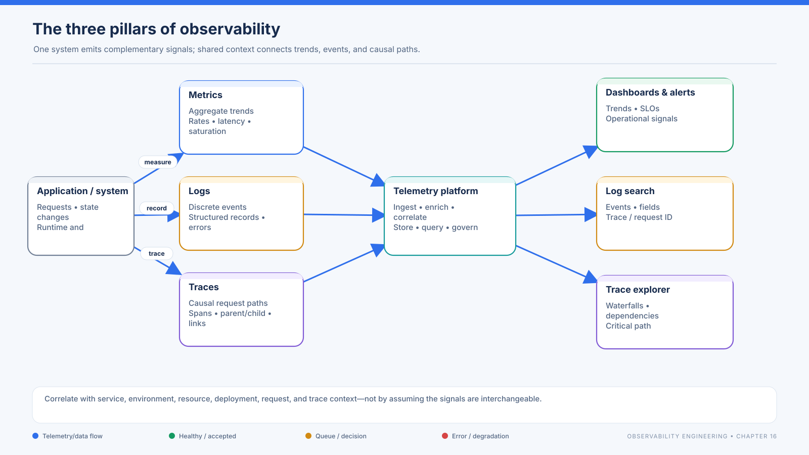

## 1.2 Observability vs monitoring

**Monitoring** is the practice of collecting and evaluating known signals to determine whether a system is behaving within expected limits. It is excellent for questions anticipated in advance: Is the API error rate above 2%? Is disk usage above 85%? Is the queue lag increasing?

**Observability** includes monitoring but reaches beyond predefined dashboards and alerts. It supports exploratory questions: Which request path became slow? Is the failure restricted to one tenant, region, release, or dependency? Did a retry cause a downstream timeout, or did the timeout cause the retry? Which attributes distinguish successful and failed requests?

| Dimension | Monitoring | Observability |
|---|---|---|
| Primary question | Is a known condition unhealthy? | What is happening internally, and why might it be happening? |
| Typical mechanism | Dashboards, thresholds, health checks, alerts | Metrics, logs, traces, profiles, events, high-dimensional queries |
| Query style | Predetermined | Exploratory and hypothesis-driven |
| Strength | Fast detection of known failure modes | Investigation of unknown or complex failure modes |
| Limitation | Can miss unanticipated dimensions | Requires deliberate instrumentation, data quality, and analysis skills |

The distinction is conceptual rather than a strict product boundary. A good monitoring platform is often one part of a broader observability platform.

## 1.3 Why distributed systems are difficult to debug

A single logical operation can cross many processes, machines, networks, databases, caches, queues, and regions. No machine has a complete, perfectly synchronized view of the operation. Each component can fail independently, and a request can succeed in one component while failing in another. Network delay can look like slow computation; a queue can hide overload until lag grows; a retry can turn a small dependency problem into a traffic surge.

Important sources of difficulty include:

- **Partial failure:** one dependency is unavailable while the rest of the application remains operational.
- **Nondeterminism:** thread scheduling, message ordering, network timing, and load differ between runs.
- **Independent clocks:** wall clocks on different machines can drift, so timestamps alone do not establish causal order.
- **Asynchrony:** the producer and consumer may execute at different times and on different machines.
- **Hidden queues:** time spent waiting for a connection, worker, lock, or message consumer may dominate total latency.
- **Fan-out:** one user request can trigger many concurrent downstream calls; the slowest branch often controls completion time.
- **Retries and timeouts:** retries alter load and can obscure the original failure.
- **Ephemeral infrastructure:** containers and serverless instances may disappear before an engineer inspects them.

Telemetry must therefore preserve enough identity and causal context to connect events across boundaries.

## 1.4 Partial failures and visibility

A distributed service rarely has only two states, healthy and down. A database might accept reads but reject writes; one availability zone may be degraded; one Kafka partition may be stuck; a cache may be reachable but return stale data. Health checks that return a single boolean compress this important state into an overly simple signal.

A more useful design reports component-level health, request-level outcomes, and dependency-specific symptoms. A service can be *live* (the process is running), not *ready* (it cannot serve traffic), or ready for some operation classes but degraded for others. Health endpoints should not perform expensive dependency checks on every probe, nor should a successful probe be treated as proof that all customer journeys work.

## 1.5 White-box and black-box monitoring

- **White-box monitoring** inspects internal state: queue depth, thread-pool occupancy, garbage-collection pauses, connection-pool wait time, cache evictions, or replication lag.
- **Black-box monitoring** tests externally visible behavior: synthetic checkout requests, DNS resolution, TLS negotiation, API response codes, or end-user page timing.

Both are necessary. Black-box checks answer whether a user-facing path works. White-box signals help explain why it does not. Synthetic probes should be representative and isolated enough that they do not create significant load or mutate real customer data.

## 1.6 Reactive and proactive observability

**Reactive observability** supports incident detection and investigation after a symptom appears. **Proactive observability** uses trends, capacity models, anomaly signals, canary analysis, and SLO burn rates to discover risks before customers experience a broad outage. Proactive does not mean predicting every failure. It means making leading indicators visible and turning them into useful operational decisions.

## 1.7 Observability is an architectural requirement

Instrumentation becomes expensive to retrofit when services do not propagate request context, emit inconsistent operation names, or hide work inside uninstrumented background jobs. Observability requirements should therefore be included in service templates, API standards, deployment reviews, data governance, and reliability objectives. A service contract should define how trace context crosses HTTP, RPC, and messaging boundaries; which metrics are required; what log fields are safe; and which SLOs describe customer outcomes.

## 1.8 How observability evolves with architecture

| Architecture stage | Typical request path | Main visibility challenge | Useful baseline |
|---|---|---|---|
| Single-process application | Handler → function → local state | Finding slow code paths and unexpected state | Structured logs, runtime metrics, profiles, exception tracking |
| Monolith + database | Handler → business logic → DB | Separating application time from query, lock, and pool wait | Request metrics, DB metrics, query logs, request IDs |
| Microservices | Gateway → many services → databases/cache | Cross-service causality, fan-out, retries, ownership boundaries | Distributed traces, consistent service metrics, propagated context |
| Multi-region application | Global routing → regional services/data | Region-specific degradation, replication, clock skew, data locality | Region/zone dimensions, synthetic probes, replication metrics, regional traces |
| Event-driven architecture | Producer → broker → consumer chain | Delayed causality, retries, duplicates, consumer lag, long-lived workflows | Message IDs, trace context in headers, queue metrics, consumer spans, event audit trail |

The observability design should grow with the architecture. A monolith does not need a distributed tracing backend merely to trace local function calls, but it should establish conventions that can later extend across processes.

---

# 2. The Three Pillars of Observability

Metrics, logs, and traces answer different questions. The most useful platforms make them navigable together: a metric anomaly leads to an exemplar or trace; a trace identifies a failing service and time interval; logs explain the local event and error details.

## 2.1 Metrics

### Definition and data model

A **metric** is a numerical measurement associated with a time and a set of dimensions. Examples include HTTP requests per second, active connections, process memory, queue depth, and request duration distributions. Metrics are usually aggregated across many events and are efficient for trend detection and alert evaluation.

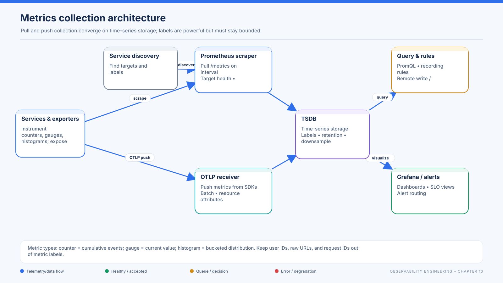

A time series is commonly identified by a metric name plus a label set, such as:

`http_server_requests_total{service="checkout",method="POST",status_class="5xx"}`

A label should describe a bounded, useful dimension. `service`, `region`, `method`, and a normalized `status_class` are usually manageable. A raw `user_id`, `request_id`, full URL, or exception message can create an enormous number of time series and should generally not be a metric label.

### Metric types

| Type | Meaning | Examples | Common misuse |
|---|---|---|---|
| Counter | Monotonically increasing total, except reset on restart | Requests, bytes sent, failed jobs | Using it for active requests or queue depth |
| Gauge | Point-in-time value that can rise or fall | Queue depth, memory used, active sessions | Applying counter `rate()` logic to it |
| Histogram | Distribution represented by bucket counts, sum, and count | Request duration, payload size | Choosing buckets that cannot resolve the SLO boundary |
| Summary | Locally calculated quantiles plus count and sum over a configured window | In-process latency quantiles | Assuming quantiles from separate instances can be aggregated correctly |

In Prometheus, classic histograms expose cumulative bucket series, a sum, and a count; native histograms use a composite representation. Summaries calculate quantiles in the instrumented process, and those quantiles generally cannot be meaningfully merged across replicas. Histograms are usually preferable when fleet-wide percentile aggregation is required. See the Prometheus metric type documentation in [References](#21-references-and-further-reading).

### Cumulative and delta temporality

A cumulative counter reports the total since process or instrument start. A delta metric reports the change during a collection interval. Cumulative data is convenient for backends that calculate rates from successive points, but resets must be detected. Delta data can simplify aggregation and reduce reset ambiguity, but the pipeline must not lose or double-apply intervals. OpenTelemetry metrics support temporality choices; compatibility depends on the receiver and exporter.

### Labels, dimensions, and cardinality

**Cardinality** is the number of distinct time series produced by the combinations of metric labels. If a metric has 5 methods, 4 status classes, 6 regions, and 20 service names, its theoretical combination count is `5 × 4 × 6 × 20 = 2,400` (before additional labels). Adding 1 million user IDs can raise this to billions.

High cardinality increases memory, index, ingestion, query, and network costs. It can also make dashboards slower and cause ingestion limits to be exceeded. Use bounded labels, normalize paths (`/orders/{orderId}` rather than `/orders/938472`), move request-specific details to traces or logs, and review label sets before deployment.

### Aggregation, downsampling, and retention

Metrics backends often retain high-resolution samples for a shorter period, then downsample into coarser rollups. For example, a 15-second stream may be retained for 15 days, then represented as one-minute or five-minute aggregates for longer analysis. Downsampling saves storage but loses fine-grained spikes and may not preserve percentile information unless the underlying distribution representation is retained. Averages of averages are not generally equal to the overall average unless weighted by sample counts.

Collection interval is a trade-off. A 5-second scrape detects short changes faster and creates more samples than a 60-second scrape. Very short intervals increase load on both target and monitoring backend. Collection should be frequent enough for the expected detection and control loop, not simply as frequent as possible.

### Push vs pull collection

- **Pull:** the collector or monitoring server periodically scrapes an endpoint. Prometheus commonly uses this model. It centralizes target discovery and makes missing targets visible as scrape failures.
- **Push:** the application or agent sends measurements to a receiver. It suits short-lived jobs, environments behind restrictive network boundaries, and OTLP-based pipelines.

Push does not automatically make delivery reliable: applications still need bounded queues, retries, and a policy for what happens when the receiver is unavailable. Pull does not guarantee complete visibility either: scrape failures, misconfigured service discovery, and short-lived workloads can be missed.

### Histograms, percentiles, and tail latency

A percentile is a rank statistic. P99 latency is the value at or below which 99% of observed requests completed during the specified window. It does **not** mean that every request takes that long or that 99% of users are happy across all endpoints.

Averages hide skew. Suppose 990 requests take 100 ms and 10 requests take 5 seconds. The mean is 149 ms, which sounds reasonable, while the worst 1% experience a 5-second delay. A service with fan-out can amplify this problem: if a request waits for the slowest of 20 dependencies, even moderately rare slow calls can make a substantial fraction of top-level requests slow.

Histogram buckets should be dense around operational boundaries. If an SLO is 300 ms, buckets such as 100 ms, 200 ms, 250 ms, 300 ms, 400 ms, and 1 s give more useful visibility near that boundary than buckets only at 0.1 s and 10 s. Bucket selection is an instrumentation design choice; native histogram support may reduce the need for manually selected boundaries, but backend capability and query cost still matter.

### Important metric families

| Metric family | Example signals | Interpretation and diagnostic value |
|---|---|---|
| Request rate | Requests/s by route and result class | Demand change, traffic shift, retry amplification |
| Error rate | Failed requests / eligible requests | User-visible failure; split by meaningful error class |
| Latency | P50/P95/P99, histogram buckets | User experience, queueing, saturation, dependency delay |
| CPU | Utilization, throttled time, run queue | Compute pressure or container CPU limits |
| Memory | RSS, heap, allocation rate, GC pause | Leak, cache growth, pressure, garbage-collection overhead |
| Disk I/O | IOPS, throughput, latency, queue depth | Storage bottleneck, noisy neighbor, capacity limit |
| Network | Bytes/s, packet loss, retransmits, connection errors | Congestion, routing, MTU, DNS, or peer instability |
| Queue depth | Pending messages and age of oldest message | Backlog and consumer capacity mismatch |
| Cache hit ratio | Hits / (hits + misses) | Cache effectiveness; interpret with request mix and freshness |
| DB pool utilization | Active, idle, pending, acquisition wait | Pool exhaustion, leaked connections, slow queries |
| Thread-pool saturation | Active workers, queue length, rejected tasks | Blocking work or insufficient worker capacity |
| Consumer lag | Latest produced offset − committed/processed offset | Whether consumers keep up with producers; also track age |
| Retry rate | Retries / original attempts | Dependency instability and retry amplification |
| Timeout rate | Timed-out operations / operations | Deadline mismatch, queueing, network or dependency stalls |

**Example interpretation.** Checkout traffic rises from 800 to 1,200 requests/s. CPU increases from 45% to 60%, but P99 latency rises from 350 ms to 1.8 s and DB pool wait rises from 5 ms to 900 ms. The primary clue is not CPU: requests are waiting for database connections. Inspect query latency, active connections, transaction duration, and downstream calls holding connections. Scaling application replicas alone may worsen contention by multiplying connection pools.

## 2.2 Logs

### Definition and log categories

A **log** is a timestamped record of an event. Logs preserve discrete details that are awkward to represent as a metric: an exception message, a rejected authorization decision, a state transition, a SQL error code, or a deployment configuration change.

Common categories include:

- **Application logs:** business and application execution events.
- **Infrastructure/system logs:** kernel, operating system, container runtime, node, and orchestration events.
- **Access logs:** inbound requests and response metadata at gateways, proxies, and servers.
- **Audit logs:** who performed a security- or business-sensitive action, what changed, and when.
- **Security logs:** authentication, authorization, policy violations, suspicious activity, and security control events.

### Structured vs unstructured logging

Unstructured logs are free-form text, such as `Payment failed for order 123`. They are easy to write but hard to query consistently. Structured logs use a stable schema, often JSON:

```json
{
  "timestamp": "2026-11-06T00:15:30.120Z",
  "severity": "ERROR",
  "service.name": "payment-service",
  "event.name": "payment.authorization.failed",
  "order.id": "ord_7f2a",
  "payment.provider": "provider-a",
  "error.type": "ProviderTimeout",
  "trace_id": "4bf92f3577b34da6a3ce929d0e0e4736",
  "span_id": "00f067aa0ba902b7",
  "message": "Authorization request exceeded deadline"
}
```

The example intentionally contains an opaque order identifier, not card data or a secret. Real schemas should be reviewed against data classification rules. Use stable field names, consistent timestamp formats, explicit severity, and normalized event names. Do not serialize arbitrary request bodies by default.

### Log levels

| Level | Intended use | Production guidance |
|---|---|---|
| TRACE | Extremely detailed execution flow | Usually disabled or sampled in production |
| DEBUG | Developer diagnostics | Enable narrowly and temporarily when possible |
| INFO | Normal significant events and lifecycle transitions | Avoid logging every successful request if metrics already cover it |
| WARN | Unexpected but recoverable condition | Should be actionable or useful in investigation |
| ERROR | Operation failed or invariant was violated | Include error type, context, and trace linkage without secrets |
| FATAL | Process cannot safely continue | Emit once, flush best-effort, and terminate according to policy |

Severity is not a substitute for alert policy. A large number of ERROR logs may represent one failed request retried many times; a critical user-visible failure may produce no ERROR if the application silently returns incorrect data.

### Correlation IDs and trace IDs

A **correlation ID** associates events with a business operation or workflow. A **trace ID** identifies a distributed trace. They may be the same in a simple design, but they represent different concepts: one workflow can contain several traces (for example, a long-running saga with separate execution attempts), and a trace can include many logs. Include trace and span identifiers in logs when available. Do not use them as metric labels.

### Enrichment and context propagation

Enrichment adds controlled metadata such as service name, version, environment, region, container, Kubernetes namespace, tenant classification, trace ID, and deployment revision. Context should be propagated explicitly across process and asynchronous boundaries. Avoid relying only on thread-local state: executor pools, coroutines, callbacks, and queue consumers can run on different threads or machines.

### Aggregation pipeline

A typical logging pipeline separates these stages:

1. **Collection:** an agent reads container stdout/stderr, files, journald, or application transport.
2. **Parsing:** convert raw records into structured fields; detect malformed records.
3. **Enrichment:** attach host, container, cluster, service, environment, and trace metadata.
4. **Filtering/redaction:** remove secrets, PII, noisy health checks, and unwanted events according to policy.
5. **Routing/buffering:** batch and send records to one or more backends.
6. **Indexing/storage:** make fields searchable; apply retention and storage tiers.
7. **Query/visualization:** search, aggregate, correlate, investigate, and export evidence.

Fluent Bit is a lightweight log processor/forwarder commonly deployed as a node agent. Fluentd and Logstash provide extensible collection and transformation pipelines. Elasticsearch and OpenSearch offer indexed search and analytics. Loki indexes labels and stores log content in chunks, so its label design differs from full-text indexing systems. Splunk is a commercial platform with ingestion, search, and enterprise operations capabilities. These products have overlapping features; they are not interchangeable at every scale or cost profile.

### Why logging every event is not sustainable

At high request volume, per-event logging can create more I/O and ingestion volume than application business data. It increases storage and indexing cost, makes useful events harder to find, can expose sensitive information, and may slow hot request paths. A better policy is to use metrics for aggregate counts, traces for request structure, and logs for meaningful state changes and diagnostic details. Keep successful high-volume events sampled or summarized when detailed records add little value; retain security and audit events according to policy rather than sampling them casually.

### Retention, indexing, and cost controls

Retention should depend on purpose and legal requirements. Hot searchable logs may be retained for days or weeks; compressed archival logs may be retained longer if permitted. Avoid indexing every field. Index fields used for filtering, preserve other fields as payload when supported, and avoid high-cardinality labels in systems such as Loki. Use source-side filtering only where the data is truly unnecessary: aggressive filtering at the edge can erase evidence needed during an incident.

## 2.3 Distributed tracing

### Definition

A **distributed trace** records the path and timing of one logical operation as it crosses services and other execution components. A trace consists of **spans**. A span describes an operation with a start time, duration, context, attributes, events, status, and relationships to other spans.

A span has a trace ID and span ID. Child spans normally carry a parent span ID, forming a tree. A trace can also use links to represent causal relationships that are not a simple parent-child tree, such as a batch consumer processing messages from multiple producer traces.

### Why tracing is needed

Metrics show that a service's P99 latency increased. Logs show errors in several components. A trace can show that a single request spent 20 ms at the gateway, 15 ms authenticating, 1.4 seconds waiting for a DB connection, and 5 ms serializing the response. It turns a multi-service timeline into a navigable execution record.

### Example request path

Consider `POST /checkout`:

1. API gateway receives the request and creates a server span.
2. Gateway calls the identity service over HTTP; client and server spans share trace context.
3. Checkout service validates the cart and reads inventory from Redis.
4. Checkout service calls pricing and promotion services concurrently.
5. Payment service authorizes the payment through an external provider.
6. Checkout service publishes `OrderPlaced` to Kafka with trace context in message headers.
7. An order-fulfillment consumer receives the event later and creates a consumer span linked to the producer context.
8. The API returns a response; the asynchronous fulfillment span may complete after the original HTTP trace has ended.

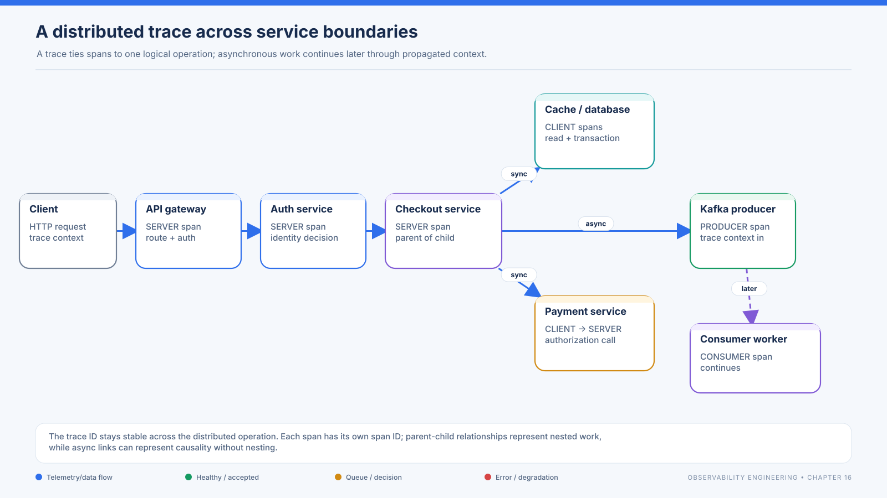

A simplified trace tree might look like this:

```text
Trace 4bf9...
└── gateway POST /checkout                 0–820 ms
    ├── identity GET /verify               8–42 ms
    │   └── identity DB query              19–31 ms
    └── checkout createOrder               45–790 ms
        ├── redis GET cart                  48–55 ms
        ├── pricing calculate               60–145 ms
        ├── promotion evaluate              61–110 ms
        ├── payment authorize              150–720 ms
        │   └── provider HTTP call         170–700 ms
        └── kafka publish OrderPlaced      730–742 ms

Later, separate consumer execution:
└── fulfillment consume OrderPlaced      linked to producer context
    ├── inventory reserve                 4–32 ms
    └── warehouse dispatch                40–95 ms
```

The diagram is schematic: concurrent spans overlap, so durations cannot simply be added. Wall-clock offsets are relative to the trace start. A trace should preserve the original error and timeout information, not merely a duration bar.

### Span attributes and events

Attributes are key-value metadata attached to a span: HTTP method, normalized route, database system, RPC method, messaging destination, deployment version, or a bounded tenant tier. Events are timestamped annotations within a span, such as `retry scheduled`, `cache refresh started`, or `validation rejected`. Use semantic conventions where applicable to avoid inconsistent naming across teams.

Span status communicates whether the operation succeeded, failed, or has an unset status. Instrumentation should set error status when an operation failed according to its semantics. A client cancellation or expected 404 may not be an error in every application. Record exception type and a safe message, but do not attach credentials, payment data, or unbounded request payloads.

### Synchronous and asynchronous execution

Synchronous parent-child spans fit a direct call chain. Asynchronous work breaks the assumption that child execution finishes before its parent. A message consumer may run minutes later, and one batch may contain messages from many traces. Propagate W3C context through message headers and use span links when a consumer operation has multiple causal parents. A trace view should not imply that delayed background processing blocks the original request unless that is actually true.

### HTTP, gRPC, and messaging propagation

W3C Trace Context standardizes headers such as `traceparent` and optional `tracestate`. In gRPC, context is typically carried in metadata. Kafka and RabbitMQ integrations carry trace context in message headers. The sender injects context; the receiver extracts it and creates the next span. Every boundary needs explicit instrumentation or a verified automatic integration. A missing propagation step creates separate traces, even though the work is causally related.

### Baggage

Baggage is a set of key-value pairs propagated with context across services. It can carry small contextual information such as a tenant classification or routing hint when there is a clear use case. Baggage is not a place for secrets, large objects, or unrestricted user data. Because it crosses trust boundaries and can increase request size, validate, allow-list, and limit it.

### Trace sampling and retention

Tracing every request at a high-volume service can be expensive. Sampling selects a subset of traces or spans for storage. Head sampling decides early, often probabilistically, and has low decision overhead but cannot know whether a future span will fail. Tail sampling buffers spans and decides after seeing more of the trace, enabling error- and latency-aware policies, but it requires stateful collectors and careful capacity planning. Parent-based sampling preserves a consistent decision through descendants when the parent decision is known.

## 2.4 Comparing the three pillars

| Dimension | Metrics | Logs | Traces |
|---|---|---|---|
| Data model | Numeric time series with dimensions | Timestamped event records | Causal tree/graph of timed spans |
| Primary purpose | Detect trends and quantify health | Explain specific events and state | Explain request path and latency contribution |
| Strength | Cheap aggregation, dashboards, alerts | Rich detail, flexible search, audit trail | Cross-service causal context and timing |
| Limitation | Aggregation loses per-request detail; cardinality risk | Volume and index cost; inconsistent text is hard to query | Sampling gaps; incomplete context; storage cost |
| Storage | Time-series database or metrics backend | Search/index store or object/chunk store | Trace store optimized for trace lookup and span relationships |
| Query | Range, rate, aggregation, quantiles | Search by time, fields, text, correlation ID | Trace ID, service, operation, duration, attributes |
| Typical use | P99, error rate, saturation, capacity | Exception details, auth decisions, state changes | Slow request path, dependency bottleneck, retries |
| Cost tendency | Often lowest per event; high cardinality can reverse this | Can be high due to volume and indexing | Depends on spans/request, sampling, and retention |

They are complementary. A metric is the efficient alarm bell; a trace gives the path; logs give local detail. Metrics cannot identify a specific stack trace, logs rarely provide a complete causal graph, and traces alone do not give a reliable long-term view of saturation or total traffic.

A platform correlates them using shared resource attributes, timestamps, service names, trace IDs, span IDs, exemplars, deployment identifiers, and consistent environment metadata. Avoid assuming timestamps alone provide exact causality across machines.

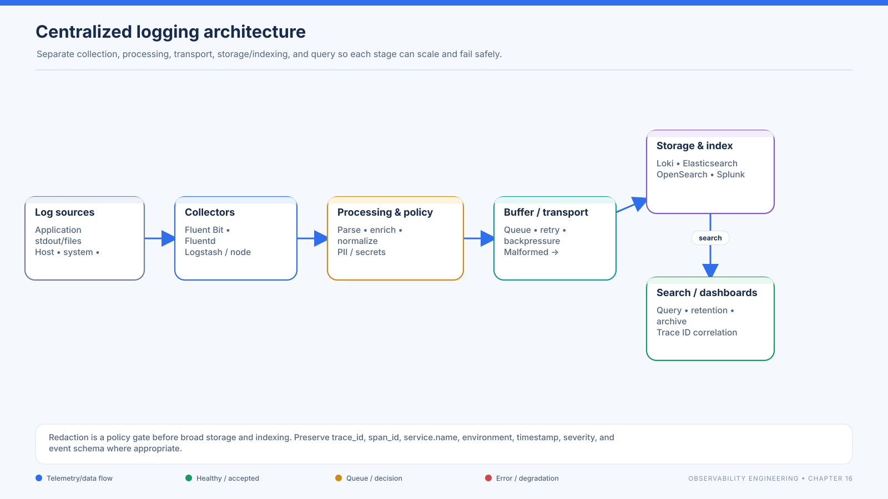
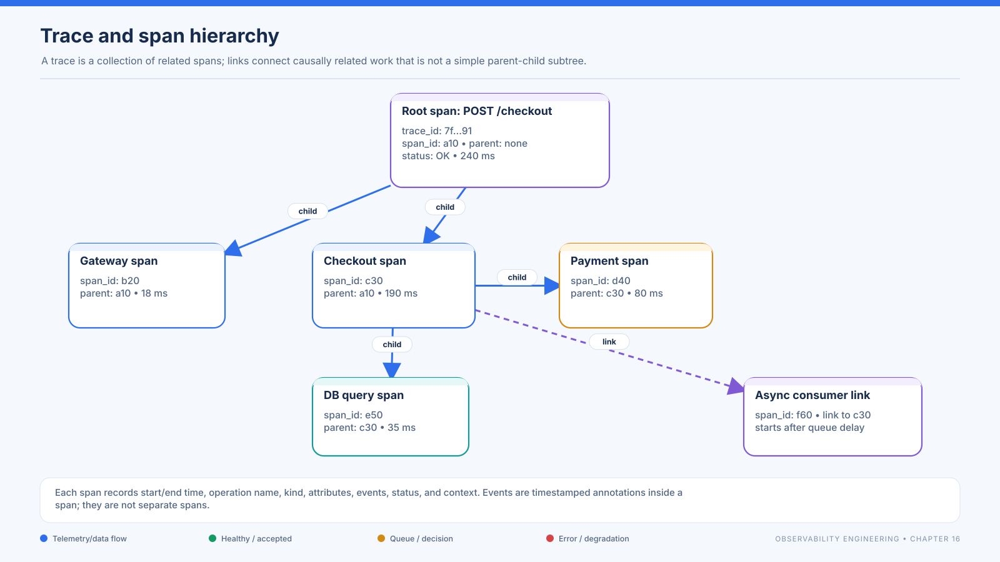
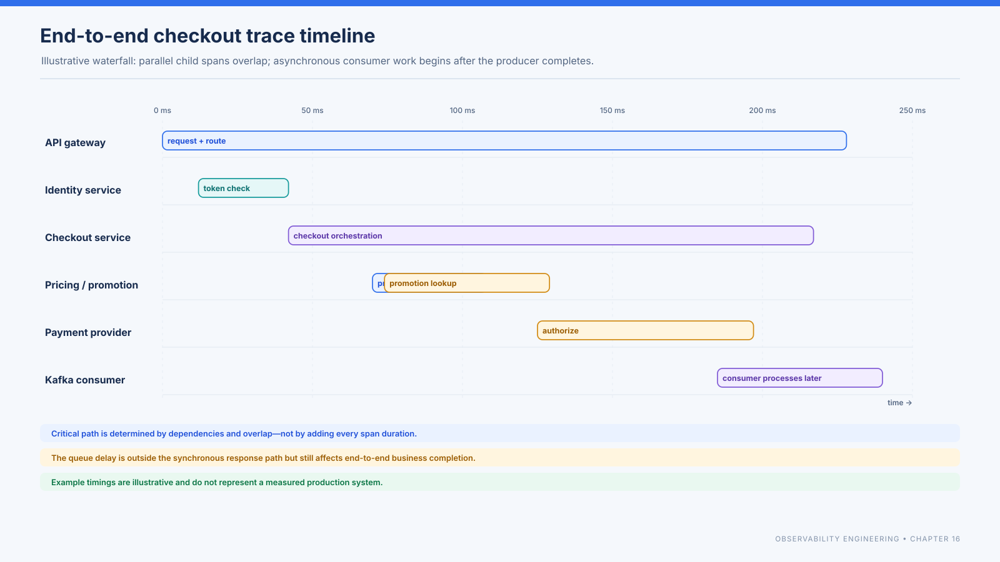

---

# 3. Distributed Tracing Architecture

## 3.1 Trace anatomy and lifecycle

A trace usually begins when an instrumented entry point receives or creates a context. Each operation creates a span, attaches attributes and events, records status, and ends when the operation completes. The SDK exports completed spans asynchronously or in batches. A collector may enrich, sample, batch, and route them to a trace backend.

### Span relationships and kinds

The five commonly used span kinds communicate the role of an operation:

- **SERVER:** handling an incoming remote request.
- **CLIENT:** making an outgoing remote request.
- **PRODUCER:** initiating message production.
- **CONSUMER:** receiving or processing a message.
- **INTERNAL:** local operation with no remote client/server role.

Parent-child relationships represent nested work. Links connect spans whose causal structure is not accurately represented by one parent. For example, a batch consumer span may link to 100 producer contexts. A fan-in operation can have multiple causal inputs; choosing one arbitrary parent would be misleading.

### W3C Trace Context

The `traceparent` header carries a version, trace ID, parent span ID, and trace flags. An illustrative value is:

```text
00-4bf92f3577b34da6a3ce929d0e0e4736-00f067aa0ba902b7-01
```

The final `01` indicates the sampled flag in this example. The `tracestate` header can carry vendor-specific state. Implementations must validate incoming context and avoid trusting arbitrary remote baggage or vendor state as authorization input. Trace context is diagnostic metadata, not an authentication token.

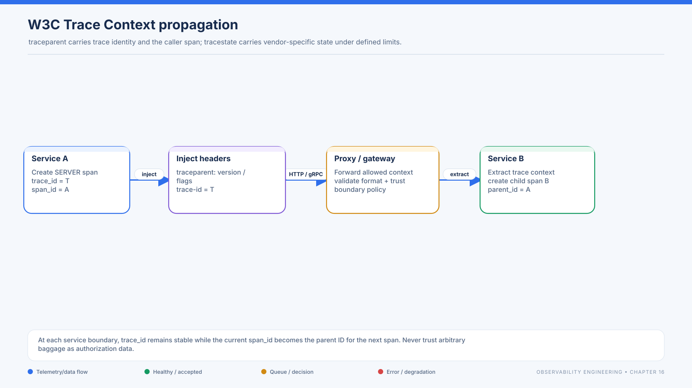

## 3.2 Context propagation in real systems

### HTTP and RPC

On an outgoing HTTP request, the instrumentation injects trace context into headers. The receiving service extracts it and creates a server span using the remote parent context. When both services use compatible propagation and instrumentation, the trace becomes a connected tree. Reverse proxies and API gateways must preserve or deliberately translate headers; header stripping, case handling bugs, and custom middleware are common causes of broken traces.

For gRPC, propagation commonly uses metadata interceptors. Ensure that context follows asynchronous continuations and that cancellation and deadlines are represented correctly. A trace that records a downstream call as successful after the parent request has timed out may indicate missing cancellation propagation or incomplete instrumentation.

### Thread pools and asynchronous tasks

Thread-local context is convenient for synchronous code but is not sufficient for asynchronous execution. A task submitted to an executor must capture the current context and restore it when the task runs. Without this, logs may lack trace IDs and child spans may become roots of unrelated traces. Framework-supported context propagation is generally safer than custom wrappers, but the integration must be tested for the exact runtime and executor being used.

### Kafka and RabbitMQ

A producer injects context into message headers. A consumer extracts it and creates a consumer span. Message retries should preserve or explicitly link to the original context. Dead-letter queues, scheduled redelivery, batch consumers, and fan-in jobs need deliberate semantics. For a batch with many messages, span links may be a better representation than selecting a single parent.

### Broken trace-chain scenarios

1. **Gateway strips `traceparent`:** gateway and backend appear as separate traces. Verify proxy header allow-lists and middleware order.
2. **Background job loses context:** HTTP trace ends, a task is queued without headers, and the worker creates a new root. Capture context when scheduling and inject it into job metadata.
3. **Kafka headers are not copied on retry:** first attempt is connected, retry is orphaned. Preserve valid context or link retries to the original producer context.
4. **Thread-local leakage:** a reused worker thread retains the previous request context. Always restore/clear context in `finally`-style cleanup and use framework context propagation.
5. **Sampling inconsistency:** services independently sample spans, leaving partial traces. Use parent-based decisions or a coordinated tail-sampling architecture.
6. **One service uses a different propagation format:** configure compatible W3C or explicitly supported B3 propagation and avoid accidental double extraction.

## 3.3 Sampling strategies

Sampling is a resource allocation policy. It should be designed around the diagnostic questions the organization must answer, not selected only to minimize storage.

| Strategy | Decision point | Strength | Limitation | Typical use |
|---|---|---|---|---|
| Head-based | At or near trace start | Cheap, predictable, low buffering | Cannot see future errors or final latency | High-volume baseline sampling |
| Probabilistic | Random probability at start | Simple and unbiased in expectation | Rare failures may be missed | Stable baseline sample |
| Rate-limited | Enforce a traces-per-second cap | Bounds ingestion | May bias toward early traffic depending on implementation | Protect ingestion during bursts |
| Parent-based | Follow upstream sampling decision | Keeps traces coherent across services | Depends on a trusted upstream decision | Distributed services |
| Tail-based | After spans arrive and a trace window closes | Keep errors, slow traces, selected tenants | Stateful buffering, decision latency, capacity and routing complexity | Error-aware diagnostic capture |
| Adaptive | Adjust rate based on volume or policy | Responds to changing load | More complex and can change sample bias over time | Dynamic high-volume systems |
| Error-aware | Prioritize failed or unusual traces | Improves visibility into rare failures | Requires error classification and often tail sampling | Payment, checkout, critical APIs |

### Numerical sampling example

Assume a fleet receives 20,000 requests/s and each request creates an average of 12 spans. Full tracing produces:


a. Spans per second: `20,000 × 12 = 240,000 spans/s`.  
 b. At an average encoded span size of 700 bytes: `240,000 × 700 = 168,000,000 bytes/s`, about 168 MB/s decimal before indexing and replication.  
 c. At 5% head sampling: `240,000 × 0.05 = 12,000 spans/s`, or about 8.4 MB/s.  
 d. Raw telemetry volume is reduced by 95%, but only approximately 5% of traces are represented.

This example ignores protocol framing, compression, metadata, replication, and storage-index overhead. A tail sampler can retain 100% of error traces while sampling most healthy traces, but it must receive and hold enough spans to make that decision. It cannot recover spans that were discarded upstream.

### Sampling design guidance

Maintain a baseline sample for ordinary traffic, reserve capacity for errors and slow operations, and define explicit policies for high-value operations. Apply consistent trace identity and sampling decisions across services. Track the number of spans received, sampled, dropped, late, and exported. Sampling policy itself needs tests: a deployment that accidentally samples 0% of traces is an observability incident.

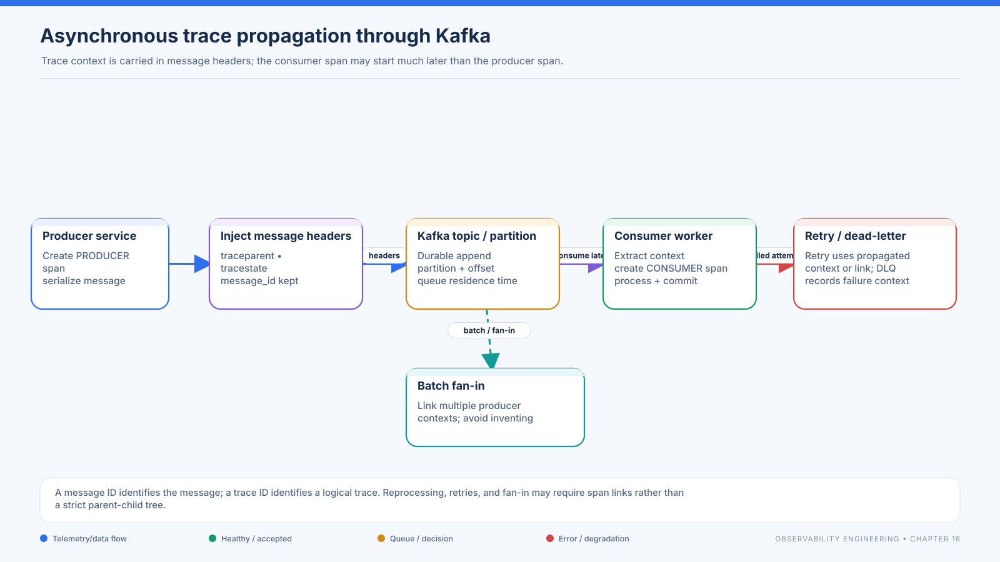
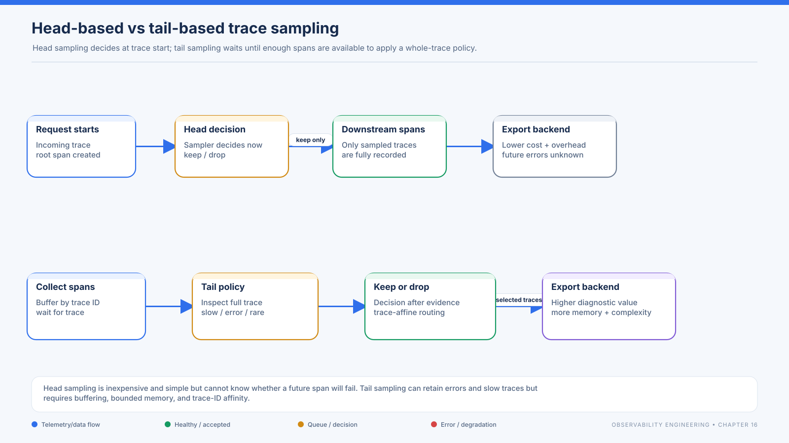

---

# 4. OpenTelemetry

## 4.1 What OpenTelemetry is

**OpenTelemetry (OTel)** is a vendor-neutral set of APIs, SDKs, semantic conventions, instrumentation libraries, and protocol specifications for generating, collecting, and exporting telemetry. It supports traces, metrics, and logs. It is not itself a storage backend, dashboard product, or complete observability platform.

OpenTelemetry emerged from the convergence of OpenTracing and OpenCensus. OpenTracing emphasized a vendor-neutral tracing API; OpenCensus provided a broader metrics and tracing implementation approach. The projects merged to form OpenTelemetry, reducing fragmentation in instrumentation interfaces and enabling common data conventions and transport.

The core design separates:

- **API:** interfaces used by application and instrumentation code to create telemetry.
- **SDK:** implementation that configures processors, samplers, readers, exporters, resources, and lifecycle behavior.
- **Instrumentation libraries/agents:** integrations for frameworks, databases, HTTP clients, runtimes, and messaging libraries.
- **OTLP:** the OpenTelemetry Protocol used to transport telemetry.
- **Collector:** a vendor-neutral service that receives, processes, and exports telemetry.
- **Backend:** a metrics, logs, traces, or full-stack observability store and query system.

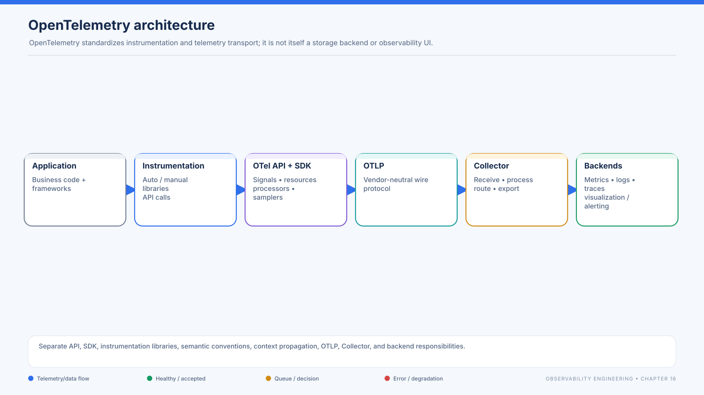

## 4.2 APIs, SDKs, automatic and manual instrumentation

An application typically depends on the OpenTelemetry API. The SDK is configured by the application or deployment environment. Instrumentation libraries create spans and metrics around common frameworks. Automatic instrumentation can capture standard HTTP, database, runtime, and framework behavior with minimal application changes. Manual instrumentation captures business operations such as `reserveInventory`, `authorizePayment`, or `calculateFare` that generic libraries cannot infer.

Automatic instrumentation is fast to adopt but may produce generic operation names, miss business-level context, or add overhead. Manual instrumentation gives domain precision but requires engineering discipline. Use both: auto-instrument common boundaries and add manual spans around meaningful business steps. Avoid creating one span for every trivial function; spans should represent operations useful during diagnosis.

### Resources and instrumentation scope

A **resource** describes the entity producing telemetry, for example `service.name`, `service.version`, `deployment.environment.name`, `cloud.region`, `k8s.namespace.name`, and `host.name`. A resource should be stable for the lifetime of that process or workload. An **instrumentation scope** identifies the instrumentation library or component that emitted telemetry. These are distinct from span attributes, which describe an individual operation.

### Semantic conventions

Semantic conventions define standard attribute names and values for common concepts such as HTTP, RPC, databases, messaging, exceptions, and cloud resources. They make cross-team queries and vendor migration easier. Conventions evolve; pin and review semantic convention versions during upgrades rather than assuming that all versions use identical names or stability guarantees.

## 4.3 OTLP and exporters

**OTLP** is the wire protocol for transmitting OpenTelemetry telemetry. It supports gRPC and HTTP transports and uses Protobuf data structures. The choice depends on firewall rules, infrastructure support, interoperability, and operational constraints. Batching reduces per-request overhead. Compression can reduce bandwidth at the expense of CPU. TLS protects transport; authentication and authorization must also be configured where the network is not fully trusted.

An exporter sends telemetry to a destination. It may export directly from an SDK to a backend, or more commonly to a local or regional Collector. Direct export is simpler for small systems. Collector-based export decouples application instrumentation from backend choice, centralizes filtering and enrichment, and supports routing to multiple destinations.

## 4.4 OpenTelemetry Collector architecture

The Collector is a telemetry proxy that can receive, process, and export data. A typical pipeline contains:

- **Receivers:** accept telemetry (for example, OTLP, Prometheus scrape, or supported vendor formats).
- **Processors:** batch, filter, transform, enrich, redact, sample, or limit data.
- **Exporters:** send telemetry to backends or another Collector.
- **Connectors:** bridge pipelines, such as generating one signal from another where supported.
- **Extensions:** provide auxiliary capabilities such as health checks, authentication, or storage/management support depending on distribution.
- **Pipelines:** connect receivers → processors → exporters for a signal type.

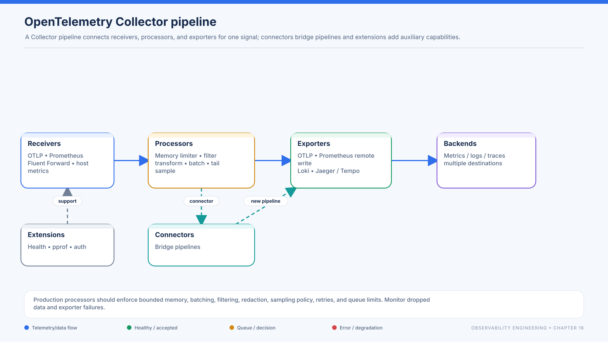

A conceptual configuration fragment:

```yaml
receivers:
  otlp:
    protocols:
      grpc:
      http:
processors:
  memory_limiter:
    check_interval: 1s
    limit_mib: 1024
  batch:
    send_batch_size: 8192
exporters:
  otlp/backend:
    endpoint: telemetry-backend.internal:4317
    tls:
      insecure: false
service:
  pipelines:
    traces:
      receivers: [otlp]
      processors: [memory_limiter, batch]
      exporters: [otlp/backend]
```

This is illustrative, not a production-ready security configuration. Authentication, certificates, endpoint discovery, resource limits, retry queues, and version-specific fields must be supplied for a real deployment.

### Agent vs gateway deployment

- **Agent pattern:** a Collector runs close to the workload, commonly as a Kubernetes DaemonSet or host agent. It receives local telemetry, enriches it with host/pod metadata, and forwards it to a gateway or backend. Benefits include local buffering and reduced application network complexity. Costs include per-node resource consumption and fleet upgrades.
- **Gateway pattern:** a centralized or regional Collector tier receives telemetry from agents or applications. It is suited to centralized routing, tail sampling, policy enforcement, and backend fan-out. It needs horizontal scaling, load balancing, capacity management, and high availability.
- **Sidecar pattern:** a Collector runs alongside an individual workload or pod. It can isolate tenants and simplify local context but multiplies deployment and resource overhead.

A common production design uses a DaemonSet agent for local collection and enrichment, then a regional gateway tier for policy, tail sampling, and export. Not every environment needs both tiers; choose the smallest design that satisfies isolation, buffering, and scale requirements.

### Collector scaling, backpressure, and loss

Collectors are part of the production data path. Configure memory limits, queue sizes, batch sizes, retries, timeouts, and persistent queues where appropriate. Monitor receiver accepted/refused points, processor drops, exporter failures, queue utilization, send latency, and process memory. When a backend is unavailable, queues eventually fill. At that point the Collector must drop telemetry, apply backpressure, or cause senders to block/fail. Each choice has an impact on application latency and observability completeness.

Tail sampling requires spans for the same trace to reach the same decision-making sampler within its decision window. This often needs trace-ID-aware routing or a compatible load-balancing exporter/processor. A generic round-robin load balancer can split a trace across samplers and undermine decisions.

### High availability

Run multiple gateway replicas across failure domains. Use load balancing that preserves trace affinity for tail sampling. Size persistent queues and storage against outage duration, not just average throughput. Protect against retry storms with exponential backoff and jitter. Test Collector restarts, network partitions, backend throttling, and disk-full behavior. A Collector health endpoint only proves process health; exporter and queue telemetry is needed to prove delivery health.

## 4.5 Production instrumentation strategy

A production rollout should follow a sequence:

1. Define service identity and resource attributes consistently.
2. Add standard HTTP/RPC/database/messaging instrumentation.
3. Propagate trace context across every supported boundary.
4. Add business-level spans around key workflows.
5. Emit low-cardinality request, error, and duration metrics.
6. Add structured logs with trace/span IDs and safe fields.
7. Export through a Collector tier with bounded queues and retries.
8. Set baseline sampling, then add error/latency policies if necessary.
9. Validate trace completeness, attribute quality, overhead, and data loss under load.
10. Define dashboards and SLO alerts around user-facing behavior.

Instrumentation must be tested under normal load and degraded backend conditions. Measure CPU, memory, allocation, network, tail latency, and dropped telemetry before and after enablement. Avoid high-volume synchronous exporters on request threads. Use batching and bounded asynchronous queues, understanding that a process crash can lose data still buffered in memory.

### Instrumenting different workload types

- **Databases:** capture query operation, database system, pool wait, connection state, query duration, and slow-query information. Avoid recording raw SQL literals or bind values containing personal data.
- **Caches:** capture hit/miss, operation, key namespace (not raw keys), latency, eviction, and backend fallback. A cache miss alone is not necessarily an error.
- **Message brokers:** record publish/consume spans, destination, partition where bounded/appropriate, message age, retry, dead-letter, and consumer lag. Message payloads are not telemetry attributes.
- **Kubernetes:** combine Kubernetes API/state metrics, node and container metrics, pod lifecycle events, application telemetry, and control-plane health.
- **Serverless:** capture invocation IDs, function version, cold-start signal, duration, timeout, concurrency, and downstream trace context. Execution environments may be reused, so clear per-invocation context correctly.
- **Background jobs:** use job IDs as log/trace attributes only when cardinality and privacy policies allow; propagate context from enqueue to execution.

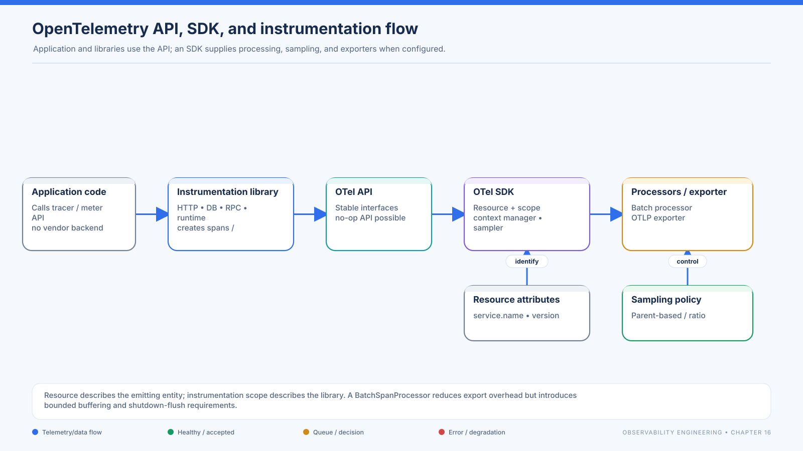
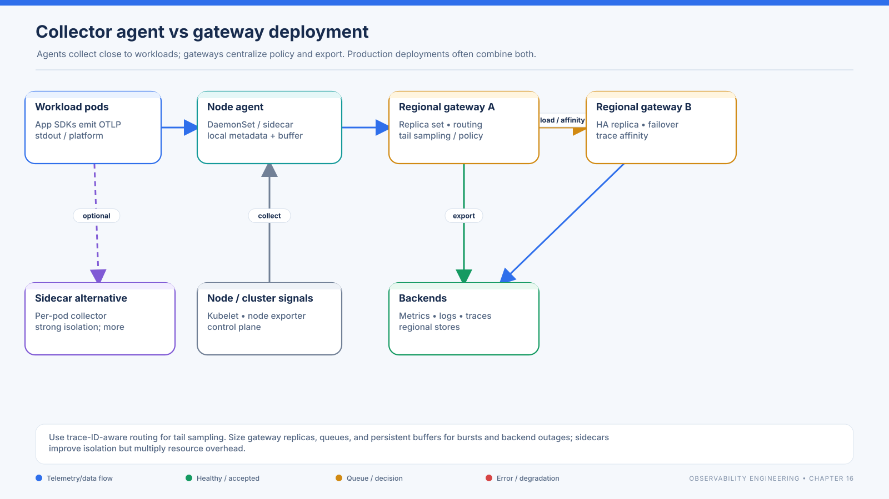
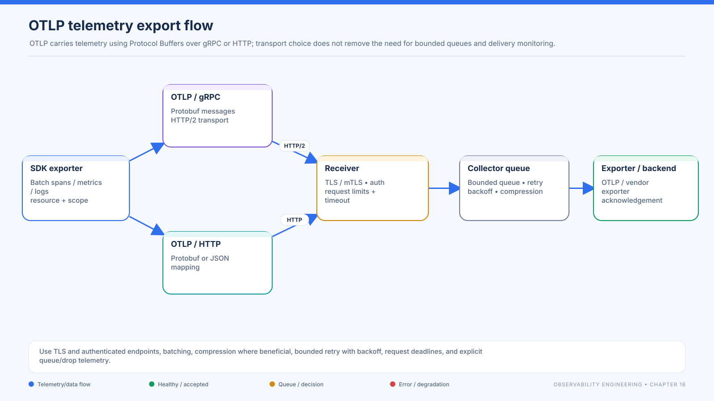

---

# 5. Tracing Systems: Jaeger and Dapper

## 5.1 Jaeger

**Jaeger** is an open-source distributed tracing system originally created at Uber and later contributed to the Cloud Native Computing Foundation. It provides trace ingestion, storage integration, querying, and visualization. Modern Jaeger deployments integrate with OpenTelemetry instrumentation and the OpenTelemetry Collector ecosystem; architecture and deployment modes depend on the Jaeger version and chosen distribution.

### Conceptual architecture

1. Application instrumentation creates spans through OpenTelemetry APIs/SDKs or compatible instrumentation.
2. Applications export spans through OTLP, commonly to an OpenTelemetry Collector or Jaeger ingestion endpoint.
3. Collectors/processors validate, batch, sample, and route spans.
4. Storage persists trace data and indexes fields used for discovery.
5. Query components retrieve traces by trace ID or searchable attributes.
6. The UI renders span timelines, tags, process information, and service dependencies.

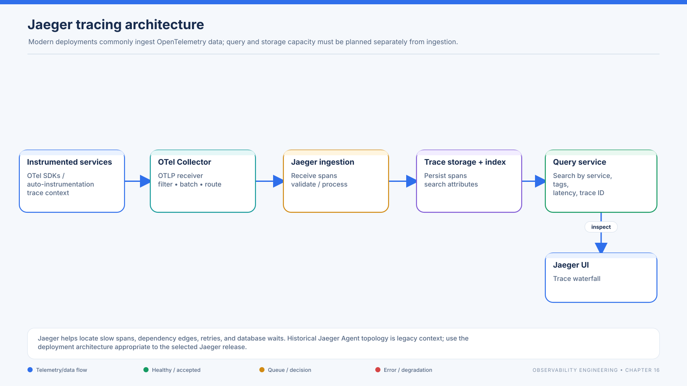

Historically, Jaeger deployments included Jaeger clients, agents, collectors, query service, and a storage backend. In current deployments, OpenTelemetry SDKs and Collectors often replace older agent/client paths. Do not assume every historical component remains required in a modern deployment. Storage may be backed by supported distributed databases or object-storage-oriented architectures, depending on version and operating model.

### What Jaeger helps diagnose

- **Slow service:** compare span durations across services and find the longest critical-path operation.
- **Database bottleneck:** identify DB client spans and compare query time with pool wait and application time.
- **Network delay:** compare client and server spans while accounting for instrumentation and clock limitations; inspect connection retries and transport metrics.
- **Retry amplification:** look for repeated client spans, retry events, and increasing request counts downstream.
- **Cascading failure:** inspect trace trees where a slow dependency causes parent requests to time out and retry.
- **Unexpected dependency:** service dependency graphs can reveal calls not represented in architecture diagrams, though they only show observed traffic during retained traces.

### Production considerations

Define sampling and retention policy before high-volume rollout. Use trace attributes that support common investigations but avoid unbounded cardinality and sensitive values. Protect the UI and query API with authentication and authorization. Capacity-plan ingestion, indexing, storage, compaction, and query concurrency separately. Monitor dropped spans, storage write failures, query latency, and trace completeness. A trace backend outage should not take down application requests.

## 5.2 Dapper

**Dapper** is Google's large-scale distributed tracing infrastructure, described in a 2010 paper by Sigelman and colleagues. It was designed for low overhead, application-level transparency, ubiquitous deployment, and operation at very large scale. Its design relied on sampling and instrumentation in common libraries to minimize application changes and make traces broadly available across teams and services.

### Trace trees and annotations

Dapper represents a distributed request as a tree of spans, identified by trace and span IDs, with parent relationships connecting nested work. Annotations record important points or metadata during a span. Instrumentation at common RPC and threading boundaries can capture a useful amount of behavior without requiring developers to hand-instrument every method.

### Sampling and low overhead

At large scale, complete tracing of all requests can be expensive. Dapper used sampling to control overhead and storage while aiming for useful statistical visibility. Its design demonstrates that widespread adoption and consistent instrumentation can be more valuable than highly detailed tracing deployed only in a few services.

### Design principles and influence

Dapper's lasting lessons include:

- Instrument common infrastructure libraries so tracing follows the paths used by most applications.
- Make instrumentation low overhead and safe to leave enabled.
- Use a common trace context and span model across teams.
- Sample deliberately at scale.
- Treat tracing as an operational platform, not merely a developer debugging feature.
- Build useful analysis tools on top of the trace corpus.

The paper is a primary reference for the principles above; it should not be interpreted as a description of Google's current internal implementation.

## 5.3 Dapper vs Jaeger vs OpenTelemetry

| System | What it is | Main role | Interoperability / deployment point |
|---|---|---|---|
| Dapper | Google's production tracing infrastructure and design described in a research paper | Large-scale tracing with low overhead and broad instrumentation | Historical/internal system; influential design principles, not a general open-source product to deploy |
| Jaeger | Open-source tracing backend and UI | Ingest, store, query, and visualize traces | Commonly integrates with OpenTelemetry and Collector pipelines |
| OpenTelemetry | Vendor-neutral instrumentation and telemetry framework/specification | Generate, propagate, collect, and export telemetry | Can send data to Jaeger or many other backends |

A tracing **system** includes ingestion, storage, query, and visualization. An instrumentation **framework** defines APIs, SDK behavior, conventions, and transport. A paper describing an internal production system may define important design principles without providing a deployable product. Jaeger and OpenTelemetry therefore complement each other rather than compete as equivalent categories.

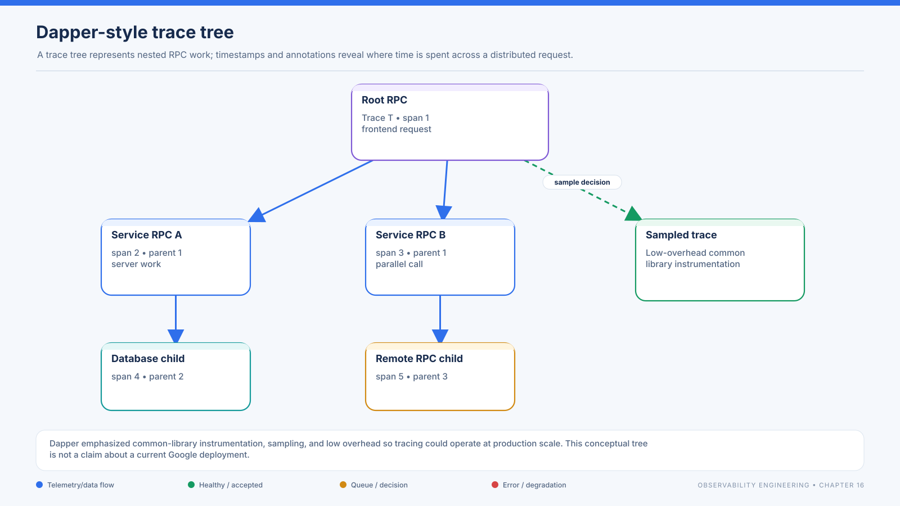

# 6. Monitoring and Alerting

Monitoring converts telemetry into operational awareness. A good monitoring system answers four questions: Is the service working for users? Is demand changing? Is the service approaching a resource limit? Is the reliability objective being consumed faster than planned?

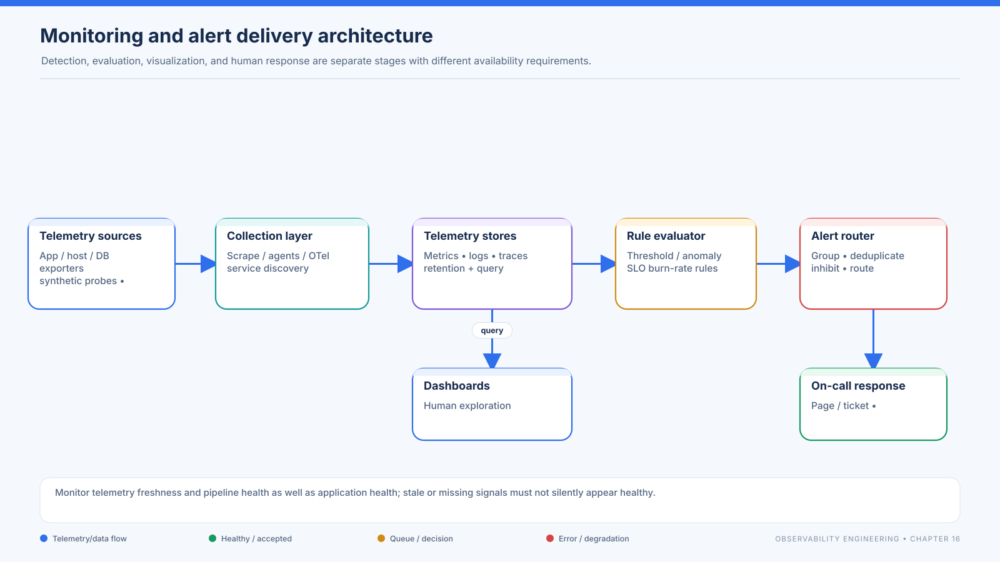

## 6.1 Monitoring fundamentals

| Monitoring area | What it observes | Example signals |
|---|---|---|
| Infrastructure | Nodes, disks, networks, VMs, containers | CPU, memory, disk latency, packet loss, node pressure |
| Application performance monitoring (APM) | Application execution and dependencies | Request traces, throughput, exceptions, code-level latency |
| Service monitoring | Service-level outcomes and dependencies | Availability, error rate, request latency, saturation |
| Database monitoring | Database engine and client behavior | Query latency, locks, replication lag, connections, cache efficiency |
| Network monitoring | Connectivity and transport | DNS, TCP retransmits, packet loss, RTT, bandwidth |
| Synthetic monitoring | Scripted user journeys from controlled probes | Login, search, checkout, DNS/TLS checks |
| Real-user monitoring (RUM) | Actual client-side user experience | Page load, interaction latency, frontend errors, device/browser dimensions |
| Black-box monitoring | Externally visible behavior | Can an external probe complete a real or safe synthetic transaction? |
| White-box monitoring | Internal component state | Queue depth, thread pool, GC, pool wait, internal error counters |

A **health check** should express one clear property. A liveness check answers whether a process should be restarted. A readiness check answers whether it should receive traffic. A startup probe gives slow-starting applications time to initialize. Avoid making liveness depend on every downstream service: a temporary database outage can cause every application pod to restart, amplifying the incident.

Monitoring and observability overlap. Monitoring is one operational use of observability data; observability additionally supports exploratory diagnosis and unanticipated questions.

## 6.2 The Four Golden Signals

Google's SRE guidance recommends latency, traffic, errors, and saturation as a compact starting point for user-facing service monitoring. These signals are complementary: traffic describes demand, latency and errors describe outcomes, and saturation describes pressure on the resources required to serve demand.

### 1. Latency

Latency is the time required to complete an operation. Measure a distribution, not only a mean. Track successful and failed request latency separately: an immediate 500 response may appear fast while still representing a failed user journey. Include queueing and dependency time in the end-to-end measurement. Useful dimensions include normalized route, method, region, and operation class.

**Misleading interpretation:** P50 is stable, so the service is healthy. The P99 may have degraded severely. Another trap is measuring only server processing while excluding client-side, network, and queue wait.

### 2. Traffic

Traffic measures demand: requests/s, messages/s, transactions/s, active streams, or bytes/s. Use a domain-appropriate unit. Segment by operation class where workloads differ materially. A single request count can hide a shift from cheap reads to expensive writes.

**Misleading interpretation:** requests/s is unchanged, so load is unchanged. Request cost may change because of payload size, fan-out, query plan, tenant mix, or cache hit ratio.

### 3. Errors

Errors represent failed or incorrect operations. Count explicit failures such as HTTP 5xx, timeouts, rejected requests, and dependency failures. Also define implicit failures: an HTTP 200 response containing stale or incorrect data may violate correctness. Business outcomes matter; a checkout request that returns success but does not create an order is not healthy.

**Misleading interpretation:** a low server 5xx rate proves availability. Failures may occur at the client, gateway, DNS, payment provider, or data correctness layer.

### 4. Saturation

Saturation describes how close a constrained resource is to its effective capacity. Observe CPU throttling, run queue, memory pressure, disk queue, DB pool wait, connection backlog, thread-pool queue, and consumer backlog. A resource can become saturated before its headline utilization reaches 100%.

**Misleading interpretation:** CPU is only 50%, so the service is not saturated. A DB connection pool can be fully occupied, a lock can serialize work, or a dependency can be saturated while application CPU remains low.

### Worked example: checkout API

Assume a checkout API normally receives 900 requests/s, has 99.95% successful requests, P99 latency of 450 ms, and DB pool wait below 10 ms. During a sale:

| Signal | Baseline | During incident | Interpretation |
|---|---:|---:|---|
| Traffic | 900 req/s | 1,450 req/s | Demand is up about 61% |
| Error rate | 0.05% | 1.8% | Customer-visible reliability degraded |
| P99 latency | 450 ms | 2.4 s | Tail latency is severe |
| CPU | 48% | 62% | CPU rose but does not explain the entire delay |
| DB pool wait P99 | 8 ms | 1.1 s | Connections are a likely bottleneck |
| DB query P99 | 35 ms | 42 ms | Queries themselves changed little |

A likely hypothesis is that connections are held while application code waits on another dependency or while transactions remain open. Confirm by inspecting connection hold duration, transaction boundaries, trace timing, and dependency call placement. Increasing pool size may make database contention worse. A safe mitigation could cap concurrency, reduce expensive optional work, shorten transaction scope, and scale the database only after capacity analysis.

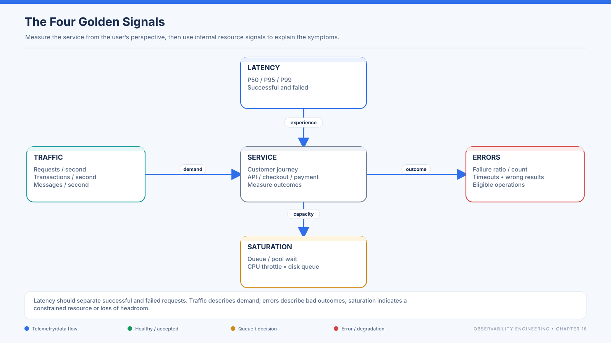

## 6.3 RED and USE methods

### RED: Rate, Errors, Duration

RED is a service/request-oriented method:

- **Rate:** requests or operations per second.
- **Errors:** failed requests per second or error ratio.
- **Duration:** latency distribution, especially tail percentiles.

Use RED for APIs, microservices, RPC methods, and user-facing request paths. It is simple enough to apply consistently across services.

### USE: Utilization, Saturation, Errors

USE is a resource-oriented method:

- **Utilization:** fraction of a resource's capacity in use.
- **Saturation:** work queued or demand that cannot be served immediately.
- **Errors:** resource-level errors such as I/O failures or rejected operations.

Use USE for CPUs, disks, network interfaces, connection pools, thread pools, and other bounded resources. A utilization value must be interpreted with a capacity definition: 80% CPU on a large host means something different from 80% of a single constrained core.

| Method | Focus | Best applied to | Typical questions |
|---|---|---|---|
| Golden Signals | User-facing service health | Critical services and end-to-end journeys | Are users seeing latency, errors, demand changes, or saturation? |
| RED | Request behavior | APIs and service endpoints | How many requests, how many fail, how long do they take? |
| USE | Resource behavior | Hosts, pools, queues, devices | What is busy, what is queued, and what is failing? |

They are not competing frameworks. A service dashboard can show RED; its infrastructure dashboard can show USE; its executive reliability view can show the four Golden Signals and SLO compliance.

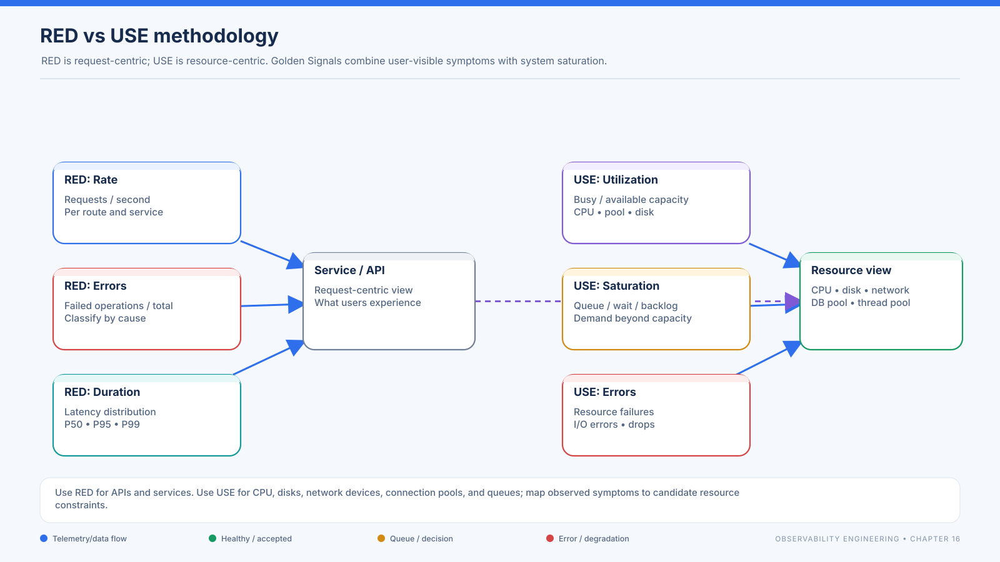

## 6.4 Alerting

An alert should represent a condition that requires a response, not merely an interesting metric. Before creating one, define the user or business impact, expected action, owner, severity, and runbook. Page only when a human should act promptly. Use tickets or dashboards for lower-priority anomalies that do not need immediate response.

### Alert methods

- **Static threshold:** e.g. `error_ratio > 2% for 5 minutes`. Easy to understand; vulnerable to normal workload variation.
- **Dynamic threshold:** compare against seasonal or learned baselines. Useful for predictable patterns, but can normalize a slow degradation or create false positives when traffic changes.
- **Anomaly alert:** detect statistical deviation. Best treated as an investigative signal unless tied to user impact.
- **Multi-window alert:** require a condition across short and long windows to balance speed and noise.
- **Composite alert:** combine symptoms and context, for example elevated 5xx *and* sufficient traffic.
- **Symptom-based alert:** alert on failed requests or SLO burn. Usually more actionable than alerting on an inferred root cause.
- **Cause-oriented alert:** alert on a known precursor, such as disk predicted to fill in 4 hours. Useful when the action is clear and the symptom has not occurred yet.

### Alert lifecycle

1. Evaluate alert rules near the data source.
2. Group related alerts by service, region, cluster, and incident fingerprint.
3. Deduplicate repeated notifications for the same active condition.
4. Route by ownership, severity, and time zone.
5. Apply inhibition or suppression when a higher-level outage makes lower-level alerts redundant.
6. Escalate when an alert is not acknowledged or remains unresolved.
7. Resolve automatically only when the underlying condition has recovered and the alert's recovery policy is satisfied.

Prometheus Alertmanager handles grouping, deduplication, routing, silencing, and inhibition for Prometheus alert streams. Grafana Alerting provides alert rules and contact-point integrations across supported data sources. PagerDuty and Opsgenie-style incident platforms add on-call schedules, escalation policies, acknowledgements, incident workflows, and integrations. Exact features and licensing evolve; verify current product capabilities before procurement.

### Alert fatigue

Alert fatigue happens when excessive, duplicated, low-value, or non-actionable notifications cause responders to ignore or disable alerts. Reduce it by paging on customer impact and SLO burn, grouping related failures, assigning ownership, and reviewing alert quality after incidents. Every page should answer: what is broken, who is affected, how urgent is it, and what should the responder do first?

### Example alert policy

For an API with a 99.9% availability SLO, page when a short-window error-budget burn is very high and a longer window confirms sustained impact. Create a lower-severity ticket when saturation is rising but user outcomes remain within objectives and there is enough lead time to act. This avoids paging for harmless CPU spikes while still catching a genuine availability risk.

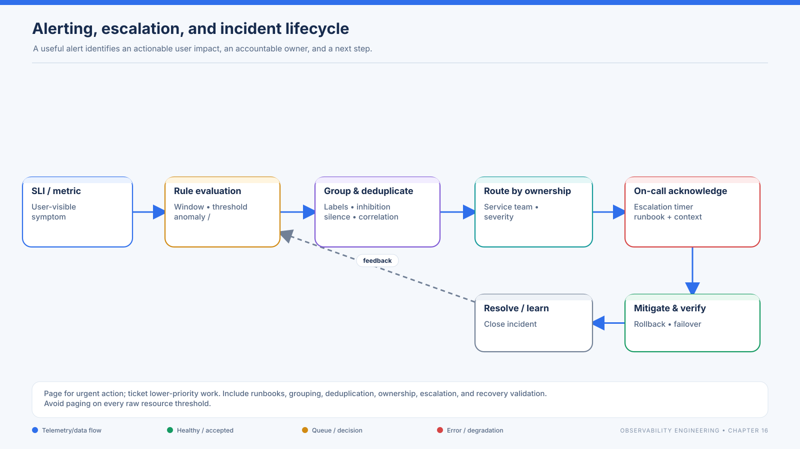

## 6.5 SLI, SLO, SLA, and error budgets

- **Service Level Indicator (SLI):** a measured value representing a user-relevant aspect of service quality, such as the fraction of valid requests completed successfully within 300 ms.
- **Service Level Objective (SLO):** the target value for an SLI over a defined time window, such as 99.9% over 30 days.
- **Service Level Agreement (SLA):** an external agreement with customers, often including consequences or credits if commitments are missed.
- **Error budget:** the allowed unreliability implied by an SLO. For an availability objective of 99.9%, the error budget is 0.1% of eligible events or time, depending on the SLI definition.

### Choosing SLIs

A request-based availability SLI may be:

\[
\text{Availability SLI} = \frac{\text{Good eligible requests}}{\text{Total eligible requests}} \times 100\%
\]

A latency SLI may measure the fraction of eligible requests completed within a threshold:

\[
\text{Latency SLI} = \frac{\text{Requests completed within } T}{\text{Eligible requests}} \times 100\%
\]

Correctness SLI can be the fraction of results that pass a correctness check; freshness SLI can be the fraction of records updated within a defined age. Define eligibility carefully. Excluding too many failures can make an SLI look healthy while users experience failure. Exclusions should be explicit, stable, and reviewed.

### Monthly time-based error budgets

For a 30-day month:

\[
T = 30 \times 24 \times 60 = 43{,}200 \text{ minutes}
\]

| SLO | Allowed unavailability | Monthly time budget |
|---:|---:|---:|
| 99% | 1% | 432 minutes = 7 h 12 min |
| 99.9% | 0.1% | 43.2 minutes |
| 99.95% | 0.05% | 21.6 minutes |
| 99.99% | 0.01% | 4.32 minutes |

These are time-based illustrations. Request-based error budgets depend on request volume and the good/total event definition. A service that receives few requests overnight may have a different request-based budget than a time-based budget.

### Burn rate

Burn rate measures how quickly an error budget is being consumed relative to the allowed rate. If an SLO allows 0.1% bad events, and the observed bad-event ratio is 1%, the instantaneous burn rate is `1% / 0.1% = 10×`. Sustained at that rate, the whole budget would be consumed in roughly one-tenth of the SLO window.

A multi-window, multi-burn-rate alert combines a short window for fast detection with a longer window to avoid paging on brief spikes. The exact thresholds depend on SLO window, page urgency, and organizational policy. Commonly used Google SRE guidance describes multi-window burn-rate alerting; teams should tune it to their response model.

### Error budgets and deployment velocity

An error budget is a decision tool, not merely a dashboard percentage. When budget is healthy, teams can take normal delivery risk. When budget is rapidly consumed, teams may slow risky releases, prioritize reliability work, or require additional testing. This creates a mechanism for balancing feature velocity with reliability. It should not become a punitive metric: teams need authority and resources to address systemic causes.

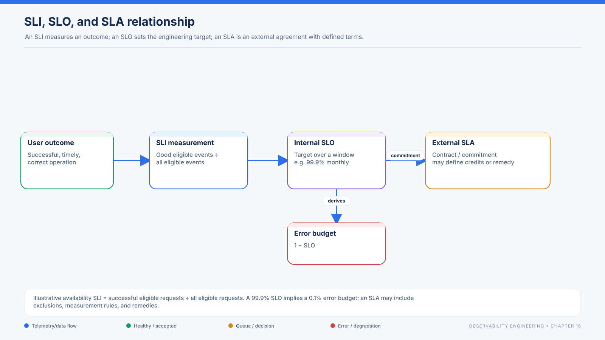
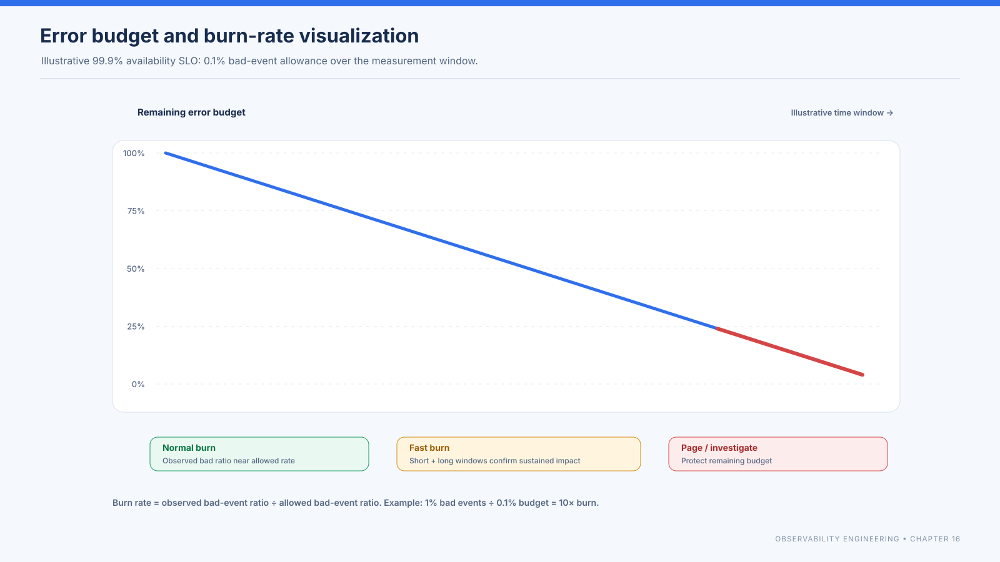

---

# 7. Observability Tooling and Platforms

Tool selection should begin with the data model, operational requirements, scale, security, query patterns, team skill, and total cost—not with a brand comparison alone. Many stacks combine specialized open-source components with managed services.

## 7.1 Metrics ecosystem

| Tool | Role and architecture | Strengths | Limitations and trade-offs |
|---|---|---|---|
| Prometheus | Pull-oriented time-series monitoring with service discovery, PromQL, and alert rules | Strong Kubernetes ecosystem, simple scrape model, broad integrations | Long-term/global scale commonly needs remote storage or federation; label cardinality remains a design responsibility |
| Grafana | Query, dashboard, and alert visualization across data sources | Flexible dashboards and broad ecosystem | Visualization does not replace a durable storage/query backend; dashboard sprawl can hide ownership |
| VictoriaMetrics | High-performance metrics storage and query system with single-node and cluster modes | Efficient ingestion and long retention options | Operational model and compatibility should be evaluated against existing PromQL and ecosystem needs |
| Thanos | Components that add long-term object storage, global querying, and HA patterns around Prometheus-compatible systems | Multi-cluster/global metrics and historical retention | Adds distributed components and operational complexity |
| Grafana Mimir | Horizontally scalable, multi-tenant metrics backend compatible with Prometheus-style workflows | Large-scale metrics storage and tenancy | More infrastructure to operate when self-hosted; capacity and object storage design matter |
| InfluxDB | Time-series database and ecosystem oriented around time-series/event workloads | Flexible time-series ingestion and query models | Product versions and query languages differ; assess compatibility and operational model |

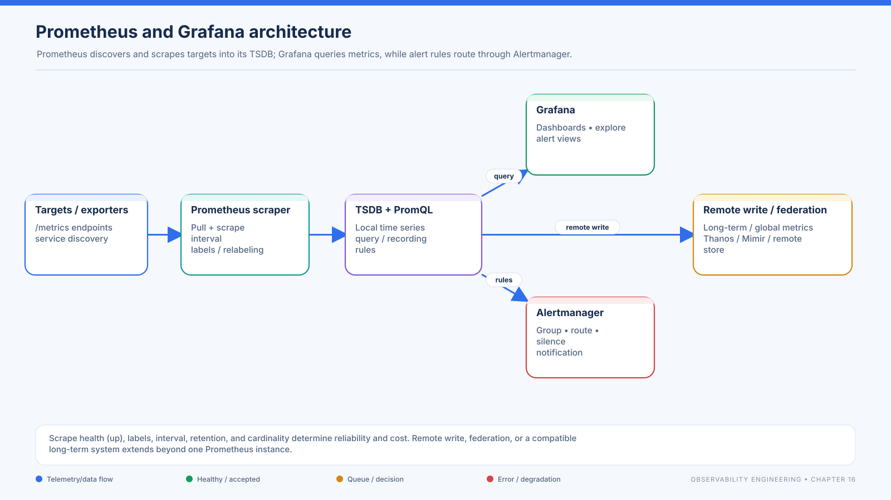

## 7.2 Logging ecosystem

| Tool | Role | Strengths | Limitations and trade-offs |
|---|---|---|---|
| Fluent Bit | Lightweight collection and forwarding agent | Low footprint, Kubernetes-friendly, many inputs/outputs | Complex transformations and debugging require configuration expertise |
| Fluentd | Extensible log collection and processing | Large plugin ecosystem and flexible routing | Higher resource footprint than lightweight agents in some deployments |
| Logstash | Pipeline-based ingestion and transformation | Rich parsing/filtering and Elastic ecosystem integration | JVM resource use; pipeline complexity can increase latency and maintenance |
| Elasticsearch | Distributed search and analytics store | Powerful indexing and search | Indexing cost, shard management, heap pressure, and retention require care |
| OpenSearch | Open-source search/analytics platform | Search, dashboards, and ecosystem flexibility | Cluster management, index design, and upgrade compatibility require operations expertise |
| Loki | Log aggregation with label-based indexing and chunk/object storage | Cost-conscious design when labels are controlled; integrates with Grafana | Label cardinality and query semantics differ from full-text indexed search; query design matters |
| Splunk | Commercial observability/security analytics platform | Mature search, ingestion, enterprise features, ecosystem | Licensing and ingestion volume can be substantial; governance and data volume control are essential |

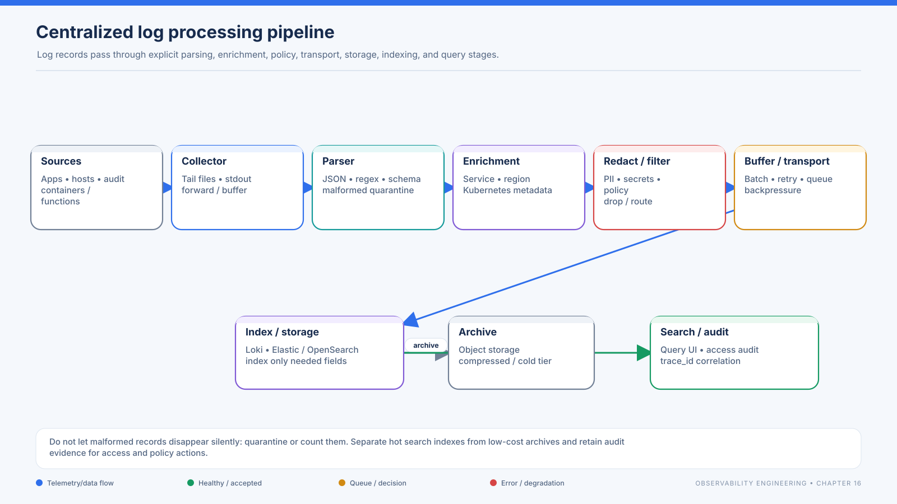

## 7.3 Tracing ecosystem

| Tool | Role | Strengths | Limitations and trade-offs |
|---|---|---|---|
| OpenTelemetry | Instrumentation, context propagation, semantic conventions, Collector, OTLP | Vendor-neutral, common instrumentation model | Not a trace storage/UI product; support varies by library and backend |
| Jaeger | Open-source trace backend and UI | Mature trace visualization and service dependency exploration | Requires ingestion/storage/query operations; current deployment architecture depends on version |
| Grafana Tempo | Distributed tracing backend designed for object-storage-oriented trace retention and Grafana integration | Cost-oriented trace storage design and correlation with Grafana stack | Search strategy and query capabilities differ from highly indexed trace stores; operational choices matter |
| Zipkin | Distributed tracing system with instrumentation and trace UI | Established, relatively simple tracing concepts and ecosystem | Evaluate current integrations, scale, and feature needs against modern OTel-based stacks |

## 7.4 Full-stack observability platforms

| Platform | General positioning | Strengths | Evaluation questions |
|---|---|---|---|
| Datadog | Managed infrastructure, APM, logs, traces, security and experience monitoring | Broad integrated product and integrations | What is the true cost by host, custom metric, log volume, and retention? |
| New Relic | Managed observability with APM, telemetry, and analytics | Broad telemetry query and application monitoring | Do query model, ingest rules, and pricing match workload shape? |
| Dynatrace | Managed full-stack monitoring with automation and topology-oriented analysis | Deep application/infrastructure discovery | How much automation is desired, and how transparent are data models and costs? |
| Honeycomb | High-dimensional observability and event-oriented analysis | Exploratory querying and high-cardinality debugging workflows | Does the event model fit instrumentation and budget? |
| Elastic Observability | Observability capabilities integrated with Elastic's search and analytics stack | Unified log/search ecosystem and flexible deployment choices | Is indexing and cluster operations justified by the query requirements? |

This table is a category-level orientation, not a ranking. Features, architecture, product names, and pricing change. Validate current documentation, data residency, supported integrations, export controls, and contract terms before selecting a vendor.

## 7.5 Deployment and ownership comparison

| Model | Advantages | Costs/risks | Good fit |
|---|---|---|---|
| Open-source, self-hosted | Control, portability, customizable retention, no per-event vendor contract | Staff time, upgrades, HA, security, storage, on-call ownership | Teams with platform engineering capacity and strong control requirements |
| Managed open-source-compatible backend | Lower operational burden while retaining common protocols/query patterns | Vendor-specific limits, managed-service pricing, feature/version differences | Teams wanting standard instrumentation without operating every storage tier |
| Commercial managed platform | Integrated experience, support, rapid onboarding, broad integrations | Ingestion and retention cost, vendor lock-in, proprietary features and data models | Teams prioritizing operational simplicity and willing to pay for it |
| Hybrid | Sensitive or high-volume data kept regionally/self-hosted; selected signals sent to managed backend | Two operating models and governance complexity | Regulated or multi-region environments with mixed needs |

A sound platform often uses OpenTelemetry at the instrumentation boundary so backend selection can evolve. Vendor neutrality is not absolute: query languages, semantic conventions, advanced analytics, and data export formats can still create switching costs.

---

# 8. Observability in Cloud-Native and Distributed Architectures

## 8.1 Microservices

Use a consistent service identity and version across metrics, logs, traces, and deployment metadata. Instrument ingress, service-to-service calls, databases, caches, and message brokers. Define service ownership and dependency maps. Use RED per service and Golden Signals for critical user journeys. A service dependency graph is an observed view, not a complete architecture specification: rarely used paths may not appear in sampled data.

## 8.2 Kubernetes and containers

Kubernetes workloads are ephemeral. Pod names and IP addresses change; a replacement pod may have a different start time and node. Telemetry should include stable workload identity such as namespace, deployment, service, cluster, and region, while retaining pod/container identity for short-lived diagnosis. Avoid unbounded label dimensions such as raw container IDs in long-term metrics.

Observe several layers:

- **Node:** CPU, memory pressure, disk, network, kubelet/runtime health.
- **Pod/container:** restarts, OOM kills, CPU throttling, working set, filesystem, resource requests/limits.
- **Workload/controller:** desired vs available replicas, rollout status, autoscaling, scheduling failures.
- **Control plane:** API server latency, etcd health/latency, scheduler and controller-manager behavior where accessible.
- **Application:** service metrics, traces, structured logs, queue and dependency telemetry.
- **Network/service mesh:** request rate, latency, retries, mTLS failures, connection pools, and sidecar resource use.

Container stdout/stderr is commonly collected by a node agent. Kubernetes metadata enrichment attaches workload identity. Application telemetry flows to local or regional Collectors. Metrics can be scraped from targets or delivered through OTLP, depending on the platform. Service mesh telemetry is helpful but does not replace application-level business spans; it may not know whether a payment was correct or a checkout workflow completed.

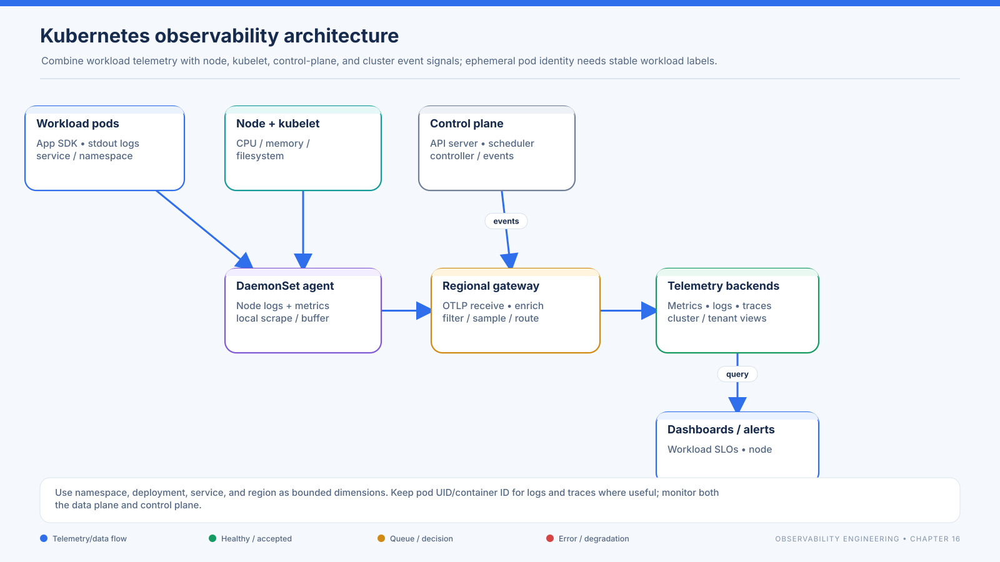

## 8.3 Serverless functions

Serverless instances may start and stop rapidly, have concurrency limits, reuse warm execution environments, and expose platform-level invocation metrics. Capture cold starts, invocation duration, timeouts, concurrency, throttles, and downstream dependency behavior. The function's own logs and traces must carry invocation context across asynchronous calls. Avoid flushing telemetry synchronously in a way that dominates short function duration; use supported extensions or platform integrations where available.

## 8.4 Event-driven systems and message brokers

The broker introduces a delay between producer and consumer, so end-to-end latency should be decomposed into enqueue time, queue age, consumer wait, processing time, and downstream commit. Monitor lag per consumer group and partition, but avoid turning every partition identifier into a permanent high-cardinality metric label in very large clusters. Track oldest-message age, retry count, dead-letter volume, consumer throughput, rebalance count, and processing errors.

Trace context must travel with message headers. A message ID can connect operational logs, business event records, and traces, but should be governed like other identifiers. Duplicate delivery is normal in many messaging systems; instrumentation must not imply exactly-once processing merely because the trace appears once.

## 8.5 Databases and distributed caches

Database observability should cover client-side pool acquisition, query duration, lock wait, transaction duration, slow queries, replication lag, storage pressure, and connection churn. A database can be healthy internally while the application pool is exhausted, so collect both client and server metrics. For distributed caches, observe hit ratio by bounded namespace, evictions, memory fragmentation, replication, latency, hot keys, and fallback rate. A sudden hit-ratio drop may reflect a traffic mix change rather than a cache defect.

## 8.6 Multi-region and hybrid cloud

Keep regional telemetry local when privacy, residency, or network resilience requires it. A global control plane can aggregate SLO summaries, service health, and redacted metadata. During a region isolation event, local pipelines should continue collecting and buffering within bounded capacity. When connectivity returns, delayed telemetry may arrive out of order; backend ingestion and event-time queries must tolerate this.

Track region and availability-zone dimensions, routing decisions, replication lag, cross-region network latency, failover events, and data locality. Distinguish control-plane health (configuration, orchestration, service discovery) from data-plane health (actual user requests and data movement). A globally healthy control plane can coexist with a degraded regional data plane.

## 8.7 Multi-tenant telemetry isolation

For SaaS systems, tenant identifiers can create sensitive high-cardinality telemetry. Use tenant tiers or sampled tenant exemplars in metrics; use access-controlled attributes in traces and logs when needed. Enforce authorization at query time, not merely by hiding a dashboard. Prevent one tenant's telemetry volume from exhausting shared ingestion capacity through quotas, per-tenant limits, and fair scheduling. Ensure redaction and retention rules apply consistently across all signals.

### Reference Kubernetes architecture

A practical design has application pods exporting OTLP to a node-local DaemonSet Collector or sidecar; node agents enrich container and Kubernetes metadata and forward to regional gateway Collectors. Gateways apply policy, redaction, batching, sampling, and routing. Metrics flow to a Prometheus-compatible or managed metrics backend; traces flow to Jaeger, Tempo, or a commercial trace store; logs flow through a log processor to Loki, OpenSearch, Elasticsearch, Splunk, or a managed log backend. Grafana or a full-stack platform unifies dashboards and correlation. Alert routing is integrated with the incident-management process.

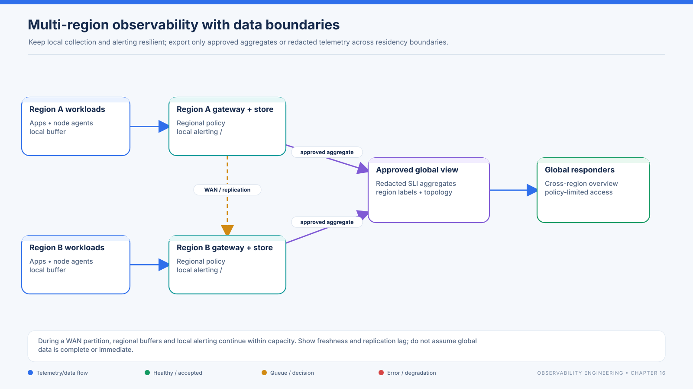

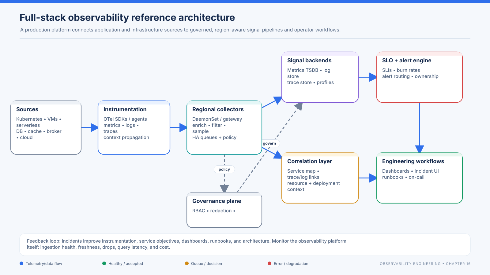

---

# 9. Debugging Distributed Systems

Distributed debugging is the process of turning incomplete, time-dependent evidence from multiple components into a verified causal explanation and a safe mitigation. The objective during an incident is not to find the most interesting graph; it is to restore service while preserving enough evidence to prevent recurrence.

## 9.1 Failure modes that complicate diagnosis

| Failure mode | What it looks like | Why it is difficult |
|---|---|---|
| Partial failure | One dependency or zone fails while others work | Health is not binary; failures may be operation-specific |
| Nondeterminism | Failure appears intermittently | Different schedules, inputs, load, and network timing |
| Network delay | Requests hang or time out | Slow network and slow server may look alike to caller |
| Race condition | Incorrect state under concurrent updates | Timing-dependent and often difficult to reproduce |
| Clock skew | Events appear out of order | Wall clocks are imperfect; causal order is not timestamp order |
| Eventual consistency | Read temporarily returns older state | Expected propagation delay can be confused with data loss |
| Distributed deadlock | Components wait on each other | No single process sees the full wait cycle |
| Retry storm | Request volume multiplies after failures | Recovery traffic competes with normal traffic |
| Message duplication/loss | Repeated or missing business action | At-least-once delivery, bad acknowledgement order, or operational loss |
| Queue buildup | Lag and message age rise | Symptom may appear far downstream from producer or capacity cause |
| Cascading failure | Several services degrade in sequence | Dependency graph and retries amplify initial fault |
| Resource exhaustion | Pools, memory, CPU, disk, or file descriptors run out | Local symptom may be caused by upstream behavior |
| Split brain | Multiple nodes act as leader | Coordination and fencing failures may create inconsistent writes |
| Cross-service dependency failure | One service's degradation breaks many callers | Ownership and telemetry schemas may differ across teams |

## 9.2 Systematic incident investigation workflow

### Step 1 — Understand the reported symptom

Translate the report into observable behavior: what user journey failed, what response was seen, which region/tenant/client was affected, and when it started. Distinguish customer statements from verified evidence. Ask whether the incident is ongoing, intermittent, or historical.

### Step 2 — Establish scope and timeline

Determine the blast radius: one route, one service, one region, a tenant cohort, a deployment cohort, or all traffic. Create a timeline with UTC timestamps and explicit source. Include releases, configuration changes, traffic events, failovers, dependency changes, and alerts. Account for clock skew; use trace parentage and sequence numbers for causality where possible.

### Step 3 — Check Golden Signals

Review traffic, errors, latency distributions, and saturation for the affected journey and its major dependencies. Compare with a normal baseline and a comparable region. Look at both absolute volume and ratios: a 2% error rate at 10 requests/s is different from 2% at 100,000 requests/s.

### Step 4 — Identify affected services

Use service maps, deployment metadata, and traces to identify which services participate in the failing path. Check whether one service is a common dependency for all affected routes. Do not assume the first service that logs an error is the root cause.

### Step 5 — Inspect correlated logs

Search by trace ID, span ID, request ID, or a safe business operation ID. Look around the incident start and the earliest abnormal span. Compare successful and failed examples. Inspect exception types, timeout values, retry events, pool acquisition, and state transitions. Verify that logs are from the correct deployment and region.

### Step 6 — Follow distributed traces

Compare representative normal and abnormal traces. Find the earliest divergence in the critical path: unexpected queue wait, increased downstream duration, retries, lock waits, or missing spans. Inspect parallel branches and fan-out. Remember that span duration includes child work in nested relationships and should not be double-counted blindly.

### Step 7 — Examine infrastructure metrics

Look at DB pools, thread pools, connection counts, CPU throttling, memory/GC, disk/network, queue age, broker partitions, and autoscaling. A green CPU chart does not disprove resource saturation elsewhere.

### Step 8 — Identify the earliest abnormal event

Construct a cause timeline. If service A returns slowly because it waited 800 ms for service B, and B waited 750 ms for a database lock, the earliest abnormal event may be the lock, not A's timeout. Consider changes in load, deployment, configuration, and dependency state.

### Step 9 — Form and test hypotheses

Write hypotheses that predict observable evidence. Example: “The DB pool is exhausted because payment calls occur while a transaction is open.” Prediction: traces show outbound payment spans nested inside DB transaction duration; pool wait rises; database query time remains normal. Test with traces, pool metrics, safe sampling, and a controlled mitigation.

### Step 10 — Verify root cause

A plausible story is not a root cause until the evidence supports it and alternative explanations have been considered. Root cause can be systemic: missing concurrency limit, insufficient queue isolation, unsafe retry policy, or an SLO that does not measure the actual user outcome.

### Step 11 — Mitigate safely

Prefer reversible actions: roll back a release, disable a feature flag, cap concurrency, shed optional traffic, pause a consumer, reduce retry volume, fail over, or add capacity when the bottleneck is understood. Avoid actions that increase load on the failing dependency without a capacity model.

### Step 12 — Validate recovery

Check the original user-facing symptom, not just the component that was changed. Confirm error rate, latency, queue age, customer transaction completion, and SLO burn. Watch long enough to detect delayed backlog or recurring retries.

### Step 13 — Document and prevent recurrence

Produce a blameless timeline, impact, contributing conditions, detection gaps, mitigation, and prioritized actions with owners. Improve alerting, capacity limits, tests, runbooks, retry policy, context propagation, and system design. A postmortem without tracked action is only a narrative.

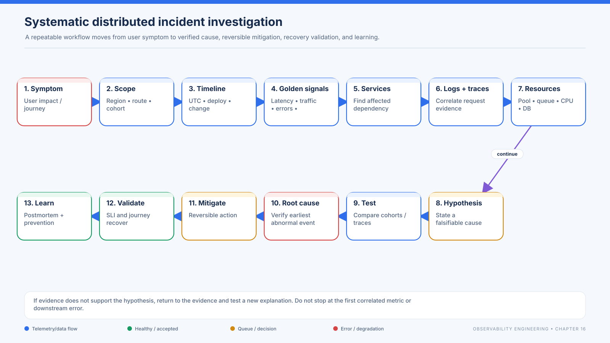

## 9.3 Practical investigation scenarios

The following scenarios are illustrative. Metrics and timings are example values, not claims about a particular company's production system.

### Scenario A — One microservice becomes unexpectedly slow

**Symptoms:** `catalog-service` P99 rises from 120 ms to 1.5 s; other services appear normal.

**Inspect:** request rate by route; P50/P95/P99; error and timeout rates; DB query and pool wait; cache hit ratio; thread-pool queue; downstream client spans; GC pauses; CPU throttling.

**Logs:** slow query events, pool acquisition timeouts, cache fallback, deployment version, retry events, and correlated exceptions.

**Traces:** compare normal and slow requests. Identify whether the time accumulates in application code, cache, database, or a downstream HTTP call. Split client span duration from server-side processing where both are available.

**Possible causes:** query plan regression, hot key, connection pool exhaustion, lock contention, DNS delays, thread starvation, CPU throttling, or traffic mix change.

**Sequence:** segment by route and version → compare trace critical path → inspect pool and DB metrics → correlate with deployment/configuration → run a bounded diagnostic query or rollback.

**Mitigation:** roll back query change, disable problematic feature, cap concurrency, bypass optional dependency, or scale the actual constrained resource.

**Prevention:** query-plan regression tests, pool-wait SLO, load tests, cache-key distribution monitoring, and canary comparison.

### Scenario B — API latency increases while CPU remains low

**Symptoms:** P99 increases 5×; CPU stays around 35%; request volume stable.

**Metrics:** DB connection wait, thread-pool queue, lock wait, outbound dependency latency, DNS time, TCP retransmits, connection-pool idle count, and request queue depth.

**Logs/traces:** inspect long waits, client timeouts, lock acquisition, and downstream spans. Look for requests that spend most of their lifetime waiting rather than executing.

**Possible causes:** external dependency stall, connection pool depletion, deadlock/lock convoy, network loss, DNS retry, thread starvation due to blocking I/O, or rate limiting.

**Mitigation:** enforce deadlines, limit concurrency, isolate bulkhead pools, use circuit breakers appropriately, and roll back bad dependency changes.

**Prevention:** RED + USE dashboard, pool wait instrumentation, bounded queues, async I/O where appropriate, and dependency SLOs.

### Scenario C — Database connection pool exhaustion

**Symptoms:** requests fail with acquisition timeout; active connections at max; DB CPU may be low or moderate.

**Metrics:** active/idle/pending connections, acquisition wait histogram, hold duration, transaction duration, query duration, DB sessions, lock waits, connection churn.

**Logs/traces:** identify code paths holding connections during external calls, missing close/release paths, long transactions, and retry loops.

**Investigation:** confirm whether DB is slow or application holds connections too long. Compare pool wait with DB execution time. A 1-second pool wait with 20-ms SQL means the scarce resource is connection occupancy, not necessarily query execution.

**Mitigation:** fix leaks, shorten transactions, move external calls outside transactions, cap concurrency, reduce pool size multiplication across replicas if DB capacity is limited, and tune timeouts.

**Prevention:** pool metrics, leak detection in tests, transaction boundaries, per-service connection budgets, and capacity calculations.

### Scenario D — Kafka consumer lag grows continuously

**Symptoms:** lag rises from 20,000 to 600,000 messages over 30 minutes; producer rate exceeds consumer completion rate.

**Metrics:** produce/consume rate, lag by group and partition, oldest-message age, rebalance count, processing duration, retry count, DLQ rate, partition skew, consumer CPU and memory.

**Logs/traces:** slow handler spans, poison messages, deserialization exceptions, external API delays, commits, rebalances, and duplicate processing.

**Possible causes:** consumer throughput below arrival rate, hot partition, rebalance loop, downstream throttling, poison message, too few partitions/workers, or excessive retries.

**Mitigation:** pause noncritical producers, scale consumers only if partition parallelism allows, isolate poison messages, apply bounded retries, and restore downstream capacity.

**Prevention:** message-age SLO, per-partition lag analysis, idempotent handlers, DLQ policy, batch tuning, and capacity tests.

### Scenario E — Intermittent HTTP 500 errors

**Symptoms:** error rate is 0.3% overall but concentrated in one region and one downstream call.

**Metrics:** 5xx by route/region/version; dependency timeout; connection error; retry rate; DNS errors; traffic mix.

**Logs/traces:** correlate failed trace IDs; inspect error types and retry sequence; compare region-specific successful and failed traces.

**Possible causes:** connection reset, stale endpoint discovery, partial deployment, rate limit, regional dependency impairment, serialization edge case, or a rare race.

**Mitigation:** drain affected instances, roll back, fail over where safe, add bounded retries with jitter, or route around unhealthy dependency.

**Prevention:** zone-aware canaries, error budget alerting, dependency contracts, chaos tests, and per-region dashboards.

### Scenario F — Distributed request timeouts

**Symptoms:** callers time out at 2 seconds; some downstream operations continue for 8 seconds and complete after caller abandonment.

**Metrics:** deadline exceeded count, active requests, downstream duration, cancellation count, in-flight work, queue length, retries.

**Logs/traces:** verify deadline propagation through gateway, RPC, DB, and external client; inspect whether cancellation is observed.

**Possible causes:** mismatched timeouts, missing cancellation, retrying after deadline expiry, queue waits not included in deadline, or downstream calls with no timeout.

**Mitigation:** propagate remaining deadline, cancel child operations, set per-hop budgets, prevent retries after the useful deadline, and cap queues.

**Prevention:** deadline policy, cancellation tests, trace annotations for remaining budget, and timeout hierarchy review.

### Scenario G — Cache hit ratio suddenly drops

**Symptoms:** hit ratio falls from 94% to 61%, DB read traffic rises, and P95 latency increases.

**Metrics:** hit/miss by bounded cache namespace, eviction rate, memory usage, key cardinality estimate, TTL distribution, backend read rate, hot-key skew.

**Logs/traces:** cache key namespace, deployment version, serialization errors, stampede lock behavior, fallback events. Never log raw secrets or user-specific cache keys unnecessarily.

**Possible causes:** cache flush, key format change, TTL regression, traffic mix shift, hot-key invalidation, memory pressure, or inconsistent cache version across deployments.

**Mitigation:** restore compatible key format, warm cache safely, rate-limit fallback, add request coalescing, and avoid uncontrolled DB fan-out.

**Prevention:** cache effectiveness dashboard, rollout compatibility tests, TTL review, capacity alerts, and stampede protection.

### Scenario H — Retry storm causes cascading failure

**Symptoms:** a downstream service slows; callers retry aggressively; traffic multiplies; more services time out.

**Metrics:** attempt rate vs original request rate, retry count, timeout ratio, concurrency, queue length, dependency latency, circuit-breaker state.

**Logs/traces:** retry attempt number, backoff, deadline remaining, original error, parent trace ID, and caller identity.

**Possible causes:** immediate retries, retries at multiple layers, no idempotency key, long timeouts, unbounded concurrency, and retries on non-retryable failures.

**Mitigation:** disable or reduce retries temporarily, add jittered exponential backoff, enforce retry budgets, cap concurrency, shed load, and use circuit breakers with care.

**Prevention:** one retry owner per operation, total deadline budget, idempotency, load tests under dependency failure, and alerts on attempt-to-request ratio.

### Scenario I — Service appears healthy while requests fail

**Symptoms:** liveness/readiness probes are green, yet users receive failed or incorrect responses.

**Metrics:** end-to-end synthetic transaction, business success count, response correctness, downstream failure rate, request-level error ratio.

**Logs/traces:** check whether the probe covers the failing route and data path; inspect application-level swallowed exceptions and partial results.

**Possible causes:** health check tests only process state, dependency check does not exercise writes, cached stale data, tenant-specific permission problem, or a failure after response serialization.

**Mitigation:** route traffic away only if readiness is truly compromised; fix the actual request path and customer data issue.

**Prevention:** synthetic user journeys, business outcome SLIs, safe dependency checks, and explicit degraded-mode behavior.

### Scenario J — Dependency causes tail-latency amplification

**Symptoms:** service P50 remains 80 ms, P99 grows to 3 s; each request fans out to 15 services.

**Metrics:** per-dependency latency histograms, fan-out count, timeout rate, concurrency, queue wait, retry attempts, and top-level P99.

**Logs/traces:** identify the slow branch on failed/slow traces and count how many branches are awaited. Compare serial and parallel work.

**Possible causes:** maximum-of-many latency effect, one unbounded optional call, regional hotspot, correlated slowdowns, or overly aggressive retries.

**Mitigation:** reduce unnecessary fan-out, set per-dependency budgets, return partial results where product semantics permit, cache stable data, and isolate slow optional work.

**Prevention:** fan-out budget, tail-latency load tests, dependency-specific SLOs, and traces that record critical path.

### Scenario K — Memory leak in a long-running service

**Symptoms:** RSS grows steadily over hours, pods restart from OOM, latency worsens before restart.

**Metrics:** heap/RSS over time, allocation rate, GC pause and frequency, live object count, container memory limit, restart count, request mix.

**Logs/traces:** correlate growth with request types, cache population, large payloads, unclosed streams, and deployment version. Use profiling or heap snapshots under controlled privacy and production-safety procedures.

**Possible causes:** unbounded cache, retained request context, listener leak, response buffering, native memory leak, or large-object retention.

**Mitigation:** roll back, reduce workload, lower cache capacity, increase memory limit only as a temporary mitigation, and restart safely if required.

**Prevention:** soak tests, heap profiling, bounded caches, lifecycle cleanup, and memory SLO/capacity forecasts.

### Scenario L — Cross-region network degradation

**Symptoms:** one region has higher P99 for remote database or service calls; local requests remain healthy.

**Metrics:** RTT, packet loss/retransmits, connection setup, DNS, cross-region bytes, replication lag, regional request/error/latency, failover count.

**Logs/traces:** compare client and server spans by region; inspect connection errors, retries, routing, and endpoint selection.

**Possible causes:** network congestion, route change, regional peering issue, overloaded NAT, DNS resolver issue, or traffic routed to distant region.

**Mitigation:** shift eligible traffic regionally, use local replicas/caches, reduce cross-region chatter, or disable noncritical replication work with a defined recovery plan.

**Prevention:** regional synthetic probes, topology-aware routing, replication SLOs, capacity reserve, and tested failover procedures.

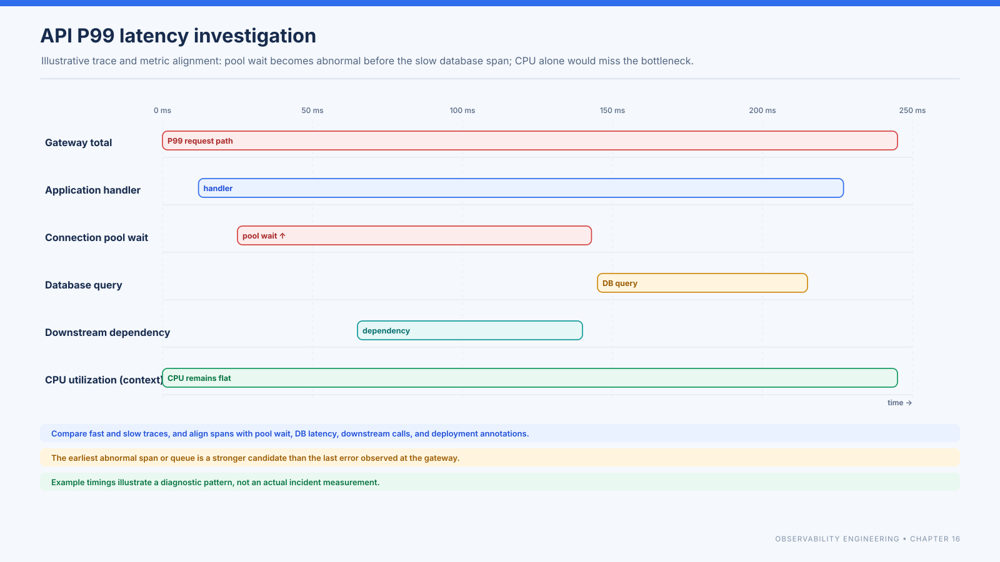
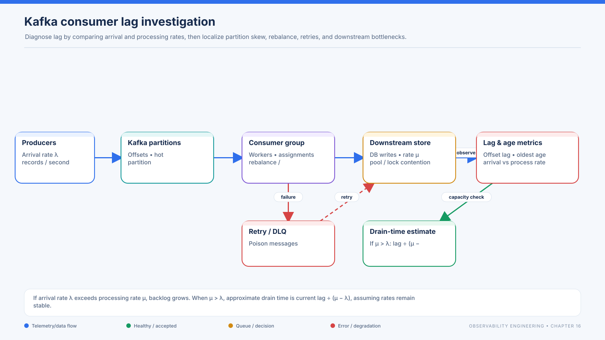
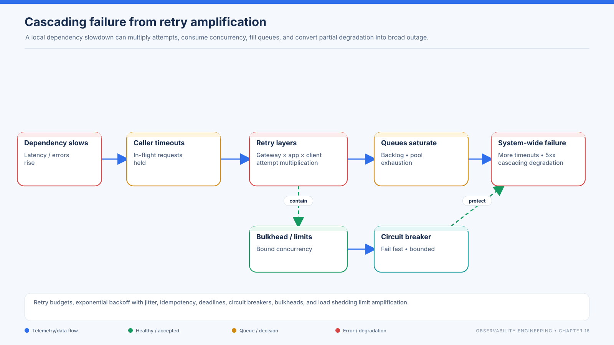

---

# 10. Deterministic Replay and Reproducible Debugging

## 10.1 What deterministic replay means

**Deterministic replay** reconstructs an execution so that, given the same initial state and the same recorded nondeterministic inputs, the program follows the same relevant sequence of decisions and events. It is valuable for intermittent concurrency bugs, race conditions, ordering errors, and failures that cannot be reproduced reliably from ordinary logs.

A normal application log records selected observations. It rarely captures all inputs and scheduling decisions needed to reproduce execution. A replay system must capture enough of the causes of nondeterminism to reproduce the failure, not only the symptoms that were noticed.

### Sources of nondeterminism

- Thread scheduling and synchronization order.
- Network message arrival, loss, timeout, and reconnection.
- Wall-clock and monotonic-clock reads.
- Random number generation and UUID generation.
- External service responses and database reads.
- File-system state, environment variables, and process signals.
- Timer callbacks and task scheduling.
- Hardware and runtime behavior that affects execution ordering.

### What to record

The exact record set depends on the runtime and replay technique. It may include program inputs, initial state snapshots, system calls, thread scheduling decisions, synchronization events, random seeds and generated values, clock reads, network packets or logical messages, external dependency responses, file operations, and nondeterministic runtime events. Recording all memory accesses is often too costly, so tools use instrumentation, binary execution capture, or deterministic runtime design to constrain the capture problem.

## 10.2 Generic deterministic replay architecture

1. **Capture inputs and events:** record user input, messages, external responses, and relevant system interactions.
2. **Record nondeterministic choices:** capture scheduling, time, random values, and ordering decisions where required.
3. **Preserve state:** record a snapshot or a reproducible state-construction procedure.
4. **Reconstruct environment:** use compatible binary, runtime, dependencies, configuration, and dataset.
5. **Replay sequence:** feed the recorded inputs and choices to the program or deterministic runtime.
6. **Compare behavior:** compare state transitions, output, invariant checks, and event sequence.
7. **Isolate failure:** vary a controlled factor or inspect the first divergence from the recorded execution.

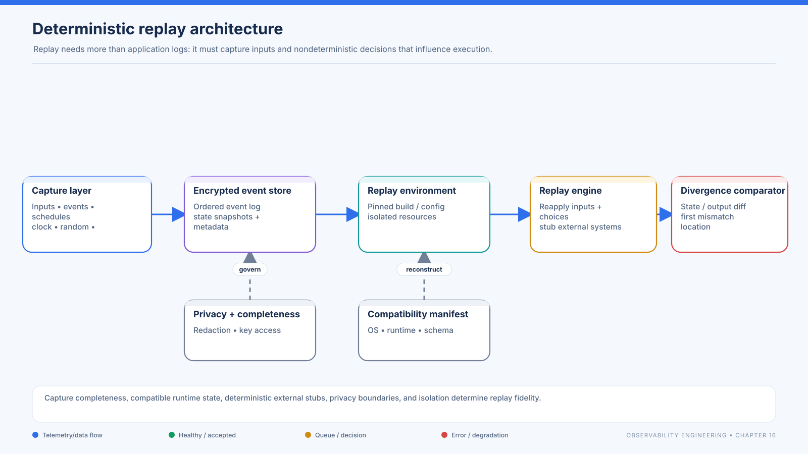
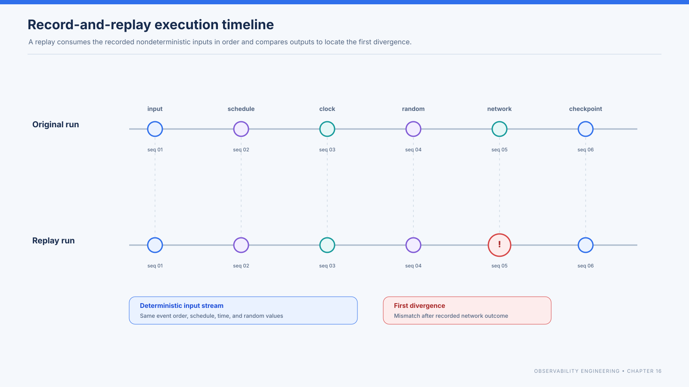

### Why logs are not sufficient

Suppose two threads update a shared counter. Logs show that both executed `read counter = 10`, then both logged `write counter = 11`. The actual bug depends on the interleaving. If logs omit synchronization events, exact memory operation order, or the thread schedule, replaying the same high-level log sequence may not recreate the lost update. Distributed systems add network arrival order, retries, clock reads, and remote state. Logs describe selected observations; deterministic replay requires control or capture of the nondeterministic inputs that influenced the execution.

## 10.3 Related approaches and systems

### Record-and-replay debugging

A record-and-replay debugger captures enough runtime events to reproduce a process execution. The `rr` debugger for Linux records user-space process execution and supports reverse execution and replay debugging for supported environments. It is especially useful for debugging a single process, but it is not a general turnkey recorder for a complete multi-service production deployment. Kernel, hardware, and process constraints apply.

### Event sourcing

Event sourcing stores domain events as the authoritative record of state changes. Current state is reconstructed by replaying events through application logic. It provides reproducible business-state reconstruction when event handlers and historical semantics are controlled, but it is not automatically deterministic execution replay: it may not record thread schedules, external responses, runtime nondeterminism, or every transient execution detail.

### Distributed event logs

An append-only event log such as a broker topic can preserve message history and order within the log's partition semantics. It supports audit, reprocessing, and rebuilding materialized views. It does not necessarily capture all external state or cross-partition causal ordering. Replaying messages against changed dependencies can produce different results.

### Time-travel debugging

Time-travel debugging lets an engineer navigate backward and forward through recorded execution state. It depends on a recording mechanism and may be implemented using snapshots, checkpoints, instruction recording, or deterministic replay. It is a debugging interface/technique, not a single universal recording guarantee.

### Deterministic simulation

A deterministic simulator models time, network, scheduling, and failures under a controlled runtime. FoundationDB documents a simulation approach in which its Flow runtime can run in production or deterministic simulated execution; the simulation can exercise cluster behavior with repeatable seeds and injected failures. This is a testing architecture, not an after-the-fact replay of arbitrary production execution.

### Jepsen-style fault testing and history analysis

Jepsen is a methodology and tooling ecosystem for testing distributed systems under faults and analyzing operation histories against consistency models. It can find correctness violations under controlled fault injection. It is not necessarily an exact replay engine for an arbitrary production run; history checking and fault injection provide reproducibility at the test level.

### FoundationDB simulation testing

FoundationDB's documented simulation framework deterministically simulates a cluster in a controlled process, allowing repeatable fault scenarios and accelerated simulated time. Its importance is architectural: design the system so important nondeterministic components can be substituted with deterministic abstractions during testing.

### Microsoft CHESS and concurrency testing

CHESS explored systematic exploration of thread interleavings for concurrent programs, reproducing concurrency bugs with controlled schedules. Systematic schedule exploration differs from recording one production execution: it searches interleavings to expose failures. Its ideas remain relevant to concurrency testing even though tool availability and current support must be checked separately.

### Distributed tracing is not replay

A trace captures a selected view of causal relationships and timing. It can reveal which service called which dependency and where a request waited. It does not normally capture every input, instruction, scheduler decision, message payload, or external state required to execute the same behavior again. Tracing is an investigation aid, not a substitute for deterministic replay.

| Technique | Primary evidence | Repeatability | What it does not guarantee |
|---|---|---|---|
| Logs | Selected timestamped events | Searchable, but usually not exact execution repeatability | Full input and schedule reconstruction |
| Distributed traces | Timed spans and causal context | Repeatable query of captured trace | Exact program state or instruction replay |
| Event sourcing | Domain state-transition events | Rebuilds state if handlers and semantics are controlled | Runtime schedule and transient external interactions |
| Deterministic replay | Recorded nondeterministic execution inputs/choices | Reproduces supported execution under compatible environment | Identical behavior across unsupported hardware/runtime changes |
| Simulation testing | Deterministic model/runtime and injected faults | Repeatable simulated scenarios | Exact production execution unless model matches it |
| Fault/history testing | Operations, histories, faults, checker results | Reproducible test case when inputs/seeds are retained | Instruction-level replay of production |

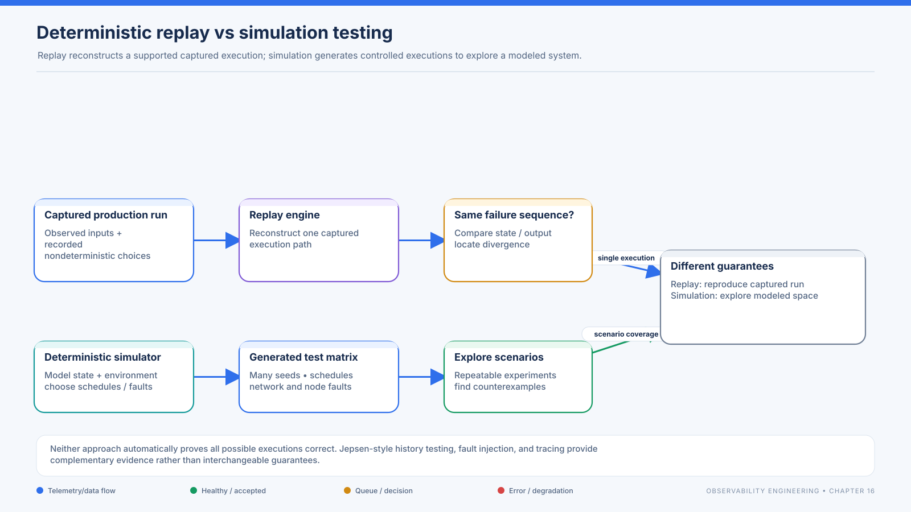

## 10.4 Limitations and trade-offs

- **Runtime overhead:** recording can add CPU, I/O, memory, and latency overhead. Instrumentation should be measured under realistic load.
- **Storage overhead:** event streams and snapshots can be large. Compress, deduplicate, scope capture, and apply short retention where appropriate.
- **Privacy:** recorded inputs may contain secrets, PII, or customer content. Use redaction, synthetic data, access controls, and explicit capture policies.
- **External dependencies:** replaying against a live payment provider or mutable database can cause side effects or different responses. Stub or snapshot dependencies where safe.
- **Hardware nondeterminism:** DMA, device timing, kernel behavior, and multicore execution may be outside a tool's replay model.
- **Replay fidelity:** missing one relevant event can make replay diverge. Treat replay success as evidence only within the documented support envelope.
- **Production safety:** use opt-in, bounded capture and never replay side-effecting transactions against live systems without isolation.
- **Distributed execution:** a multi-machine replay must reconstruct causal message ordering, clock semantics, retries, and state across nodes. This is significantly harder than replaying one process.

---

# 11. Observability Data Architecture and Cost Optimization

## 11.1 Telemetry data lifecycle

A production observability pipeline is a data platform. It has source instrumentation, collection, transformation, transport, storage, indexing, query, visualization, alerting, and deletion stages. Each stage can introduce latency, cost, data loss, security exposure, or a new failure mode.

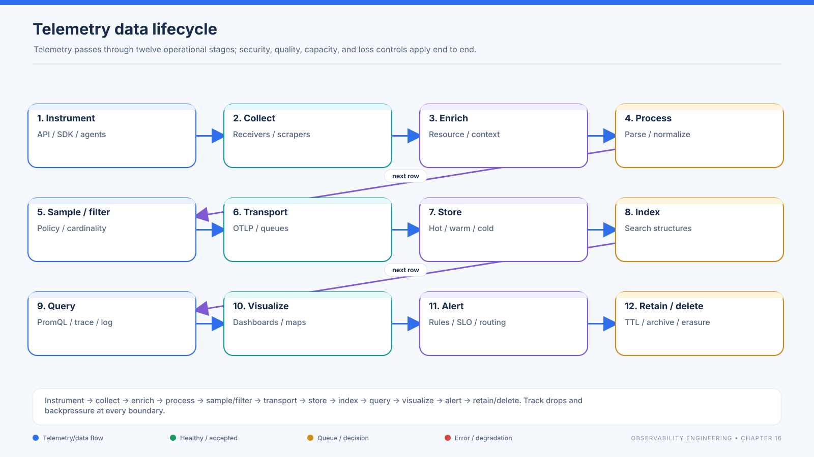

| Stage | Responsibilities | Common failure or design question |
|---|---|---|
| 1. Instrumentation | Generate metrics, logs, spans, events, and profiles | Are signals accurate, bounded, and safe? |
| 2. Collection | Scrape endpoints or receive SDK/agent exports | Are ephemeral workloads and failed targets visible? |
| 3. Enrichment | Add service, host, region, version, and trace context | Is metadata consistent and trustworthy? |
| 4. Processing | Parse, normalize, redact, transform, filter | Can one bad record or processor stall the pipeline? |
| 5. Sampling/filtering | Select useful data and remove noise | Are critical failures retained? |
| 6. Transport | Batch and send through OTLP, remote write, or log protocol | Are retries bounded and queues sized? |
| 7. Storage | Persist raw and aggregated telemetry | What are the durability and retention requirements? |
| 8. Indexing | Build searchable metadata and inverted indexes | Are index cost and cardinality controlled? |
| 9. Querying | Retrieve and aggregate data | Do common investigations meet latency targets? |
| 10. Visualization | Dashboards, trace views, service maps | Do views show actionable context and ownership? |
| 11. Alerting | Evaluate conditions and route incidents | Are alerts actionable and deduplicated? |
| 12. Retention/deletion | Expire, archive, or delete data under policy | Can deletion be proven across replicas and backups? |

## 11.2 Telemetry volume estimation

### Metrics

Approximate raw sample volume:

\[
V_{metrics} = N_{series} \times S_{day} \times B_{sample}
\]

where `N_series` is the number of active time series, `S_day` is samples per series per day, and `B_sample` is average bytes per stored sample including an estimated storage overhead. The true backend footprint depends on compression, labels, index structures, replication, and block format.

Example: 80,000 active series scraped every 15 seconds produce `86,400 / 15 = 5,760` samples/series/day. Total is `80,000 × 5,760 = 460,800,000` samples/day. At a hypothetical 1.5 bytes/sample compressed average, the sample payload is about 691 MB/day before index and replication overhead. This is only a planning estimate; measure actual backend bytes per sample.

### Logs

\[
V_{logs/day} = R_{events/s} \times B_{avg/event} \times 86{,}400
\]

At 25,000 events/s and 900 bytes/event, daily raw volume is `25,000 × 900 × 86,400 = 1,944,000,000,000 bytes`, or about 1.94 TB/day decimal. Compression may reduce object-store bytes, while indexing and replicas can increase total cost. Reducing noise by 30% reduces ingest by roughly 0.58 TB/day before downstream effects.

### Traces

\[
V_{traces/day} = R_{requests/s} \times S_{spans/request} \times P_{sample} \times B_{span} \times 86{,}400
\]

At 10,000 requests/s, 15 spans/request, 10% sampling, and 700 bytes/span, raw sampled trace payload is `10,000 × 15 × 0.10 × 700 × 86,400 = 907,200,000,000 bytes`, about 907 GB/day decimal. Real span sizes and backend index overhead vary widely.

## 11.3 Cost and capacity controls

### Cardinality management

Review metric label combinations in code review. Use route templates, bounded status classes, and service/region dimensions. Keep trace IDs and request IDs in logs/traces, not metrics. For high-cardinality event analytics, evaluate an event-oriented backend and explicitly budget the resulting storage/index cost.

### Log ingestion controls

Filter debug noise at source where safe, sample repetitive success records, aggregate frequent identical errors, and retain security/audit events according to policy. Use structured logs to support targeted searches without indexing every field. Avoid logging full payloads as a shortcut for observability.

### Trace sampling controls

Use baseline head sampling to bound normal traffic. Tail sample errors, slow requests, and selected high-value operations where ingestion capacity permits. Retain representative healthy traces to establish normal behavior. Monitor sampled/dropped counts and ensure sampling decisions remain coherent across services.

### Storage tiering

- **Hot:** recent data used during active incident response; low query latency, higher cost.
- **Warm:** older but still searchable data; more compression and lower-cost storage.
- **Cold/archive:** rarely queried data retained for compliance or long-horizon analysis; slower retrieval and possible restore cost.

Retention should reflect the incident investigation horizon, audit requirements, regulatory obligations, and storage budget. Keep metrics rollups longer than raw high-resolution points where appropriate. Trace retention can be shorter for healthy sampled traces and longer for high-value error traces, subject to privacy and platform constraints.

### Compression and downsampling

Compression reduces storage and network usage but consumes CPU. Downsampling reduces the number of points and speeds long-range analysis but loses detail. Keep raw data long enough to investigate incidents that may be discovered with delay. Preserve histograms or distribution sketches where percentile analysis matters; a mean-only rollup cannot recover tail latency.

### Query optimization

Use time bounds and selective predicates; avoid scanning all tenants or all time when a service/version/region filter can narrow the query. Precompute common aggregates. Keep indexes aligned with query patterns. Prevent dashboards from issuing hundreds of expensive queries on every refresh. Set per-user query limits so one investigation cannot starve incident dashboards.

## 11.4 Backpressure, buffering, and data loss

A telemetry pipeline should remain bounded. Unbounded buffers convert a backend outage into an eventual memory outage. A queue that is too small loses data during short backend interruptions; a queue that is too large can hide a prolonged outage and consume excessive disk or memory.

Design explicit behavior for:

- Backend slowdown: batch, queue, retry with backoff and jitter.
- Backend unavailable: persistent queue if justified; otherwise drop according to priority.
- Application shutdown: flush with a bounded timeout; do not block shutdown indefinitely.
- Collector restart: persist state only where the component supports it and the durability benefit exceeds complexity.
- Queue full: define which signal is dropped first and alert on the drop.
- Malformed telemetry: isolate bad records and count them rather than poisoning the entire batch.

Telemetry delivery is often best-effort, not exactly-once. Duplicates can happen during retries; gaps can happen during process or network failures. The pipeline should expose its own accepted, refused, queued, dropped, retry, and export-failure metrics.

## 11.5 Observability overhead

Measure overhead as a percentage of application resources:

\[
\text{CPU overhead} = \frac{CPU_{instrumented} - CPU_{baseline}}{CPU_{baseline}} \times 100\%
\]

Similarly compare memory, allocation rate, network bytes, request latency, and p99 under representative workloads. Example: baseline uses 4.0 CPU cores at a target throughput; instrumented service uses 4.16 cores. Incremental CPU overhead is `(4.16 - 4.0) / 4.0 = 4%`. Report this alongside throughput and latency; a lower CPU percentage caused by lower throughput is not a win.

A practical target is not one universal overhead percentage. Small services may tolerate only a small incremental footprint; short-lived serverless workloads may be more sensitive to startup and flush cost; critical infrastructure may accept more overhead for comprehensive failure visibility. Define budgets and test them.

### Cost-efficient design principles

1. Instrument at standard boundaries once; avoid duplicate middleware and duplicate log pipelines.
2. Use metrics for aggregates, traces for sampled request paths, and logs for high-value diagnostic events.
3. Prefer bounded labels and normalized operation names.
4. Keep high-resolution retention only where it is operationally useful.
5. Use sampling policies that preserve error and slow-path evidence.
6. Separate user-facing reliability data from verbose developer diagnostics.
7. Monitor the telemetry platform as a service with capacity, availability, and SLOs.
8. Review telemetry cost per request, per service, and per tenant, not only total invoice.

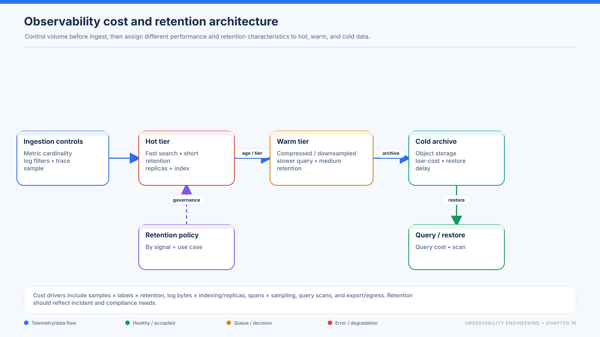

---

# 12. Security, Privacy, and Governance

Observability systems can contain credentials, customer identifiers, internal topology, business transactions, source locations, and security incidents. They should be treated as security-sensitive infrastructure, not as harmless diagnostic output.

## 12.1 Sensitive data and redaction

Never log passwords, access tokens, private keys, session cookies, payment card security codes, or full authentication headers. Avoid collecting full request/response bodies unless a specific approved need exists and data is minimized. Hashing is not automatically anonymization: low-entropy identifiers can be reversed by guessing, and stable hashes still permit correlation.

Apply sanitization as close to source as practical, then enforce a second policy boundary in the Collector or ingestion pipeline. Redaction should cover nested JSON, headers, exception messages, SQL statements, baggage, and span attributes. Test redaction rules with adversarial examples and schema changes.

## 12.2 Authentication, authorization, and tenancy

- Require strong authentication for dashboards, query APIs, and Collector administration.
- Use role-based access control and least privilege for viewing, exporting, changing retention, and modifying alert rules.
- Separate production, staging, and development telemetry where trust boundaries differ.
- Enforce tenant-level isolation in backend query authorization, not only UI filters.
- Audit searches and exports of sensitive telemetry where appropriate.
- Protect service-to-Collector transport with TLS and authenticated identity when crossing trust boundaries.

## 12.3 Encryption and data residency

Encrypt telemetry in transit and at rest. Use managed key policies where available and define key rotation and access processes. Multi-region architectures should know where raw logs, traces, and backups are stored and processed. Routing telemetry to a global backend may violate residency requirements even when application data remains regional.

## 12.4 Audit and retention governance

Audit logs often need stronger integrity and retention guarantees than routine application logs. Separate operational diagnostics from compliance/audit records, and do not apply routine sampling to events required by policy. Define retention and deletion by signal, environment, data class, and tenant. Ensure data deletion covers replicas, object storage, indexes, caches, and backup lifecycle where required.

## 12.5 Observability pipeline threat model

Potential threats include telemetry poisoning, forged trace context, log injection, resource-exhaustion attacks through high-cardinality labels, unauthorized data export, malicious dashboard queries, and compromise of a Collector with access to internal networks. Treat remote attributes and baggage as untrusted input. Validate size and schema, restrict egress, isolate pipelines, patch agents, and monitor changes to retention and routing.

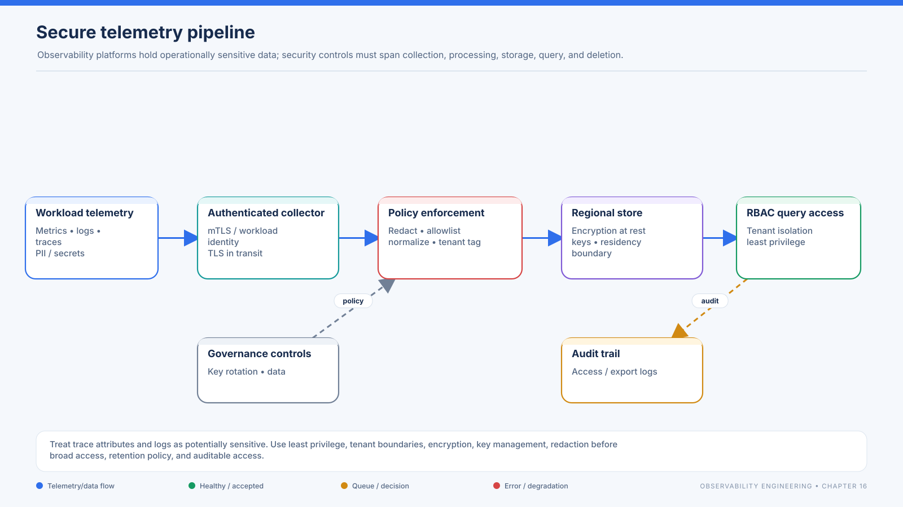

---

# 13. Real-World Case Studies

The case studies below distinguish documented public engineering practices from hypothetical scenarios. They explain how observability principles apply, but they do not claim access to private company incident details. Cases 1–3 describe publicly documented design themes at a high level; cases 4–10 are explicitly hypothetical architecture exercises.

## Case 1 — Google-style distributed tracing at large scale (documented design themes)

**Context and architecture.** Google's Dapper paper describes a tracing infrastructure intended for services composed from many modules, languages, and machines. It used trace/span identifiers, annotations, sampling, and instrumentation in common libraries to make tracing low overhead and widely deployed.

**Operational problem.** In a large service graph, local logs and per-host metrics cannot reliably explain the latency of one end-to-end request. Engineers need a view that spans RPC boundaries and nested work.

**Telemetry and investigation.** A trace tree exposes the sequence and duration of nested operations. Aggregated analysis helps identify recurring latency patterns and unexpected dependencies. Sampling reduces collection cost while preserving a representative set of requests.

**Design lesson.** Ubiquitous low-overhead instrumentation and consistent context propagation are foundational. The paper documents design principles and historical system behavior; it should not be read as an exact map of Google's current internal platform.

## Case 2 — Uber-style microservices observability (documented public context, generalized)

**Context.** Uber has publicly discussed large-scale microservice operations and open-source observability work, including Jaeger. A ride lifecycle can involve identity, dispatch, maps, pricing, payments, notifications, and data services.

**Problem class.** A user-visible delay can originate in any dependency or fan-out branch. Teams need shared trace context, service maps, and common operation semantics to investigate across service ownership boundaries.

**Telemetry approach.** Distributed traces expose dependency spans; metrics quantify request rate, errors, latency, and saturation; logs provide local exceptions and business transitions. A centralized trace system supports service-level filtering and dependency discovery.

**Lesson.** Common instrumentation and a shared tracing platform reduce the cost of cross-team debugging. This is a generalized interpretation of public engineering themes, not a claim about an undocumented Uber deployment topology or incident.

## Case 3 — Netflix-style monitoring and incident diagnosis (documented public themes, generalized)

**Context.** Netflix has publicly described cloud-scale operations, resilience engineering, canary analysis, and production monitoring practices. Streaming experiences depend on APIs, playback services, content delivery, identity, device software, and regional infrastructure.

**Problem class.** Aggregate service uptime does not fully represent viewer experience. Startup delay, playback interruption, bitrate degradation, and regional availability are user-visible outcomes.

**Telemetry approach.** Combine backend metrics and logs with client-side experience signals, deployment/canary comparisons, regional segmentation, and synthetic or real-user measurements.

**Lesson.** Observability should be aligned to customer experience and release safety. This case summarizes public themes and does not assert a specific private Netflix architecture or incident root cause.

## Case 4 — Kubernetes platform observability (hypothetical)

**Architecture.** A company runs 400 microservice deployments across 12 clusters. Each node runs a log/telemetry agent; regional Collectors aggregate OTLP and Kubernetes metadata; Prometheus-compatible metrics storage, Loki-style logs, and a trace backend retain signals.

**Symptoms.** A deployment becomes unavailable while dashboards show low average CPU. Pods restart, readiness fluctuates, and one namespace reports elevated request timeouts.

**Investigation.** Pod events show OOM kills; container memory rises after a new cache implementation. Traces reveal that cache misses fall through to the database, increasing connection use. Node-level metrics show memory pressure and evictions.

**Root cause and mitigation.** The cache retained unbounded keys and the deployment's memory limit was too low for the new workload. Roll back the release, cap cache size, and reduce rollout concurrency.

**Long-term improvements.** Add cache memory metrics, memory soak tests, rollout health gates, and an SLO alert on request error/latency. Keep node, pod, and application views linked.

## Case 5 — E-commerce checkout latency (hypothetical)

**Architecture.** Gateway → cart → pricing → promotion → inventory → payment → order service; asynchronous fulfillment follows Kafka publication.

**Symptoms.** P99 checkout latency rises from 700 ms to 4 s during a flash sale. Overall CPU is moderate and only some customers are affected.

**Telemetry.** Checkout RED metrics, DB pool wait, payment provider duration, cache hit ratio, trace spans, and structured order state logs.

**Investigation.** Slow traces show promotion service fan-out and a DB connection acquisition wait. Promotion code introduced a query per cart line, and DB connections are held while the payment provider call runs.

**Root cause and mitigation.** N+1 query behavior plus long transaction scope exhausts the pool. Temporarily disable expensive promotion enrichment, cap checkout concurrency, then fix the query and move external payment work outside the DB transaction.

**Long-term improvements.** Query-count tests, connection-hold histograms, transaction boundary review, high-load tests using realistic cart sizes, and business-level checkout SLOs.

## Case 6 — Payment authorization failure (hypothetical)

**Architecture.** Checkout calls a payment orchestration service, which routes to provider A or B and records idempotency state.

**Symptoms.** The payment API returns intermittent 502/504 responses, while some customers report that their card was charged despite seeing an error.

**Telemetry.** Trace each authorization attempt; record provider, route, attempt number, timeout, idempotency key hash, and state transition; monitor provider latency, timeout ratio, duplicate authorization, and reconciliation backlog.

**Investigation.** Traces show that provider authorization completed after the caller timed out. The orchestration layer retried without checking the idempotency result, causing ambiguous outcomes.

**Root cause and mitigation.** Timeout semantics were confused with definite failure. Stop blind retries, reconcile uncertain authorizations, and query provider status using idempotency keys.

**Long-term improvements.** Explicit payment state machine (`PENDING`, `AUTHORIZED`, `DECLINED`, `UNKNOWN`, `RECONCILED`), provider idempotency, bounded retries, outbox/inbox patterns, and a correctness SLI.

## Case 7 — Kafka consumer lag (hypothetical)

**Architecture.** Order events are partitioned by customer ID; consumers update search indexes and analytics views.

**Symptoms.** Lag grows from 5 minutes to 90 minutes; producer traffic remains stable; search results are stale.

**Telemetry.** Per-group lag, oldest-message age, processing duration, rebalance count, partition skew, error/retry counts, consumer throughput, and downstream search write latency.

**Investigation.** One partition receives a disproportionate share of messages; a hot customer key concentrates work. Traces show slow bulk indexing and repeated retries on a throttled search cluster.

**Root cause and mitigation.** Partition skew plus slow downstream writes reduces effective consumer throughput. Apply bounded bulk writes, pause low-priority analytics consumption, and increase consumer capacity only where partition concurrency permits.

**Long-term improvements.** Key distribution analysis, partition planning, lag-age SLOs, idempotent writes, retry/DLQ policy, and downstream capacity tests.

## Case 8 — Multi-region degradation (hypothetical)

**Architecture.** Users route to the nearest region; orders write locally and replicate to a secondary region for disaster recovery.

**Symptoms.** Region A remains healthy, while region B reports higher P99 and delayed order visibility. Global availability looks normal because most traffic uses A.

**Telemetry.** Regional Golden Signals, route decisions, cross-region RTT, replication lag, failover metrics, synthetic probes, and data freshness SLIs.

**Investigation.** Traces show region B reads remote inventory after local cache misses. Network metrics show retransmits on the inter-region path; replication delay increases.

**Root cause and mitigation.** A routing configuration sends one workload class to a distant region. Correct routing, protect the affected region from excess failover traffic, and communicate freshness impact.

**Long-term improvements.** Region-specific dashboards and alerts, topology-aware routing tests, local read policy, failover capacity reserve, and explicit replication/freshness objectives.

## Case 9 — Database performance regression (hypothetical)

**Architecture.** Order service uses a relational database with read replicas and a connection pool.

**Symptoms.** P95 query latency increases after a schema/index deployment; write success remains high but the service queue grows.

**Telemetry.** Query duration by normalized query fingerprint, rows examined, lock wait, buffer/cache hit, replication lag, DB CPU/I/O, and application pool wait.

**Investigation.** Query plans show that a composite index is not selected for a changed predicate. Read replica lag grows because a query is scanning a large table.

**Root cause and mitigation.** A schema migration changed selectivity and query planning. Roll back the query path or add the correct index after analyzing write amplification and online-build impact.

**Long-term improvements.** Query plan checks in CI, safe migration practices, representative data-volume tests, and database SLOs tied to service-level latency.

## Case 10 — Cascading failure from retry amplification (hypothetical)

**Architecture.** Gateway → profile → recommendation → inventory; each layer has a retry policy.

**Symptoms.** Inventory latency increases modestly, then gateway errors and queue depth rise sharply across the service graph.

**Telemetry.** Original requests vs attempts, retry rate by layer, deadline remaining, concurrency, queue length, circuit-breaker events, and dependency P99.

**Investigation.** Traces reveal up to three retries at each of three layers. One original request generates up to `4 × 4 × 4 = 64` downstream attempts in the worst configured path.

**Root cause and mitigation.** Independent retry policies multiply work during a dependency incident. Disable redundant retries, set one retry owner, enforce an end-to-end deadline, add jitter and retry budget, and shed optional recommendation traffic.

**Long-term improvements.** Retry policy standards, idempotency keys, failure load testing, bulkheads, adaptive concurrency, and alerting on attempts per logical request.

---

# 14. Quantitative Worked Examples and Formulas

This section collects calculations used in operational reviews. Values are illustrative and must be interpreted using the exact SLI/metric definition and sampling window.

## 14.1 Request rate

\[
\text{RPS} = \frac{\text{Requests observed}}{\text{Window seconds}}
\]

If 360,000 requests arrive in 5 minutes, then `360,000 / 300 = 1,200 requests/s`. State whether retries and health checks are included. For business throughput, count successful completed operations separately from attempts.

## 14.2 Error rate

\[
\text{Error rate} = \frac{\text{Failed eligible requests}}{\text{Total eligible requests}} \times 100\%
\]

If 2,400 of 120,000 eligible requests fail, error rate is `2,400 / 120,000 × 100 = 2%`. Use a denominator consistent with user-facing eligibility and avoid mixing requests with attempts.

## 14.3 Percentiles

Sort `N` latency observations in ascending order. A percentile rank is commonly estimated from a rank around `p × N`, though interpolation conventions vary. For a sample of 10,000 requests, P99 is around the 9,900th ranked observation; P99.9 is around the 9,990th. Small samples make high percentiles unstable. Always display sample count and window.

Example sorted observations: 9,500 requests complete within 200 ms, 400 within 500 ms, 90 within 1 s, and 10 within 3 s. P50 and P90 are below 200 ms; P95 may be near 200 ms depending on exact observations; P99 is near 500 ms; P99.9 is near 1 s. Exact values require raw distribution or histogram buckets, not only cumulative prose counts.

## 14.4 Histogram interpretation

For classic Prometheus histograms, bucket counts are cumulative. Suppose buckets are `le=0.1: 600`, `le=0.3: 920`, `le=1.0: 990`, `le=+Inf: 1000`. Then:

- 600 observations are ≤100 ms.
- `920 − 600 = 320` are >100 ms and ≤300 ms.
- `990 − 920 = 70` are >300 ms and ≤1 s.
- `1000 − 990 = 10` are >1 s.
- 90% are ≤300 ms; 99% are ≤1 s.

The precise percentile inside a bucket is estimated, not directly observed from classic bucket counts. Choose buckets around SLO thresholds.

## 14.5 Metric cardinality

If a metric has 8 methods, 5 status classes, 4 regions, 12 services, and 3 environments, theoretical maximum label combinations are:

`8 × 5 × 4 × 12 × 3 = 5,760 time series`.

Add 50,000 customer IDs and the naïve maximum becomes 288 million. This is why request/user IDs should not normally be metric labels. Actual combinations may be lower, but capacity planning should use plausible upper bounds.

## 14.6 Metrics storage

Assume 80,000 active time series, one sample every 15 seconds, 1.5 bytes per compressed sample estimate:

- Samples/series/day = `86,400 / 15 = 5,760`.
- Total samples/day = `80,000 × 5,760 = 460.8 million`.
- Estimated sample payload = `460.8M × 1.5 = 691.2 MB/day`.
- 30-day payload = about `20.7 GB` before indexes, replication, metadata, and compaction overhead.

Use empirical bytes-per-sample and backend retention behavior for real sizing.

## 14.7 Log ingestion

Assume 25,000 events/s × 900 bytes/event:

- Per second = 22.5 MB/s.
- Per day = `22.5 × 86,400 = 1,944,000 MB` ≈ 1.94 TB/day decimal.
- 30 days raw = about 58.3 TB before compression, indexes, replicas, and metadata.

A 40% source-side reduction saves about 0.78 TB/day raw. Validate that the removed logs are not required for audit or rare failure investigation.

## 14.8 Trace volume and sampling

Assume 10,000 requests/s, 15 spans/request, 700 bytes/span, and 10% sampling:

- Full span rate = `10,000 × 15 = 150,000 spans/s`.
- Sampled span rate = `15,000 spans/s`.
- Payload rate = `15,000 × 700 = 10.5 MB/s`.
- Daily payload = `10.5 × 86,400 = 907.2 GB/day`.

Sampling at 10% reduces baseline trace volume by 90%, before collector/backend overhead. Error-aware tail sampling can retain more error traces than healthy traces but requires enough Collector capacity for the pre-sampled volume reaching the tail sampler.

## 14.9 Availability and error budgets

Availability is a ratio over a declared window. For time-based SLI over a 30-day month (43,200 minutes), downtime budgets are 432 minutes at 99%, 43.2 at 99.9%, 21.6 at 99.95%, and 4.32 at 99.99%.

For request-based SLI, assume 12 million eligible requests in a month and 99.9% objective. Allowed bad requests = `12,000,000 × 0.001 = 12,000`. If 18,000 requests are bad, the error budget is exceeded by 6,000 events regardless of whether total downtime was small.

## 14.10 Burn rate

If the SLO permits 0.1% bad events and current bad ratio is 0.5%, burn rate = `0.5 / 0.1 = 5×`. If this rate persisted over a 30-day window, a 30-day budget would be consumed in `30 / 5 = 6 days`. This is a simplified constant-rate interpretation; alerting uses observed rolling windows and eligible event volumes.

## 14.11 Alert threshold worked example

An API receives 2,000 eligible requests/s. A 1% error-rate threshold corresponds to 20 bad requests/s. Over 5 minutes, that is 6,000 bad requests if traffic remains constant. But a 1% rate at 2 req/s represents only 0.02 errors/s and may be statistically noisy. Use minimum traffic volume, multi-window confirmation, SLO burn, and symptom context rather than one unqualified threshold.

## 14.12 Queue lag

A simple count lag is:

\[
\text{Lag} = \text{Latest produced offset} - \text{Committed consumer offset}
\]

If the latest offset is 9,500,000 and committed offset is 9,120,000, lag is 380,000 records. If the consumer processes 2,000 records/s and producers stop, estimated drain time is `380,000 / 2,000 = 190 seconds`. In practice, partitions, retries, message size, and downstream bottlenecks make lag age and throughput more informative than one total count.

## 14.13 Collector throughput and queue sizing

If the expected incoming span rate is 60,000 spans/s and average span is 700 bytes, payload ingress is 42 MB/s. To buffer a 2-minute backend outage, the theoretical payload buffer is `42 × 120 = 5,040 MB` (~5.04 GB), before queue metadata and safety margin. Compression may reduce disk usage but consumes CPU. If the system cannot provision that buffer, define a deliberate drop/backpressure priority instead of assuming infinite resilience.

## 14.14 Observability overhead

A workload uses 8.0 cores baseline and 8.24 cores after instrumentation. CPU overhead is `(8.24 − 8.0) / 8.0 × 100 = 3%`. Memory rises from 4.0 GiB to 4.18 GiB, or 4.5%. Network egress rises 6%. Evaluate at matched throughput and compare p95/p99 latency. A telemetry exporter that increases p99 by 20% may be unacceptable even when average CPU overhead is low.

## 14.15 Observability cost estimation

A simplified monthly cost model:

\[
C_{total} = C_{ingest} + C_{storage} + C_{index} + C_{query} + C_{compute} + C_{network} + C_{operations}
\]

Illustration: a log platform ingests 1 TB/day, retains searchable hot data for 7 days and compressed archive for 30 additional days. Hot logical volume is 7 TB; archive logical volume is 30 TB. Apply actual compression ratios, replication, indexing expansion, query workload, and vendor pricing. Do not equate ingested bytes with billable stored bytes; many commercial plans meter several dimensions.

## 14.16 Key formula sheet

| Quantity | Formula |
|---|---|
| Request rate | `requests / seconds` |
| Error rate | `failed eligible requests / eligible requests` |
| Availability | `good eligible events / all eligible events` |
| P99 rank | approximately `0.99 × N` sorted observations |
| Metric samples/day | `series × (86,400 / scrape interval seconds)` |
| Log bytes/day | `events/s × avg bytes × 86,400` |
| Trace bytes/day | `requests/s × spans/request × sample fraction × avg bytes × 86,400` |
| Monthly downtime budget | `window minutes × (1 − SLO)` |
| Burn rate | `observed bad-event ratio / allowed bad-event ratio` |
| Queue drain time | `backlog / net processing rate` |
| Resource overhead | `(instrumented − baseline) / baseline × 100%` |

---

# 15. System Design Interview Applications

For every observability system design, begin with user and operator requirements, then estimate data volume, design collection and storage, establish failure behavior, and define security and cost controls. The designs below are reference approaches, not one-size-fits-all architectures.

## 15.1 Design observability for a microservices e-commerce platform

**Requirements.** Support checkout, search, catalog, inventory, payment, and fulfillment; diagnose latency and correctness; 99.95% availability objective for checkout; multi-region deployment.

**Functional requirements:** metrics, structured logs, traces, business events, dashboards, alerting, dependency map, SLO reports, and trace-to-log correlation.

**Non-functional requirements:** low application overhead, bounded telemetry queues, multi-region resilience, tenant isolation, query performance, retention governance, and secure access.

**Architecture/data flow.** OpenTelemetry SDKs instrument each service. Context crosses HTTP/gRPC and Kafka. Local agents collect logs and enrich workload metadata. Regional gateways batch, redact, tail-sample critical traces, and route signals to specialized backends. SLO dashboards aggregate checkout success and latency.

**Storage/scaling.** Metrics use a horizontally scalable Prometheus-compatible backend; logs use object-backed or indexed storage according to query requirements; traces use a backend designed for trace lookup and retention. Capacity estimates are based on RPS × spans, events/s × bytes, active series × scrape rate.

**Failure/security/cost.** Application requests never wait indefinitely for telemetry. Gateways have bounded queues and HA. PII is redacted; tenant queries are authorized. Sample routine traces, retain error/slow traces, and archive logs by policy.

**Trade-offs.** A unified vendor reduces integration work but increases lock-in and cost. Specialized backends optimize each signal but increase operational burden.

## 15.2 Design centralized logging for 1,000 services

**Requirements.** Ingest logs from 1,000 services across Kubernetes and VMs; searchable within 1 minute; hot retention 14 days; archive up to 90 days.

**Functional requirements:** collection, parsing, enrichment, redaction, routing, search, export, alerting, and deletion.

**Architecture.** Node agents collect stdout/files; application logs are JSON; agents add cluster/namespace/service metadata. Regional gateways parse, redact secrets, apply rate limits, and batch. Hot searchable storage indexes selected fields; older data moves to compressed object storage.

**Scalability.** Estimate peak events/s and bytes/event, then apply 2–3× burst headroom as a starting capacity assumption. Partition by time and service/environment; cap per-tenant ingestion; monitor indexing queue and storage compaction.

**Failure handling.** Local disk buffers absorb short outages; queues have size limits and drop policies. A malformed log is quarantined/counted. The log backend must not block application writes synchronously.

**Security/cost.** RBAC, audit search, TLS, data classification, redaction, retention by log class, and index only common query dimensions.

**Trade-off.** Full-text indexing every field improves ad hoc search but raises cost; selective indexing with structured payloads is cheaper but requires query conventions.

## 15.3 Design tracing for millions of spans per second

**Requirements.** Ingest 2 million spans/s peak, support trace-by-ID lookup and slow/error trace discovery, preserve cross-service trace integrity.

**Architecture.** SDKs use OTLP with batch exporters. Agent Collectors receive local spans and forward to a trace-ID-aware gateway tier. Gateways apply memory limits, tail-sampling decisions, and export to horizontally scalable ingestion/storage. Object storage retains blocks; an index supports service, operation, duration, and error search.

**Data flow.** SDK → agent → trace-ID router → tail sampler → storage distributor → object store/index → query frontend/UI.

**Scalability.** At 600 bytes/span compressed estimate, 2M spans/s implies 1.2 GB/s ingress before replication/indexing. Tail sampling requires buffering by trace and decision window. Shard by trace ID to keep spans together; scale ingestion and query pools independently.

**Failure handling.** Monitor dropped spans, late spans, sampler memory, queue utilization, and backend write errors. Use bounded queues and controlled degradation to head sample when tail sampling capacity is exhausted, if policy allows.

**Security/cost.** Redact sensitive attributes before storage; short retention for healthy traces and longer retention for selected failure traces.

**Trade-off.** Rich indexing improves search but adds cost. Object-storage-first designs lower retention cost but may make arbitrary search less immediate.

## 15.4 Design metrics monitoring for Kubernetes

**Requirements.** Monitor nodes, pods, workloads, control plane, application services, autoscaling, and SLOs across several clusters.

**Architecture.** Prometheus-compatible agents scrape kubelet/cAdvisor and exporters; service discovery follows Kubernetes labels. Application metrics use standard labels. A global metrics tier (Thanos/Mimir/VictoriaMetrics or managed equivalent) provides multi-cluster query and retention. Grafana dashboards and Alertmanager route alerts.

**Scalability.** Cardinality budgets per namespace/team, scrape intervals by metric importance, federation or remote write, and rollups for long-term trends.

**Failure handling.** Detect scrape target loss, remote write backlog, rule evaluation delay, and global query outages. Keep local alerting for region-critical signals if global connectivity fails.

**Security.** Restrict Prometheus endpoints, protect query APIs, isolate tenants, and use least-privilege service accounts.

**Trade-off.** Centralized scrape is simpler for some environments; local agents improve resilience and locality but add fleet operations.

## 15.5 Design alerting for a global payment platform

**Requirements.** Detect payment authorization failures, latency, correctness issues, provider degradation, and region-specific problems. Pages must be low-noise and auditable.

**Architecture.** Define payment SLIs for authorization success and completion time, excluding only explicitly ineligible test/invalid requests. Use multi-window burn-rate alerts, provider-specific symptom alerts, and synthetic canary transactions. Alertmanager or Grafana routes to incident management by service/provider/region ownership.

**Reliability.** Keep separate alerts for definite decline vs unknown outcome vs internal failure. Monitor reconciliation backlog and duplicate/ambiguous authorization as correctness signals.

**Failure handling.** Deduplicate provider incidents, inhibit downstream noise when a regional network incident is active, and preserve regional local paging if global control plane is unavailable.

**Security.** Never put card data or secrets in alert payloads. Limit transaction identifiers to approved opaque references.

**Trade-off.** Aggressive pages reduce detection latency but create fatigue. SLO-based pages focus on user harm, while predictive capacity alerts can be tickets.

## 15.6 Design observability for Kafka-based event-driven architecture

**Requirements.** Trace producer-to-consumer processing; detect lag, poison messages, duplication, and DLQ growth; support replay and audit.

**Architecture.** Producer/consumer OTel instrumentation injects/extracts trace context in headers. Broker metrics expose throughput, partition health, rebalances, and lag. Consumer spans include processing and commit events. Logs use message ID and safe event type. Event audit store is separate from telemetry.

**Scaling.** Partition count, key distribution, consumer parallelism, batch sizes, and downstream capacity determine throughput. Track oldest-message age in addition to offsets.

**Failure/security.** Retry with backoff and bounded attempts; use DLQ with reason; idempotent processing; do not include payload in traces by default. Preserve headers during retry and forwarding.

**Trade-off.** A trace per message is expensive; batch spans with links or use sampled message traces depending on diagnostic requirements.

## 15.7 Design multi-region observability with data isolation

**Requirements.** Regional telemetry must remain in-region for restricted data classes; global operators need fleet health and incident coordination.

**Architecture.** Each region has local agents, gateways, storage for restricted raw data, and regional alerting. A global layer receives approved aggregate SLI metrics, redacted service health, and limited cross-region trace metadata.

**Failure handling.** Regional pipelines continue during WAN partition; local buffering is bounded. On recovery, backfill delayed telemetry without overwriting newer state incorrectly.

**Security.** Region-specific identity, encryption keys, query RBAC, data classification, and audit logs.

**Trade-off.** Global correlation is weaker when raw traces cannot leave a region. Use secure remote query or metadata aggregation where compliant.

## 15.8 Design a low-cost tiered-retention telemetry platform

**Requirements.** Support on-call search for recent incidents, historical trend analysis, and policy-driven archive.

**Architecture.** Hot metrics/logs/traces optimized for recent query; warm tier compressed; cold archive in object storage. Use downsampled metrics, sampled traces, and structured logs. Keep SLO-relevant rollups longer than raw request-level events.

**Cost model.** Estimate daily ingest by signal and actual compression/index/replication factors; forecast retention by tier. Include query and restore charges.

**Failure/security.** Lifecycle transitions must be auditable and deletion policy consistent across tiers. Test restore and query on archived data.

**Trade-off.** Cold storage saves money but increases retrieval latency; preserve enough hot data for the organization's mean time to detect/investigate incidents.

## 15.9 Design an SLO-based alerting system

**Requirements.** Define service SLIs/SLOs, compute rolling error-budget consumption, page on fast burn, and support release policy.

**Architecture.** Instrument good/total events at trusted service boundaries. Record histograms for latency and counters for outcomes. Recording rules calculate SLI windows and burn rate. Alert rules use short+long windows; alert router groups by service and SLO owner. SLO dashboard shows budget remaining and deploy annotations.

**Failure handling.** Ensure monitoring data loss does not appear as 100% availability. Alert on missing telemetry and stale rule evaluation. Define minimum request volume and maintenance behavior.

**Trade-off.** Request-based SLOs align to customer events but require correct eligibility; time-based SLOs are simpler but can misrepresent low-traffic periods.

## 15.10 Debug a sudden increase in API P99 latency

**Requirements.** Identify whether the problem is code, dependency, queue, resource, network, or workload shift; restore service safely.

**Approach.** Confirm P99 sample size and endpoint. Compare P50/P95/P99, errors, traffic, and saturation. Segment by region, version, tenant tier, and route. Compare traces before/after incident; isolate first duration increase. Check connection pool, DB, thread pool, queue, and dependency spans. Correlate with deploy/config changes.

**Mitigation.** Roll back, cap concurrency, shed optional work, route around a bad region, or fix the constrained resource. Validate end-to-end outcome and backlog recovery.

**Trade-off.** Scaling can relieve a true capacity bottleneck but can worsen a downstream shared dependency. Choose mitigation only after identifying the constrained component.

## 15.11 Design end-to-end trace propagation across HTTP and Kafka

**Requirements.** A user request calls services synchronously and publishes events consumed later; traces must show causal relation without pretending asynchronous work blocks the response.

**Architecture.** HTTP middleware extracts/injects W3C Trace Context. Kafka producer injects trace context into headers. Consumer extracts headers and creates a consumer span. Batch consumers use links to multiple producer contexts. Retry/DLQ handlers preserve or link original context.

**Testing.** Integration tests assert trace ID continuity, span kind, parent/link relationship, and safe baggage limits. Test proxies that strip headers and message serializers that drop metadata.

**Trade-off.** One long trace across a long-lived workflow can be hard to retain and query; separate traces linked by a workflow/business correlation ID may be clearer.

## 15.12 Design deterministic replay for intermittent distributed failures

**Requirements.** Reproduce a correctness bug caused by ordering, timing, or retries without re-running side effects against live systems.

**Architecture.** Capture logical inputs, message order, external responses, clock and random inputs, state snapshots, and required scheduling/serialization events. Store records encrypted and access-controlled. Replay inside an isolated environment with deterministic dependency stubs or snapshots. Compare invariant outcomes and first divergence.

**Scalability.** Capture selectively by request, tenant class, or canary. Bound storage; use event streaming and checkpoints. Keep binary/runtime/config version metadata.

**Failure/security.** Missing events reduce fidelity; privacy risk is high; replayed external side effects must be blocked. Add explicit completeness metadata and fail closed when required data is absent.

**Trade-off.** Exact process replay is expensive and tool-specific; deterministic simulation is often more practical when the system is designed around a controllable runtime.

---

# 16. Interview Preparation: 180 Questions and Answers

The answers emphasize reasoning and operational trade-offs. For senior interviews, explain the failure mode, scale assumptions, and what evidence would change your decision—not only the definition.

## 16.1 Observability fundamentals

**Q1. What is observability?**  
Observability is the ability to infer internal system behavior from exposed outputs such as metrics, logs, and traces. In practice, it combines instrumentation, context propagation, telemetry pipelines, storage/query, and an investigation process that supports questions engineers did not anticipate in advance.

**Q2. How is observability different from monitoring?**  
Monitoring evaluates known conditions through predefined dashboards and alerts. Observability includes monitoring but also supports exploratory investigation of unknown behavior, such as identifying which dependency or tenant dimension explains a latency regression.

**Q3. Why are distributed systems harder to debug than monoliths?**  
A request crosses independent processes and networks, each of which can fail partially. Clocks drift, calls execute concurrently, queues delay work, and retries change load. No single process necessarily has the complete causal history.

**Q4. What is a partial failure?**  
A partial failure occurs when one component or operation fails while other parts remain available. For example, reads may work while writes fail, or one region may have degraded connectivity. Observability must expose component- and operation-level health rather than one boolean.

**Q5. What are white-box and black-box monitoring?**  
White-box monitoring inspects internal state such as queues, pools, GC, and cache evictions. Black-box monitoring tests externally visible behavior such as a synthetic checkout. Black-box detects user impact; white-box helps explain it.

**Q6. Why should observability be designed into a system?**  
Context propagation, stable service identity, and safe structured event schemas are difficult to retrofit. Adding them to service templates and API standards makes signals consistent across teams and reduces the cost of incident investigation.

**Q7. Are metrics, logs, and traces enough?**  
They are the core telemetry pillars, but profiles, events, synthetics, and real-user data can add valuable evidence. The correct signal depends on the question: aggregate health, discrete event detail, execution path, code hot spots, or user-experience validation.

**Q8. What does high observability mean?**  
It means engineers can ask meaningful questions and correlate evidence across services without repeatedly redeploying code. It does not mean collecting every internal value; excessive telemetry can add overhead, cost, and noise.

**Q9. What is telemetry?**  
Telemetry is data emitted by a system to describe its behavior and state. Examples include counters, histograms, log events, trace spans, profiles, and deployment events.

**Q10. Why can a healthy process still provide an unhealthy service?**  
The process may be alive while a critical dependency is unavailable, a business operation is incorrect, or a request pool is exhausted. Liveness and readiness probes must be supplemented by end-to-end user outcome SLIs.

**Q11. What is the role of a service map?**  
A service map summarizes observed dependencies and traffic relationships. It helps identify fan-out and common dependencies, but it is incomplete when paths are rare, sampled away, or not instrumented.

**Q12. How do you evaluate an observability design?**  
Test whether known incidents can be detected and investigated, whether unexpected dimensions can be queried, and whether telemetry remains bounded and secure. Measure detection time, investigation time, data loss, overhead, and cost.

## 16.2 Metrics

**Q13. What is a counter?**  
A counter is a monotonically increasing total that may reset when a process restarts. It is appropriate for requests, errors, bytes, and completed jobs; derive rates from counter changes over time.

**Q14. What is a gauge?**  
A gauge represents a value that can rise or fall, such as active connections, queue depth, memory usage, or in-flight requests. Use aggregation appropriate to a point-in-time state rather than counter-rate logic.

**Q15. What is a histogram?**  
A histogram records observations into buckets and usually exposes count and sum. It supports fleet-wide distribution analysis when bucket data can be aggregated, making it useful for latency and payload-size SLOs.

**Q16. How does a summary differ from a histogram?**  
A summary commonly calculates quantiles inside each instrumented process over a window; those quantiles are not generally aggregatable across replicas. Histograms expose bucket counts that can be aggregated, with quantile estimates calculated centrally.

**Q17. What is metric cardinality?**  
Cardinality is the number of unique time series generated by metric names and label combinations. Unbounded labels such as user IDs can cause explosive memory, index, and query costs.

**Q18. Why are request IDs poor metric labels?**  
Each request ID is nearly unique, creating a separate time series per request. Request IDs belong in logs or traces, where high-cardinality values are expected and query patterns are different.

**Q19. Why are percentiles more useful than averages for latency?**  
Averages hide skew and rare slow requests. P95/P99 expose tail behavior that often dominates user experience, especially in fan-out systems where one slow dependency delays the overall request.

**Q20. What is cumulative temporality?**  
Cumulative temporality reports totals accumulated since an instrument or process started. Consumers must handle resets and restarts correctly when calculating rates or aggregating across instances.

**Q21. What is delta temporality?**  
Delta temporality reports changes during a collection interval. It can simplify aggregation but depends on complete interval delivery; dropped or duplicated deltas can distort totals unless the pipeline handles them.

**Q22. Pull vs push metrics: which is better?**  
Neither universally. Pull supports target discovery and missing-target detection; push suits short-lived jobs and network topologies where scraping is impractical. Reliability, security, and lifecycle behavior matter more than the label.

**Q23. What is downsampling?**  
Downsampling reduces time-series resolution for older data, lowering storage and query cost. It loses short spikes and may destroy distribution details, so preserve histograms or useful rollups for latency and SLO analysis.

**Q24. How do you choose histogram buckets?**  
Place bucket boundaries around meaningful thresholds such as SLO limits and common latency ranges. Buckets that are too coarse cannot explain boundary violations; too many buckets increase storage and processing costs.

## 16.3 Logging

**Q25. What is structured logging?**  
Structured logging records events as fields with stable names and types, commonly JSON. It supports reliable filtering and aggregation, unlike free-form text whose meaning must be inferred from message strings.

**Q26. What belongs in an application log?**  
Meaningful lifecycle transitions, failures, important decisions, and diagnostic context such as service version and trace ID. Avoid logging every trivial operation or dumping arbitrary payloads.

**Q27. When should you use INFO vs WARN vs ERROR?**  
INFO describes expected significant events; WARN identifies an unexpected but recoverable condition; ERROR indicates an operation failed or an invariant was violated. Severity should reflect operational meaning, not developer frustration.

**Q28. What is a correlation ID?**  
A correlation ID associates records with a business operation or workflow. It may differ from a trace ID, especially when one workflow spans several independent traces or retries.

**Q29. Why include trace IDs in logs?**  
Trace IDs let investigators move from a span to detailed local events for the same request. Span IDs further identify the exact operation that emitted a log.

**Q30. What is log enrichment?**  
Enrichment adds consistent metadata such as service, version, environment, region, namespace, and trace context. Centralized enrichment reduces duplicated application code but must use trusted identity sources.

**Q31. Why not log every request body?**  
Bodies can contain secrets and personal data, increase ingestion cost, and expose sensitive information. Use selected safe fields, explicit redaction, sampling, and approved capture procedures.

**Q32. What is the difference between indexing and storage?**  
Storage retains log records; indexing builds structures that make selected fields searchable. Indexing every field can multiply cost, so choose fields based on actual query needs.

**Q33. What is log sampling?**  
Sampling retains a subset of repetitive records to control volume. It should be applied carefully: repetitive success logs may be sampled, but security/audit records and rare error evidence may require complete retention.

**Q34. What is the role of Fluent Bit?**  
Fluent Bit is a lightweight log and telemetry processor commonly used as a node-level collector/forwarder. It reads sources, enriches/transforms records, buffers, and sends them to downstream systems.

**Q35. Loki vs Elasticsearch: what is the key difference?**  
Loki emphasizes indexing labels and storing log chunks rather than indexing all log content. Elasticsearch provides a fuller indexed search model. Loki can be cost-efficient with disciplined labels; Elasticsearch supports broader text search at potentially higher indexing cost.

**Q36. How do you protect logs from injection?**  
Use structured encoders, escape untrusted values, validate fields, prevent control characters from corrupting line structure, and ensure query/rendering layers treat content as data. Restrict write access and monitor parsing anomalies.

## 16.4 Distributed tracing

**Q37. What is a trace?**  
A trace is a connected record of operations involved in one logical request or workflow. It is made up of spans that capture timing, context, attributes, events, and relationships.

**Q38. What is a span?**  
A span represents one operation with a start time, end time, trace ID, span ID, optional parent, attributes, events, and status. Its scope should be meaningful enough to support diagnosis.

**Q39. What is a root span?**  
A root span has no parent within the trace. It is often created at an incoming request boundary or when a background workflow begins independently.

**Q40. What is a span link?**  
A link connects spans with a causal relationship that is not accurately represented by a single parent. Batch consumers and fan-in jobs often link to multiple producer spans.

**Q41. What are span kinds?**  
CLIENT and SERVER represent outgoing and incoming remote calls; PRODUCER and CONSUMER describe messaging; INTERNAL describes local work. Correct kinds improve interpretation and backend analysis.

**Q42. What is context propagation?**  
It carries trace identity and parent context across process and asynchronous boundaries. Without it, each service may create a separate trace and the end-to-end request becomes fragmented.

**Q43. What does `traceparent` contain?**  
W3C Trace Context `traceparent` includes a version, trace ID, parent span ID, and trace flags. It lets compatible services continue the trace without sharing a vendor-specific SDK.

**Q44. What is `tracestate`?**  
`tracestate` carries optional vendor-specific tracing state alongside W3C context. It should be validated and bounded; it must not be trusted for authorization or contain secrets.

**Q45. What is baggage?**  
Baggage is a small set of key-value pairs propagated with trace context. It can carry useful cross-service context but increases request size and can leak data, so allow-list and limit it.

**Q46. Why can async traces become disconnected?**  
The queue/job metadata may omit trace headers, or the worker may fail to restore context on a thread pool. Capture context when enqueueing and extract it when consuming.

**Q47. Why can a trace show overlapping spans?**  
Parallel downstream calls overlap in time. Their durations are not additive; top-level request time is determined by critical-path dependencies, joins, and local work.

**Q48. Can tracing prove root cause?**  
No. It shows observed timing and causal relationships, which help form hypotheses. Validate with logs, metrics, code/config changes, and controlled tests; correlation in one trace is not proof of causation.

## 16.5 OpenTelemetry

**Q49. What is OpenTelemetry?**  
OpenTelemetry is a vendor-neutral framework and specification for generating, propagating, collecting, and exporting telemetry. It includes APIs, SDKs, instrumentation, semantic conventions, OTLP, and the Collector.

**Q50. Is OpenTelemetry a backend?**  
No. It does not require a specific storage or visualization product. It exports telemetry to backends such as Jaeger, Tempo, Prometheus-compatible systems, log stores, or commercial platforms.

**Q51. Why did OpenTracing and OpenCensus converge?**  
The ecosystem had overlapping instrumentation efforts and fragmented interfaces. Combining them provided a common project spanning tracing, metrics, logs, APIs, SDKs, and transport conventions.

**Q52. API vs SDK?**  
The API defines interfaces application/instrumentation code calls. The SDK implements configuration, processing, sampling, and export. Libraries should generally depend on the API so the application controls the implementation.

**Q53. What is automatic instrumentation?**  
It hooks common frameworks and libraries to capture standard operations with little code change. It accelerates adoption but may miss business semantics or need configuration to avoid duplicate/noisy spans.

**Q54. What is manual instrumentation?**  
Developers explicitly create spans, metrics, and events around business operations. It adds domain meaning but requires consistent conventions and careful span granularity.

**Q55. What is a resource attribute?**  
A resource attribute describes the entity producing telemetry, such as service name, version, region, or Kubernetes namespace. It is distinct from attributes of one particular span or measurement.

**Q56. What are semantic conventions?**  
They standardize attribute names and values for common technologies and operations. Standard conventions make dashboards and queries portable across services and vendors.

**Q57. What is OTLP?**  
OTLP is OpenTelemetry's vendor-neutral telemetry transport protocol. It supports Protobuf over gRPC and HTTP, allowing SDKs and Collectors to exchange telemetry consistently.

**Q58. What is the OpenTelemetry Collector?**  
It is a vendor-neutral telemetry proxy that receives, processes, and exports metrics, logs, and traces. It decouples application instrumentation from backend selection and centralizes policy.

**Q59. What are Collector receivers and exporters?**  
Receivers accept telemetry from sources; exporters send it to destinations. Processors transform, filter, batch, enrich, or sample data between them in a pipeline.

**Q60. Why deploy an agent and a gateway Collector?**  
Agents provide local collection and metadata enrichment; gateways centralize routing, policy, tail sampling, and backend fan-out. Two tiers add complexity, so use them only when locality or scale justifies it.

## 16.6 Jaeger and Dapper

**Q61. What is Jaeger?**  
Jaeger is an open-source distributed tracing system that ingests, stores, queries, and visualizes traces. It commonly integrates with OpenTelemetry instrumentation and Collector pipelines.

**Q62. What are the major Jaeger functions?**  
Trace ingestion, storage, indexing/search, query APIs, UI visualization, and dependency analysis. A production deployment must also handle sampling, retention, authentication, and capacity.

**Q63. How does Jaeger identify a slow dependency?**  
The trace timeline shows client/server or internal spans and their durations. Compare slow and healthy traces, then verify the suspected dependency with its metrics and logs.

**Q64. What is Dapper?**  
Dapper is Google's large-scale distributed tracing infrastructure described in a 2010 paper. It emphasized low overhead, ubiquitous instrumentation, sampling, and trace analysis across a large service environment.

**Q65. Why was Dapper influential?**  
It showed that practical tracing needs broad deployment and low operational cost, not only a good span data model. Its instrumentation-at-common-libraries approach helped make traces available across teams.

**Q66. How did Dapper use sampling?**  
Sampling controlled telemetry cost at scale while retaining enough traces for statistical analysis and diagnosis. Sampling inevitably limits visibility into rare events unless policy preserves them.

**Q67. Is Dapper an open-source alternative to Jaeger?**  
No. Dapper is a Google production system described in research literature, not a general open-source backend to deploy. Jaeger is an open-source tracing platform.

**Q68. Is OpenTelemetry a tracing backend like Jaeger?**  
No. OpenTelemetry defines instrumentation and telemetry collection/export. Jaeger stores and visualizes traces. An OTel-instrumented application can export to Jaeger.

**Q69. What does a Jaeger service dependency graph show?**  
It summarizes observed communication among services in retained traces. It can reveal hidden dependencies but cannot guarantee that every possible route is represented.

**Q70. What is a limitation of trace search?**  
Search depends on indexed attributes and retention. A sampled-out trace or a trace without the required attribute may not be discoverable, so preserve trace IDs from logs and design query dimensions intentionally.

**Q71. Why should trace storage be planned separately from ingestion?**  
Ingestion throughput, indexing, object storage, compaction, and query concurrency have different resource profiles. Scaling only collectors does not solve a query/index bottleneck.

**Q72. What is the main lesson from Dapper for modern systems?**  
Make tracing low overhead, consistent, and ubiquitous at common boundaries. Sampling and standard context are necessary for scale; useful analysis depends on broad coverage.

## 16.7 Monitoring and alerting

**Q73. What is APM?**  
Application Performance Monitoring measures application execution, transaction behavior, errors, and dependencies. It is one part of broader observability, often combining traces, metrics, and profiling.

**Q74. What is synthetic monitoring?**  
Synthetic monitoring runs scripted probes from controlled locations to test external behavior. It can detect failures even when real traffic is low, but probes must avoid unsafe production mutations.

**Q75. What is RUM?**  
Real-user monitoring collects actual client-side experience signals such as page load, interaction timing, browser errors, and device dimensions. It reveals issues not visible from server metrics alone.

**Q76. What are liveness and readiness probes?**  
Liveness determines whether a process should be restarted; readiness determines whether it should receive traffic. A dependency outage should not automatically trigger liveness restarts across the fleet.

**Q77. What makes an alert actionable?**  
It identifies a user or service symptom, severity, owner, and first response. It should page only when a human action is needed within the alert horizon.

**Q78. What is alert deduplication?**  
It groups repeated notifications for the same underlying condition into one incident stream. This reduces noise while preserving counts and affected dimensions.

**Q79. What is alert inhibition?**  
Inhibition suppresses lower-level alerts when a higher-level alert is active. For example, suppress hundreds of pod alerts when a known region-wide network outage explains them.

**Q80. What is alert fatigue?**  
It is the loss of responder attention caused by excessive or low-value alerts. Reduce it with SLO-based paging, clear ownership, grouping, runbooks, and periodic alert reviews.

**Q81. Why alert on symptoms rather than every resource threshold?**  
A resource threshold may be harmless, while user-facing degradation is what requires urgent response. Symptom alerts align paging to impact; cause alerts remain useful when they provide actionable lead time.

**Q82. What is an anomaly alert?**  
It detects deviations from learned or historical patterns. It is useful for discovery but can be noisy when traffic or seasonality changes; tie it to user impact before paging.

**Q83. What is a multi-window alert?**  
It combines shorter and longer evaluation windows. The short window detects rapid impact, while the longer one filters brief spikes and confirms sustained budget consumption.

**Q84. What belongs in a runbook?**  
Impact interpretation, first checks, dashboards/queries, safe mitigations, escalation contacts, rollback steps, and validation criteria. Commands should include preconditions and warnings for destructive actions.

## 16.8 Golden Signals, RED, and USE

**Q85. Name the Four Golden Signals.**  
Latency, traffic, errors, and saturation. Together they describe user-facing outcomes, demand, and resource pressure.

**Q86. What does latency measure?**  
Time to complete an operation, preferably as a distribution and separated for successful and failed requests. It should reflect the user-relevant boundary and include queue/dependency wait.

**Q87. What does traffic measure?**  
The demand imposed on the service, such as requests/s, transactions/s, messages/s, or active sessions. Use workload-appropriate units and segment materially different request classes.

**Q88. What does saturation measure?**  
How constrained a resource is, often including queued work. It can reveal a bottleneck before utilization reaches 100%, such as DB connection wait or CPU throttling.

**Q89. What is RED?**  
Rate, Errors, Duration. It is a simple request-centric method for services and APIs.

**Q90. What is USE?**  
Utilization, Saturation, Errors. It is a resource-centric method for hosts, pools, queues, disks, and network interfaces.

**Q91. When would you use RED over USE?**  
Use RED to understand how an API or service handles requests. Use USE to find the constrained resource that may be causing the service symptom; a full diagnosis often uses both.

**Q92. Why can CPU be low while a service is saturated?**  
Requests may wait on database connections, locks, network I/O, or a downstream API. CPU utilization describes only one resource dimension.

**Q93. Why monitor failed-request latency separately?**  
Fast failures can lower overall latency and hide a serious error-rate problem; slow failures may be even more harmful. Separate outcome and latency dimensions.

**Q94. What is the danger of a single aggregate traffic metric?**  
A change in request mix can make equal request counts impose very different work. Segment by operation class, payload size, tenant tier, or cost where useful.

**Q95. How do saturation and utilization differ?**  
Utilization is the fraction of capacity in use; saturation captures queued or unserved demand. A resource may be near capacity with a growing queue even when an average utilization metric looks moderate.

**Q96. How would you dashboard a critical API?**  
Start with RED and SLO compliance, then add saturation of its pools and dependencies, deploy annotations, region/version segmentation, and links to relevant traces and logs.

## 16.9 SLI, SLO, SLA

**Q97. What is an SLI?**  
A Service Level Indicator is a measured aspect of service quality, such as successful eligible requests divided by all eligible requests. It must match user expectations and a precise event definition.

**Q98. What is an SLO?**  
A Service Level Objective is a target for an SLI over a defined window, such as 99.9% good requests over 30 days. It guides reliability decisions and error-budget use.

**Q99. What is an SLA?**  
A Service Level Agreement is an external commitment, often with remedies or credits. It may be less ambitious than the internal SLO to provide a reliability buffer.

**Q100. What is an error budget?**  
It is the allowed unreliability under an SLO. It quantifies how much failure a team can absorb while meeting the objective.

**Q101. How much monthly downtime does 99.9% allow in a 30-day month?**  
`43,200 minutes × 0.001 = 43.2 minutes`. This assumes a time-based SLI over a 30-day window; request-based budgets produce a different count.

**Q102. What is burn rate?**  
Burn rate is the observed bad-event ratio divided by the allowed bad-event ratio. A 1% error rate against a 0.1% error allowance is a 10× burn rate.

**Q103. Why use request-based SLOs?**  
They measure the fraction of user operations that succeed and can better reflect varying traffic. Eligibility and denominator rules must be precise to avoid hiding failures.

**Q104. When is a time-based availability SLI useful?**  
It is simple for continuous services and uptime commitments. It can be misleading for low-traffic or partially degraded systems, so request-based or user-journey SLIs may complement it.

**Q105. What is a correctness SLI?**  
It measures whether responses or state transitions are correct, not merely returned successfully. It is essential for systems where HTTP 200 can contain stale or incorrect business outcomes.

**Q106. What is a freshness SLI?**  
It measures whether data is updated within an agreed age or lag. It is useful for replication, search indexing, analytics, and event-driven materialized views.

**Q107. How do SLOs influence release velocity?**  
Healthy error budgets permit normal delivery risk; rapid budget consumption shifts attention toward reliability and safer releases. This creates a common decision framework rather than treating reliability and features as opposing opinions.

**Q108. What makes an SLO ineffective?**  
A metric that does not represent user experience, vague eligibility, no owner, or no operational action. An SLO should influence prioritization and alerting, not exist only as a dashboard number.

## 16.10 Prometheus and Grafana

**Q109. What is Prometheus?**  
Prometheus is a metrics monitoring system with a time-series data model, pull-based scraping, service discovery, PromQL, and alert-rule evaluation. It is widely used in cloud-native environments.

**Q110. What is PromQL?**  
PromQL is Prometheus's query language for selecting and aggregating time series over time. It supports rates, range functions, vector matching, histogram calculations, and alert expressions.

**Q111. What does `rate()` do?**  
It estimates per-second increase of a counter over a range, accounting for counter resets. It is not appropriate for arbitrary gauges such as current queue depth.

**Q112. What is `histogram_quantile()` used for?**  
It estimates a quantile from histogram bucket series. The estimate depends on bucket boundaries and distribution assumptions; use the correct bucket aggregation and label dimensions.

**Q113. What is Grafana?**  
Grafana is a visualization and alerting platform that queries multiple data sources. It does not replace the underlying storage systems or the need for well-designed telemetry.

**Q114. What is remote write?**  
Remote write sends scraped metric samples to a compatible remote storage system. It enables long-term storage and global query, but requires queue, retry, and backpressure monitoring.

**Q115. What is federation?**  
Federation allows one Prometheus server to scrape selected aggregated series from another. It supports hierarchical setups but should not be confused with a complete global long-term storage architecture.

**Q116. Why should Prometheus labels be bounded?**  
Every label combination creates a distinct time series. High-cardinality labels increase memory and query cost and can overwhelm ingestion; model unique IDs in logs/traces instead.

**Q117. What is an alert rule?**  
A rule evaluates an expression and optional duration/labels to produce an alert state. Good rules encode user impact and include annotations for owner, runbook, and summary.

**Q118. What is Alertmanager?**  
Prometheus Alertmanager groups, deduplicates, routes, silences, and inhibits alerts. It is a notification management layer rather than a metrics store.

**Q119. How do you prevent missing-target blindness?**  
Monitor scrape health and target discovery, alert when critical targets disappear, and compare expected workload count with observed targets. A dashboard of only successfully scraped targets can hide missing data.

**Q120. How should dashboards be organized?**  
Use service overview dashboards for on-call, dependency/resource dashboards for diagnosis, and SLO views for reliability decisions. Link panels to traces, logs, deploys, and runbooks; avoid ornamental panels with no decision purpose.

## 16.11 Cloud-native observability

**Q121. Why are Kubernetes workloads hard to monitor?**  
Pods are ephemeral, labels and IPs change, and work moves between nodes. Use stable workload identity for long-term aggregation and transient pod/container identity for short-lived diagnosis.

**Q122. What should a Kubernetes dashboard include?**  
Cluster/node pressure, workload desired vs available replicas, pod restarts/OOMs, CPU throttling, memory, scheduling failures, control-plane health, and application service outcomes.

**Q123. What is the difference between control-plane and data-plane observability?**  
Control-plane telemetry describes scheduling, configuration, API servers, and orchestration. Data-plane telemetry describes actual requests, packets, messages, and application data movement.

**Q124. What are the risks of service-mesh-only observability?**  
A mesh sees transport behavior but may not understand business correctness or internal application work. Combine mesh telemetry with application spans and business SLIs.

**Q125. How do you observe serverless cold starts?**  
Capture invocation duration, initialization/cold-start indicators, concurrency, throttles, memory, and downstream spans. Ensure telemetry export does not dominate short execution time.

**Q126. How do you trace a Kafka message?**  
Inject trace context into producer headers and extract it in consumers. Create producer and consumer spans; use links for batch/fan-in processing and preserve context across retries and DLQs.

**Q127. Why monitor oldest-message age as well as consumer lag?**  
Offset lag is a count, not a time. A million small messages and a million slow/large messages imply different freshness impact; oldest age directly reflects delay experienced by downstream users.

**Q128. What is multi-tenant telemetry isolation?**  
It prevents one tenant from viewing or overwhelming another tenant's telemetry. Enforce query authorization, ingestion quotas, retention policy, and fair resource allocation in backend infrastructure.

**Q129. How should a region behave when disconnected from global telemetry?**  
Continue local collection and alerting, buffer within explicit limits, and forward delayed data on recovery. Do not depend on a cross-region control plane for every local incident decision.

**Q130. How do you monitor autoscaling?**  
Track desired/available replicas, scaling decisions, pending pods, resource requests/limits, scale-up delay, and service outcomes. A scale event without capacity or readiness may not improve service.

**Q131. What is a useful signal for a distributed cache?**  
Hit/miss ratio alongside eviction, memory pressure, latency, replication, and fallback rate. Hit ratio alone can be skewed by workload changes or cache warmup.

**Q132. How can observability reveal a noisy neighbor?**  
Compare resource usage, queueing, latency, and throttling by workload/tenant/node. Isolation dimensions must be available without creating unbounded metrics cardinality.

## 16.12 Distributed debugging

**Q133. How do you start an incident investigation?**  
Translate the report into a concrete user-facing symptom, establish scope and timeline, then check Golden Signals. Avoid starting with an arbitrary infrastructure graph before knowing what failed.

**Q134. How do you distinguish symptom from root cause?**  
Trace the dependency path and find the earliest abnormal event supported by evidence. A timeout in the API may be a symptom of a downstream lock or an upstream retry storm.

**Q135. Why is clock skew a problem?**  
Wall-clock timestamps on different hosts can disagree, making events appear out of order. Use trace parentage, sequence numbers, monotonic durations, and clock synchronization while treating timestamps as imperfect evidence.

**Q136. How do you debug low-CPU high-latency behavior?**  
Inspect connection pools, locks, thread queues, DNS, network retransmits, and downstream waits. Low CPU often means work is blocked rather than executing.

**Q137. How do you debug DB pool exhaustion?**  
Compare pool acquisition wait, connection hold time, query duration, transactions, and DB session metrics. Find code paths holding connections during remote calls or failing to release them.

**Q138. How do you debug a retry storm?**  
Compare logical requests with attempts, inspect retry policy at each layer, and trace attempt numbers and deadlines. Stop multiplicative retries, enforce a budget, and add jittered backoff.

**Q139. How do you debug intermittent 500s?**  
Segment errors by route, version, region, and dependency; correlate failed traces and logs; compare against successful requests. Intermittence often reflects topology, load, rare input, or timing rather than random behavior.

**Q140. How do you debug queue buildup?**  
Compare arrival and processing rates, oldest-message age, partition skew, consumer throughput, retries, and downstream capacity. Find whether the bottleneck is producer burst, consumer work, or dependency slowdown.

**Q141. What is a cascading failure?**  
A failure in one component propagates through dependencies, queues, retries, and resource exhaustion. It often becomes nonlinear because degraded components receive more work as callers retry.

**Q142. What is a bulkhead?**  
A bulkhead isolates resource pools or concurrency limits so one dependency or workload cannot exhaust all capacity. Separate pools and bounded queues reduce failure propagation.

**Q143. Why use a deadline rather than independent timeouts?**  
A deadline defines the total useful time budget for an operation. Per-hop timeouts can add up beyond the caller's limit; propagate remaining time and cancel work that no longer matters.

**Q144. How do you validate recovery?**  
Check the original user outcome, error rate, latency, queue age, data correctness, and SLO burn. Confirm the mitigation did not merely move the backlog or failure downstream.

## 16.13 Deterministic replay

**Q145. What is deterministic replay?**  
It reproduces a supported execution using recorded inputs and nondeterministic choices. It is especially useful for schedule- or timing-dependent bugs that ordinary logs cannot reliably reproduce.

**Q146. Why are logs insufficient for replay?**  
Logs capture selected events, not necessarily all external inputs, clock reads, random values, thread schedules, or message ordering. Missing one relevant nondeterministic event can make replay diverge.

**Q147. What should a replay system capture?**  
At minimum, the data required by its execution model: initial state, inputs, external responses, clock/random sources, scheduling or synchronization events, and relevant system interactions. Capture scope must be documented.

**Q148. Is event sourcing deterministic replay?**  
Not by itself. Event sourcing rebuilds business state from domain events; it does not necessarily reproduce thread interleavings, transient network behavior, or external runtime inputs.

**Q149. What is time-travel debugging?**  
It allows developers to inspect prior execution states and move backward/forward through a recorded run. It relies on an underlying recording or replay technique and inherits its coverage limitations.

**Q150. What does rr provide?**  
`rr` is a Linux record-and-replay debugger for supported user-space process executions, including reverse debugging. It is not a universal multi-machine production replay system.

**Q151. What is deterministic simulation?**  
A controlled runtime models time, scheduling, and failures so the same seed and inputs reproduce the same simulated behavior. It is particularly powerful when the system is designed for injectable dependencies and deterministic abstractions.

**Q152. How does FoundationDB use simulation?**  
Its documented simulation framework runs a simulated cluster under a deterministic runtime and can repeat seeded failure scenarios. This enables large-scale correctness testing without reproducing the exact physical production environment.

**Q153. What does Jepsen test?**  
Jepsen-style testing injects faults, records operation histories, and checks behavior against consistency models. It can expose correctness violations but is not necessarily instruction-level replay of a production incident.

**Q154. What is a limitation of distributed replay?**  
All relevant machines, messages, external responses, and state transitions must be represented. Cross-machine scheduling, hardware, and mutable dependencies make exact replay extremely difficult and expensive.

**Q155. How is deterministic replay different from simulation?**  
Replay reconstructs a recorded execution; simulation generates controlled executions in a model or deterministic runtime. Simulation explores scenarios; replay focuses on reproducing a specific observed run.

**Q156. What are the security risks of replay capture?**  
Inputs and snapshots may contain secrets or personal data. Capture must be scoped, encrypted, access-controlled, redacted where possible, retained briefly, and replayed in an isolated environment.

## 16.14 Production incidents

**Q157. A service is slow but has no errors. What do you inspect?**  
Latency distribution, traffic mix, queueing, dependency spans, DB pool wait, thread saturation, cache behavior, and resource pressure. No errors does not mean the SLO is healthy.

**Q158. Errors rise after a deploy. What next?**  
Segment metrics and traces by version, region, and route; compare with the previous version; inspect configuration and dependency changes. Roll back if impact is clear and rollback is safe, then validate user outcomes.

**Q159. A payment times out but may have succeeded. What is the safe response?**  
Treat the outcome as unknown rather than failed. Use provider idempotency/status lookup and reconciliation; do not blindly retry a financial side effect.

**Q160. A Kafka group rebalances repeatedly. What do you check?**  
Consumer processing time, poll interval, session heartbeat, member crashes, partition assignment, network instability, and deployment changes. Rebalance storms reduce useful processing capacity and raise lag.

**Q161. P99 degrades only in one region. What dimensions matter?**  
Regional route, dependency endpoints, network RTT/retransmits, DNS, replica locality, resource saturation, and release version. Compare local and cross-region dependency paths.

**Q162. A metric dashboard suddenly becomes empty. What do you verify?**  
Scrape targets, service discovery, credentials, network, ingestion refusal, query time range, label changes, and backend health. Missing telemetry is not evidence of healthy zero activity.

**Q163. Why might a trace have missing child spans?**  
Sampling inconsistency, export failure, context loss, collector drops, late spans, or instrumentation gaps. Inspect SDK/Collector drop metrics and test propagation at boundaries.

**Q164. How would you investigate a sudden drop in cache hit ratio?**  
Compare traffic mix, key namespace, TTL/evictions, memory pressure, deployment version, and fallback load. Verify whether the drop is cause or simply a consequence of a changed workload.

**Q165. How do you approach an OOM restart?**  
Correlate memory/RSS/heap, allocation, GC, pod limits, request patterns, and deploys. Use profiles or heap dumps safely, mitigate with rollback or bounded capacity, and validate a leak fix under soak load.

**Q166. How do you investigate a service that is ready but cannot process one route?**  
Use per-route SLIs and synthetic checks, inspect route-specific dependencies, permissions, data, and thread pools. Readiness should only represent traffic eligibility, not guarantee every business operation.

## 16.15 Advanced architecture and system design

**Q167. How would you design a telemetry pipeline for 1 million events/s?**  
Estimate payload bytes/s and burst factor, use local agents and partitioned regional gateways, batch and compress, and separate ingestion from storage/query pools. Bound queues, monitor loss, and test backend outages.

**Q168. How do you keep tail sampling scalable?**  
Route all spans for a trace to the same sampler, size decision windows and memory from trace volume, and scale by trace-ID shards. Monitor late spans, memory, drop rate, and decision latency.

**Q169. How would you choose between a managed platform and self-hosting?**  
Compare total cost, staff operations, data residency, query needs, ingestion volume, retention, portability, support, and vendor lock-in. Include on-call effort and migration cost, not only list price.

**Q170. How do you design telemetry for a multi-tenant SaaS product?**  
Use authenticated tenant context, strict query-time isolation, quotas, fair ingestion scheduling, and retention policies. Avoid raw tenant IDs in every metric where they create unbounded cardinality.

**Q171. How do you prevent observability from impacting application availability?**  
Use asynchronous exporters, bounded queues, timeouts, retries with backoff, and clear drop behavior. Never make request success depend on an observability backend being available.

**Q172. What telemetry should be retained longest?**  
Retain according to operational, legal, security, and business requirements. Aggregated metrics and approved audit records often outlive raw traces/logs; data classification and deletion policy govern the decision.

**Q173. How do you design a useful SLO for search?**  
Define eligible search requests and measure the fraction returning correct, sufficiently fresh results within a latency threshold. Segment by region or query class only when those distinctions materially affect user outcomes.

**Q174. How do you design observability for a payment provider dependency?**  
Track authorization success, latency, timeout/unknown state, provider-specific error classes, retries, circuit-breaker behavior, and reconciliation. Never confuse a network timeout with a definite decline.

**Q175. How do you reduce the cost of logs without losing diagnostic value?**  
Use structured schemas, remove repeated low-value events, sample routine successes, aggregate duplicate errors, index only common query fields, tier retention, and preserve audit records separately.

**Q176. How would you detect telemetry pipeline failure?**  
Monitor accepted/refused records, queue depth, export failures, retries, dropped points, last-success timestamp, backend query health, and end-to-end canary telemetry. Alert on stale or missing signals.

**Q177. What is the biggest trade-off in observability architecture?**  
It balances diagnostic completeness against overhead, storage, cost, privacy, and operational complexity. The right answer is not maximal collection but sufficient evidence for important decisions under bounded budgets.

**Q178. How do you design observability for a long-running workflow?**  
Use a workflow/business correlation identifier and link separate traces for each execution stage. Persist state transitions and deadlines; a single trace may be too long-lived for practical sampling and retention.

**Q179. How would you prove that an observability change improved reliability?**  
Compare incident detection and diagnosis time, SLO alert precision, trace completeness, signal coverage, overhead, and cost before/after. Use controlled rollout and ensure metric definitions did not change in a way that creates artificial improvement.

**Q180. What would you ask before approving a new telemetry attribute?**  
What investigation does it enable, is it bounded, is it sensitive, who needs access, how long is it retained, and what is its cost? If no query or decision uses it, do not collect it by default.

---

# 17. Common Mistakes and Anti-Patterns

Each anti-pattern below includes why it occurs, its impact, and a safer alternative. A review should evaluate these in the context of the system's scale and risk rather than treating every rule as absolute.

| # | Anti-pattern | Why it happens | Consequence | Recommended alternative |
|---:|---|---|---|---|
| 1 | Treating monitoring and observability as identical | Both use dashboards and alerts | Unknown failures are difficult to explore | Keep alerting for known symptoms and preserve high-quality exploratory telemetry |
| 2 | Logging everything | Developers assume more data always helps | Cost, noise, latency, and privacy risk | Log meaningful events; use metrics and traces for high-volume behavior |
| 3 | High-cardinality metric labels | Request/user IDs are convenient dimensions | Explosive series count and query cost | Normalize routes; move unique IDs to logs/traces |
| 4 | Using averages instead of percentiles | Averages are easy to calculate | Tail latency is hidden | Use histograms and P50/P95/P99 with sample counts |
| 5 | Missing trace context propagation | Each service is instrumented independently | Broken trace trees and orphan spans | Standardize W3C context and test every boundary |
| 6 | Sampling away important failures | One uniform sample rate is applied everywhere | Rare, high-impact failures disappear | Baseline sampling plus error/slow-path retention with capacity safeguards |
| 7 | Alerting on every metric threshold | Teams equate alert count with coverage | Alert fatigue and low response quality | Page on user symptoms/SLO burn; create tickets for nonurgent conditions |
| 8 | Monitoring infrastructure but not user experience | Host metrics are familiar | A green cluster can still deliver broken journeys | Add synthetic and business outcome SLIs |
| 9 | Confusing correlation with causation | Adjacent events look related | Incorrect mitigation and repeated incidents | Form hypotheses, test predictions, and identify the earliest abnormal event |
| 10 | Relying on logs without traces | Logging is easier to add initially | Cross-service timing and causality remain unclear | Correlate structured logs with distributed spans |
| 11 | Keeping telemetry indefinitely | Retention has no owner | Cost growth and privacy exposure | Define per-signal retention and deletion policy |
| 12 | Ignoring instrumentation overhead | Instrumentation is assumed to be free | CPU, allocation, and tail latency regressions | Benchmark matched workloads and set overhead budgets |
| 13 | Exposing sensitive information | Developers log request objects for convenience | Credential/PII leakage and compliance incidents | Data classification, source redaction, Collector enforcement, tests |
| 14 | Treating green health checks as service health | Probe is process-oriented | Customer journeys can fail undetected | Separate liveness/readiness and add end-to-end synthetic/business SLIs |
| 15 | Not monitoring telemetry pipelines | Telemetry is assumed to be reliable | Blindness during a production incident | Monitor queue depth, drops, export failures, stale signals, and query health |
| 16 | Ignoring async message propagation | Tracing focuses on HTTP | Producer/consumer work is disconnected | Propagate context in headers and use links for fan-in/batches |
| 17 | Ignoring clock skew | Timestamps are treated as exact global order | Incorrect incident timelines | Use causality, monotonic durations, sequence IDs, and synchronized clocks |
| 18 | Assuming traces reproduce execution | A trace looks like a complete history | Engineers expect exact replay from incomplete evidence | Treat traces as sampled causal summaries; use replay/simulation where needed |
| 19 | Confusing event sourcing with deterministic replay | Both rebuild prior behavior/state | Wrong tooling for concurrency bugs | Distinguish domain state reconstruction from runtime schedule replay |
| 20 | Unbounded telemetry buffers | Queues are sized for normal traffic only | Memory/disk exhaustion during backend outage | Bound queues, set drop priority, use backoff, and alert on saturation |
| 21 | Synchronous telemetry export on request threads | Simple implementation | Backend slowness affects user requests | Batch asynchronously with finite queues and timeouts |
| 22 | One retry policy at every layer | Teams configure clients locally | Multiplicative retry storms | Assign retry ownership, propagate deadlines, and enforce retry budgets |
| 23 | Instrumenting every function as a span | More spans appear more complete | High volume and unreadable traces | Instrument meaningful operations and boundaries |
| 24 | Using raw URLs as metric labels | Convenient route distinction | User-specific IDs create cardinality explosion | Use route templates and bounded operation names |
| 25 | Treating a 404 as universally an error | Status-code-only logic | Business semantics are misrepresented | Define success/failure by operation contract and user intent |
| 26 | Ignoring failed-request latency | Errors are filtered from latency charts | Fast failure appears as improved latency | Report successful and failed latency separately |
| 27 | Scaling the wrong layer | CPU is the easiest graph to inspect | More replicas increase DB/queue pressure | Identify the constrained resource from end-to-end evidence |
| 28 | Alerting on utilization without saturation/context | Fixed thresholds are simple | Pages on harmless peaks and misses queueing | Pair utilization with queue depth, outcomes, and capacity models |
| 29 | No ownership on dashboards or alerts | Platform teams create shared artifacts | Nobody fixes stale or noisy rules | Assign service owner, review date, and runbook |
| 30 | Indexing every log field | Full search seems convenient | High storage and indexing cost | Index high-value fields; keep remaining payload queryable where appropriate |
| 31 | Long retention for all raw traces | Retention is configured once | Expensive storage and more sensitive data at rest | Tier retention by diagnostic value and error class |
| 32 | Sampling metrics or audit events indiscriminately | Cost reduction is applied uniformly | Aggregates become inaccurate or audit gaps appear | Apply signal-specific policy; do not sample mandatory audit records casually |
| 33 | No minimum sample size for percentile alerts | P99 is always plotted | Noisy alerts at low traffic | Require volume thresholds and use longer windows or synthetic probes |
| 34 | Treating Collector process health as delivery health | Health endpoint is green | Data may be queued, refused, or dropped | Monitor receiver/exporter counters, queues, and end-to-end canaries |
| 35 | No deployment/configuration annotations | Telemetry is viewed in isolation | Investigators miss change correlation | Add version, rollout, configuration, and feature-flag events |
| 36 | Ignoring tenant isolation in telemetry | Operators assume internal data is safe | Cross-tenant data exposure | Enforce RBAC and query-time tenancy across every signal backend |
| 37 | Relying on a single global telemetry region | Centralization seems simpler | WAN partition causes visibility loss during regional incident | Keep regional collection/alerting and bounded local buffers |
| 38 | Using raw exception messages as metric labels | Easy error grouping | Unbounded cardinality and sensitive text | Normalize error types; keep message detail in logs/traces |
| 39 | No backpressure policy | Delivery is assumed to be reliable | Queues grow until the application or Collector fails | Define queue limits, retry backoff, and signal drop priorities |
| 40 | Treating a service map as ground truth | Graph appears authoritative | Rare or unobserved dependencies are missed | Combine observed graph with reviewed architecture and ownership metadata |

---

# 18. Revision and Quick Reference

## 18.1 One-page observability summary

- **Metrics:** numerical aggregates over time; use for rate, error ratio, latency distributions, and saturation.
- **Logs:** timestamped events; use for exceptions, decisions, state changes, audit, and detailed local context.
- **Traces:** spans connected by context; use for request path, dependency timing, and cross-service causality.
- **OpenTelemetry:** common APIs, SDKs, semantic conventions, OTLP, and Collector; it is not a storage backend.
- **Monitoring:** evaluate known conditions; **observability:** support exploratory reasoning about system behavior.
- **Golden Signals:** latency, traffic, errors, saturation.
- **RED:** rate, errors, duration for request paths.
- **USE:** utilization, saturation, errors for resources.
- **SLI:** measured outcome; **SLO:** internal target; **SLA:** external commitment; **error budget:** allowed unreliability.
- **Debugging:** scope → timeline → symptoms → service map → logs/traces → resource metrics → hypothesis → mitigation → validation → postmortem.
- **Cost:** bound cardinality, use sampling, tier retention, compress, downsample carefully, and monitor data loss.
- **Security:** minimize data, redact secrets/PII, authenticate access, isolate tenants, encrypt, audit, and delete on policy.

## 18.2 Metrics vs logs vs traces

| Quick question | First signal to inspect | Follow-up |
|---|---|---|
| Did the service become unhealthy? | Metrics/SLI | Alerts and deploy events |
| Which request path became slow? | Trace | Service/resource metrics |
| What exception occurred? | Structured logs | Trace attributes and span events |
| Is the DB pool exhausted? | Metrics | Traces showing connection wait; logs for acquisition timeout |
| Did a message get delayed? | Broker lag/age metrics | Producer/consumer traces and message logs |
| Did users receive incorrect data? | Correctness SLI/synthetic test | Audit/business events and traces |

## 18.3 Distributed tracing terminology

| Term | Quick meaning |
|---|---|
| Trace ID | Identifier for a trace |
| Span ID | Identifier for one operation |
| Parent span | Span that caused a child operation |
| Span link | Non-parent causal relationship |
| Context propagation | Carry trace context across boundaries |
| Baggage | Small propagated key-value context |
| Sampling | Select telemetry for recording/export |
| Head sampling | Decide near trace start |
| Tail sampling | Decide after observing trace spans |
| Span kind | CLIENT, SERVER, PRODUCER, CONSUMER, INTERNAL |

## 18.4 OpenTelemetry architecture summary

`Application API/SDK + instrumentation → OTLP → Collector receiver → processors → exporter → backend`

Resources identify the producing entity; semantic conventions standardize attributes; propagators carry context; SDK processors/exporters control generation and delivery; Collector pipelines centralize routing and policy.

## 18.5 Jaeger architecture summary

`Instrumented service → OTLP/Collector ingestion → trace storage/index → query service → Jaeger UI`

Use Jaeger to inspect trace trees, span timings, attributes, and observed service dependencies. Capacity-plan ingestion, storage, indexing, and query separately.

## 18.6 Golden Signals cheat sheet

| Signal | Ask | Example measurement |
|---|---|---|
| Latency | How long does a user operation take? | P50/P95/P99 request duration |
| Traffic | How much demand arrives? | Requests/s, transactions/s, messages/s |
| Errors | How often does an operation fail or return wrong output? | Bad eligible events / all eligible events |
| Saturation | What constrained resource is filling? | Queue depth, pool wait, CPU throttle, disk queue |

## 18.7 RED vs USE

| RED | USE |
|---|---|
| Rate — requests per second | Utilization — fraction of resource capacity used |
| Errors — failed request ratio/count | Saturation — queued or unserved work |
| Duration — request latency distribution | Errors — resource-level failures |
| Apply to APIs/services | Apply to CPU, disks, pools, queues, network |

## 18.8 SLI/SLO/SLA formulas

\[
SLI_{availability} = \frac{good\ eligible\ events}{all\ eligible\ events}
\]

\[
Error\ budget = 1 - SLO
\]

\[
Monthly\ time\ budget = window\ minutes \times (1 - SLO)
\]

\[
Burn\ rate = \frac{observed\ bad\ event\ ratio}{allowed\ bad\ event\ ratio}
\]

For 30 days: 99% → 432 min; 99.9% → 43.2 min; 99.95% → 21.6 min; 99.99% → 4.32 min.

## 18.9 Common PromQL-style examples

These queries assume metric names and labels match the instrumentation. Adapt label names and histogram representation to the deployed version.

```promql
# Request rate over five minutes
sum by (service) (rate(http_server_requests_total[5m]))

# Error ratio (assuming status_class labels)
sum(rate(http_server_requests_total{status_class="5xx"}[5m]))
/
sum(rate(http_server_requests_total[5m]))

# Approximate P99 from classic histogram buckets
histogram_quantile(
  0.99,
  sum by (le, service) (rate(http_server_request_duration_seconds_bucket[5m]))
)

# Current queue depth
max by (service, queue) (queue_depth)

# Increase in a counter over one hour
sum by (service) (increase(http_server_requests_total[1h]))

# Scrape failure signal
up == 0
```

## 18.10 Incident investigation checklist

- [ ] State the user-visible symptom and affected journey.
- [ ] Establish UTC timeline, scope, region, route, version, and tenant cohort.
- [ ] Check latency, traffic, errors, and saturation.
- [ ] Confirm telemetry pipeline is healthy and data is fresh.
- [ ] Identify affected services and shared dependencies.
- [ ] Compare successful and failed traces.
- [ ] Correlate structured logs by trace/request/workflow ID.
- [ ] Inspect pool, queue, network, DB, and runtime metrics.
- [ ] Find earliest abnormal event and test a falsifiable hypothesis.
- [ ] Apply a reversible mitigation and validate end-to-end recovery.
- [ ] Record impact, root cause/contributing factors, and owned follow-up work.

## 18.11 Deterministic replay summary

Replay recreates a supported execution from captured inputs and nondeterministic choices. It is different from logs, traces, event sourcing, or fault-injection testing. The most important requirements are capture completeness, compatible environment, deterministic external dependencies, isolation, privacy controls, and honest documentation of replay limits.

## 18.12 Observability design checklist

- [ ] Service identity and semantic conventions are standardized.
- [ ] Context propagates across HTTP, RPC, executors, and messaging.
- [ ] Every critical service has RED and saturation metrics.
- [ ] Critical journeys have Golden Signals and user-facing SLIs.
- [ ] Logs are structured, safe, and correlated with trace context.
- [ ] Sampling and retention preserve important diagnostic evidence.
- [ ] Collectors have bounded queues, backpressure, HA, and drop metrics.
- [ ] Alert rules have owners, runbooks, and action-oriented severity.
- [ ] Telemetry is encrypted, authorized, redacted, and region-aware.
- [ ] Capacity and cost are estimated from measured volume.
- [ ] Telemetry pipeline itself has availability and freshness monitoring.
- [ ] Incident exercises test the actual dashboards and workflows.

## 18.13 Interview takeaways

A strong answer starts with the user-visible outcome, defines the data model and scale, explains context propagation and failure handling, and makes costs explicit. Explain why an option is appropriate and when it fails. Avoid claiming exactly-once delivery, perfect clocks, complete trace capture, or automatic root-cause discovery unless the architecture actually provides those guarantees.

---

# 19. Glossary

At least 100 terms are included below. Definitions are concise; see the linked sections for operational detail.

| Term | Definition |
|---|---|
| APM | Application Performance Monitoring; measures application execution, dependencies, and performance. |
| Alert | A notification or incident state produced when a defined condition needs attention. |
| Alert fatigue | Reduced responder effectiveness caused by excessive or low-value alerts. |
| Alertmanager | Prometheus component for grouping, routing, silencing, and inhibiting alerts. |
| Anomaly detection | Identification of behavior that deviates from an expected statistical or learned pattern. |
| Attribute | Key-value metadata attached to a span, log, resource, or measurement. |
| Availability | Ability to successfully serve eligible user operations over a defined window. |
| Baggage | Small key-value context propagated across distributed operations. |
| Backpressure | Mechanism that slows or rejects producers when downstream capacity is constrained. |
| Black-box monitoring | Monitoring based on externally visible behavior rather than internal implementation state. |
| Burn rate | Rate at which an SLO error budget is consumed relative to its allowed rate. |
| Cardinality | Number of distinct metric time series or unique dimension combinations. |
| Causal relationship | A dependency in which one operation or event influences another. |
| Collector | Telemetry service that receives, processes, and exports signals. |
| Consumer lag | Difference between produced and processed/committed message position, often paired with message age. |
| Context propagation | Carrying trace or workflow context across service and asynchronous boundaries. |
| Correlation ID | Identifier used to associate events with a logical workflow or operation. |
| Counter | Monotonically increasing metric value, subject to reset on restart. |
| Dashboard | Visual display of telemetry designed to support a particular operational question. |
| Delta temporality | Metric reporting form that records the change over an interval. |
| Deterministic replay | Reproduction of a supported execution from recorded inputs and nondeterministic choices. |
| Downsampling | Reduction of telemetry resolution for older data to lower storage cost. |
| Error budget | Allowed unreliability implied by an SLO. |
| Error rate | Fraction of eligible operations that fail under a defined policy. |
| Event | A discrete occurrence recorded with time and associated data. |
| Event sourcing | Architecture that stores domain state changes as events from which state can be reconstructed. |
| Exporter | Component that sends telemetry to a destination. |
| Fan-out | One request triggering multiple downstream operations. |
| Fencing token | Monotonic token used to prevent stale leaders/clients from performing protected actions. |
| Fluent Bit | Lightweight log/telemetry collector and forwarder. |
| Fluentd | Extensible log collection and processing system. |
| Golden Signals | Latency, traffic, errors, and saturation. |
| Gauge | Metric representing a value that can increase or decrease. |
| Histogram | Metric that records observations into buckets, usually with count and sum. |
| Head-based sampling | Sampling decision made near the beginning of a trace. |
| Health check | Probe that reports a defined aspect of process or service readiness/health. |
| High availability | Design property intended to keep a service usable despite component failures. |
| Hot storage | High-performance storage tier for recent, frequently queried telemetry. |
| Indexing | Creating structures that make stored data searchable by selected fields. |
| Instrumentation | Code or runtime integration that generates telemetry. |
| Internal span | Span representing local work rather than a remote client/server or messaging boundary. |
| Liveness probe | Health check indicating whether a process should be restarted. |
| Log | Timestamped record of a discrete event. |
| Log enrichment | Addition of consistent metadata to log records. |
| Log level | Severity classification such as TRACE, DEBUG, INFO, WARN, ERROR, or FATAL. |
| Log sampling | Retention of a selected subset of repetitive log events. |
| Metric | Numerical measurement associated with time and dimensions. |
| Metric label | Dimension identifying a metric time series. |
| Multi-window alert | Alert rule evaluating conditions over short and longer time windows. |
| Native histogram | Composite histogram representation supported by compatible metrics systems. |
| Observability | Ability to infer internal system behavior from externally exposed outputs. |
| OTLP | OpenTelemetry Protocol for transporting telemetry data. |
| OpenTelemetry | Vendor-neutral APIs, SDKs, conventions, protocol, instrumentation, and Collector ecosystem. |
| Parent span | Span that causally initiated a child span in a trace tree. |
| Percentile | Value at or below which a specified fraction of observations fall. |
| PII | Personally identifiable information that can identify or relate to a person. |
| Producer span | Span representing initiation of a message or asynchronous operation. |
| Pull collection | Model in which a monitoring system periodically retrieves telemetry from a target. |
| Push collection | Model in which an application or agent sends telemetry to a receiver. |
| Queue depth | Number of pending items in a queue at a point in time. |
| Rate | Change in a counter per unit time, often requests or events per second. |
| Readiness probe | Health check indicating whether a workload should receive traffic. |
| RED | Rate, Errors, Duration; request-oriented monitoring method. |
| Resource attribute | Metadata identifying the entity producing telemetry, such as service and region. |
| Retention | Policy and duration for keeping telemetry before archival or deletion. |
| RUM | Real-user monitoring of actual client-side performance and experience. |
| Sampling | Policy for selecting telemetry records or traces to retain. |
| Saturation | Queued or unserved demand on a constrained resource. |
| Semantic convention | Standard attribute name/value guidance for common telemetry concepts. |
| Server span | Span representing handling of an incoming remote request. |
| Service map | Graph of observed service dependencies and communication. |
| SLI | Service Level Indicator; quantitative measure of service quality. |
| SLA | Service Level Agreement; external reliability commitment. |
| SLO | Service Level Objective; target for an SLI over a defined period. |
| Span | Timed operation with trace context, attributes, events, and status. |
| Span event | Timestamped annotation recorded within a span. |
| Span link | Causal association between spans that is not represented by parent-child nesting. |
| Span kind | Classification such as CLIENT, SERVER, PRODUCER, CONSUMER, or INTERNAL. |
| Structured logging | Logging in a consistent machine-readable schema. |
| Synthetic monitoring | Scripted probes that test user journeys or external availability. |
| Tail-based sampling | Sampling decision made after observing spans for a trace. |
| Tail latency | Latency experienced by the slowest fraction of requests, often P95/P99/P99.9. |
| Telemetry | Data emitted to describe system operation, including metrics, logs, traces, and profiles. |
| Thread-pool saturation | Condition where worker capacity is consumed and tasks queue or reject. |
| Time-series database | Storage engine optimized for timestamped measurements and time-range queries. |
| Trace | Collection of related spans describing one logical operation or workflow. |
| Trace context | Identifiers and flags used to connect spans across boundaries. |
| Trace ID | Identifier shared by spans belonging to a trace. |
| Traceparent | W3C HTTP header carrying trace ID, parent span ID, and flags. |
| Tracestate | Optional W3C header carrying vendor-specific trace state. |
| Tracing | Recording and analyzing causal/timing relationships among operations. |
| Utilization | Fraction of a resource's available capacity being used. |
| USE | Utilization, Saturation, Errors; resource-oriented monitoring method. |
| Warm storage | Lower-cost storage tier for older but still accessible telemetry. |
| White-box monitoring | Monitoring based on internal system state and implementation signals. |
| Window | Time interval over which a metric, SLI, or alert is evaluated. |
| Workload identity | Stable metadata identifying a deployed workload independently of a transient process or pod. |
| Zipkin | Distributed tracing system and instrumentation ecosystem. |
| Idempotency key | Identifier used to make repeated requests safe against duplicate side effects. |
| Retry budget | Limit on retry work allowed for an operation or time window. |
| Circuit breaker | Mechanism that stops calls to a failing dependency for a period to limit damage. |
| Bulkhead | Isolation boundary that prevents one workload/dependency from exhausting shared resources. |
| Deadline propagation | Passing the remaining time budget through nested operations. |
| Exemplar | Example observation attached to aggregate metrics, often linking to a trace. |
| Memory limiter | Collector processor that constrains memory and may reject/drop telemetry under pressure. |
| Monotonic clock | Clock source that advances consistently for measuring durations, independent of wall-clock adjustments. |
| Object storage | Durable storage for large telemetry blocks and archives, often lower-cost than indexed hot storage. |
| Outbox pattern | Pattern that atomically records a business change and an event to be published later. |
| Poison message | Message that repeatedly fails processing and blocks or slows a consumer. |
| Reconciliation | Process of comparing intended/recorded outcomes with external or authoritative state to resolve uncertainty. |
| Retry amplification | Increase in workload caused by repeated attempts, especially across multiple layers. |
| Root cause | Verified underlying condition or combination of conditions that produced an incident. |
| Sampling bias | Systematic difference between retained telemetry and the population it represents. |
| Service dependency | Another service or resource required to complete an operation. |
| Time-to-detect | Time from incident onset to detection. |
| Time-to-mitigate | Time from incident onset or detection until impact is reduced. |
| Trace affinity | Routing property that sends spans for a trace to the same tail-sampling decision point. |

---

# 20. SVG Diagram Plan

The chapter includes 37 generated, standalone SVG diagrams. The diagram plan below documents each asset and its intended placement. All diagrams use a consistent visual system: light background, dark readable text, muted blue for data flow, green for healthy/success paths, amber for queues/warnings, red for errors/failure paths, rounded service boxes, uniform arrowheads, and a small legend where needed. Use professional typography, avoid tiny text, and keep labels concise. Diagram references are relative to the chapter file.

| # | Exact SVG filename | Purpose | Components and relationships/arrows | Labels and important details | Chapter placement |
|---:|---|---|---|---|---|
| 1 | `diagrams/16-01-three-pillars.svg` | Show how metrics, logs, and traces complement each other | Application/system emits three signal streams → telemetry platform → dashboards, search, trace UI, alerts; cross-links between signals | Metrics = aggregate trends; logs = discrete events; traces = causal paths; include shared service/resource/trace context | Section 1 introduction and Section 2 opening |
| 2 | `diagrams/16-02-metrics-collection-architecture.svg` | Explain metrics instrumentation and collection | App/exporter endpoints → Prometheus pull scraper or OTLP push receiver → TSDB → PromQL/query → Grafana/alerts | Show service discovery, scrape interval, labels, counter/gauge/histogram, remote write, and cardinality boundary | Section 2.1 after metric definition |
| 3 | `diagrams/16-03-centralized-logging-architecture.svg` | Explain centralized log collection | App stdout/files and host logs → Fluent Bit/Fluentd/Logstash → parser/enricher/redactor → queue → Loki/Elastic/OpenSearch/Splunk → query/UI | Distinguish collection, processing, indexing, storage, search; show trace ID field and PII redaction gate | Section 2.2 centralized logging |
| 4 | `diagrams/16-04-distributed-tracing-overview.svg` | Show one request crossing service boundaries | Client → gateway → auth → application → cache/DB/payment → Kafka producer/consumer; spans joined by propagated context | Trace ID shared across spans; parent/child edges; asynchronous consumer shown later and linked | Section 2.3 request-path example |
| 5 | `diagrams/16-05-trace-span-hierarchy.svg` | Explain trace anatomy | Root span containing child spans; nested subspans; separate linked span for async work | Trace ID, span ID, parent ID, start/end, attributes, events, status, link; distinguish nesting from links | Section 2.3 span definition |
| 6 | `diagrams/16-06-end-to-end-microservice-trace.svg` | Provide a timeline of checkout execution | Gateway, identity, checkout, Redis, pricing, promotion, payment, Kafka publish; parallel branches overlap; consumer begins later | Horizontal time scale, span bars, parent-child connector, duration labels, critical path and queue gap | Section 2.3 end-to-end trace example |
| 7 | `diagrams/16-07-w3c-trace-context-propagation.svg` | Explain propagation over HTTP/gRPC | Service A injects `traceparent`/`tracestate` → proxy → Service B extracts → child span; gRPC metadata path | Show trace ID stable, parent span ID changes at each boundary, flags, validation and trust boundary | Section 3.1 W3C context |
| 8 | `diagrams/16-08-kafka-async-trace-propagation.svg` | Show asynchronous context propagation | Producer span injects message headers → Kafka topic/partition → consumer extracts → consumer span; retry/DLQ branch | Headers carry trace context; message ID separate; async delay; batch fan-in uses links | Section 3.2 Kafka/RabbitMQ |
| 9 | `diagrams/16-09-head-vs-tail-sampling.svg` | Contrast sampling timing | Head: trace start → sample decision → downstream spans; Tail: spans → buffer/group by trace ID → wait window → policy decision → backend | Show head low overhead but cannot see future error; tail can preserve slow/error traces but requires buffering and trace affinity | Section 3.3 sampling |
| 10 | `diagrams/16-10-opentelemetry-architecture.svg` | Show OpenTelemetry ecosystem | App instrumentation/API → SDK → propagators/exporters → OTLP → Collector → metrics/log/trace backends | Separate API, SDK, instrumentation, protocol, Collector, and backend; OTel is not a backend | Section 4.1 |
| 11 | `diagrams/16-11-otel-sdk-api-flow.svg` | Clarify API vs SDK and instrumentation | Application calls API; instrumentation libraries create spans/metrics; SDK applies processors/sampler/exporter; OTLP out | Mark resource attributes, instrumentation scope, context manager, sampler, batch processor | Section 4.5 instrumentation strategy |
| 12 | `diagrams/16-12-otel-collector-pipeline.svg` | Explain Collector pipeline components | Receivers → processors → exporters; connectors bridge pipelines; extensions attach auxiliary services | Include traces/metrics/logs pipelines, batch, memory limiter, filter, transform, tail sampling and queue | Section 4.4 Collector |
| 13 | `diagrams/16-13-collector-agent-vs-gateway.svg` | Compare Collector deployment topologies | Workload pods → node DaemonSet agents → regional gateway replicas → backends; sidecar alternative shown separately | Label local enrichment/buffering, regional routing/tail sampling, HA replicas, trace-ID affinity | Section 4.4 deployment patterns |
| 14 | `diagrams/16-14-otlp-telemetry-export.svg` | Show OTLP transport | SDK exporter → OTLP/gRPC or OTLP/HTTP → Collector receiver; batching/compression/TLS → exporter/backend | Protobuf payload, retry/backoff, request timeout, TLS, queue, endpoint and protocol choice | Section 4.3 OTLP and exporters |
| 15 | `diagrams/16-15-jaeger-architecture.svg` | Explain Jaeger trace backend | OTel SDK/Collector → ingestion → storage/index → query service → Jaeger UI; dependency graph side view | Mark modern OTel integration; optionally annotate historical agent path as legacy/contextual, not required in every deployment | Section 5.1 Jaeger |
| 16 | `diagrams/16-16-dapper-trace-tree.svg` | Illustrate Dapper-style trace tree | Root RPC span → nested child RPC/database spans; annotations along spans; sampled trace selected | Trace ID, span ID, parent ID, annotation timestamps; low-overhead common-library instrumentation | Section 5.2 Dapper |
| 17 | `diagrams/16-17-monitoring-architecture.svg` | Show monitoring and alert delivery | App/host/DB exporters and synthetic probes → metrics/log/trace backends → rule evaluator → Alertmanager/notification/on-call; dashboards query stores | Separate collection, evaluation, visualization, and human response; include stale telemetry alert | Section 6 opening |
| 18 | `diagrams/16-18-four-golden-signals.svg` | Summarize Golden Signals | Central service box with four surrounding panels and incoming/outgoing traffic | Latency, traffic, errors, saturation; example metric per signal; note user-facing outcome | Section 6.2 |
| 19 | `diagrams/16-19-red-vs-use.svg` | Compare request and resource monitoring | API/request path panel (RED) alongside host/pool/resource panel (USE), arrows linking service symptom to resource cause | RED = Rate, Errors, Duration; USE = Utilization, Saturation, Errors; Golden Signals bridge both | Section 6.3 |
| 20 | `diagrams/16-20-alerting-escalation-workflow.svg` | Show alert lifecycle | Metric/SLI → rule evaluation → group/deduplicate/inhibit → route → on-call acknowledge → mitigate → resolve/postmortem | Severity and ownership, page vs ticket, escalation timer, runbook link, recovery validation | Section 6.4 |
| 21 | `diagrams/16-21-sli-slo-sla-relationship.svg` | Explain reliability commitment hierarchy | User outcome → SLI measurement → internal SLO target → external SLA commitment; error budget derived from SLO | Use example availability ratio and show SLA may include credits/contract terms | Section 6.5 |
| 22 | `diagrams/16-22-error-budget-burn-rate.svg` | Visualize budget consumption | Time-series line of remaining budget and burn rate; threshold bands for normal/fast burn; short/long alert windows | 99.9% illustrative SLO, 0.1% budget, burn rate calculation, multi-window alert markers | Section 6.5 burn rate |
| 23 | `diagrams/16-23-prometheus-grafana-architecture.svg` | Show Prometheus metrics ecosystem | Exporters/targets → Prometheus scrape/service discovery → TSDB/PromQL → Grafana; rule evaluator → Alertmanager | Pull model, labels, scrape interval, remote write/federation/global storage option | Section 7.1 |
| 24 | `diagrams/16-24-centralized-log-processing-pipeline.svg` | Detail log processing stages | Sources → collector → parser → enrichment → redaction/filter → buffer/transport → index/storage/archive → search | Use stage names; show poison/malformed record quarantine and audit path | Section 7.2 |
| 25 | `diagrams/16-25-kubernetes-observability-architecture.svg` | Show Kubernetes telemetry layers | Pods/app SDKs, kubelet/node metrics, API/control plane, DaemonSet agent, regional gateway, stores, dashboards | Node/pod/workload/control-plane/data-plane layers; stable namespace/deployment labels; ephemeral pod IDs | Section 8.2 |
| 26 | `diagrams/16-26-multi-region-observability-architecture.svg` | Explain region-aware telemetry | Region A/B local agents and storage → regional gateways/alerts → approved global aggregates; WAN partition and recovery arrows | Data residency boundary, local buffer, redacted global SLI, replication/latency, region labels | Section 8.6 |
| 27 | `diagrams/16-27-systematic-debugging-workflow.svg` | Make investigation repeatable | Symptom → scope/timeline → Golden Signals → services → logs/traces → resource metrics → hypothesis → root cause → mitigation → validation → postmortem | Numbered 13-step workflow; branch back to hypothesis if evidence is insufficient | Section 9.2 |
| 28 | `diagrams/16-28-api-latency-investigation.svg` | Illustrate API P99 investigation | Request trace across gateway/app/DB/dependency; parallel panels for pool wait, CPU, downstream latency, deploy annotation | Highlight earliest abnormal span, P99 before/after, pool wait, failed vs successful traces | Section 9.3 Scenario B/J |
| 29 | `diagrams/16-29-kafka-consumer-lag-investigation.svg` | Explain consumer lag diagnosis | Producer rate → broker partitions → consumer group/workers → downstream store; queue age/offset lag gauges | Arrival vs processing rate, hot partition, rebalance, retry/DLQ, drain-time formula | Section 9.3 Scenario D |
| 30 | `diagrams/16-30-cascading-failure-diagnosis.svg` | Show retry amplification | Initial dependency degradation → caller timeouts → retries at multiple layers → queue saturation → downstream failures | Original request vs attempts, multiplicative retry path, circuit breaker/bulkhead/limit mitigation | Section 9.3 Scenario H |
| 31 | `diagrams/16-31-deterministic-replay-architecture.svg` | Show replay system components | Capture inputs/events/schedule/random/time → encrypted event store/snapshot → isolated environment → replay engine → divergence comparator | Mark external dependency stubs, compatibility metadata, capture completeness, privacy boundary | Section 10.2 |
| 32 | `diagrams/16-32-record-replay-execution-timeline.svg` | Show how recorded nondeterminism drives replay | Original execution lane with events/schedules/time/random/network; replay lane consumes same record and compares state | Sequence numbers, checkpoints, divergence point, deterministic input stream | Section 10.2 |
| 33 | `diagrams/16-33-simulation-vs-replay.svg` | Compare two reproducibility approaches | Left: recorded production execution → replay; right: deterministic simulator → generated fault schedules → repeated test runs | Replay reconstructs a captured run; simulation explores controlled scenarios; annotate different guarantees | Section 10.3 |
| 34 | `diagrams/16-34-telemetry-data-lifecycle.svg` | Present end-to-end telemetry lifecycle | Instrument → collect → enrich → process/sample → transport → store/index → query/visualize → alert → retain/delete | All 12 lifecycle stage labels; security/governance overlay; drop/backpressure checkpoints | Section 11.1 |
| 35 | `diagrams/16-35-observability-cost-retention.svg` | Explain cost and retention architecture | Hot searchable tier → warm compressed tier → cold object archive; separate metric/log/trace retention policies | Ingest volume, compression, downsampling, index/replica overhead, query and restore cost | Section 11.5 |
| 36 | `diagrams/16-36-secure-telemetry-pipeline.svg` | Show security controls | Workload → authenticated encrypted collector → redaction/policy → regional store → RBAC query; audit path | TLS, key management, PII/secret scrub, tenant boundary, retention/deletion, audit logs | Section 12 |
| 37 | `diagrams/16-37-full-stack-observability-reference-architecture.svg` | Provide the final reference architecture | Application/platform sources → OTel SDK/agents → regional Collector gateways → metrics/logs/traces backends → correlation UI/SLO engine/alert router/on-call | Include Kubernetes, DB/cache/broker, cloud/provider, synthetic/RUM, control/data plane, governance and feedback loop | End of Section 8 and final architecture reference |

All 37 in-chapter diagram placeholders have been replaced with relative Markdown image references. The SVG files are stored in `diagrams/` beside this Markdown file; every referenced asset was generated and validated.

---

# 21. References and Further Reading

The references below are primary documentation, research papers, or established engineering publications. Product behavior and documentation evolve; verify the version relevant to a deployment.

## OpenTelemetry and telemetry standards

1. OpenTelemetry, *Concepts*. https://opentelemetry.io/docs/concepts/
2. OpenTelemetry, *Components*. https://opentelemetry.io/docs/concepts/components/
3. OpenTelemetry Specification, *Overview*. https://opentelemetry.io/docs/specs/otel/overview/
4. OpenTelemetry, *Collector documentation*. https://opentelemetry.io/docs/collector/
5. OpenTelemetry, *Context propagation*. https://opentelemetry.io/docs/concepts/context-propagation/
6. OpenTelemetry, *Sampling*. https://opentelemetry.io/docs/concepts/sampling/
7. W3C, *Trace Context Recommendation*. https://www.w3.org/TR/trace-context/
8. OpenTelemetry, *Semantic Conventions*. https://opentelemetry.io/docs/specs/semconv/

## Metrics and SRE

9. Prometheus, *Metric types*. https://prometheus.io/docs/concepts/metric_types/
10. Prometheus, *Histograms and summaries*. https://prometheus.io/docs/practices/histograms/
11. Prometheus, *Querying basics*. https://prometheus.io/docs/prometheus/latest/querying/basics/
12. Prometheus, *Alerting*. https://prometheus.io/docs/alerting/latest/overview/
13. Google, *Monitoring Distributed Systems*, Site Reliability Engineering. https://sre.google/sre-book/monitoring-distributed-systems/
14. Google, *Service Level Objectives*, Site Reliability Engineering. https://sre.google/sre-book/service-level-objectives/
15. Google, *Alerting on SLOs*, The Site Reliability Workbook. https://sre.google/workbook/alerting-on-slos/
16. Google, *Implementing SLOs*, The Site Reliability Workbook. https://sre.google/workbook/implementing-slos/

## Tracing systems and research

17. Benjamin H. Sigelman et al., *Dapper, a Large-Scale Distributed Systems Tracing Infrastructure*, Google Technical Report, 2010. https://research.google/pubs/dapper-a-large-scale-distributed-systems-tracing-infrastructure/
18. Jaeger, *Documentation*. https://www.jaegertracing.io/docs/
19. Grafana, *Tempo documentation*. https://grafana.com/docs/tempo/latest/
20. Zipkin, *Documentation*. https://zipkin.io/pages/architecture.html

## Logs and observability platforms

21. Fluent Bit, *Documentation*. https://docs.fluentbit.io/manual/
22. Fluentd, *Documentation*. https://docs.fluentd.org/
23. Elastic, *Elasticsearch Reference*. https://www.elastic.co/guide/en/elasticsearch/reference/current/index.html
24. OpenSearch, *Documentation*. https://opensearch.org/docs/latest/
25. Grafana, *Loki documentation*. https://grafana.com/docs/loki/latest/
26. Grafana, *Grafana documentation*. https://grafana.com/docs/grafana/latest/
27. Thanos, *Documentation*. https://thanos.io/tip/thanos/
28. Grafana Mimir, *Documentation*. https://grafana.com/docs/mimir/latest/
29. VictoriaMetrics, *Documentation*. https://docs.victoriametrics.com/
30. InfluxData, *InfluxDB documentation*. https://docs.influxdata.com/

## Cloud-native operations and deterministic testing

31. Kubernetes, *Metrics for Kubernetes System Components*. https://kubernetes.io/docs/concepts/cluster-administration/system-metrics/
32. Kubernetes, *Liveness, Readiness, and Startup Probes*. https://kubernetes.io/docs/concepts/configuration/liveness-readiness-startup-probes/
33. Apple/FoundationDB, *Simulation and Testing*. https://apple.github.io/foundationdb/testing.html
34. Mozilla, *rr: Record and Replay Debugging*. https://rr-project.org/
35. Jepsen, *Testing Distributed Systems*. https://jepsen.io/
36. Microsoft Research, *CHESS: A Systematic Testing Tool for Concurrent Software*. https://www.microsoft.com/en-us/research/project/chess/
37. Martin Kleppmann, *Designing Data-Intensive Applications*, O'Reilly Media, 2017. Chapters on replication, partitioning, transactions, and stream processing provide useful context for observability and debugging.
38. Brendan Gregg, *Systems Performance: Enterprise and the Cloud*, 2nd edition, 2020. Useful for resource-level diagnosis, profiling, and performance methodology.

## Suggested reading order

1. Read Google SRE's monitoring chapter for Golden Signals and alerting foundations.
2. Read the OpenTelemetry concepts and Collector documentation to understand the modern instrumentation and transport model.
3. Read the Dapper paper for large-scale tracing design principles, then Jaeger/Tempo docs for backend architecture.
4. Read Prometheus histogram and alerting documentation before writing production SLO queries.
5. Study FoundationDB simulation and Jepsen-style testing to distinguish deterministic simulation, replay, and fault/history testing.

---

*End of Chapter 16 — Observability in Distributed Systems.*
