# Chapter 17 — Security in Distributed Systems

> **Filename:** `17-security-in-distributed-systems.md`  
> **Scope:** Architecture, protocols, operations, failure analysis, and senior-level system design.  
> **Status:** Phase 2 complete — all 46 SVG diagrams have been generated, validated, and embedded using relative image references.

## Learning objectives

After studying this chapter, a reader should be able to define trust boundaries, perform a practical threat model, design human and workload identity, select authentication and authorization mechanisms, operate token and certificate lifecycles, apply zero-trust controls, protect secrets and data cryptographically, reason about Byzantine faults, compare public-chain consensus mechanisms, secure cloud-native infrastructure and delivery pipelines, and respond to identity-related incidents.

## Table of contents

- [1. Introduction to Distributed Systems Security](#1-introduction-to-distributed-systems-security)
- [2. Threat Modeling and Security Fundamentals](#2-threat-modeling-and-security-fundamentals)
- [3. Authentication and Authorization](#3-authentication-and-authorization)
- [4. OAuth 20 and OpenID Connect](#4-oauth-20-and-openid-connect)
- [5. JSON Web Tokens](#5-json-web-tokens)
- [6. Mutual TLS and Service-to-Service Security](#6-mutual-tls-and-service-to-service-security)
- [7. Zero Trust Architecture](#7-zero-trust-architecture)
- [8. Secrets Management](#8-secrets-management)
- [9. Encryption in Distributed Systems](#9-encryption-in-distributed-systems)
- [10. Byzantine Threats and Fault Models](#10-byzantine-threats-and-fault-models)
- [11. Blockchain Consensus: Proof of Work and Proof of Stake](#11-blockchain-consensus-proof-of-work-and-proof-of-stake)
- [12. Security in Distributed Databases and Messaging Systems](#12-security-in-distributed-databases-and-messaging-systems)
- [13. Security in Kubernetes and Cloud-Native Systems](#13-security-in-kubernetes-and-cloud-native-systems)
- [14. Supply Chain and Software Security](#14-supply-chain-and-software-security)
- [15. Security Monitoring, Auditing, and Incident Response](#15-security-monitoring-auditing-and-incident-response)
- [16. Security Design Trade-offs and Performance](#16-security-design-trade-offs-and-performance)
- [17. Real-World Case Studies](#17-real-world-case-studies)
- [18. Quantitative Worked Examples and Security Formulas](#18-quantitative-worked-examples-and-security-formulas)
- [19. System Design Interview Applications](#19-system-design-interview-applications)
- [20. Interview Preparation — 180 Questions and Answers](#20-interview-preparation--180-questions-and-answers)
- [21. Common Security Mistakes and Anti-Patterns](#21-common-security-mistakes-and-anti-patterns)
- [22. Revision and Quick Reference](#22-revision-and-quick-reference)
- [23. Glossary](#23-glossary)
- [24. SVG Diagram Plan](#24-svg-diagram-plan)
- [25. References and Further Reading](#25-references-and-further-reading)
- [26. Production Security Design Checklist](#26-production-security-design-checklist)

---

# 1. Introduction to Distributed Systems Security

## 1.1 Meaning and objectives

Distributed systems security is the set of architectural, cryptographic, operational, and organizational controls that protect identities, services, data, control planes, and business operations when computation and state are spread across networked components. A request can cross a browser, edge network, gateway, application service, message broker, worker, cache, database, object store, and an external provider. Each hop creates a communication boundary and each independently deployed component can be misconfigured, compromised, unavailable, or operated by a different team.

A secure distributed system must answer four questions for every sensitive operation:

1. **Who or what is making the request?** Establish a trustworthy human, device, or workload identity.
2. **What is the requester allowed to do?** Evaluate authorization against the resource, action, tenant, context, and current policy.
3. **Can the request and data be trusted in transit and at rest?** Protect confidentiality, integrity, authenticity, and key material.
4. **Can the organization detect, contain, investigate, and recover from misuse?** Preserve reliable audit evidence and limit blast radius.

Security is not a single gateway or firewall. A valid user token does not make a database query safe; encrypted transport does not make an over-privileged service safe; consensus does not make a smart contract correct; and a healthy replica count does not prove that replicas are honest.

## 1.2 CIA, accountability, and non-repudiation

| Objective | Meaning | Distributed example | Typical control |
|---|---|---|---|
| Confidentiality | Prevent unauthorized disclosure | A tenant must not read another tenant's invoices | Authorization, encryption, isolation |
| Integrity | Prevent or detect unauthorized alteration | A payment amount must not change between approval and settlement | MACs, signatures, immutable audit records, transaction validation |
| Availability | Keep authorized services usable | A regional failure must not make login or payments unavailable indefinitely | Redundancy, rate limits, DDoS protection, graceful degradation |
| Accountability | Attribute actions to an identity | Identify which workload changed a policy | Authenticated identities, correlated audit logs |
| Non-repudiation | Make a party's later denial difficult to sustain under defined evidence assumptions | A signed transaction can be verified against a public key | Digital signatures, trusted timestamps, protected key custody |

Non-repudiation is not an absolute property supplied by a signature alone. A verifier must also establish key ownership, key protection, signing intent, certificate validity at the relevant time, and the integrity of evidence. A compromised signing key weakens attribution.

## 1.3 Core principles

- **Least privilege:** grant only the minimum permissions, for the minimum duration, to the minimum number of identities.
- **Defense in depth:** layer independent controls so a single failure does not expose the whole system. For example, combine workload identity, mTLS, authorization, network policy, database roles, and audit logging.
- **Secure defaults:** deny access unless an explicit policy grants it; ship with safe TLS settings, private storage, and disabled administrative endpoints.
- **Fail-safe design:** failure should not silently grant access. For a payment authorization or privileged operation, inability to verify identity normally means deny. Carefully designed read-only degradation may be acceptable for lower-risk features.
- **Security by design:** include threats, trust boundaries, and data classification in architecture and delivery decisions, not only in pre-release testing.
- **Minimize shared fate:** separate tenants, credentials, cryptographic keys, and administrative privileges where compromise could otherwise cross boundaries.
- **Assume breach:** design detection, containment, recovery, and evidence collection on the assumption that one identity or component will eventually be compromised.
- **Shared responsibility:** the cloud provider secures facilities and managed infrastructure according to its service model; the customer remains responsible for identity configuration, data, application logic, access policy, secrets, and many workload settings. Exact boundaries vary by service.

## 1.4 How the attack surface evolves

| Architecture stage | New attack surface | Main security requirements |
|---|---|---|
| Single-machine application | Local users, files, processes, privileged operating-system interfaces | OS hardening, local access control, secure storage, patching |
| Client-server | Network protocols, remote authentication, exposed ports, browser sessions | TLS, strong authentication, input validation, session security, firewalling |
| Distributed database | Replication links, coordinators, nodes, backups, consistency protocols | Node identity, encrypted replication, per-role authorization, backup protection |
| Microservices | East-west traffic, service identities, APIs, queues, internal secrets | Workload identity, mTLS, fine-grained authorization, segmentation, short-lived credentials |
| Multi-region cloud-native | Control planes, cross-region links, cloud IAM, failover paths, global data replication | Federated identity, KMS strategy, regional isolation, resilient policy distribution, disaster recovery |
| Multi-tenant SaaS | Tenant context, shared compute/storage, support tooling, noisy-neighbor abuse | Tenant-aware authorization, isolation, per-tenant keys where justified, audit and quota enforcement |
| Public decentralized network | Permissionless peers, adversarial validators/miners, forks, Sybil identities, economic attacks | Sybil resistance, consensus security, incentives, cryptographic verification, client diversity |

The attack surface expands because more identities, network paths, administrative systems, and replicated copies exist. A central perimeter can still be useful, but it cannot represent every trust boundary once services and users are distributed across clouds, devices, and regions.

## 1.5 Trust boundaries and security perimeters

A trust boundary is a point where data or control passes between principals with different security assumptions. Examples include internet-to-edge, edge-to-application, service-to-service, application-to-database, tenant-to-tenant, workload-to-cloud-control-plane, and production-to-CI/CD. Draw a boundary whenever the identity, privilege, ownership, or threat exposure changes.

For every boundary document: the caller identity, the resource identity, the protocol, authentication method, authorization decision, data classification, cryptographic protection, allowed direction, rate limits, audit events, and behavior when the policy service is unavailable.

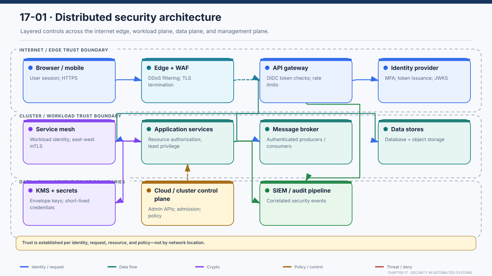
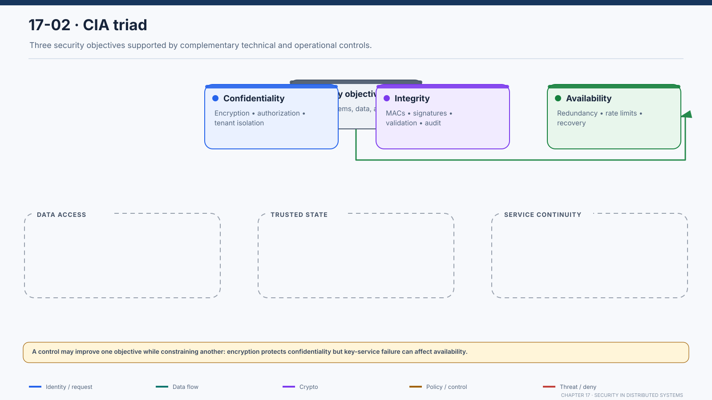
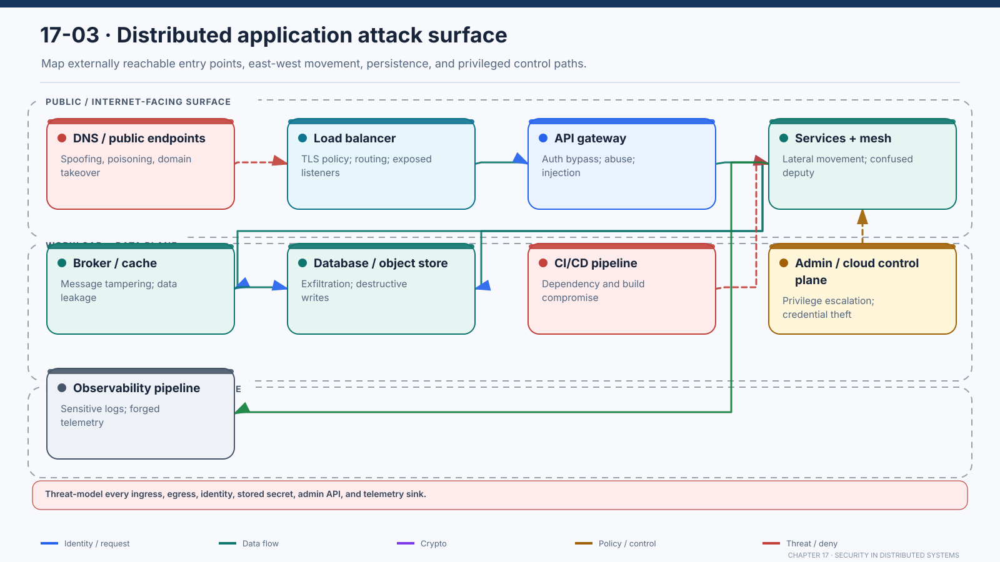

---

# 2. Threat Modeling and Security Fundamentals

## 2.1 A repeatable threat-modeling process

Threat modeling is a structured process for discovering how a system could be attacked, deciding which scenarios matter, and choosing controls before an incident. It is not a one-time compliance worksheet. Revisit the model when a trust boundary, data flow, identity provider, deployment platform, tenant model, or external dependency changes.

A useful workflow is:

1. **Define scope:** system, environment, business process, data classes, and security objectives.
2. **Inventory assets:** credentials, personal data, payment data, source code, signing keys, availability, reputation, and administrative authority.
3. **Map components and data flows:** clients, gateways, services, queues, databases, caches, object stores, control planes, CI/CD, and operators.
4. **Mark trust boundaries:** internet, tenant, region, cloud account, cluster, namespace, workload, and administrative boundary.
5. **Identify actors:** unauthenticated internet users, authenticated customers, malicious tenants, compromised workloads, insiders, suppliers, and nation-state or financially motivated groups where relevant.
6. **Enumerate threats:** use STRIDE, abuse cases, attack trees, and known vulnerability classes.
7. **Estimate risk:** consider likelihood, impact, exploitability, exposure, and existing controls. Record assumptions and uncertainty.
8. **Select mitigations:** assign an owner, test, telemetry, and residual-risk decision.
9. **Validate:** architecture review, security tests, tabletop exercises, and production monitoring.

**Threat, vulnerability, and risk are different.** A threat is a potential cause of harm (for example, a malicious tenant). A vulnerability is a weakness (for example, an endpoint that trusts a client-supplied tenant ID). Risk combines the likelihood of exploitation and the resulting impact in a particular context.

### STRIDE

| Category | Security property threatened | Example in a microservices platform | Typical control |
|---|---|---|---|
| Spoofing | Authentication | Attacker presents a forged service identity | mTLS, signed tokens, workload identity, key protection |
| Tampering | Integrity | Message content is altered in a broker path | TLS, message signatures/MACs, schema and state validation |
| Repudiation | Accountability | Operator denies changing a production policy | Strong operator identity, immutable audit trail, time synchronization |
| Information disclosure | Confidentiality | Search service returns another tenant's record | Tenant-scoped authorization, encryption, data minimization |
| Denial of service | Availability | One tenant floods an expensive report endpoint | Quotas, rate limits, admission control, bulkheads, DDoS defenses |
| Elevation of privilege | Authorization | Read-only worker obtains admin API access | Least privilege, policy checks, sandboxing, short-lived credentials |

STRIDE is a categorization aid, not a complete risk score. One scenario may fit several categories. For example, stealing a service token is spoofing; using it to read tenant data is information disclosure; and changing a role is elevation of privilege.

### Attack trees and abuse cases

An attack tree starts with an attacker goal and decomposes it into alternative or combined paths. Example: **exfiltrate tenant invoices** → obtain customer token OR compromise report worker OR exploit tenant-filter bug; then bypass authorization, query data, and move it to an external endpoint. Abuse cases describe misuse from the attacker's perspective, such as “as a malicious tenant, I submit a valid invoice ID belonging to another tenant.” They make negative requirements testable.

## 2.2 STRIDE applied to a microservices architecture

Assume an e-commerce platform with a web client, API gateway, identity provider, catalog, cart, checkout, payment adapter, order service, Kafka, and PostgreSQL. Threat-model each hop rather than treating “the backend” as one trusted zone:

- **Client → gateway:** stolen session, CSRF, bot abuse, malformed input, token leakage.
- **Gateway → services:** token audience mismatch, confused-deputy behavior, missing service identity, header spoofing.
- **Service → broker:** forged producer, replayed event, topic over-permission, sensitive event payload leakage.
- **Worker → database:** SQL injection, cross-tenant query, excessive database role, credential theft.
- **CI/CD → cluster:** malicious dependency, compromised build runner, unsigned image, leaked deploy token.
- **Operator → control plane:** phishing, excessive cluster-admin access, audit tampering.

For each flow define what is authenticated, what is authorized, which fields are trusted, whether the message may be replayed, how often credentials rotate, and what logs are required to reconstruct an event.

## 2.3 Common threats and mitigations

| Threat | How it works and likely impact | Detection signals | Primary mitigations |
|---|---|---|---|
| Man-in-the-middle | Attacker intercepts or modifies traffic on an untrusted path | Certificate errors, unexpected peer identity, network anomalies | TLS with hostname/chain validation; mTLS for workloads; pinning only where operationally justified |
| Replay | A captured request, token, or message is submitted again | Duplicate IDs, unusual timing, repeated nonce or transaction IDs | Nonces, timestamps with bounded skew, idempotency keys, short token lifetime, sequence numbers |
| Credential theft | Password, API key, private key, or cloud token is exposed | Unusual source, impossible travel, new workload use, secret access anomaly | MFA, phishing-resistant authenticators, short-lived credentials, vaulting, rotation |
| Session hijacking | Attacker takes over a valid browser session | Session used from unusual device/IP, concurrent anomalies | Secure HttpOnly cookies, SameSite, TLS, rotation after privilege change, reauthentication |
| Token theft | Bearer token is copied and replayed | Token reuse, audience/source anomalies | Secure storage, short expiry, sender-constrained tokens (DPoP/mTLS), revocation strategy |
| Privilege escalation | Weak authorization or vulnerable component grants greater rights | Role changes, denied-then-allowed sequences, unusual admin APIs | Least privilege, separation of duties, policy tests, patching |
| DDoS | Traffic exhausts network, CPU, state, or downstream dependencies | Rate/latency spikes, saturation, connection churn | Edge filtering, adaptive limits, caching, queues, autoscaling with caps, upstream DDoS services |
| API abuse | Valid API is automated beyond intended use | High cardinality, expensive query patterns, quota exhaustion | Per-identity and per-tenant quotas, schema validation, abuse detection, cost-aware limits |
| Insider threat | Authorized person misuses legitimate access | Bulk reads, unusual access time, privilege use | JIT access, approvals, immutable logs, dual control, data-loss monitoring |
| Supply-chain attack | Dependency, build system, artifact, or update is compromised | Unexpected dependency changes, provenance mismatch | Pinned dependencies, SBOM, signed artifacts, isolated builds, provenance policy |
| DNS spoofing/poisoning | Name resolution is manipulated to redirect traffic | Resolver inconsistencies, certificate mismatch | DNSSEC where applicable, trusted resolvers, TLS identity checks, egress controls |
| Certificate compromise | Private key is stolen or CA is abused | Unexpected certificate issuance, key use from new host | Short-lived certs, protected keys, issuance audit, rapid revoke/rotate |
| Message tampering | Event payload is modified or forged | Signature/MAC failure, schema/state inconsistency | Authenticated producer, TLS, message integrity, authorization and idempotency |
| Data exfiltration | Authorized or compromised component moves data out | Egress anomalies, large exports, unusual object reads | Egress policy, least privilege, DLP, quotas, encryption, alerting |
| Side channel | Timing, cache, resource, or power behavior leaks information | Statistical timing patterns, co-tenant leakage | Constant-time crypto, isolation, resource controls, avoid secret-dependent branching |
| Compromised service identity | Workload credential grants attacker the service's authority | Token use from unexpected workload, identity activity spike | Workload attestation, scoped roles, rapid revocation, segmentation, rotation |
| Lateral movement | Attacker pivots from one service to reachable peers | New east-west paths, unusual service calls | Microsegmentation, service identity, per-hop authorization, egress restrictions |
| Control-plane compromise | Attacker changes deployments, policies, IAM, or cluster state | New admins, admission policy changes, unexpected workload specs | Strong admin MFA, isolated control plane, approval, immutable audit, break-glass process |

## 2.4 Attack-surface analysis by component

| Component | High-value attack paths | Controls to review |
|---|---|---|
| API gateway | Authentication bypass, parser differential, request smuggling, quota bypass | Strict parsing, TLS, JWT policy, route-level authorization, WAF/rate limits |
| Load balancer | TLS termination weakness, forged forwarding headers, unhealthy failover | Secure listener policy, trusted proxy chain, health-check isolation |
| Application service | Injection, business-logic abuse, IDOR, unsafe deserialization | Input validation, object-level authorization, safe libraries, bounded work |
| Service mesh | Control-plane compromise, permissive peer policy, identity confusion | Strict mTLS mode, policy review, control-plane RBAC, telemetry |
| Message broker | Unauthorized producer/consumer, replay, topic leakage | TLS, SASL/OAuth/mTLS, topic ACLs, quotas, retention and encryption |
| Database | Privilege escalation, injection, tenant leakage, backup theft | Separate roles, parameterized queries, row policies, TLS, encryption, audited backup access |
| Cache | Cache poisoning, cross-tenant key collision, stale authorization | Tenant-scoped keys, authenticated access, TTLs, avoid caching sensitive authorization blindly |
| Object storage | Public bucket, weak presigned URL, metadata leakage | Private-by-default, scoped short-lived URLs, object policy, access logs |
| Secret store | Excessive retrieval, root credential theft, outage | Narrow policies, audit, HA, break-glass, rotation and recovery drills |
| Control plane | Admin token theft, malicious policy/deployment | Strong MFA, just-in-time access, approval, isolated admin network, audit |
| Administrative UI | CSRF, session theft, overbroad role | MFA, reauthentication, CSRF protection, IP/device controls, least privilege |
| Observability pipeline | Secret leakage, log injection, attacker deleting evidence | Redaction, write-only agent identities, immutable archive, integrity controls |

## 2.5 Practical e-commerce threat model

**Assets:** customer PII, password reset capability, payment references, order state, inventory, merchant credentials, signing keys, and availability. **Trust boundaries:** browser/edge, gateway/service mesh, payment-provider boundary, broker, database, cloud control plane, and tenant boundary.

| Scenario | Preconditions | Consequence | Design response |
|---|---|---|---|
| IDOR on `/orders/{id}` | Endpoint checks authentication but not ownership | Cross-customer order disclosure | Authorize `read` against order owner and tenant on every request; test guessed IDs |
| Forged payment callback | Webhook endpoint trusts source IP or JSON fields | Fraudulent order marked paid | Verify provider signature, timestamp, event ID, amount, currency, merchant account; make handler idempotent |
| Stolen checkout token | Bearer access token copied from browser logs | Cart/order access | Short-lived token, secure storage, redaction, risk-based reauthentication, sender constraint where supported |
| Kafka consumer overreach | Worker can read all topics | Customer-data exposure and lateral movement | Topic-level ACLs, distinct producer/consumer principals, payload minimization |
| Compromised CI runner | Deploy credential stored in job variables | Malicious production image | Ephemeral isolated runner, OIDC federation, artifact signatures, protected environments, narrow deploy role |
| Inventory race abuse | Concurrent requests exploit check-then-update | Overselling or inconsistent state | Atomic conditional updates, idempotency, authorization, fraud limits; security and correctness must be designed together |

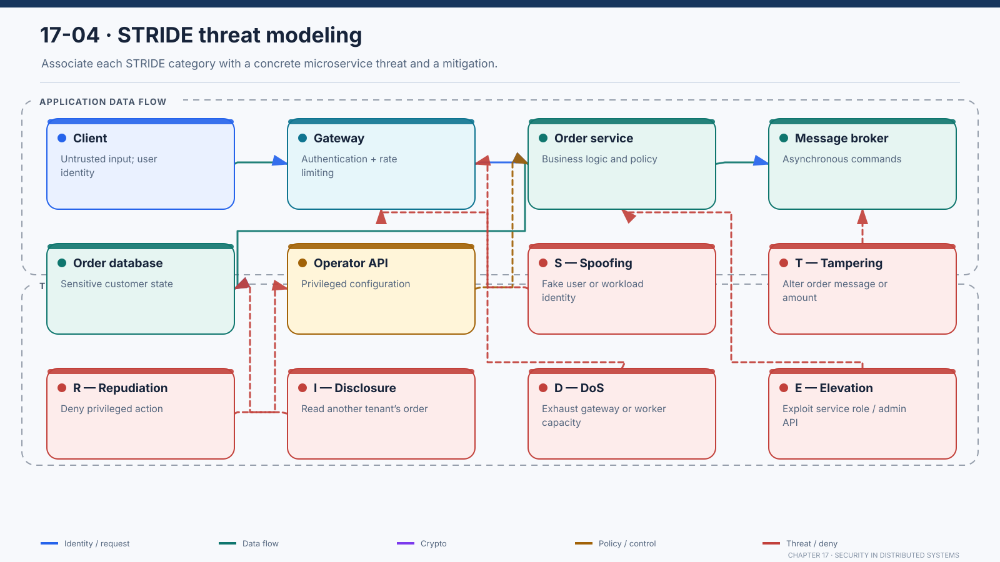

---

# 3. Authentication and Authorization

## 3.1 Identity vocabulary

- **Identification** is the claim “I am principal P.” It may be a username, service name, certificate subject, or workload URI.
- **Authentication** verifies that claim using evidence bound to the principal: password, passkey, certificate private-key proof, token, or a combination.
- **Authorization** decides whether the authenticated principal may perform an action on a resource under a policy and context.
- **Credential/authenticator** is evidence used to authenticate. It should be protected, rotated, and revoked.
- **Session** is server- or client-maintained context representing an authenticated interaction.
- **Identity provider (IdP)** authenticates principals and issues identity or security tokens.
- **Human identity** represents a person. **Workload identity** represents an executing service, job, pod, VM, or application instance.

Authentication does not imply authorization. A valid employee identity should not automatically read payroll data; a valid checkout service identity should not automatically access the cluster control plane.

## 3.2 Authentication factors and lifecycle

Factors are commonly categorized as something you know (password/PIN), have (security key/device), or are (biometric). MFA combines independent factor categories. A passkey or FIDO2 security key can provide phishing-resistant public-key authentication; an SMS OTP is generally weaker because of SIM swap, SS7, and phishing risks. Biometrics typically unlock a local authenticator rather than being sent as a reusable secret to every server.

A production identity lifecycle includes enrollment, proofing, authentication, session issuance, privilege changes, periodic review, suspension, offboarding, and recovery. Deprovisioning must propagate to groups, API tokens, device credentials, service accounts, and delegated grants. “Disable the user in the IdP” is insufficient if long-lived credentials remain valid elsewhere.

## 3.3 Authentication models

| Model | Mechanism | Strengths | Risks/operational cost | Suitable use |
|---|---|---|---|---|
| Password | Shared secret verified by server | Universal and simple to deploy | Phishing, reuse, stuffing, reset burden; needs strong hashing and MFA | Legacy and low-friction human sign-in when paired with modern controls |
| Certificate-based | Prove possession of private key corresponding to trusted certificate | Strong machine identity; supports mTLS | PKI issuance, rotation, revocation, clock and trust-bundle operations | Workloads, devices, enterprise access |
| Token-based | Present signed or opaque bearer/sender-constrained token | Scales across APIs; supports scopes and audience | Theft, replay, validation and revocation design | APIs and delegated access |
| Session-based | Server tracks authenticated session, often via cookie | Immediate server-side invalidation; browser-friendly | Session store availability and CSRF/XSS considerations | Traditional web applications and BFF patterns |
| API key | Static or semi-static random credential | Simple integration and metering | Often broad, long-lived, hard to bind to person/device | Low-risk partner identification or service metering; not a full identity strategy |
| OAuth delegated access | Authorization server issues scoped access token | User can grant limited access without sharing password | Complex protocol and lifecycle | Third-party access to APIs |
| OpenID Connect | OAuth-based identity layer with ID token | Standardized login and SSO | Requires strict issuer, audience, nonce, and signature validation | User authentication federation |
| SAML federation | Signed XML assertions exchanged between IdP and service provider | Mature enterprise federation and SSO | XML signature-wrapping and configuration complexity | Enterprise and legacy SSO |
| Workload identity | Platform-issued identity tied to an attested runtime | Avoids embedded static credentials | Requires trusted node/control plane and lifecycle integration | Kubernetes, cloud workloads, batch jobs |

## 3.4 Authorization models

| Model | Decision basis | Example | Advantages | Limitations |
|---|---|---|---|---|
| RBAC | Role membership | `billing-admin` can refund payments | Easy to explain and administer | Role explosion; context and object ownership may be awkward |
| ABAC | Attributes of subject, resource, action, environment | Allow only finance staff in managed devices to approve refunds below limit | Expressive contextual policies | Attribute quality, policy complexity, evaluation cost |
| ACL | Per-resource list of principals and rights | Document X grants read to user A and edit to group B | Direct and intuitive for small resource sets | Large distributed ACLs are hard to synchronize |
| Policy-Based Access Control | Explicit rules evaluated by policy engine | Deny exports outside approved region | Central policy consistency and audit | Policy engine can become a dependency or bottleneck |
| ReBAC | Relationships between principals and objects | User can edit a project if member of its team | Natural for sharing and graph permissions | Relationship data consistency and evaluation complexity |
| Capability-based | Unforgeable reference/token conveys authority | Short-lived signed upload URL scoped to one object | Delegation without repeated identity lookup | Leakage transfers authority; revocation and attenuation require care |

### Policy architecture

- **Policy Enforcement Point (PEP):** intercepts a request and enforces the result. It may be a gateway, sidecar, service middleware, or database policy.
- **Policy Decision Point (PDP):** evaluates a request and returns permit/deny plus obligations.
- **Policy Administration Point (PAP):** authors, versions, approves, and distributes policies.
- **Policy Information Point (PIP):** supplies attributes such as tenant, device posture, ownership, risk, and resource classification.

A typical request is `principal + action + resource + context → PEP → PDP (+ PIP) → decision → PEP enforcement`. Keep the decision auditable and include a policy version. Resource services must still enforce object-level constraints; a gateway decision alone cannot prevent a confused-deputy bug.

### Centralized vs decentralized enforcement

Central policy authoring improves consistency; local enforcement reduces latency and avoids a network call on every request. A common design distributes signed, versioned policy bundles to local PEPs and uses remote decisions for especially dynamic or high-risk cases. Define cache TTLs, revocation propagation objectives, and fail-open/fail-closed behavior explicitly.

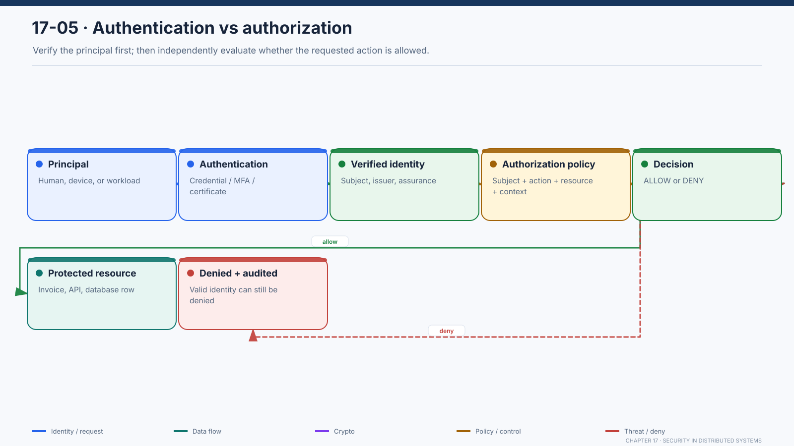
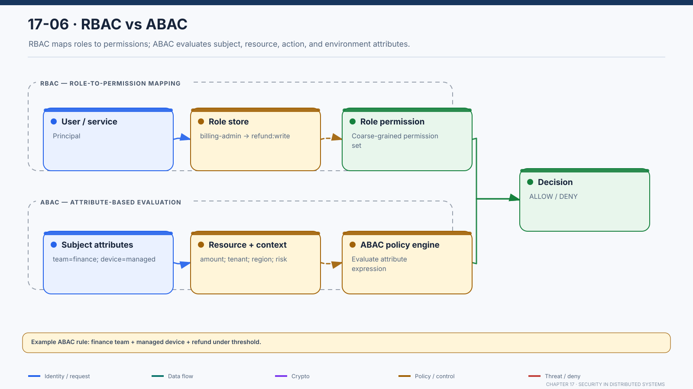

---

# 4. OAuth 2.0 and OpenID Connect

## 4.1 What OAuth solves

OAuth 2.0 is an authorization framework that lets a client obtain limited access to an HTTP resource without receiving the resource owner's password. It separates the client, authorization server, resource owner, and resource server. OAuth access tokens represent delegated authorization; OAuth by itself is not an end-user authentication protocol. OpenID Connect (OIDC) adds an identity layer for authentication and standardized ID tokens.

### Roles and artifacts

| Element | Responsibility |
|---|---|
| Resource owner | Entity able to authorize access, commonly an end user |
| Client | Application requesting access on behalf of a user or itself |
| Authorization server | Authenticates/obtains consent and issues tokens |
| Resource server | Hosts protected API resources and validates access tokens |
| Authorization code | Short-lived, one-time credential exchanged at token endpoint |
| Access token | Credential presented to API; limited by scope, audience, and lifetime |
| Refresh token | Credential used to obtain new access tokens; must be protected and lifecycle-managed |
| Scope | Delegated permission vocabulary such as `orders.read` |
| Redirect URI | Pre-registered client callback endpoint |
| PKCE verifier/challenge | Proof that the client redeeming a code is the client that initiated the request |

## 4.2 Authorization Code with PKCE — recommended interactive pattern

1. Client creates a cryptographically random `code_verifier` and derives `code_challenge = BASE64URL(SHA256(verifier))` using `S256`.
2. Client redirects the browser to the authorization endpoint with `response_type=code`, exact registered `redirect_uri`, requested scopes, `state`, and the challenge.
3. Authorization server authenticates the user, evaluates consent and policy, and redirects back with a short-lived authorization code and the original state.
4. Client validates state and sends the code, redirect URI, client identification, and original verifier to the token endpoint.
5. Authorization server verifies the code, redirect URI, expiry, one-time use, and PKCE verifier, then issues an access token and, when appropriate, a refresh token.
6. Client calls the resource server with the access token. Resource server validates issuer, audience, signature/introspection result, time claims, scopes, and resource policy.

```text
Client             Browser              Authorization Server       API
  | create verifier   |                           |                    |
  |-- redirect + challenge ---------------------->|                    |
  |                    |-- authenticate/consent ->|                    |
  |<-- callback + code + state -------------------|                    |
  |-- code + verifier ---------------------------->|                    |
  |<-- access token (+ refresh token) -------------|                    |
  |---------------------------------------------------- Bearer token -->|
  |<--------------------------------------------------- API response ---|
```

**Trust boundaries:** the browser may be observable or compromised; redirect endpoints must be exact-match registered; the code should not be usable by an interceptor without the verifier; the resource server must not assume that a token issued for another API is valid for it.

**Implementation mistakes:** wildcard redirect URIs, missing state/CSRF binding, weak or reused verifier, logging codes/tokens, accepting an untrusted issuer, treating an ID token as an API access token, failing to validate audience, and returning refresh tokens to insecure browser storage.

RFC 9700 (January 2025) is the current OAuth 2.0 Security Best Current Practice. It recommends PKCE for authorization-code flows, exact redirect URI matching, and avoiding the implicit grant and resource-owner password credentials grant in modern deployments. Public clients must use PKCE; confidential clients are also strongly advised to use it. [RFC 9700](https://www.rfc-editor.org/rfc/rfc9700.html).

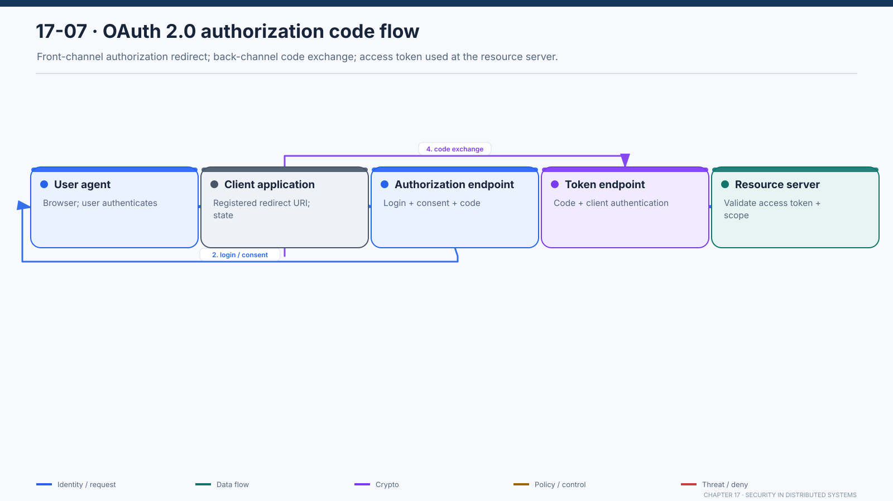
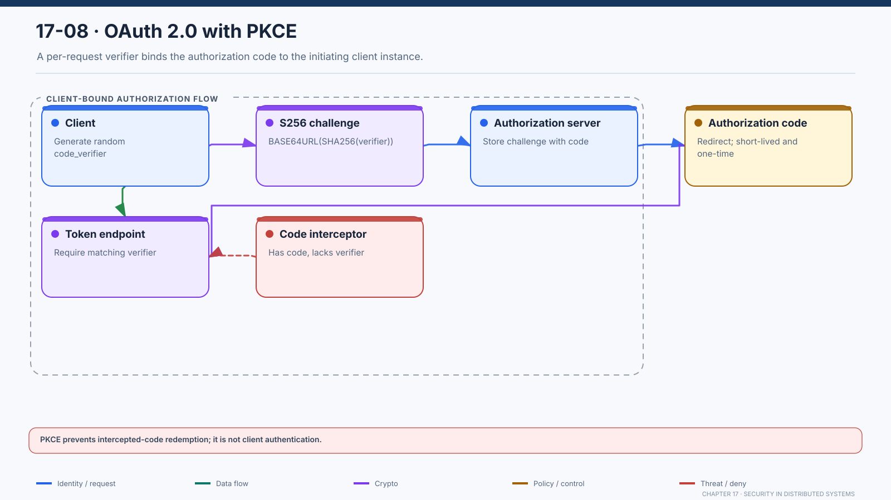

## 4.3 Other modern OAuth flows

### Client Credentials

Used when a confidential workload accesses an API as itself, not on behalf of a user. The client authenticates to the token endpoint (for example, using private-key JWT, mutual TLS, or a securely managed client secret), requests a narrow scope, and receives an access token. The resource server authorizes the client identity and scope. Do not use a shared client credential across unrelated services; use distinct workload identities and rotate them.

```text
Worker -- client authentication + scope --> Authorization Server
Worker <-- short-lived access token -------- Authorization Server
Worker -- token + request -----------------> Resource Server
Worker <-- policy-authorized response ----- Resource Server
```

### Device Authorization Grant

For input-constrained devices such as TVs, the device obtains a device code and user code, displays a verification URI, and polls the token endpoint while the user completes authentication on a separate capable device. Enforce user-code entropy, polling interval, expiry, and rate limits; do not allow device codes to be guessed or polled aggressively.

### Refresh Token Flow

The client presents a valid refresh token to obtain a new access token. Refresh tokens are higher-value, longer-lived credentials: rotate them on use where supported, detect reuse, bind them to client and grant, protect them at rest, and revoke the token family after suspicious reuse. Refresh-token rotation does not eliminate the need for secure storage.

### Legacy grants

- **Implicit grant:** exposes access tokens in the authorization response and browser URL-related surfaces; avoid for new systems. Use authorization code with PKCE.
- **Resource Owner Password Credentials:** makes the client handle the user's password and cannot support many modern authentication interactions safely; RFC 9700 says it must not be used. Migrate to browser-mediated authorization code with PKCE or another suitable modern flow.

## 4.4 OIDC identity layer

OIDC adds authentication semantics on top of OAuth. The **ID token** is intended for the client and describes an authentication event; it is not automatically an API authorization credential. It commonly contains `iss`, `sub`, `aud`, `exp`, `iat`, and `nonce`, plus optional identity and authentication-context claims. The client validates signature, issuer, audience, time bounds, nonce, and relevant claims.

- **UserInfo endpoint:** returns claims about the authenticated end user when called with a valid access token.
- **Discovery:** metadata document advertises issuer endpoints, supported algorithms, and capabilities.
- **JWKS:** JSON Web Key Set publishes public keys used to validate signed tokens. Cache sensibly and refresh on unknown `kid` without trusting arbitrary token-provided URLs.
- **Nonce:** binds the ID token to the authentication request and reduces replay/injection risk.
- **Authentication context:** claims such as `auth_time` or `acr` can communicate how and when authentication occurred, subject to provider semantics.
- **SSO:** a shared identity provider session can let users authenticate to multiple clients, while each client still validates its own tokens and applies its own authorization policy.

## 4.5 Production identity architecture

A common SaaS pattern uses a trusted IdP (for example, Keycloak, Auth0, Okta, Microsoft Entra ID, or Amazon Cognito), a browser/backend-for-frontend or native client, an API gateway, and services. The IdP authenticates the user and issues tokens. The gateway validates the access token's signature/issuer/audience and basic scope; the target service performs resource- and tenant-level authorization. Internal service calls use workload identity and often mTLS; user delegation is propagated deliberately rather than blindly forwarding a broad user token to every backend.

**Architecture decisions:** choose token audience boundaries per API; decide where user context is propagated; map external groups to internal roles conservatively; define tenant claim provenance; make logout/revocation behavior explicit; monitor IdP dependency and key rotation; avoid making the IdP a synchronous dependency for every API request if locally validated short-lived tokens meet the risk model.

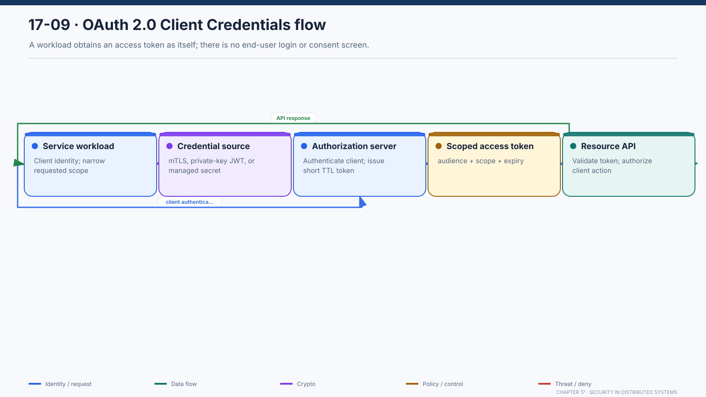
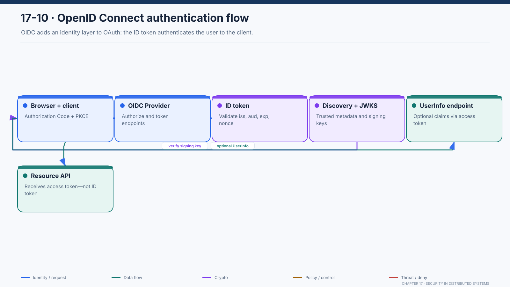

---

# 5. JSON Web Tokens

## 5.1 Structure and semantics

A compact signed JWT commonly has three Base64url-encoded parts:

```text
BASE64URL(header) . BASE64URL(payload) . BASE64URL(signature)
```

Example (illustrative only):

```json
// Header
{"alg":"EdDSA","typ":"JWT","kid":"signing-key-2026-04"}
// Payload
{"iss":"https://id.example","sub":"user-482","aud":"orders-api",
 "scope":"orders.read","iat":1793923200,"exp":1793923500}
```

The header identifies protected-header parameters such as algorithm, type, and key ID. The payload contains claims. The signature authenticates the header and payload under the selected algorithm and key. Base64url encoding is not encryption: anyone holding a normal signed JWT can decode its claims.

### JWS, JWE, JWK, and JWKS

- **JWS (JSON Web Signature):** integrity protection and origin authentication using a signature or MAC.
- **JWE (JSON Web Encryption):** confidentiality and integrity protection for encrypted content.
- **JWK (JSON Web Key):** JSON representation of a cryptographic key.
- **JWKS:** set of JWKs, commonly published by an issuer for signature verification.
- **Symmetric signing (for example HS256):** issuer and every verifier share the same secret. Any verifier that can mint tokens can impersonate the issuer.
- **Asymmetric signing (for example EdDSA or ES256):** issuer holds private signing key; verifiers hold public key. This reduces key-distribution risk for many resource servers.

### Registered claims

| Claim | Purpose | Validation concern |
|---|---|---|
| `iss` | Issuer | Exact expected trusted issuer |
| `sub` | Subject | Stable subject identifier in the correct issuer namespace |
| `aud` | Intended recipient(s) | Must include this API/client as appropriate |
| `exp` | Expiration time | Reject after expiry, allowing only justified clock skew |
| `nbf` | Not-before time | Reject before this time |
| `iat` | Issued-at time | Useful for age and token policy; not a replacement for `exp` |
| `jti` | Token identifier | Can support replay/revocation tracking when backed by state |

Public claims must use collision-resistant names or agreed registries; private claims are application-specific. Do not put passwords, private data, secrets, or unnecessary PII in claims.

## 5.2 JWT validation lifecycle

1. Extract the token from the expected location (normally the `Authorization: Bearer` header, not query string).
2. Enforce size, syntax, and expected token type.
3. Select the algorithm from a local allow-list; never let an untrusted header choose arbitrary algorithms or key sources.
4. Resolve `kid` only against a trusted issuer's configured JWKS or key registry.
5. Verify signature/MAC over the exact protected representation.
6. Validate exact issuer and required audience.
7. Validate `exp`, `nbf`, and reasonable `iat` policy with bounded clock skew.
8. Validate required claims, token type, scope, tenant context, and authentication context as appropriate.
9. Apply resource-level authorization and reject unexpected token usage.
10. Record a privacy-conscious audit event without logging the raw token.

## 5.3 Security risks and controls

| Risk | Failure mode | Mitigation |
|---|---|---|
| Algorithm confusion | Verifier accepts wrong algorithm/key interpretation | Fixed algorithm allow-list per issuer and token type; robust library |
| `none` acceptance | Unsigned token treated as trusted | Reject unsigned tokens unless a very specific, separately protected design requires them |
| Weak HMAC key | Offline guessing or forged tokens | High-entropy managed key; asymmetric signature where many verifiers exist |
| Token theft/replay | Bearer token used by attacker | TLS, secure storage, short lifetime, sender constraint, anomaly detection |
| Excessive lifetime | Revocation is delayed until expiry | Short access-token lifetime and controlled refresh rotation |
| Missing audience | Token for API A accepted by API B | Validate `aud` and use distinct resource audiences |
| Missing issuer | Attacker-controlled issuer/token accepted | Exact `iss` allow-list and trusted metadata/key source |
| Sensitive claims | PII exposed to every token recipient/log | Minimize claims; use opaque reference or encrypted JWE only when needed |
| Key rotation failure | New tokens rejected or old compromised key accepted | Overlap publication, `kid`, cache refresh, retirement and emergency procedures |
| Refresh-token compromise | Persistent session takeover | Rotation, reuse detection, secure storage, family revocation |

RFC 8725 is the JWT Best Current Practices document and emphasizes algorithm verification, explicit typing, issuer/key binding, and mutually exclusive validation rules for different token kinds. [RFC 8725](https://www.rfc-editor.org/rfc/rfc8725.html).

## 5.4 Revocation and lifecycle patterns

- **Short-lived access token:** lowers exposure window but increases refresh/issuance traffic.
- **Refresh token rotation:** issue a new refresh token per use; detect reuse of an already-rotated token and revoke the grant/session family.
- **Denylist/blacklist:** store revoked `jti` or token hash until expiry; useful for urgent revocation but adds shared state and lookup cost.
- **Introspection:** resource server asks authorization server whether an opaque or reference token is active; centralizes state but creates latency and availability dependency.
- **Key rotation:** publish new public key before signing with it, retain old public key until issued tokens expire, then retire. Emergency compromise requires faster invalidation and may invalidate active sessions.
- **Sender-constrained token:** bind token use to proof of possession, for example mTLS or DPoP, to reduce usefulness of a stolen bearer token.

## 5.5 JWT vs opaque token

| Dimension | JWT | Opaque/reference token |
|---|---|---|
| Validation | Local signature and claims validation | Introspection or trusted cache lookup |
| Latency | Low after key cache warm-up | Remote lookup unless cached |
| Revocation | Harder without extra state or short expiry | Easier to centralize |
| Scale | Good for high-volume local verification | Introspection service must scale and be highly available |
| Privacy | Claims are visible to holder unless encrypted | No claims disclosure to client |
| Policy freshness | Claims can become stale until expiry | Central state can reflect current status |
| Operational complexity | Key lifecycle, claim design, cache refresh | Introspection availability, cache policy, token DB |

Use JWT when distributed services need interoperable, locally verifiable claims and bounded staleness is acceptable. Use opaque tokens when privacy or immediate centralized control is more important. Hybrid systems are common: gateway introspects or validates once and services receive constrained internal identity context, protected against spoofing.

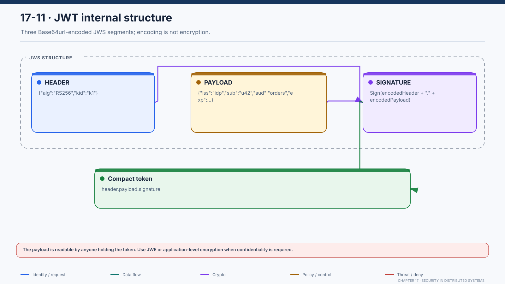
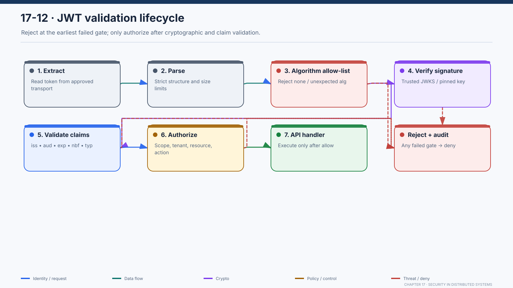
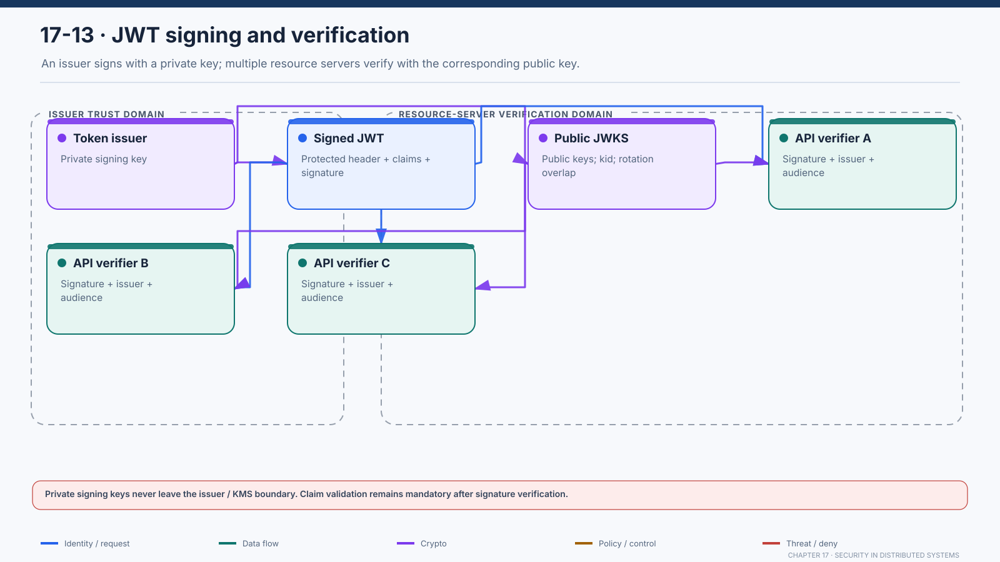
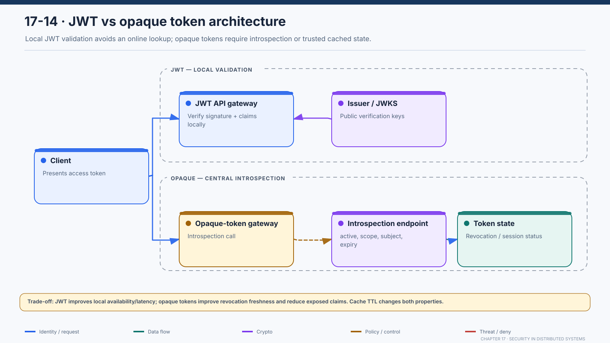

---

# 6. Mutual TLS and Service-to-Service Security

## 6.1 TLS fundamentals

Transport Layer Security (TLS) establishes an authenticated and cryptographically protected channel over a reliable transport. In a typical server-authenticated connection, the client validates the server certificate chain and hostname, negotiates cryptographic parameters, and derives symmetric traffic keys. TLS protects application data against passive observation and in-transit modification; it does not decide whether a user may access a business object.

A simplified TLS 1.3 handshake:

1. Client sends `ClientHello` with supported versions, cipher suites, key share, and extensions such as SNI/ALPN.
2. Server responds with `ServerHello` and key share; both sides derive handshake secrets.
3. Server sends encrypted handshake messages including certificate, certificate verify, and finished message.
4. Client validates certificate chain, validity, name, purpose, and proof of private-key possession; sends its finished message.
5. Both sides derive application traffic keys and exchange protected records.

TLS 1.3 reduces handshake round trips and removes obsolete cryptographic options compared with older TLS versions. It does not make certificate verification optional. Session resumption and 0-RTT have replay and policy implications: do not use early data for non-idempotent operations unless the application has replay protection. RFC 9846 is the current TLS 1.3 specification and obsoletes RFC 8446; deployments should follow the current RFC and their platform's tested TLS profile. [RFC 9846](https://www.rfc-editor.org/rfc/rfc9846.html).

## 6.2 PKI and certificate lifecycle

A Public Key Infrastructure (PKI) binds public keys to identities through certificates signed by trusted Certificate Authorities (CAs). A verifier builds and validates a chain from leaf certificate to a trusted root, checks name/identity, validity period, key usage, extended key usage, constraints, and revocation status according to policy.

Operational controls include secure CA key custody, limited issuing intermediates, short-lived leaf certificates, automated renewal, trust-bundle distribution, clock synchronization, issuance audit, and tested emergency rotation. Revocation may use CRLs or OCSP depending on environment; short certificate lifetimes and automated replacement often reduce reliance on real-time revocation checks, but do not eliminate incident procedures.

## 6.3 Mutual TLS (mTLS)

In mTLS, both peers authenticate with certificates. The client validates the server; the server validates the client. The certificate identity becomes an input to authorization (for example, `spiffe://prod.example/ns/payments/sa/settlement`). mTLS can encrypt internal traffic and prevent an unauthenticated workload from impersonating another service, but it does not by itself constrain what an authenticated service may do.

A service-to-service flow:

1. Workload A obtains a short-lived certificate from a trusted workload identity system after runtime/node attestation.
2. Workload A opens TLS to workload B and presents its client certificate.
3. B validates the certificate chain, lifetime, intended identity, and trust domain.
4. A validates B's server identity.
5. Both derive traffic keys and establish the channel.
6. B's PEP maps A's verified identity to a policy and authorizes the requested method/resource.
7. Logs record caller identity, target, decision, and correlation ID without exposing private keys or tokens.

**Service meshes** such as Istio and Linkerd can automate identity issuance, certificate rotation, traffic encryption, and policy enforcement through data-plane proxies. The control plane distributes identity material and policy; it therefore becomes a high-value asset and must be hardened. SPIFFE defines a standard workload identity format and SPIRE is an implementation that attests workloads and issues SPIFFE identities/SVIDs.

### mTLS vs JWT vs API keys

| Dimension | mTLS | JWT | API key |
|---|---|---|---|
| Identity established | Possession of private key tied to certificate/workload | Claims signed by issuer; bearer unless sender-constrained | Possession of static secret |
| Main boundary | Transport connection | Application/API request | Application/API request |
| Authorization | Requires policy mapping from cert identity | Scopes/claims plus resource policy | Usually coarse mapping or metering |
| Theft risk | Private key theft; connection/identity impersonation | Token copy/replay if bearer | Copy/replay, often long-lived |
| Rotation | PKI/certificate automation | Signing keys and token expiry | Secret distribution and replacement |
| Performance | Handshake cost; reuse amortizes it | Local signature validation or introspection | Usually fast lookup/compare |
| Best fit | Workload/channel authentication | Delegated user/service authorization | Narrow integrations and client identification |

mTLS and JWT are complementary. mTLS authenticates the channel peer; JWT can carry delegated user context, audience, and scopes at the application layer. A strong design can require both and authorize the combination.

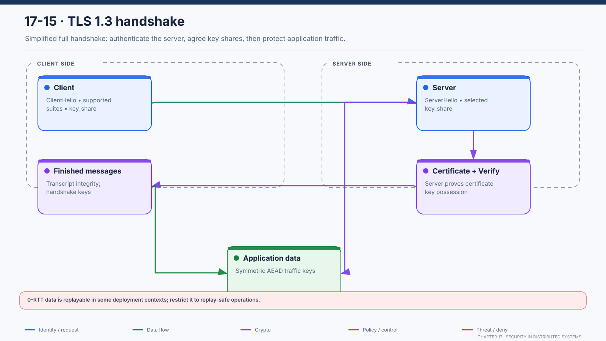
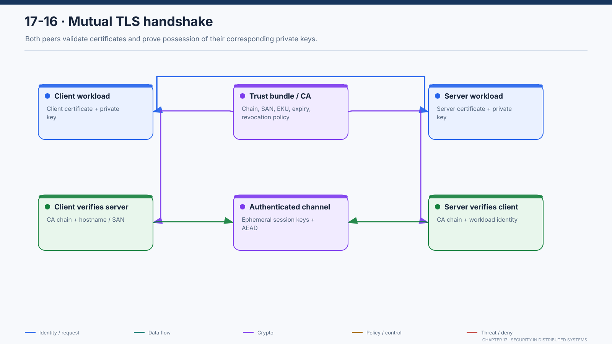
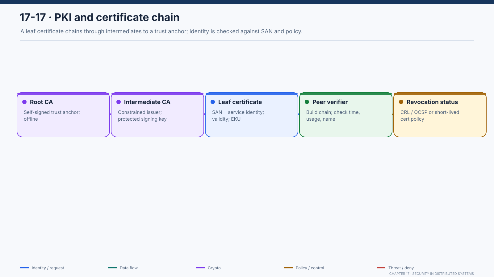
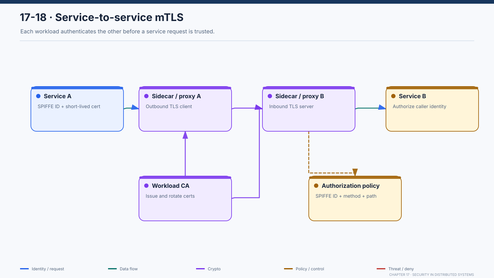

---

# 7. Zero Trust Architecture

## 7.1 Principle and components

Zero Trust (ZT) rejects implicit trust based solely on network location, device ownership, or the fact that a request originated “inside” a corporate network. The system evaluates each access request using subject identity, device/workload posture, resource sensitivity, requested action, and relevant context. Zero trust is a design approach and operating model, not a product or a claim that every packet must trigger a human login.

NIST SP 800-207 describes a logical architecture with a **Policy Engine (PE)**, **Policy Administrator (PA)**, and **Policy Enforcement Point (PEP)**. The PE decides whether access should be granted, continued, or terminated; the PA establishes or tears down the communication path; the PEP mediates access to the protected resource. Identity services, device posture systems, threat intelligence, and security analytics can provide decision inputs. [NIST SP 800-207](https://csrc.nist.gov/pubs/sp/800/207/final).

### Access decision lifecycle

1. Subject requests a specific resource/action.
2. PEP intercepts and gathers identity and context.
3. PE evaluates policy with available information (user, workload, device posture, resource classification, risk, location, time, and recent behavior).
4. PA configures an allowed session or connection through PEP.
5. PEP enforces least privilege and logs the decision.
6. Continuous signals can cause re-evaluation, scope reduction, or termination.

## 7.2 Zero trust in microservices

A practical microservices design combines:

- Unique workload identity for each service instance or workload class.
- mTLS for authenticated, encrypted east-west communication.
- Strict JWT validation for delegated user/API context.
- Authorization at both gateway and target service, including object- and tenant-level checks.
- Network policies and microsegmentation to restrict reachability.
- Short-lived credentials and automated rotation.
- Control-plane RBAC and signed policy distribution.
- Security telemetry, alerting, and tested containment.

### End-to-end request flow

A browser authenticates through OIDC and receives an access token for `orders-api`. The gateway validates issuer, audience, expiry, and scope. The gateway calls `orders-service` over mTLS using its own workload identity and forwards only the minimum user/tenant context required, with cryptographic or trusted-channel protection. `orders-service` validates the delegated context and checks that the subject may read the requested order in the identified tenant. The database connection uses a narrow service role and row/tenant policies as defense in depth. Every hop records a common trace/correlation ID and a decision reason.

## 7.3 Service mesh, SPIFFE, and SPIRE

A service mesh separates application business logic from traffic-management and security plumbing. Data-plane proxies enforce mTLS and policy; a control plane distributes certificates and configuration. Istio commonly uses Envoy proxies; Linkerd provides its own lightweight data plane. Envoy is also usable independently as a proxy.

SPIFFE specifies a portable identity framework. A SPIFFE ID is a URI-like identifier, and an SVID (SPIFFE Verifiable Identity Document) is a cryptographically verifiable identity document, commonly an X.509 certificate or JWT. SPIRE performs node/workload attestation and issues SVIDs. A workload proves properties of its runtime to a trusted agent; the agent obtains short-lived identity credentials; peers verify the identity against a trust bundle. This removes the need to bake static passwords into images, but it depends on secure node attestation, registration policy, agent isolation, and CA protection.

| Traditional perimeter approach | Identity-centric zero trust |
|---|---|
| Trust follows network segment or VPN | Trust is evaluated per identity/resource/action |
| Broad internal reachability is common | Microsegmentation and explicit policy restrict paths |
| VPN often becomes the main gate | Device, user, and workload posture are explicit decision inputs |
| Internal traffic may remain unencrypted | Encrypt and authenticate east-west traffic |
| Static network rules dominate | Identity, attributes, policy, and telemetry shape access |

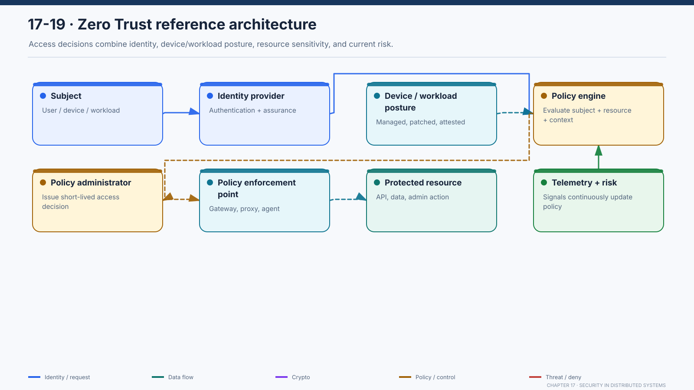
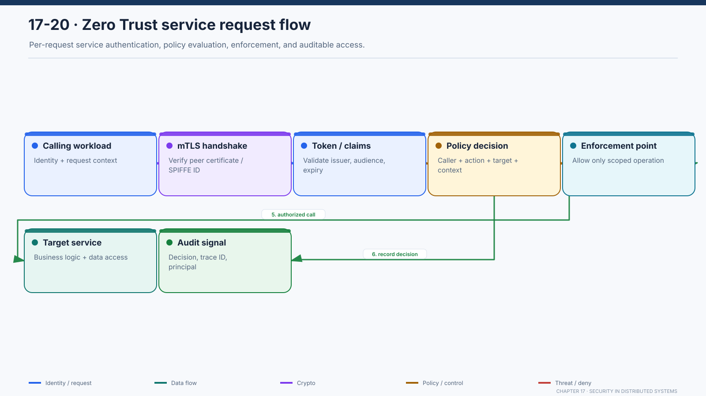
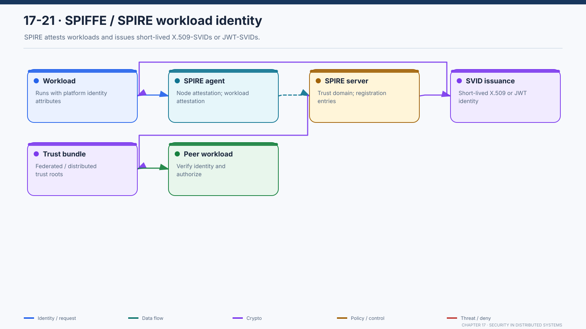
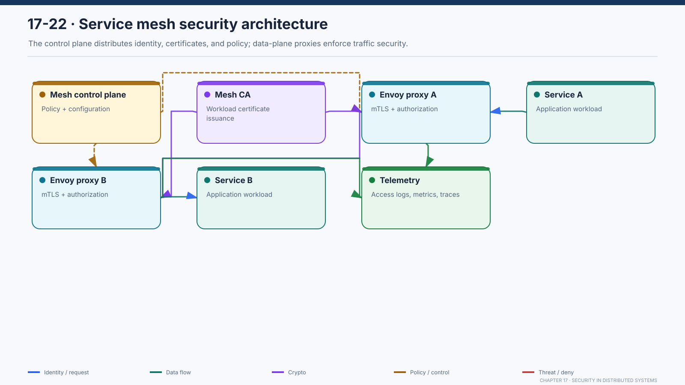

---
# 8. Secrets Management

## 8.1 Secrets as high-value assets

A secret is information whose disclosure or unauthorized use enables access or cryptographic authority. Examples include passwords, API keys, database credentials, signing keys, encryption keys, TLS private keys, cloud credentials, service-account tokens, bootstrap credentials, and recovery codes. Treat secrets differently from ordinary configuration: classify them, restrict who can retrieve them, encrypt them, rotate them, audit their use, and define an emergency revocation path.

A secure secrets-management lifecycle is **create → store → authorize → distribute → use → rotate → revoke → destroy**. Every transition needs an owner and an audit trail. A secret copied into a container image, source repository, shell history, crash dump, telemetry event, or CI log is no longer controlled by the original secret store.

## 8.2 Principles and system choices

- Centralize policy and audit where it improves governance, but avoid a single unprotected root credential or single-region availability dependency.
- Prefer dynamic, short-lived credentials over static credentials where the target system supports leases and revocation.
- Scope each secret to one workload, environment, tenant, or operation; do not reuse a production password across services.
- Separate secret retrieval authority from secret administration authority.
- Use versioned references and controlled rollout for rotation; do not overwrite a secret without knowing which workloads still depend on the old version.
- Redact values from logs, traces, metrics, crash reports, and support bundles.
- Maintain break-glass access with dual control, alerting, limited duration, and a post-use review.

| System | Typical role | Strengths | Design cautions |
|---|---|---|---|
| HashiCorp Vault | Central secret broker, dynamic credentials, PKI, encryption service | Rich lease and policy model, multi-backend integrations | HA/storage/seal/unseal operations; root token must be protected |
| AWS Secrets Manager | Managed secret storage and rotation workflows | Managed service, IAM integration, versioning | API cost/latency, regional replication semantics, IAM policy design |
| AWS Systems Manager Parameter Store | Configuration and parameter storage, including secure strings | Simple integration and parameter hierarchy | Feature tier limits; not every parameter is a dynamic secret lease |
| Azure Key Vault | Secrets, keys, certificates | Cloud IAM and managed HSM options | Throttling, network/identity setup, soft-delete and purge controls |
| Google Secret Manager | Versioned secret storage and access policies | Cloud IAM, audit integration, version lifecycle | Regional design, access scope, rotation orchestration |
| Kubernetes Secret | API object for distributing small secret values to pods | Native workload integration | Base64 is encoding, not encryption; etcd encryption/RBAC/audit and external lifecycle still required |
| External Secrets Operator | Synchronizes external secret providers into Kubernetes objects | Reuses external vault policy and Kubernetes consumption patterns | Synced values still exist in cluster; controller and namespace permissions matter |

Kubernetes Secret objects alone are not a complete secret-management system. They do not inherently provide dynamic database credential leasing, robust external approval workflows, comprehensive rotation orchestration, or protection from every cluster administrator. Configure encryption at rest for etcd, narrow RBAC, protect backups, restrict pod access, and consider external secret stores or CSI integrations.

## 8.3 Dynamic secrets and credential leases

Static credential: an administrator creates `app_user/password`, places it in a vault, and many deployments reuse it until manual rotation. Dynamic credential: a workload authenticates to a secrets manager, requests a database role, receives a unique username/password with a lease TTL, and the manager revokes or expires it when the lease ends.

Example:

```text
orders-service -> authenticate as workload identity
orders-service -> request database/read role, TTL=20m
Vault          -> create temporary DB principal and random password
Vault          -> return credential + lease ID + expiry
orders-service -> connect using TLS; renew lease only while needed
Vault          -> revoke DB principal on expiry/revocation
```

The service must handle lease renewal failures and database connection pooling carefully. Do not assume a credential's expiration automatically terminates already-established database sessions. The secrets manager's database plugin, database permissions, and session behavior must be tested.

## 8.4 Distribution patterns and failure scenarios

| Pattern | Benefits | Risks/operational notes |
|---|---|---|
| Startup retrieval | Secret fetched once when app starts | Rotation may require restart; startup is coupled to store availability |
| Sidecar/agent injection | Refresh and file materialization outside app logic | Sidecar is privileged; file permissions and reload behavior matter |
| Environment variable | Simple compatibility | May leak through process inspection, dumps, diagnostics, or child processes; generally poor for frequently rotated secrets |
| Mounted file | Supports atomic replacement and file permissions | Application must reopen/reload safely; old file descriptors may persist |
| CSI driver | Standard volume integration with external providers | Node plugin, provider permissions, mount refresh, and failure semantics need validation |

**Secret manager unavailable at startup:** fail startup for workloads that cannot function securely without the secret, but avoid endless crash loops; use bounded retries, backoff, readiness gating, and a clear alert. **Unavailable during rotation:** continue only with an unexpired valid credential and within an explicit safety window; never silently fall back to an embedded default. **Leaked credential:** revoke/rotate, identify all consumers, invalidate sessions where possible, search logs and repositories, and reduce blast radius with per-service identities. **Rotation race:** deploy consumers that accept both old and new versions during a bounded overlap; switch issuer, verify successful connections, then revoke old material.

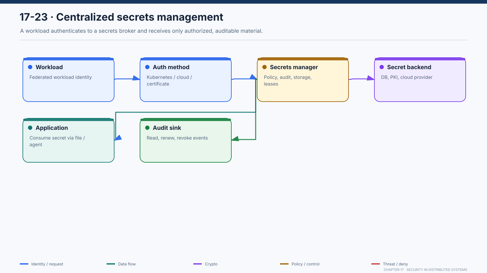
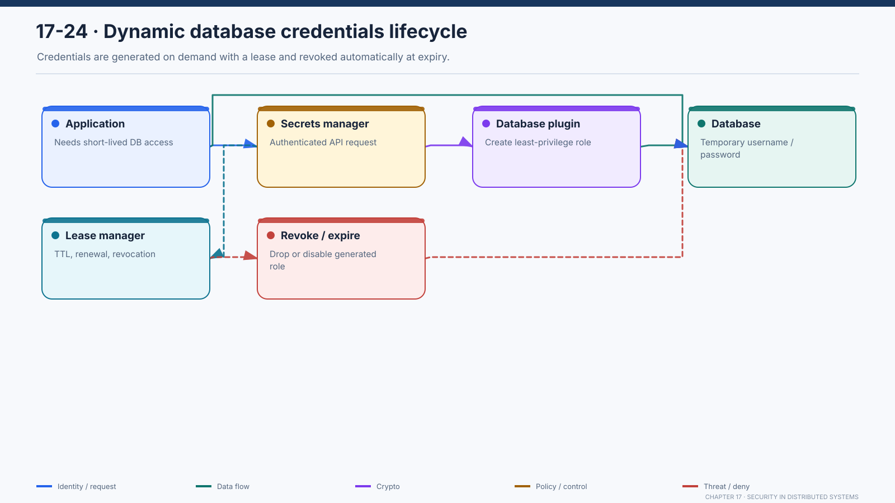
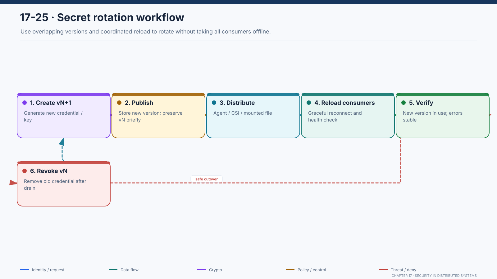

---

# 9. Encryption in Distributed Systems

## 9.1 Cryptographic foundations

- **Plaintext/ciphertext:** readable input and its encrypted representation.
- **Symmetric encryption:** same secret key encrypts and decrypts; fast for bulk data, but key distribution is difficult. AES-GCM and ChaCha20-Poly1305 are authenticated-encryption-with-associated-data (AEAD) constructions.
- **Asymmetric cryptography:** public/private key pair supports signatures or key agreement. It helps establish identities and exchange keys but is generally not used to encrypt large data directly.
- **Hash function:** maps data to a fixed-size digest; cryptographic hashes such as SHA-256 aim to resist preimage, second-preimage, and collision attacks.
- **MAC/HMAC:** keyed integrity/authenticity check. HMAC-SHA-256 uses a secret key and hash function.
- **Digital signature:** private key signs; public key verifies. Signatures support integrity and key-based attribution, not confidentiality.
- **Key exchange:** peers derive shared secret material, for example using X25519, then derive symmetric traffic keys.
- **Nonce:** value intended for one-time use within a defined key/algorithm context. Reusing a nonce in an AEAD mode such as GCM can catastrophically undermine security.
- **Salt:** unique random value used with password hashing or key derivation to prevent precomputed attacks and separate identical inputs.
- **KDF:** derives cryptographic keys from input key material; HKDF is commonly used to derive context-specific keys from strong input key material.
- **Entropy/randomness:** unpredictability needed for keys, nonces, and tokens. Use a cryptographically secure random generator, not timestamps or ordinary pseudorandom functions.

### Important algorithms and where they fit

| Primitive | Typical use | Strengths | Common misuse / caveat |
|---|---|---|---|
| AES-GCM | Fast authenticated encryption | Widely accelerated; confidentiality and integrity | Never reuse nonce with same key; validate tags; track usage limits |
| ChaCha20-Poly1305 | AEAD, especially where AES acceleration is unavailable | Efficient in software; standardized AEAD | Nonce uniqueness remains essential |
| RSA | Legacy-compatible signatures/key transport | Mature ecosystem | Prefer modern padding schemes (e.g., PSS for signatures); large keys and slower operations |
| ECC | Compact key agreement/signatures | Smaller keys and efficient operations | Use vetted curves/protocols and libraries; parameter and validation errors are dangerous |
| ECDSA | Digital signatures | Broad interoperability | Signature nonce failure can reveal private key; use robust implementation and deterministic nonce strategy where specified |
| Ed25519 | Digital signatures | Fast, compact, deterministic signature scheme | Check protocol/library support and key custody requirements |
| SHA-256 | Hashing, content identifiers, integrity digests | Widely supported | Hash alone is not authentication; use MAC or signature against active attackers |
| HMAC-SHA-256 | Message authentication | Simple, robust shared-key MAC | Every verifier with secret can also forge; protect key and compare safely |
| HKDF | Key derivation | Separates keys and contexts | Not a password hashing function; input key material must have sufficient entropy |
| X25519 | Diffie-Hellman key agreement | Efficient modern key agreement | Must be combined with authentication and transcript binding; shared secret alone is not identity |

Password storage is a special case: use an adaptive password-hashing scheme such as Argon2id, scrypt, or bcrypt with a unique salt and appropriate work factor; do not store passwords with a fast hash such as plain SHA-256.

## 9.2 Encryption in transit

Use TLS for external HTTPS and internal service traffic, including database connections, message brokers, administrative APIs, and regional replication links. Validate certificate identity and chain; disable obsolete protocol versions and weak cipher suites; manage CA roots and trust bundles; rotate keys; and monitor expiration. A private VPC or internal subnet is not a cryptographic trust guarantee: cloud misconfiguration, compromised hosts, shared networks, and insider access remain possible.

TLS 1.2 and 1.3 can coexist for compatibility, but modern deployments should prefer TLS 1.3 where supported and retain TLS 1.2 only where justified by client compatibility and a secure configuration. Treat TLS termination as a trust boundary: traffic from the load balancer to backend services must be re-encrypted or otherwise protected and authenticated.

## 9.3 Encryption at rest

Protect database files, disks/volumes, object storage, backups, snapshots, logs, replicated data, and exported archives. Infrastructure-level disk encryption protects against certain storage-media exposures but does not necessarily protect data from an application or administrator authorized to read the mounted volume. Application-level and field-level encryption can reduce exposure to database operators and limit data available to compromised services, at the cost of queryability, indexing, key distribution, and operational complexity.

### Envelope encryption

Envelope encryption uses a data encryption key (DEK) to encrypt data and a key encryption key (KEK), often held in a KMS/HSM, to wrap the DEK.

1. Application requests a data key from KMS.
2. KMS returns plaintext DEK (for immediate use) and encrypted/wrapped DEK.
3. Application encrypts data with DEK using an AEAD mode and stores ciphertext, nonce, tag, and wrapped DEK.
4. Application discards plaintext DEK from memory as soon as practical.
5. To decrypt, application asks KMS to unwrap the DEK, verifies the AEAD tag, and decrypts.

The master/KEK need not leave the KMS. Associated data can bind ciphertext to tenant ID, record ID, schema version, and purpose so ciphertext cannot be transplanted between contexts undetected. Ensure the associated data is reconstructed exactly.

## 9.4 Key management lifecycle

| Stage | Required practice |
|---|---|
| Generate | Use approved cryptographic libraries and CSPRNG; generate within HSM/KMS where appropriate |
| Store | Keep private/symmetric keys in KMS/HSM or tightly controlled secret store; encrypt exports |
| Use | Enforce purpose separation, least privilege, rate limits, and audit |
| Rotate | Version keys and support overlap/rewrap; rotate after compromise or cryptoperiod |
| Revoke | Stop new use, invalidate dependent certificates/tokens, and coordinate caches |
| Destroy | Verify all replicas/backups/exports and retention obligations before irreversible destruction |
| Recover | Test HSM/KMS backup, quorum, disaster recovery, and access recovery procedures |

**BYOK (Bring Your Own Key):** customer supplies/imports key material or controls key creation while provider KMS performs operations. **HYOK (Hold Your Own Key):** key custody/operations remain under customer control outside provider KMS, often with additional latency and availability implications. Neither label alone establishes a security guarantee; understand provider access, exportability, replication, audit, and legal jurisdiction.

### Numerical envelope-encryption illustration

Suppose 10 million records each use a fresh 256-bit DEK and each encrypted record stores a 12-byte nonce, 16-byte GCM tag, and a 512-byte wrapped DEK. The cryptographic metadata is approximately `10,000,000 × (12 + 16 + 512)` bytes = 5.4 GB (decimal), excluding record identifiers and storage framing. In practice, wrapped-key size depends on KMS algorithm and encoding; key reuse/batching can reduce KMS operations but changes compromise blast radius. Treat this as a planning estimate, not a universal key format.

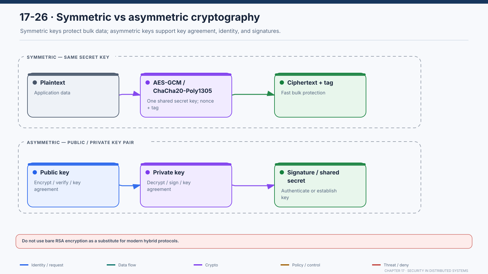
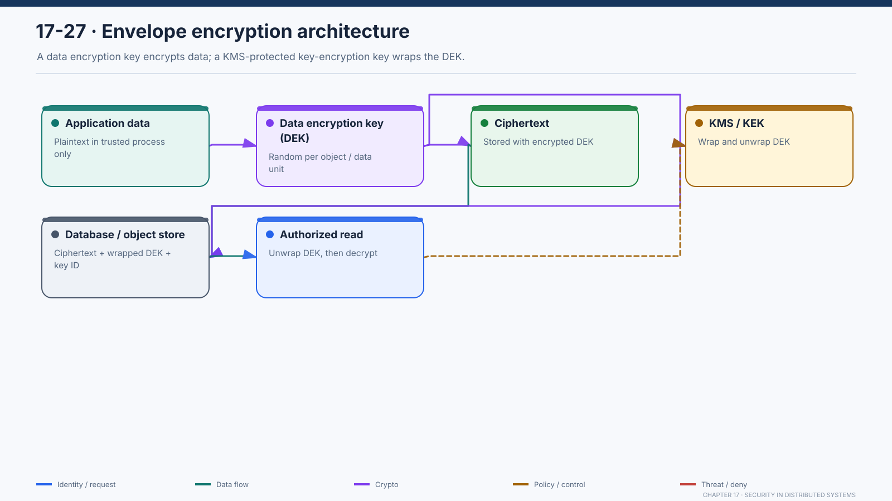
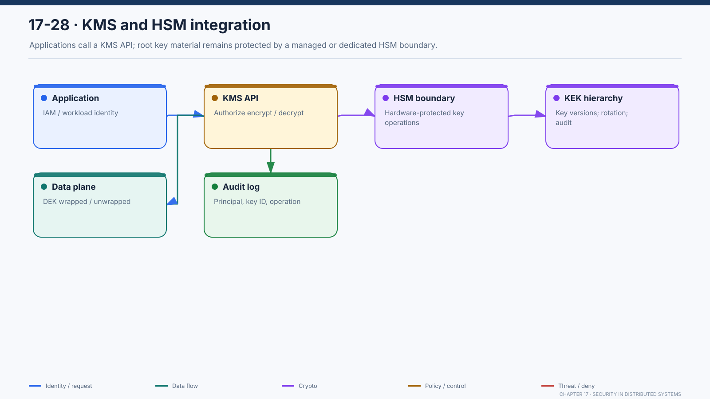
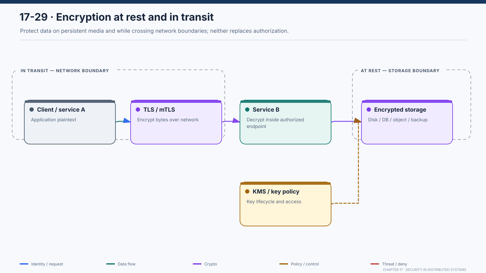

---

# 10. Byzantine Threats and Fault Models

## 10.1 Fault models

Distributed algorithms need an explicit model of what a faulty component can do.

| Fault model | Behavior | Example |
|---|---|---|
| Crash | Node stops taking steps | Process exits or machine fails |
| Omission | Node fails to send or receive some messages | Dropped outbound response or overloaded queue |
| Timing | Node responds outside assumed timing bounds | Delayed response, clock drift, scheduler pause |
| Network partition | Communication graph splits | Region-to-region link unavailable |
| Arbitrary/Byzantine | Node can behave in any way, including maliciously and inconsistently | Compromised replica sends conflicting state to different peers |

Crash fault-tolerant protocols assume a node may fail by stopping, not that it will lie consistently or collude. Byzantine fault tolerance (BFT) explicitly accounts for arbitrary behavior by up to a bounded number of faulty replicas under stated synchrony, authentication, and network assumptions.

**Equivocation** is sending conflicting statements to different participants. **Collusion** occurs when faulty participants coordinate. A **Sybil attack** creates many pseudonymous identities; BFT replica counting is meaningful only when membership identities are controlled or participation is made costly through a Sybil-resistance mechanism.

## 10.2 Byzantine Generals Problem

Imagine several generals must agree to attack or retreat, but some generals may be traitors and may send different messages to different peers. The system needs:

- **Agreement:** honest participants decide the same value.
- **Validity:** if the relevant honest proposer/participants support a value under the protocol's validity definition, the decision respects it.
- **Termination:** honest participants eventually decide, under the protocol's timing/liveness assumptions.

The intuition is difficult because an honest process cannot directly distinguish a delayed message from a malicious lie in an asynchronous network. More message rounds, authenticated identities, quorum intersection, and synchrony assumptions provide ways to constrain ambiguity. Signed messages prove who sent a statement but do not make the sender honest; Byzantine participants can sign contradictory messages.

## 10.3 PBFT: classical state-machine replication

Practical Byzantine Fault Tolerance (PBFT) is a protocol for replicating a deterministic state machine across known replicas. Under its classical assumptions it tolerates `f` Byzantine replicas with at least `3f + 1` total replicas. A primary proposes an operation; backups exchange messages to agree on an order; replicas execute in the same order and produce consistent replies.

The classical replica bound is:

\[
n \geq 3f + 1
\]

where `n` is the total number of replicas and `f` is the maximum number of Byzantine replicas tolerated. A common quorum size is:

\[
q = 2f + 1
\]

For a normal request, classical PBFT is commonly explained using:

1. **Request:** client sends operation to primary.
2. **Pre-prepare:** primary assigns sequence number and view, and proposes a digest/request order.
3. **Prepare:** backups multicast prepare messages; replicas collect a prepare quorum for the same view/sequence/digest.
4. **Commit:** replicas multicast commit after prepared; a commit quorum establishes that the operation can be executed safely.
5. **Reply:** replicas execute in order and reply; client accepts a matching response quorum according to protocol rules.
6. **View change:** if primary appears faulty/unavailable, replicas exchange view-change evidence and select a new primary.

Exact quorum and local-state predicates are protocol-specific; a textbook summary should not replace the paper's formal rules. Safety means honest replicas do not commit conflicting operations at the same log position. Liveness requires sufficient communication progress and eventual synchrony in common practical models.

### Why `n ≥ 3f + 1`

To tolerate `f` Byzantine replicas, the system needs enough replicas for quorums to intersect in at least one honest replica. With `n = 3f+1`, a common quorum size is `2f+1`; two such quorums intersect in at least `f+1` replicas, so at least one member of the intersection is honest. Honest replicas follow protocol rules and do not support conflicting values at the same sequence position. This intuition depends on authenticated messages and the specific quorum protocol.

| Byzantine replicas tolerated (`f`) | Minimum replicas (`3f+1`) | Common quorum (`2f+1`) |
|---:|---:|---:|
| 0 | 1 | 1 |
| 1 | 4 | 3 |
| 2 | 7 | 5 |
| 3 | 10 | 7 |
| 4 | 13 | 9 |
| 5 | 16 | 11 |

The formula is not a universal rule for every BFT system. Membership assumptions, synchrony, quorum definitions, cryptographic authentication, and whether faults include network infrastructure all matter.

## 10.4 PBFT and modern BFT systems

| Family | High-level design | Strengths | Trade-offs |
|---|---|---|---|
| PBFT | Multi-phase multicast with primary and view changes | Clear safety model; suitable for permissioned replicas | All-to-all communication can create O(n²) messages per phase |
| Tendermint-style BFT | Propose, prevote, precommit rounds with validator voting power | Understandable round-based structure and deterministic finality under assumptions | Validator set and network timing affect liveness; voting power concentration matters |
| HotStuff | Chained quorum certificates and leader-driven phases | Linear communication pattern per decision in common descriptions; pipelining | More complex view/leader and pacemaker mechanics; exact variant matters |
| Chained BFT | Decisions linked across successive blocks/rounds | Throughput via pipelining | Commit latency and view-change behavior depend on design |

PBFT becomes expensive as replica count grows because replicas exchange many point-to-point messages and signatures. Aggregated signatures, threshold cryptography, leader rotation, batching, and pipelining can reduce overhead, but add implementation and trust assumptions.

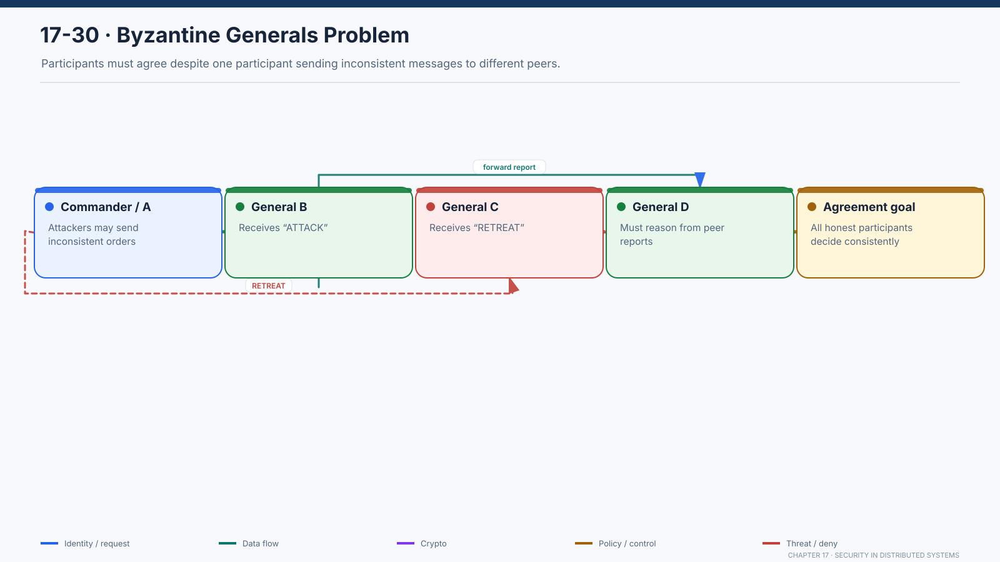
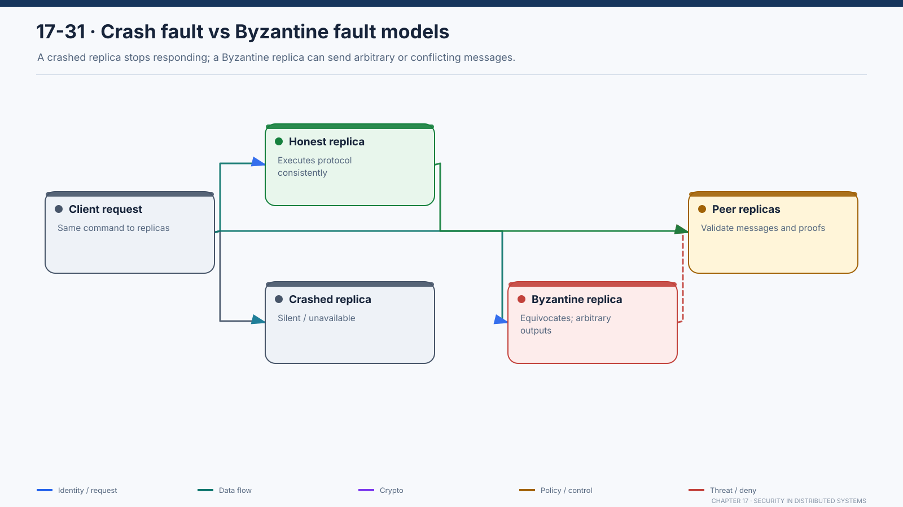
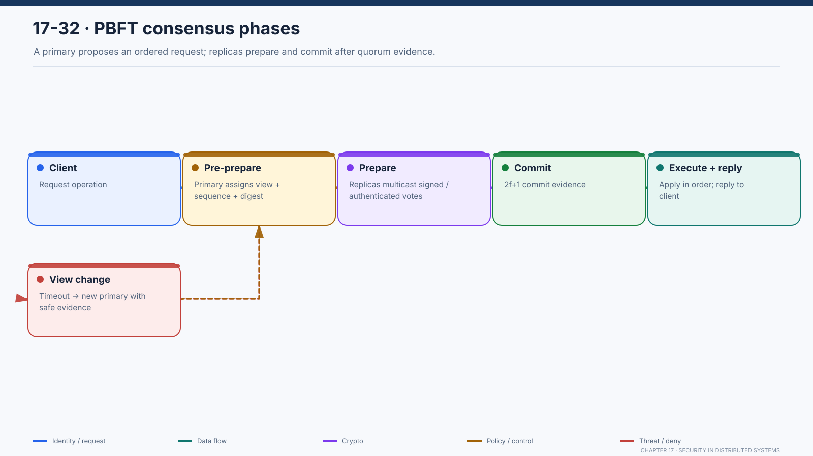
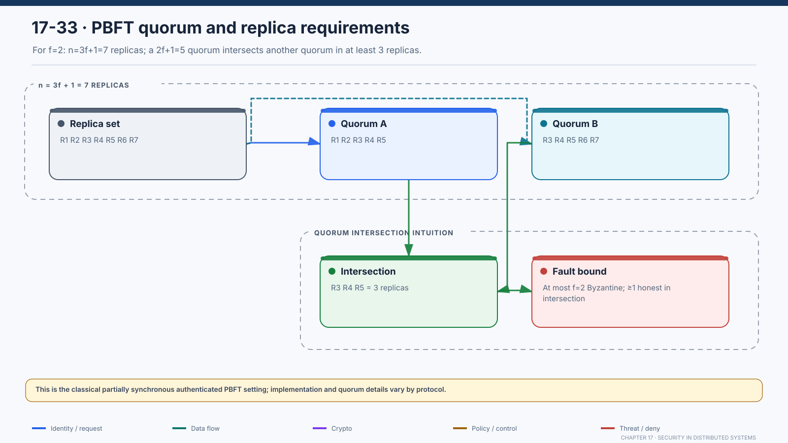
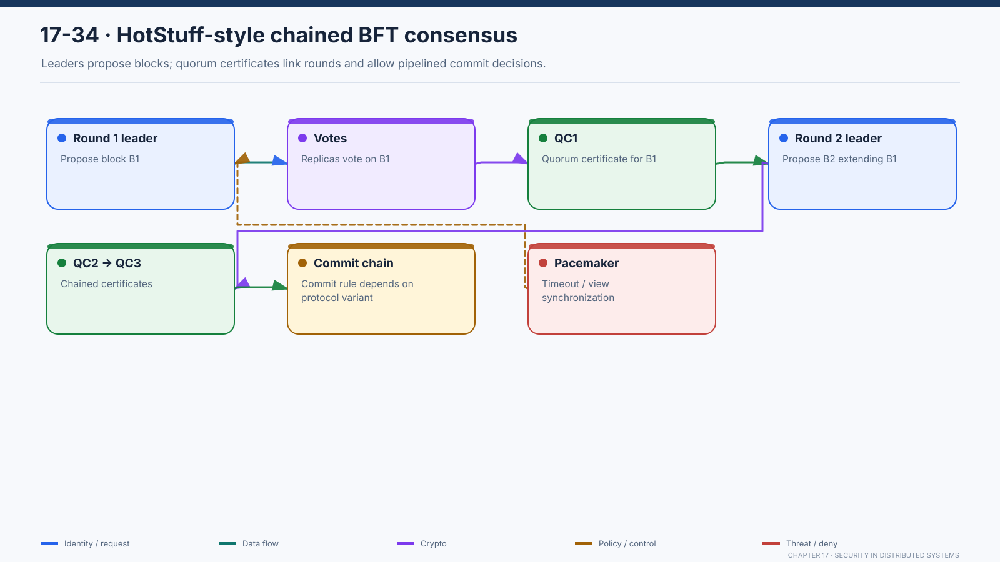

---

# 11. Blockchain Consensus: Proof of Work and Proof of Stake

## 11.1 Blockchain fundamentals

A blockchain is a replicated append-oriented ledger in which blocks reference prior blocks through cryptographic hashes. A block commonly contains a header, transaction data, and a reference to the previous block. Merkle trees summarize transactions so a client can verify inclusion with a compact proof. Digital signatures authorize transactions under the ledger's rules; peer-to-peer nodes propagate candidate transactions and blocks.

A blockchain is a type of distributed ledger, but not every distributed ledger is a blockchain, and neither is equivalent to a conventional distributed database. A traditional database normally relies on identified administrators and access control; a public permissionless blockchain must handle open participation, Sybil identities, adversarial block producers, and economic incentives.

**Consensus** decides which history the network recognizes under a specific protocol. **Forks** occur when participants temporarily observe competing histories. **Finality** describes the protocol's guarantee or confidence that a block will not be reverted; it can be probabilistic or protocol/economic finality.

## 11.2 Proof of Work (PoW)

PoW requires miners to find a nonce or other variable that makes a block header hash satisfy a target threshold. A simplified condition is:

\[
H(\text{block header} \parallel \text{nonce}) < T
\]

where `H` is a cryptographic hash and `T` is the target. Lower target means greater difficulty. Mining is probabilistic: each hash attempt has a small success probability, and miners compete to discover a valid block. The network's difficulty adjustment aims to regulate block production rate as aggregate hash power changes.

### Bitcoin transaction lifecycle (conceptual)

1. Wallet constructs a transaction referencing spendable outputs and intended outputs.
2. Wallet signs inputs using the relevant private keys.
3. Transaction propagates through peers.
4. Nodes validate syntax, signatures/scripts, transaction policy, and spend availability; valid unconfirmed transactions may enter mempools.
5. Miner selects transactions and constructs a candidate block, typically including a coinbase transaction.
6. Miner searches for a valid proof of work.
7. Valid block propagates; nodes independently validate it.
8. Nodes update their preferred chain according to cumulative work and protocol validity.
9. Additional blocks build on the transaction's block, increasing confirmation depth and making reversal more costly, but not mathematically impossible under the usual probabilistic model.

### Security concepts

- **Most-work chain selection:** in simplified descriptions often called “longest chain,” nodes prefer the valid chain with greatest accumulated proof of work, not necessarily the most blocks.
- **Double-spending:** conflicting spends are broadcast or mined in competing histories; confirmations reduce the probability of reversal.
- **51% attack:** an attacker controlling majority of effective hash power may reorganize recent history or censor transactions, subject to protocol and economic constraints. It does not automatically allow forging signatures or spending arbitrary users' coins.
- **Mining pools:** aggregate hash power and distribute rewards; pool concentration affects censorship and coordination risk.
- **Energy:** PoW security consumes real-world resources, often dominated by electricity and hardware; energy is part of the cost model and a major externality.

A simple PoW success probability per hash is `p = (T+1)/2^256` for a uniformly distributed 256-bit hash and target `T` under a simplified inclusive-target model. Actual Bitcoin target encoding and difficulty representation require protocol-specific detail.

## 11.3 Proof of Stake (PoS)

PoS replaces continuous energy-intensive hash competition with validator participation backed by staked capital. A protocol selects proposers and attesters using stake-weighted rules and randomness. Validators sign votes or attestations about blocks/checkpoints. Rewards incentivize correct participation; slashing penalizes specific provable violations such as conflicting votes, depending on the protocol.

Key terms:

- **Validator:** participant responsible for proposing or attesting to blocks.
- **Stake:** capital bonded under protocol rules to support participation and economic penalties.
- **Proposer:** validator selected to propose a block for a slot/round.
- **Attestation/vote:** validator's signed statement about block validity or chain view.
- **Slashing:** penalty for defined provable misconduct; not simply a punishment for every offline event.
- **Unbonding/withdrawal delay:** waiting period before staked funds can be withdrawn, allowing protocol responses and reducing instant exit after misconduct.
- **Finality:** protocol milestone after sufficient stake-weighted votes, with safety assumptions based on active stake and protocol rules.
- **Weak subjectivity:** a new or long-offline node may need a recent trusted checkpoint to distinguish the canonical chain from certain long-range alternatives.

### PoS attack and design concerns

- **Nothing at stake:** in naive designs, validators might sign multiple competing forks at low marginal cost. Slashing rules, fork-choice design, and protocol constraints address this.
- **Long-range attack:** old keys or validators may construct an alternate history; checkpointing/weak-subjectivity assumptions help new nodes choose the correct chain.
- **Stake concentration:** exchanges, custodians, pools, or large holders may gain disproportionate influence.
- **Collusion/censorship:** a validator cartel may delay or censor transactions within its protocol power.
- **Inactivity:** offline validators can miss rewards or incur penalties; severe penalties depend on protocol conditions.
- **Economic security:** an attacker may need to acquire/bond large stake and risk slashing or loss in value, but attack-cost estimates depend on market liquidity, derivative markets, governance, and correlated behavior.

Ethereum's proof-of-stake system separates execution-layer transaction processing from the consensus layer's validator duties, checkpoints, fork choice, and finality. Its details are defined in evolving protocol specifications; consult the official consensus specifications rather than assuming every PoS chain works like Ethereum. [Ethereum consensus specifications](https://github.com/ethereum/consensus-specs).

## 11.4 PoW vs PoS

| Dimension | Proof of Work | Proof of Stake |
|---|---|---|
| Sybil resistance | Costly hash computation and energy/hardware | Economic stake and protocol-defined validator selection |
| Primary resource | Computation, hardware, energy | Capital/stake and validator operations |
| Attack cost | Acquire/control sustained hash power | Acquire/control sufficient stake or exploit governance/protocol weaknesses |
| Finality | Usually probabilistic under cumulative work | Can be probabilistic or explicit checkpoint finality depending on design |
| Energy | High by design | Generally much lower consensus energy use |
| Operational burden | Mining hardware, pools, electricity, network propagation | Validator keys, uptime, staking, slashing and client diversity |
| Centralization pressure | Economies of scale in mining hardware/pools | Large stake holders, custodians, delegation and liquid-staking concentration |
| Common risks | Majority hash power, selfish mining, censorship, reorgs | Validator collusion, long-range and nothing-at-stake variants, key theft, concentration |

Probabilistic finality means confidence increases with additional blocks/confirmations. Protocol-level finality means the consensus protocol has finalized a checkpoint under stated assumptions; reverting it generally requires a severe safety violation or slashable behavior. “Economic finality” describes deterrence via economic penalties and is not identical to a mathematical impossibility of reversion.

## 11.5 Public vs permissioned consensus

| Model | Membership | Common consensus | Security basis |
|---|---|---|---|
| Public permissionless | Anyone may participate subject to protocol rules | PoW, PoS, BFT-family variants | Sybil resistance, incentives, crypto-economic assumptions |
| Permissioned | Known/approved validators | PBFT/HotStuff/Tendermint-like BFT, sometimes Raft for crash faults | Membership governance, identity, legal/organizational controls, quorum assumptions |
| Consortium | Multiple organizations govern membership | BFT or crash-fault ordering | Cross-organization trust and operational agreements |

Raft provides crash fault tolerance, not Byzantine fault tolerance. Using Raft among known nodes may be appropriate when operators are trusted and malicious behavior is outside the fault model; it is not a substitute for BFT where nodes may actively equivocate or collude.

Bitcoin's original whitepaper describes a peer-to-peer electronic cash system using proof of work and accumulated work to select a transaction history. The paper is a foundational conceptual source, but production behavior should be checked against current Bitcoin consensus rules and implementation. [Bitcoin whitepaper](https://bitcoin.org/bitcoin.pdf).

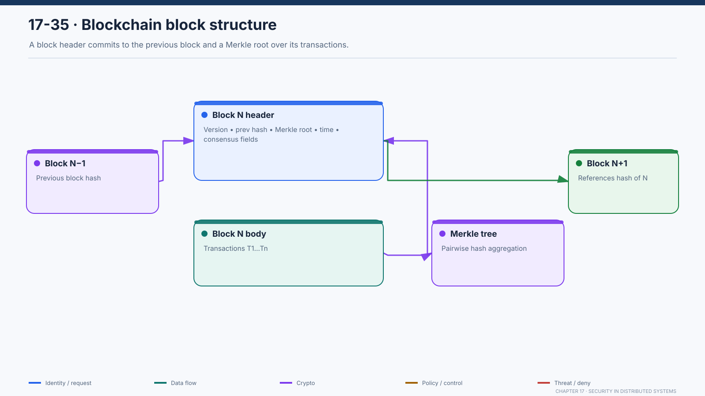
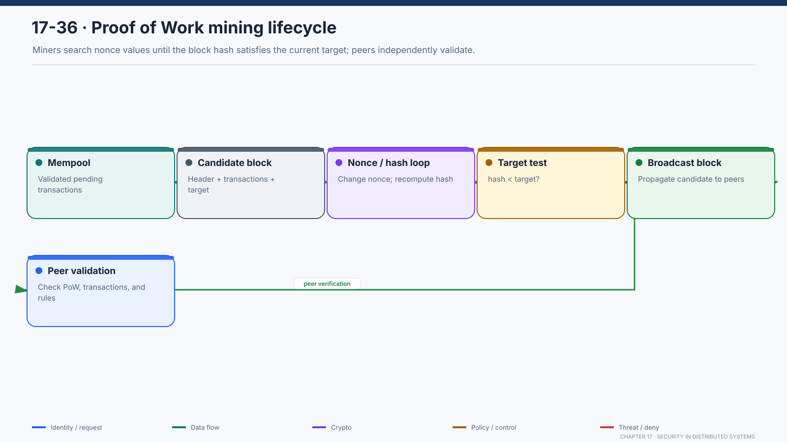
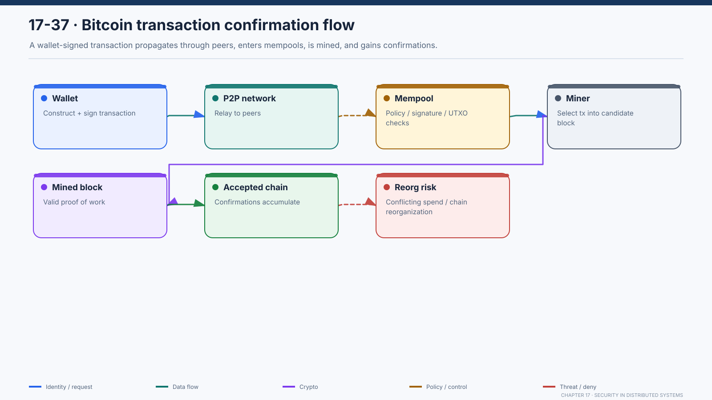
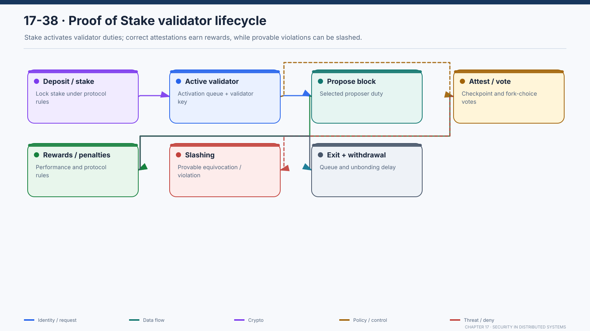
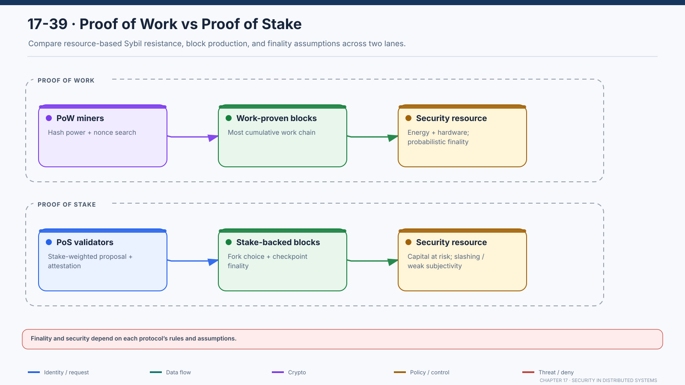
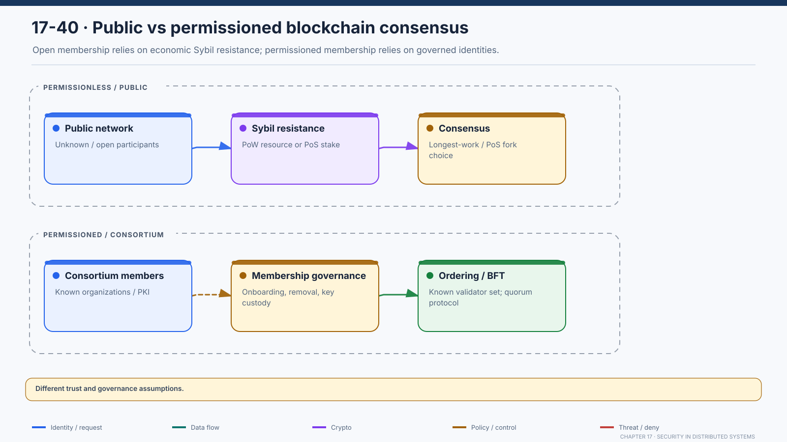

---

# 12. Security in Distributed Databases and Messaging Systems

## 12.1 Database security architecture

Database security must combine network protection, authentication, authorization, tenant isolation, encryption, and audit. Use separate principals for applications, migrations, reporting, operations, and replication. Do not run every service as the database owner or administrator. Parameterized queries address injection; they do not replace authorization. Row-level security (RLS) can enforce tenant or ownership constraints close to the data, but must be configured so privileged roles and connection-pool context cannot bypass it accidentally.

| System | Security design points |
|---|---|
| PostgreSQL | SCRAM or certificate auth, TLS, roles/grants, RLS, `pg_hba.conf`, audited admin actions, encrypted backups |
| MySQL | Strong account auth, TLS, least-privilege grants, roles, audit plugin/service, protected replication credentials |
| MongoDB | Enable authentication, role-based privileges, TLS, network restrictions, encryption at rest, auditing, tenant/database design |
| Cassandra | Authenticator/authorizer, TLS internode and client traffic, role permissions, protected gossip/management interfaces |
| Redis | Bind/network restrictions, ACL users, TLS where available, protected mode, command permissions, no exposed unauthenticated port |

Replication links, snapshots, logical exports, maintenance accounts, and observability integrations are all security boundaries. Backup credentials should not be able to alter production data; backup deletion should be protected against ransomware-style compromise.

## 12.2 Kafka, RabbitMQ, and object storage

- **Broker authentication:** use TLS client certificates, SASL mechanisms, or OAuth/OIDC integration supported by the platform. Each producer and consumer should have a distinct principal.
- **Topic/queue authorization:** grant write/read permissions by topic, exchange, queue, consumer group, and administrative operation. A consumer should not have cluster-admin because it reads one topic.
- **Message integrity and replay:** TLS protects a connection but messages may be persisted, replayed, or forwarded later. Include event ID, schema version, producer identity, and idempotent processing; sign or MAC messages when trust crosses storage or organization boundaries and connection protection is insufficient.
- **Payload minimization:** place only necessary data in events. Prefer opaque references for highly sensitive data when downstream services can securely retrieve it.
- **Retention and deletion:** topics, dead-letter queues, logs, and object storage may retain data beyond the source database. Define retention, legal holds, encryption, and deletion workflows.
- **Object storage:** private by default; use scoped IAM policies and short-lived presigned URLs; restrict public ACLs; enable access logging, versioning/retention protections, and server-side encryption.

### Secure Kafka reference pattern

Use TLS for client/broker and inter-broker links; authenticate each workload; authorize each principal to only required topics and consumer groups; separate admin identities; encrypt sensitive payloads with envelope encryption if necessary; enforce quotas; audit ACL changes; rotate credentials; and monitor unusual topic reads, consumer-group changes, and large egress volumes.

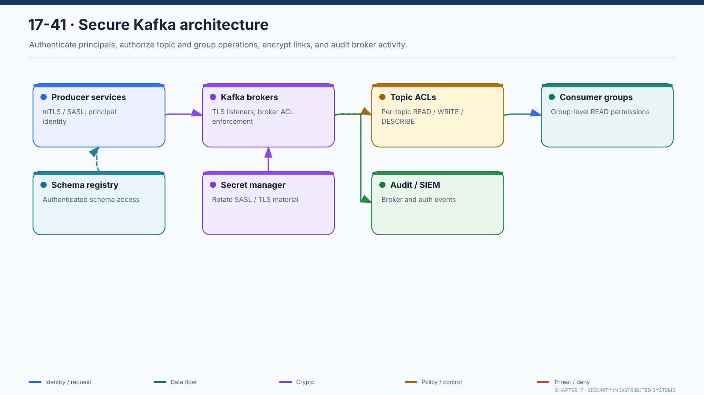

---

# 13. Security in Kubernetes and Cloud-Native Systems

## 13.1 Control-plane and workload security

Kubernetes security spans the API server, etcd, scheduler/controller manager, kubelets, container runtime, nodes, admission chain, pods, network, images, and operators. A compromised cluster-admin credential can change workload specs, mount secrets, create privileged pods, or alter network policy; protect the control plane as a high-value system.

| Layer | Controls |
|---|---|
| API server | Private endpoint where appropriate, strong authentication, RBAC, audit policy, encryption at rest for secrets, rate limits |
| etcd | Network isolation, TLS client/server auth, encryption of sensitive values, protected snapshots |
| Identity | Short-lived service-account tokens, projected tokens, cloud workload identity, no shared static credentials |
| Authorization | Namespace/resource-scoped RBAC, separate human and machine identities, periodic permission review |
| Admission | Validating/mutating controls, Pod Security Standards, image signature and provenance checks, policy-as-code |
| Workload | Non-root, read-only filesystem where feasible, drop capabilities, seccomp/AppArmor/SELinux, resource limits |
| Network | Default-deny ingress/egress policies, explicit service paths, encrypted service traffic |
| Node/runtime | Patch OS/runtime, minimize host mounts, isolate workloads, runtime detection, protect node credentials |
| Supply chain | Pinned base images, SBOM, vulnerability scanning, signed images, trusted build provenance |
| Audit/monitoring | API audit logs, runtime events, admission denials, secret access, privileged container alerts |

## 13.2 Kubernetes mechanisms and ecosystem

- **RBAC:** controls which authenticated users/service accounts can perform which verbs on which resources. Avoid wildcard `*` for verbs/resources and cluster-wide bindings unless necessary.
- **Service accounts:** identify pods to the Kubernetes API or external platforms; scope permissions and disable automatic token mounting when unused.
- **Workload identity:** bind a pod/service account to a cloud identity through an attested federation mechanism instead of embedding cloud access keys.
- **Admission controllers:** enforce policy at object creation/update; they are important for rejecting privileged pods, unsigned images, host namespaces, and unsafe configuration before deployment.
- **Pod Security Standards:** baseline/restricted profiles constrain privileged container behavior; enforcement mode and namespace labels must be tested.
- **NetworkPolicy:** limits pod ingress/egress if the CNI implements the feature; default-deny plus explicit allow rules reduces lateral movement.
- **OPA Gatekeeper / Kyverno:** policy engines for admission and configuration governance. Policies should be versioned, tested, and staged to avoid accidental outages.
- **Falco:** runtime threat detection based on system events; detection is not a substitute for prevention and response.
- **Sigstore/Cosign:** sign and verify container images and artifacts; integrate verification into admission policy.
- **SPIFFE/SPIRE and service mesh:** provide cryptographic workload identity and mTLS between services.

## 13.3 Workload security lifecycle: build to runtime

1. Developer commits reviewed source; branch protections and signed commits may support provenance but do not alone prove code safety.
2. CI builds in isolated ephemeral workers with short-lived federated credentials.
3. Dependencies are pinned/scanned; an SBOM and provenance attestation are generated.
4. Artifact is signed with protected key identity and pushed to a private registry.
5. Admission verifies signature, provenance, vulnerability policy, and approved registry.
6. Scheduler places the pod on a hardened node; admission has already rejected unsafe privilege settings.
7. Pod receives a scoped workload identity; it retrieves only authorized secrets and uses mTLS to call peers.
8. Runtime monitoring detects unexpected process, file, privilege, or network behavior.
9. Patch/rebuild replaces the image; mutable in-place repair is not the preferred long-term artifact lifecycle.
10. On termination, ephemeral credentials expire and temporary storage is disposed according to policy.

Kubernetes documentation changes over time; use the current official [Kubernetes security documentation](https://kubernetes.io/docs/concepts/security/) and test the exact feature behavior of the deployed version and CNI.

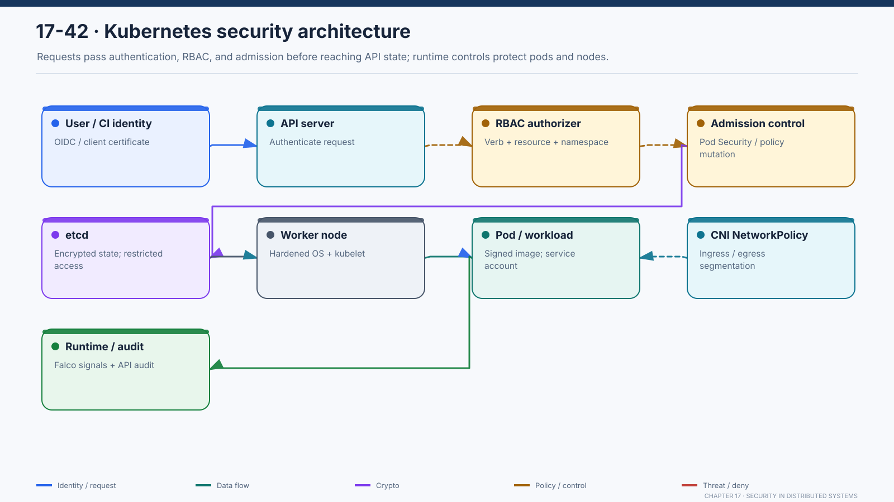

---

# 14. Supply Chain and Software Security

## 14.1 Threats across the software supply chain

The software supply chain includes source control, developer workstations, dependencies, build runners, CI/CD definitions, artifact registries, signing keys, deployment controllers, and runtime images. An attacker may compromise a maintainer account, publish a malicious dependency, poison a build, steal CI secrets, replace an image tag, or alter a deployment manifest. A secure runtime cannot compensate for a malicious artifact that is trusted at admission.

### Key controls

- **Dependency hygiene:** pin versions, use lockfiles, review transitive dependencies, scan for known vulnerabilities, and maintain a process for urgent upgrades. Pinning prevents surprise changes but can preserve vulnerable versions; combine it with update automation.
- **SBOM:** Software Bill of Materials inventories components and versions. SPDX and CycloneDX are common formats. An SBOM improves inventory and incident response but does not prove a component is safe.
- **Reproducible builds:** aim for the same source and declared inputs to produce equivalent artifacts, reducing hidden build inputs and improving verification.
- **Signed artifacts:** signatures bind an artifact digest to a signing identity. Verify signature and identity at deployment, not just at build time.
- **Provenance/attestation:** records how, where, and from what inputs an artifact was built. Verify builder identity and policy, not merely presence of an attestation.
- **SLSA:** a framework/specification for increasing software supply-chain assurance through build integrity and provenance requirements. Adopt a level appropriate to threat model and platform.
- **in-toto:** framework for describing and verifying steps in a software supply chain.
- **Sigstore/Cosign:** tooling and infrastructure for signing/verifying artifacts and associating signatures with identities.

## 14.2 Secure CI/CD reference architecture

Use protected source branches and review; ephemeral isolated build runners; OIDC federation from CI to cloud rather than long-lived cloud keys; least-privilege deploy roles; locked and scanned dependencies; secret redaction; reproducible or hermetic build practices where possible; SBOM and provenance generation; artifact digest pinning; signature verification at admission; environment approvals for production; immutable audit logs; and rapid revocation of compromised build identities.

**Failure scenario:** an attacker changes a pipeline file to exfiltrate a deploy token. Mitigations include protected pipeline definitions, environment-scoped credentials, no untrusted fork access to secrets, short-lived identity federation, outbound network restrictions, approval for production promotion, and alerting on unusual OIDC role assumptions.

Official references: [SLSA specification](https://slsa.dev/spec/) and [Sigstore documentation](https://docs.sigstore.dev/).

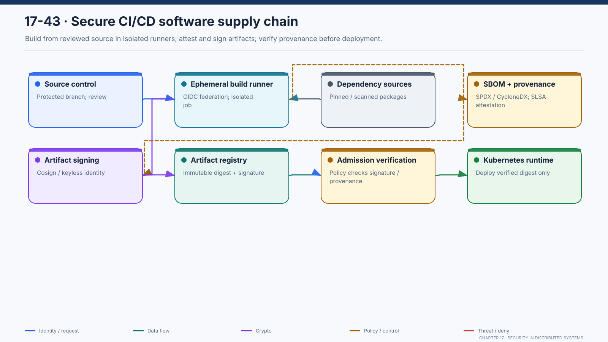

---

# 15. Security Monitoring, Auditing, and Incident Response

## 15.1 Security telemetry in distributed systems

Security events should be structured, time-synchronized, attributable, and correlated across service boundaries. Log decisions and metadata rather than raw credentials. Useful fields include event timestamp, principal/workload identity, tenant, action, resource identifier (appropriately minimized), outcome, reason code, policy version, source/destination service, region, trace/correlation ID, and credential/key identifier where safe.

Important signals include repeated authentication failures, authorization denials, unusual service-to-service paths, role or policy changes, cloud credential use from new workloads, anomalous token reuse, certificate expiry/issuance spikes, secret retrieval patterns, bulk object reads, unusual egress, privileged container creation, and DDoS indicators.

- **SIEM:** aggregates and correlates security events for detection, investigation, and compliance.
- **SOAR:** orchestrates response actions such as disabling accounts, opening incidents, isolating hosts, or rotating credentials under controlled playbooks.
- **Audit trail:** protected record of who performed what action, against which resource, when, and with what result.
- **Forensic evidence:** data preserved with chain-of-custody, integrity, access controls, and time context sufficient for investigation.

Platforms such as Wazuh, Splunk, Elastic Security, Falco, and cloud-native security services provide different mixes of collection, detection, analytics, and response. Product choice matters less than telemetry quality, coverage, ownership, and tested response.

## 15.2 Incident response lifecycle

1. **Prepare:** asset inventory, contacts, playbooks, secure log retention, credential inventory, break-glass controls, and exercises.
2. **Detect and analyze:** validate alert, establish scope, identify affected identities/services/tenants, preserve evidence, and classify severity.
3. **Contain:** disable or constrain compromised identity; isolate workload; block suspicious paths; revoke tokens/certificates; rate-limit harmful traffic.
4. **Eradicate:** remove persistence, patch root cause, rebuild compromised workloads from trusted artifacts, and rotate all exposed credentials.
5. **Recover:** restore service gradually, verify integrity, monitor for recurrence, and validate tenant isolation.
6. **Learn:** timeline, root cause, control gaps, customer/regulatory communication, action owners, and measurable prevention work.

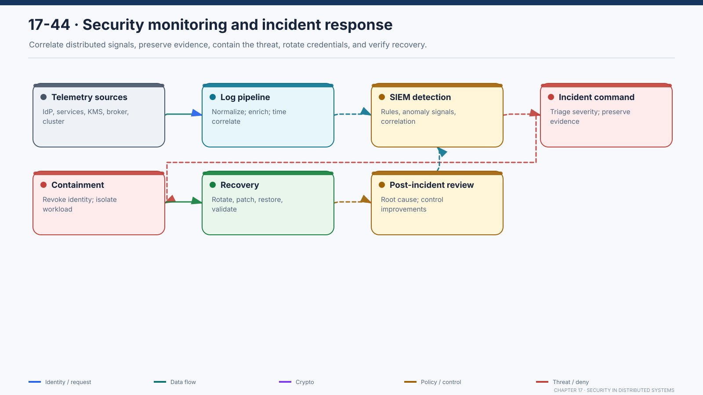

### Walkthrough: compromised service credential spreads laterally

**Scenario:** an attacker extracts the `catalog-worker` cloud token from a debug log. The identity can read product data and has an overly broad permission to consume order events. The attacker uses it from an unexpected workload, harvests customer order metadata, and attempts to call the refund service.

**Detection:** alert on token use from a new workload identity/source, unusual topic consumption, elevated read volume, and denied refund calls. Correlate identity-provider, cloud audit, broker, mesh, application, and egress logs using a common trace/time window.

**Containment:** disable or revoke the affected credential; deny the compromised workload identity at the mesh/network policy; pause or quarantine its consumers; block egress to the observed destination; preserve relevant logs and pod/node snapshots where appropriate. Do not simply restart the pod while leaving the identity valid.

**Eradication:** determine whether the token was static or federated; remove logging of secrets; patch the debug path; rebuild the service from a trusted image; reduce topic and cloud permissions; rotate any downstream credentials the attacker could access; invalidate derived sessions or credentials.

**Recovery:** redeploy with short-lived workload identity; validate producer/consumer ACLs and service-to-service authorization; restore consumer offsets carefully to avoid data loss or duplicate business actions; monitor for new use of the compromised identity and similar patterns.

**Lessons:** unique identities, minimal topic access, no secret logging, token short lifetime, mTLS identity, per-hop authorization, and audit correlation reduce both likelihood and blast radius.

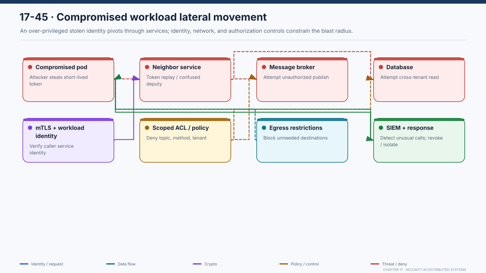

---

# 16. Security Design Trade-offs and Performance

Security choices affect latency, throughput, availability, operations, and incident recovery. Measure them under realistic load rather than assuming encryption or authorization cost is negligible.

## 16.1 Cost centers

- **TLS/mTLS handshake:** certificate validation, key agreement, and signature work add connection-establishment latency. Connection pooling and session resumption amortize cost; do not share connections across security principals when that weakens isolation.
- **Token verification:** local asymmetric signature verification consumes CPU but avoids a remote call; caching JWKS and using efficient libraries helps. Cache only within a carefully defined issuer/key policy.
- **Introspection:** gives centralized revocation but every uncached check adds network latency and authorization-server load. Cache duration defines revocation staleness.
- **Centralized authorization:** simplifies governance but can become a latency and availability bottleneck. Local PEPs with signed policy bundles can keep routine decisions close to workloads.
- **Secret manager:** retrieval and renewal create dependency and API load. Cache credentials only for an explicitly bounded period; avoid infinite stale fallback.
- **KMS:** envelope encryption adds remote key operations. Batch or cache wrapped DEKs where safe, use data-key generation, and separate KMS availability from every data read where the threat model allows.
- **Certificate rotation:** high-scale fleets need staggered renewal, trust-bundle overlap, and monitoring to avoid synchronized handshake storms.
- **Audit logging:** high event volume can saturate pipelines; prioritize security-relevant fields, sample low-risk telemetry carefully, and never sample critical audit events without a defensible design.

## 16.2 Worked capacity example

Assume 20,000 API requests/second and a gateway that validates a signed JWT on every request. If one CPU core safely performs 15,000 validations/second for the chosen key type and payload on benchmark hardware, the theoretical minimum is `20,000 / 15,000 = 1.34` cores. With 2× headroom for bursts, runtime overhead, and uneven traffic, budget about 3 cores for verification alone. This is an illustrative benchmark assumption, not a portable cryptographic constant; measure your actual stack and token shape.

If instead every request performs a remote introspection call and each authorization-server instance sustains 5,000 checks/second, four instances are the mathematical minimum at 20,000 checks/second. With 50% target utilization, plan approximately eight instances, plus regional redundancy and cache behavior. A 30-second introspection cache means revocation may take up to roughly 30 seconds to propagate to cache holders, subject to invalidation and network behavior.

## 16.3 Fail-open vs fail-closed

| Decision | Typical posture | Reason |
|---|---|---|
| Payment approval, admin action, access to sensitive records | Fail closed | Verification uncertainty must not grant authority |
| Public product catalog read with low sensitivity | Carefully designed degraded/read-only mode may be acceptable | Availability may outweigh freshness for this low-risk operation |
| Secret retrieval | Fail closed after bounded use of still-valid cached secret | No insecure fallback credential |
| Revocation service failure | Depends on risk; short token TTL and local policy can bound exposure | A universal fail-open rule is unsafe |
| Telemetry pipeline outage | Application may continue with bounded local buffering, but critical audit loss must alert | Avoid making all request handling depend synchronously on logging while preserving evidence requirements |

The correct choice is not “always fail closed” for every subsystem. It is to define security invariants, acceptable stale-decision windows, and failover behavior by action and data sensitivity.

# 17. Real-World Case Studies

The following are architecture case studies. They are illustrative composites based on established protocol and cloud engineering practices, not claims about the confidential internal designs of named companies. Product names identify example technologies, not endorsements.

## 17.1 SaaS identity with OAuth and OIDC

- **Business context:** A multi-tenant SaaS product has browser users, mobile users, customer integrations, and internal workers.
- **Architecture:** OIDC provider, browser backend-for-frontend (BFF), API gateway, tenant-aware services, service mesh, and audit pipeline.
- **Requirements/threats:** phishing, session theft, tenant confusion, token replay, malicious OAuth client, stale group membership.
- **Flow:** authorization code with PKCE; BFF stores refresh token server-side; access token has a narrow API audience; gateway validates signature/issuer/audience; target service checks tenant and object ownership.
- **Crypto/key management:** TLS externally, mTLS internally, issuer signing keys in protected KMS/HSM, key rotation with JWKS overlap.
- **Failure/attack cases:** IdP outage, signing-key rollover error, stolen refresh token, user removed from tenant but cached claims remain.
- **Mitigation/trade-offs:** short access-token TTL; refresh rotation; session revocation; local JWKS cache; explicit reauthentication for sensitive operations. Centralized identity improves governance but can become a dependency.
- **Lessons:** authentication federation does not replace application authorization; tenant boundaries must be enforced at data access.

## 17.2 Zero trust across Kubernetes microservices

- **Business context:** Hundreds of services are deployed across clusters and regions by independent teams.
- **Architecture:** Kubernetes RBAC, default-deny NetworkPolicies, SPIFFE/SPIRE or mesh identity, mTLS, local policy enforcement, centralized policy authoring, security telemetry.
- **Threats:** compromised pod, lateral movement, stolen service account token, permissive mesh mode, cluster-admin misuse.
- **Flow:** pod is admitted only if policy passes; workload is attested; short-lived identity is issued; mTLS authenticates caller and callee; target PEP authorizes method/resource; egress is restricted.
- **Crypto/secrets:** automatic SVID/certificate rotation; external secret store; cloud workload identity via federation.
- **Failure cases:** mesh CA outage, stale trust bundle, CNI policy not enforced, compromised node.
- **Mitigation/trade-offs:** staged strict-mTLS rollout, canary policies, node isolation, emergency CA rotation, break-glass operations. The control plane is itself a high-value trust anchor.
- **Lessons:** zero trust is the interaction of identity, policy, segmentation, and telemetry—not simply enabling a mesh.

## 17.3 mTLS identity and certificate rotation in a service mesh

- **Business context:** Internal services must encrypt and authenticate every east-west request.
- **Architecture:** workload identity agent, intermediate CA, trust bundle distribution, sidecar/data-plane proxy, policy controller.
- **Threats:** private-key theft, spoofed service, expired certificate, rogue CA, control-plane compromise.
- **Flow:** workload attestation → short-lived X.509 SVID → proxy TLS handshake → peer verifies trust domain and identity → authorization policy.
- **Crypto/key management:** CA signing key protected by HSM/KMS; short-lived leaf certificates; staged root/intermediate rotation.
- **Failure cases:** clock drift, trust bundle mismatch, issuance outage, mass reconnect storm.
- **Mitigation/trade-offs:** overlapping trust anchors, jittered rotation, connection reuse, readiness alerts, local issuance cache where safe. Shorter lifetime reduces compromise window but raises control-plane load.
- **Lessons:** certificate lifecycle automation is mandatory at fleet scale; certificate identity still needs authorization.

## 17.4 Dynamic secrets using Vault

- **Business context:** Services need database access without static shared passwords.
- **Architecture:** workload authenticates to Vault; Vault policy maps identity to a database role; database plugin creates temporary user; lease metadata is returned.
- **Threats:** Vault root token theft, overly broad policy, lease not revoked, stale pool connections.
- **Flow:** workload identity → Vault auth → role request → temporary DB principal → TLS database connection → lease renewal/revocation.
- **Crypto:** Vault storage encryption/seal mechanism, TLS, audit devices, KMS/HSM auto-unseal where configured.
- **Failure cases:** Vault unavailable during startup or renewal, database plugin credentials compromised, pool uses expired credentials.
- **Mitigation/trade-offs:** HA Vault, bounded retries, narrow role permissions, lease monitoring, tested revocation, connection pool recycling. Dynamic credentials add operational integration complexity.
- **Lessons:** short-lived database users reduce shared-secret exposure but require reliable lifecycle integration.

## 17.5 Envelope encryption with cloud KMS

- **Business context:** A multi-region application stores sensitive user documents and backups.
- **Architecture:** application requests data key from regional KMS; DEK encrypts object; wrapped DEK and metadata are stored alongside ciphertext; KEK remains under KMS control.
- **Threats:** key policy misconfiguration, KMS outage, accidental plaintext logging, cross-tenant ciphertext substitution.
- **Flow:** generate data key → AEAD encrypt with tenant/object context as associated data → persist ciphertext and encrypted DEK → decrypt via KMS when authorized.
- **Key management:** key hierarchy, per-region keys or multi-region keys according to residency/availability needs, key versioning, audit, rotation/rewrap.
- **Failure cases:** regional KMS unavailable, key disabled, wrapped key version lost, access denied after policy change.
- **Mitigation/trade-offs:** tested recovery, key replication policy, bounded DEK caching, dual-region design, immutable audit. KMS control reduces raw key exposure but creates policy and availability dependencies.
- **Lessons:** encryption is only as strong as authorization to invoke decrypt and the lifecycle of wrapped keys.

## 17.6 Payment-processing authorization

- **Business context:** A payment platform accepts checkout requests, talks to external payment processors, and updates order state.
- **Architecture:** customer-facing gateway, checkout service, payment orchestrator, isolated payment adapter, tokenized payment references, ledger, signed provider webhooks.
- **Threats:** forged webhook, replayed capture, amount/currency tampering, compromised payment credential, confused deputy, insider misuse.
- **Flow:** customer authenticates; checkout authorizes cart ownership; payment service creates idempotent intent; provider callback is signature-verified and timestamp-checked; order state transition is authorized and idempotent.
- **Crypto/secrets:** TLS/mTLS, KMS-backed signing credentials, vault-managed processor secrets, minimize PCI scope through tokenization and provider-hosted collection where appropriate.
- **Failure cases:** callback duplication, timeout with unknown processor outcome, key rotation during webhook delivery, partial ledger update.
- **Mitigation/trade-offs:** idempotency keys, reconciliation jobs, append-only ledger, signed callback verification, separation of duties. Strong fraud controls may add friction.
- **Lessons:** never trust client-supplied payment status; validate all provider events and business invariants.

## 17.7 Permissioned distributed ledger with BFT

- **Business context:** Several consortium organizations share a regulated asset-transfer ledger and do not want one party to control ordering.
- **Architecture:** identified validator membership, PKI, deterministic state machine, BFT ordering layer, replicated ledger storage, governance process.
- **Threats:** compromised validator, colluding members, equivocation, CA compromise, governance takeover, application-level bug.
- **Flow:** client submits signed transaction; validators verify client authorization; BFT protocol orders transaction; replicas execute deterministically; commit certificate/evidence is returned.
- **Crypto/key management:** organization-specific validator keys, HSM-backed signing where appropriate, rotation and membership revocation.
- **Failure cases:** more than `f` validators unavailable or malicious, network partition, faulty state-machine implementation, membership update disagreement.
- **Mitigation/trade-offs:** `3f+1`-style replica sizing under protocol assumptions, diverse operations, threshold/quorum evidence, deterministic upgrades, independent audits. BFT gives consistency under a fault bound; it does not guarantee correct business semantics.
- **Lessons:** governance and membership control are part of consensus security.

## 17.8 Bitcoin PoW and double-spending resistance

- **Business context:** A permissionless peer-to-peer currency needs a common transaction history without a central operator.
- **Architecture:** nodes validate transactions and blocks; miners perform PoW; nodes select valid chain with greatest accumulated work.
- **Threats:** double-spending, majority hash power, eclipse attack, selfish mining, peer-level denial of service.
- **Flow:** signed transaction propagates → nodes validate → miners include it → valid block propagates → confirmations accumulate.
- **Crypto:** transaction signatures and hash-linked block headers; mining target enforces work.
- **Failure cases:** temporary fork, reorganization, miner concentration, network partition.
- **Mitigation/trade-offs:** wait for confirmations based on transaction value/risk; diverse peer connectivity; full validation. Confirmation risk is probabilistic, not zero.
- **Lessons:** PoW makes history rewriting costly but does not prevent every application, wallet, exchange, or endpoint compromise.

## 17.9 Ethereum PoS validator security

- **Business context:** A public smart-contract platform needs validators to propose and attest to chain history.
- **Architecture:** execution clients process transactions/state; consensus clients manage slots, validator duties, fork choice, and finality; validators hold signing keys and stake.
- **Threats:** validator key theft, equivocation, client bugs, stake concentration, censorship, long-range attacks, network partitions.
- **Flow:** proposer selected → block produced → validators attest → fork choice selects head → checkpoint votes accumulate toward finality.
- **Crypto/economic security:** validator keys sign duties; stake-backed penalties apply to defined slashable behavior; withdrawal timing and protocol rules affect risk.
- **Failure cases:** correlated client bug, validator downtime, mass slashing event, weak-subjectivity issue for long-offline node.
- **Mitigation/trade-offs:** client diversity, key isolation, monitoring, safe validator operation, checkpoint selection from trusted sources where required. Stake is not a simple guaranteed collateral value.
- **Lessons:** PoS security combines protocol rules, operator hygiene, economic incentives, and client diversity.

## 17.10 Response to compromised service identity

- **Business context:** An internal workload identity is stolen and used to access adjacent services.
- **Architecture:** mesh identities, IAM federation, scoped service roles, SIEM correlation, network segmentation.
- **Threats:** token reuse, lateral movement, secret retrieval, data export, privilege escalation.
- **Flow of incident:** anomaly detects identity use from an unexpected pod; security team revokes identity, blocks path, isolates workload, rotates downstream secrets, rebuilds clean artifact, and validates recovery.
- **Crypto/keys:** revoke or expire certificates/tokens; rotate keys derived or accessed by compromised workload.
- **Failure cases:** cached tokens remain usable, identity authority is unavailable, logs are incomplete, attacker created persistence.
- **Mitigation/trade-offs:** keep local deny capability; preserve audit evidence; avoid broad emergency shutdown unless required; restore only after trust re-establishment.
- **Lessons:** credentials are authority; response must invalidate authority and downstream access, not only restart processes.

## 17.11 Secure Kafka with tenant-level authorization

- **Business context:** Multiple product domains publish and consume events on a shared platform.
- **Architecture:** brokers with TLS, distinct producer/consumer principals, topic and group ACLs, schema registry, encryption for sensitive payloads, SIEM.
- **Threats:** cross-tenant topic read, rogue producer, consumer group takeover, broker admin credential theft.
- **Flow:** workload authenticates → broker maps identity → ACL checks topic/group/action → message accepted or denied → audit event emitted.
- **Crypto/secrets:** mTLS/SASL OAuth as supported; secrets via external manager; envelope encryption for highly sensitive fields.
- **Failure cases:** ACL propagation delay, identity outage, certificate expiry, dead-letter topic exposure.
- **Mitigation/trade-offs:** per-tenant topic namespace, quotas, schema validation, separate administrative identities, periodic ACL tests.
- **Lessons:** broker authentication alone is not enough; authorization must constrain every resource and operation.

## 17.12 Secure cloud-native CI/CD supply chain

- **Business context:** A large organization deploys hundreds of services from multiple teams.
- **Architecture:** protected Git, ephemeral CI runners, OIDC federation, dependency scanning, SBOM/provenance, signing, private registry, admission verification, progressive deployment.
- **Threats:** malicious dependency, pipeline tampering, stolen deploy token, image substitution, unreviewed production deploy.
- **Flow:** reviewed commit → isolated build → attestation/SBOM → sign artifact digest → registry → admission policy verify → rollout.
- **Crypto/secrets:** short-lived CI identity, signing key in KMS/HSM or keyless signing identity, no permanent cloud secret in repo.
- **Failure cases:** compromised trusted builder, leaked signing identity, unavailable registry, false-positive admission block.
- **Mitigation/trade-offs:** trusted builder policy, independent provenance verification, emergency rollback, staged policy enforcement, audit. Strong provenance adds pipeline complexity and build latency.
- **Lessons:** the deployment system is part of the production trust boundary and should receive security investment comparable to runtime services.

---

# 18. Quantitative Worked Examples and Security Formulas

All numbers below are illustrative assumptions to teach the calculation. They are not universal performance claims or complete security proofs.

## 18.1 CIA objectives translated into service objectives

Assume an order platform handles 100,000 orders/day. Its objective is that unauthorized users cannot read order details, paid order amount/status cannot be altered without an authorized transition, and monthly availability is at least 99.95%.

- Confidentiality test: cross-tenant read attempts must return deny and generate audit evidence.
- Integrity test: a valid payment transition must be signed/verified and applied once; duplicate event IDs must not change state twice.
- Availability budget: a 30-day month has `30 × 24 × 60 = 43,200` minutes. At 99.95% availability, allowed downtime is `43,200 × 0.0005 = 21.6` minutes/month.

The calculation translates an abstract percentage into an operational budget; it does not define what counts as available or whether partial functionality is acceptable. Those definitions belong in the SLO.

## 18.2 JWT expiry and renewal window

Assume access tokens live for 10 minutes and the client refreshes when 2 minutes remain. A token issued at 14:00 expires at 14:10; refresh should begin by 14:08. With an assumed maximum clock skew of 30 seconds, the verifier must apply a consistent bounded policy. Refresh should use a rotated token and retry with backoff; it must not continue using an expired access token just because the IdP is temporarily down.

Exposure window is approximately the remaining token lifetime after theft, not automatically the full 10 minutes if the token is sender-constrained or revoked earlier. Use `remaining exposure ≤ exp - theft_time`, subject to revocation and verifier cache behavior.

## 18.3 Certificate rotation overlap

Suppose leaf certificates have a 24-hour lifetime; workloads renew at 70% of lifetime, with ±10% random jitter. Nominal renewal occurs at 16.8 hours; a 10% jitter band is ±2.4 hours, so renewal requests spread roughly from 14.4 to 19.2 hours after issuance. If the CA publishes a new trust intermediate, retain old and new intermediates together for at least the maximum certificate validity plus expected propagation and clock-skew margin. Do not set overlap by guess: measure bundle distribution and client reload behavior.

## 18.4 Key rotation strategy

A signing key is rotated every 90 days; access tokens are valid for at most 10 minutes. Publish new public key `K2` before starting to sign with it. Stop signing with `K1` at T0, keep `K1` published for at least token maximum lifetime + clock skew + JWKS cache staleness, e.g. 10m + 30s + 5m = 15m30s under the assumptions. Operationally use a larger margin and observe cache refresh behavior. For a compromised key, this normal overlap is not enough: revoke/deny the key and invalidate affected tokens as quickly as the incident requires.

## 18.5 Dynamic secret lease duration

Suppose a worker job runs for 45 minutes, and the DB credential lease is 20 minutes. The worker needs at least `ceil(45/20)=3` lease periods if it renews before expiry. Use a safety margin: renew at 70% of TTL, which is at 14 minutes, then renew again around 28 minutes; handle a failed renewal before 40 minutes. The process should stop using the credential if it is no longer valid and should not log it during retries.

## 18.6 TLS connection overhead and reuse

Assume 8,000 new TLS connections/second and a measured CPU cost of 0.25 ms of CPU per handshake. Handshake CPU demand is `8,000 × 0.25ms = 2,000ms CPU/second`, or about 2 fully utilized CPU cores. With 2× capacity margin, plan around 4 cores for handshake processing, then benchmark with real certificates, cipher suites, hardware, and concurrency. If connection reuse reduces new connections to 800/second, handshake demand falls to about 0.2 core at the same assumed cost. Connection reuse must preserve identity isolation and not create cross-tenant pooling errors.

## 18.7 Encryption throughput

A service encrypts 500 MB/s of payload using AES-GCM; benchmark throughput on target hardware is 1.5 GB/s per core under the relevant buffer and tag conditions. The theoretical core demand is `0.5 / 1.5 = 0.33` core. With 3× headroom for variable payloads, contention, and TLS framing, reserve about 1 core. This simplification omits memory bandwidth, I/O, nonce management, concurrency, and library details; measure end-to-end throughput.

## 18.8 Authentication request capacity

Assume peak 12,000 logins/s, each login requires 2 CPU milliseconds for password verification and policy work. CPU demand is `12,000 × 0.002 = 24` core-seconds per second, or 24 fully utilized cores. At a target of 60% CPU utilization, capacity planning gives `24/0.60 = 40` cores before redundancy. Password hashing parameters must be tuned to resist offline attacks while preserving capacity; rate limiting and bot defenses are also needed.

## 18.9 Token introspection load

Assume 50,000 API requests/s and every request introspects remotely: 50,000 introspections/s. With a 20-second positive cache and average 10 repeated uses per token within the cache window, the approximate steady lookup load could approach 5,000/s (roughly 90% reduction), but this depends on token cardinality and access pattern. A 20-second cache creates a revocation staleness window of up to about 20 seconds unless invalidation is pushed. Choose the TTL based on risk.

## 18.10 PBFT quorum calculations

For `f=2`, minimum replicas `n=3f+1=7`; common quorum is `2f+1=5`. Two quorums of five among seven intersect in at least `5+5-7=3` replicas. At most two are Byzantine, so at least one honest replica lies in the intersection. This helps explain safety intuition; the actual PBFT prepare/commit predicates and synchrony conditions still govern correctness.

## 18.11 Byzantine replica requirements

For `f=4`, `n ≥ 3(4)+1=13`. If an organization has only 10 independently operated nodes, it cannot claim tolerance of four Byzantine nodes under the classical `3f+1` model; with `n=10`, the maximum classical `f` is `floor((10-1)/3)=3`. Independence matters: 13 VMs in one compromised cloud account may not provide 13 independent failure domains.

## 18.12 PoW mining probability

For a simplified 256-bit hash target `T`, a single hash attempt succeeds with probability approximately `p=(T+1)/2^256`. For `N` independent attempts, probability of at least one success is `1-(1-p)^N`, approximately `Np` when `p` is very small. This model explains the lottery-like nature of PoW; real chain security also depends on network propagation, honest hash rate, difficulty adjustment, attacker resources, and mining strategy.

## 18.13 PoS stake and slashing illustration

Suppose a validator has 32 ETH stake and a defined slashable event causes an illustrative 1 ETH penalty under the assumed protocol state. The nominal loss is `1/32 = 3.125%` of that validator's stake. This is only arithmetic, not a statement of Ethereum's current penalty schedule; actual penalties depend on protocol rules, validator state, correlated slashing, and timing. Do not estimate real attack cost from stake quantity alone: account for liquidity, price impact, borrowing, derivatives, governance, and external consequences.

## 18.14 Attack-cost and economic security

An oversimplified PoW cost estimate is `required_hash_rate × cost_per_hash_rate × attack_duration`. A naive PoS estimate might be `required_controlled_stake × market_price`. Both omit adversary acquisition, capital lockup, hedging, opportunity cost, slashing, market reaction, bribery, censorship, and protocol response. Treat them as scenario bounds, not proofs of security.

## 18.15 Security incident blast radius

Suppose one compromised service credential can reach 12 services, each can access 3 data stores, and each data store contains 4 tenant partitions. A naive upper-bound reachability count is `12 × 3 × 4 = 144 service-store-tenant paths`. This is not 144 confirmed exposures; it is a graph-based investigation scope. Use an identity/resource graph to determine actual permissions, queries, and data access. Unique service identities and resource-level authorization can reduce this graph substantially.

---

# 19. System Design Interview Applications

The exercises below use a consistent interview frame: requirements → threat model → trust boundaries → architecture → controls → failure handling → trade-offs. A strong answer states assumptions first, explains why components are placed where they are, and identifies what must be measured or tested.

## 19.1 Design authentication and authorization for a global microservices platform

- **Requirements:** global user and workload identity, multi-region availability, low API latency, tenant isolation, auditable access.
- **Threat model/boundaries:** internet, IdP, gateway, service mesh, service, database, control plane, region and tenant boundaries; token theft, compromised service, stale policy.
- **Architecture:** OIDC IdP, API gateway, short-lived access tokens with API audiences, workload identity via SPIFFE/cloud federation, mTLS, local PEP/PDP policy bundles, database RLS, audit stream.
- **Controls:** MFA/passkeys, PKCE, strict JWT checks, per-service identity, ABAC/RBAC, secrets manager, KMS.
- **Failure/scaling:** regional IdP failover; cached JWKS and signed policy; bounded staleness; circuit breakers; local deny capability; policy-version telemetry.
- **Trade-offs:** local validation improves latency but delays revocation; central authorization improves consistency but adds dependency. Decide per risk tier.

## 19.2 Design OAuth 2.0/OIDC identity for a SaaS application

- **Functional:** browser/mobile SSO, social/enterprise federation, API access, logout and account recovery.
- **Non-functional:** phishing resistance, tenant mapping, privacy, availability, audit, compliance.
- **Threats:** CSRF, code injection, redirect manipulation, token theft, issuer confusion, refresh reuse.
- **Architecture:** Authorization Code + PKCE, BFF for browser where appropriate, OIDC ID token for login, access token for API, refresh rotation, exact redirect URIs, JWK cache.
- **Authorization:** map IdP groups into application roles but enforce tenant/resource ownership in services.
- **Failure/trade-offs:** IdP outage, signing-key change, external provider outage; local token verification aids availability but token revocation is bounded by TTL.

## 19.3 Design a secure API gateway with JWT and fine-grained authorization

- **Requirements:** validate tokens, rate-limit clients, route requests, apply coarse scopes, propagate identity safely.
- **Threats/boundaries:** client↔gateway, gateway↔service, tenant context, header spoofing, token confusion, request smuggling.
- **Architecture:** TLS edge, normalized parser, issuer-specific JWT validators, policy engine, per-route quotas, mTLS to backends, trusted identity context.
- **Controls:** validate `iss`, `aud`, signature, `exp`, `nbf`, token type; remove untrusted forwarded identity headers; service-level object authorization.
- **Failure:** JWKS refresh failure; use last-known trusted keys only within bounded policy; no insecure fallback to unsigned tokens.
- **Trade-off:** gateway centralization simplifies edge controls but must not become the only authorization point.

## 19.4 Design zero-trust communication for 500 microservices

- **Requirements:** automatic service identity, mTLS, least privilege, low operational overhead, migration without outage.
- **Threats:** compromised pod, broad network reachability, CA/control-plane compromise, service impersonation.
- **Architecture:** service mesh with SPIFFE identities, workload attestation, short-lived SVID, default-deny mesh and network policies, policy-as-code, telemetry.
- **Scaling:** distribute policy bundles, stagger cert issuance/rotation, connection reuse, regional control planes and tested failover.
- **Failure/trade-off:** strict mTLS can break unknown dependencies; inventory traffic, start in permissive/observe mode, then enforce by namespace/service tier.

## 19.5 Design automatic mTLS certificate issuance and rotation in Kubernetes

- **Requirements:** unique pod/workload identities, automated short-lived certs, CA protection, no manual restarts.
- **Threats:** forged registration, compromised node, leaked private key, stale trust bundle.
- **Architecture:** SPIRE/server and agents or mesh CA; node attestation; workload selectors; SVID delivery to sidecar; peer verification.
- **Operations:** renewal with jitter, overlapping trust bundles, expiry alerts, root/intermediate rotation playbook, emergency revoke.
- **Trade-off:** attestation rules must be strong but maintainable; node compromise can undermine workloads on that node.

## 19.6 Design centralized secrets management

- **Requirements:** secure storage, dynamic credentials, audit, HA, rotation, multi-cloud, break-glass.
- **Threats:** root-token theft, policy bypass, store outage, secret leakage from application logs.
- **Architecture:** Vault or cloud secret manager, workload auth, narrow policies, lease engine, KMS/HSM seal/unseal, audit backend, CSI/agent delivery.
- **Failure:** no secret store at startup; bounded retry and fail securely; use still-valid cached credential only under explicit TTL and no insecure fallback.
- **Trade-off:** central governance creates a critical dependency; regional replicas/caches and tested recovery mitigate it.

## 19.7 Design envelope encryption for a multi-region database

- **Requirements:** data at rest, regional recovery, tenant separation, controlled key rotation, low decrypt latency.
- **Threats:** KMS compromise, cross-tenant ciphertext swap, key loss, unauthorized decrypt.
- **Architecture:** per-record or per-object DEK; regional KMS KEK; wrapped DEK stored with ciphertext; AEAD associated data includes tenant/resource ID; KMS policy tied to workload identity.
- **Failure:** region unavailable, key disabled, stale key version; maintain documented key recovery and regional failover policy.
- **Trade-off:** per-record keys improve compartmentalization but increase metadata and KMS operations; batched DEKs reduce cost but enlarge blast radius.

## 19.8 Design secure Kafka with tenant-level access controls

- **Requirements:** tenant-isolated event access, high throughput, producer authenticity, retention and audit.
- **Threats:** cross-tenant consumer, rogue producer, group hijack, replay, broker admin misuse.
- **Architecture:** TLS, per-workload SASL/OAuth or mTLS identity, topic/group ACLs, schema registry, quotas, encryption for sensitive payloads, audit logs.
- **Failure:** auth outage or ACL rollout error; maintain controlled policy distribution and test negative authorization cases.
- **Trade-off:** tenant-per-topic improves isolation but can increase topic count/operations; shared topics need strict tenant field validation and access design.

## 19.9 Design a Byzantine fault-tolerant replicated service

- **Requirements:** replicated deterministic state machine, agreement under up to `f` malicious replicas, authenticated participants.
- **Threats:** equivocation, collusion, message delay, compromised primary, replay.
- **Architecture:** at least `3f+1` replicas under classical assumptions, quorum certificates, signed/authenticated messages, sequence numbers, view change, durable logs.
- **Failure:** leader unavailable, partition, more than `f` Byzantine nodes; preserve safety even when liveness pauses.
- **Trade-off:** BFT message and signature costs grow with membership; keep validator set controlled and consider modern chained BFT.

## 19.10 Design a permissioned blockchain with BFT consensus

- **Requirements:** consortium asset ledger, identified members, deterministic finality, audit and membership governance.
- **Threats:** validator collusion, CA compromise, unauthorized transaction, software upgrade abuse.
- **Architecture:** permissioned PKI, BFT ordering, signed client transactions, deterministic execution, governance-controlled membership, independent validator domains.
- **Controls:** quorum thresholds, key rotation, dual approval for upgrades, reproducible software, monitoring and incident coordination.
- **Trade-off:** known validator membership improves Sybil resistance but introduces governance/legal trust and can centralize control.

## 19.11 Compare PoW vs PoS for a public ledger

- **Requirements:** permissionless participation, Sybil resistance, security budget, finality, throughput, environmental constraints.
- **Threat model:** majority hash power or stake, censorship, reorgs, validator concentration, long-range variants, client bugs.
- **Architecture:** define whether finality is probabilistic or protocol-level; model fork choice, incentives, validator/miner entry and exit, and recovery.
- **Evaluation:** quantify attack resource and market liquidity under explicit assumptions; model honest participation and network partitions.
- **Trade-off:** PoW anchors security in physical resource expenditure; PoS in bonded capital and protocol penalties. Neither is universally superior.

## 19.12 Design secure CI/CD for a large microservices organization

- **Requirements:** many teams, traceable artifacts, least-privilege deployment, fast release, safe rollback.
- **Threats:** dependency compromise, malicious build, runner escape, secret theft, registry substitution.
- **Architecture:** protected source, isolated ephemeral runners, OIDC federation, pinned dependencies, SBOM/provenance, artifact signing, registry, admission verification, progressive rollout.
- **Operations:** trust-root rotation, builder inventory, vulnerability exception process, audit, incident playbook for compromised signer/builder.
- **Trade-off:** stronger reproducibility and review add engineering friction; risk-based policy and reusable golden pipelines help scale.

# 20. Interview Preparation — 180 Questions and Answers

The answers are intentionally explanatory. In an interview, state assumptions, identify trust boundaries, discuss failure behavior, and distinguish protocol guarantees from implementation choices.

## 20.1 Distributed systems security fundamentals (Q1–Q10)

**Q1. What makes security harder in a distributed system?**  
**Answer:** More components, identities, network paths, replicas, administrative planes, and external dependencies create more attack surfaces. Trust must be established at each boundary, and compromise of one service must not automatically grant access to all others.

**Q2. Explain the CIA triad with an example.**  
**Answer:** Confidentiality prevents unauthorized reading, integrity prevents unauthorized change, and availability keeps authorized use possible. In a payment system, customer data must stay private, payment amounts must not be altered, and checkout must remain usable during a regional failure.

**Q3. What is a trust boundary?**  
**Answer:** It is a boundary across which identity, privilege, ownership, or threat assumptions change. Examples include internet-to-gateway, service-to-database, tenant-to-tenant, and CI-to-production; each needs explicit authentication, authorization, and data-protection rules.

**Q4. Is a private network a security boundary?**  
**Answer:** It can reduce exposure and support segmentation, but it does not prove that a caller is trustworthy. Compromised hosts, cloud misconfiguration, insiders, and lateral movement make identity-based authentication and authorization necessary inside private networks too.

**Q5. What is least privilege?**  
**Answer:** Give a principal only the actions and resources required for its current task, preferably for a limited time. A report worker that reads one reporting view should not have database-owner rights or access to all message topics.

**Q6. What is defense in depth?**  
**Answer:** It combines independent layers so failure of one control does not expose the system. For example, a service can use mTLS, resource-level authorization, a narrow database role, network policy, and audit logging.

**Q7. What is non-repudiation and what are its limits?**  
**Answer:** It is the ability to provide evidence that an action is attributable to a key or principal under defined assumptions. A signature alone does not prove which human controlled the key, that the key was uncompromised, or that signing intent was genuine.

**Q8. Why is accountability important in a microservices environment?**  
**Answer:** A business operation may cross many services and queues, so operators need to reconstruct which identity performed each step. Correlation IDs, authenticated workload identities, policy-decision logs, and protected timestamps provide the evidence chain.

**Q9. What is the shared-responsibility model in cloud security?**  
**Answer:** The provider secures facilities and managed infrastructure according to the service model; the customer remains responsible for areas such as data, identities, application logic, access policies, and workload configuration. The exact division differs between IaaS, PaaS, and SaaS.

**Q10. What does assume breach mean architecturally?**  
**Answer:** Design on the expectation that some credential or component will eventually be compromised. Use segmentation, unique identities, narrow permissions, monitoring, revocation, and tested recovery to limit damage.

## 20.2 Threat modeling and STRIDE (Q11–Q20)

**Q11. What is threat modeling?**  
**Answer:** It is a repeatable way to identify assets, trust boundaries, attacker goals, vulnerabilities, and mitigations before or during system design. Its output should include prioritized scenarios, owners, residual risk, and tests—not just a diagram.

**Q12. Distinguish threat, vulnerability, and risk.**  
**Answer:** A threat is a potential cause of harm, a vulnerability is a weakness that can be exploited, and risk combines likelihood and impact in context. A malicious tenant is a threat; missing object ownership validation is a vulnerability; cross-tenant data exposure is the resulting risk.

**Q13. What is STRIDE?**  
**Answer:** STRIDE classifies threats as Spoofing, Tampering, Repudiation, Information disclosure, Denial of service, and Elevation of privilege. It is a discovery framework and does not itself calculate risk or guarantee completeness.

**Q14. How would you threat-model a message broker?**  
**Answer:** Identify producers, consumers, administrators, topics, groups, schemas, retention, and trust boundaries. Consider forged producers, unauthorized topic reads, replay, payload tampering, consumer-group takeover, credential theft, and broker denial of service; then map each to ACLs, identity, integrity, quotas, and audit.

**Q15. What is an attack tree?**  
**Answer:** An attack tree decomposes an attacker goal into alternative or combined steps. For example, “exfiltrate invoices” may require obtaining a token, bypassing tenant authorization, querying records, and moving data to an external endpoint.

**Q16. What is an abuse case?**  
**Answer:** It describes how a user or attacker can misuse a feature, often as a negative user story. “A tenant submits another tenant's order ID and receives its data” becomes a concrete authorization test.

**Q17. Why are trust boundaries important in data-flow diagrams?**  
**Answer:** They show where authentication, policy, protocol, or ownership assumptions change. Without them, teams often model internal calls as implicitly safe and miss lateral movement paths.

**Q18. How do you prioritize threats?**  
**Answer:** Assess impact, likelihood, exploitability, exposure, affected assets, existing controls, and uncertainty. Prioritize high-impact paths to sensitive assets and record assumptions so risk decisions can be revisited.

**Q19. How do you prevent replay attacks on APIs?**  
**Answer:** Use short-lived credentials, nonces or timestamps where protocol-appropriate, idempotency keys for state-changing operations, request binding, and sender-constrained tokens where feasible. Idempotency is particularly important because legitimate retries also produce repeated requests.

**Q20. What is lateral movement?**  
**Answer:** It is an attacker's movement from an initially compromised component to other systems using reachable services or credentials. Per-service identities, network segmentation, per-hop authorization, and egress restrictions make movement harder and more visible.

## 20.3 Authentication and authorization (Q21–Q30)

**Q21. Authentication vs authorization?**  
**Answer:** Authentication establishes who a principal is; authorization decides whether that principal may perform a particular action on a resource. A valid employee login does not imply permission to read payroll records.

**Q22. What is the difference between a human identity and workload identity?**  
**Answer:** A human identity represents a person and commonly uses interactive authentication such as MFA. A workload identity represents a service, pod, job, or VM and should be issued and rotated automatically from trusted runtime identity rather than embedded static credentials.

**Q23. What makes MFA effective?**  
**Answer:** It combines independent factor categories so theft of one factor is insufficient. Phishing-resistant passkeys/security keys are stronger against credential phishing than OTP codes that can be relayed by an attacker.

**Q24. Compare RBAC and ABAC.**  
**Answer:** RBAC evaluates role membership and is relatively simple to administer; ABAC evaluates subject, resource, action, and environment attributes and supports richer context. Large systems often combine them, using roles as one input to attribute-based policy.

**Q25. What is ReBAC?**  
**Answer:** Relationship-Based Access Control grants access based on relationships such as “user is a member of team” or “team owns project.” It is natural for collaboration and sharing products but depends on relationship data freshness and graph evaluation.

**Q26. What is a capability?**  
**Answer:** A capability is an unforgeable reference that conveys specific authority, such as a short-lived upload URL for one object. It is powerful for delegation but must be narrowly scoped, time-limited, and protected from leakage.

**Q27. What are PEP, PDP, PAP, and PIP?**  
**Answer:** The PEP enforces a decision, the PDP evaluates policy, the PAP manages policy, and the PIP supplies attributes. Separating these roles supports consistent governance while allowing local enforcement.

**Q28. Centralized or decentralized authorization?**  
**Answer:** Centralized decisions improve consistency and can reflect current policy but add latency and dependency. Local policy evaluation improves availability and speed but introduces policy-distribution and revocation-staleness concerns.

**Q29. What is just-in-time privileged access?**  
**Answer:** Privileges are granted only for an approved task and limited duration, then revoked automatically. It reduces standing administrative authority and should be logged with requester, approver, scope, and expiry.

**Q30. What is a confused deputy?**  
**Answer:** A privileged service is tricked into using its own authority for a less-privileged caller's request. Prevent it by binding delegated identity and resource authorization to the request rather than trusting caller-supplied IDs or broad service permissions.

## 20.4 OAuth 2.0 and OIDC (Q31–Q40)

**Q31. What problem does OAuth solve?**  
**Answer:** It allows a client to obtain limited delegated access to an HTTP resource without receiving the resource owner's password. It is an authorization framework; OIDC adds standardized authentication semantics.

**Q32. Name the four core OAuth roles.**  
**Answer:** Resource owner, client, authorization server, and resource server. These roles separate the user or owner of data, the requesting application, the token issuer, and the API holding protected resources.

**Q33. What is an authorization code?**  
**Answer:** It is a short-lived, one-time credential returned through the redirect-based flow and exchanged at the token endpoint. It should not be treated as an access token, logged, or accepted more than once.

**Q34. What does PKCE protect?**  
**Answer:** PKCE binds code redemption to the client instance that initiated authorization by requiring the original verifier. It protects against intercepted or injected authorization codes; it is not a substitute for client authentication.

**Q35. Why use exact redirect URI matching?**  
**Answer:** Loose matching can allow an attacker to redirect authorization responses to an attacker-controlled endpoint. Register and compare redirect URIs exactly, with only narrowly defined platform exceptions such as native-app loopback ports.

**Q36. Why is the implicit grant discouraged?**  
**Answer:** It returns access tokens through the authorization response, increasing leakage and replay exposure. Modern clients should use authorization code with PKCE so tokens are issued from the token endpoint.

**Q37. Why is the password grant discouraged?**  
**Answer:** It makes the client collect the user's password and cannot safely support many modern authentication mechanisms. It expands credential exposure and is prohibited by current OAuth security best practice for new designs.

**Q38. What is the Client Credentials flow for?**  
**Answer:** It lets a confidential client obtain a token as itself, commonly for service-to-service access. The resulting token should represent a narrow workload identity and scope, not an end-user identity.

**Q39. What is the difference between an access token and an ID token?**  
**Answer:** An access token is intended for a resource server and conveys authorization; an ID token communicates authentication information to the OIDC client. APIs should validate access tokens for their own audience rather than accepting ID tokens by convenience.

**Q40. What is the purpose of OIDC nonce?**  
**Answer:** It binds the returned ID token to the authentication request and helps detect replay or injection. The client must compare the returned nonce with the transaction-specific value it stored.

## 20.5 JWT and token security (Q41–Q50)

**Q41. What are the three parts of a signed JWT?**  
**Answer:** Header, payload, and signature, separated by dots and Base64url encoded. Encoding is not encryption, so claims in a normal signed JWT are readable by its holder.

**Q42. What is the difference between JWS and JWE?**  
**Answer:** JWS provides integrity/authenticity using a signature or MAC; JWE provides encryption for confidentiality and integrity. Choose based on the threat model and avoid adding encryption where TLS and claim minimization already meet the requirement.

**Q43. Why validate `aud`?**  
**Answer:** Audience validation ensures a token intended for one API is not accepted by another. Without it, a valid token may be replayed across services that share a signing trust but should have different authorization boundaries.

**Q44. Why validate `iss`?**  
**Answer:** Issuer validation binds the token to a trusted authority and the correct key set. Accepting arbitrary issuers can let an attacker supply a token signed by their own key.

**Q45. Should a JWT library accept the algorithm from the token header?**  
**Answer:** The token header is untrusted input and must not define the verifier's policy. Configure an algorithm allow-list and bind each issuer and token type to expected keys and algorithms.

**Q46. How do you rotate JWT signing keys?**  
**Answer:** Publish the new public key before using it, sign new tokens with the new `kid`, keep the old key available for a bounded overlap, and remove it after all old tokens and caches have expired. For compromise, emergency deny/revocation overrides routine overlap.

**Q47. How can JWTs be revoked?**  
**Answer:** Options include short expiry, denylisting token IDs, introspection, session/grant revocation, or signing-key invalidation. Each trades immediate control against state, latency, and blast radius.

**Q48. What is refresh token rotation?**  
**Answer:** A new refresh token is issued whenever the prior one is used, and reuse of an old token can signal theft. Reuse detection should revoke the affected grant or token family and trigger investigation.

**Q49. JWT or opaque token?**  
**Answer:** JWTs support local verification and low-latency claim access but make immediate revocation harder. Opaque tokens centralize state and hide claims but require introspection or secure caching; choose based on freshness, privacy, and availability needs.

**Q50. What is a sender-constrained token?**  
**Answer:** It is bound to proof of possession of a key, such as through mTLS or DPoP, rather than usable by anyone who copies it. It reduces bearer-token replay risk but adds client key lifecycle and verification complexity.

## 20.6 TLS and mTLS (Q51–Q60)

**Q51. What security properties does TLS provide?**  
**Answer:** It provides confidentiality and integrity for the channel and authenticates the server; client authentication is optional unless mTLS is used. It does not authorize business operations or protect data after an endpoint is compromised.

**Q52. What is a certificate chain?**  
**Answer:** A leaf certificate is signed by an intermediate CA, which chains to a trusted root. The verifier checks signatures, trust anchors, names, validity, key usage, and applicable constraints.

**Q53. What is mTLS?**  
**Answer:** Mutual TLS authenticates both client and server using certificates during connection establishment. It is useful for workload identity and encrypted east-west traffic, but the application still needs authorization.

**Q54. What is perfect forward secrecy?**  
**Answer:** It means compromise of a long-term authentication key does not automatically reveal previously recorded session traffic when ephemeral key agreement was used correctly. Modern TLS configurations use ephemeral key exchange to support this property.

**Q55. How should certificate rotation work at scale?**  
**Answer:** Use automated short-lived certificates, staggered renewal, overlapping trust bundles, and alerts on issuance/expiry failures. Rotation must be tested with actual client reload and connection behavior.

**Q56. Does TLS protect a request after it reaches the server?**  
**Answer:** No. TLS protects the network channel; an authorized or compromised endpoint can still read or misuse plaintext. Use application authorization, process isolation, data minimization, and endpoint hardening.

**Q57. What is a CA hierarchy?**  
**Answer:** A root CA anchors trust and often signs intermediate CAs; intermediates issue leaf certificates. Keeping the root offline and intermediates scoped limits exposure of the trust anchor.

**Q58. What is certificate pinning and when is it appropriate?**  
**Answer:** Pinning restricts trust to specified public keys or certificates beyond normal CA validation. It can reduce some trust risks but creates outage risk during key rotation; use only with a robust backup pin and lifecycle plan.

**Q59. Why is private-network traffic still encrypted?**  
**Answer:** Private networks can be misconfigured, shared, or traversed by compromised hosts. TLS/mTLS protects against eavesdropping and spoofing within the internal attack surface.

**Q60. What is the difference between authentication and authorization in mTLS?**  
**Answer:** Certificate validation authenticates the peer identity. A policy must then decide whether that identity may call the target endpoint or perform the requested action.

## 20.7 Zero trust architecture (Q61–Q70)

**Q61. Define zero trust.**  
**Answer:** Zero trust removes implicit trust based on network location or device ownership and evaluates access to each protected resource using identity and context. It emphasizes explicit verification, least privilege, and continuous risk evaluation.

**Q62. Does zero trust mean never trusting any identity?**  
**Answer:** It means trust is not inferred from network position and must be established for the requested access. Verified identity and device/workload posture become evidence inputs, not permanent blanket trust.

**Q63. Name the main NIST ZTA logical components.**  
**Answer:** Policy Engine, Policy Administrator, and Policy Enforcement Point. The engine decides, the administrator establishes/terminates the path, and the enforcement point mediates access.

**Q64. How does microsegmentation help?**  
**Answer:** It limits which workloads can communicate, reducing lateral movement and the impact of a compromised service. Segmentation rules should be identity-aware where possible and paired with application authorization.

**Q65. What role does a service mesh play in zero trust?**  
**Answer:** It can automate workload identity, mTLS, traffic policy, and telemetry for service-to-service communication. A mesh does not automatically provide correct business authorization or secure its own control plane.

**Q66. What is SPIFFE?**  
**Answer:** SPIFFE is a framework for portable workload identity and defines identifiers and verifiable identity documents such as X.509 or JWT SVIDs. It standardizes how workloads can be identified independently of their network address.

**Q67. What is SPIRE?**  
**Answer:** SPIRE is an implementation of the SPIFFE specifications that attests nodes/workloads and issues SVIDs. Its security depends on trustworthy attestation rules, agent protection, and CA key custody.

**Q68. How should a zero-trust policy handle context changes?**  
**Answer:** The system can re-evaluate when device posture, identity risk, network context, resource sensitivity, or behavior changes. Define thresholds and session termination behavior so continuous evaluation is meaningful rather than merely collecting telemetry.

**Q69. Can a gateway alone implement zero trust?**  
**Answer:** No. It can enforce edge identity and coarse permissions, but internal services, data stores, control planes, and workloads still need identity-aware authorization and segmentation.

**Q70. What is a practical zero-trust migration strategy?**  
**Answer:** Inventory flows and identities, establish strong identity, observe traffic, define policies, roll out in monitor mode, enforce by service tier, and continuously test. Abrupt default-deny rollout without dependency discovery risks production outages.

## 20.8 Secrets management (Q71–Q80)

**Q71. What qualifies as a secret?**  
**Answer:** Any value whose unauthorized use can grant access or cryptographic authority, including passwords, API keys, certificates' private keys, cloud tokens, and encryption keys. Secret classification should be based on capability and impact, not file format.

**Q72. Why are dynamic secrets useful?**  
**Answer:** They create unique, time-limited credentials for a workload or job and can be revoked automatically. They reduce long-lived shared-secret exposure but require lease renewal, connection-pool, and revocation integration.

**Q73. Why is Base64 not encryption?**  
**Answer:** Base64 is a reversible encoding with no key or secrecy property. Anyone can decode it, so Kubernetes Secret values need encryption-at-rest and strong access controls.

**Q74. Environment variables or mounted secret files?**  
**Answer:** Mounted files can support permission control and rotation by file replacement, while environment variables are easy but may leak through process metadata or diagnostics. Both require access restrictions and application reload behavior; there is no universal answer.

**Q75. What is a secret lease?**  
**Answer:** It is a time-bounded grant of a credential or secret, often with renewal and revocation operations. Monitor lease expiry and ensure that the consuming system actually stops using expired credentials.

**Q76. How should a secret manager outage be handled?**  
**Answer:** Use bounded retries and fail securely when no valid credential exists. A still-valid cached secret may be used only within a defined TTL and risk policy; never fall back to a hard-coded default.

**Q77. What is break-glass access?**  
**Answer:** It is emergency privileged access used when normal identity workflows fail. It should require strong protection, limited duration, alerting, dual control where possible, and a mandatory post-use review.

**Q78. How do you rotate a database password without downtime?**  
**Answer:** Create a second credential or overlapping principal, deploy consumers to use it, verify healthy connections, then revoke the old credential and terminate stale sessions according to plan. Exact strategy depends on the database and pool behavior.

**Q79. What is the risk of one secret shared across services?**  
**Answer:** Compromise of any one service exposes the authority of every service using that secret. Unique per-service credentials enable scoped revocation and reduce blast radius.

**Q80. What should be logged during secret retrieval?**  
**Answer:** Log the requesting identity, secret identifier/version, time, outcome, and relevant context—not the secret value. These events support abuse detection without creating another disclosure channel.

## 20.9 Cryptographic fundamentals (Q81–Q90)

**Q81. Symmetric vs asymmetric cryptography?**  
**Answer:** Symmetric cryptography uses one shared key and is efficient for bulk data; asymmetric cryptography uses related public/private keys for signatures or key agreement. Systems commonly use asymmetric mechanisms to establish trust and symmetric AEAD to protect data.

**Q82. What is authenticated encryption?**  
**Answer:** AEAD provides confidentiality and integrity/authenticity for plaintext plus optional associated data. It detects tampering, but nonce uniqueness and correct tag verification are essential.

**Q83. Why must AES-GCM nonces not repeat under the same key?**  
**Answer:** Nonce reuse can reveal relationships between plaintexts and may undermine authentication security. Design a unique nonce strategy, rotate keys before usage limits, and use vetted libraries.

**Q84. Hash vs MAC?**  
**Answer:** A hash is unkeyed and detects accidental differences but an attacker can recompute it. A MAC uses a secret key and authenticates data against parties without that key.

**Q85. What is a digital signature?**  
**Answer:** A private key creates a signature over data and a corresponding public key verifies it. It supports integrity and attribution to key possession, but not confidentiality or guaranteed human intent.

**Q86. What is HKDF used for?**  
**Answer:** HKDF derives one or more context-specific cryptographic keys from input key material. It is useful for key separation but not for turning a weak password into a secure key by itself.

**Q87. Why salt password hashes?**  
**Answer:** A unique salt prevents identical passwords from producing identical stored hashes and defeats reusable precomputed lookup tables. Use a password hashing function with a work factor, such as Argon2id, rather than a fast general hash.

**Q88. What is entropy in key generation?**  
**Answer:** Entropy measures unpredictability in the random source. Cryptographic keys and nonces must be generated using a cryptographically secure random generator; predictable seeds can make mathematically strong algorithms insecure.

**Q89. What is key separation?**  
**Answer:** Use different keys for different purposes, protocols, tenants, or directions, often derived with explicit context. It limits the impact of one key compromise and prevents cross-protocol misuse.

**Q90. Why use a cryptographic library instead of implementing AES or RSA yourself?**  
**Answer:** Secure implementations must handle padding, side channels, nonce management, constant-time operations, and edge cases correctly. Use maintained, vetted libraries and standard protocols; custom cryptography greatly increases review burden.

## 20.10 Encryption and key management (Q91–Q100)

**Q91. What is encryption in transit?**  
**Answer:** It protects data while moving between endpoints, commonly using TLS. It must be applied to all relevant paths, including internal traffic, replication, database connections, and message brokers.

**Q92. What is encryption at rest?**  
**Answer:** It protects stored data on disks, databases, object stores, backups, logs, and snapshots. Infrastructure encryption may not prevent an authorized application or administrator from reading decrypted data.

**Q93. Explain envelope encryption.**  
**Answer:** A DEK encrypts application data and a KEK held in KMS wraps the DEK. The application stores ciphertext and wrapped DEK while limiting plaintext key exposure.

**Q94. What is the difference between a DEK and KEK?**  
**Answer:** A Data Encryption Key encrypts the actual data; a Key Encryption Key encrypts or wraps the DEK. Separating them simplifies key rotation and allows centralized control of data-key access.

**Q95. What does a KMS provide?**  
**Answer:** A Key Management Service controls key creation, storage, use, policy, audit, and lifecycle. It reduces raw key handling but becomes a critical availability and authorization dependency.

**Q96. What is an HSM?**  
**Answer:** A Hardware Security Module is a tamper-resistant device or service for cryptographic operations and key custody. It can protect high-value keys, but must be integrated with backup, availability, access, and operator procedures.

**Q97. BYOK vs HYOK?**  
**Answer:** BYOK generally lets customers bring/import or control key material used by a provider KMS, while HYOK keeps keys and cryptographic operations under customer control outside that provider. Product definitions vary, so evaluate actual custody, exportability, and access semantics.

**Q98. How do you rotate an encryption key without re-encrypting all data immediately?**  
**Answer:** Rewrap the DEKs under a new KEK while leaving the data ciphertext unchanged, then retire the old KEK after all wrapped keys and backups are migrated. This depends on envelope encryption and correct version metadata.

**Q99. What is crypto agility?**  
**Answer:** It is the ability to change algorithms, keys, parameters, and protocols without redesigning the entire system. Separate algorithm configuration from data format and plan migration before algorithms become unacceptable.

**Q100. What happens if a KMS key is deleted accidentally?**  
**Answer:** Data encrypted under that key may become unrecoverable unless a supported recovery window or backup exists. Use deletion protection, approvals, key-state monitoring, backup/recovery design, and regular restore tests.

## 20.11 Byzantine fault tolerance (Q101–Q110)

**Q101. What is a Byzantine failure?**  
**Answer:** A node behaves arbitrarily, including sending contradictory messages, lying, colluding, or acting maliciously. It is a stronger fault model than a node that simply crashes.

**Q102. Why does Raft not tolerate Byzantine nodes?**  
**Answer:** Raft assumes nodes may crash or become unavailable but follow the protocol when operating. A malicious Raft node can send conflicting or forged behavior that the crash-fault model does not handle.

**Q103. State the classical BFT replica requirement.**  
**Answer:** Classical Byzantine state-machine replication commonly requires at least `n = 3f + 1` replicas to tolerate up to `f` Byzantine replicas. The formula depends on protocol and network/authentication assumptions.

**Q104. Why is `2f+1` a common quorum?**  
**Answer:** With `3f+1` replicas, any two quorums of `2f+1` intersect in at least `f+1` replicas, so at least one intersection member is honest. Honest protocol behavior prevents conflicting support under the protocol's safety rules.

**Q105. What is equivocation?**  
**Answer:** A participant sends conflicting statements about the same protocol position or event. Signed evidence of equivocation can support accountability or slashing, but does not by itself solve consensus.

**Q106. What is the Byzantine Generals Problem?**  
**Answer:** It illustrates how distributed participants must agree despite traitors sending inconsistent instructions. Agreement, validity, and termination must be defined under explicit assumptions about communication and participant behavior.

**Q107. What is the primary role in PBFT?**  
**Answer:** The primary proposes request ordering for a view, while backups independently verify and participate in prepare/commit phases. A faulty primary can be replaced through view change.

**Q108. What is the difference between safety and liveness?**  
**Answer:** Safety means the system never reaches conflicting committed decisions; liveness means it eventually makes progress. Under partitions or severe delays, a BFT protocol may preserve safety while temporarily losing liveness.

**Q109. Why does classical PBFT have O(n²) communication?**  
**Answer:** Replicas multicast messages to other replicas during phases, creating a number of message deliveries proportional to the square of replica count. This becomes expensive as membership grows.

**Q110. What assumptions are hidden behind `3f+1`?**  
**Answer:** The formula assumes a specific BFT quorum protocol, authenticated identities, bounded Byzantine membership, and network/timing assumptions sufficient for progress. It does not cover arbitrary correlated infrastructure failures or prove the application state machine is correct.

## 20.12 PBFT and modern BFT protocols (Q111–Q120)

**Q111. What are the main PBFT phases?**  
**Answer:** A simplified description is request, pre-prepare, prepare, commit, reply, with view changes for primary failure. The exact protocol predicates and certificate evidence must be taken from the formal specification.

**Q112. What does a view change accomplish?**  
**Answer:** It replaces a faulty or unavailable primary while preserving evidence about already prepared requests. Correct view-change rules are central to retaining safety while restoring liveness.

**Q113. Why use deterministic state machine replication?**  
**Answer:** If honest replicas receive the same ordered commands and execute deterministically, they produce the same state. Nondeterministic time, randomness, or external calls must be controlled or included in the replicated protocol.

**Q114. What is a quorum certificate?**  
**Answer:** It is cryptographic evidence that a sufficient voting set approved a value or protocol step. It can be represented by a set of signatures or an aggregated/threshold signature, depending on the protocol.

**Q115. What is HotStuff at a high level?**  
**Answer:** HotStuff is a leader-based BFT family that uses chained quorum certificates and structured phases to simplify leader changes and support pipelining. Variants differ, so claims about latency and complexity should name the particular version.

**Q116. What is Tendermint-style consensus?**  
**Answer:** It uses proposer rounds and validator prevote/precommit voting to finalize blocks under a stake-weighted or membership-based validator set. Liveness depends on network synchrony assumptions and sufficient voting power being online.

**Q117. How can BFT throughput be increased?**  
**Answer:** Batch requests, pipeline blocks, aggregate signatures, optimize network topology, and reduce payload duplication. Each technique changes latency, complexity, failure handling, or cryptographic assumptions and should be benchmarked.

**Q118. Why is validator diversity important?**  
**Answer:** Independent operators, software clients, regions, and infrastructure reduce correlated failure. A nominally large validator set can behave like a small set if all nodes share one cloud account, client implementation, or administrator.

**Q119. What happens when Byzantine faults exceed the tolerated bound?**  
**Answer:** The protocol's safety or liveness guarantees no longer apply. The system may halt, fork, or commit inconsistent outcomes; operational recovery may require governance or a trusted checkpoint.

**Q120. Is BFT consensus enough to secure a blockchain application?**  
**Answer:** No. It orders transactions under consensus assumptions but does not prove that smart-contract code, wallets, user interfaces, governance, or off-chain oracles are correct.

## 20.13 Proof of Work (Q121–Q130)

**Q121. What is mining in PoW?**  
**Answer:** Miners repeatedly hash candidate block headers with varying nonce/fields until one hash is below the current target. The winning block must still pass independent node validation.

**Q122. What does difficulty represent?**  
**Answer:** Difficulty expresses how hard it is to find a valid hash relative to a reference target. Protocols adjust the target to regulate block production as aggregate hash power changes.

**Q123. Longest chain or most-work chain?**  
**Answer:** Nodes select the valid chain with the greatest accumulated work in Bitcoin-like PoW, not simply the chain with the most blocks. This distinction matters when difficulties differ.

**Q124. What is a confirmation?**  
**Answer:** A transaction is included in a block and gains additional confirmations as later blocks build on it. More confirmations generally reduce reorganization risk, but do not make reversal mathematically impossible.

**Q125. What is a 51% attack?**  
**Answer:** Majority effective hash power can allow an attacker to reorganize recent blocks or censor transactions for a period. It does not allow forging another user's signature or arbitrarily spending coins without valid authorization.

**Q126. Can a miner steal coins by changing a transaction output?**  
**Answer:** Not without satisfying the transaction authorization rules, such as valid signatures/scripts. A miner may exclude, reorder, or reorganize valid transactions within protocol limits but cannot simply forge the owner's key.

**Q127. What is double-spending?**  
**Answer:** It is attempting to spend the same funds in conflicting transactions and have both accepted in different histories or contexts. Consensus and confirmations make it costly to reverse a confirmed history, but merchants must choose confirmation thresholds based on risk.

**Q128. What are mining pools?**  
**Answer:** Pools aggregate hash power and distribute rewards among participants. They reduce payout variance for miners but can create concentration and coordination risk if a few pools dominate.

**Q129. Why is PoW energy-intensive?**  
**Answer:** The security contest intentionally requires repeated computation whose cost is external to the ledger. This creates a real-world resource cost but also an environmental and economic trade-off.

**Q130. What is an eclipse attack?**  
**Answer:** An attacker controls much of a node's peer connectivity so it sees a manipulated view of network activity. Diverse peer selection, network monitoring, and robust connection policies reduce exposure.

## 20.14 Proof of Stake (Q131–Q140)

**Q131. What is staking?**  
**Answer:** Participants bond value under protocol rules to obtain validator rights and rewards. Stake provides Sybil resistance and economic exposure but does not by itself guarantee honest behavior.

**Q132. What is a validator attestation?**  
**Answer:** It is a signed vote by a validator about a block, checkpoint, or chain view. The protocol aggregates votes according to stake or membership weights to advance consensus and finality.

**Q133. What is slashing?**  
**Answer:** Slashing is a protocol penalty for provable violations such as certain forms of double-signing. It is distinct from ordinary offline penalties and must be implemented through precise protocol conditions.

**Q134. Explain nothing-at-stake.**  
**Answer:** In a naive PoS fork design, a validator might sign several competing histories because signing has little marginal cost. Slashing, fork-choice rules, and protocol incentives are designed to discourage this behavior.

**Q135. What is a long-range attack?**  
**Answer:** An attacker may use old validator keys or historical membership to construct a conflicting history far in the past. Weak-subjectivity checkpoints and protocol-specific rules help new or long-offline nodes identify the canonical chain.

**Q136. What is weak subjectivity?**  
**Answer:** It means a node that has been offline long enough may need a recent trusted checkpoint from outside the chain to safely select the canonical history. This is a different assumption from a fully objective PoW chain selection view.

**Q137. How does stake concentration affect security?**  
**Answer:** A few large holders, custodians, or pools can gain disproportionate influence over block production, censorship, and governance. Evaluate beneficial ownership and correlated operators, not just validator count.

**Q138. What causes validator inactivity penalties?**  
**Answer:** Protocols may reduce rewards or impose penalties when validators fail to perform duties, with stronger consequences in some correlated failure conditions. Exact severity depends on the chain's current rules.

**Q139. Is PoS attack cost simply the market value of 51% of stake?**  
**Answer:** No. Acquisition liquidity, lockup, slashing, derivatives, governance, market reaction, and validator coordination all matter. A market-cap multiplication is only a crude thought experiment.

**Q140. Why is client diversity important in PoS?**  
**Answer:** A consensus-client bug can affect many validators simultaneously and threaten safety or liveness. Diverse independently implemented clients reduce correlated software failure, though diversity alone is not a guarantee.

## 20.15 Blockchain security and finality (Q141–Q150)

**Q141. What is a Merkle tree used for?**  
**Answer:** It hashes leaf data and combines hashes upward to create a root committing to many transactions. Inclusion proofs let a verifier check a transaction's membership without downloading every leaf.

**Q142. What is a hash pointer?**  
**Answer:** It is a reference to prior data that includes a cryptographic hash of that data. Changing prior content changes the hash and breaks the integrity link, subject to hash security.

**Q143. Blockchain vs distributed database?**  
**Answer:** A blockchain adds an append-oriented, cryptographically linked history and consensus among participants under a particular trust model. A conventional distributed database may provide replication and transactions without permissionless consensus or economic Sybil resistance.

**Q144. What is probabilistic finality?**  
**Answer:** Confidence that a transaction will remain in history increases as more blocks accumulate. It is not an absolute irreversible commit and depends on assumptions about honest resource share and network behavior.

**Q145. What is protocol finality?**  
**Answer:** A protocol declares a checkpoint final after sufficient voting under its safety rules. Reverting it typically requires violating assumptions or incurring protocol penalties, rather than merely a short fork winning.

**Q146. Does blockchain guarantee data confidentiality?**  
**Answer:** No. Public ledgers generally expose transaction data to participants, even when addresses are pseudonymous. Sensitive information should not be placed on a public chain in plaintext.

**Q147. What is a Sybil attack?**  
**Answer:** An attacker creates many identities to gain disproportionate influence or disrupt a network. Permissionless consensus uses costly resources or stake to make identities non-free; permissioned systems use governed membership.

**Q148. What is a smart-contract risk not solved by consensus?**  
**Answer:** A smart contract may contain logic flaws, access-control errors, reentrancy bugs, or unsafe oracle assumptions. Consensus faithfully replicates execution; it does not guarantee the code's intent is correct.

**Q149. Why are public and permissioned networks different threat models?**  
**Answer:** Public networks allow unknown participants and require Sybil resistance, while permissioned systems constrain membership through organizational identity and governance. Permissioned networks still need to tolerate malicious or colluding approved members if that is in scope.

**Q150. When is blockchain unnecessary?**  
**Answer:** If one organization controls writers, can operate a trusted database, and does not need shared adversarial ordering, a conventional database is often simpler and cheaper. Use a blockchain when the multi-party trust and audit requirements justify consensus complexity.

## 20.16 Kubernetes and cloud-native security (Q151–Q160)

**Q151. What does Kubernetes RBAC control?**  
**Answer:** It controls which authenticated users and service accounts can perform verbs on API resources at namespace or cluster scope. It does not automatically authorize application-level business actions inside a pod.

**Q152. Why avoid cluster-admin for applications?**  
**Answer:** A compromised pod with cluster-admin can often create privileged workloads, read secrets, or alter policies across the cluster. Grant only required API verbs and resources to a dedicated service account.

**Q153. What is a Kubernetes admission controller?**  
**Answer:** It intercepts API object create/update requests and may mutate or reject them based on policy. It is a preventive control for unsafe workload specs, image policy, and organizational standards.

**Q154. What is a default-deny NetworkPolicy?**  
**Answer:** It denies pod traffic unless explicitly allowed, provided the cluster's CNI implements NetworkPolicy. Pair it with explicit ingress/egress rules and verify enforcement rather than assuming the YAML alone provides protection.

**Q155. Are Kubernetes Secrets encrypted by default?**  
**Answer:** Secret objects are Base64-encoded in API representation, which is not encryption. Configure encryption at rest for etcd, limit RBAC, protect backups, and consider external secret lifecycle tools.

**Q156. How do you secure container images?**  
**Answer:** Use trusted minimal base images, pin digests, scan vulnerabilities, produce SBOM/provenance, sign artifacts, and verify signatures at admission. A signed image can still contain vulnerable or malicious code if the build trust is compromised.

**Q157. What are Pod Security Standards?**  
**Answer:** They define baseline levels of pod security restrictions, including a restricted profile for stronger isolation. Apply and test them by namespace and account for workloads that legitimately need extra privileges.

**Q158. What is runtime security?**  
**Answer:** It monitors or enforces behavior after workloads start, such as unexpected syscalls, privilege changes, file access, or network connections. Runtime detection complements, but does not replace, secure build and admission controls.

**Q159. How should pods access cloud APIs?**  
**Answer:** Use workload identity federation or the platform's short-lived identity mechanism rather than static cloud access keys in environment variables. Scope the identity to the pod/service account and target resources.

**Q160. What is the Kubernetes control plane's security priority?**  
**Answer:** Protect API access, identity, etcd, admission, audit logs, and node credentials because control-plane compromise can change the entire cluster. Separate administrative identities, require strong MFA, and monitor policy and role changes.

## 20.17 Supply-chain security (Q161–Q168)

**Q161. What is an SBOM?**  
**Answer:** A Software Bill of Materials inventories the components and versions included in a software artifact. It supports vulnerability response and transparency but does not prove that components are safe.

**Q162. What does artifact signing prove?**  
**Answer:** It proves that a signer controlling a particular key or identity signed a specific artifact digest. It does not prove the signer or build process was trustworthy; verify identity and provenance under policy.

**Q163. What is provenance?**  
**Answer:** Provenance records how an artifact was produced, including source, builder, and build parameters. Deployment policy should verify that provenance came from an approved builder and source revision.

**Q164. What is SLSA?**  
**Answer:** SLSA is a framework/specification for progressively improving software supply-chain assurance, especially build integrity and provenance. Its requirements should be mapped to actual build threats and tooling rather than treated as a badge.

**Q165. Why use ephemeral CI runners?**  
**Answer:** They reduce persistence between builds and limit the opportunity for a compromised job to poison later builds. They must still be isolated and prevented from accessing secrets for untrusted code.

**Q166. Why prefer OIDC federation over static cloud CI keys?**  
**Answer:** Federation can exchange a short-lived signed CI identity for narrowly scoped cloud credentials. It reduces long-lived secret storage but requires strict trust conditions on repository, branch, workflow, and environment claims.

**Q167. What is dependency confusion?**  
**Answer:** It is an attack in which package resolution selects a malicious public package that shadows an internal package name or version. Use namespace controls, trusted registries, dependency pinning, and package-source policy.

**Q168. How do you handle a compromised signing key?**  
**Answer:** Stop signing with it, revoke or distrust the identity, identify every artifact signed during the exposure window, re-sign trusted artifacts, and redeploy verified builds. Preserve evidence and update admission policy so old signatures cannot be accepted blindly.

## 20.18 Incident response (Q169–Q174)

**Q169. What are the major incident response phases?**  
**Answer:** Prepare; detect/analyze; contain; eradicate; recover; and learn. The phases may overlap, but evidence preservation, clear ownership, and measured recovery are essential.

**Q170. Why revoke a compromised credential before rebuilding a pod?**  
**Answer:** Rebuilding the pod without invalidating the stolen credential leaves the attacker's authority intact. Revoke the credential and downstream access, isolate the workload, then rebuild from a trusted artifact.

**Q171. What should a security audit log contain?**  
**Answer:** Identity, time, action, resource, outcome, decision context, policy version, and correlation ID, while avoiding raw secrets and unnecessary personal data. Protect logs against alteration and unauthorized deletion.

**Q172. How do you determine incident blast radius?**  
**Answer:** Build an identity and access graph, inspect permissions and actual use, correlate service/broker/database/cloud logs, and identify reachable resources and tenants. Distinguish theoretical reachability from confirmed access or exfiltration.

**Q173. When should a workload be isolated?**  
**Answer:** When evidence suggests active compromise or harmful behavior, isolation can prevent lateral movement while preserving necessary forensic evidence. Balance containment speed against business impact and avoid destroying volatile evidence unnecessarily.

**Q174. What belongs in a post-incident review?**  
**Answer:** A factual timeline, root cause, contributing conditions, detection/response effectiveness, customer impact, corrective actions, owners, and deadlines. Focus on system improvements rather than individual blame.

## 20.19 Advanced architecture and performance (Q175–Q180)

**Q175. How do you choose fail-open or fail-closed behavior?**  
**Answer:** Evaluate the action's sensitivity, harm from unauthorized access, dependency outage likelihood, and acceptable degraded mode. Payments and sensitive reads normally fail closed; low-risk public reads may serve a carefully bounded stale cache.

**Q176. How do you reduce JWT validation cost at high request volume?**  
**Answer:** Use efficient vetted libraries, cache trusted JWKS, avoid unnecessary remote introspection, reuse connections, and benchmark on actual hardware. Do not weaken algorithm or claim validation to save CPU.

**Q177. How do you prevent authorization bottlenecks?**  
**Answer:** Distribute signed policy bundles, perform local decisions for stable rules, cache safe attributes, and reserve remote policy calls for high-risk/dynamic operations. Define policy versioning and revocation propagation objectives.

**Q178. How do you design for certificate rotation during regional failure?**  
**Answer:** Ensure each region has trusted CA material and can renew or safely use still-valid certificates within a bounded outage window. Avoid making one regional control plane the only source of identity; test expiry, failover, and trust-bundle recovery.

**Q179. How do you decide between a blockchain and a replicated database?**  
**Answer:** Identify whether independent parties need adversarially robust ordering without a single trusted operator. If membership is controlled by one organization and ordinary transactional replication meets the requirements, a conventional database is usually simpler.

**Q180. What should a senior security architecture answer always include?**  
**Answer:** Assets, trust boundaries, identities, threat model, authorization enforcement points, key/secret lifecycle, failure modes, observability, scale assumptions, trade-offs, and operational ownership. Also state which guarantees come from protocol standards and which depend on implementation and governance.

---

# 21. Common Security Mistakes and Anti-Patterns

The following 45 anti-patterns describe why the mistake occurs, the consequence, a realistic scenario, and a safer alternative.

1. **Trusting the internal network.** Teams equate private IP space with safety; a compromised pod then calls admin APIs. Use workload identity, mTLS, per-hop authorization, and segmentation.
2. **Long-lived access tokens.** They simplify clients but extend the replay window; a leaked token remains useful for hours or days. Use short-lived tokens, refresh rotation, and sender constraints where possible.
3. **Skipping JWT audience validation.** A token minted for service A is accepted by service B. Validate exact `aud` and use resource-specific tokens.
4. **Accepting arbitrary JWT algorithms.** A verifier trusts token-controlled algorithm metadata and may misinterpret keys. Use an explicit algorithm allow-list and issuer-bound key policy.
5. **Storing secrets in source code.** Convenience leads to permanent repository history exposure. Use a secret manager, scan history, and rotate leaked values.
6. **Committing credentials to Git.** Deleted secrets remain in clones, forks, caches, and history. Revoke first, purge where appropriate, and prevent recurrence with scanning and short-lived credentials.
7. **Reusing credentials across services.** One compromised workload inherits multiple systems' authority. Create unique principals and scope each to one workload/resource set.
8. **Using API keys as workload identity.** A static string does not prove runtime provenance or provide strong lifecycle controls. Prefer workload identity and short-lived credentials.
9. **Skipping TLS internally.** Teams assume east-west traffic is private; compromised network components can observe or modify requests. Encrypt and authenticate internal links.
10. **Ignoring certificate rotation.** Certificates expire simultaneously and cause a service outage. Automate renewal, jitter rotation, monitor expiry, and test trust-bundle overlap.
11. **Sharing private keys across unrelated services.** Rotation or compromise affects every service and attribution becomes ambiguous. Use distinct keys and identities.
12. **Overbroad RBAC.** A worker receives `cluster-admin` to fix a deployment error and later becomes a cluster takeover path. Scope verbs/resources/namespaces and periodically review bindings.
13. **Wildcard authorization policies.** A rule such as “allow all authenticated” silently expands access when new endpoints appear. Use explicit actions/resources and negative tests.
14. **Ignoring refresh-token rotation.** A stolen refresh token can maintain access. Rotate on use, detect reuse, and revoke the token family.
15. **Logging raw secrets or tokens.** Debug statements copy credentials into logs and support tools. Redact at source, test redaction, and treat logs as sensitive.
16. **Treating Kubernetes Secret Base64 as encryption.** Administrators assume encoding protects values. Enable etcd encryption, restrict RBAC, protect backups, and use external secret lifecycle controls.
17. **Using static database passwords indefinitely.** Passwords persist through staff changes and are hard to attribute. Use dynamic users/leases or rotation with distinct principals.
18. **Not monitoring secret access.** Unauthorized retrieval is invisible until data is misused. Audit identity, secret version, outcome, and retrieval pattern.
19. **Ignoring dependency vulnerabilities.** Transitive packages remain untracked and exploitable. Maintain SBOM, scanning, update cadence, and emergency remediation process.
20. **Trusting unsigned container images.** An attacker replaces an image tag or registry artifact. Verify signatures and provenance by digest at admission.
21. **Confusing PoW and PoS assumptions.** Teams assume both have identical finality and adversary economics. Model hash power, stake, slashing, checkpoints, and governance separately.
22. **Assuming blockchain eliminates application bugs.** Consensus faithfully executes incorrect contract logic. Audit smart contracts, access controls, oracles, and off-chain systems.
23. **Treating crash tolerance as Byzantine tolerance.** Raft nodes are assumed safe against malicious equivocation. Choose the protocol based on the actual fault model.
24. **Ignoring validator concentration.** A high validator count hides a few common operators or client implementations. Measure ownership, hosting, software, and stake concentration.
25. **No certificate-expiry monitoring.** Renewal pipeline silently breaks until service calls fail. Alert on issuance failures and remaining lifetime, not only current expiry.
26. **Failing open when identity is unavailable.** Gateway bypasses auth to preserve uptime and exposes data. Define safe degraded modes by resource sensitivity; privileged operations should deny.
27. **Overloading a centralized IdP.** Every API call depends on synchronous login/authorization infrastructure. Use local token validation where safe, cache keys, and plan regional resilience.
28. **No key recovery/revocation plan.** A deleted or compromised KMS key causes outage or permanent data loss. Test recovery, deletion protection, rotation, and incident playbooks.
29. **Sensitive PII in JWT claims.** Claims are visible to holders and may leak through logs. Minimize claims and use reference identifiers or encryption where required.
30. **Neglecting tenant isolation.** Client-supplied tenant ID is treated as authority. Derive tenant from verified identity and enforce it in every data-access path.
31. **Using a single shared database role.** Every service has full access and activity is hard to attribute. Create separate roles, schema/table privileges, and RLS where appropriate.
32. **Relying only on gateway authorization.** A direct internal route or confused-deputy call bypasses it. Enforce resource-level policy in the service and database layers.
33. **Caching authorization indefinitely.** Role removal does not affect already-cached decisions. Set bounded TTLs, version policy, and invalidate high-risk grants.
34. **Using unbounded retries.** Retry storms amplify an IdP, KMS, or database outage. Apply exponential backoff, jitter, retry budgets, and circuit breakers.
35. **No idempotency for security-sensitive writes.** Replayed payment callbacks trigger duplicate refunds. Use idempotency keys, durable event IDs, and state-transition invariants.
36. **Trusting webhook source IP alone.** Attackers exploit shared cloud ranges or proxy paths. Verify cryptographic signatures, timestamps, event IDs, and expected account context.
37. **No egress controls.** Compromised services can exfiltrate data freely. Use destination allow-lists, proxies, DNS controls, and anomaly detection.
38. **Secrets in environment dumps and crash reports.** Diagnostics expose credentials to broad operators. Redact sensitive process metadata and restrict dump access/retention.
39. **No clock synchronization.** Token/certificate validity checks become inconsistent. Use reliable time sources, monitor skew, and keep tolerated skew narrow.
40. **Blind trust in service-mesh defaults.** Permissive mTLS or broad authorization remains enabled. Review actual effective policy and move to strict identity validation deliberately.
41. **No audit of administrative policy changes.** Attacker quietly adds a role or wildcard permission. Log policy diffs, approvals, actor identity, and rollout target.
42. **Building custom cryptography.** Teams miss nonce, padding, side-channel, and key-rotation details. Use standards and maintained libraries.
43. **Using fast hashes for passwords.** GPU attackers test guesses rapidly. Use Argon2id/scrypt/bcrypt with a unique salt and tuned work factor.
44. **Assuming KMS authorization equals data authorization.** A broad decrypt role lets a service read every tenant's ciphertext. Bind KMS policy to workload identity and pair it with resource-level access control and associated data.
45. **No incident revocation drill.** A stolen key remains usable while teams discuss ownership. Practice revoking identity, rotating downstream credentials, isolating workloads, and restoring safely.

---
# 22. Revision and Quick Reference

## 22.1 One-page distributed security summary

- Model assets, threats, trust boundaries, identities, and data flows before selecting products.
- Authenticate every human and workload; authorize every sensitive action against the target resource and tenant.
- Use modern OAuth/OIDC flows for delegated user access; prefer authorization code with PKCE and avoid implicit/password grants.
- Validate JWT signature, issuer, audience, lifetime, token type, and required claims; never trust the header's algorithm choice.
- Use TLS externally and mTLS for workload authentication where appropriate; certificate identity still needs an authorization policy.
- Apply zero trust: identity-aware access, least privilege, segmentation, context, and continuous telemetry.
- Keep secrets out of source, images, logs, and long-lived environment; prefer short-lived dynamic credentials and automated rotation.
- Encrypt data in transit and at rest; use AEAD and envelope encryption with KMS/HSM-backed KEKs.
- Distinguish crash faults from Byzantine faults; use BFT only when malicious replicas are in scope and understand its assumptions.
- PoW and PoS solve permissionless Sybil resistance with different resource/economic assumptions; neither makes application logic secure.
- Secure databases, brokers, Kubernetes, build systems, artifact registries, and administrative planes as part of one system.
- Monitor identity use, policy changes, secret access, certificate expiry, unusual traffic, and data egress.
- Plan containment and recovery before an incident; revocation and rebuilding must remove attacker authority, not just restart processes.

## 22.2 CIA triad cheat sheet

| Objective | Ask | Example evidence/control |
|---|---|---|
| Confidentiality | Who can read this? | Tenant policy, encryption, scoped role |
| Integrity | Who can change this, and how is change detected? | Signature/MAC, state transition validation, append-only audit |
| Availability | Can the authorized operation complete under failure or load? | Redundancy, DDoS defense, rate limits, recovery test |
| Accountability | Can the action be attributed? | Principal identity, event ID, immutable audit |

## 22.3 Authentication vs authorization

| Authentication | Authorization |
|---|---|
| Verifies the principal | Evaluates permitted action |
| Credentials, MFA, certificates, tokens | RBAC, ABAC, ACL, ReBAC, capability |
| “Who are you?” | “May you do this to this resource now?” |
| Failure: identity not established | Failure: permission denied |

## 22.4 OAuth flow comparison

| Flow | Principal use | Security notes |
|---|---|---|
| Authorization Code + PKCE | Interactive users, browser/native | Preferred modern pattern; exact redirect URI, `state`, PKCE S256 |
| Client Credentials | Workload acting as itself | Confidential client; narrow scope; short token; secure client auth |
| Device Authorization | Input-constrained device | Rate-limit polling and protect user code |
| Refresh Token | Renew access for an existing grant | Protect, rotate, detect reuse, revoke grant family |
| Implicit | Legacy browser pattern | Avoid for new systems; token leakage/replay concerns |
| Password grant | Legacy direct credential exchange | Do not use in modern deployments |

## 22.5 JWT validation checklist

- [ ] Token came from the expected transport location; reject unexpected query-string tokens.
- [ ] Size and syntax are bounded; token type is expected.
- [ ] Algorithm is selected by local allow-list and issuer policy.
- [ ] Signing key comes from a configured trusted issuer/JWKS source.
- [ ] Signature/MAC verifies.
- [ ] `iss` is exact and trusted.
- [ ] `aud` includes the receiving API/client.
- [ ] `exp`, `nbf`, and time policy are valid with bounded clock skew.
- [ ] Required subject, scope, tenant, and token-type claims exist and have expected meaning.
- [ ] Resource-level authorization is performed after token validation.
- [ ] Raw token is never written to logs.

## 22.6 JWT vs opaque token

| Prefer JWT when | Prefer opaque when |
|---|---|
| Local, high-volume validation is important | Central revocation/control is important |
| Bounded claim staleness is acceptable | Privacy and claim hiding matter |
| Distributed verifiers can safely cache public keys | Introspection service can meet availability/latency objectives |

## 22.7 TLS vs mTLS

| TLS | mTLS |
|---|---|
| Server authenticates; client may be anonymous at TLS layer | Both sides authenticate using certificates |
| Common for browser-to-server HTTPS | Common for workload/service communication |
| Encrypts and authenticates server identity | Adds client/workload identity at channel layer |
| Application still authorizes the user | Application still authorizes the service and requested operation |

## 22.8 Zero-trust checklist

- [ ] No trust is granted solely because a request is on a private network.
- [ ] Human and workload identities are unique and lifecycle-managed.
- [ ] mTLS and service authorization cover east-west paths where appropriate.
- [ ] APIs validate issuer, audience, scope, and object ownership.
- [ ] Network access is default-deny and explicitly allowed.
- [ ] Device/workload posture and risk are available to relevant decisions.
- [ ] Secrets and certificates rotate automatically.
- [ ] Policies are versioned, reviewed, tested, and auditable.
- [ ] Control plane and break-glass access are strongly protected.
- [ ] Security telemetry supports continuous evaluation and incident response.

## 22.9 Secrets management lifecycle

`Create → Store → Authorize → Distribute → Use → Renew/Rotate → Revoke → Destroy`

At each step verify identity, scope, encryption, audit, ownership, expiry, backup/recovery, and failure behavior.

## 22.10 Cryptography and key management

| Topic | Rule of thumb |
|---|---|
| Symmetric | Efficient bulk encryption; key distribution is the hard part |
| Asymmetric | Signatures and key agreement; authenticate the public key |
| Hash | Integrity fingerprint, not secret/authentication by itself |
| MAC/HMAC | Integrity/authenticity with shared secret |
| Digital signature | Private key signs; public key verifies; no confidentiality |
| AEAD | Encrypt and authenticate; never reuse nonce under same key |
| KDF | Derive context-specific keys from strong input material |
| Password hash | Use a deliberately expensive password hashing scheme and unique salt |
| Envelope encryption | DEK encrypts data; KMS/HSM KEK wraps DEK |

Key lifecycle: generate → register/version → protect → use → rotate → revoke → destroy/recover under explicit procedures.

## 22.11 Crash vs Byzantine faults; PBFT formula

| Crash fault | Byzantine fault |
|---|---|
| Stops or becomes unavailable | Can lie, equivocate, collude, or act arbitrarily |
| Raft/Paxos-style crash tolerance | BFT protocol such as PBFT/HotStuff under specific assumptions |
| A crashed node does not send conflicting messages | A Byzantine node can send different messages to different peers |

Classical BFT sizing: `n ≥ 3f + 1`; common quorum `2f + 1`. For `f=2`, plan at least 7 independent replicas; the formula is not a protocol-independent guarantee.

## 22.12 PoW vs PoS; permissioned vs permissionless

| Dimension | PoW | PoS |
|---|---|---|
| Sybil cost | Hash power/energy | Bonded stake and protocol rules |
| Primary risk | Hash-power concentration/reorg | Stake concentration, validator collusion, key/protocol faults |
| Finality | Usually probabilistic | May provide protocol checkpoint finality |
| Operations | Mining hardware/pools | Validator keys, clients, stake and uptime |

Permissionless systems accept unknown participants and need economic Sybil resistance. Permissioned systems constrain membership but still need governance and a clear crash/Byzantine fault model.

## 22.13 Kubernetes and deployment checklist

- [ ] API server and etcd are restricted, authenticated, audited, and protected at rest.
- [ ] Human and workload RBAC are separate and least-privilege.
- [ ] Service-account tokens are short-lived and not mounted unnecessarily.
- [ ] Admission enforces pod security, image policy, and resource limits.
- [ ] Network policies are enforced by the CNI and tested.
- [ ] Images are pinned by digest, scanned, signed, and verified.
- [ ] Secrets are encrypted at rest and delivered from a controlled secret manager.
- [ ] Runtime events and privileged actions are monitored.
- [ ] CI/CD uses ephemeral runners and short-lived federated credentials.
- [ ] Rollback, key rotation, and incident containment are rehearsed.

---

# 23. Glossary

The terms are alphabetically organized. Definitions are concise but preserve the distinctions needed for architecture discussions.

1. **Access Control List (ACL):** A resource-associated list mapping principals to allowed operations.
2. **Access Token:** A credential presented to a resource server to authorize access to protected resources.
3. **Accountability:** Ability to associate actions with identities and supporting evidence.
4. **AEAD:** Authenticated Encryption with Associated Data; provides confidentiality and integrity for ciphertext and integrity protection for unencrypted associated metadata.
5. **ABAC:** Attribute-Based Access Control; evaluates policy using subject, resource, action, and contextual attributes.
6. **Algorithm Confusion:** Vulnerability where a verifier accepts an attacker-influenced or incorrectly interpreted cryptographic algorithm/key mode.
7. **API Gateway:** Edge component that routes API requests and commonly enforces authentication, quotas, and coarse-grained policy.
8. **API Key:** A shared secret used to identify or authorize a client, often for metering or limited integration use.
9. **Asymmetric Cryptography:** Cryptography using mathematically related public and private keys.
10. **Attestation:** Evidence that a device, node, process, or workload meets defined identity or integrity properties.
11. **Authentication:** Process of verifying a claimed identity.
12. **Authorization:** Decision about whether a principal may perform an action on a resource.
13. **Availability:** Property that authorized users can access a service when required.
14. **Base64url:** URL-safe encoding used in compact JOSE formats; it does not provide encryption.
15. **Bearer Token:** Token usable by whoever possesses it, without additional proof of key possession.
16. **BFT:** Byzantine Fault Tolerance; ability to maintain specified safety/liveness properties despite bounded arbitrary or malicious participant behavior.
17. **Block:** A data structure containing transactions and metadata that links to a prior block in a blockchain.
18. **Blockchain:** Replicated ledger organized into cryptographically linked blocks and maintained by a consensus protocol.
19. **BYOK:** Bring Your Own Key; customer-provided or customer-controlled key material used within a provider's key-management environment.
20. **CA (Certificate Authority):** Entity that signs certificates binding public keys to identities or attributes.
21. **Capability:** Unforgeable reference or token that conveys specific authority to a resource or operation.
22. **Certificate Chain:** Ordered certificate path from leaf certificate through intermediate CA(s) to a trust anchor.
23. **Certificate Pinning:** Restricting accepted server identity to specific public keys/certificates beyond ordinary CA trust validation.
24. **Ciphertext:** Encrypted representation of plaintext.
25. **Client Credentials Grant:** OAuth flow in which a confidential client obtains a token representing itself.
26. **Confidentiality:** Protection against unauthorized disclosure of information.
27. **Consensus:** Protocol by which distributed participants agree on a value, order, or ledger history under stated assumptions.
28. **Control Plane:** Components that manage configuration, membership, policy, or deployment of a distributed platform.
29. **Crash Fault:** Fault in which a process stops or becomes unavailable without malicious protocol behavior.
30. **Cryptographic Hash:** Fixed-length digest computed from data using a one-way cryptographic function.
31. **Cryptoperiod:** Planned time or usage interval during which a key is authorized for use.
32. **CSR (Certificate Signing Request):** Request containing a public key and identity information submitted to a CA for certificate issuance.
33. **Data Encryption Key (DEK):** Key used directly to encrypt or decrypt application data.
34. **Data Flow:** Movement of information between components, including its transformations and security boundaries.
35. **DDoS:** Distributed Denial of Service; coordinated traffic or requests exhaust service resources or network capacity.
36. **Digital Signature:** Cryptographic value created with a private key and verified with its corresponding public key.
37. **Device Authorization Grant:** OAuth flow for devices with limited input, where a user completes authorization on another device.
38. **Discovery Document:** Metadata endpoint describing an identity/authorization server's endpoints and capabilities.
39. **Double-Spending:** Attempt to use the same digital asset in conflicting transactions.
40. **Dynamic Secret:** Credential generated on demand with a limited lifetime and often an automatic revocation/lease mechanism.
41. **ECDSA:** Elliptic Curve Digital Signature Algorithm; signature scheme whose security depends on correct curve and nonce handling.
42. **Ed25519:** Modern EdDSA signature scheme using the Ed25519 curve and deterministic signing construction.
43. **Encryption at Rest:** Cryptographic protection of data stored on persistent media or storage systems.
44. **Encryption in Transit:** Cryptographic protection of data while moving across a network.
45. **Envelope Encryption:** Pattern where a DEK encrypts data and a KEK encrypts/wraps the DEK.
46. **Entropy:** Measure of uncertainty or unpredictability in a random source.
47. **Equivocation:** Sending conflicting statements about the same protocol event or position to different participants.
48. **Fail-Closed:** Deny or stop an operation when a required security decision cannot be made.
49. **Fail-Open:** Permit or continue an operation despite a failed security dependency; must be restricted to explicitly accepted risk.
50. **Federated Identity:** Trust relationship allowing one identity provider to authenticate principals for another application or organization.
51. **Finality:** Property or protocol status indicating that a committed ledger state is not expected to be reverted under stated assumptions.
52. **Forward Secrecy:** Property that past session keys remain protected if a long-term authentication key is later compromised.
53. **HMAC:** Hash-based Message Authentication Code; keyed integrity/authentication construction based on a hash function.
54. **HSM:** Hardware Security Module; protected hardware or service for cryptographic key custody and operations.
55. **ID Token:** OIDC token conveying authentication information to a client.
56. **Identity Provider (IdP):** System that authenticates identities and provides identity assertions or tokens.
57. **Idempotency Key:** Unique request identifier that lets a service safely recognize retries of the same operation.
58. **Information Disclosure:** STRIDE category describing unauthorized exposure of data.
59. **Integrity:** Assurance that data or messages have not been altered without authorization or detection.
60. **Introspection:** OAuth endpoint operation by which a resource server asks an authorization server about a token's active state and metadata.
61. **JWE:** JSON Web Encryption; format for encrypted JSON-based content.
62. **JWK:** JSON Web Key; JSON representation of a cryptographic key.
63. **JWKS:** JSON Web Key Set; collection of JWKs, often published for token signature verification.
64. **JWS:** JSON Web Signature; format for integrity-protected/signed JSON-based content.
65. **JWT:** JSON Web Token; compact representation of claims that may be signed/MAC-protected or encrypted.
66. **Key Encryption Key (KEK):** Key used to encrypt or wrap another key such as a DEK.
67. **Key Derivation Function (KDF):** Function that derives cryptographic keys from input key material.
68. **Key Rotation:** Replacing a key with a new version and retiring the old key under a controlled transition.
69. **Key Revocation:** Preventing further trust or use of a key after expiry, compromise, or policy change.
70. **Keyless Signing:** Artifact signing model that uses a verifiable short-lived identity rather than a long-lived exported signing key.
71. **Least Privilege:** Granting only the minimum necessary authority for a task and duration.
72. **Man-in-the-Middle (MitM):** Attack in which an adversary intercepts or modifies communication between parties.
73. **Merkle Tree:** Hash tree that enables compact proofs of inclusion or consistency for a set of data.
74. **Microsegmentation:** Fine-grained restriction of network communication among workloads or resources.
75. **mTLS:** Mutual Transport Layer Security; TLS in which both client and server authenticate using certificates.
76. **Multi-Factor Authentication (MFA):** Authentication requiring evidence from multiple independent factor categories.
77. **Nonce:** Value intended for one-time or unique use within a cryptographic protocol context.
78. **Non-repudiation:** Evidence property that makes denial of an attributed action difficult under defined assumptions.
79. **OAuth 2.0:** Authorization framework for delegated access to protected HTTP resources.
80. **OIDC (OpenID Connect):** Identity layer built on OAuth 2.0 that defines authentication and ID tokens.
81. **Opaque Token:** Reference token whose claims are not directly readable and usually require introspection or lookup.
82. **PBFT:** Practical Byzantine Fault Tolerance; classical BFT state-machine replication protocol.
83. **PEP:** Policy Enforcement Point; component that mediates and enforces access decisions.
84. **PDP:** Policy Decision Point; component that evaluates authorization policy.
85. **PAP:** Policy Administration Point; component used to author and manage policies.
86. **PIP:** Policy Information Point; source of attributes used in policy evaluation.
87. **PKCE:** Proof Key for Code Exchange; binds OAuth authorization-code redemption to the initiating client instance.
88. **PKI:** Public Key Infrastructure; policies, roles, components, and processes for managing public-key certificates.
89. **PoS (Proof of Stake):** Consensus/Sybil-resistance family where validator participation is weighted or secured by bonded stake.
90. **PoW (Proof of Work):** Consensus/Sybil-resistance mechanism requiring computational work to produce candidate blocks.
91. **Policy-Based Access Control:** Authorization model in which explicit policies govern decisions using identity, resource, action, and context.
92. **Principal:** Authenticated or asserted entity that may request an action, such as a user, service, or device.
93. **Private Key:** Secret key in an asymmetric key pair used for signing or key agreement operations.
94. **Public Key:** Shareable key corresponding to a private key, used for verification or key agreement.
95. **Quorum:** Minimum set or voting weight of participants required for a protocol decision.
96. **RBAC:** Role-Based Access Control; authorization based on assigned roles and role permissions.
97. **ReBAC:** Relationship-Based Access Control; authorization based on relationships between users, groups, and resources.
98. **Replay Attack:** Reuse of a previously valid message, token, or request to cause an unauthorized or duplicate action.
99. **Revocation:** Withdrawal of a credential, certificate, key, token, or permission before its normal expiry.
100. **Risk:** Combination of likelihood and impact of a threat exploiting a vulnerability in context.
101. **RSA:** Public-key cryptosystem used for signatures and, historically, key transport; use secure modern padding and key sizes.
102. **SAML:** Security Assertion Markup Language; XML-based standard for exchanging authentication and authorization assertions.
103. **SBOM:** Software Bill of Materials; inventory of software components contained in an artifact or product.
104. **Secret Rotation:** Controlled replacement of a secret and transition of consumers to the new value.
105. **Secret Store:** System that stores, controls access to, versions, and audits secret material.
106. **Session Hijacking:** Taking control of an authenticated session, often through theft of a session cookie or token.
107. **SHA-256:** 256-bit member of the SHA-2 cryptographic hash family.
108. **Side Channel:** Information leakage through timing, cache, power, electromagnetic, or other behavior beyond intended outputs.
109. **SIEM:** Security Information and Event Management platform that aggregates and correlates security telemetry.
110. **SLSA:** Supply-chain Levels for Software Artifacts; framework/specification for build integrity and provenance assurance.
111. **SOAR:** Security Orchestration, Automation, and Response; platform for coordinating detection and response workflows.
112. **SPIFFE:** Secure Production Identity Framework for Everyone; specifications for portable workload identity.
113. **SPIRE:** SPIFFE Runtime Environment; implementation that attests workloads and issues SPIFFE identities.
114. **Spoofing:** STRIDE category where an attacker pretends to be another principal or component.
115. **Stake:** Value bonded under a PoS protocol to participate in validation and incur protocol-defined economic risk.
116. **STRIDE:** Threat-modeling taxonomy: Spoofing, Tampering, Repudiation, Information disclosure, Denial of service, Elevation of privilege.
117. **Supply Chain Security:** Protection of source, dependencies, build, artifacts, distribution, and deployment processes.
118. **Sybil Attack:** Attack where one adversary creates many identities to gain disproportionate influence.
119. **Tampering:** Unauthorized modification of data, messages, artifacts, or system state.
120. **Threat Actor:** Person, group, or system capable of initiating an attack or causing harm.
121. **Threat Model:** Structured representation of assets, actors, attack surfaces, trust boundaries, threats, and mitigations.
122. **TLS:** Transport Layer Security; protocol providing authenticated and protected communication channels.
123. **Token Audience:** Intended recipient/resource identified by a token's `aud` claim or equivalent metadata.
124. **Token Introspection:** Online lookup of token validity and associated authorization information.
125. **Trust Anchor:** Root certificate or other configured authority at which a verifier begins a trust decision.
126. **Trust Boundary:** Point where security assumptions, privilege, identity, or ownership changes.
127. **Validator:** Participant responsible for proposing or attesting to blocks in a consensus protocol.
128. **View Change:** BFT protocol process for replacing a primary/leader while preserving safety evidence.
129. **Workload Identity:** Machine identity bound to a running service, process, pod, VM, or job.
130. **Zero Trust:** Security approach that explicitly verifies access to resources rather than trusting network location or ownership.

---

# 24. SVG Diagram Plan

This section records the 46 diagram specifications and exact filenames. Each item specifies purpose, components, main connections/arrows, labels, technical details, and insertion point. All 46 SVG files are generated in `diagrams/` and embedded at their corresponding locations with relative Markdown image references. The diagrams share a consistent visual system: accessible contrast, readable typography, consistent arrowheads, rounded component cards, explicit trust-boundary lines, and a legend for identity, data, control, and cryptographic flows. Color is reinforced with labels and line styles rather than used as the sole signal.

## 24.1 Foundations and threat modeling

### 17-01 — Distributed security architecture
- **Filename:** `diagrams/17-01-distributed-security-architecture.svg`
- **Purpose:** Show an end-to-end secure distributed platform and its trust boundaries.
- **Components:** Browser/mobile client, edge/WAF, API gateway, IdP, service mesh, application services, message broker, database, object store, KMS/secrets manager, control plane, SIEM.
- **Connections/arrows:** Client→edge→gateway→service; service↔broker/database/object store; services↔IdP/key/secret services; telemetry from all components→SIEM.
- **Labels/details:** TLS at edge, OIDC token, mTLS east-west, workload identity, resource authorization, envelope encryption, audit events; draw internet, cluster, data, and management boundaries.
- **Placement:** Section 1.5.

### 17-02 — CIA triad
- **Filename:** `diagrams/17-02-cia-triad.svg`
- **Purpose:** Relate confidentiality, integrity, and availability to controls and failure examples.
- **Components:** Three equal nodes for confidentiality, integrity, availability; supporting examples and control labels.
- **Connections/arrows:** Center “Security objectives” branches to the three nodes; controls point back to outcomes.
- **Labels/details:** Confidentiality—encryption/authorization; integrity—MAC/signature/state validation; availability—redundancy/rate limits/recovery.
- **Placement:** Section 1.2.

### 17-03 — Distributed application attack surface
- **Filename:** `diagrams/17-03-distributed-application-attack-surface.svg`
- **Purpose:** Identify external, east-west, data, and management attack paths.
- **Components:** Client, DNS, load balancer, gateway, services, mesh, broker, cache, database, object store, CI/CD, admin console, cloud control plane.
- **Connections/arrows:** Normal request/data paths plus dashed attacker entry paths to exposed interfaces and lateral paths between workloads.
- **Labels/details:** Internet-facing, internal service, persistence, privileged control-plane, supply-chain, observability surfaces.
- **Placement:** Section 2.4.

### 17-04 — STRIDE threat modeling
- **Filename:** `diagrams/17-04-stride-threat-modeling.svg`
- **Purpose:** Map each STRIDE category to a representative microservice boundary.
- **Components:** Client, gateway, service, broker, database, operator, six STRIDE callouts.
- **Connections/arrows:** Data-flow arrows between components with callouts placed at relevant edges/nodes.
- **Labels/details:** Spoofing at gateway/service identity; tampering on messages; repudiation on admin actions; disclosure at database; DoS at gateway; elevation at service/admin API.
- **Placement:** Section 2.1–2.2.

## 24.2 Identity, OAuth, and tokens

### 17-05 — Authentication vs authorization
- **Filename:** `diagrams/17-05-authentication-vs-authorization.svg`
- **Purpose:** Show that identity verification and permission evaluation are separate decisions.
- **Components:** Principal, authenticator/IdP, authentication result, policy engine, resource/action, allow/deny outcome.
- **Connections/arrows:** Principal→authentication→verified identity→authorization policy→decision→resource.
- **Labels/details:** “Who are you?” and “May you perform this action?”; include valid identity + denied operation branch.
- **Placement:** Section 3.1.

### 17-06 — RBAC vs ABAC
- **Filename:** `diagrams/17-06-rbac-vs-abac.svg`
- **Purpose:** Compare role lookup with attribute evaluation.
- **Components:** User, role/group store, resource, subject/resource/environment attributes, policy engine.
- **Connections/arrows:** RBAC path: user→role→permission; ABAC path: attributes→policy→decision.
- **Labels/details:** Example “billing-admin” versus “finance team + managed device + refund below threshold.”
- **Placement:** Section 3.4.

### 17-07 — OAuth authorization code flow
- **Filename:** `diagrams/17-07-oauth-authorization-code-flow.svg`
- **Purpose:** Show actors and redirect/token exchanges in the code flow.
- **Components:** User agent, client, authorization endpoint, token endpoint, resource server.
- **Connections/arrows:** Authorization request→user login/consent→redirect with code→token exchange→API call.
- **Labels/details:** `state`, exact redirect URI, short-lived one-time code, client authentication, access token; mark browser redirect vs back-channel exchange.
- **Placement:** Section 4.2.

### 17-08 — OAuth PKCE flow
- **Filename:** `diagrams/17-08-oauth-pkce-flow.svg`
- **Purpose:** Explain verifier/challenge binding and intercepted-code defense.
- **Components:** Client, browser, authorization server, token endpoint, attacker/interceptor.
- **Connections/arrows:** Client generates verifier and S256 challenge; challenge travels in authorization request; code returns; verifier is sent at token endpoint; attacker lacking verifier fails.
- **Labels/details:** `code_verifier`, `BASE64URL(SHA256(verifier))`, `code_challenge_method=S256`; emphasize PKCE is not client authentication.
- **Placement:** Section 4.2.

### 17-09 — Client Credentials flow
- **Filename:** `diagrams/17-09-client-credentials-flow.svg`
- **Purpose:** Show workload obtaining access as itself.
- **Components:** Service workload, identity/authorization server, resource API, secret/key store.
- **Connections/arrows:** Workload authenticates to token endpoint; receives scoped token; calls API; API validates client identity and scope.
- **Labels/details:** No end-user/resource-owner login; private-key JWT/mTLS/managed secret client auth; narrow scope and short TTL.
- **Placement:** Section 4.3.

### 17-10 — OIDC authentication flow
- **Filename:** `diagrams/17-10-oidc-authentication-flow.svg`
- **Purpose:** Distinguish authentication result from API authorization.
- **Components:** Browser/client, OIDC provider, authorization/token endpoints, JWKS, UserInfo, API.
- **Connections/arrows:** Code+PKCE flow; client validates ID token, nonce, issuer/audience; optional UserInfo call; access token separately reaches API.
- **Labels/details:** ID token for client authentication context; access token for resource API; discovery and JWKS key retrieval.
- **Placement:** Section 4.4.

### 17-11 — JWT internal structure
- **Filename:** `diagrams/17-11-jwt-internal-structure.svg`
- **Purpose:** Visualize compact JWT parts and what is visible.
- **Components:** Header JSON, payload JSON, signature, separators, signing key, verifier.
- **Connections/arrows:** Header+payload bytes→signature function; three encoded segments→token.
- **Labels/details:** Base64url encoding is not encryption; show `alg`, `kid`, `iss`, `sub`, `aud`, `exp` examples.
- **Placement:** Section 5.1.

### 17-12 — JWT validation lifecycle
- **Filename:** `diagrams/17-12-jwt-validation-lifecycle.svg`
- **Purpose:** Present ordered validation gates.
- **Components:** Extract token, parse, algorithm allow-list, trusted JWKS/key, signature verifier, claim checks, authorization policy, API handler.
- **Connections/arrows:** Sequential decision gates; each failure flows to deny/audit.
- **Labels/details:** `iss`, `aud`, `exp`, `nbf`, `iat`, token type, required claims, resource-level authorization.
- **Placement:** Section 5.2.

### 17-13 — JWT signing and verification
- **Filename:** `diagrams/17-13-jwt-signing-and-verification.svg`
- **Purpose:** Explain asymmetric signing and trust separation.
- **Components:** Issuer with private key, signed JWT, public JWKS, multiple API verifiers.
- **Connections/arrows:** Private key signs; public key distributed to verifiers; each verifier checks signature and claims.
- **Labels/details:** Private key never distributed to API verifiers; issuer/audience constraints remain required.
- **Placement:** Section 5.1–5.2.

### 17-14 — JWT vs opaque token architecture
- **Filename:** `diagrams/17-14-jwt-vs-opaque-token-architecture.svg`
- **Purpose:** Compare local verification with centralized introspection.
- **Components:** Client, API gateway, services, issuer/JWKS, introspection endpoint, token state store.
- **Connections/arrows:** JWT path: local signature/claim check; opaque path: introspection request and active result.
- **Labels/details:** Latency, revocation freshness, privacy, cache TTL, control-plane dependency.
- **Placement:** Section 5.5.

## 24.3 TLS, PKI, zero trust, and secrets

### 17-15 — TLS handshake
- **Filename:** `diagrams/17-15-tls-handshake.svg`
- **Purpose:** Show TLS 1.3 handshake phases and key derivation.
- **Components:** Client and server sequence lanes, ClientHello, ServerHello, certificate, CertificateVerify, Finished, application data.
- **Connections/arrows:** Time-ordered sequence messages; key-share arrows feed handshake/application secrets.
- **Labels/details:** Certificate/hostname validation; encrypted handshake messages; symmetric traffic keys; note 0-RTT replay considerations.
- **Placement:** Section 6.1.

### 17-16 — Mutual TLS handshake
- **Filename:** `diagrams/17-16-mutual-tls-handshake.svg`
- **Purpose:** Show both peers proving identity.
- **Components:** Client workload, server workload, client certificate, server certificate, CA bundle, key agreement.
- **Connections/arrows:** Both certificates flow to peer validators; both names/identities are checked before protected application traffic.
- **Labels/details:** Server validates client identity; client validates server identity; authorization follows handshake.
- **Placement:** Section 6.3.

### 17-17 — PKI certificate chain
- **Filename:** `diagrams/17-17-pki-certificate-chain.svg`
- **Purpose:** Explain trust from root to workload certificate.
- **Components:** Offline root CA, intermediate CA, leaf service certificate, trust store, verifier.
- **Connections/arrows:** Root signs intermediate; intermediate signs leaf; verifier builds chain to configured trust anchor.
- **Labels/details:** Subject/SAN, validity, key usage, EKU, signature checks, revocation/short lifetime.
- **Placement:** Section 6.2.

### 17-18 — Service-to-service mTLS
- **Filename:** `diagrams/17-18-service-to-service-mtls.svg`
- **Purpose:** Show identity-bound service communication.
- **Components:** Service A proxy, service B proxy, workload CA/identity provider, authorization PEP.
- **Connections/arrows:** Identity issuance; mutual TLS handshake; authenticated request; local policy decision; response.
- **Labels/details:** SPIFFE ID, certificate chain, encrypted channel, method/resource authorization.
- **Placement:** Section 6.3.

### 17-19 — Zero-trust reference architecture
- **Filename:** `diagrams/17-19-zero-trust-reference-architecture.svg`
- **Purpose:** Show NIST-style policy decision and enforcement components.
- **Components:** Subject/device, PEP, Policy Engine, Policy Administrator, IdP, device posture, threat analytics, protected resource.
- **Connections/arrows:** Context signals→PE; request→PEP→PE decision; PA configures permitted path; telemetry returns to evaluation.
- **Labels/details:** Explicit verification, least privilege, continuous evaluation; no implicit internal trust.
- **Placement:** Section 7.1.

### 17-20 — Zero-trust service request flow
- **Filename:** `diagrams/17-20-zero-trust-service-request-flow.svg`
- **Purpose:** Follow a request from user token to resource-level authorization.
- **Components:** User/client, gateway, service A, service B, identity provider, policy engine, database.
- **Connections/arrows:** OIDC access token, gateway validation, mTLS workload call, delegated context, object/tenant authorization, narrow DB role.
- **Labels/details:** Audience, scope, service identity, tenant ID provenance, policy decision and audit trace.
- **Placement:** Section 7.2.

### 17-21 — SPIFFE/SPIRE workload identity
- **Filename:** `diagrams/17-21-spiffe-spire-workload-identity.svg`
- **Purpose:** Explain node/workload attestation and SVID issuance.
- **Components:** SPIRE server, SPIRE agent, node attestor, workload attestor, workload, trust bundle.
- **Connections/arrows:** Node attestation→agent registration; workload attestation→SVID request; server issues SVID; peer validates.
- **Labels/details:** SPIFFE ID, X.509-SVID/JWT-SVID, short-lived identity, attestation selector.
- **Placement:** Section 7.3.

### 17-22 — Service mesh security architecture
- **Filename:** `diagrams/17-22-service-mesh-security-architecture.svg`
- **Purpose:** Distinguish control plane from data plane.
- **Components:** Control plane, CA, sidecar/ambient proxies, workloads, policy store, telemetry collector.
- **Connections/arrows:** Control plane distributes certificates/policy; proxies enforce mTLS/authorization; telemetry flows back.
- **Labels/details:** Control plane is high-value; identity rotation; strict peer authentication; policy version.
- **Placement:** Section 7.3.

### 17-23 — Centralized secrets management
- **Filename:** `diagrams/17-23-centralized-secrets-management.svg`
- **Purpose:** Show identity-authorized secret distribution.
- **Components:** Workloads, workload IdP, Vault/secret manager, KMS, secret audit sink, database/API.
- **Connections/arrows:** Workload authenticates; policy authorizes; secret delivered by file/agent/CSI; usage audited.
- **Labels/details:** No static secret in source/image; secret version; lease/expiry; narrow role.
- **Placement:** Section 8.2.

### 17-24 — Dynamic database credentials lifecycle
- **Filename:** `diagrams/17-24-dynamic-database-credentials.svg`
- **Purpose:** Explain temporary DB user creation and lease revocation.
- **Components:** Service, secret manager, database admin role, temporary DB principal, lease store.
- **Connections/arrows:** Auth→role request→credential creation→DB connection→renewal or expiry→revoke.
- **Labels/details:** TTL, lease ID, scoped SQL grants, existing-session caveat.
- **Placement:** Section 8.3.

### 17-25 — Secret rotation workflow
- **Filename:** `diagrams/17-25-secret-rotation-workflow.svg`
- **Purpose:** Show safe overlapping rotation without avoidable downtime.
- **Components:** Secret manager, old/new versions, producer/consumer deployments, monitoring, revocation.
- **Connections/arrows:** Create new→publish overlap→deploy consumers→verify→revoke old→audit.
- **Labels/details:** Version, overlap window, rollback gate, expiration and emergency rotation path.
- **Placement:** Section 8.4.

## 24.4 Cryptography, BFT, and blockchain

### 17-26 — Symmetric vs asymmetric encryption
- **Filename:** `diagrams/17-26-symmetric-vs-asymmetric-encryption.svg`
- **Purpose:** Compare key usage and practical roles.
- **Components:** Plaintext, symmetric shared key, ciphertext, public/private key pair, signature verification.
- **Connections/arrows:** Symmetric encrypt/decrypt with same key; asymmetric private-key signature/public-key verify and key agreement.
- **Labels/details:** Bulk AEAD versus identity/key exchange; signature is not encryption.
- **Placement:** Section 9.1.

### 17-27 — Envelope encryption architecture
- **Filename:** `diagrams/17-27-envelope-encryption-architecture.svg`
- **Purpose:** Show DEK and KEK separation.
- **Components:** Application, KMS/KEK, plaintext DEK, AEAD engine, ciphertext store, wrapped DEK.
- **Connections/arrows:** KMS returns DEK+wrapped DEK; DEK encrypts plaintext; wrapped DEK stored; decrypt path unwraps then AEAD verifies.
- **Labels/details:** Nonce, tag, associated data (tenant/resource), key version, plaintext DEK memory handling.
- **Placement:** Section 9.3.

### 17-28 — KMS and HSM integration
- **Filename:** `diagrams/17-28-kms-and-hsm-integration.svg`
- **Purpose:** Show protected key hierarchy and policy boundaries.
- **Components:** Application identity, KMS API, HSM boundary, KEK, DEK, audit service, backup/recovery authority.
- **Connections/arrows:** Authorized workload invokes KMS; KMS calls HSM; key operations logged; recovery/rotation path shown separately.
- **Labels/details:** Key never exported where possible, separation of duties, key states and versioning.
- **Placement:** Section 9.4.

### 17-29 — Encryption at rest and in transit
- **Filename:** `diagrams/17-29-encryption-at-rest-and-in-transit.svg`
- **Purpose:** Show data protected on network paths and storage layers.
- **Components:** Client, TLS channel, services, database volume, object storage, backup store, KMS.
- **Connections/arrows:** TLS on every hop; encryption boundary at each storage target; key unwrap path to KMS.
- **Labels/details:** Transport encryption, disk/object encryption, field encryption, snapshot/replica protection.
- **Placement:** Section 9.2–9.3.

### 17-30 — Byzantine Generals Problem
- **Filename:** `diagrams/17-30-byzantine-generals-problem.svg`
- **Purpose:** Illustrate honest and traitorous participants sending conflicting messages.
- **Components:** Four or more generals, loyal/traitor markers, messengers, attack/retreat values.
- **Connections/arrows:** Traitor sends different values to different peers; honest peers relay messages.
- **Labels/details:** Agreement, validity, termination; signed messages prove sender, not honesty.
- **Placement:** Section 10.2.

### 17-31 — Crash vs Byzantine fault models
- **Filename:** `diagrams/17-31-crash-vs-byzantine-fault-models.svg`
- **Purpose:** Compare stopped node with malicious inconsistent node.
- **Components:** Replica sets, client, network links, one crashed replica and one equivocating replica.
- **Connections/arrows:** Crash node has no outgoing messages; Byzantine node sends different values to replicas.
- **Labels/details:** Crash fault tolerance vs arbitrary behavior; threat assumptions.
- **Placement:** Section 10.1.

### 17-32 — PBFT consensus phases
- **Filename:** `diagrams/17-32-pbft-consensus-phases.svg`
- **Purpose:** Show request, pre-prepare, prepare, commit, reply, and view change.
- **Components:** Client, primary, backup replicas, messages, new primary.
- **Connections/arrows:** Sequence lanes with multicast phase arrows and separate timeout/view-change path.
- **Labels/details:** View number, sequence number, digest, prepare/commit quorum, safety and liveness distinction.
- **Placement:** Section 10.3.

### 17-33 — PBFT quorum and replica requirements
- **Filename:** `diagrams/17-33-pbft-quorum-and-replica-requirements.svg`
- **Purpose:** Explain intersection intuition behind `3f+1` and `2f+1`.
- **Components:** Replica set of 7 for f=2, two overlapping 5-node quorums, Byzantine nodes highlighted.
- **Connections/arrows:** Quorum membership regions and overlap members.
- **Labels/details:** At least 3 replicas in intersection, at most 2 faulty, therefore at least one honest intersection member.
- **Placement:** Section 10.3.

### 17-34 — HotStuff-style BFT overview
- **Filename:** `diagrams/17-34-hotstuff-bft-consensus-overview.svg`
- **Purpose:** Visualize chained quorum certificates and leader rounds.
- **Components:** Leaders across rounds, blocks, proposal, votes, quorum certificates, commit chain.
- **Connections/arrows:** Proposal→votes→QC→next chained block; view-change/pacemaker arrow.
- **Labels/details:** Leader rotation, QC evidence, pipelining, protocol-variant caveat.
- **Placement:** Section 10.4.

### 17-35 — Blockchain block structure
- **Filename:** `diagrams/17-35-blockchain-block-structure.svg`
- **Purpose:** Show hash-linked blocks and Merkle-root commitment.
- **Components:** Block N-1, block N header/body, transaction list, Merkle tree, block N+1.
- **Connections/arrows:** Previous hash links blocks; transaction hashes combine to Merkle root in header.
- **Labels/details:** Version, timestamp, target/consensus metadata as illustrative; do not imply all chains share one header format.
- **Placement:** Section 11.1.

### 17-36 — Proof of Work mining lifecycle
- **Filename:** `diagrams/17-36-proof-of-work-mining-lifecycle.svg`
- **Purpose:** Show miner nonce search and block validation.
- **Components:** Mempool, candidate block, nonce/hash loop, target comparator, peer nodes.
- **Connections/arrows:** Transactions→candidate block→hash attempts→target satisfied→broadcast→node validation.
- **Labels/details:** `hash < target`, difficulty, cumulative work, valid block check.
- **Placement:** Section 11.2.

### 17-37 — Bitcoin transaction confirmation flow
- **Filename:** `diagrams/17-37-bitcoin-transaction-confirmation-flow.svg`
- **Purpose:** Follow transaction from wallet signing to accumulated confirmations.
- **Components:** Wallet, P2P peers, mempool, miner, block, validating nodes, chain.
- **Connections/arrows:** Sign→broadcast→validate→mempool→mine→propagate→accept→confirmations increment.
- **Labels/details:** Signature validation, conflicting spend, probabilistic reorg risk.
- **Placement:** Section 11.2.

### 17-38 — Proof of Stake validator lifecycle
- **Filename:** `diagrams/17-38-proof-of-stake-validator-lifecycle.svg`
- **Purpose:** Show stake deposit, duties, rewards, penalties, and withdrawal.
- **Components:** Validator, stake/deposit contract or protocol state, proposer selection, attestation, finality, slashing, exit queue.
- **Connections/arrows:** Deposit→activation→propose/attest→reward/penalty→exit→withdrawal.
- **Labels/details:** Validator key, stake weight, checkpoint, slashing conditions, unbonding delay.
- **Placement:** Section 11.3.

### 17-39 — PoW vs PoS architecture comparison
- **Filename:** `diagrams/17-39-pow-vs-pos-architecture.svg`
- **Purpose:** Compare resource and message flows for both consensus families.
- **Components:** PoW miners/hash target/chain work; PoS validators/stake/proposer/attestation/finality.
- **Connections/arrows:** Parallel lanes showing block production, propagation, selection, and adversarial resource.
- **Labels/details:** Energy/hash power vs stake/economic penalties; probabilistic vs protocol finality as design-dependent.
- **Placement:** Section 11.4.

### 17-40 — Public vs permissioned blockchain consensus
- **Filename:** `diagrams/17-40-public-vs-permissioned-blockchain-consensus.svg`
- **Purpose:** Contrast unknown public membership with governed validator membership.
- **Components:** Public peers/miners/validators; consortium organizations/PKI/validator set/BFT orderer.
- **Connections/arrows:** Permissionless join and economic Sybil resistance versus permissioned onboarding and governed membership.
- **Labels/details:** Trust assumptions, consensus family, governance, identity.
- **Placement:** Section 11.5.

## 24.5 Infrastructure, supply chain, monitoring, and reference architecture

### 17-41 — Secure Kafka architecture
- **Filename:** `diagrams/17-41-secure-kafka-architecture.svg`
- **Purpose:** Show authenticated producer/consumer and topic authorization.
- **Components:** Producer services, broker cluster, topic ACLs, consumer groups, schema registry, secret manager, SIEM.
- **Connections/arrows:** mTLS/SASL authentication; produce/consume flows; authorization checks; audit stream.
- **Labels/details:** Per-service principal, topic-level read/write, group permission, quota, retention/encryption.
- **Placement:** Section 12.2.

### 17-42 — Kubernetes security architecture
- **Filename:** `diagrams/17-42-kubernetes-security-architecture.svg`
- **Purpose:** Show cluster security layers and control-plane boundary.
- **Components:** API server, etcd, admission controller, RBAC, scheduler, nodes, pods, CNI/network policy, secret store, runtime monitor.
- **Connections/arrows:** API object flow through authentication/RBAC/admission; pod network/identity; audit/runtime telemetry.
- **Labels/details:** Control plane, node boundary, restricted pod, workload identity, encrypted etcd, signed image.
- **Placement:** Section 13.1–13.3.

### 17-43 — Secure CI/CD software supply chain
- **Filename:** `diagrams/17-43-secure-cicd-software-supply-chain.svg`
- **Purpose:** Show trusted code-to-runtime path and verification gates.
- **Components:** Source control, reviewers, ephemeral runner, dependency store, SBOM/provenance generator, signer, registry, admission controller, cluster.
- **Connections/arrows:** Reviewed commit→isolated build→attestation/signing→artifact digest→policy verification→deploy.
- **Labels/details:** OIDC federation, no static cloud key, signature/provenance verification, rollback path.
- **Placement:** Section 14.2.

### 17-44 — Security monitoring and incident response
- **Filename:** `diagrams/17-44-security-monitoring-and-incident-response.svg`
- **Purpose:** Connect telemetry, SIEM alerting, response, and recovery.
- **Components:** Services, IdP, KMS, broker, cluster, log pipeline, SIEM/SOAR, incident commander, containment/recovery actions.
- **Connections/arrows:** Events→pipeline→correlation/detection→incident→revoke/isolate/rotate→verify/recover.
- **Labels/details:** Evidence preservation, time correlation, playbook approval, post-incident learning.
- **Placement:** Section 15.1–15.2.

### 17-45 — Compromised workload lateral movement
- **Filename:** `diagrams/17-45-compromised-workload-lateral-movement.svg`
- **Purpose:** Illustrate how overbroad identity can pivot and where controls interrupt the path.
- **Components:** Compromised pod, stolen token, neighboring service, broker, database, egress, SIEM, identity revocation control.
- **Connections/arrows:** Red attack path for token reuse and lateral movement; green/neutral control gates for mTLS policy, ACL, egress deny, revocation.
- **Labels/details:** Detection signals, blast-radius edges, credential invalidation, forensic evidence.
- **Placement:** Section 15.2 and case study 17.10.

### 17-46 — End-to-end secure microservices reference architecture
- **Filename:** `diagrams/17-46-end-to-end-secure-microservices-reference-architecture.svg`
- **Purpose:** Synthesize identity, policy, encryption, secrets, supply chain, and monitoring in one production view.
- **Components:** Client, IdP, gateway, service mesh, workload identity, microservices, Kafka, database, object storage, KMS, secret manager, CI/CD, registry, Kubernetes control plane, SIEM/SOAR.
- **Connections/arrows:** User OIDC flow; workload mTLS; resource authorization; envelope encryption; dynamic secrets; signed artifact deployment; observability/security events.
- **Labels/details:** Trust boundaries for internet, cluster, data, CI/CD, and management; mark identity and data flows separately; include failure/containment feedback.
- **Placement:** End of Section 1 as preview and Section 26 as final reference.

---

# 25. References and Further Reading

The links below are standards, primary specifications, research papers, and official documentation. Protocol details evolve; prefer the current status page and errata of a standard over copied snippets in blogs. Vendor product pages describe implementation options, not universal protocol guarantees.

## 25.1 OAuth, identity, and tokens

1. IETF, [RFC 6749 — The OAuth 2.0 Authorization Framework](https://www.rfc-editor.org/rfc/rfc6749.html), 2012; updated by later specifications including RFC 9700.
2. IETF, [RFC 7636 — Proof Key for Code Exchange by OAuth Public Clients](https://www.rfc-editor.org/rfc/rfc7636.html), 2015.
3. IETF, [RFC 9700 — Best Current Practice for OAuth 2.0 Security](https://www.rfc-editor.org/rfc/rfc9700.html), January 2025.
4. OpenID Foundation, [OpenID Connect Core 1.0](https://openid.net/specs/openid-connect-core-1_0.html).
5. IETF, [RFC 7519 — JSON Web Token](https://www.rfc-editor.org/rfc/rfc7519.html), 2015.
6. IETF, [RFC 8725 — JSON Web Token Best Current Practices](https://www.rfc-editor.org/rfc/rfc8725.html), 2020.
7. IETF, [RFC 8414 — OAuth 2.0 Authorization Server Metadata](https://www.rfc-editor.org/rfc/rfc8414.html), 2018.
8. IETF, [RFC 7662 — OAuth 2.0 Token Introspection](https://www.rfc-editor.org/rfc/rfc7662.html), 2015.
9. IETF, [RFC 7009 — OAuth 2.0 Token Revocation](https://www.rfc-editor.org/rfc/rfc7009.html), 2013.
10. IETF, [RFC 8252 — OAuth 2.0 for Native Apps](https://www.rfc-editor.org/rfc/rfc8252.html), 2017.

## 25.2 TLS, cryptography, and identity

11. IETF, [RFC 9846 — The Transport Layer Security (TLS) Protocol Version 1.3](https://www.rfc-editor.org/rfc/rfc9846.html), current TLS 1.3 specification; it obsoletes RFC 8446.
12. IETF, [RFC 8446 — TLS 1.3 (historic original specification)](https://www.rfc-editor.org/rfc/rfc8446.html), 2018.
13. NIST, [SP 800-57 Part 1 — Recommendation for Key Management](https://csrc.nist.gov/pubs/sp/800/57/pt1/r5/final).
14. NIST, [SP 800-56A — Recommendation for Pair-Wise Key-Establishment Schemes](https://csrc.nist.gov/pubs/sp/800/56/a/r3/final).
15. NIST, [FIPS 197 — Advanced Encryption Standard (AES)](https://csrc.nist.gov/pubs/fips/197/final).
16. IETF, [RFC 5869 — HMAC-based Extract-and-Expand Key Derivation Function (HKDF)](https://www.rfc-editor.org/rfc/rfc5869.html), 2010.
17. IETF, [RFC 8032 — Edwards-Curve Digital Signature Algorithm (EdDSA)](https://www.rfc-editor.org/rfc/rfc8032.html), 2017.
18. SPIFFE, [SPIFFE specifications](https://spiffe.io/docs/latest/spiffe-about/overview/).
19. SPIRE, [SPIRE documentation](https://spiffe.io/docs/latest/spire-about/).
20. NIST, [SP 800-63 Digital Identity Guidelines](https://pages.nist.gov/800-63-4/).

## 25.3 Zero trust, cloud, and Kubernetes

21. NIST, [SP 800-207 — Zero Trust Architecture](https://csrc.nist.gov/pubs/sp/800/207/final), 2020.
22. NIST, [SP 800-207A — A Zero Trust Architecture Model for Access Control in Cloud-Native Applications](https://csrc.nist.gov/pubs/sp/800/207/a/final).
23. Kubernetes, [Security concepts](https://kubernetes.io/docs/concepts/security/).
24. Kubernetes, [Pod Security Standards](https://kubernetes.io/docs/concepts/security/pod-security-standards/).
25. Kubernetes, [Network Policies](https://kubernetes.io/docs/concepts/services-networking/network-policies/).
26. Kubernetes, [Secrets](https://kubernetes.io/docs/concepts/configuration/secret/).
27. Istio, [Security concepts](https://istio.io/latest/docs/concepts/security/).
28. Linkerd, [Security documentation](https://linkerd.io/2/features/automatic-mtls/).
29. Open Policy Agent, [OPA documentation](https://www.openpolicyagent.org/docs/latest/).
30. Falco, [Official documentation](https://falco.org/docs/).

## 25.4 Byzantine consensus and blockchain

31. Miguel Castro and Barbara Liskov, [Practical Byzantine Fault Tolerance](https://pmg.csail.mit.edu/papers/osdi99.pdf), OSDI 1999.
32. Diego Ongaro and John Ousterhout, [In Search of an Understandable Consensus Algorithm (Raft)](https://raft.github.io/raft.pdf), USENIX ATC 2014.
33. Maofan Yin et al., [HotStuff: BFT Consensus in the Lens of Blockchain](https://arxiv.org/abs/1803.05069), 2019.
34. Satoshi Nakamoto, [Bitcoin: A Peer-to-Peer Electronic Cash System](https://bitcoin.org/bitcoin.pdf), 2008.
35. Bitcoin Developer Documentation, [Developer Guide](https://developer.bitcoin.org/devguide/).
36. Ethereum, [Consensus Specifications](https://github.com/ethereum/consensus-specs).
37. Ethereum.org, [Proof-of-Stake documentation](https://ethereum.org/en/developers/docs/consensus-mechanisms/pos/).
38. Tendermint/CometBFT, [Consensus documentation](https://docs.cometbft.com/).

## 25.5 Software supply chain and security operations

39. SLSA, [Specification](https://slsa.dev/spec/).
40. Sigstore, [Documentation](https://docs.sigstore.dev/).
41. in-toto, [Documentation](https://in-toto.io/).
42. SPDX, [Specification](https://spdx.github.io/spdx-spec/).
43. CycloneDX, [Specification](https://cyclonedx.org/specification/overview/).
44. NIST, [SP 800-61 Rev. 2 — Computer Security Incident Handling Guide](https://csrc.nist.gov/pubs/sp/800/61/r2/final); consult current NIST incident-response guidance for updates.
45. OWASP, [API Security Top 10](https://owasp.org/API-Security/).
46. OWASP, [Application Security Verification Standard](https://owasp.org/www-project-application-security-verification-standard/).

---

# 26. Production Security Design Checklist

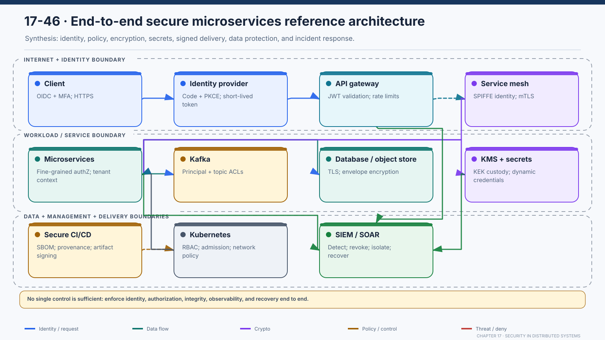

Use this as a release and architecture-review checklist. A checked item should have evidence: a test, policy, configuration, dashboard, runbook, or owner.

## Architecture and threat model

- [ ] Assets, data classes, principals, entry points, and trust boundaries are documented.
- [ ] STRIDE/abuse-case review includes browser, APIs, services, brokers, databases, cloud control plane, CI/CD, and operators.
- [ ] Tenant isolation is enforced server-side and tested with cross-tenant negative cases.
- [ ] Threats have owners, mitigations, residual-risk decisions, and review triggers.

## Identity and authorization

- [ ] Human login uses modern federation/MFA appropriate to risk.
- [ ] OAuth authorization code uses PKCE; redirect URIs are exact-matched.
- [ ] APIs distinguish ID tokens from access tokens and validate issuer/audience/time/signature.
- [ ] Workloads have unique short-lived identities; static credentials are avoided where possible.
- [ ] Every sensitive action is authorized at the resource and tenant boundary.
- [ ] Privileged access is time-bound, approved, logged, and reviewed.

## Transport and cryptography

- [ ] TLS is used for all relevant external and internal paths.
- [ ] Certificate identity, hostname, chain, validity, and key usage are validated.
- [ ] mTLS is deployed for workload channels where required by the threat model.
- [ ] Modern algorithms and AEAD modes are used through vetted libraries.
- [ ] Nonce uniqueness, key separation, key usage limits, and cryptographic agility are addressed.
- [ ] At-rest, backup, snapshot, replication, and log encryption are covered.

## Secrets and keys

- [ ] Secrets are not in source, images, logs, traces, or test fixtures.
- [ ] Secrets are stored in approved managers with least-privilege policies.
- [ ] Short-lived/dynamic credentials are used for supported workloads.
- [ ] Rotation, revocation, emergency response, and disaster recovery are tested.
- [ ] KMS/HSM policies separate key administration from application data access.

## Infrastructure, data, and messaging

- [ ] Database roles are service-specific; RLS/tenant checks are tested.
- [ ] Broker principals have topic/group-level permissions and quotas.
- [ ] Object storage is private by default and presigned URLs are scoped and short-lived.
- [ ] Kubernetes API, etcd, nodes, pods, admission, RBAC, and network policies are hardened.
- [ ] Container images are pinned, scanned, signed, and verified at deployment.

## Software supply chain

- [ ] CI runners are isolated and ephemeral where feasible.
- [ ] CI uses short-lived federated cloud credentials rather than static long-lived keys.
- [ ] Dependencies are pinned, inventoried, scanned, and updated through a managed process.
- [ ] SBOM and build provenance are produced and retained.
- [ ] Artifact signatures and builder identities are verified before deployment.

## Operations and incident response

- [ ] Logs include identity, outcome, resource, timestamp, policy version, and correlation ID without raw secrets.
- [ ] Alerts cover token/credential misuse, secret access, policy changes, certificate expiry, unusual east-west traffic, and data egress.
- [ ] Revocation and containment can be executed without depending on the compromised identity.
- [ ] Incident response includes evidence preservation, tenant-impact assessment, recovery, and post-incident review.
- [ ] Load, regional failure, IdP/KMS outage, certificate rollover, and secret rotation are tested.

## Final architecture review prompts

1. Which single identity compromise would have the largest blast radius, and what prevents it from reaching unrelated services?
2. Where is authorization actually enforced if the gateway is bypassed?
3. What happens when the IdP, KMS, secret manager, policy engine, CA, or audit pipeline is unavailable?
4. How quickly can a stolen token, private key, certificate, or cloud credential be invalidated?
5. Can the team prove which artifact was deployed, who approved it, and what source/build inputs produced it?
6. Which assumptions distinguish the system's crash-fault, Byzantine, or economic-consensus guarantees?
7. What evidence would be available 30 minutes after a suspected lateral-movement incident?

---

**End of Chapter 17 — Security in Distributed Systems.**
