# Chapter 18 — Verification and Testing in Distributed Systems

**Filename:** `18-verification-and-testing.md`  
**Scope:** formal specification, model checking, fault injection, property-based testing, simulation, operational verification, and production assurance.

> **Reading note.** This chapter distinguishes (a) mathematical guarantees under explicit assumptions, (b) properties checked by a bounded or finite model, (c) properties observed in a test campaign, and (d) behavior documented by a vendor for a particular product version. These are not interchangeable. Historical test findings are tied to their tested versions and should not be read as claims about current releases.

## Learning objectives

After studying this chapter, a reader should be able to turn system requirements into safety and liveness properties; define a useful fault model; write and inspect small TLA+ specifications; explain what TLC and symbolic model checkers do and do not establish; design Jepsen-style histories and checkers; build property-based and deterministic simulation tests; plan safe chaos experiments; verify consensus, replication, storage, messaging, and transaction workflows; and assemble a verification pipeline that preserves reproducible evidence.

## Table of contents

- [1. Introduction to Verification and Testing](#1-introduction-to-verification-and-testing)
  - [1.1 Testing Distributed Systems at Different Levels](#11-testing-distributed-systems-at-different-levels)
  - [1.2 Correctness in Distributed Systems](#12-correctness-in-distributed-systems)
- [2. Testing Foundations and Distributed System Models](#2-testing-foundations-and-distributed-system-models)
  - [2.1 System Models](#21-system-models)
  - [2.2 Histories and Executions](#22-histories-and-executions)
  - [2.3 Invariants](#23-invariants)
- [3. Formal Methods and Formal Specification](#3-formal-methods-and-formal-specification)
- [4. TLA+ — Temporal Logic of Actions](#4-tla--temporal-logic-of-actions)
  - [4.1 Introduction to TLA+](#41-introduction-to-tla)
  - [4.2 TLA+ Mathematical Foundations](#42-tla-mathematical-foundations)
  - [4.3 State and Transition Modeling](#43-state-and-transition-modeling)
  - [4.4 Safety and Liveness in TLA+](#44-safety-and-liveness-in-tla)
  - [4.5 Model Checking with TLC](#45-model-checking-with-tlc)
  - [4.6 TLA+ PlusCal](#46-tla-pluscal)
  - [4.7 TLA+ Case Studies](#47-tla-case-studies)
  - [4.8 TLA+ Tools and Workflow](#48-tla-tools-and-workflow)
- [5. Jepsen Testing](#5-jepsen-testing)
- [6. Property-Based Testing](#6-property-based-testing)
- [7. Simulation Testing](#7-simulation-testing)
- [8. Fault Injection and Chaos Engineering](#8-fault-injection-and-chaos-engineering)
- [9. Testing Consensus and Replication Protocols](#9-testing-consensus-and-replication-protocols)
- [10. Testing Distributed Transactions](#10-testing-distributed-transactions)
- [11. Testing Storage and Messaging Systems](#11-testing-storage-and-messaging-systems)
- [12. Testing Consistency and Linearizability](#12-testing-consistency-and-linearizability)
- [13. Performance, Load, and Stress Testing](#13-performance-load-and-stress-testing)
- [14. Testing Security and Byzantine Behavior](#14-testing-security-and-byzantine-behavior)
- [15. Verification in CI/CD and Production](#15-verification-in-cicd-and-production)
- [16. Real-World Case Studies](#16-real-world-case-studies)
- [17. Quantitative Worked Examples and Formulas](#17-quantitative-worked-examples-and-formulas)
- [18. System Design and Verification Exercises](#18-system-design-and-verification-exercises)
- [19. Interview Preparation — 180 Questions and Answers](#19-interview-preparation--180-questions-and-answers)
- [20. Common Mistakes and Anti-Patterns](#20-common-mistakes-and-anti-patterns)
- [21. Revision and Quick Reference](#21-revision-and-quick-reference)
- [22. Glossary](#22-glossary)
- [23. SVG Diagram Plan](#23-svg-diagram-plan)
- [24. References and Further Reading](#24-references-and-further-reading)

---

# 1. Introduction to Verification and Testing

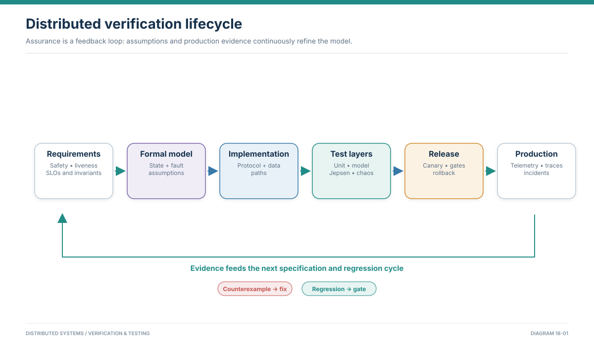

Distributed systems verification is the disciplined process of establishing evidence that a system's behavior satisfies its requirements under stated operating conditions and failure assumptions. Testing executes an implementation or model and compares observed behavior with an oracle: an expected result, invariant, protocol rule, or formal specification. Verification is broader than executing tests. It includes specification review, mathematical reasoning, model checking, runtime assertions, fault injection, operational evidence, and analysis of production histories.

A centralized program often has one process, one address space, and a relatively direct execution order. A distributed service has multiple processes that progress independently and communicate through channels that can delay, lose, duplicate, or reorder messages. Nodes can fail separately. A request can be committed even when its acknowledgement is lost. Two clocks can disagree. A restarted process may recover durable state but lose volatile state. Therefore, a test must reason not only about returned values but also about concurrency, histories, durability, membership, and recovery.

## 1.1 Testing Distributed Systems at Different Levels

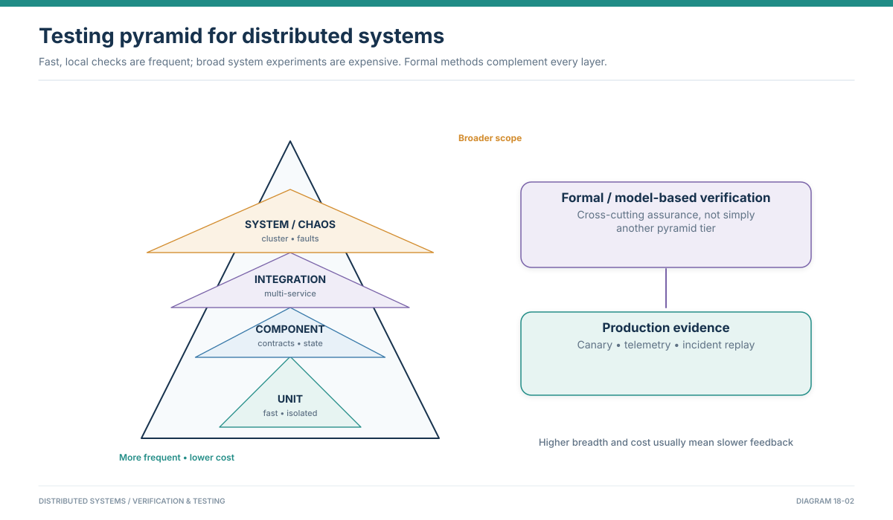

No single testing technique gives complete confidence. A layered strategy uses cheap, deterministic checks frequently and expensive, broad experiments at controlled intervals.

| Technique | What it validates | Typical defects found | Main limitation | Relative cost | When to use |
|---|---|---|---|---|---|
| Unit testing | A function or isolated state transition | Boundary errors, incorrect predicates, serialization bugs | Does not exercise deployment or concurrency | Low | Every commit |
| Component testing | A service with local dependencies or fakes | Adapter errors, retry policy defects, local state bugs | Fakes may not match real dependencies | Low–medium | Every pull request |
| Integration testing | Real components interacting | Schema, protocol, configuration, and integration defects | Small scenario coverage; often healthy-network biased | Medium | Pull requests and nightly |
| Contract testing | Producer/consumer API assumptions | Schema drift, incompatible semantics, invalid assumptions | Does not prove runtime reliability | Low–medium | Service boundary changes |
| End-to-end testing | User-visible workflows | Wiring, authentication, orchestration, deployment defects | Slow, brittle, hard to diagnose | High | Release and smoke suites |
| System testing | Whole deployed system against requirements | Cross-service failures and operational regressions | Environment and workload may be unrepresentative | High | Pre-release and staging |
| Performance testing | Latency, throughput, resource behavior | Saturation, queueing, contention, regressions | Passing one workload says little about others | Medium–high | Before release and continuously for critical paths |
| Stress testing | Behavior beyond expected capacity | Collapse modes, retry storms, resource exhaustion | Can damage shared environments | High | Isolated environments and planned windows |
| Soak testing | Long-duration stability | Leaks, compaction issues, drift, resource creep | Slow feedback | High | Nightly or pre-release |
| Chaos testing | Resilience to controlled faults | Failover, recovery, dependency, and cascading failure defects | Does not prove all failure combinations | High | Staging and carefully governed production |
| Formal verification | A mathematical model against a specification | Protocol design flaws, invariant violations, deadlocks | Model can omit implementation realities; proofs rely on assumptions | High upfront | High-consequence protocols and designs |
| Model checking | All reachable states in a finite model, or bounded symbolic executions | Rare interleavings, short counterexamples, deadlocks | State explosion and finite abstraction | Medium–high | Design review and CI for critical models |
| Simulation testing | Many controlled executions in virtual time | Timing, concurrency, recovery, and fault-sequence bugs | Simulator fidelity and shared code paths matter | Medium–high | Protocol and storage-engine development |

**Testing-level distinction.** Unit and component tests mainly establish local behavior. Integration and end-to-end tests establish that components cooperate in selected scenarios. Property-based testing broadens input and operation-sequence coverage. Model checking explores a defined state space. Jepsen-style testing checks histories from a real cluster under faults. Chaos engineering tests operational response to selected failures. Performance testing measures behavior under load. Each answers a different question.

### Verification vs. validation

- **Verification:** “Did we build the system according to its specification?” This includes checking that an implementation refines the intended model and that safety properties hold.
- **Validation:** “Does the specified system solve the real problem?” A perfectly implemented specification can still be wrong for users, omit a business rule, or make an unacceptable availability/performance trade-off.

A practical review asks both questions. For a payment service, verification may establish that a payment identifier is applied at most once. Validation asks whether the business workflow correctly handles refunds, partial capture, and a customer-visible pending state.

## 1.2 Correctness in Distributed Systems

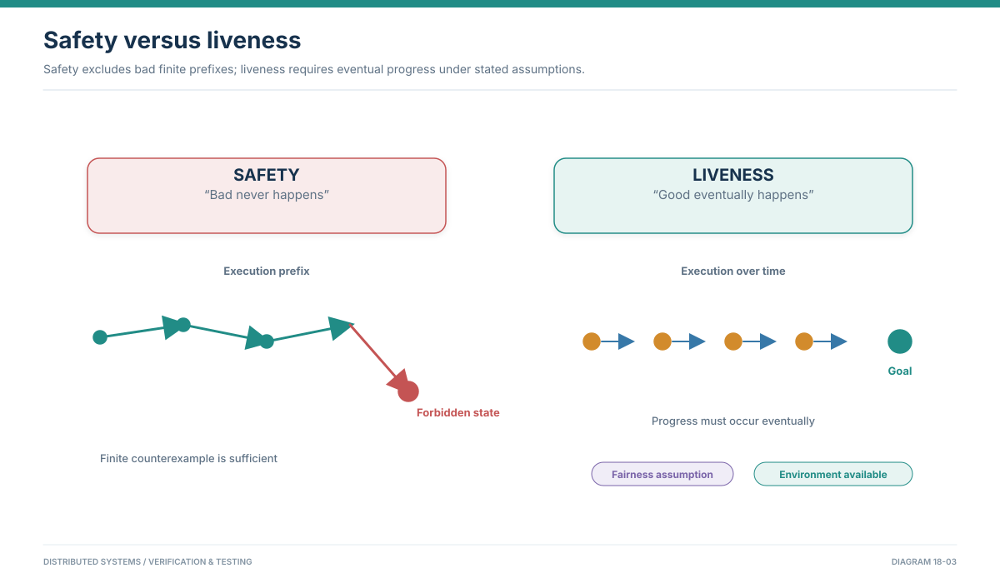

Correctness is not simply “the endpoint returned HTTP 200.” It is a relation between an execution and the contract the system promises. The contract may describe legal values, ordering, atomicity, durability, fault behavior, and progress.

### Safety, liveness, and recovery

A **safety property** says that something bad never happens. A finite execution prefix is enough to demonstrate a safety violation. Examples:

- Two clients are never simultaneously accepted as the owner of one exclusive lock.
- A committed log position never contains two different commands.
- A payment key never causes two charges.
- A committed transaction does not expose only an arbitrary subset of its atomic effects.

A **liveness property** says that something good eventually happens. A violation generally requires an infinite execution in which progress never occurs. Examples include a request eventually completing, a healthy majority eventually electing a leader, or a queued message eventually being processed.

**Recovery** is a distinct operational capability: once a fault is removed, the system returns to a valid and useful state within an acceptable time. Recovery often combines safety during failure with liveness after assumptions are restored. A node that permanently refuses to serve after a transient partition may remain safe but fail the recovery objective.

| Dimension | Question | Example test oracle |
|---|---|---|
| Safety | Did an illegal state or result ever occur? | No duplicate charge; no conflicting committed log entry |
| Liveness | Did required progress eventually occur under stated assumptions? | Pending write commits when a quorum is healthy |
| Recovery | Did the system converge to an operational state after fault removal? | Replica catches up; service meets recovery-time objective |
| Availability | Can a request receive a successful response now? | Success rate during a partition, with semantics defined |
| Durability | Does an acknowledged commit survive the declared failure model? | Crash/restart and storage-loss experiment |
| Consistency | Are observed values/history allowed by the consistency contract? | Linearizability or transaction-history checker |

### Consistency and atomicity vocabulary

- **Atomicity:** an operation or transaction takes effect as one indivisible logical unit, or has no effect, according to the contract.
- **Linearizability:** each operation appears to take effect at one instant between invocation and response, preserving real-time order for non-overlapping operations.
- **Sequential consistency:** operations appear in one total order that preserves each process's program order; real-time order across processes is not required.
- **Causal consistency:** causally related operations are observed in an order consistent with causality; concurrent operations may be observed in different orders.
- **Eventual consistency:** if updates stop and communication/reconciliation assumptions hold, replicas eventually converge. It does not itself define a useful bound or prevent stale reads.
- **Durability:** once the system acknowledges an operation at the promised durability level, the operation survives the failures included in that promise.
- **Fault tolerance:** the system continues to satisfy specified properties despite a bounded class or number of failures.

Examples: a bank transfer needs an invariant such as total funds conserved, plus atomic visibility of debit and credit. A distributed lock needs fencing or an equivalent resource-side check because an expired owner may resume. A payment workflow needs idempotency across lost acknowledgements. A consensus protocol needs agreement and leader/log safety even when liveness temporarily stops.

A system may be available while incorrect: a partitioned replica can return a stale value quickly. It may be correct but unavailable: a quorum protocol can reject writes rather than risk conflicting commits. It may be safe and unavailable during a fault yet recover once a quorum returns. Requirements must say which trade-off is intended.

---

# 2. Testing Foundations and Distributed System Models

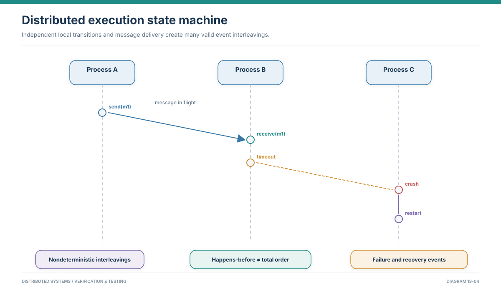

A useful test model describes the state that matters and the transitions that can change it. A distributed execution is not necessarily one global sequence of simultaneous events. Each process has a local order; messages and synchronization events connect those orders into a partial order.

A model commonly includes:

- **System state:** all modeled variables at one logical instant, such as replica logs, current terms, leases, balances, and pending requests.
- **Initial conditions:** permitted starting states, including empty stores, recovered stores, or arbitrary valid snapshots.
- **Events and inputs:** client requests, message arrivals, timer expirations, disk completions, crashes, and operator actions.
- **Outputs:** responses, committed records, emitted messages, metrics, and externally visible side effects.
- **Process state:** volatile memory, role, term, local progress, and process lifecycle.
- **Network state:** in-flight messages, partitions, delay queues, duplication, reordering, and dropped packets.
- **Failure state:** crashed, paused, restarted, isolated, or Byzantine processes.
- **Execution history:** the externally visible sequence or partial order of invocations, completions, and events.

An action maps a state to one or more possible next states. Multiple enabled actions create nondeterminism: the model may choose any legal transition next. Nondeterminism is useful because it represents concurrency and unspecified scheduling rather than pretending that a single schedule is inevitable.

## 2.1 System Models

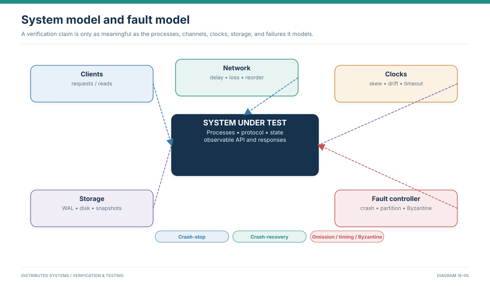

A correctness argument is always relative to an assumed model of time, communication, and failure. A test that omits an allowed fault does not validate behavior under that fault.

### Timing models

- **Synchronous:** known upper bounds exist for message delay and processing time, and clocks/timers can support those assumptions. This is a strong model and often unrealistic across the public internet.
- **Asynchronous:** there are no known upper bounds on message delay or process speed. A slow process cannot always be distinguished from a failed one based only on silence.
- **Partially synchronous:** bounds may hold only after an unknown stabilization time, or may exist but be unknown to the algorithm. Many practical consensus liveness arguments use assumptions of this kind.

### Failure models

| Failure model | Meaning | Testing implication |
|---|---|---|
| Crash-stop | A process halts and never returns | Remove node; verify quorum and safety |
| Crash-recovery | A process may restart with durable state but lose volatile state | Restart repeatedly at persistence boundaries |
| Omission | A process or channel fails to send/receive selected messages | Drop requests, replies, heartbeats, or acknowledgements independently |
| Timing | Messages or processing exceed expected deadlines | Delay messages, pause processes, skew clocks |
| Network partition | Nodes are split into groups that cannot communicate across the cut | Verify quorum behavior and divergent local views |
| Byzantine | A node may send arbitrary, conflicting, or malicious messages | Inject equivocation, malformed messages, invalid signatures, and collusion within the model's bound |

Failure assumptions determine what can be guaranteed. For example, majority-based crash-fault consensus tolerates up to `f` unavailable members in a cluster of `2f + 1`, assuming the protocol's storage and timing assumptions. Byzantine consensus commonly requires at least `3f + 1` replicas to tolerate `f` Byzantine faults under the classic authenticated partially synchronous model. The formulas are not universal substitutes for the actual protocol assumptions.

A proof under crash-stop failures does not cover malicious equivocation. A model with reliable messages does not validate packet loss. A test that restarts processes but never loses un-fsynced writes does not establish power-loss durability.

## 2.2 Histories and Executions

A **history** records externally visible operations. For a read/write object, an operation is often represented by an invocation and a response:

```text
process P1: invoke write(x, 5)  ---------------- return ok
process P2:       invoke read(x) ------- return 5
```

The invocation precedes the response for one operation. Two operations overlap when neither operation's response precedes the other's invocation. A **sequential history** has no overlap. A **concurrent history** includes overlapping operations and therefore admits multiple candidate serializations.

A history may contain:

- completed operations, with both invocation and response;
- pending operations, invoked but not yet completed when observation ends;
- failed operations, whose contract must clarify whether the effect is impossible, possible, or unknown;
- informational events such as process start/stop and fault boundaries.

The **happens-before** relation captures causal ordering. For example, program order inside one process, send-before-receive for a message, and transitivity establish happens-before edges. Concurrent events have no happens-before relation. Lamport's relation is a partial order, not a global physical timestamp.

### Linearization points

A linearization point is the conceptual instant at which a concurrent operation takes effect in a legal sequential history. It must lie between invocation and response. For a quorum write, the point may be tied to a protocol-defined commit event; it is not automatically the moment the client sends the request or one replica stores bytes. Identifying the point is a design argument that tests can challenge.

When checking a history, a checker searches for a legal sequential ordering that respects real-time precedence for non-overlapping operations and the object's sequential specification. If no ordering exists, the history is a counterexample. For transactions, checkers may need dependency graphs rather than only one-object linearizability.

Example: `write(x, 7)` returns at time 10; `read(x)` is invoked at time 11 and returns 4. Because the write completed before the read began, no legal linearization may place the read before that write. The read violates linearizability if the object contract says the write succeeded and remained visible.

## 2.3 Invariants

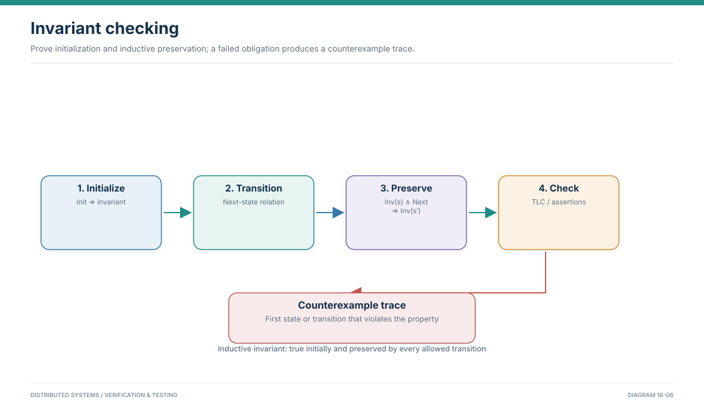

An **invariant** is a predicate that must hold in every reachable state. If `I(s)` is the predicate over state `s`, then the proof obligation is:

1. **Initialization:** every allowed initial state satisfies `I`.
2. **Inductiveness:** for every permitted transition `s -> s'`, `I(s)` implies `I(s')`.

A predicate can be true initially and still fail after a transition. An assertion placed only at startup is not enough. Invariants may be checked in unit/property tests, continuously in a simulator, as runtime assertions, by TLC over a finite model, or in a proof.

| Invariant class | Example | Typical check |
|---|---|---|
| State invariant | One active lock owner at most | Assert over every modeled state |
| Transition invariant | A successful CAS changes the value only if its precondition held | Check action relation |
| Data invariant | Debits and credits preserve the ledger total | Property or transaction checker |
| Safety invariant | Committed log entries never conflict at one index | Model checker and history checker |
| Conservation property | Sum of balances remains unchanged during internal transfer | Stateful property test |

Examples:

- Under the business rule that overdrafts are disallowed, every account balance remains non-negative.
- A lock service must not issue two simultaneously valid grants for the same lock. If leases can expire, the protected resource should also reject stale fencing tokens.
- Replicas must not apply different commands at the same committed log position.
- An idempotency key must map to one logical payment outcome, not multiple debits.
- A primary identifier must not resolve to two conflicting records.

A practical invariant should specify scope and assumptions. “Balances are non-negative” is false if fees or overdrafts are permitted. “Replicas eventually agree” needs a quiescence and communication assumption. “A lock has one owner” must distinguish lease validity from a paused former owner that still attempts external writes.

Runtime invariants are useful for early detection but may be incomplete, sampled, or disabled in production. Tests exercise selected executions. Formal models explore the transitions they encode. Confidence comes from using several methods and reviewing the gap between model and implementation.

---

# 3. Formal Methods and Formal Specification

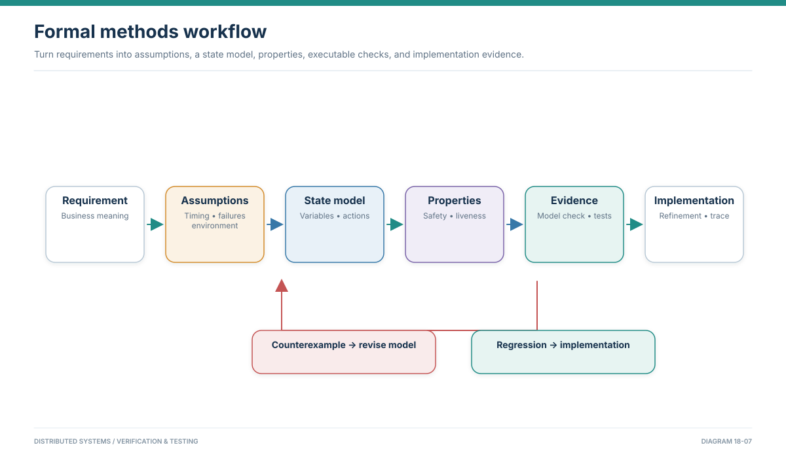

**Formal methods** use mathematical descriptions and reasoning to analyze whether a system satisfies a precise contract. They range from lightweight preconditions and invariants to model checking and machine-checked proofs. Their central benefit is precision: ambiguous words such as “exactly once,” “safe,” “leader,” or “committed” must be converted into predicates and transition rules.

### From requirement to evidence

Consider the statement: “A payment is never charged twice.” This is incomplete. Does “charged” mean a request accepted by the API, a ledger debit, a card-network authorization, or settlement? What happens after a timeout where the client does not know whether the provider committed? A formalizable version might say:

> For every idempotency key `k`, the ledger contains at most one successful debit associated with `k`; retrying the same logical request returns the stored outcome or a semantically equivalent status.

This can be refined into an invariant over ledger state and a transition rule for `SubmitPayment(k, request)`. The implementation can then be tested with duplicates, concurrency, restarts, and lost acknowledgements.

| Artifact | Form | What it contributes | What it does not establish alone |
|---|---|---|---|
| Informal requirement | Natural language | Intent and user/business context | Exact semantics |
| Executable test | Code plus examples | Evidence for selected executions | All possible behaviors |
| Formal specification | Mathematical state/actions/properties | Unambiguous behavior contract | Correctness of unmodeled implementation details |
| Model-checking result | Exhaustive or bounded exploration result | Counterexamples or no counterexample within model/configuration | Correctness outside the explored abstraction/bounds |
| Mathematical proof | Derivation from axioms and assumptions | Theorem under explicit premises | Correctness of code, hardware, compiler, or assumptions unless included |

### Core techniques

- **State-based modeling:** define variables representing the abstract state and actions defining legal transitions.
- **Transition systems:** represent the system as states plus a transition relation.
- **Temporal logic:** express properties over sequences of states, including “always,” “eventually,” and “leads to.”
- **Preconditions/postconditions:** specify what must hold before an operation and what must hold after it completes.
- **Refinement:** show that each implementation behavior corresponds to an allowed abstract behavior, often hiding implementation steps as stuttering.
- **Model checking:** automatically explore a finite or bounded state space for invariant violations, deadlocks, or temporal-property failures.
- **Theorem proving:** prove a mathematical statement using proof rules and assumptions; interactive proof assistants can check proof construction.

### When formal methods are worth the cost

They are especially valuable when a small protocol controls a large amount of state or money; when concurrency creates many plausible interleavings; when a bug could corrupt data irreversibly; when the protocol is difficult to test exhaustively; or when a design needs a precise contract across teams. Consensus, leases, distributed transactions, replication, configuration changes, and payment idempotency are strong candidates.

Formal methods are not free. Modeling requires expertise, abstraction choices require review, state spaces can explode, and a model can be wrong or disconnected from code. A small but accurate model with explicit assumptions is more valuable than a huge model that merely resembles the implementation. The objective is not to formalize every line of application code; it is to formalize the correctness-critical decisions and state transitions.

### A practical specification workflow

1. Write user-visible guarantees and failure assumptions in plain language.
2. Identify state variables and the smallest useful abstract state.
3. Define initial states and all state-changing actions.
4. State safety invariants and liveness goals separately.
5. Add fairness and environmental assumptions only where justified.
6. Model-check small configurations and inspect every counterexample.
7. Refine the model where it was too abstract or incorrect; do not weaken a property merely to obtain a green result.
8. Map model variables/actions to implementation components, persistence points, and RPCs.
9. Derive property tests and fault-injection scenarios from the model.
10. Preserve the model, configuration, tool version, result, and rationale with the design.

---

# 4. TLA+ — Temporal Logic of Actions

TLA+ (Temporal Logic of Actions) is a specification language for describing and reasoning about concurrent and distributed systems. It combines ordinary mathematics for describing states and actions with temporal logic for describing whole behaviors. Leslie Lamport developed TLA and TLA+ to make system designs precise enough to reason about before implementation. The key idea is to specify what state changes are allowed rather than narrating one expected execution.

TLA+ is particularly effective for algorithms with concurrency, retries, timeouts, membership changes, and failure recovery. It can expose a design flaw before an implementation exists. It does not automatically prove that the implementation matches the model; refinement and implementation testing remain necessary.

## 4.1 Introduction to TLA+

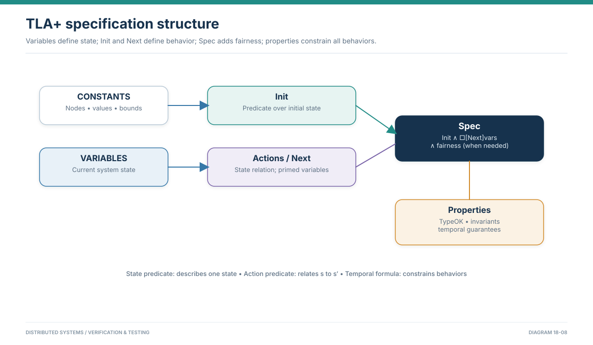

A TLA+ specification normally identifies:

- variables that describe the abstract state;
- an `Init` predicate describing initial states;
- a `Next` action describing permitted state transitions;
- a `Spec` temporal formula describing legal behaviors;
- invariants and temporal properties to check.

A behavior is an infinite sequence of states. Finite executions can be viewed as prefixes of such behaviors. Actions can be nondeterministic: they may permit several possible next states. This is how one compact specification represents many schedules and interleavings.

The standard skeleton is:

```tla
---------------- MODULE Example ----------------
VARIABLES x
vars == <<x>>

Init == x = 0

Inc == x' = x + 1

Next == Inc

Spec == Init /\ [][Next]_vars

TypeOK == x \in Nat
=================================================
```

`x` is the current-state value; `x'` is the next-state value. `[][Next]_vars` allows a next-state step satisfying `Next`, or a stuttering step in which the listed variables do not change. The module above is deliberately simple; TLC should be configured with a finite bound or a finite domain if an unbounded state variable would otherwise create an infinite state space.

## 4.2 TLA+ Mathematical Foundations

TLA+ expressions are mathematical rather than imperative assignments.

| Construct | Meaning | Example |
|---|---|---|
| Set | Unordered collection of distinct values | `Nodes == {n1, n2, n3}` |
| Tuple | Ordered fixed-length sequence | `<<client, key, value>>` |
| Sequence | Indexed ordered collection | `Append(<<1,2>>, 3)` |
| Function | Mapping from a domain to values | `balance \in [Accounts -> Nat]` |
| Record | Named fields | `[term |-> 2, role |-> "leader"]` |
| Predicate | Boolean expression over state | `count <= MaxCount` |
| Quantifier | Statement over a set/domain | `\A n \in Nodes : alive[n]` |
| Set comprehension | Set built from values satisfying a predicate | `{n \in Nodes : alive[n]}` |
| Operator | Reusable expression or predicate | `Quorum(s) == Cardinality(s) > N/2` |

Important notation:

- `=` means equality; `/\` is conjunction; `\/` is disjunction; `~` is negation; `=>` is implication.
- `\A x \in S : P(x)` means for every `x` in `S`, `P(x)` holds. `\E` means there exists.
- `x'` denotes the value of variable `x` in the next state.
- `UNCHANGED x` means `x' = x`. `UNCHANGED vars` means every variable in the tuple `vars` is unchanged.
- `[]P` means `P` is always true in every state of the behavior.
- `<>P` means `P` eventually becomes true in some state.
- `P ~> Q` means whenever `P` holds, `Q` eventually holds (possibly already in the current state).
- `ENABLED A` means action `A` is enabled in the current state: at least one next state satisfies it.
- `WF_vars(A)` is weak fairness: if `A` remains continuously enabled, it must eventually occur.
- `SF_vars(A)` is strong fairness: if `A` is enabled infinitely often, it must occur infinitely often (subject to the precise TLA+ fairness semantics).
- `Init` names the initial-state predicate; `Next` names the next-state relation; `Spec` usually combines initialization, next-state behavior, and fairness constraints.

A state predicate refers to one state. An action predicate relates a current state to a next state. A temporal formula refers to a complete behavior. Confusing these levels is a common source of incorrect specifications.

### `Init`, `Next`, and `Spec`

`Init` constrains initial values. `Next` is usually a disjunction of named actions:

```tla
Next == SendRequest \/ ReceiveRequest \/ CrashNode \/ RecoverNode
```

Each action may update only some variables and should explicitly constrain the others with `UNCHANGED`. `Spec` is often:

```tla
Spec == Init /\ [][Next]_vars
```

Fairness can be added for actions that the model assumes will not be postponed forever:

```tla
Spec == Init /\ [][Next]_vars /\ WF_vars(DeliverMessage)
```

Fairness is an environmental or scheduler assumption, not a magic property of the implementation. Adding it can exclude behaviors in which a message is delayed forever. Do so only if the operational model justifies eventual delivery or scheduling.

### Stuttering and nondeterminism

A stuttering step leaves the variables in `vars` unchanged. It is important because an implementation may take internal steps that are invisible at the abstraction level. Nondeterminism means an action permits a set of possible next states. For a request, the model may allow either delivery or delay, and a crash may happen before or after a message is sent. A model checker explores these alternatives within the selected state space.

## 4.3 State and Transition Modeling

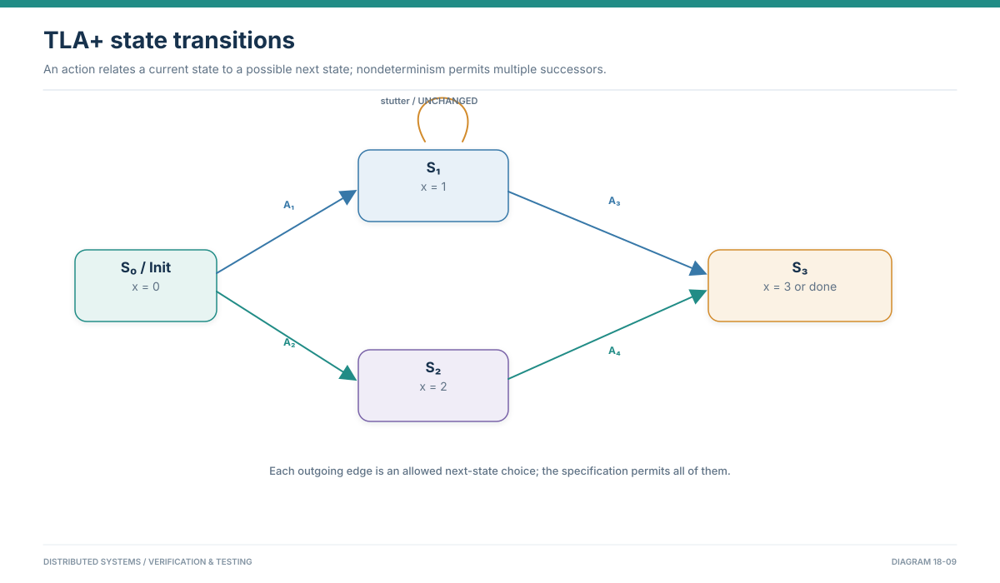

Suppose a replicated integer register has three replicas, a committed value, and messages in transit. One simplified abstraction is:

```tla
---------------- MODULE ReplicatedRegister ----------------
EXTENDS Naturals, FiniteSets
CONSTANTS Nodes, Values
ASSUME Nodes # {} /\ Values # {}
VARIABLES value, pending
vars == <<value, pending>>

Init ==
  /\ value \in [Nodes -> Values]
  /\ pending = {}

Write(n, v) ==
  /\ n \in Nodes
  /\ v \in Values
  /\ pending' = pending \cup {<<n, v>>}
  /\ UNCHANGED value

Deliver(msg) ==
  /\ msg \in pending
  /\ value' = [value EXCEPT ![msg[1]] = msg[2]]
  /\ pending' = pending \ {msg}

Next == \E n \in Nodes, v \in Values : Write(n, v)
        \/ \E msg \in pending : Deliver(msg)

Spec == Init /\ [][Next]_vars
=================================================
```

This is a teaching model, not a production replication protocol: it has no ordering rule, quorum, conflict resolution, or authoritative commit record. It is useful because its omissions are visible. If the requirement is “all replicas eventually converge after writes stop and all messages are delivered,” one must add assumptions and a convergence property. If concurrent writes are allowed, a conflict-resolution rule must define which value wins.

A distributed counter could instead model a map of per-node increments and define the visible count as their sum. A replicated state machine would model an ordered committed log and an apply index. The right abstraction is the smallest state that still preserves the property being checked.

## 4.4 Safety and Liveness in TLA+

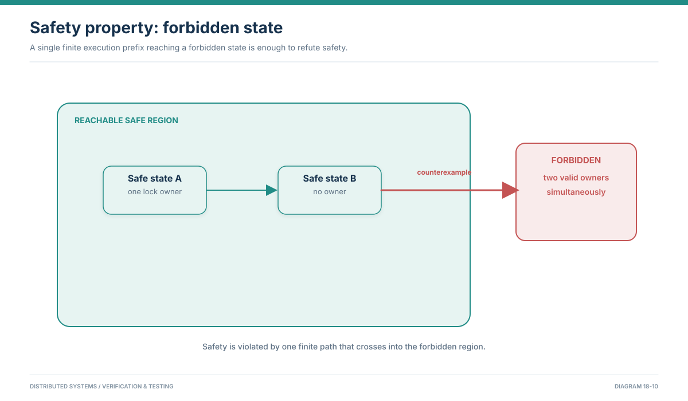

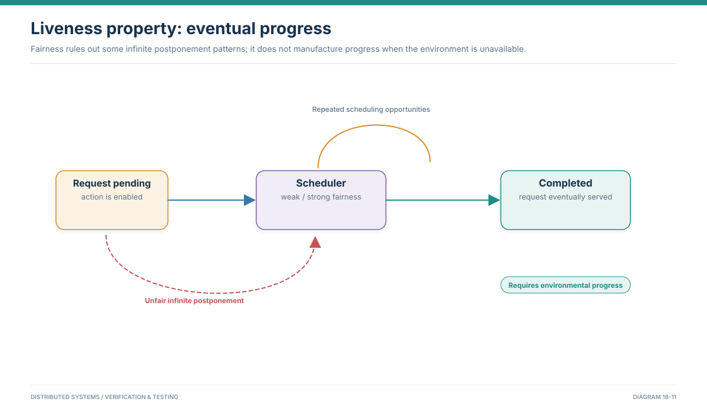

A safety property is commonly written as an invariant predicate `Inv` and checked as:

```tla
THEOREM Spec => []Inv
```

Examples include mutual exclusion, no conflicting committed entries, no negative balances, and type correctness. If a counterexample exists, the trace gives a finite sequence of states that reaches a violation.

Liveness properties use temporal formulas. Examples:

```tla
RequestPending ~> RequestCompleted
Leaderless ~> HasLeader
```

These are meaningful only under assumptions. If every message may be delayed forever, “requests eventually complete” is not generally provable. If every node can crash permanently, leader election is not guaranteed. A liveness statement should name assumptions such as eventual synchrony, a functioning quorum, eventual message delivery, fair scheduling, and bounded failure count.

**Weak fairness** is suitable when an action, once continuously enabled, must eventually run (for example, a scheduler eventually executes a continuously ready worker). **Strong fairness** is stronger and is useful when an action becomes enabled infinitely often but is repeatedly disabled in between. Strong fairness can be unrealistic or expensive; never add it merely to make a theorem pass.

Safety and liveness should be reviewed separately. A system can maintain mutual exclusion by never granting a lock; safety holds, liveness fails. A service can always answer by granting duplicate ownership; liveness holds, safety fails.

## 4.5 Model Checking with TLC

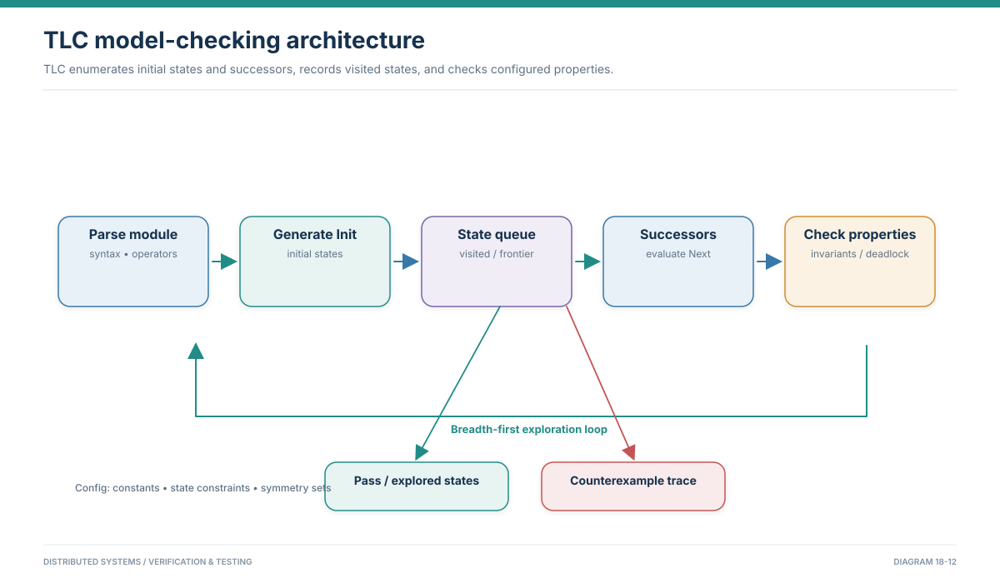

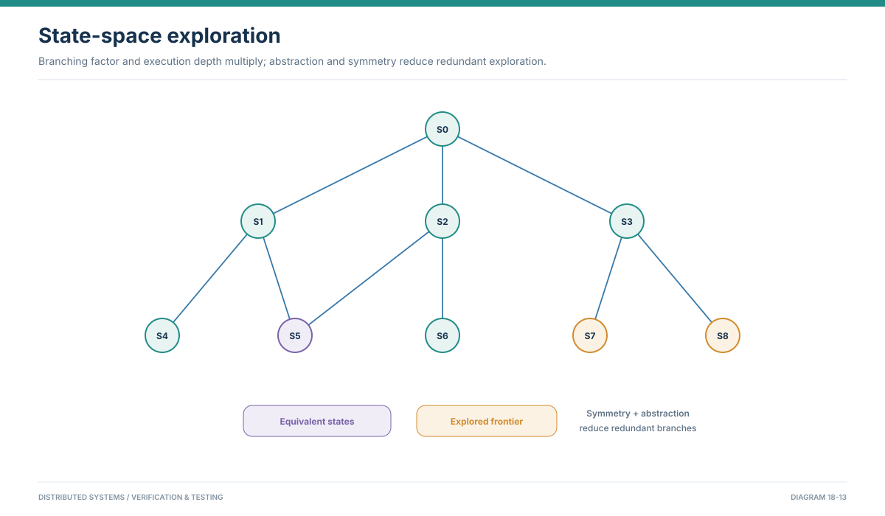

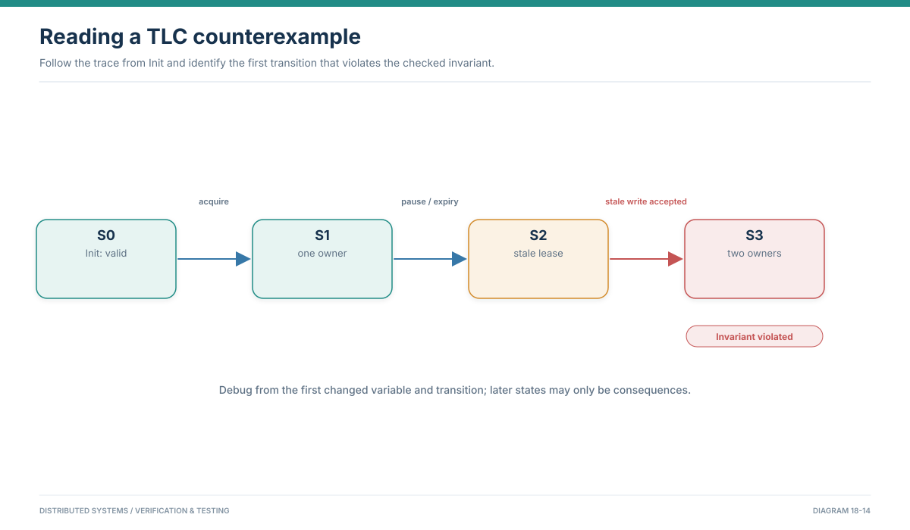

TLC is the explicit-state model checker for TLA+. It starts from states satisfying `Init`, evaluates enabled `Next` actions, adds successor states, and repeats until no new states remain or a configured limit/error is reached. It checks requested invariants and temporal properties over the explored model.

Typical workflow:

1. Write a module and a finite model configuration.
2. Define finite constants, such as three nodes and a small value set.
3. Select invariants (`TypeOK`, `Safety`, and other state predicates).
4. Select temporal properties if liveness is being checked.
5. Run TLC and capture the model parameters and tool version.
6. If TLC finds a violation, inspect the trace in order and identify the first transition that breaks the property.
7. Decide whether the counterexample reveals a real design flaw, an incorrect specification, or an intentionally excluded environment.

TLC can detect deadlocks (no enabled next-state transition) and produce counterexamples. It can use state constraints to bound a model and symmetry sets to reduce equivalent states. Constraints make exploration manageable but may exclude the exact behavior of interest; document every bound.

**State-space explosion** occurs because the number of combinations of process states, messages, values, timers, and interleavings grows rapidly. If each of `n` processes has `k` local states, a crude upper bound for local-state combinations is `k^n`, before accounting for messages and histories. Partial-order reductions, symmetry, abstraction, bounded values, and careful modeling help, but none eliminates the need to reason about coverage.

A green TLC run means that no checked property failed in the explored finite model and configuration. It is not a proof about arbitrary cluster sizes, unbounded integers, all implementation details, or real hardware unless a corresponding proof/refinement argument exists.

## 4.6 TLA+ PlusCal

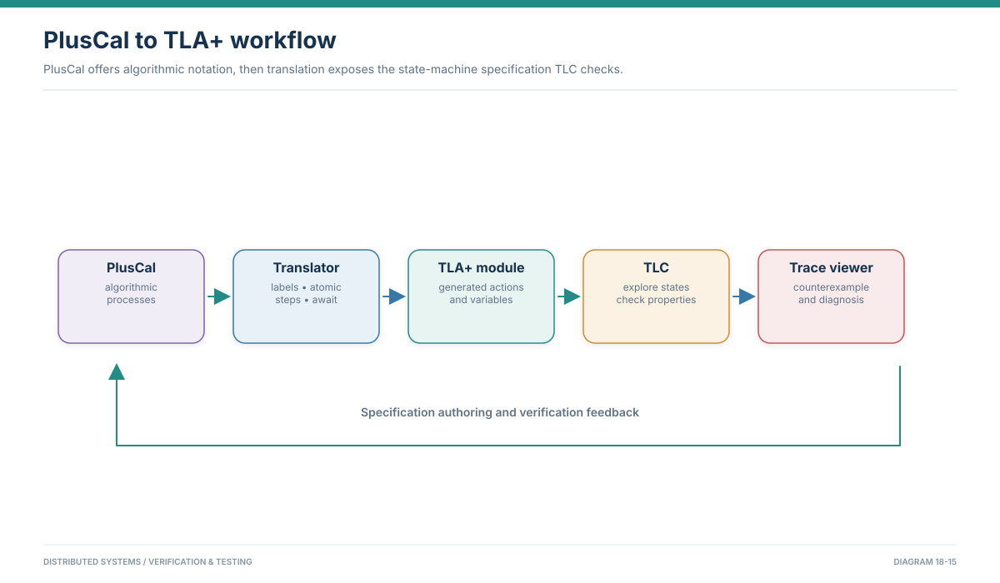

PlusCal is an algorithmic notation that translates into TLA+. It is useful for readers who find action-based TLA+ difficult to write directly. A PlusCal algorithm describes processes, labels, variables, atomic statements, and `await` conditions. Translation produces a TLA+ state-machine specification that TLC can analyze.

Conceptual example:

```text
--algorithm Counter {
  variables count = 0;
  process Worker \in {1, 2} {
  Start:
    count := count + 1;
    goto Done;
  Done:
    skip;
  }
}
```

The translated model explores the interleavings between worker processes. The increment statement's atomicity is determined by PlusCal's statement boundaries and labels. A direct TLA+ specification is often more concise for a mathematical protocol, while PlusCal may be more approachable for an algorithm with explicit control flow. Both ultimately require careful modeling and review.

## 4.7 TLA+ Case Studies

The following are compact specification blueprints. They are not complete production implementations; each names the state, actions, properties, and assumptions that a full model should refine.

### 1. Distributed counter

- **State:** `localCount \in [Nodes -> Nat]`; optionally `messages` for replication.
- **Initial state:** every local count is zero and no messages are pending.
- **Actions:** `Increment(n)` increases one local component; `Replicate(n,m)` transfers a component or delta; `Crash(n)` and `Recover(n)` model process lifecycle if persistence matters.
- **Invariant:** all local components are natural numbers; visible total equals the sum of components; no increment is lost in the chosen CRDT model.
- **Liveness:** after updates stop and communication resumes, every replica eventually has the same component map.
- **Assumptions/counterexamples:** duplicated delta delivery breaks a non-idempotent delta protocol unless deltas carry unique IDs or are merged idempotently. The model highlights the difference between a grow-only counter and a counter that supports decrements.

### 2. Mutual-exclusion lock

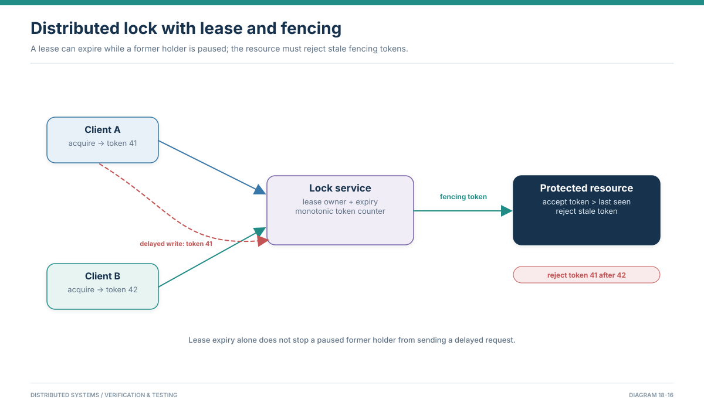

- **State:** `owner \in Nodes \cup {None}`, `leaseUntil`, `clock`, and possibly `fence`.
- **Actions:** acquire, renew, expire, release, pause, and resume.
- **Invariant:** at most one unexpired grant exists. A stronger resource invariant rejects operations with fencing token lower than the latest accepted token.
- **Liveness:** a waiting client eventually acquires the lock if the current owner releases/expires and the service can make progress.
- **Assumptions/counterexamples:** a client can pause past lease expiry and later resume. If the resource does not validate a fencing token, both old and new owners may perform effects even though the lock service itself has one current owner.

### 3. Producer-consumer queue

- **State:** queue contents, message IDs, in-flight deliveries, acknowledgements, and consumer status.
- **Actions:** enqueue, deliver, ack, timeout, redeliver, consumer crash/restart.
- **Invariant:** no acknowledged message is silently removed before its durable acceptance point; ordering is preserved if the contract requires FIFO within a partition.
- **Liveness:** every retained message is eventually delivered or moved to a declared terminal/dead-letter state, assuming a consumer and broker eventually recover.
- **Counterexample:** commit a consumer-side effect, crash before offset/ack commit, and redeliver. The model demonstrates why exactly-once side effects need idempotency or atomic coordination with the effect store.

### 4. Replicated key-value register

- **State:** per-replica values, versions, client operation IDs, and messages.
- **Actions:** local write, quorum acknowledgement, read, anti-entropy, and conflict resolution.
- **Invariant:** a returned value is permitted by the specified consistency model; a linearizable register additionally respects real-time order.
- **Liveness:** replicas converge after updates stop and reconciliation succeeds.
- **Counterexample:** two partitions accept conflicting writes and later apply last-writer-wins using unsynchronized physical clocks. The model exposes clock assumptions and data-loss semantics.

### 5. Leader election

- **State:** per-node role, term, vote, election timer, and messages.
- **Actions:** timeout, request vote, grant vote, receive append/heartbeat, crash, recover.
- **Invariant:** at most one leader per term (under protocol assumptions); terms never decrease for a node.
- **Liveness:** eventually some leader is elected under eventual synchrony with a live quorum and fair processing.
- **Counterexample:** missing term persistence or an incorrect vote rule can permit two leaders or repeated elections.

### 6. Two-phase commit (2PC)

- **State:** coordinator decision, participant states (`working`, `prepared`, `committed`, `aborted`), and messages.
- **Actions:** prepare, vote yes/no, decide commit/abort, log decision, notify participant, crash/recover.
- **Invariant:** no participant commits unless a durable global commit decision exists; participants do not make contradictory terminal decisions.
- **Liveness:** termination requires the coordinator or a recovery mechanism to reveal the durable decision; standard 2PC can block while participants are prepared and the coordinator is unavailable.
- **Counterexample:** coordinator sends `COMMIT` to one participant, crashes before durable decision/notification to others, then recovers without the log. This is why decision logging and recovery protocols matter.

### 7. Raft election and log replication

- **State:** `currentTerm`, `votedFor`, role, log, `commitIndex`, `lastApplied`, `nextIndex`, `matchIndex`, and messages.
- **Actions:** election timeout, request/grant vote, append entries, reply, commit, apply, crash/recover, membership change.
- **Invariants:** election safety; log matching; leader completeness; state-machine safety; no commit of an old-term entry solely by counting replicas unless the protocol's current-term rule is respected.
- **Liveness:** a stable majority and eventual communication allow a leader to emerge and entries to commit.
- **Counterexamples:** volatile vote state after restart, unsafe membership transition, or a stale leader accepting writes after losing quorum.

### 8. Distributed transaction workflow

- **State:** order status, payment status, inventory reservation, outbox rows, and event IDs.
- **Actions:** create order, reserve stock, charge payment, publish event, compensate, retry, crash/recover.
- **Invariant:** no fulfilled order without successful payment and stock allocation; each logical payment ID causes at most one debit.
- **Liveness:** every accepted workflow reaches success, explicit failure, or operator-visible manual-reconciliation state under recovery assumptions.
- **Counterexample:** payment succeeds but acknowledgement is lost, then an unsafe retry charges again.

### 9. Message acknowledgement and retry

- **State:** broker log/offset, consumer checkpoint, in-flight messages, side-effect ledger.
- **Actions:** poll, process, side effect, commit offset, timeout, redelivery, restart.
- **Invariant:** an offset never advances past work that the declared delivery contract considers unfinished; deduplication key maps to one side effect.
- **Liveness:** unprocessed retained messages eventually retry or reach a declared terminal state.
- **Counterexample:** offset commit precedes side effect and process crashes, causing loss; side effect precedes offset commit and crash causes duplicate delivery.

### 10. Lease-based distributed locking

- **State:** lease owner, expiration time, monotonically increasing fencing token, resource's greatest accepted token.
- **Actions:** grant, renew, expire, resume delayed client, resource write.
- **Invariant:** resource accepts only tokens at least as new as its stored token; lock service issues increasing tokens.
- **Liveness:** a new lease is granted after expiry when a quorum is available.
- **Counterexample:** clock assumptions or delayed renewal lead to stale owner writes. Model lease expiration separately from resource authorization.

## 4.8 TLA+ Tools and Workflow

- **TLA+ Toolbox:** desktop environment for editing specifications, configuring TLC, and inspecting states/traces.
- **TLC:** explicit-state model checker; strong for finite, concrete state exploration.
- **Apalache:** symbolic model checker for TLA+ that translates bounded verification problems into logical constraints for an SMT solver. Its supported fragment and bounded execution assumptions differ from TLC; check current documentation and tool maturity before relying on it.
- **PlusCal:** algorithmic notation that translates to TLA+.
- **VS Code support:** editor integrations improve syntax support and workflow; they do not change semantics.
- **CI integration:** parse and model-check a deliberately small configuration on pull requests; run larger configurations nightly or before release.
- **Specification review:** pair a protocol engineer with someone who challenges assumptions, checks action coverage, and maps abstract transitions to code.

“Bounded model checking” usually means exploring executions up to a chosen depth or bound, often symbolically. TLC's typical explicit-state workflow instead enumerates all reachable states in a finite model, subject to configured state constraints. Neither term should be used as a synonym for a mathematical proof over all unbounded executions.

---

# 5. Jepsen Testing

Jepsen is an open-source distributed-systems testing framework and a body of published analyses associated with Kyle Kingsbury and collaborators. Its central question is empirical: does a real, deployed system behave according to its documented consistency and safety claims when concurrent clients operate during realistic faults? Jepsen tests opaque-box binaries on clusters, generates operation histories, injects faults through a **nemesis**, and checks the histories against a model.

Unlike a unit test, which usually calls one function with a known input, a Jepsen test observes a distributed system through its public interface while many clients and faults interact. It is especially useful for finding bugs that appear only when acknowledgements are lost, clocks disagree, leaders change, replicas restart, or the network partitions.

## 5.1 What Is Jepsen?

The method combines four pieces:

1. **A real system under test** deployed with its supported configuration.
2. **A workload** that performs concurrent operations designed to distinguish correct from incorrect behavior.
3. **A fault schedule** that changes connectivity or process availability while operations are in progress.
4. **A checker** that examines the resulting history against a sequential specification, consistency model, or transaction invariant.

A test may discover an acknowledged write that disappears, a stale read, a lost update, two clients that both believe they own a lock, a transaction isolation anomaly, or a message-ordering violation. It may also reveal documentation ambiguity: a system can be internally consistent under its real semantics while its advertised wording leads users to expect a stronger guarantee.

Jepsen differs from ordinary integration testing in that failures are part of the workload, concurrent histories are retained for analysis, and a consistency checker determines whether the observed history is legal. It is not a proof of correctness. It is a systematic way to find concrete counterexamples in actual software.

## 5.2 Jepsen Architecture

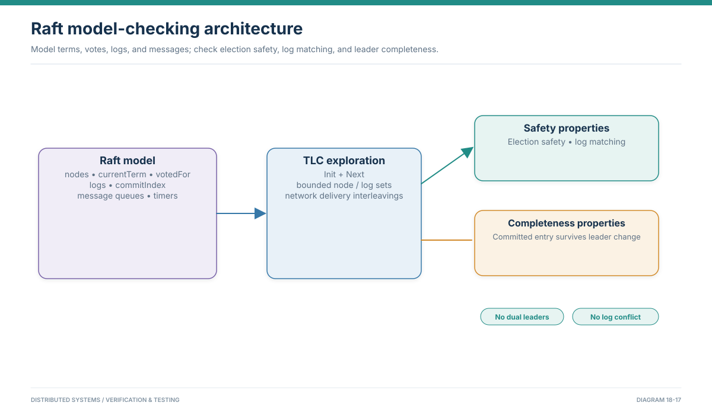

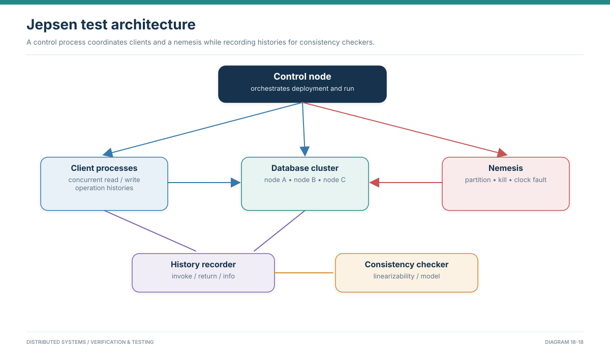

| Component | Responsibility | Design concern |
|---|---|---|
| Control node | Orchestrates deployment, clients, nemesis, and collection | Must coordinate clocks and preserve artifacts without becoming an unintended bottleneck |
| Database nodes | Run the actual database or service | Use documented production-like configuration and record exact versions |
| Client processes | Issue concurrent operations | Include process identity, operation ID, invocation and completion times |
| Workload generator | Produces reads, writes, transactions, CAS, appends, transfers, etc. | Must encode the contract's semantics, not just generate traffic |
| Nemesis | Injects faults such as partitions, pauses, kills, and clock changes | Fault schedule must be observable and safely bounded |
| History recorder | Stores requests, results, time intervals, and metadata | Retain enough detail to reconstruct ambiguity and causality |
| Checker | Tests whether the history is permitted | Select a model that matches the promised semantics |
| Report/triage | Summarizes violations and counterexample histories | Separate actual safety failures from checker/model mistakes |

### End-to-end execution lifecycle

1. **Deploy:** create a cluster with a fixed version, topology, and configuration. Record all parameters.
2. **Initialize:** create keys, tables, queues, users, or invariants needed by the workload.
3. **Run concurrent clients:** execute a mix of operations with unique IDs and explicit invocation/response events.
4. **Inject faults:** partition selected links, pause or kill nodes, manipulate clocks, or disrupt storage while clients continue.
5. **Collect history:** record successful, failed, and timed-out operations; retain the fault timeline.
6. **Heal:** remove the injected network/process faults.
7. **Recover:** allow re-election, repair, anti-entropy, catch-up, and compaction to run.
8. **Inspect final state:** compare all replicas or query the authoritative logical state where possible.
9. **Check:** run linearizability, register, queue, transaction, or custom invariant checkers.
10. **Report:** preserve the failing history, seed, fault schedule, logs, versions, and reduced reproduction.

The recovery phase matters. A system may provide acceptable responses during a partition but permanently lose acknowledged data after healing. Conversely, it may reject writes during the partition and correctly catch up afterward. A complete campaign examines both the fault interval and the healed cluster.

## 5.3 Jepsen Workloads

Common operations include:

- **Read/write register:** `read(k)` and `write(k,v)` test a single-value object.
- **Compare-and-set:** `cas(k, expected, new)` tests atomic conditional updates.
- **Append/list:** append unique tokens to a list and read it back; useful for ordering and loss detection.
- **Set:** add/remove unique elements and compare observed sets.
- **Queue:** enqueue/dequeue to test ordering, duplication, and loss.
- **Bank transfer:** move value between accounts while conserving a total and preventing forbidden balances.
- **Transaction:** issue multi-key operations to test atomicity and isolation.
- **Lock:** acquire/release a logical mutex and inspect overlapping ownership.
- **Watch/stream:** reconnect from a revision or offset and verify continuity and ordering.

A workload should be chosen from the claimed contract. If the service claims linearizable compare-and-set, simple independent writes are not enough. If a database claims serializable transactions, the workload needs read/write dependencies capable of exposing serialization cycles. If the claim is eventual convergence, record the quiescence point and the time allowed for replicas to converge.

A poor workload may miss the bug even if it runs for hours. Unique values, known invariants, concurrent conflicts, and read-back operations make incorrect histories observable.

## 5.4 Jepsen Nemesis and Fault Injection

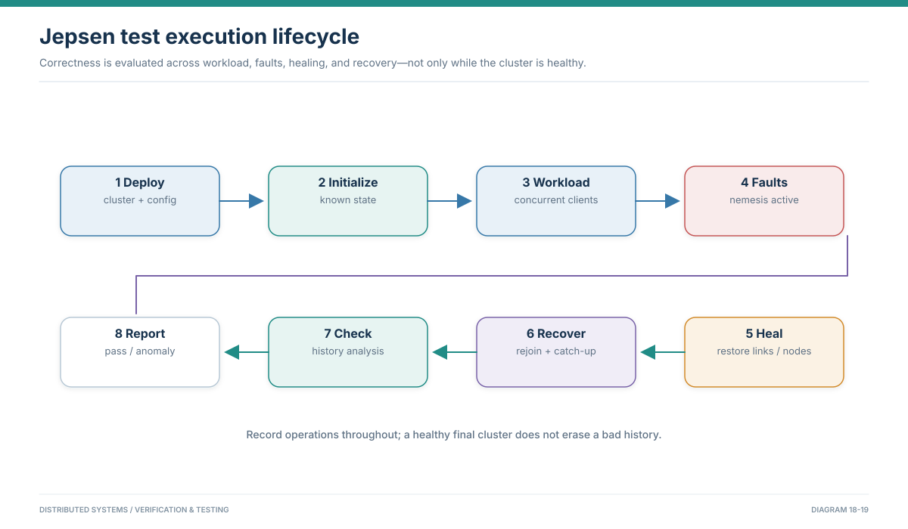

A nemesis is a controlled fault generator. It may:

- isolate nodes from one another or from clients;
- add latency, drop packets, or create asymmetric connectivity;
- kill, pause, restart, or reboot selected processes;
- manipulate wall clocks or time synchronization;
- simulate disk write loss or storage errors;
- heal the network and permit recovery.

The injection itself is not a correctness verdict. A successful partition proves only that the fault was applied. The history checker must still show whether operations remained legal. Record exactly which links were cut, which processes were paused, when the fault began and ended, and whether the system recovered.

## 5.5 Consistency Checkers

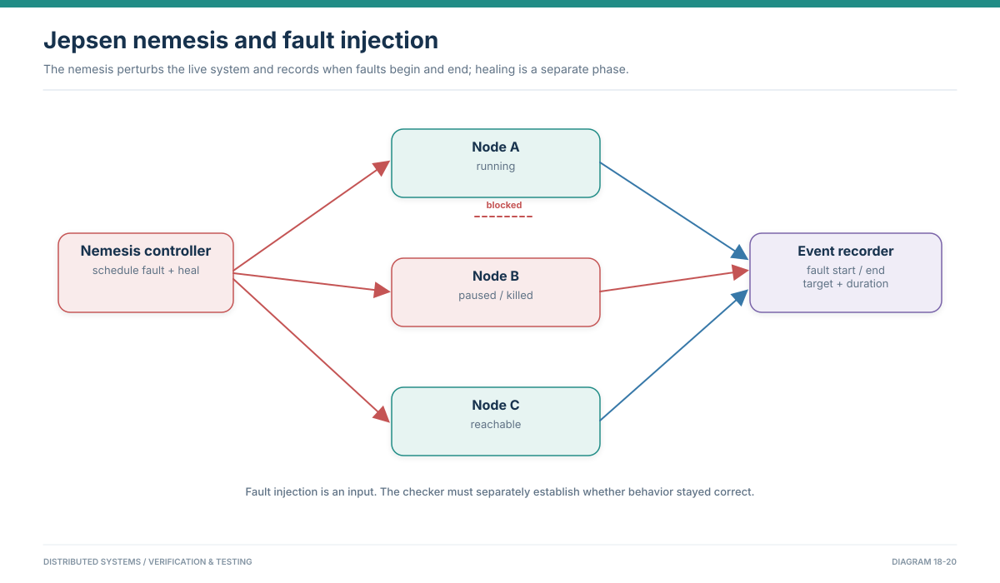

A checker compares an observed history with a specification.

- **Linearizability checker:** searches for a sequential ordering that respects real-time constraints and object semantics. It is powerful but can be computationally expensive for large histories.
- **Sequential-consistency checker:** allows a global ordering that preserves each client's program order but does not enforce real-time precedence between clients.
- **Register checker:** validates a single read/write object against a register model.
- **Set/list/queue checker:** verifies add/remove, append, dequeue, ordering, and membership semantics.
- **Transaction checker:** builds a dependency graph among transactions and detects forbidden cycles or anomalies.
- **Custom invariant checker:** validates domain constraints such as conservation, uniqueness, or no duplicate business effect.

A history may look healthy because every RPC returned `ok`, yet the state may be wrong. A write could be acknowledged on a replica that later loses it; two clients may both acquire a lock; or a transaction may have observed an impossible mixture of versions. Availability and correctness are different axes.

### Interpreting a failed check

1. Read the exact property and object model.
2. Verify the checker input includes invocation and completion times correctly.
3. Inspect the shortest violating operations and causal dependencies.
4. Confirm whether a timeout or error means “no effect” or “effect unknown.”
5. Replay the fault schedule when possible.
6. Minimize the workload while preserving the violation.
7. Compare against documentation for the tested version.
8. Report impact and scope without generalizing to untested releases or configurations.

## 5.6 Jepsen Case Studies and Documented Findings

The following are historical, version-specific examples from published Jepsen reports. They illustrate methodology and failure classes, not blanket statements about the products today.

| System/version tested | Test approach | Documented observation | General engineering lesson |
|---|---|---|---|
| MySQL 8.0.34 / InnoDB (2023 report) | Transactional append/read histories, Elle dependency analysis, process/network faults, and lost un-fsynced writes | The report found several isolation anomalies at Repeatable Read, including G2-item and Monotonic Atomic View violations; it also discusses RDS MySQL serializability findings for its tested deployment | Treat isolation-level names as claims to verify; test multi-row dependencies and durability separately |
| PostgreSQL 12.3 (2020 report) | Concurrent append/read transactions analyzed with Elle | The report characterized Repeatable Read as snapshot isolation and reported a G2-item anomaly under the tested Serializable configuration | Use precise history models and version-specific findings; a label is not a proof |
| MongoDB 4.2.6 (2020 report) | Nine-node sharded cluster, transactional and non-transactional document operations, network partitions | The report described acknowledged updates disappearing in a transaction scenario under the tested configuration and highlighted the impact of transaction-level read concern | Test the exact read/write concern and transaction settings used in production |
| etcd 3.4.3 (2020 report) | Random lock/unlock histories, lease-based locking, shared set updates, and watch continuity tests | The report found that the lock API alone did not safely protect arbitrary external resources in the tested usage; overlapping lock ownership was observed | A lock service does not fence a stale client unless the protected resource checks a monotonically increasing token |
| TiDB 2.1.7 and related prereleases (2019 report) | Distributed SQL transaction workloads, startup/recovery scenarios, and custom consistency tests | The report described startup/reconnection fragility and under-replicated region behavior in tested releases/configurations | Test bootstrapping, node restarts, and the window before replication reaches its target |
| CockroachDB beta-20160829 (2017 report) | Transaction workloads, partitioning, retry and timestamp edge cases | The report documented serializability anomalies in the tested beta and an RPC retry path that could duplicate an operation after an indeterminate result | Preserve the distinction between definite failure and ambiguous outcome; retries need transaction IDs and idempotency |
| Kafka 0.8 beta (2013 report) | Producer/consumer workloads and broker failures | The historical report explored ordering and data-loss behavior in the then-current release | Test the exact acknowledgement, replication, producer, and consumer-offset semantics; old reports do not describe modern Kafka |
| Cassandra 2.0.0 (2013 report) | Concurrent operations with node and network faults | The historical report identified consistency anomalies under the tested consistency levels and failure conditions | Quorum settings, read repair, hinted handoff, and topology assumptions affect observable semantics |
| Redis 1.0/early Redis-era report sets | Operations and failover histories across historical configurations | Historical studies show why asynchronous replication and failover require explicit data-loss expectations | Do not assume replication implies synchronous durability |
| ZooKeeper/etcd-style coordination services | Locks, watches, session and lease histories | Tests focus on whether revisions/events are complete and whether lock ownership is exclusive under pauses and partitions | Treat sessions, leases, watch cursors, and external resource fencing as separate contracts |

The list of published Jepsen analyses is a changing index. For any system, read the specific report and its tested version, configuration, workload, and limitations before drawing a conclusion. The official index is listed in [References](#24-references-and-further-reading).

---

# 6. Property-Based Testing

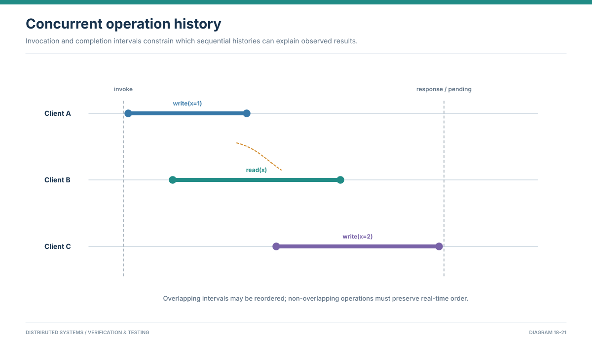

**Example-based testing** checks selected inputs and expected outputs. **Property-based testing (PBT)** checks general statements over many generated inputs. Instead of asking only whether `serialize({x: 1})` returns a particular string, a property may say that decoding an encoded value returns an equivalent value for every supported input.

PBT is particularly valuable when the input space is large, edge cases are hard to enumerate, and the system has invariants that can be checked independent of a particular output.

## 6.1 Designing Properties

Translate a requirement into a predicate over an input, output, or execution history.

| Requirement | Property-style statement | Important assumption |
|---|---|---|
| Serialization round trip | `decode(encode(x)) = x` | Equality and supported data domain are defined |
| Replication convergence | After writes stop and all required messages are delivered, replicas agree | Conflict resolution is deterministic/convergent and communication resumes |
| Compare-and-set | A successful CAS changes the value only if the observed old value equals `expected` | CAS is atomic at the declared scope |
| Idempotency | Repeating the same logical request does not alter the outcome after the first application | Stable idempotency key and request identity |
| Transaction invariant | A completed transfer preserves total funds | Fees, FX, and external effects are excluded or modeled |
| Queue ordering | Dequeued elements preserve the order promised by the queue contract | Scope may be partition-wide or per partition |
| Register semantics | Every observed read is allowed by the selected consistency model | Model distinguishes pending/failed writes and concurrency |

A test of one expected output checks an example. A test of a property checks a class of inputs, but only as broadly as the generator and test budget allow. PBT is not proof: a million generated cases can miss a rare interleaving or unsupported region of the domain.

## 6.2 Generators and Shrinking

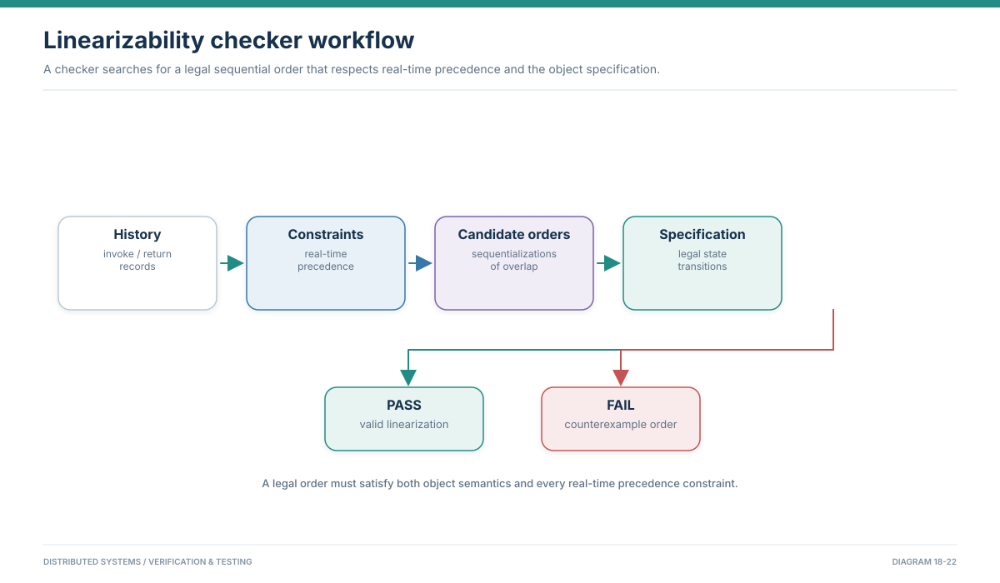

A generator constructs valid, invalid, or boundary inputs. For distributed systems, structured generators are usually more effective than arbitrary bytes because they produce meaningful commands and protocol events.

Useful generator dimensions include:

- IDs with collisions, repeated IDs, and near-boundary values;
- operation sequences that create dependencies;
- simultaneous updates to the same key;
- reordered, duplicated, delayed, and dropped messages;
- crashes around persistence or acknowledgement boundaries;
- clock jumps, lease expiry, and timer races;
- partial transaction states and retries;
- membership changes while requests are in flight.

**Shrinking** reduces a failing input or trace while preserving failure. A 500-event failure might shrink to: write A, partition node 2, acknowledge B, crash node 1, heal, read stale value. A minimal counterexample makes the violated rule and necessary race much easier to understand.

A reproducible seed is essential. Store the seed, generator version, software revision, model parameters, and minimized trace. A seed alone may not reproduce behavior if scheduling, threads, wall-clock inputs, dependencies, or runtime versions remain uncontrolled.

## 6.3 Stateful Property-Based Testing

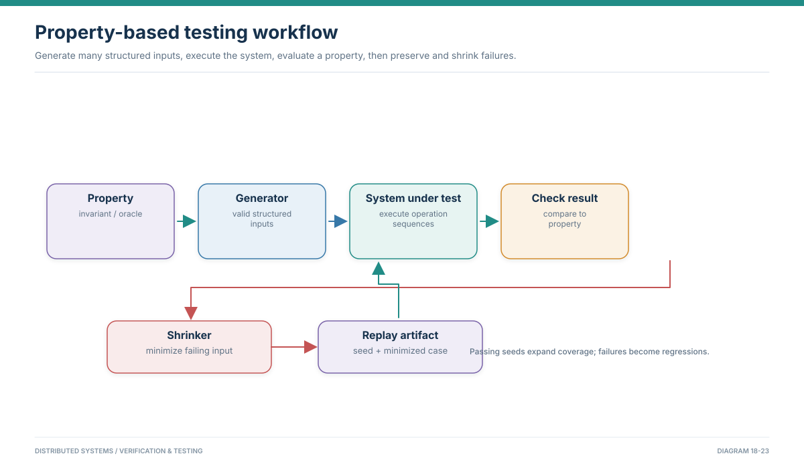

Stateful testing generates sequences of commands, not only independent data values. A reference state machine tracks expected behavior and is compared with the implementation.

A typical workflow is:

1. Define the reference model state.
2. Define commands such as create, read, write, transfer, retry, acquire, release, and restart.
3. Define command preconditions, so generated actions make sense in the current model state.
4. Define the reference transition and expected response.
5. Run the command against the real implementation.
6. Compare the response and observable state with the model.
7. Check global invariants after each step.
8. Shrink failing sequences to a minimal command trace.

A model for an idempotent payment API might keep `payments: Map<IdempotencyKey, Outcome>` and `ledgerEntries: Set<PaymentId>`. On `submit(k, amount)`, the reference model creates one debit if `k` is new; otherwise it returns the previously recorded outcome. The implementation is challenged with concurrent duplicate requests, client timeouts, process restarts, and retries.

### Libraries and ecosystems

- **Hypothesis:** Python property-based testing library with strategies, shrinking, replay, and rule-based state machines. Its stateful API generates action sequences and can reuse generated values through bundles.
- **QuickCheck:** original influential property-based testing approach from Haskell; random generation and shrinking inspired many language ports.
- **ScalaCheck:** property-based testing for Scala, integrating generators and shrinking with Scala's testing ecosystem.
- **jqwik:** property-based testing library for Java, commonly integrated with JUnit 5.
- **fast-check:** property-based testing library for JavaScript/TypeScript, including model-based and asynchronous testing support.

These tools share a broad philosophy but differ in state-machine abstractions, shrinking algorithms, execution models, and integration. Check library documentation for the version in use.

### Stateful testing pseudocode

```text
model = empty_reference_state()
for command in generated_commands(model):
    require precondition(command, model)
    expected = reference_step(model, command)
    actual = implementation.execute(command)
    assert equivalent(actual, expected)
    assert invariants(model)
```

The comparison oracle must be independent enough to catch implementation defects. Copying implementation logic into the model can reproduce the same bug twice.

---

# 7. Simulation Testing

Simulation testing runs a model or the system's production logic inside a controlled environment that simulates selected components such as time, networking, storage, and process scheduling. A simulator can execute many scenarios cheaply and reproducibly without starting a physical cluster for each one.

A **discrete-event simulation** advances virtual time from one scheduled event to another. Events may include message delivery, timer expiry, disk completion, node failure, and recovery. The simulation can choose event ordering, delay, loss, and duplication according to deterministic rules or a seeded pseudo-random source.

Simulation can reveal timing bugs, race conditions, recovery defects, and protocol inconsistencies. Its confidence depends on fidelity: if the simulator uses different persistence code or bypasses the real RPC path, a bug in the production path may remain hidden.

## 7.1 Simulation Architecture

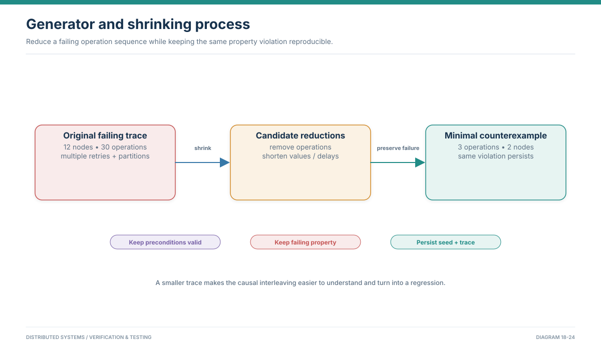

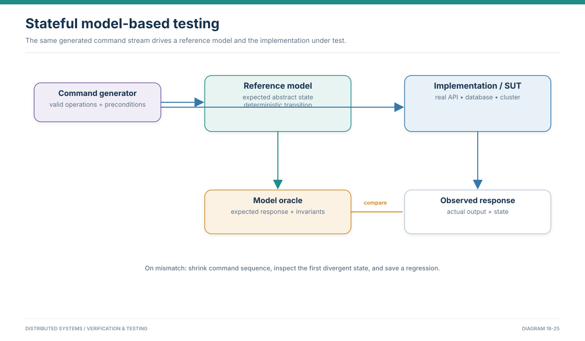

A replicated key-value-store simulator can be decomposed into:

```text
Test workload
   |
   v
Simulation scheduler ---- seed / event trace / virtual clock
   |                         |
   +---- Node models --------+
   |       |                 |
   |       +-- protocol state (term, log, commit index)
   |       +-- local storage model (WAL, snapshots, fsync)
   |       +-- timers and process lifecycle
   |
   +---- Network model (delay, drop, duplicate, reorder, partition)
   |
   +---- Fault controller (crash, pause, restart, disk full, clock skew)
   |
   +---- Assertions and history recorder
               |
               v
       invariant checks / trace replay / report
```

| Component | Purpose | Example event |
|---|---|---|
| Simulation engine | Selects next event deterministically | Pop next event from ordered priority queue |
| Virtual clock | Advances simulated time | Move from t=120 ms to t=135 ms |
| Event queue | Stores pending events ordered by simulated time and tie-breaker | Deliver RPC reply before timeout |
| Network model | Controls transport behavior | Drop one heartbeat; delay another by 300 ms |
| Node model | Represents process state | Follower becomes candidate after timer expiry |
| Storage model | Represents persistence and crash semantics | Flush WAL, then power-loss event |
| Timer model | Schedules logical timeouts | Election timeout fires |
| Fault controller | Executes fault schedule | Kill leader and isolate follower |
| Recorder | Stores trace and seed | Capture the first violated invariant |
| Oracle | Checks correctness | No two leaders commit conflicting entries |

## 7.2 Deterministic Simulation

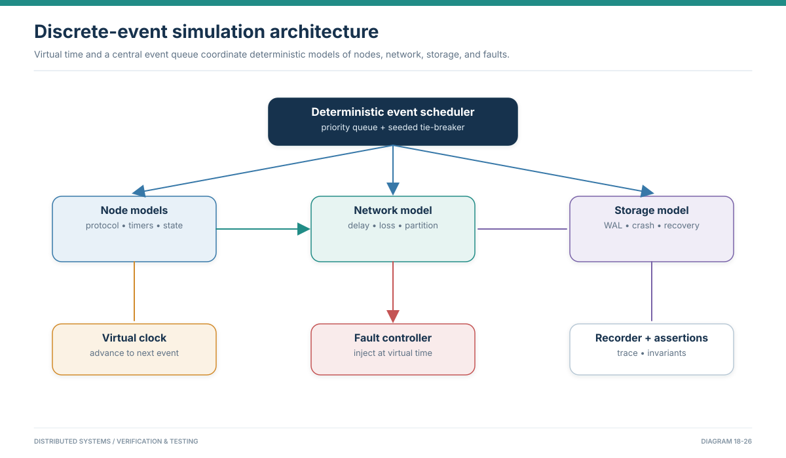

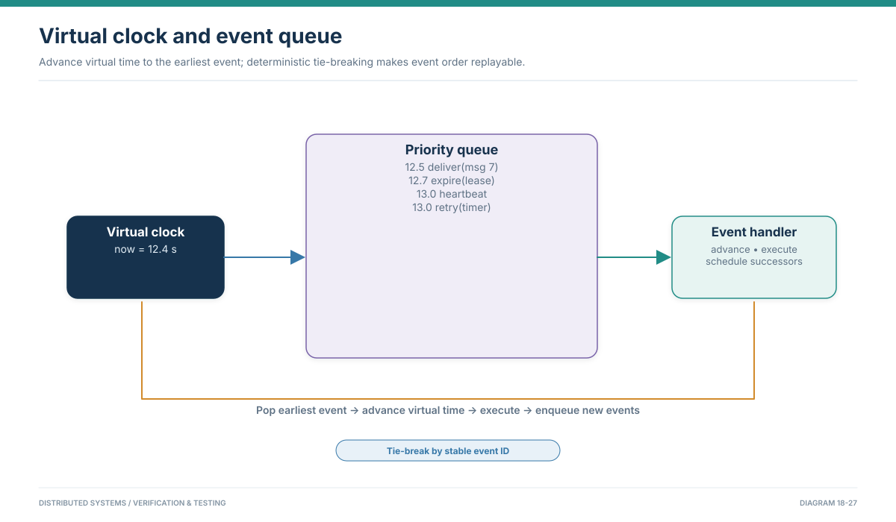

A deterministic simulator controls all relevant sources of nondeterminism: random choices, time, task scheduling, message delivery, and storage completion. The same seed and inputs should reproduce the same event sequence, provided the test has no uncontrolled source of entropy or concurrency.

A typical deterministic run:

1. Initialize the cluster and random seed.
2. Generate workload operations from a deterministic PRNG.
3. Put all outgoing messages into a simulated transport queue.
4. Choose delivery, delay, drop, or duplication events.
5. Advance virtual time to the next event.
6. Execute the event and update node state.
7. Inject a planned fault when its virtual-time or event-count condition is met.
8. Check invariants after each relevant transition.
9. On failure, store the seed and exact trace.
10. Replay the trace and shrink the event schedule if possible.

Deterministic simulation is not identical to deterministic replay of a production execution. Simulation controls the environment before the execution. Production replay attempts to reconstruct an already-observed execution using recorded nondeterministic inputs, event ordering, timestamps, and external responses. Production replay is harder because not every source of nondeterminism is usually recorded.

## 7.3 Real-World Simulation Systems

| System | What it is | Strengths | Limitations and appropriate use |
|---|---|---|---|
| FoundationDB Simulation | Deterministic simulation integrated with the Flow runtime and database code | Can simulate cluster components, network, machines, storage behavior, failures, and virtual time; same seed supports reproduction | Requires architecture designed for simulation; not a substitute for hardware/performance tests or live deployment validation |
| Antithesis | Deterministic testing platform/environment designed to explore executions and faults | Combines deterministic execution, fault control, assertions, and debugging/causality tooling | Adoption and instrumentation effort; platform behavior and supported environment are part of the test assumptions |
| SimPy | General-purpose Python discrete-event simulation framework | Useful for modeling queues, resources, latency, and process interaction quickly | It is a simulation library, not a drop-in correctness test harness for production distributed databases |
| Custom protocol simulator | Purpose-built event engine and node/network models | Exact control over protocol schedules and failure scenarios | Maintenance burden; risks diverging from production code |
| Deterministic unit/integration harness | Injected clocks, schedulers, and fake transports around real components | Cheap and focused; useful for retry, timeout, and race boundaries | Only the components actually under the deterministic harness are controlled |

FoundationDB publicly describes simulation as tightly integrated with its asynchronous runtime and capable of simulating a cluster in a single-threaded process with deterministic repetition. Its documentation also describes combining simulation with live performance and hardware-based failure tests. Antithesis documentation describes deterministic simulation testing as controlling time, scheduling, randomness, and faults so that failures are reproducible. SimPy should be understood as a general-purpose discrete-event library rather than the same category of production database testing platform.

---

# 8. Fault Injection and Chaos Engineering

**Fault injection** deliberately introduces a failure condition to test a system's response. **Chaos engineering** is a disciplined operational practice that selects a hypothesis about steady-state behavior, introduces a controlled perturbation, observes the effect, and uses the evidence to improve resilience. Ordinary failure testing may be a fixed test case; chaos engineering emphasizes realistic experiments, safety controls, observability, and organizational learning.

A fault injection test without a correctness oracle is incomplete. Killing a database primary is merely an action. The actual test asks whether committed writes survive, whether a leader is elected, whether reads obey the consistency contract, whether clients receive bounded errors, and whether the cluster recovers.

## 8.1 Fault Models

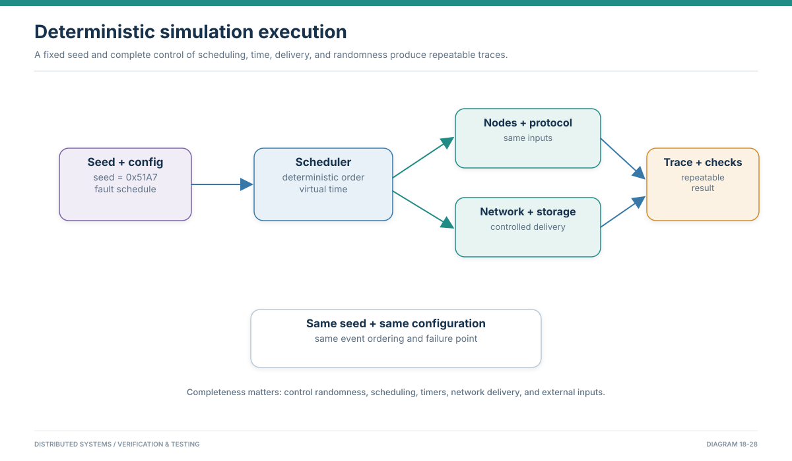

| Fault class | Examples | Typical behavior | Common risk |
|---|---|---|---|
| Process | Crash, pause, deadlock, restart loop | Transient or persistent | In-flight work lost; duplicate retry |
| Machine | VM termination, reboot, host failure | Often correlated with several services | Replica loss and noisy-neighbor pressure |
| Network | Partition, latency, loss, duplication, reordering | Transient or persistent | Split-brain, timeouts, stale state |
| Storage | Disk full, I/O error, torn write, lost cache, corruption | May be persistent | Acknowledged data loss or unreadable log |
| Time | Clock skew, NTP step, clock drift, leap/time jump | Often gradual or abrupt | Lease expiry, ordering, certificate validity |
| Resource | CPU starvation, memory exhaustion, pool exhaustion | Transient or escalating | Queue buildup and cascading failure |
| Dependency | DNS, broker, database, identity provider, secrets manager | Often shared/correlated | Large failure domain and retry storm |
| Security/PKI | Expired certificate, revoked secret, invalid token | Persistent until repaired | Authentication outage or insecure fallback |

Failures may be **transient** (a short network loss), **persistent** (a full disk), **correlated** (an entire availability zone fails), or **cascading** (timeouts trigger retries that overload a dependency). A test plan should include combinations that are plausible in the intended environment, especially correlated faults and recovery while load remains active.

## 8.2 Fault Injection Techniques and Tools

| Tool/technique | Role | Suitable use | Caveat |
|---|---|---|---|
| Linux `tc` / `netem` | Queueing discipline for delay, loss, duplication, corruption, and reordering | Local/host network experiments | Apply filters carefully; isolate interfaces and clean up rules |
| Toxiproxy | Programmable TCP proxy that can add latency, bandwidth limits, and connection failures | Testing service dependencies and client retry logic | Does not emulate every network-layer or routing failure |
| Pumba | Container chaos tool for killing, pausing, or stressing containers and network conditions | Docker-based test clusters | Container scope and privileges matter |
| Chaos Mesh | Kubernetes-native chaos experiments for pods, network, time, and other resources | Kubernetes staging and controlled production experiments | CRDs, permissions, safety policies, and version support require review |
| LitmusChaos | Kubernetes chaos engineering framework with experiments and workflows | Game days and platform resilience testing | Experiment quality and blast-radius controls remain the operator's responsibility |
| Gremlin | Managed chaos engineering platform | Enterprise fault experiments across infrastructure/services | Commercial platform; verify capabilities and policy fit |
| AWS Fault Injection Service | Managed experiments against supported AWS resources | Controlled tests for AWS workloads | Service/resource support and account safeguards are specific to AWS |
| Process/service controls | `kill`, systemd, container runtime, VM APIs | Crash/restart and dependency outage tests | Avoid accidentally targeting shared or production-critical resources |

A local `netem` experiment can test packet loss on a test interface; it does not automatically prove that a cloud load balancer, service mesh, or cross-region route fails in the same way. Choose the tool and fault boundary to match the claim being tested.

## 8.3 Chaos Engineering Principles

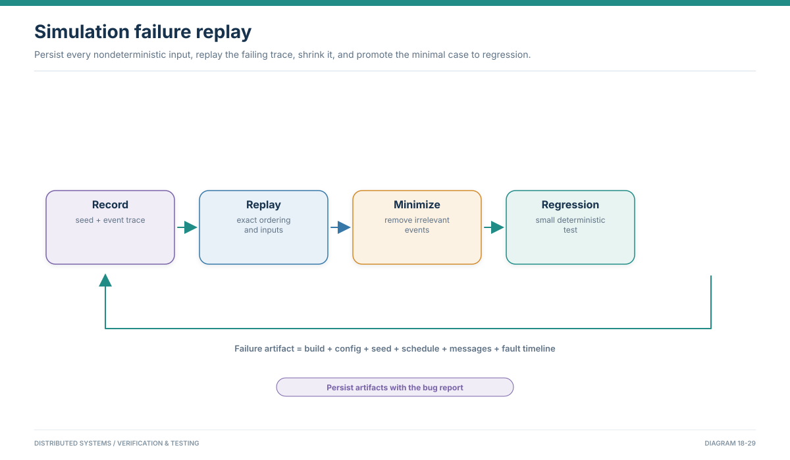

1. **Define steady state:** choose measurable indicators such as success rate, bounded latency, no committed-data loss, and queue age.
2. **Write a hypothesis:** for example, “If one database node fails, the remaining quorum continues to commit writes without violating the register contract.”
3. **Choose a controlled experiment:** select one fault and one target boundary initially.
4. **Minimize blast radius:** begin in a test environment or a small, isolated production slice.
5. **Introduce a realistic failure:** use the failure mode the architecture claims to tolerate.
6. **Observe:** collect application metrics, protocol metrics, logs, traces, histories, and infrastructure events.
7. **Compare with expected behavior:** evaluate correctness as well as availability and latency.
8. **Abort or roll back safely:** define automated and human stop conditions before the experiment.
9. **Document findings:** store configuration, timestamps, owners, trace, and recovery actions.
10. **Improve and repeat:** convert discoveries into regression tests, runbooks, design changes, or SLO updates.

**Game days** are planned exercises to rehearse failures and incident response. Staging experiments reduce risk but may not reproduce production scale, topology, or dependency behavior. Production experiments can validate real conditions but require stronger authorization, narrow blast radius, customer-impact limits, and immediate abort capability.

### Safety controls

- named experiment owner and approver;
- explicit target identifiers and exclusion lists;
- time-bounded experiment window;
- customer-impact and error-budget guardrails;
- abort thresholds (e.g., error rate, data-integrity signal, queue age);
- out-of-band management access;
- rollback/repair procedure tested in advance;
- no destructive storage or credential fault without a recoverability proof and backup plan;
- incident command and communication plan for production tests.

## 8.4 Failure Injection Scenarios

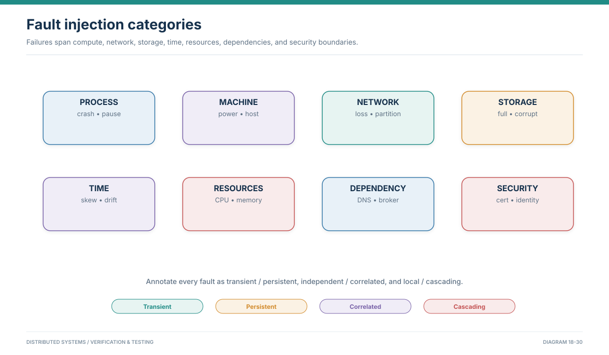

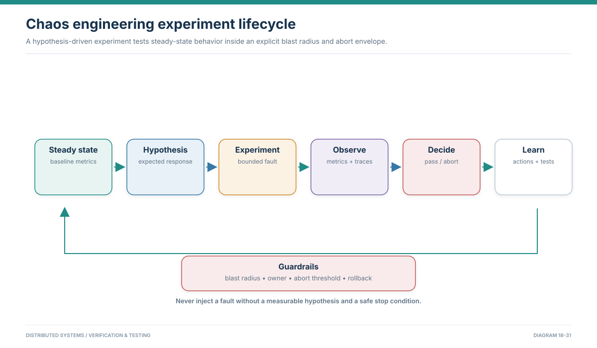

The scenarios below are experiment templates. Execute them in isolated environments first; production experiments need environment-specific approval and guardrails.

| # / scenario | Hypothesis and initial conditions | Fault injection | Expected behavior and observations | Safety, recovery, and lesson |
|---|---|---|---|---|
| 1. Kill database primary | A healthy replica set has committed data and a write workload | Terminate the primary process/VM | A new primary is elected; acknowledged writes survive the declared durability level; requests fail/retry within budget. Inspect election time, write errors, replication lag, and history | Preserve quorum; restart old primary as follower; compare final data. Election success alone is not enough—verify no loss or double application |
| 2. Partition replicas | Three or five replicas are healthy and clients write/read concurrently | Split a minority from the majority, then reverse the cut | Majority may continue under quorum semantics; minority must not accept conflicting committed writes. Inspect leader terms, quorum errors, stale reads, and commit indexes | Keep a management path; heal and wait for convergence. Verify the minority did not create split-brain state |
| 3. Add high latency | Service is stable under representative load | Add 300–1000 ms delay to a dependency path | Timeouts/retries remain bounded; tail latency increases predictably; no unbounded queue growth | Restore path and inspect retry budgets, circuit breakers, and timer assumptions |
| 4. Drop service messages | RPC calls are observable and idempotency keys exist | Drop selected requests or replies, including acknowledgements | Client may see timeout/unknown outcome; retry must not duplicate the logical effect | Preserve operation IDs; compare ledger and request history. Distinguish “not executed” from “executed but reply lost” |
| 5. Kafka broker unavailable | Replication factor and producer acknowledgements are configured | Stop one broker or isolate a partition leader | Partition leader changes if ISR/quorum requirements permit; acknowledged records survive according to config; consumer lag rises then recovers | Restore broker and verify offsets, duplicates, order, and replication state; never infer exactly-once from producer success alone |
| 6. Fill a disk | Database has monitoring and a known storage margin | Constrain a test volume or consume space until a threshold | Writes fail safely before corruption; alerts fire; recovery does not silently discard acknowledged records | Stop before host-level collateral damage; free space, run integrity checks, and test WAL/compaction recovery |
| 7. Restart Kubernetes pods | Replicas are spread with disruption budgets and readiness probes | Delete or restart selected pods in controlled order | Service remains within availability objective; readiness prevents premature traffic; replicas rejoin and catch up | Respect PDB and replica quorum; verify rollout/termination grace and persistent volumes |
| 8. Break DNS | Service relies on DNS for dependency discovery | Fail resolver or return stale/wrong records in test | Caches and retry behavior follow design; fail closed where identity/security requires; no uncontrolled retry storm | Restore resolver, invalidate stale records if appropriate, and inspect TTL/cache behavior |
| 9. Expire TLS certificate | Test trust chain and rotation path are instrumented | Use expired test certificate or block renewal | Requests fail securely with useful alerts; no silent plaintext fallback | Rotate certificate and validate all clients; check long-lived connections and trust-store reload |
| 10. Secrets manager unavailable | Workload has a defined secret-refresh policy | Deny test access to secret service | Existing credentials behave according to cache/lease policy; new bootstrap may fail explicitly; no secret leakage | Restore access and rotate/reload as needed. Inspect retry volume and token expiration edge cases |
| 11. Introduce clock skew | Clock-dependent code has bounds and monitoring | Offset a test node clock or delay time sync | Leases/timestamps respect declared drift bounds; unsafe node may stop serving or be fenced | Return clocks to sync and check leader/lease recovery. Avoid conflating monotonic clocks and wall clocks |
| 12. Exhaust connection pools | Pool limits, queue bounds, and timeouts are known | Constrain pool size or hold connections | Backpressure and bounded errors occur; callers do not create unlimited threads or retries | Release held connections; inspect pool wait, queue depth, thread count, timeout alignment |
| 13. Simulate regional outage | Multi-region topology and failover policy are documented | Isolate one region from clients and peers | Failover policy respects quorum and data RPO; writes may pause where required; recovery avoids conflicting histories | Preserve unaffected region; restore links and reconcile. Test the true correlated failure domain |
| 14. Cause retry storm | Retry policy has budgets, jitter, and circuit breaking | Induce a transient dependency slowdown | Retries do not amplify load beyond a bounded budget; queue and latency recover after dependency heals | Abort on saturation; inspect retries per request, synchronized backoff, concurrency limits, and overload shedding |

Every scenario should include a correctness oracle, not just an infrastructure signal. A database primary may fail over rapidly while losing acknowledged writes; a queue may continue accepting records while consumers process them twice. Correctness and operational recovery must both be assessed.

---

# 9. Testing Consensus and Replication Protocols

Consensus and replication are correctness-critical because they decide which history a distributed service exposes. A leader-based replicated state machine generally orders commands in a log; a quorum protocol requires enough members to acknowledge a decision; replicas then apply the committed commands deterministically. A correct test must separate **agreement**, **commit**, **application**, **client response**, and **durability**.

Key properties include:

- **Agreement:** no two correct replicas decide conflicting values for the same consensus instance or committed log position.
- **Validity:** a decided value must satisfy the protocol's permitted proposal rules.
- **Leader safety:** at most one valid leader exists per term/epoch, according to the protocol's definition.
- **Log matching:** if two logs contain an entry with the same index and term, their preceding entries match.
- **Leader completeness:** entries committed in one term are present in leaders elected in later terms, under Raft's assumptions.
- **Commit safety:** a node never applies an entry that is not committed according to the protocol.
- **Membership safety:** configuration changes preserve the quorum-intersection rules needed by the protocol.
- **Progress:** a quorum that can communicate eventually commits new commands under timing and fairness assumptions.

Testing should deliberately create asymmetric partitions, message delays, duplicate RPCs, leader crashes between persistence and response, and configuration changes while requests are outstanding.

## 9.1 Raft Verification

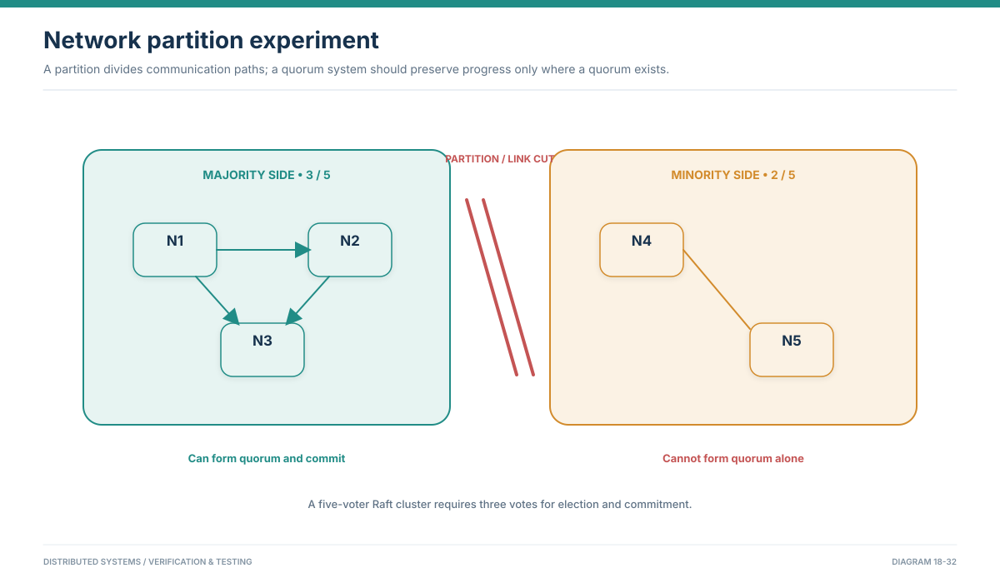

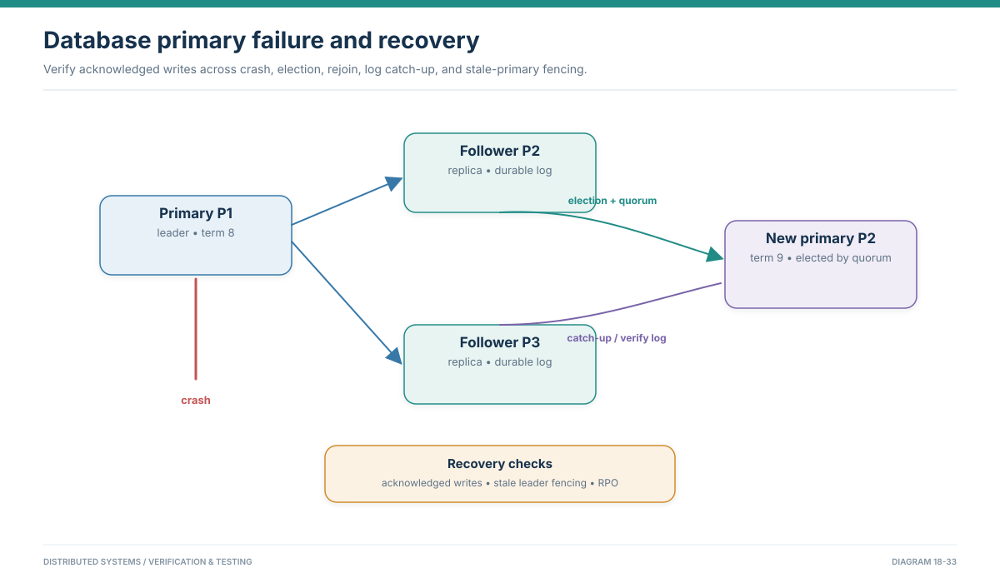

Raft decomposes consensus into leader election, log replication, and safety. Its well-known properties are election safety, leader append-only, log matching, leader completeness, and state-machine safety. The system stores persistent state such as current term, vote, and log; volatile state such as role and replication progress; and communication state such as RPCs in flight.

### Raft verification matrix

| Property | Core assertion | Adversarial scenario |
|---|---|---|
| Election safety | At most one leader per term | Split candidates, delay vote replies, duplicate RequestVote |
| Leader append-only | A leader does not overwrite entries in its own log | Receive conflicting AppendEntries while leader state changes |
| Log matching | Same index and term implies identical prefix | Divergent follower logs and repeated repair |
| Leader completeness | A later leader contains every previously committed entry | Crash leaders after commit; elect a candidate with a stale log |
| State-machine safety | No two state machines apply different commands at one index | Delay commit notifications and restart replicas |
| Commitment rule | Entries from earlier terms are not committed by counting replicas alone | Replicate an old-term entry to a majority without committing a current-term entry |
| Membership change | Joint/overlapping quorums preserve safety | Reconfigure while partitioned and while nodes restart |
| Recovery | Restart restores persistent term/vote/log correctly | Crash at every persistence/ack boundary |

### How to combine verification techniques

- **TLA+:** model terms, votes, logs, commit index, message queues, and crash/recovery; check Raft invariants over small clusters and bounded logs.
- **Model checking:** explore election and append interleavings, particularly the interaction of stale terms, higher-term replies, and crashes.
- **Simulation:** execute real protocol logic against a deterministic clock and network; vary message ordering and timer events.
- **Fault injection:** kill a leader, partition a follower, pause a process past election timeout, and restore links while writes continue.
- **History checking:** compare client-visible writes and reads against the promised consistency contract.
- **Runtime checks:** assert monotonic term/index progression and alert on unexpected leader or commit-index regressions.

A useful test schedule: (1) commit an entry on a majority; (2) withhold one follower's append acknowledgement; (3) crash the leader after its durable commit point but before response; (4) elect a new leader; (5) read and verify the entry; (6) restart the old leader and ensure it follows the new term without overwriting committed history.

## 9.2 Paxos Verification

Paxos separates proposal numbers, prepare/promise, accept, and learned decisions. A proposer must use a proposal number that is unique and ordered according to the implementation's scheme. An acceptor promises not to accept lower-numbered proposals after a promise and must report previously accepted values so a proposer can preserve safety.

### Paxos properties and tests

- **Agreement:** two learners must not decide different values for one instance.
- **Validity:** a chosen value must have been proposed by a proposer.
- **Promise correctness:** after promising proposal number `n`, an acceptor rejects lower proposal numbers.
- **Accepted-value preservation:** a proposer that receives a quorum of promises selects the value with the highest accepted proposal number reported by that quorum, if any.
- **Quorum intersection:** any two decision quorums intersect in at least one acceptor under the protocol's configuration.
- **Leader change:** a new proposer cannot forget a previously chosen value.
- **Duplicate/reordered messages:** repeated Prepare, Promise, Accept, and Accepted messages do not alter a decided value.
- **Concurrent proposers:** competing proposal numbers may delay progress but must not violate agreement.

A model should include multiple proposers, acceptors, learners, and a finite message multiset. Inject loss and duplication at every phase. A key counterexample pattern is a proposer that incorrectly chooses its own value after promise responses instead of the highest previously accepted value. Another is reusing proposal numbers across proposers.

Paxos variants differ in batching, leadership, reconfiguration, and persistence. Testing a Multi-Paxos implementation requires modeling the stable-leader optimization and the transition from leader changes to later instances; testing a single-instance abstraction alone is not enough for all implementation claims.

## 9.3 Replication Verification

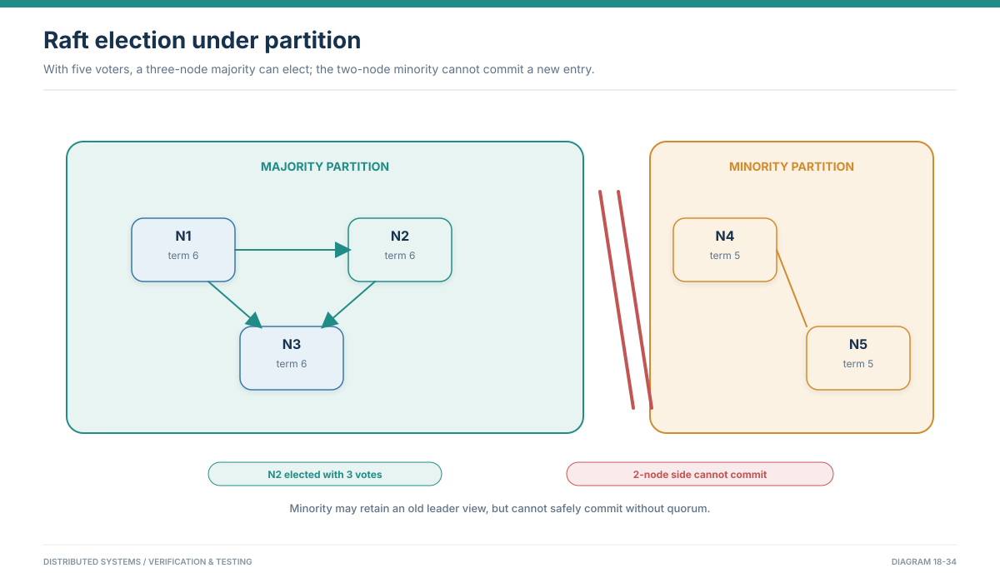

A replicated database test plan should define the replication contract before selecting tests.

| Dimension | Question to test | Example experiment |
|---|---|---|
| Strong consistency | Is every read/write history linearizable or serializable as claimed? | Concurrent writes and reads during leader failover |
| Eventual convergence | Do replicas converge after updates cease and communication returns? | Partition, concurrent updates, heal, wait, compare state |
| Quorum correctness | Are writes/reads acknowledged only under configured quorum rules? | Remove replicas until below and above threshold |
| Read-after-write | Does a client observe its own acknowledged write? | Write through one endpoint, read through another |
| Conflict resolution | Is the winner deterministic and documented? | Concurrent writes with equal timestamps/version ties |
| Replica recovery | Does a restarted replica catch up without losing committed state? | Crash, compact, restart from snapshot and log |
| Anti-entropy | Are missed updates discovered and repaired? | Drop a replica's update stream and restore it |
| Read repair | Does a stale read trigger correct repair without exposing an impossible value? | Deliberately lag one replica and issue reads |
| Duplicate handling | Are operation IDs and replicated effects deduplicated? | Duplicate replication messages and client retries |

### Practical replicated-database test campaign

1. Freeze a version, topology, consistency configuration, and client driver.
2. State the desired read/write consistency model and durability definition.
3. Create workloads for single-key registers, multi-key transactions, list append, and domain invariants.
4. Record all operations with IDs and monotonic timestamps; preserve invocation and completion intervals.
5. Inject node crashes, asymmetric partitions, disk pressure, and delayed replication.
6. Continue client traffic during selected faults; also run a quiescent convergence phase.
7. Heal faults; wait for repair and catch-up with a declared timeout.
8. Run consistency checkers and compare final replica state.
9. Repeat with different seeds, schedules, and membership changes.
10. Keep minimized counterexamples as regression tests and document untested assumptions.

Quorum arithmetic is necessary but not sufficient. A write quorum and read quorum must intersect if the system relies on intersection to see an acknowledged write, but the protocol also needs version ordering, durable acknowledgements, membership consistency, and a correct merge/commit rule.

---

# 10. Testing Distributed Transactions

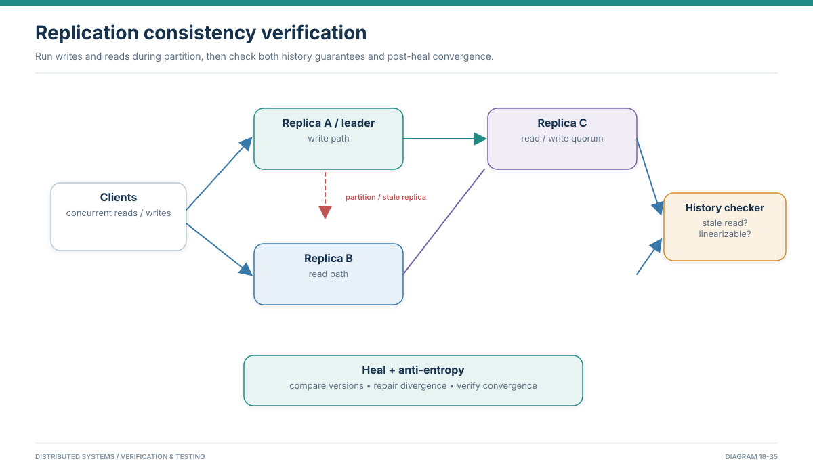

A distributed transaction spans multiple data owners or services. The core challenge is preserving a business invariant when each participant can fail independently and network outcomes can be ambiguous.

### ACID and isolation

- **Atomicity:** all transaction effects become visible together or none do, as promised.
- **Consistency:** valid transactions preserve declared application/database invariants.
- **Isolation:** concurrent transactions behave according to a defined isolation level.
- **Durability:** committed transactions survive the specified crash and storage failure model.

Isolation should be tested using histories and dependency analysis, not inferred from a product label alone. Possible anomalies include dirty reads, lost updates, write skew, read skew, phantoms, cyclic information flow, and non-repeatable reads.

### Distributed commit and workflow patterns

- **Two-phase commit (2PC):** participants prepare, then commit/abort after the coordinator's decision. It can block while participants are prepared if the coordinator and recovery information are unavailable.
- **Three-phase commit (3PC):** adds a pre-commit phase and relies on stronger timing/failure assumptions to reduce blocking; it is not a universal cure for partitions.
- **Saga:** breaks a long workflow into local transactions with compensating actions. Compensation is a new business action, not a literal rollback of history.
- **Transactional outbox:** stores an event in the same local database transaction as the business update; a relay publishes it later, usually at least once.
- **Idempotency:** repeated delivery of the same logical command produces one logical effect.
- **Exactly-once claims:** must identify the scope (broker record, consumer state, database transaction, or external side effect). End-to-end exactly-once behavior generally requires atomic coordination or deduplication at the effect boundary.

### Failure matrix

| Failure | Required test | Correctness question |
|---|---|---|
| Coordinator crashes before prepare | Restart coordinator and retry | Can a new attempt start without ghost participant state? |
| Coordinator crashes after prepare | Recover durable decision or remain safely blocked | Can participants avoid guessing commit/abort? |
| Participant crashes before vote | Rejoin and recover state | Is the participant's vote/prepare state durable and coherent? |
| Partial commit notification | Some participants receive commit, others do not | Do all eventually learn the same durable decision? |
| Lost client acknowledgement | Client retries after timeout | Is outcome queryable or idempotently replayed? |
| Duplicate messages | Redeliver prepare/commit/compensation | Are transitions idempotent and monotonic? |
| Compensation fails | Inject dependency failure during saga rollback | Is workflow marked for retry/manual recovery rather than falsely complete? |
| Database restart | Crash around commit/WAL flush | Does recovery restore atomicity and durability? |
| Broker restart | Crash after publishing but before outbox checkpoint | Can relay resend without duplicate business effects? |
| Network partition during commit | Isolate coordinator/participants | Does the protocol preserve safety even if progress stops? |

## Worked example: payment and order workflow

Assume an order service, inventory service, payment service, and event broker. The business requirements are:

1. An order may be marked `FULFILLED` only after stock is reserved and payment is confirmed.
2. A stable `payment_id` causes at most one ledger debit.
3. Every accepted order eventually reaches `FULFILLED`, `CANCELLED`, or `MANUAL_REVIEW` when dependencies recover or an operator acts.
4. The order event is published at least once; consumers deduplicate by event ID.

### Architecture

```text
Client -> Order API -> Order DB (order + outbox row)
                         |
                         v
                    Outbox relay -> Broker -> Inventory/Shipping consumers
                         |
                         v
                   Saga orchestrator
                    /           \
          Inventory service   Payment service
          reserve/release      authorize/capture/refund
```

### Verification strategy

- Submit the same order twice with the same idempotency key; assert one order and one payment outcome.
- Kill the order service after database commit but before HTTP response; retry and query the original order.
- Publish an outbox event, then kill the relay before it records progress; verify duplicate delivery does not duplicate reservation or shipping.
- Let payment succeed but drop its response; retry with the same payment ID and assert one debit.
- Fail inventory reservation after payment authorization; verify compensation voids authorization or refunds according to the contract.
- Fail compensation; verify workflow remains visible as `COMPENSATION_PENDING` or `MANUAL_REVIEW` and alerts fire.
- Restart the broker and consumers around offset/ack commit; verify replay is safe.

### Example invariant

Let `debits(payment_id)` count successful ledger debits. Then:

\[
\forall p:\; debits(p) \leq 1
\]

A second invariant could be:

\[
order.status = FULFILLED \Rightarrow inventory.reserved(order) \land payment.captured(order)
\]

The workflow's liveness goal is conditional: under eventual dependency recovery, durable retry storage, and an operator/manual path for irrecoverable compensation, every accepted order eventually reaches a terminal or explicitly escalated state. This is more honest than saying every order always succeeds.

---

# 11. Testing Storage and Messaging Systems

## 11.1 Distributed Storage

Storage correctness spans the application, database engine, operating system, filesystem, controller, and physical media. Acknowledging a write has meaning only relative to the persistence boundary promised by the system.

| Area | What to verify | Example test |
|---|---|---|
| Data integrity | Values and indexes remain mutually consistent | Random writes/reads plus checksum and structural validation |
| Durability | Acknowledged data survives the declared crash model | Power-loss simulation, process kill, VM reset, or storage fault at WAL boundaries |
| Replication | Replicas contain the promised committed history | Partition and restart replicas; compare logs and final state |
| Recovery | Crash recovery replays or discards records correctly | Kill during WAL append, flush, checkpoint, and compaction |
| Compaction | Live data is preserved while obsolete versions are removed | Trigger compaction during reads, writes, and restart |
| Crash consistency | On-disk state is one of the permitted pre/post states | Crash at each write ordering boundary |
| WAL correctness | Log ordering, checksums, and commit markers are correct | Truncate/corrupt segments; replay after failure |
| Snapshot correctness | Snapshot represents a coherent index/version | Snapshot while writes and compaction occur |
| Disk corruption | Detected corruption is not silently served as valid data | Flip blocks/checksums in a test image |
| Backup/restore | Restored data matches a consistent backup point | Restore into a clean cluster and compare invariants |
| Migration | Schema/data transitions are safe and reversible where required | Interrupt migration and resume/rollback |

Durability tests should distinguish process crash from machine crash and volatile write-cache loss. A process kill often leaves the kernel page cache alive; it does not model abrupt power loss. Tools such as filesystem fault layers, virtual-machine reset, or hardware-based testing are needed to approximate stronger failures.

### WAL and crash-consistency test matrix

Test crashes:

1. before record creation;
2. after log record is written but before flush;
3. after flush but before commit acknowledgement;
4. after commit acknowledgement but before data-page flush;
5. during checkpoint/snapshot creation;
6. during compaction/segment replacement;
7. during replica catch-up;
8. during restore/migration.

For each point, define legal recovered states. The result may be “operation absent” before commit, or “operation present” after durable acknowledgement, but it must not be a corrupt mixture that violates the storage contract.

## 11.2 Messaging Systems

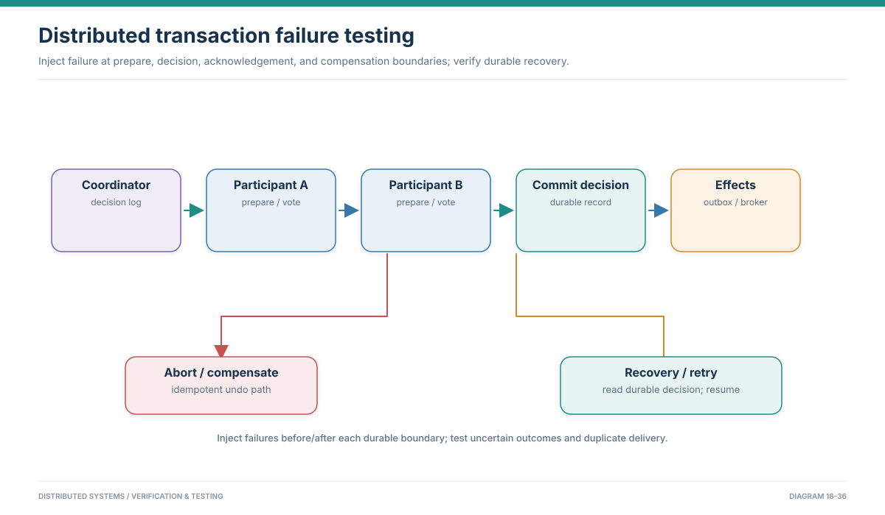

Messaging systems expose different delivery guarantees and ordering scopes. “Exactly once” may refer to broker-side transactions, producer idempotence, transactional offset handling, or an end-to-end database side effect. The test must identify which one is claimed.

| Guarantee | Meaning | Typical verification |
|---|---|---|
| At-most-once | Message is delivered zero or one times; loss is possible | Stop consumer after fetch and before effect; verify no redelivery if that is the contract |
| At-least-once | Message is delivered one or more times until acknowledged/expired | Crash before ack; verify redelivery and idempotent effects |
| Exactly-once processing | A scoped transaction makes input progress and output effect appear once | Rebalance/crash around transaction commit; inspect state and offsets together |
| Ordering | Messages preserve a declared order within a scope | Concurrent producers, partition reassignment, retries, and consumer restart |
| Durability | Acknowledged messages survive configured broker failures | Kill leader and replicas; verify committed records after recovery |
| Backpressure | Consumers and brokers bound queued work | Slow consumers and observe lag, memory, and admission control |

### Kafka-focused verification checklist

- Test producer acknowledgement settings and replication/ISR configuration as one unit.
- Distinguish record append success from consumer processing success.
- Crash a consumer after its side effect but before offset commit; verify deduplication or transaction semantics.
- Crash after offset commit but before side effect; verify the contract does not silently lose work.
- Rebalance while messages are in flight; verify stale consumers cannot commit out-of-scope progress.
- Test idempotent producers with retries and sequence-number behavior.
- Test transactional producer fencing and transaction abort/recovery paths.
- Validate per-partition ordering; do not assume total order across partitions.
- Verify dead-letter, retry, and poison-message behavior.
- Measure lag and ensure overload creates bounded backpressure rather than unbounded memory growth.

The test result must match the actual broker version, client library version, producer configuration, replication factor, acknowledgement policy, consumer isolation level, and offset strategy.

---

# 12. Testing Consistency and Linearizability

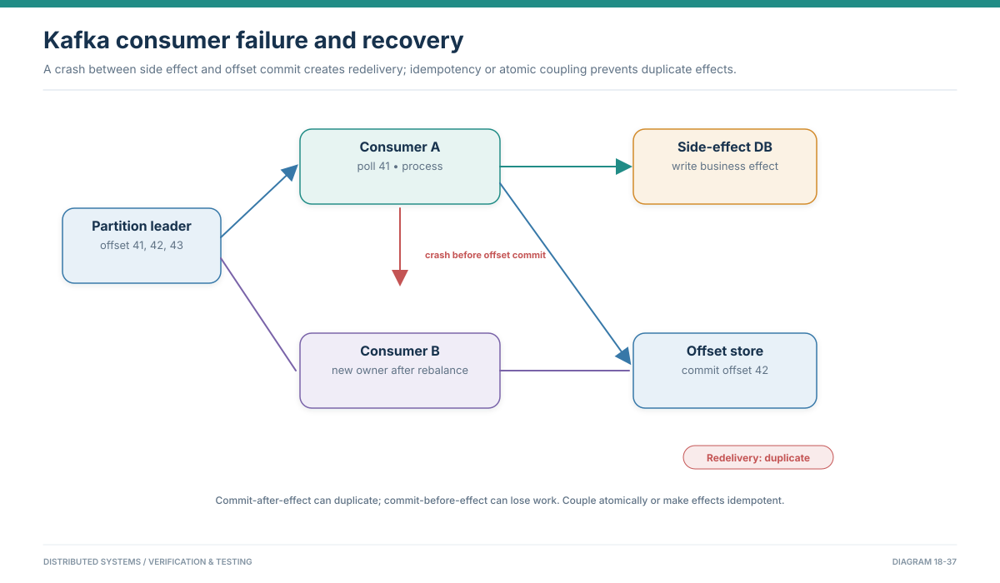

Consistency is a contract about which values and histories may be observed. The same physical database can offer different guarantees depending on read concern, write concern, transaction isolation, replication mode, and routing policy.

### Consistency models and their test oracles

| Model/guarantee | Constraint | Suitable test |
|---|---|---|
| Linearizability | Single global order respecting real-time order | Register history checker with invocation/response times |
| Sequential consistency | One global order preserving each client's program order | Concurrent multi-client read/write histories |
| Causal consistency | Causally dependent operations are observed in causal order | Propagate dependency tokens; read from different replicas |
| Eventual consistency | Replicas converge after writes stop and repair can complete | Partition, concurrent writes, heal, wait, compare all replicas |
| Read-your-writes | Client sees its own acknowledged writes | Write through one endpoint, read through another session path |
| Monotonic reads | Later reads do not move backward in observed version | Repeated reads while routing across replicas |
| Monotonic writes | One client's writes are applied in program order | Concurrent replication and failover from one session |
| Quorum consistency | Reads/writes obey configured quorum and version rules | Change replica availability around quorum threshold |
| Session guarantees | Per-session behavior such as read-your-writes or monotonic reads | Preserve session context while switching nodes |

## Invocation/response histories and real-time constraints

A linearizability checker models operations as intervals from invocation to response. If operation A completes before B begins, A must precede B in every candidate sequential history. If they overlap, the checker may choose either order if the object specification allows it.

Consider:

```text
Time  Client A                 Client B
----  ----------------------   ----------------------
  1   invoke write(x, 9)
  2   ----------------------   invoke read(x)
  3                            return 4
  4   return OK
  5                            invoke read(x)
  6                            return 9
```

The first read overlaps the write, so it may linearize before the write. The second read begins after the write completed and returns `9`, which is legal. Now change the first read to start after time 4 and still return `4`: that is a violation because the write completed before the read began.

### A successful-response violation

Suppose a service acknowledges `write(k, v2)` after a majority has stored it. A client then invokes `read(k)` after the write response, but the read is routed to a stale replica and returns `v1`. Both RPCs succeeded at the transport layer, yet the history violates linearizability. The checker uses the non-overlapping intervals to reject any sequential order that places the read before the acknowledged write.

A common faulty checker ignores real-time constraints and therefore accepts this history under sequential consistency. The choice of checker must match the product's stated guarantee.

### Strongly consistent vs eventually consistent testing

Strong consistency testing should use linearizability or serializability checkers, concurrent conflicting operations, real-time intervals, and failures during leader/quorum changes. Eventual consistency tests should specify quiescence, reconciliation, and a maximum convergence expectation if one exists. They should also validate conflict resolution, monotonicity, and session guarantees. Do not label a temporarily stale read a failure when the documented model allows it; conversely, do not excuse permanent divergence by calling the system eventually consistent.

---

# 13. Performance, Load, and Stress Testing

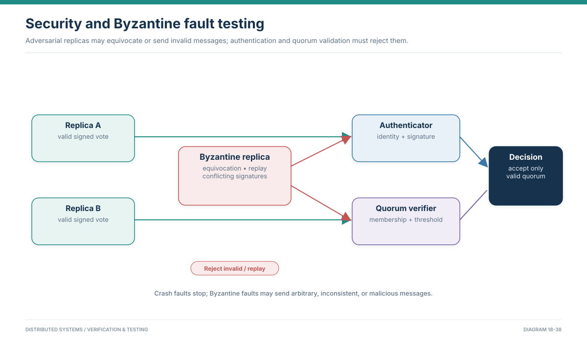

Correctness testing asks whether results are legal. Performance testing asks whether legal results arrive fast enough and at a sustainable rate. The two interact: overload can trigger timeouts, retries, leadership churn, queue overflow, dropped requests, and retry storms that become correctness or availability defects.

### Test types

- **Load test:** expected traffic profile under representative workload and data distribution.
- **Stress test:** increase load or reduce resources until the system degrades or fails.
- **Spike test:** sudden burst beyond the normal arrival rate.
- **Soak test:** long-running load to expose leaks, compaction, memory growth, and resource drift.
- **Capacity test:** determine safe throughput/latency limits with headroom.
- **Scalability test:** measure how throughput and latency change as nodes/resources increase.

### Metrics

- **Throughput:** completed operations per unit time (requests/s, transactions/s, messages/s).
- **Latency distribution:** p50, p90, p95, p99, p99.9; averages hide tail behavior.
- **Tail latency:** slowest percentile behavior, often amplified by fan-out and queues.
- **Concurrency:** number of outstanding or simultaneously executing requests.
- **Queue depth/age:** backlog size and oldest-message age.
- **Resource utilization:** CPU, memory, I/O, network, connection pools, and file descriptors.
- **Contention:** lock wait, retry conflicts, hot partitions, and coordination overhead.
- **Coordinated omission:** a load generator that waits for a slow response before sending the next request can under-report latency during stalls. Use an arrival model that records missed scheduled requests.

### Tools

| Tool | Typical role | Notes |
|---|---|---|
| k6 | Scriptable HTTP, browser, and protocol-oriented load tests | Useful for CI and performance checks |
| Locust | Python-based user-behavior workload generation | Flexible task models and distributed workers |
| JMeter | Broad protocol load testing and test plans | Mature ecosystem; careful test-plan tuning needed |
| Gatling | Code-driven load testing with detailed reporting | Scala/Java/Kotlin ecosystem and simulation-style scenarios |
| `wrk` | High-throughput HTTP benchmarking | Simple and useful for controlled endpoint tests; less representative of complex user workflows |
| Custom generators | Database, broker, and domain-specific workloads | Can represent realistic key skew, transactions, and think times |

### Building realistic workloads

A representative workload should encode operation mix, key popularity/skew, payload size, transaction shape, client geography, burstiness, think time, retries, and data growth. A uniform random key distribution can hide a hot partition. A benchmark with only reads may not expose write amplification, compaction, or quorum contention. Run workloads long enough to reach steady state and include warm-up/cool-down phases.

### Why correctness can degrade under overload

Overload can stretch message delay beyond timeout assumptions. Clients retry requests whose outcome is unknown. Duplicate writes may arrive while the first is still running. Queue limits may be bypassed by unbounded buffering. Leadership may flap as heartbeats are delayed. A system can be correct at moderate load but unsafe under a retry or timeout bug. Include history checking during stress tests, not only throughput graphs.

---

# 14. Testing Security and Byzantine Behavior

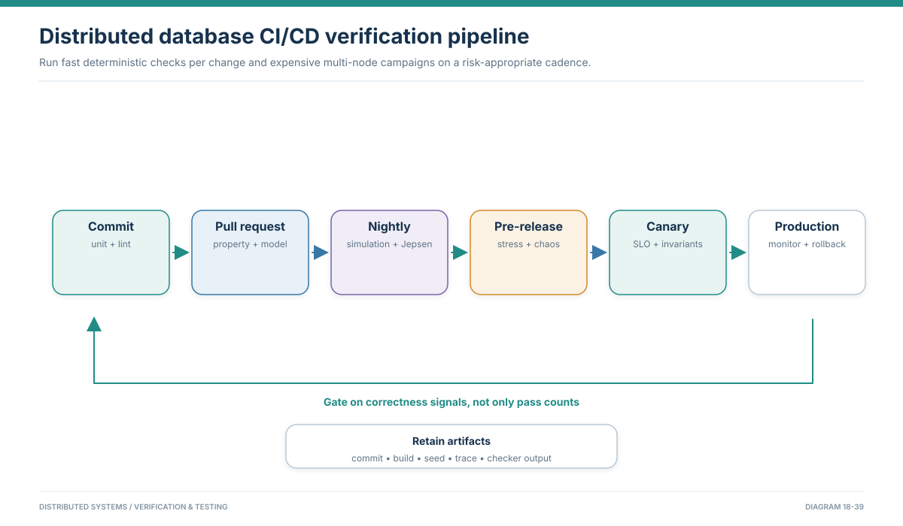

Crash-fault testing asks how the system behaves when nodes stop or messages disappear. Byzantine testing asks what happens when a participant sends arbitrary or malicious messages, equivocates, replays old requests, or deliberately violates the protocol. These are different threat models.

### Threat behaviors

- **Malicious node:** deviates from the protocol intentionally.
- **Equivocation:** sends conflicting statements to different peers.
- **Invalid signature:** presents a message that fails authentication/integrity checks.
- **Replay:** resends a previously valid message outside its permitted freshness/context.
- **Unauthorized request:** attempts an operation without required permission.
- **Compromised replica:** may collude with other replicas or withhold/alter state.
- **Sybil behavior:** creates multiple identities to exceed assumed membership/control.
- **Malicious client:** sends malformed, oversized, repeated, or adversarially timed commands.
- **Faulty validator:** approves invalid transitions or signs conflicting values.

### Verification strategies

1. **Protocol validation:** generate malformed and out-of-order messages; assert that nodes reject them without corrupting state.
2. **Authentication/authorization:** test every operation under valid, expired, revoked, wrong-scope, and missing credentials.
3. **Replay protection:** reuse valid signed requests with old nonces, timestamps, epochs, or sequence numbers.
4. **Certificate lifecycle:** rotate, expire, revoke, and temporarily withhold certificate/CA material.
5. **Secret lifecycle:** revoke and rotate secrets; verify old credentials stop working within the declared propagation bound.
6. **Encryption correctness:** check negotiated transport security, certificate identity, trust chain, and failure behavior; do not allow silent downgrade.
7. **Permission enforcement:** test tenant/resource boundaries, admin paths, internal endpoints, and batch operations.
8. **BFT consensus:** make up to the assumed Byzantine bound behave arbitrarily, including equivocation and collusion, and verify agreement among correct replicas.

A crash fault is not an adequate substitute for a Byzantine fault. A crashed replica sends nothing; a Byzantine replica may send a valid-looking but conflicting message. Likewise, BFT guarantees require assumptions about cryptographic identity, replica membership, synchrony, and the maximum number of adversaries. State those assumptions in the test model.

### Secure failure behavior

Security tests should establish that failures are fail-closed when authorization cannot be established, that errors do not leak secrets or internal signing material, and that recovery does not resurrect revoked credentials. Observe both external behavior and internal audit events. Test certificate rotation during long-lived connections and token expiration during retries.

---

# 15. Verification in CI/CD and Production

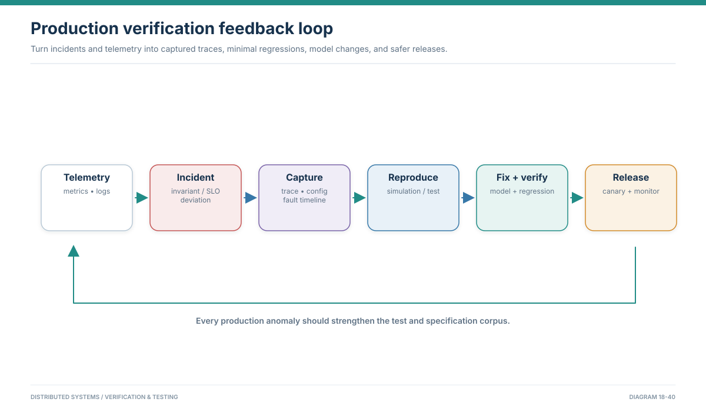

Verification is most effective when it is a repeatable lifecycle gate rather than a single pre-release event. Different test costs belong at different stages, and test artifacts must be retained so that failures can be reproduced after the build changes.

## 15.1 Verification pipeline for a distributed database

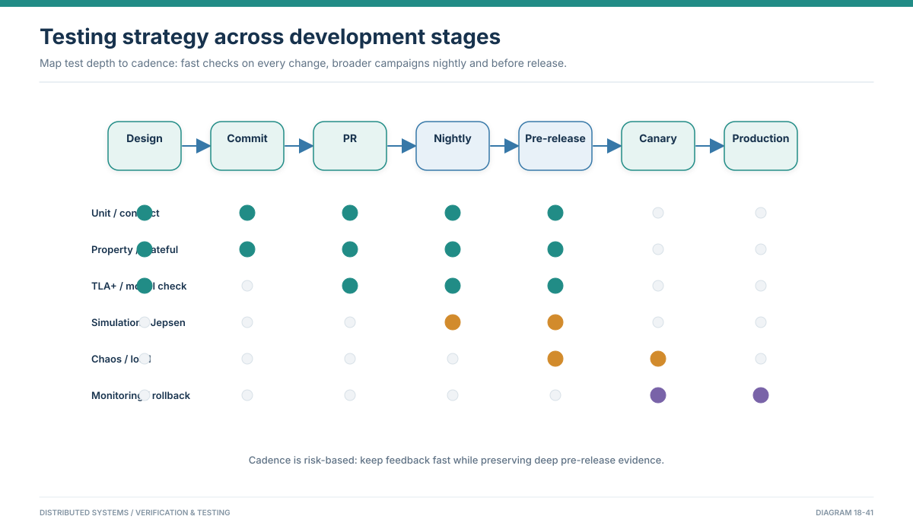

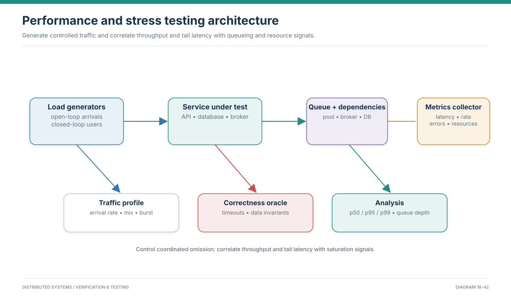

```text
Developer change
   |
   v
Static checks + unit tests + schema/protocol tests
   |
   v
PR gate: contract tests + property tests + small TLA+/TLC model
   |
   v
Build immutable artifact + dependency/SBOM metadata
   |
   v
Nightly: larger model + deterministic simulation + integration cluster
   |
   v
Pre-release: Jepsen-style histories + fault matrix + crash durability tests
   |
   v
Performance regression + soak + restore/upgrade validation
   |
   v
Staging canary + production-like topology and observability checks
   |
   v
Controlled rollout -> production assertions, SLOs, and rollback gates
   |
   v
Incident/counterexample -> regression test, model update, runbook, release gate
```

### Test cadence

| Cadence | Recommended checks | Reason |
|---|---|---|
| Every commit | Formatting/static analysis, unit tests, fast property tests | Cheap feedback on local regressions |
| Pull request | Integration/contract tests, targeted stateful tests, small finite TLC model | Prevent design/API regressions before merge |
| Nightly | Larger property tests, deterministic simulation seeds, expanded TLC configurations, longer integration runs | Explore more combinations and catch flaky schedules |
| Before release | Jepsen-style workloads, crash/recovery, durability, performance, upgrade/restore, chaos game day | Validate release artifact and deployment configuration |
| Continuously in production | Invariants/telemetry, canary analysis, error budgets, replication lag, audit checks, safe probes | Detect runtime drift and unexpected behavior |

### Reproducible test environments

A useful test record includes:

- source revision and immutable build/artifact digest;
- database and dependency versions;
- client and test harness versions;
- topology and placement (zones/regions/nodes);
- all consistency/durability/timeout/retry settings;
- random seed and generated workload configuration;
- fault schedule and exact start/end timestamps;
- event trace, history, logs, metrics, traces, and crash dumps;
- model version and checked properties;
- checker version and output;
- minimization/replay instructions.

Flaky tests should not be deleted or blindly retried until green. Record retry counts, classify sources of nondeterminism, and determine whether the flake itself exposes a race. A retry may help diagnose environmental noise, but it must not erase a correctness failure.

### Release gates and risk-based testing

Not all services need a full Jepsen campaign for every patch. Choose testing depth based on impact, change surface, protocol complexity, failure history, data criticality, and reversibility. A storage-engine change to WAL ordering warrants crash-consistency tests; a client-rendering change may not. A new quorum rule or membership transition should trigger model and distributed-fault suites.

A release should not pass solely because all tests returned green. Review untested failure classes, changed assumptions, suppressed tests, model bounds, known flakiness, and operational readiness. Canary deployments should watch both health metrics and semantic signals such as duplicate transaction IDs, checksum mismatches, divergent replicas, and invalid state transitions.

### Production verification feedback loop

Production incidents and near misses should feed back into the model and regression suite. A good incident-derived test captures the actual trigger, the invariant violated, and the smallest schedule that reproduces the issue. Avoid tests that merely duplicate the symptom without preserving the causal condition.

---

# 16. Real-World Case Studies

This section deliberately separates **documented engineering practice** from **illustrative system-design scenarios**. A test architecture can be a valid case study without claiming that a named company observed a particular failure. Historical product findings are tied to the cited release and report.

## 16.1 FoundationDB deterministic simulation testing — documented practice

- **Architecture overview:** FoundationDB uses an asynchronous runtime (Flow) that supports production execution and deterministic simulated execution. Its simulation models machines, storage, networking, and cluster components.
- **Correctness requirements:** transactional integrity, data guarantees, and correct behavior under a broad range of network, machine, and datacenter failures.
- **Testing strategy:** simulation runs many seeds and workloads, including transaction patterns such as a ring of key-value pairs whose invariant must be maintained.
- **System model:** simulated processes, virtualized time, deterministic random choices, storage capacity, packet delivery, and component failures.
- **Workload:** transaction and correctness workloads run against a simulated cluster; live performance tests and hardware-based failure tests complement simulation.
- **Faults introduced:** network connection failures/degradation, machine shutdown/reboot, machine performance changes, and storage capacity pressure.
- **Observed behavior:** the public FoundationDB testing documentation describes tens of thousands of nightly simulations and deterministic reruns using the same seed. It reports an engineering estimate of roughly one trillion CPU-hours equivalent across its accumulated simulation effort; this is the project's estimate, not a benchmark independently reproduced here.
- **Verification results:** the documented practice demonstrates how integrating a deterministic simulator with production runtime abstractions supports high-volume repeatable testing. It is a methodology case, not a claim that no bugs remain.
- **Lessons:** design for replaceable time, networking, and storage dependencies; check invariants continuously; preserve seed/trace; still use real hardware and live performance tests.

## 16.2 Jepsen testing of distributed databases — documented methodology

- **Architecture overview:** control node, real cluster, concurrent clients, nemesis, history recorder, and correctness checker.
- **Correctness requirements:** the selected product claims, such as linearizable register semantics, transactional isolation, or safe lock ownership.
- **Testing strategy:** generative workloads run against real binaries while faults are injected; histories are checked with object models or transaction dependency analysis.
- **System model:** real processes and network plus an abstract correctness model for operations.
- **Workload:** registers, append lists, sets, queues, bank transfers, locks, watches, or generated SQL transactions.
- **Faults introduced:** partitions, node/process crashes, pauses, clock changes, and in some analyses storage-cache loss.
- **Observed behavior:** the public analysis archive contains version-specific reports, including MySQL 8.0.34 (2023), PostgreSQL 12.3 (2020), MongoDB 4.2.6 (2020), etcd 3.4.3 (2020), TiDB 2.1.7 (2019), and CockroachDB beta-20160829 (2017). The reports describe different issues and test methods; they should not be collapsed into one generalized product assessment.
- **Verification results:** each report records whether the tested histories satisfied the chosen model and describes concrete counterexamples where they did not.
- **Lessons:** choose the checker carefully, preserve product/version/configuration details, and never equate a healthy API response with a legal history.

## 16.3 TLA+ verification of Raft — documented specification practice

- **Architecture overview:** a leader-based replicated log with voters, terms, messages, and commit/application progress.
- **Correctness requirements:** election safety, log matching, leader completeness, and state-machine safety.
- **Testing strategy:** specify state and actions, then model-check small clusters; use the published Raft TLA+ specification as a starting point for understanding.
- **System model:** finite number of servers, bounded log entries/terms for exploration, and message actions that model possible delays/orderings.
- **Workload:** client commands, elections, append entries, and membership transitions.
- **Faults introduced:** message loss/delay, leader crash, follower restart, and partitions, within the model's assumptions.
- **Observed behavior:** the Raft project publishes the paper and links to a TLA+ specification associated with the protocol; this is evidence of formal specification practice, not proof that every Raft implementation refines that specification.
- **Verification results:** model checking can expose counterexamples in a particular model/configuration; the reader must inspect model bounds and assumptions.
- **Lessons:** separate algorithm correctness from implementation refinement and deployment validation.

## 16.4 Raft leader election under a network partition — illustrative scenario

- **Architecture overview:** five voting nodes using majority quorum; one leader and four followers.
- **Correctness requirements:** no two leaders in one term; committed entries remain present; minority cannot commit conflicting entries.
- **Testing strategy:** deterministic simulation plus real-cluster partition tests and client-history checking.
- **System model:** five nodes, message queue, election timers, persistent term/vote/log, and quorum of three.
- **Workload:** continuous writes and reads while links are partitioned.
- **Faults introduced:** isolate leader with one follower from the other three; later heal the network; crash and restart a node during healing.
- **Observed behavior:** expected behavior under the protocol model is that the majority side can elect a leader; the minority cannot commit new entries. This is a predicted result for the scenario, not a claim about a tested vendor product.
- **Verification results:** assert one leader per term and no conflicting committed index; run a linearizability checker against client-visible operations if linearizable reads/writes are promised.
- **Lessons:** partition topology matters; test asymmetric cuts and leader recovery, not just “one node down.”

## 16.5 Distributed key-value store linearizability — illustrative scenario

- **Architecture overview:** three replicas, one leader, quorum writes, routed reads.
- **Correctness requirements:** a successful write is visible to every read invoked after its response.
- **Testing strategy:** generate concurrent `get`/`put`/CAS operations and analyze invocation/response intervals.
- **System model:** single-key register with leader election and in-flight replication messages.
- **Workload:** clients update a key through one endpoint and read through other endpoints.
- **Faults introduced:** delay follower replication, isolate stale read replica, fail leader after acknowledgement.
- **Observed behavior:** illustrative counterexample: write `v2` returns successfully, later read returns `v1` from a stale follower.
- **Verification results:** history violates linearizability because write completion precedes read invocation; it may still be consistent with a weaker model depending on the contract.
- **Lessons:** a green transport check is not a consistency check; route reads through a safe mechanism or expose weaker semantics explicitly.

## 16.6 Kafka message delivery and ordering — mixed documented concepts and illustrative test plan

- **Architecture overview:** partitioned append-only log, replicated partition leaders, producers, consumer groups, offsets, and optional transactional APIs.
- **Correctness requirements:** durability/ordering scope, producer retry semantics, consumer delivery semantics, and atomicity scope for transactions.
- **Testing strategy:** use a real test cluster and record producer acknowledgements, partition/offset, consumer effects, and offset commits.
- **System model:** partition log plus broker replica state and consumer-group assignment state.
- **Workload:** keyed messages with unique IDs, repeated sends, and consumers that persist a side effect.
- **Faults introduced:** leader broker stop, ISR shrink, consumer crash around side-effect/offset boundary, rebalance, and network delay.
- **Observed behavior:** the expected at-least-once pattern may redeliver after a crash before offset commit; the effect must be idempotent or coordinated with offset progress. This is a test expectation, not a product finding.
- **Verification results:** compare per-partition order, duplicates, gaps, committed offsets, and external effects.
- **Lessons:** specify whether “exactly once” is broker-local or end-to-end; ordering is usually partition-scoped.

## 16.7 2PC coordinator failure — illustrative scenario

- **Architecture overview:** one coordinator and three transaction participants, each with durable state logs.
- **Correctness requirements:** no participant commits without a durable global commit decision; participants eventually learn the decision after recovery.
- **Testing strategy:** crash the coordinator at every transition from collecting votes through durable decision and notification.
- **System model:** coordinator state machine, participant state machines, network messages, and durable log writes.
- **Workload:** transactions touching all three participants with concurrent independent traffic.
- **Faults introduced:** coordinator crash after prepare, lost commit notification, participant restart, and partition between participant groups.
- **Observed behavior:** prepared participants may block pending coordinator recovery; this is consistent with classic 2PC's blocking limitation.
- **Verification results:** assert no contradictory terminal decisions and eventual resolution once the durable decision is available.
- **Lessons:** test recovery log correctness; do not assume timeout means abort.

## 16.8 Kubernetes microservices chaos experiment — illustrative scenario

- **Architecture overview:** API gateway, stateless services, database, broker, and three replicas per critical deployment across zones.
- **Correctness requirements:** bounded request failures; no lost committed order; bounded queue growth; successful rescheduling/recovery.
- **Testing strategy:** define SLO steady state, run a controlled game day, and correlate application traces with Kubernetes events.
- **System model:** deployment replicas, services, readiness/liveness probes, disruption budgets, autoscaler, and external dependencies.
- **Workload:** representative API traffic with background message processing.
- **Faults introduced:** delete a pod, drain a node, delay a service dependency, and isolate a zone in separate experiments.
- **Observed behavior:** expected effects include replacement scheduling, readiness gating, increased latency, and queue backlog. No company-specific outcome is claimed.
- **Verification results:** assess error budget, semantic correctness, recovery time, and replica convergence.
- **Lessons:** PDBs and health probes are not proof of application-level data safety; verify durable state and retry idempotency.

## 16.9 Database durability under abrupt machine failure — illustrative scenario

- **Architecture overview:** storage engine with WAL, data pages, checkpointing, and replicated followers.
- **Correctness requirements:** acknowledged durable commits survive the declared crash class; recovery does not expose partial/corrupt transactions.
- **Testing strategy:** inject crashes at write/flush/checkpoint boundaries and compare recovered state to acknowledged history.
- **System model:** volatile page cache, durable storage, WAL records, commit markers, and recovery replay.
- **Workload:** random transactions with a ledger invariant and unique commit IDs.
- **Faults introduced:** process kill, VM reset, simulated dropped un-fsynced writes, full disk, and I/O error.
- **Observed behavior:** allowed recovered states depend on the acknowledgement and fsync contract; an acknowledged commit missing after a failure the contract covers is a violation.
- **Verification results:** validate WAL checksums, transaction atomicity, and external history vs restored state.
- **Lessons:** process termination alone does not model loss of volatile storage caches.

## 16.10 Payment correctness under duplicate messages — illustrative scenario

- **Architecture overview:** API, payment ledger, outbox, broker, and downstream fulfillment consumers.
- **Correctness requirements:** one debit per payment ID; order never fulfilled without payment and inventory; workflow status remains auditable.
- **Testing strategy:** property-based request generation plus broker redelivery and failure injection.
- **System model:** idempotency-key map, ledger, event log, and saga state.
- **Workload:** repeated and concurrent payment submissions, timeouts, retries, and duplicate events.
- **Faults introduced:** lose API response after commit, crash relay after publish, redeliver consumer message, and fail refund/compensation.
- **Observed behavior:** expected safe design returns the stored outcome on retry and records compensation/manual review if required.
- **Verification results:** assert `debits(payment_id) <= 1` and check final order/payment consistency.
- **Lessons:** dedupe at the effect boundary; at-least-once delivery is not a defect if effects are idempotent.

## 16.11 Multi-region replication under network isolation — illustrative scenario

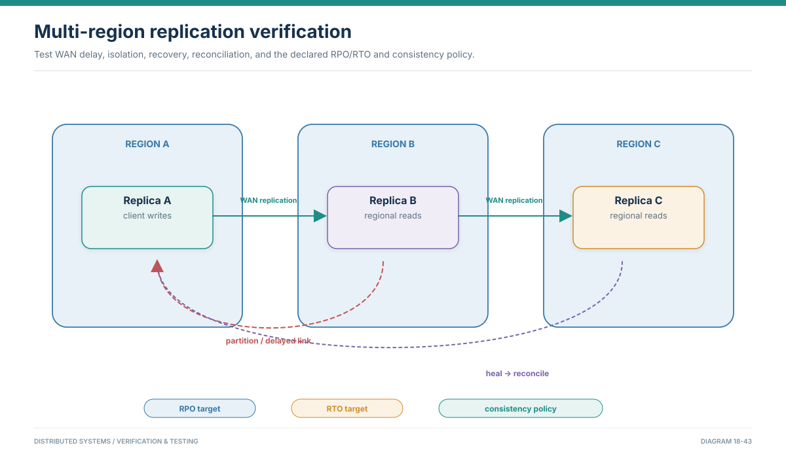

- **Architecture overview:** two or three regions, regional replicas, routing layer, and conflict resolution/consensus policy.
- **Correctness requirements:** declared RPO/RTO, no conflicting authoritative writes if strong consistency is promised, or deterministic merge if multi-writer eventual consistency is promised.
- **Testing strategy:** partition one region, continue permitted traffic, then heal and inspect convergence and data loss against the declared policy.
- **System model:** regions, WAN links, clocks, replication queues, and region priority/quorum rules.
- **Workload:** writes from multiple regions, cross-region reads, and session-bound operations.
- **Faults introduced:** asymmetric WAN isolation, high latency, region shutdown, and stale DNS routing.
- **Observed behavior:** a strong-consistency design may reject minority-region writes; a multi-writer design may accept concurrent values and merge later. This is a design-dependent expectation.
- **Verification results:** compare histories with the promised model and measure recovery/convergence against objective.
- **Lessons:** “multi-region” does not automatically mean active-active or zero data loss; specify the partition policy.

## 16.12 BFT consensus under malicious replica behavior — illustrative scenario

- **Architecture overview:** four replicas in a classic `3f + 1` configuration, with authenticated messages and one potentially Byzantine replica.
- **Correctness requirements:** correct replicas do not decide conflicting values; invalid or equivocating messages do not cause a safety violation; liveness follows the protocol's synchrony assumptions.
- **Testing strategy:** adversarial message generation, protocol-level model checking, and controlled integration tests with Byzantine test doubles.
- **System model:** authenticated replica identities, quorum certificates, epochs/views, and up to one Byzantine process.
- **Workload:** repeated consensus instances with concurrent proposers and leader changes.
- **Faults introduced:** equivocation, message omission, invalid signatures, replay, malformed payloads, and collusion within the allowed fault bound.
- **Observed behavior:** the correct-replica agreement expectation follows the selected BFT protocol's assumptions; this scenario is not a report of a specific product test.
- **Verification results:** assert quorum certificate validity, monotonic view/epoch state, and no conflicting decisions among correct replicas.
- **Lessons:** crash-fault consensus tests cannot establish Byzantine resilience; test authentication, membership, quorum intersection, and adversarial message semantics.

---

# 17. Quantitative Worked Examples and Formulas

Quantitative models make test plans measurable, but estimates must be interpreted within their assumptions. Test count, code coverage, and injected-fault count are not direct measures of correctness.

## 17.1 State-space size

**Assumptions:** `n` independent processes; each has `k` abstract local states; ignore messages and shared variables for a first upper-bound intuition.

\[
S = k^n
\]

For 4 processes with 5 local states each:

\[
S = 5^4 = 625\text{ local-state combinations}
\]

Add a message queue with 6 possible contents and the crude product becomes `625 × 6 = 3,750`. Real models can grow much faster because message ordering, timestamps, and variable domains add combinations. This is an upper-bound intuition, not a count of reachable states.

## 17.2 Model-checking exploration rate

If a run explores 180,000 distinct states in 60 seconds:

\[
R = \frac{180{,}000}{60} = 3{,}000\text{ states/second}
\]

This rate is useful for capacity planning, but it does not measure semantic coverage. A model that omits a failure mode can explore millions of irrelevant states and still miss the important bug.

## 17.3 Replica quorum intersection

For a universe of `N` replicas, two quorums of sizes `q_1` and `q_2` are guaranteed to intersect if:

\[
q_1 + q_2 > N
\]

The minimum intersection size is:

\[
|Q_1 \cap Q_2| \geq q_1 + q_2 - N
\]

For `N = 5` and majority quorums of 3:

\[
|Q_1 \cap Q_2| \geq 3 + 3 - 5 = 1
\]

Any two 3-member quorums share at least one replica. This arithmetic is only one part of correctness: shared replicas must obey the protocol's persistent state, version, and voting rules.

## 17.4 Byzantine replica tolerance

For the classic partially synchronous authenticated BFT setting, the common replica-count requirement is:

\[
N \geq 3f + 1
\]

With `f = 1`, at least `N = 4` replicas are required. With `f = 2`, at least `N = 7`. This formula is protocol/model-specific; other assumptions or BFT constructions may have different communication and quorum rules.

## 17.5 Test execution throughput

If a nightly campaign runs 12,000 tests in 6 hours:

\[
R = \frac{12{,}000}{6 \times 60 \times 60} \approx 0.556\text{ tests/second}
\]

Average elapsed time is about 1.8 seconds per test if run serially. If tests run in parallel, this is campaign throughput, not individual test duration. Preserve the distribution because a few long-running tests may dominate the wall-clock time.

## 17.6 Fault injection frequency

If a test injects 24 faults in 2 hours:

\[
\lambda = \frac{24}{2} = 12\text{ injected faults/hour}
\]

This is an experiment rate, not a production failure probability. Fault frequency should be chosen to explore meaningful state transitions without making the test so chaotic that failures are impossible to diagnose.

## 17.7 Failure probability estimation

If `x` failures are observed in `n` independent, identically distributed trials, the sample estimate is:

\[
\hat{p} = \frac{x}{n}
\]

For 5 failures in 1,000 trials, `p-hat = 0.005` or 0.5%. If zero failures are observed in `n` independent trials, a rough 95% “rule of three” upper bound is:

\[
p_{upper} \approx \frac{3}{n}
\]

For 3,000 failure-free trials, the rough upper bound is 0.001 (0.1%). The independence assumption is often false in distributed tests: repeated seeds may share code paths, infrastructure, and workload bias. Confidence intervals should not be interpreted as proof of correctness.

## 17.8 Test coverage interpretation

Statement coverage is:

\[
C_s = \frac{\text{executed statements}}{\text{total statements}} \times 100\%
\]

If 950 of 1,000 statements execute, coverage is 95%. That does not imply 95% correctness or 95% of failure scenarios. Branch, state-transition, requirement, fault-model, and history-property coverage provide different views. A test may execute a persistence branch without crashing between WAL flush and response—the critical ordering may remain untested.

## 17.9 Load generation

For an open-loop arrival-rate workload, if 1,200 requests are scheduled per second, the target arrival rate is:

\[
\lambda = 1{,}200\; requests/s
\]

An open-loop generator should record requests that could not be issued on schedule. A closed-loop generator instead waits for responses and may reduce its offered load when the system slows down.

## 17.10 Request concurrency — Little's Law

For a stable system:

\[
L = \lambda W
\]

where `L` is average in-flight work, `λ` is throughput/arrival rate, and `W` is average time in the system. At 1,200 requests/s and 80 ms average latency (`0.08 s`):

\[
L = 1{,}200 \times 0.08 = 96\text{ concurrent requests}
\]

Little's Law assumes a stable flow over the measurement interval. It is not a safe capacity formula by itself; queues can grow without bound under overload.

## 17.11 Simulation time vs wall-clock time

Define speedup as:

\[
Speedup = \frac{T_{simulated}}{T_{wall}}
\]

If a test simulates 10 hours of logical time in 1 hour of wall time, speedup is 10×. Faster virtual time helps test long leases and recovery timers, but it does not imply that physical device behavior is represented accurately.

## 17.12 Recovery time

Recovery time is measured from fault removal (or the declared recovery trigger) until all steady-state conditions hold continuously for a defined stabilization window:

\[
T_{recover} = t_{steady} - t_{fault\_removed}
\]

Example: network heals at 10:00:00; replicas converge and the service meets its error/latency/data-integrity criteria at 10:02:30 and remains stable for the next 60 seconds. The measured recovery time is 150 seconds, with a 60-second confirmation window. State exactly which endpoint is used.

## 17.13 Fault detection time

\[
T_{detect} = t_{alert} - t_{fault\_start}
\]

If a broker fails at 14:00:00 and an actionable alert fires at 14:00:18, detection time is 18 seconds. Separate time-to-detect from time-to-notify, time-to-mitigate, and time-to-recover.

## 17.14 Message loss and duplicate rates

If `S` unique messages were sent and `M` are missing after the declared retention/settling period:

\[
LossRate = \frac{M}{S} \times 100\%
\]

If 2 of 50,000 unique message IDs are missing, loss rate is 0.004%. If 300 duplicate deliveries are observed among 50,000 unique IDs:

\[
DuplicateRate = \frac{300}{50{,}000} \times 100\% = 0.6\%
\]

Count logical messages separately from transport attempts and deliveries. Duplicate delivery may be allowed under at-least-once semantics; duplicate side effects may not be.

## 17.15 Latency distribution

For sorted observations `x_1 ... x_n`, a percentile estimate uses the selected quantile definition; implementations differ slightly for finite samples. At p99, about 1% of observations are at or above the threshold. Example: if the measured p99 is 420 ms, the test should report sample size, time window, load profile, and whether the generator suffered coordinated omission. Never report only the average for a tail-sensitive service.

## 17.16 Availability under injected faults

For a defined measurement window:

\[
Availability = \frac{\text{eligible requests meeting success criteria}}{\text{total eligible requests}} \times 100\%
\]

If 98,700 of 100,000 eligible requests meet the service's success and latency criteria, availability is 98.7%. The eligibility rule must specify whether rejected writes during a partition count as unavailable, and the success criteria must include semantic correctness rather than HTTP status alone.

---

# 18. System Design and Verification Exercises

Each exercise is intended for design review, lab implementation, or interview practice. The expected outcome is a verification plan and evidence strategy, not necessarily a full production implementation.

## Exercise 1 — Formally specify a distributed lock using TLA+

- **Requirements:** one valid owner at a time; waiting clients eventually acquire after release/expiry under healthy quorum.
- **System model:** three lock-service replicas, client identities, lease time, fencing token, and resource-side token state.
- **Correctness properties:** exclusive valid grant; monotonically increasing token; stale token rejected by resource.
- **Assumptions:** majority availability, bounded/defined lease semantics, and a fair scheduler for liveness.
- **Architecture:** model lock service and protected resource as separate state machines.
- **Test strategy:** TLC over small client/node sets; property-based concurrent acquire/release; deterministic pauses around expiry.
- **Fault scenarios:** client pause, network partition, leader crash, lease renewal loss.
- **Expected outcomes:** no two tokens are accepted as current; stale former owner cannot mutate resource.
- **Failure analysis:** a lock-only invariant may pass while external writes remain unsafe; identify missing fencing.
- **Trade-offs:** stronger fencing adds resource-side state and validation cost.

## Exercise 2 — Verify a replicated register

- **Requirements:** define whether the register is linearizable, sequentially consistent, or eventually consistent.
- **System model:** three replicas, write versions, messages, client sessions, and read routing.
- **Correctness properties:** legal read values; read-your-writes if promised; convergence after quiescence.
- **Assumptions:** explicit quorum, conflict-resolution, and delivery rules.
- **Architecture:** compare abstract register model with replica implementation.
- **Test strategy:** TLA+ or reference state machine plus concurrent history checker.
- **Fault scenarios:** delayed replication, partitions, replica restart, duplicate updates.
- **Expected outcomes:** strong model rejects stale post-write reads; eventual model converges after healing.
- **Failure analysis:** identify whether history violates real-time order or only a stronger-than-promised property.
- **Trade-offs:** stronger reads may block or require quorum communication.

## Exercise 3 — Model-check simplified Raft election

- **Requirements:** one leader per term; candidate must obtain majority; term never decreases.
- **System model:** 3 or 5 finite nodes, small term set, vote and message variables.
- **Correctness properties:** election safety and vote-at-most-once per term.
- **Assumptions:** crash-stop first; add crash-recovery after persistence is modeled.
- **Architecture:** TLA+ `Init`, election timeout, request vote, grant vote, receive higher term.
- **Test strategy:** TLC small cluster and counterexample review.
- **Fault scenarios:** simultaneous timeouts, delayed votes, duplicate vote requests, candidate crash.
- **Expected outcomes:** no two leaders in one term under the model rules.
- **Failure analysis:** check vote persistence, term comparisons, and omitted message events.
- **Trade-offs:** increasing node count/term domain grows state space.

## Exercise 4 — Design a Jepsen test for a key-value database

- **Requirements:** write/read consistency and durability level are explicit.
- **System model:** real cluster, clients, operations, nemesis, and sequential register oracle.
- **Correctness properties:** linearizability or stated weaker model; no acknowledged write loss within durability scope.
- **Assumptions:** known topology, version, client semantics, and fault permissions.
- **Architecture:** control node + workload + nemesis + history recorder + checker.
- **Test strategy:** concurrent register and CAS histories plus recovery/final-state comparison.
- **Fault scenarios:** partitions, kill leader, pause node, lose acknowledgements.
- **Expected outcomes:** histories either pass chosen checker or yield minimized counterexample.
- **Failure analysis:** classify transport timeout as ambiguous outcome rather than assuming no effect.
- **Trade-offs:** real-cluster coverage is costly and nondeterministic compared with a simulator.

## Exercise 5 — Property-based idempotent payment API

- **Requirements:** same idempotency key and same request maps to one payment effect; conflicting payload reuse is rejected.
- **System model:** model map from key to request hash and outcome, plus ledger.
- **Correctness properties:** one debit per key; response replay is stable; key/payload mismatch does not silently reuse outcome.
- **Assumptions:** key retention period and ledger durability are specified.
- **Architecture:** API, idempotency store, transaction ledger, and outbox.
- **Test strategy:** stateful PBT with concurrent duplicates, retries, and restart commands.
- **Fault scenarios:** timeout after commit, process crash, duplicate event, partial dependency outage.
- **Expected outcomes:** one logical debit and a deterministic queryable outcome.
- **Failure analysis:** compare ledger effects, not only HTTP response counts.
- **Trade-offs:** retaining idempotency records costs storage and requires expiry semantics.

## Exercise 6 — Deterministic simulator for a distributed message queue

- **Requirements:** define ordering scope, retention, delivery and acknowledgement semantics.
- **System model:** brokers, partitions, logs, consumer groups, offsets, virtual clock, and message scheduler.
- **Correctness properties:** no committed record corruption; ordering within declared scope; no effect duplication when application contract requires idempotency.
- **Assumptions:** bounded node count and message set for exploration.
- **Architecture:** event queue + virtual transport + broker/consumer state machines + assertions.
- **Test strategy:** seeded randomized event ordering and deterministic replay.
- **Fault scenarios:** broker crash, leader change, duplicate delivery, offset commit race, disk full.
- **Expected outcomes:** every failure yields reproducible trace; legal duplicates are distinguished from illegal effects.
- **Failure analysis:** ensure simulator executes production protocol code where possible.
- **Trade-offs:** fidelity and deterministic control require architectural investment.

## Exercise 7 — Fault injection for a three-node database

- **Requirements:** define majority behavior, read/write policy, and durable acknowledgement.
- **System model:** three replicas and a client workload.
- **Correctness properties:** committed-write safety, no split brain, recovery convergence.
- **Assumptions:** one crash fault tolerated; storage failure model stated.
- **Architecture:** three database nodes, load generator, network fault controller, metrics/history collector.
- **Test strategy:** remove one node, partition one node, restart in different orders.
- **Fault scenarios:** primary loss, majority partition, disk pressure, lost acknowledgement.
- **Expected outcomes:** majority side behaves according to policy; minority cannot create conflicting commits.
- **Failure analysis:** compare acknowledged history with post-recovery database.
- **Trade-offs:** a small test cluster may not reproduce zone-level dependencies.

## Exercise 8 — Verify 2PC under coordinator failure

- **Requirements:** durable decision and no contradictory participant outcomes.
- **System model:** coordinator, participants, durable logs, and message channels.
- **Correctness properties:** commit requires all required votes and durable decision; participants recover consistently.
- **Assumptions:** logs survive specified crashes; recovery coordinator can discover outcome.
- **Architecture:** TLA+ model or executable state machines for coordinator/participants.
- **Test strategy:** inject crash at every phase transition and check participant states.
- **Fault scenarios:** coordinator crash after prepare, partial notification, participant reboot.
- **Expected outcomes:** prepared participants may block but do not guess conflicting outcomes.
- **Failure analysis:** inspect the exact durable decision boundary and recovery protocol.
- **Trade-offs:** safety may require blocking while decision is unavailable.

## Exercise 9 — Test eventual consistency across three replicas

- **Requirements:** define conflict resolution, convergence assumptions, and session guarantees.
- **System model:** three replicas with asynchronous anti-entropy and message queue.
- **Correctness properties:** convergence after quiescence; no lost update under intended merge; specified monotonicity/session behavior.
- **Assumptions:** eventual connectivity and fair repair.
- **Architecture:** three regions/replicas, clients, replication stream, conflict resolver.
- **Test strategy:** randomized concurrent updates and final state comparison.
- **Fault scenarios:** partition, message reorder, duplicate delta, replica restart.
- **Expected outcomes:** all replicas converge to same logical state after repair.
- **Failure analysis:** distinguish expected stale reads during partition from permanent divergence.
- **Trade-offs:** CRDT semantics simplify merge but may restrict operations or increase metadata.

## Exercise 10 — Chaos experiment for Kubernetes platform

- **Requirements:** API SLO, data-safety invariant, and recovery target.
- **System model:** deployments, nodes/zones, PDBs, services, dependencies, and traffic.
- **Correctness properties:** no lost committed transaction; bounded error rate and queue age; service recovers.
- **Assumptions:** staging topology approximates production; instrumentation is available.
- **Architecture:** traffic generator + chaos controller + cluster observability + abort controller.
- **Test strategy:** hypothesis-driven game day with one fault at a time.
- **Fault scenarios:** pod kill, node drain, dependency latency, zone isolation.
- **Expected outcomes:** controlled failover, alerting, and recovery within target.
- **Failure analysis:** correlate application symptoms with scheduler, storage, and network events.
- **Trade-offs:** production experiments offer realism but carry blast-radius risk.

## Exercise 11 — Kafka consumer under duplication and rebalancing

- **Requirements:** define at-least-once/exactly-once scope and per-partition ordering.
- **System model:** topic partitions, consumer group, offsets, downstream effect store.
- **Correctness properties:** committed offsets reflect completed work; duplicate delivery does not duplicate logical effect.
- **Assumptions:** idempotency key retention and transaction configuration are explicit.
- **Architecture:** producer, broker, two consumers, offset store, downstream DB.
- **Test strategy:** instrument unique event IDs and compare consumed, committed, and applied sets.
- **Fault scenarios:** crash before/after effect, rebalance during processing, broker failover.
- **Expected outcomes:** no lost effect under declared guarantee; duplicates handled safely.
- **Failure analysis:** inspect side-effect/offset ordering and stale consumer fencing.
- **Trade-offs:** transactional integration increases complexity and may reduce throughput.

## Exercise 12 — Verification pipeline for multi-region storage

- **Requirements:** RPO/RTO, consistency model, backup, upgrade, and region-failure policy.
- **System model:** multi-region quorum/replication topology, WAN, clocks, storage, and restore path.
- **Correctness properties:** no forbidden divergent commits; convergence/restore correctness; bounded RPO/RTO.
- **Assumptions:** failure domains, membership, and network timing are explicit.
- **Architecture:** fast CI tests, model checker, simulator, real-cluster Jepsen suite, durability tests, canary, and production feedback.
- **Test strategy:** risk-based cadence with preserved artifacts and historical regression seeds.
- **Fault scenarios:** WAN isolation, region loss, disk corruption, certificate rotation, upgrade rollback.
- **Expected outcomes:** release evidence supports the declared guarantees; unknowns are documented.
- **Failure analysis:** map every production claim to at least one test/property and identify untested assumptions.
- **Trade-offs:** broad coverage consumes compute and release time; prioritize critical data paths and irreversible operations.

---

# 19. Interview Preparation — 180 Questions and Answers

The answers emphasize reasoning and assumptions. In an interview, start with the contract and failure model, then explain the test oracle and only then name a tool.

## 19.1 Distributed Systems Verification Fundamentals

**Q1. What is verification in a distributed system?**  
Verification is the process of establishing that system behavior satisfies a specified contract under stated assumptions. Evidence can come from tests, model checking, proofs, runtime assertions, and production observations.

**Q2. How is verification different from testing?**  
Testing executes selected inputs or schedules and checks their outcomes. Verification is broader: it includes specification, mathematical reasoning, model checking, refinement arguments, and tests that explore implementation behavior.

**Q3. Why are distributed systems harder to test than centralized programs?**  
They combine concurrency, partial failure, unreliable communication, independent clocks, and recovery. Many defects depend on a rare ordering of events that ordinary single-node tests never create.

**Q4. Why can thousands of passing tests still miss a serious bug?**  
Tests cover only the inputs, schedules, configurations, and failure modes they exercise. A bug may require a particular message delay, process pause, disk flush boundary, or retry sequence not represented in the suite.

**Q5. What is nondeterminism in distributed execution?**  
It is the existence of multiple legal next events, often because independent processes race and messages arrive in different orders. A correct test strategy explores or controls those alternatives rather than assuming one schedule.

**Q6. What is a partial failure?**  
A partial failure occurs when some components fail while others continue. It is difficult because surviving nodes may not know whether a silent peer is crashed, slow, or partitioned.

**Q7. What is the purpose of a test oracle?**  
An oracle decides whether observed behavior is acceptable. It may be a reference model, invariant, consistency checker, schema contract, or business rule; without an oracle, a test can generate load but cannot establish correctness.

**Q8. Compare unit, integration, and end-to-end tests for a database.**  
Unit tests target parsing, state transitions, and storage primitives; integration tests exercise real components and protocols; end-to-end tests cover a deployed workload and client-visible behavior. They differ in scope, speed, and diagnostic precision.

**Q9. What does “production-oriented verification” mean?**  
It ties formal properties to deployed configuration, versions, failure domains, persistence, observability, recovery procedures, and customer-facing objectives. A theorem over an abstract model is not enough unless engineers understand how the implementation and operations realize its assumptions.

## 19.2 Safety, Liveness, and Invariants

**Q10. Define a safety property.**  
Safety states that something bad never happens, such as two valid owners for one exclusive lock. A finite counterexample prefix is enough to disprove it.

**Q11. Define a liveness property.**  
Liveness states that something good eventually happens, such as a request eventually completing. It needs assumptions about failures, message delivery, timing, and fair scheduling.

**Q12. Can a system satisfy safety but fail liveness?**  
Yes. A lock service that never grants a lock preserves mutual exclusion but makes no progress. Safety and liveness must be specified and tested independently.

**Q13. What is an invariant?**  
An invariant is a predicate that must hold in every reachable state. It must hold initially and be preserved by every allowed transition.

**Q14. How do you prove an invariant inductively?**  
Show that every initial state satisfies it, then show that any state satisfying it transitions only to another state satisfying it. If either obligation fails, the proposed invariant or transition model is incomplete or wrong.

**Q15. What is a conservation invariant?**  
It states that a quantity remains unchanged across allowed transitions, such as total account balance during an internal transfer. It is a powerful oracle for financial and resource-allocation workflows.

**Q16. Why are availability and correctness different?**  
Availability measures whether a response is served; correctness measures whether the response is allowed by the contract. A stale replica may be available but return an illegal value for a linearizable read.

**Q17. What is the difference between recovery and liveness?**  
Liveness is a temporal progress guarantee under assumptions; recovery is the operational return to a healthy state after a fault. Recovery commonly includes a liveness goal plus an explicit convergence and steady-state criterion.

**Q18. Give a safety/liveness example for Raft.**  
Safety requires that two leaders are not valid in the same term and committed entries are not contradicted. Liveness requires eventual election/commit when a majority is available and communication eventually stabilizes.

## 19.3 Models, Histories, and Executions

**Q19. What is a system model?**  
It is an abstraction of process state, communication, time, and failure behavior used to reason about executions. Its assumptions determine what a proof or test result actually covers.

**Q20. Synchronous vs asynchronous systems?**  
A synchronous model provides known bounds on message and processing delay; an asynchronous model provides no such bounds. An asynchronous timeout cannot reliably distinguish a slow node from a failed one.

**Q21. What is partial synchrony?**  
It allows timing bounds to hold after an unknown stabilization time or to exist but be unknown. It is a common assumption for practical liveness of consensus protocols.

**Q22. Distinguish crash-stop and crash-recovery.**  
Crash-stop nodes halt permanently; crash-recovery nodes may restart and must reconstruct state from durable storage. A protocol correct under crash-stop assumptions may fail if restart loses vote, term, or log state.

**Q23. What is an execution history?**  
It is a record of operation invocations and completions, often with process IDs and timestamps. A history allows a checker to compare observed behavior to an abstract sequential or transactional model.

**Q24. What are pending operations?**  
They are invoked operations without a recorded response when observation ends. A checker must treat them according to the contract; their effects may be unknown rather than definitely absent.

**Q25. Explain happens-before.**  
Happens-before is a partial order derived from process program order, message send/receive, and transitivity. It identifies causal precedence without pretending that all events have a reliable global physical timestamp.

**Q26. What is a linearization point?**  
It is the instant between invocation and response at which an operation is treated as taking effect in a legal sequential history. It is a conceptual correctness boundary, not necessarily a single source-code line.

**Q27. Why record time intervals instead of only completion timestamps?**  
Linearizability depends on real-time precedence between non-overlapping operations. Invocation and response intervals distinguish operations that may be reordered from those whose order is externally fixed.

## 19.4 Formal Methods

**Q28. What are formal methods?**  
Formal methods apply mathematical languages and reasoning to system design and verification. They make assumptions, state, and correctness properties explicit so errors can be found before or alongside implementation.

**Q29. What is a transition system?**  
A transition system defines a set of states, initial states, and a relation describing allowed next states. It is a natural model for concurrent algorithms and protocol state machines.

**Q30. State predicate vs action predicate?**  
A state predicate describes one state; an action predicate relates a current state to a next state. Temporal formulas describe entire behaviors composed of states.

**Q31. What is temporal logic?**  
Temporal logic extends ordinary logic with operators over time, such as always and eventually. It can express safety and liveness properties over sequences of states.

**Q32. What is refinement?**  
Refinement shows that a lower-level implementation corresponds to an abstract specification, often by mapping concrete state to abstract state and treating internal steps as stuttering. It is the bridge between an elegant protocol model and a detailed implementation model.

**Q33. Preconditions and postconditions?**  
A precondition states what must be true before an operation; a postcondition states what must be true after a successful operation. They are useful for APIs and state transitions but do not by themselves characterize all concurrent interleavings.

**Q34. Model checking vs theorem proving?**  
Model checking algorithmically explores states or bounded executions and can produce concrete counterexamples. Theorem proving establishes a general result from axioms and proof obligations, but often requires more human-guided reasoning.

**Q35. What is a proof obligation?**  
It is a mathematical statement that must be shown for a correctness argument, such as initialization and inductive preservation of an invariant. Listing proof obligations reveals hidden assumptions and missing cases.

**Q36. When are formal methods most valuable?**  
They are most valuable for compact but high-impact protocols, irreversible data operations, complex concurrency, and systems where failures are difficult to reproduce. Their cost is justified when a design flaw would be expensive or dangerous to discover in production.

## 19.5 TLA+ Syntax and Semantics

**Q37. What is TLA+?**  
TLA+ is a mathematical specification language for describing state machines and temporal properties. It is designed to reason about algorithms, especially concurrent and distributed systems.

**Q38. What does `Init` represent?**  
`Init` is a predicate that defines permitted initial states. TLC generates starting states that satisfy it.

**Q39. What does `Next` represent?**  
`Next` is an action describing all permitted one-step state transitions. It is commonly a disjunction of actions such as send, receive, timeout, crash, and recover.

**Q40. What does `Spec == Init /\ [][Next]_vars` mean?**  
It requires an initial state satisfying `Init` and then allows transitions satisfying `Next` or stuttering steps over `vars`. It defines a set of behaviors rather than one execution.

**Q41. What does the prime operator mean?**  
`x'` is the next-state value of variable `x`. An action relates current-state expressions and primed next-state expressions.

**Q42. Explain `UNCHANGED vars`.**  
It states that all listed variables keep their current values in the next state. Actions should constrain variables they do not modify so the transition relation is precise.

**Q43. What does `[]P` mean?**  
It means `P` is always true in every state of the behavior. It is commonly used to express invariants or temporal safety properties.

**Q44. What does `<>P` mean?**  
It means `P` eventually becomes true. It expresses a basic liveness goal but usually needs fairness and environmental assumptions.

**Q45. Compare `WF` and `SF`.**  
Weak fairness requires an action to occur if it stays continuously enabled; strong fairness requires it to occur if it is enabled infinitely often. Strong fairness is a stronger scheduler assumption and should be justified explicitly.

## 19.6 TLC Model Checking

**Q46. What is TLC?**  
TLC is the explicit-state model checker for TLA+. It enumerates reachable states in a configured finite model and checks invariants, deadlocks, and supported temporal properties.

**Q47. How does TLC explore states?**  
It evaluates `Init`, stores initial states, repeatedly evaluates enabled `Next` actions, and adds unseen successor states. Exploration continues until the reachable state space is exhausted or a limit/error is reached.

**Q48. What is a TLC counterexample?**  
It is a trace showing a sequence of states that violates a checked property or reaches a deadlock. The first violating transition is often the most useful point for diagnosis.

**Q49. What is a state constraint?**  
It is a predicate that restricts the states considered by the model. It can reduce exploration but may exclude important behavior, so the bound and rationale must be documented.

**Q50. What is symmetry reduction?**  
It treats structurally equivalent values or processes as interchangeable to avoid exploring redundant states. It is valid only when the model and property preserve the stated symmetry.

**Q51. What is state-space explosion?**  
It is the rapid growth in possible states and interleavings as nodes, messages, and values are added. Finite abstraction, symmetry, partial-order reasoning, and careful model scope help control it.

**Q52. What does a green TLC run prove?**  
It shows that no checked property failed in the explored model/configuration. It does not prove unbounded correctness or that the production implementation matches the model.

**Q53. How do you diagnose a TLC invariant violation?**  
Read the state trace from initialization, identify the transition that first breaks the invariant, and map it to the design rule. Then decide whether the model is wrong, the property is wrong, or the design is unsafe.

**Q54. Why model small cluster sizes?**  
Many protocol bugs require only two or three competing processes and a few messages. Small models keep exploration tractable while still exposing fundamental interleavings; larger models are then used for selected scaling properties.

## 19.7 PlusCal and Model Refinement

**Q55. What is PlusCal?**  
PlusCal is an algorithmic notation that translates into TLA+. It allows process-oriented descriptions with labels, variables, and control flow while retaining TLA+ semantics for analysis.

**Q56. Why use PlusCal instead of direct TLA+?**  
PlusCal may be more approachable for algorithms with explicit control flow and per-process steps. Direct TLA+ is often more compact for declarative state transitions and mathematical relations.

**Q57. What is an atomic statement in PlusCal?**  
It is a statement executed as one transition in the translated model according to label/statement boundaries. Choosing atomicity incorrectly can hide races or invent impossible atomic operations.

**Q58. What does `await` model?**  
It blocks a process until a condition is true, representing a synchronization condition or guard. Liveness depends on whether the condition can eventually become true and whether scheduling is fair.

**Q59. Why are labels important in PlusCal?**  
Labels define control-flow positions and influence how execution steps are translated into TLA+ actions. They make the interleaving boundaries explicit.

**Q60. What is a refinement mapping?**  
It maps concrete implementation state to abstract state so that implementation steps correspond to abstract behavior. It helps show that low-level details preserve the high-level contract.

**Q61. What is stuttering refinement?**  
It allows implementation steps that do not change abstract state to be treated as invisible stuttering steps. This accommodates internal computation and bookkeeping.

**Q62. How can TLA+ support CI?**  
A small finite model can be parsed and checked on pull requests, while larger configurations run nightly or before releases. Store model versions, configuration, tool version, and output as build artifacts.

**Q63. What is a common specification mistake?**  
Omitting a transition such as crash, restart, message duplication, or concurrent request can make the model appear correct. Review each modeled action against a failure and implementation boundary checklist.

## 19.8 Jepsen Architecture and Method

**Q64. What is Jepsen?**  
Jepsen is an open-source framework and published methodology for testing distributed systems with concurrent workloads and injected faults. It checks real-system histories against consistency and transaction models.

**Q65. What does the control node do?**  
It orchestrates deployment, client workloads, nemesis actions, and result collection. It must preserve timing and fault metadata so a result can be understood later.

**Q66. What is a nemesis?**  
A nemesis is a component that injects faults such as partitions, process pauses, kills, restarts, or clock changes. Its activity must be correlated with the operation history.

**Q67. What makes Jepsen opaque-box testing?**  
It tests real binaries through external interfaces without requiring the implementation's source code or formal annotations. This yields observable counterexamples but does not provide the proof guarantees of formal verification.

**Q68. What is the role of a workload generator?**  
It creates concurrent operations that make the claimed semantics testable. The workload should encode invariants and expose dependencies rather than merely maximize request volume.

**Q69. Why does Jepsen collect histories?**  
A history preserves what clients invoked and observed, including ambiguous operations and concurrency. The checker can then decide whether there is any legal ordering consistent with the contract.

**Q70. Why heal the network after fault injection?**  
A service may behave acceptably during a partition but fail to recover or reconcile afterward. The healed phase tests catch-up, repair, convergence, and durability.

**Q71. Does a Jepsen pass prove correctness?**  
No. It shows no violation was found in the tested histories, workload, version, configuration, and fault schedule. Other schedules or semantics may still expose defects.

**Q72. What artifacts should a Jepsen test preserve?**  
Preserve versions, configuration, topology, seeds, fault timeline, operation history, logs, metrics, checker version, and minimized counterexample. Without them, the result is difficult to reproduce or audit.

## 19.9 Jepsen Workloads and Checkers

**Q73. Why use a register workload?**  
A register is a simple object with clear read/write semantics, making it useful for linearizability checks. It can reveal stale reads and lost acknowledged writes.

**Q74. Why use list append?**  
Unique appended values expose loss, duplication, and transaction ordering anomalies. Transaction-history checkers can infer dependencies and identify forbidden cycles.

**Q75. How does a bank-transfer workload help?**  
It gives a conservation invariant: internal transfers should preserve total funds. Concurrent transfers can expose lost updates, double application, or partial visibility.

**Q76. What does a linearizability checker do?**  
It searches for a legal sequential history that respects real-time order of non-overlapping operations and the object's specification. If none exists, the observed history is a counterexample.

**Q77. What is a transaction dependency graph?**  
It represents write-write, write-read, and read-write dependencies between transactions. Forbidden cycles indicate isolation anomalies under the selected formalism.

**Q78. Why can a checker be wrong for a test?**  
The checker may model stronger semantics than promised, mishandle pending operations, or omit a legal conflict-resolution rule. Verify the oracle against the actual contract before attributing a failure to the system.

**Q79. How should timeouts be represented?**  
A timeout usually means the client does not know whether the operation took effect. Treat it as an indeterminate outcome unless the protocol guarantees no effect.

**Q80. How do you make a workload more effective?**  
Use unique IDs, overlapping operations, reads that expose prior writes, multi-key dependencies, and failure boundaries. Test workload assumptions against the intended checker.

**Q81. What is Elle used for?**  
Elle is a transaction-history analysis tool that infers dependency relationships and detects isolation anomalies such as cycles. It is useful for evaluating transactional consistency beyond simple single-key linearizability.

## 19.10 Property-Based Testing

**Q82. What is property-based testing?**  
It generates many inputs and checks general properties rather than only fixed examples. It is effective when the input domain is large and a concise correctness predicate exists.

**Q83. What is a generator?**  
A generator creates test values or command sequences, often with constraints. Structured generators produce meaningful boundary cases and valid operation dependencies.

**Q84. What is shrinking?**  
Shrinking reduces a failing generated input or execution while preserving failure. It turns a complex random failure into a small, understandable counterexample.

**Q85. Why is a reproducible seed important?**  
It allows the same pseudo-random choices to be generated again. Reproduction also depends on controlling scheduling, time, tool versions, and external inputs.

**Q86. How do you test idempotency as a property?**  
Generate a logical request with a stable ID, execute it repeatedly and concurrently, and assert one logical effect and a stable outcome. Include retries after response loss and process restart.

**Q87. What is metamorphic testing?**  
It checks relations between multiple executions when the exact output is difficult to know. For example, permuting independent operations should preserve an equivalent final state if the contract says they commute.

**Q88. How is PBT different from fuzzing?**  
PBT usually generates structured values and checks semantic properties; fuzzing often mutates inputs to reach unexpected parser/control-flow states. They overlap and can be combined.

**Q89. How can property testing apply to replication?**  
Generate operation histories and message schedules, then assert legal reads, eventual convergence, and invariants. The property must distinguish consistency during a partition from convergence after healing.

**Q90. What is a property-test oracle risk?**  
A reference model that copies the implementation's logic can reproduce the same defect. Keep the model simpler, independently specified, and reviewed against the requirement.

## 19.11 Stateful Testing and Shrinking

**Q91. What is stateful property-based testing?**  
It generates sequences of actions where later commands depend on earlier state. A reference state machine predicts legal responses and checks invariants after each operation.

**Q92. What is a command precondition?**  
It states when a generated command is valid in the current model state, such as releasing a lock only after acquisition. Preconditions help generate meaningful traces without suppressing the edge cases of interest.

**Q93. What is a model/implementation differential test?**  
It applies the same commands to a simple reference model and a real implementation, then compares outputs and state. It is powerful when the model is independent and the observability boundary is well defined.

**Q94. Why generate concurrency in stateful tests?**  
Sequential command generation misses interleavings and races. Concurrency-aware tests create overlapping operations or vary the schedule of independently generated commands.

**Q95. How can a failing sequence be minimized?**  
Remove commands, simplify values, reduce clients, and simplify timing/fault events while rerunning the failure predicate. Keep the smallest sequence that still demonstrates the violation.

**Q96. What is a bundle in Hypothesis stateful testing?**  
A bundle is a named collection of generated values produced by rules and reused by later rules. It allows data flow between commands in a generated state machine.

**Q97. How do you test retries in a state machine?**  
Generate an operation, inject a timeout at a chosen boundary, and retry with the same operation ID. Assert the expected effect count and stable result across all retry schedules.

**Q98. What causes non-reproducible stateful test failures?**  
Uncontrolled threads, clocks, external dependencies, randomized scheduling, and nondeterministic data sources. Capture these inputs or move the test into a deterministic harness.

**Q99. When is stateful testing unnecessary?**  
For a simple pure function, ordinary property generation may be enough. Use state machines when operations interact over time or when preconditions and prior results shape future commands.

## 19.12 Simulation Testing

**Q100. What is discrete-event simulation?**  
It advances virtual time from one scheduled event to the next rather than updating every instant. This makes long delays and timer-heavy distributed protocols efficient to explore.

**Q101. What is a virtual clock?**  
A virtual clock is test-controlled time used by simulated components. It permits precise ordering of timeout, lease, retry, and delivery events without waiting in wall-clock time.

**Q102. What belongs in a distributed simulator?**  
At minimum, node state, message transport, time, event scheduling, and failure controls. Storage and process lifecycle should also be modeled if they are part of the correctness claim.

**Q103. Why use a discrete event queue?**  
It orders pending events by simulated time and a deterministic tie-breaker. Controlled ordering makes races reproducible and allows the scheduler to explore alternate event interleavings.

**Q104. How do you verify a simulator?**  
Check that its abstractions match important production semantics, validate selected scenarios against real deployments, and ensure assertions are independent. A simulator can be internally consistent but faithfully simulate the wrong system.

**Q105. What is a simulation seed?**  
It initializes deterministic pseudo-random choices such as message delay and fault selection. Saving the seed and software revision allows a failure to be rerun.

**Q106. What is a simulator's main limitation?**  
It cannot establish behavior of unmodeled operating-system, device, network, and deployment layers. Use real-cluster and hardware-based tests to complement it.

**Q107. Why simulate storage?**  
Storage durability depends on ordering among writes, flushes, caches, and acknowledgements. A storage model enables systematic crash injection around these boundaries.

**Q108. What is a useful simulation oracle?**  
An invariant checked after every transition, such as no conflicting committed log entries or a conserved ledger total. Also record a history so client-visible semantics can be checked independently.

## 19.13 Deterministic Simulation

**Q109. Define deterministic simulation testing.**  
It runs software in a controlled environment where sources of nondeterminism such as time, scheduling, randomness, and message delivery can be reproduced. It is often combined with fault injection and property-based workload generation.

**Q110. Why is determinism valuable?**  
It transforms a rare timing bug from an intermittent observation into a repeatable trace. Developers can vary one event at a time and inspect the causal path.

**Q111. How is deterministic simulation different from a mock-based unit test?**  
A deterministic simulator can model a network of interacting production components and their schedules; a mock usually replaces one dependency with a scripted response. The simulator explores system behavior, while mocks often test local branching.

**Q112. How does deterministic replay differ from simulation?**  
Simulation controls an execution before it happens; replay reconstructs a recorded execution using captured nondeterministic inputs. Replay requires comprehensive recording, which is difficult in a live distributed environment.

**Q113. What should be recorded for deterministic replay?**  
Random seeds, timer events, message ordering, external responses, scheduler decisions, process lifecycle, and relevant persistence events. Any unrecorded input can cause divergence.

**Q114. Why integrate simulation with production runtime code?**  
Shared code reduces semantic drift between simulator and deployment. The test still needs an accurate simulated environment and real hardware validation.

**Q115. What is a deterministic scheduler?**  
It makes event/task ordering reproducible and controllable. It can systematically choose among runnable tasks to explore interleavings.

**Q116. Why does FoundationDB use simulation?**  
Its published documentation describes simulation integrated with Flow to model a cluster deterministically, accelerate time, and run many failure scenarios. This supports repeatable debugging of complex transaction and storage behaviors.

**Q117. How should a simulation failure become a regression test?**  
Preserve the seed and trace, minimize the schedule, express the violated property as an assertion, and keep the reduced case in a repeatable suite. Retain the original long trace as provenance.

## 19.14 Fault Injection and Chaos Engineering

**Q118. Fault injection vs chaos engineering?**  
Fault injection introduces a controlled failure; chaos engineering uses hypothesis-driven experiments with steady-state measurement, blast-radius control, and organizational learning. A chaos experiment includes more than the fault command.

**Q119. What is a network partition?**  
It is a communication cut that prevents selected groups of nodes from exchanging messages. Partitions may be asymmetric and should not be simplified to “one machine down.”

**Q120. What is a retry storm?**  
It occurs when many clients retry a slow or failing dependency, amplifying load and delaying recovery. Retry budgets, jitter, backoff, concurrency limits, and circuit breakers reduce this feedback loop.

**Q121. What is a blast radius?**  
It is the scope of components or users affected by an experiment or failure. A safe experiment begins with the smallest slice that can validate the hypothesis.

**Q122. How do you run a safe production chaos experiment?**  
Define steady state, a narrow hypothesis, target allowlist, abort thresholds, rollback, owner, and observation plan. Begin with a low-impact slice and stop immediately if safety or customer-impact signals breach limits.

**Q123. Why test clock skew?**  
Leases, expiry, timestamps, and leader-election timers may rely on clocks. Wall clocks can jump or drift; designs should use monotonic clocks for intervals where appropriate and state clock-error assumptions.

**Q124. Why test DNS failure?**  
DNS is a shared dependency whose cache, TTL, and resolver behavior can affect many services simultaneously. Name-resolution failure can look like application failure and trigger synchronized retries.

**Q125. How can `tc netem` help?**  
It can introduce controlled delay, loss, duplication, corruption, and reordering at a Linux network interface. Use filters and cleanup procedures carefully to avoid changing unrelated traffic.

**Q126. What should happen after chaos testing?**  
Restore the environment, verify state and recovery, compare telemetry to the hypothesis, document findings, and add regression tests/runbooks. A fault experiment is not complete when the fault command exits.

## 19.15 Raft and Paxos Verification

**Q127. What is Raft election safety?**  
At most one server can be elected leader in a given term. It follows from the one-vote-per-term rule and majority quorum intersection under correct persistence and voting logic.

**Q128. What is Raft log matching?**  
If two logs contain an entry with the same index and term, their prefixes through that entry are identical. It allows a committed prefix to be reasoned about consistently.

**Q129. Why does Raft restrict commitment of old-term entries?**  
Counting replicas for an old-term entry alone is insufficient to establish the needed safety condition. A leader commits an entry from its current term by replication to a majority, which also commits preceding entries.

**Q130. How would you test a Raft leader crash?**  
Commit writes, kill the leader at several points around log persistence and client response, allow election, and read back committed entries. Check history safety and ensure the restarted node follows the higher term.

**Q131. What is Paxos's promise phase?**  
An acceptor promises not to accept proposals below a proposal number. It reports previously accepted values so a proposer can preserve a potentially chosen value.

**Q132. Why must Paxos proposal numbers be unique and ordered?**  
They let acceptors reject stale proposers and let a higher-number proposer supersede lower-number attempts safely. Reuse or collision can break the protocol's reasoning.

**Q133. What role does quorum intersection play in Paxos?**  
It ensures a later proposer that gathers a quorum intersects any earlier decision quorum. The acceptor state in the intersection carries the information needed to preserve the chosen value.

**Q134. How do you test concurrent Paxos proposers?**  
Generate competing proposal numbers and permute Prepare/Promise/Accept/Accepted message delivery, loss, and duplication. Assert no two learners decide different values for one instance.

**Q135. How do TLA+ and simulation complement each other for consensus?**  
TLA+ explores abstract protocol states and can expose design-level counterexamples; simulation runs implementation logic under controlled schedules and failures. A real-cluster fault test then checks deployment and storage assumptions.

## 19.16 Replication and Distributed Transactions

**Q136. What is anti-entropy?**  
It is background reconciliation that detects and repairs divergence between replicas. Test it by withholding updates from a replica, restoring connectivity, and verifying complete convergence.

**Q137. What is read repair?**  
It is a mechanism where a read detects replica disagreement and triggers repair. Verify that the read does not return an invalid mixed state and that repair does not overwrite a newer value incorrectly.

**Q138. What is quorum read/write consistency?**  
It relies on read and write quorums intersecting, typically requiring `R + W > N` for a basic overlap argument. Correctness also depends on versioning, durable acknowledgement, and conflict resolution.

**Q139. What is split brain?**  
It is a state where multiple partitions behave as independent authorities for the same logical resource. Tests should ensure a minority cannot commit conflicting state or that the system's conflict policy is explicit.

**Q140. Why test replica recovery after a long outage?**  
A long-offline replica may need snapshots, log truncation, or anti-entropy rather than simple replay. Test disk capacity, compaction, membership, and stale-state rejection during catch-up.

**Q141. Why can classic 2PC block?**  
Participants that have prepared may not safely decide on their own if the coordinator is unreachable and the decision is unknown. Recovery requires durable decision state or a protocol with stronger assumptions.

**Q142. What is a saga compensation?**  
It is a new business operation that semantically counteracts a prior local transaction, such as a refund after capture. It may fail and must be retried or escalated; it is not an atomic rollback of external history.

**Q143. How do you test transactional outbox delivery?**  
Commit business state and outbox row atomically, then crash the relay after publish but before checkpoint. Verify duplicate publish is safe because consumers deduplicate event IDs or make effects idempotent.

**Q144. Why is end-to-end exactly-once difficult?**  
The message broker, consumer state, and external side effect may not share one atomic commit. End-to-end behavior needs a coordinated transaction or deduplication/idempotency at the effect boundary.

## 19.17 Linearizability and Consistency

**Q145. What is linearizability?**  
Each operation appears to take effect at one point between invocation and response, and non-overlapping operations preserve real-time order. It is a strong single-object consistency condition.

**Q146. Linearizability vs sequential consistency?**  
Both require a legal global order, but sequential consistency preserves only each process's program order. Linearizability additionally respects real-time ordering across processes.

**Q147. Can overlapping operations be reordered by a linearizability checker?**  
Yes, if the sequential object specification permits either order and each linearization point lies within the operation interval. Non-overlapping operations have a fixed real-time order.

**Q148. How can every request succeed but linearizability fail?**  
A write may return success and a later non-overlapping read may return the old value. Both RPCs succeeded, but the observed history has no legal real-time-preserving serialization.

**Q149. What is causal consistency?**  
It preserves the order of causally related operations while allowing concurrent operations to be observed differently. Tests need dependency tracking or causal metadata to identify required orderings.

**Q150. What does eventual consistency guarantee?**  
If updates stop and communication/repair assumptions hold, replicas eventually converge. It does not by itself guarantee freshness, monotonic reads, or a fixed convergence deadline.

**Q151. How do you test read-your-writes?**  
Write through a session, then read through the same session even if routed to another replica. Assert the read observes the write or the system blocks/retries according to its contract.

**Q152. What is a consistency checker counterexample?**  
It is a specific history that cannot be reconciled with the selected consistency model. A useful counterexample lists operations, process identities, intervals, and the ordering constraints that make the history impossible.

**Q153. Why must the consistency model be explicit?**  
Without it, teams may disagree whether stale reads, reordering, or duplicate delivery are bugs. A test oracle cannot be written correctly until the promised semantics are defined.

## 19.18 Storage, Messaging, Performance, Security, and Senior Scenarios

**Q154. Why is `fsync` relevant to durability testing?**  
It marks a boundary where data is intended to be flushed to stable storage according to the operating system/device contract. Test failures before and after that boundary and understand hardware cache assumptions.

**Q155. How do you test WAL recovery?**  
Crash after log append, after flush, after commit marker, and during checkpoint. Compare recovered state with acknowledged operations and validate checksums and transaction atomicity.

**Q156. At-most-once vs at-least-once messaging?**  
At-most-once avoids duplicate delivery but can lose messages; at-least-once retries until acknowledgement and can deliver duplicates. The consumer must be idempotent when duplicate effects are unacceptable.

**Q157. How do you test consumer rebalancing?**  
Crash or pause one consumer while messages are in flight and another takes over partitions. Verify offset ownership/fencing, ordering scope, duplicates, and external side effects.

**Q158. What is coordinated omission?**  
A closed-loop load generator can stop issuing requests while the server is slow, omitting the requests that would have arrived and under-reporting latency. Use open-loop scheduling or correct the measurement method.

**Q159. How should overload be verified?**  
Test bounded queues, backpressure, admission control, timeout hierarchy, retry budgets, and graceful degradation. Continue checking data invariants and duplicate effects while the system is saturated.

**Q160. Why are tail latencies important in distributed fan-out?**  
A request that waits for many dependencies is often governed by the slowest one. Even if each node has good p99 latency, the combined tail can be much worse as fan-out grows.

**Q161. How do you test Byzantine behavior?**  
Inject equivocation, invalid signatures, replay, and maliciously constructed messages within the threat model. Verify correct replicas maintain agreement and reject invalid state transitions.

**Q162. Why is crash testing insufficient for BFT?**  
A crashed node sends nothing, while a Byzantine node can send different valid-looking messages to different peers. The latter requires protocol-level adversarial tests and authentication validation.

**Q163. What makes a verification pipeline effective?**  
It runs cheap tests frequently, expensive exploration at suitable cadences, and release-specific real-cluster tests before deployment. It preserves seeds, configurations, histories, and artifacts for replay.

**Q164. What should run on every pull request?**  
Unit, contract, targeted property tests, integration smoke tests, and small bounded formal models for changed critical protocols. Larger model and system campaigns can run nightly or pre-release.

**Q165. How do you choose model bounds?**  
Use the smallest topology likely to expose the property, small but sufficient value domains, and bounded message counts. Document what the bounds exclude and expand them for reconfiguration or scale-related claims.

**Q166. How do you convert an incident into a regression test?**  
Identify the violated invariant, the causal event order, and the smallest reproducing trace. Preserve the original context, add the reduced case to an appropriate deterministic or integration suite, and update the model if its assumptions were incomplete.

**Q167. What would you verify before releasing a new replication algorithm?**  
Model-check agreement and recovery, simulate message schedules, run history-based correctness tests under partitions, test crash durability, and benchmark realistic workloads. Include membership changes and upgrade/rollback compatibility.

**Q168. How do you decide whether a production chaos test is safe?**  
Assess reversibility, blast radius, customer impact, out-of-band access, and observability; define abort conditions and an owner. Never inject a destructive fault without a verified recovery path and authorization.

**Q169. How do you know whether a bug belongs to the model or implementation?**  
Reproduce the trace in the model and compare each modeled transition with the actual implementation boundary. If the model permits behavior the protocol forbids, fix the model; if the implementation realizes an illegal transition, fix code or design.

**Q170. How do you verify a multi-region database?**  
Specify partition policy, consistency, RPO/RTO, and conflict rules; then test regional isolation, quorum loss, recovery, and convergence. Validate both client histories and final replica data.

**Q171. Why should backups be part of verification?**  
Durability is incomplete if operators cannot restore a correct service. Test restore into a clean environment, consistency at the backup point, encryption/key access, and recovery time.

**Q172. How would you prioritize 100 possible tests?**  
Rank by severity of failure, likelihood, change surface, irreversibility, historical incidents, and detectability. Focus first on properties that protect data integrity, money, and consensus safety.

**Q173. What does a senior verification engineer review in a design document?**  
The exact semantics, state variables, failure model, commit points, durability boundaries, liveness assumptions, observability, and recovery path. They also ask which tests can falsify every critical claim.

**Q174. How should a team handle a failing nightly randomized test?**  
Preserve the seed and complete artifact set before rerunning. Determine whether it is a product bug, environment flake, or test-model defect, then minimize and convert it to a stable regression.

**Q175. What is the danger of testing only with a single node?**  
It misses election, replication, quorum, network, and partial-failure behavior. Single-node tests remain useful for local storage semantics but cannot validate distributed claims.

**Q176. How do you test a rolling upgrade?**  
Exercise mixed-version interoperability, restart ordering, schema/protocol compatibility, quorum availability, and rollback. Verify data invariants and committed histories across each upgrade stage.

**Q177. How do you evaluate a “zero downtime” claim?**  
Define what counts as downtime, which requests/operations are eligible, acceptable latency/error thresholds, and the workload/failure scope. Measure client-visible behavior and correctness during rollout and failover.

**Q178. What is the most important distinction when reporting a test result?**  
Separate what was observed from what was assumed and what is inferred. Report exact version, configuration, fault model, property checked, coverage limits, and reproducibility artifacts.

**Q179. What is a strong verification strategy for a high-consequence service?**  
Combine explicit specifications, small-scale model checking, independent property/stateful tests, deterministic simulation, real-cluster fault testing, durability testing, and production invariants. Each technique should target a known gap in the others.

**Q180. What is the central principle of distributed systems verification?**  
Correctness is a property of all permitted behaviors under a stated model, not a count of successful requests. Make the contract precise, challenge its assumptions, explore adversarial schedules, and preserve reproducible evidence.

---


# 20. Common Mistakes and Anti-Patterns

The following mistakes are organized as engineering failure patterns. The example is illustrative unless explicitly labelled as a documented case study elsewhere in this chapter.

| # | Mistake | Why it occurs | Consequence / example | Recommended alternative |
|---:|---|---|---|---|
| 1 | Testing only happy paths | Healthy deployments are easy to run | Leader fails during a write and acknowledged data is lost | Add failure schedules and recovery checks |
| 2 | Treating integration tests as proof of correctness | Components pass a small set of scenarios | Rare interleaving is never executed | Combine integration tests with models, properties, and history checking |
| 3 | Ignoring network partitions | Local test networks are reliable | Minority and majority accept conflicting work | Test asymmetric partitions and quorum boundaries |
| 4 | Ignoring message reordering | Developers assume request order equals delivery order | A stale update overwrites a newer value | Generate reorderings and validate version/sequence rules |
| 5 | Treating retries as harmless | A timeout is misread as definite failure | Payment is applied twice after acknowledgement loss | Use idempotency keys and ambiguous-outcome handling |
| 6 | Not testing duplicate messages | Test harness sends each message once | Broker redelivery repeats a business effect | Inject duplicates at every RPC/consumer boundary |
| 7 | Testing only one node | Single-node tests are simpler | Election and replication defects remain hidden | Run multi-node integration, simulation, and fault campaigns |
| 8 | Ignoring concurrent histories | Sequential tests are deterministic | Lost update or write skew appears only under concurrency | Record invocation/response intervals and use a checker |
| 9 | Confusing safety with liveness | Both are called “correctness” | A system never grants locks and is considered correct | State and test safety and progress separately |
| 10 | Omitting failure assumptions from a specification | Requirements are written informally | Liveness theorem silently assumes reliable delivery | Document timing, crash, storage, and network assumptions |
| 11 | Adding fairness without justification | Fairness makes liveness pass | Model excludes indefinitely delayed messages that are possible in deployment | Justify weak/strong fairness from scheduler/environment behavior |
| 12 | Model-checking an oversimplified system | Details appear too complex | Model has no message duplication although production RPC retries | Add the smallest details that affect the property; map model to implementation |
| 13 | Ignoring state-space explosion | State count grows unexpectedly | Model checking times out before useful properties run | Use finite domains, symmetry, abstraction, and staged bounds |
| 14 | Using random testing without preserving seeds | Test logs record only pass/fail | Rare failure cannot be reproduced | Store seed, version, config, schedule, and trace |
| 15 | Failing to shrink generated failures | Raw failing trace is too long | Reviewers cannot identify the minimal race | Apply shrinking and retain both original and minimized traces |
| 16 | Testing eventual consistency as linearizability | Wrong oracle is selected | Expected stale read is reported as a product defect | Use the documented model and separately test convergence/session guarantees |
| 17 | Injecting faults without checking correctness | Focus stays on infrastructure command success | Pod kill succeeds but committed data loss goes unnoticed | Pair each fault with a semantic oracle and post-recovery check |
| 18 | Running unsafe production chaos | No blast-radius or abort policy | A region experiment causes customer outage | Require approval, narrow scope, guardrails, and tested rollback |
| 19 | Ignoring correlated failures | Failures are modeled independently | Entire zone, DNS, or identity dependency fails together | Model shared failure domains and common dependencies |
| 20 | Not testing after fault removal | Test ends when service returns | Replicas remain divergent after network heals | Include repair, catch-up, and steady-state verification |
| 21 | Assuming a passing Jepsen test proves correctness | Test result is overgeneralized | Untested operations/configurations are declared safe | Report exact scope and remaining assumptions |
| 22 | Confusing code coverage with correctness | Coverage percentage is easy to measure | Critical commit ordering is not faulted despite 95% line coverage | Track property, transition, fault-model, and requirement coverage |
| 23 | Measuring only average latency | Average hides long tails | p99.9 timeout causes retries and cascading load | Report latency percentiles, queue age, and workload model |
| 24 | Ignoring overload behavior | Tests run below capacity | Queue grows without bound and retries amplify saturation | Test backpressure, admission control, and retry budgets |
| 25 | Treating simulation as a full substitute for deployment testing | Simulation is reproducible and cheap | Real filesystem or cloud load-balancer behavior is missed | Validate simulator fidelity and complement with real-cluster tests |
| 26 | Ignoring disk/storage failures | Process crashes are easier to inject | Power loss drops data not flushed to stable storage | Fault around WAL/fsync/checkpoint boundaries and test restore |
| 27 | Never validating backups | Backup job reports success | Restored snapshot is corrupt or unusable | Run periodic restore drills and compare logical invariants |
| 28 | Ignoring certificate expiry and secret revocation | Security lifecycle is treated as configuration | Service fails at expiry or continues trusting revoked credentials | Test rotation, expiry, revocation, and cache refresh |
| 29 | Testing consensus only with crashes when BFT matters | Crash model is simpler | Equivocating node causes conflicting decisions | Use an adversarial Byzantine model with signatures and collusion bounds |
| 30 | Not preserving counterexamples and artifacts | Only final test status is saved | A fixed bug cannot be regression-tested or audited | Store traces, histories, logs, seeds, tool versions, and model configs |
| 31 | Treating a timeout as proof that no write occurred | Synchronous call intuition leaks into RPC design | Client retries and duplicates an unknown committed request | Represent timeout as indeterminate; query by stable operation ID |
| 32 | Not testing membership changes | Stable topology is assumed | Reconfiguration breaks quorum intersection | Model joint/overlapping configurations and test concurrent failures |
| 33 | Assuming quorum arithmetic alone guarantees safety | Intersection is mistaken for protocol correctness | A shared replica loses vote state on restart | Test persistence, epoch/version rules, and durable acknowledgements |
| 34 | Confusing clock time with elapsed time | Wall clock is used for timers and ordering | Clock jump expires a lease early | Use monotonic time for intervals and model wall-clock error bounds |
| 35 | Using a weak workload for a strong claim | Tests are designed around available APIs | A serializable database is tested only with independent point reads | Design histories that expose dependencies and conflicts |
| 36 | Testing only successful operations | Error paths are not captured | Client retry behavior hides partial commit | Include errors, timeouts, cancellation, and pending operations in histories |
| 37 | Failing to test rolling upgrades | New version tested only in isolation | Mixed-version cluster cannot elect or replicate safely | Test compatibility matrix, upgrade order, rollback, and persistent-format migration |
| 38 | Ignoring client libraries | Server is treated as the only correctness boundary | Client retries or timeouts violate intended idempotency | Test server and production client/driver versions together |
| 39 | Alerting only on process health | Liveness probes pass while data is wrong | Replica serves stale values with green health checks | Monitor semantic invariants, replication lag, divergence, and duplicate effects |
| 40 | Declaring recovery complete when the endpoint responds | Basic health check is too weak | Service serves requests while replicas have not converged | Define a stable recovery predicate including data, backlog, latency, and error rate |

---

# 21. Revision and Quick Reference

## 21.1 One-page verification summary

A distributed system is trustworthy when its contract is precise, its assumptions match deployment, and evidence exists for normal operation, concurrency, faults, and recovery.

1. Define what clients may observe: values, ordering, atomicity, durability, errors, and progress.
2. State the system model: synchrony, node failures, network behavior, storage, clocks, and membership.
3. Identify invariants and temporal properties.
4. Model critical transitions with TLA+ or an executable reference state machine.
5. Explore small configurations with TLC or another suitable model checker.
6. Generate structured inputs and operation sequences with property-based testing.
7. Use deterministic simulation to explore schedules and repeat failures.
8. Test real binaries with concurrent histories and controlled faults, for example with Jepsen-style methods.
9. Inject operational failures safely and verify semantics, not merely health endpoints.
10. Check durability, backup/restore, performance under overload, and production canary behavior.
11. Preserve versions, configs, seeds, histories, traces, and counterexamples.
12. Feed every incident and counterexample back into the model, tests, and runbooks.

## 21.2 Verification vs. validation

| Verification | Validation |
|---|---|
| Conforms to the written specification? | Does the specification solve the real user/business problem? |
| Checks implementation/model behavior against contract | Checks whether the contract is appropriate and complete |
| Example: one payment ID cannot produce two debits | Example: payment workflow handles partial capture and refunds correctly |

## 21.3 Safety vs. liveness

| Safety | Liveness |
|---|---|
| Something bad never happens | Something good eventually happens |
| Finite counterexample can prove violation | Infinite non-progress behavior is the conceptual violation |
| Mutual exclusion, no conflicting commit, no duplicate debit | Request completion, leader election, queue processing |
| Often checked as invariants | Requires fairness and environmental assumptions |

## 21.4 Fault-model comparison

| Model | Fault behavior | Typical test | Key missing assumption to ask about |
|---|---|---|---|
| Crash-stop | Process halts permanently | Kill node | Does it ever restart? |
| Crash-recovery | Process restarts from durable state | Crash around WAL/ack boundary | Which state is persistent? |
| Omission | Messages or operations disappear | Drop requests/replies | Are retries and deduplication correct? |
| Timing | Delays exceed expected bounds | Pause nodes, skew clocks | What are timeout/clock assumptions? |
| Partition | Communication graph splits | Cut links asymmetrically | What can each component commit? |
| Byzantine | Arbitrary malicious behavior | Equivocation, invalid signatures | How many identities may be compromised? |

## 21.5 Formal specification workflow

`Requirements -> State variables -> Init -> Actions/Next -> Invariants -> Liveness/fairness -> Model check -> Counterexample review -> Implementation mapping -> Regression tests`

Do not add assumptions after seeing a failure merely to make the model pass. Record why each assumption is valid in the actual deployment.

## 21.6 TLA+ operators cheat sheet

| Operator | Meaning | Typical role |
|---|---|---|
| `Init` | Initial-state predicate | Starting states |
| `Next` | Next-state action | All state transitions |
| `Spec` | Temporal behavior specification | Init + next steps + fairness |
| `UNCHANGED x` | `x' = x` | State unchanged by an action |
| `[]P` | Always P | Safety/invariant |
| `<>P` | Eventually P | Liveness |
| `P ~> Q` | P leads to Q | Progress obligation |
| `ENABLED A` | A has at least one next state | Action availability |
| `WF_vars(A)` | Weak fairness | Continuously enabled action eventually occurs |
| `SF_vars(A)` | Strong fairness | Infinitely often enabled action occurs infinitely often |
| `x'` | Next-state value | Action relation |

## 21.7 TLC model-checking workflow

- Make domains finite; choose small but meaningful node/value/message bounds.
- Check type correctness first (`TypeOK`).
- Add each safety invariant separately so the first counterexample is attributable.
- Check deadlock and review whether terminal states are intentional.
- Add liveness only after fairness/environment assumptions are explicit.
- Use symmetry only when equivalent nodes truly are interchangeable.
- Save model configuration and TLC output with source revision and tool version.

## 21.8 Jepsen architecture and lifecycle

`Cluster + clients + workload + nemesis -> recorded history + fault timeline -> recovery -> checker -> counterexample/report`

The checker must match the API's promised consistency model. The fault schedule must be observable. A passing run is evidence for its tested scope, not proof of all schedules.

## 21.9 Property-based testing workflow

`Requirement -> Property -> Generator -> Execute -> Oracle -> Shrink -> Save seed/trace -> Regression`

Generate structured operations, not only random bytes. Include concurrency, duplicate IDs, retries, boundary values, and crash boundaries where relevant.

## 21.10 Stateful testing and shrinking

Maintain a simple model state; generate commands with preconditions; apply commands to both model and implementation; compare outputs; check invariants after every step; shrink failures to the smallest sequence; preserve original seed and reduced trace.

## 21.11 Simulation testing architecture

`Workload -> deterministic scheduler -> node/runtime model -> network + storage + clock -> fault controller -> assertions + history recorder -> replay`

The simulator should share production logic where practical and be validated against real deployments for layers it abstracts.

## 21.12 Fault-injection checklist

- [ ] State the hypothesis and steady-state measurements.
- [ ] Identify fault domain and target allowlist.
- [ ] Define expected safety, liveness, and recovery behavior.
- [ ] Record topology, version, workload, and dependency graph.
- [ ] Set blast-radius limits and abort thresholds.
- [ ] Confirm out-of-band access and rollback/recovery steps.
- [ ] Start with one controlled fault; add combinations only with a reason.
- [ ] Observe application semantics, not only infrastructure health.
- [ ] Heal the fault and verify convergence and durable state.
- [ ] Preserve evidence and convert findings into regressions.

## 21.13 Chaos engineering principles

**Steady state → hypothesis → controlled experiment → observation → comparison → abort/rollback if needed → learning → repeat.** A chaos experiment should be safe, measurable, owned, and tied to a specific resilience question.

## 21.14 Raft verification properties

- Election safety: at most one leader per term.
- Leader append-only: leader does not overwrite its own entries.
- Log matching: same index/term implies identical prefix.
- Leader completeness: committed entries survive later elections.
- State-machine safety: replicas apply the same command at a given index.
- Membership safety: reconfiguration preserves quorum safety.
- Crash/recovery: persistent term, vote, and log state are restored correctly.

## 21.15 Linearizability checking summary

1. Record invocation and response intervals.
2. Include operation arguments, results, and process IDs.
3. Preserve real-time precedence of non-overlapping operations.
4. Compare against a sequential object specification.
5. Treat pending/timeout operations as potentially indeterminate.
6. If no legal ordering exists, minimize and explain the violating history.

## 21.16 CI/CD verification pipeline

| Stage | Typical checks |
|---|---|
| Commit | Static analysis, unit tests, fast properties |
| Pull request | Contract/integration, stateful tests, small model check |
| Nightly | Expanded model checks, simulation seeds, long integration/soak |
| Pre-release | Jepsen-style history tests, fault matrix, durability, performance, restore/upgrade |
| Staging/canary | Topology validation, SLO and semantic checks, rollback readiness |
| Production | Runtime invariants, replication lag, semantic alerts, safe probes, incident regression feedback |

## 21.17 Production testing checklist

- [ ] Every critical guarantee maps to an explicit property and test.
- [ ] Failure assumptions reflect real zones, networks, disks, clocks, and identity services.
- [ ] Acknowledgement and durability boundaries are documented.
- [ ] Histories include success, error, timeout, cancellation, and pending operations.
- [ ] Recovery and backup restoration are exercised.
- [ ] Tail latency, queue age, resource exhaustion, and overload are measured.
- [ ] Certificates, secrets, and permissions are tested through lifecycle changes.
- [ ] Test artifacts are immutable and reproducible.
- [ ] Release gates include risk-based review of untested assumptions.

## 21.18 Important interview takeaways

- Start with the guarantee and failure model, not a tool name.
- A timeout is not proof of no effect.
- Quorum intersection is necessary for many protocols but not sufficient alone.
- Safety and liveness are different obligations.
- Formal models expose design flaws; implementation tests expose refinement gaps.
- Jepsen checks real histories; it does not prove universal correctness.
- Deterministic simulation makes rare schedules repeatable.
- Exactly-once is scoped; idempotency is often the practical effect-boundary guarantee.
- Test recovery after the fault is removed.
- Preserve counterexamples and convert them into permanent regression assets.

---


# 22. Glossary

The terms are alphabetically organized. Definitions are specific to distributed-systems verification where appropriate.

1. **Action** — A predicate relating a current state to a permitted next state in a transition-system or TLA+ specification.
2. **Acknowledgement** — A response indicating that an operation reached a declared processing or durability point; the exact point must be defined by the protocol.
3. **Anti-entropy** — Background replica reconciliation that discovers and repairs missed or divergent updates.
4. **Atomicity** — The property that an operation or transaction takes effect as one logical unit or has no effect, according to its contract.
5. **Availability** — The ability to return an eligible response within a defined time and success policy; it is distinct from correctness.
6. **Backpressure** — A mechanism that slows or rejects producers when downstream capacity is constrained, preventing unbounded queues.
7. **Behavior** — A sequence of states representing one possible execution of a specification.
8. **Bounded model checking** — Analysis restricted to a finite execution depth, domain, or other explicit bound.
9. **Byzantine failure** — Arbitrary or malicious participant behavior, including conflicting messages and deliberate protocol deviation.
10. **Causal consistency** — A consistency model preserving the order of causally related operations while allowing concurrent operations to be observed differently.
11. **Chaos engineering** — Hypothesis-driven experimentation that introduces controlled faults to learn whether a system meets resilience expectations.
12. **Checker** — A program or procedure that evaluates a test history against a model or property.
13. **Clock skew** — Difference between clocks on separate machines, which can affect leases, timestamps, and expiration rules.
14. **Commit index** — In a replicated-log protocol, the index through which entries are known committed according to the protocol.
15. **Compensation** — A business operation that counteracts a prior action in a saga; it is not necessarily a literal rollback.
16. **Concurrency** — Multiple operations making progress during overlapping time intervals.
17. **Consistency model** — A contract defining which operation histories and read values are legal.
18. **Contract testing** — Testing that service producers and consumers agree on schemas and interface semantics.
19. **Counterexample** — A concrete trace or history demonstrating that a property is violated.
20. **Crash-recovery** — A failure model in which a process can restart and recover some state from persistent storage.
21. **Crash-stop** — A failure model in which a crashed process halts permanently.
22. **Deadlock** — A state in which required progress cannot occur because processes are blocked waiting on one another or no permitted transition is enabled.
23. **Deterministic execution** — Execution whose relevant event choices and outcomes are reproducible from recorded inputs and configuration.
24. **Deterministic replay** — Re-execution of a recorded run using captured nondeterministic inputs and scheduling decisions.
25. **Deterministic simulation** — Simulation that controls sources of nondeterminism such as clocks, scheduling, message delivery, and randomness.
26. **Disaster recovery** — Procedures and system capabilities for restoring service and data after a major failure.
27. **Discrete-event simulation** — Simulation that advances time between scheduled events rather than continuously updating all state.
28. **Durability** — Survival of acknowledged data across the failures included in the system's durability promise.
29. **Election safety** — Consensus property that prevents more than one valid leader from being elected for the same term/epoch.
30. **End-to-end exactly-once** — A claim that a logical effect occurs once across the full producer-to-consumer workflow; it requires atomic coordination or deduplication at the effect boundary.
31. **Eventual consistency** — A model in which replicas converge after updates cease and required communication/repair assumptions hold.
32. **Event queue** — Data structure holding future simulated events ordered by virtual time and a deterministic tie-breaker.
33. **Execution trace** — Ordered or partially ordered record of state transitions, messages, faults, and outcomes.
34. **Fairness** — A temporal assumption constraining how enabled actions are scheduled.
35. **Fault** — An abnormal condition that can cause a component or system to deviate from expected operation.
36. **Fault injection** — Deliberately introducing a failure condition to test system behavior.
37. **Fault model** — Explicit description of which failures are possible and how they affect processes, messages, time, or storage.
38. **Fault tolerance** — Ability to preserve specified behavior despite a bounded set or class of faults.
39. **Fencing token** — Monotonically increasing token used by a protected resource to reject stale lock holders.
40. **Formal method** — Mathematical technique for specifying, analyzing, or proving properties of a system.
41. **Formal specification** — Precise mathematical description of permitted system states, transitions, and properties.
42. **History** — Record of operation invocations, completions, results, and often timing/process metadata.
43. **Idempotency** — Property that repeated application of the same logical request has one logical effect.
44. **Inductive invariant** — A predicate shown to hold initially and be preserved by every permitted transition.
45. **Integration test** — Test that exercises multiple real components or services together.
46. **Invocation** — Event marking when a client begins an operation.
47. **Jepsen** — Open-source distributed-systems testing framework and methodology using concurrent workloads, fault injection, histories, and checkers.
48. **Leader completeness** — Raft property that a future leader contains entries that were committed in earlier terms.
49. **Leader election** — Protocol activity selecting a node authorized to coordinate operations for a term or epoch.
50. **Linearizability** — Consistency condition in which each operation appears to take effect at a point between invocation and response while respecting real-time order.
51. **Linearization point** — Conceptual instant between invocation and response when an operation takes effect in a linearizable history.
52. **Liveness** — Property that required progress eventually occurs under stated assumptions.
53. **Load test** — Test measuring behavior under a representative workload and traffic profile.
54. **Log matching** — Raft property that matching log index/term entries imply matching prefixes.
55. **Lost update** — An update overwritten or omitted because concurrent operations were not coordinated correctly.
56. **Majority quorum** — More than half of the voting members in a configuration.
57. **Message duplication** — Delivery of the same logical message more than once.
58. **Message loss** — Failure of a sent message to reach or be processed by its intended destination.
59. **Message reordering** — Delivery order differs from send order.
60. **Metamorphic testing** — Testing relationships between multiple executions when an exact output oracle is difficult to construct.
61. **Model** — An abstraction representing the state and behavior relevant to a property.
62. **Model checking** — Automated exploration of model states or bounded behaviors to find property violations.
63. **Model-based testing** — Testing driven by an explicit reference model of states, commands, and expected transitions.
64. **Monotonic reads** — Session guarantee that later reads do not return a state older than one already observed.
65. **Monotonic writes** — Session guarantee that a client's writes are applied in program order.
66. **Nondeterminism** — Existence of multiple possible next events or outcomes under a model.
67. **Nemesis** — Jepsen term for a component that injects faults into the system under test.
68. **Network partition** — Communication failure dividing nodes into groups that cannot exchange selected messages.
69. **Omission failure** — Failure to send, receive, or process a message/operation.
70. **Open-loop load** — Workload generation based on scheduled arrival times rather than waiting for prior responses.
71. **Operation ID** — Unique identifier used to correlate retries, deduplicate effects, or track an operation across services.
72. **Partial synchrony** — Timing model in which bounds hold after an unknown point or exist but are not known to the algorithm.
73. **Pending operation** — Invoked operation with no recorded completion when a history ends.
74. **Performance regression** — Degradation in latency, throughput, capacity, or resource use relative to a baseline.
75. **PlusCal** — Algorithmic notation translated into TLA+ for modeling concurrent processes and control flow.
76. **Postcondition** — Predicate expected to hold after an operation completes successfully.
77. **Precondition** — Predicate required before an operation is valid or enabled.
78. **Property** — A statement that must hold for a set of inputs, states, or executions.
79. **Property-based testing** — Automated testing that generates many inputs and checks general properties.
80. **Quorum** — A subset of nodes whose participation is sufficient for a protocol action under its rules.
81. **Quorum intersection** — Property that any two relevant quorums overlap in one or more members.
82. **Race condition** — Behavior dependent on the timing/order of concurrent events.
83. **Read repair** — Replica repair triggered by a read that discovers divergent values.
84. **Read-your-writes** — Session guarantee that a client can observe its own acknowledged writes in later reads.
85. **Recovery** — Process of restoring valid and useful service after a fault or restart.
86. **Refinement** — Relationship showing that a concrete implementation behavior corresponds to an abstract specification behavior.
87. **Regression test** — Test retained to prevent a previously discovered defect from returning.
88. **Replay** — Re-execution of a recorded input, schedule, or event sequence.
89. **Replication** — Maintaining copies of data or state across multiple nodes.
90. **Request timeout** — Client-side deadline exceeded before receiving a response; it does not necessarily imply that the operation had no effect.
91. **Safety** — Property that an invalid or undesirable event/state never occurs.
92. **Saga** — Workflow pattern composed of local transactions and compensating actions.
93. **Sequential consistency** — Model requiring a global order preserving each process's program order, without necessarily preserving global real time.
94. **Simulation** — Execution of a system model in a controlled environment, often with virtualized time and faults.
95. **Snapshot** — Consistent captured view of system state at a declared logical point.
96. **Soak test** — Long-duration test intended to reveal resource leaks, drift, or degradation.
97. **State** — Values of the variables that describe a system at one logical point.
98. **State machine** — Model in which state changes through defined transitions in response to events or commands.
99. **State-space explosion** — Growth of reachable states/interleavings that makes exhaustive exploration expensive.
100. **State transition** — Change from one system state to another under an action.
101. **Stateful testing** — Testing that generates sequences of operations whose effects depend on prior state.
102. **Stuttering step** — Transition in which the variables of interest do not change.
103. **Strong fairness** — Fairness condition requiring an action to occur when it is enabled infinitely often, under TLA+ temporal semantics.
104. **Stress test** — Test that pushes a system beyond expected operating conditions to expose failure behavior.
105. **System model** — Explicit assumptions and abstractions about components, timing, communication, and failures.
106. **System testing** — Testing a complete system against requirements in a representative environment.
107. **Temporal logic** — Logic for expressing properties over sequences of states or time.
108. **Test artifact** — Evidence produced by a test, including configuration, logs, history, trace, and result.
109. **Test oracle** — Mechanism deciding whether an observed result satisfies the expected behavior.
110. **Throughput** — Completed operations per unit time.
111. **TLA+** — Temporal Logic of Actions, a mathematical language for specifying concurrent and distributed systems.
112. **TLC** — Explicit-state model checker for TLA+ specifications.
113. **Trace** — Recorded sequence of events or states, often used for counterexample analysis and replay.
114. **Transaction dependency graph** — Graph of read/write dependencies used to analyze transactional isolation anomalies.
115. **Transactional outbox** — Pattern that commits a business update and event record atomically in one local database transaction.
116. **Validation** — Assessing whether the specified system solves the intended real-world problem.
117. **Verification** — Establishing that system behavior conforms to a specification under stated assumptions.
118. **Virtual time** — Simulated time controlled by a test harness rather than wall-clock time.
119. **Weak fairness** — Fairness condition requiring an action to eventually occur if it remains continuously enabled.
120. **Workload** — Generated operation mix and traffic profile used to exercise the system.
121. **Write-ahead log (WAL)** — Log in which changes are recorded before the corresponding data pages are updated, enabling recovery.
122. **Write concern** — Database setting defining the acknowledgement/replication conditions required for a write response.
123. **Write skew** — Transaction anomaly in which concurrent transactions each make decisions from a snapshot and jointly violate an invariant.
124. **Zero-downtime deployment** — Deployment objective with no user-visible interruption under a defined availability/latency/error policy.

---

# 23. SVG Diagram Plan

The chapter requires **43 professional SVG diagrams**. Phase 1 contains only placeholders; no SVG files are generated in this deliverable. Use a consistent visual language: neutral dark text, restrained blue/teal accents, readable labels, clear arrowheads, consistent node shapes, and sufficient whitespace. Avoid embedding long paragraphs inside diagrams; use numbered callouts and keep explanatory detail in the Markdown text.

Every planned file uses the `diagrams/` directory and an ordered `18-NN` prefix. The placeholder shown for each item is intended to be inserted near the section listed.

### 23.1 Diagram specifications

1. **`diagrams/18-01-distributed-verification-lifecycle.svg`** — **Purpose:** show the full verification feedback loop. **Components:** requirements, formal model, implementation, test layers, deployment, production observations. **Arrows:** requirements → model → implementation/tests → release → telemetry → revised requirements. **Labels/details:** safety, liveness, fault model, regression feedback. **Placement:** Section 1 introduction. **Placeholder:** `<!-- SVG: diagrams/18-01-distributed-verification-lifecycle.svg -->`
2. **`diagrams/18-02-testing-pyramid-distributed-systems.svg`** — **Purpose:** compare test breadth/cost. **Components:** unit, component, integration, system/Jepsen/chaos/formal layers. **Arrows:** upward arrows for broader scope/cost; downward arrows for frequency/diagnostic speed. **Labels/details:** fast/local at base, broad/expensive at top; emphasize that formal/model methods are complementary axes. **Placement:** Section 1.1. **Placeholder:** `<!-- SVG: diagrams/18-02-testing-pyramid-distributed-systems.svg -->`
3. **`diagrams/18-03-safety-vs-liveness.svg`** — **Purpose:** contrast safety and liveness. **Components:** valid/invalid state paths and progress path. **Arrows:** timeline progression; red stop marker for safety violation, target state marker for liveness. **Labels/details:** “bad never happens” vs “good eventually happens.” **Placement:** Section 1.2. **Placeholder:** `<!-- SVG: diagrams/18-03-safety-vs-liveness.svg -->`
4. **`diagrams/18-04-distributed-execution-state-machine.svg`** — **Purpose:** visualize concurrent process transitions. **Components:** nodes, local states, messages, timeout, crash/recovery. **Arrows:** send/receive, timer, failure, restart. **Labels/details:** nondeterministic event ordering and partial order. **Placement:** Section 2. **Placeholder:** `<!-- SVG: diagrams/18-04-distributed-execution-state-machine.svg -->`
5. **`diagrams/18-05-system-model-and-fault-model.svg`** — **Purpose:** show what belongs in a verification model. **Components:** processes, network, clocks, storage, clients, fault controller. **Arrows:** request/message paths and fault boundaries. **Labels/details:** crash, omission, timing, partition, Byzantine. **Placement:** Section 2.1. **Placeholder:** `<!-- SVG: diagrams/18-05-system-model-and-fault-model.svg -->`
6. **`diagrams/18-06-invariant-checking.svg`** — **Purpose:** demonstrate invariant proof/checking cycle. **Components:** initial states, transitions, invariant predicate, assertion/checker. **Arrows:** Init → state → transition → next state; failed edge to counterexample. **Labels/details:** initialization and inductive preservation obligations. **Placement:** Section 2.3. **Placeholder:** `<!-- SVG: diagrams/18-06-invariant-checking.svg -->`
7. **`diagrams/18-07-formal-methods-workflow.svg`** — **Purpose:** show requirement-to-evidence workflow. **Components:** requirement, assumptions, state model, properties, checker/proof, implementation mapping. **Arrows:** sequential workflow with feedback from counterexample. **Labels/details:** refinement and regression tests. **Placement:** Section 3. **Placeholder:** `<!-- SVG: diagrams/18-07-formal-methods-workflow.svg -->`
8. **`diagrams/18-08-tla-specification-structure.svg`** — **Purpose:** map TLA+ module structure. **Components:** constants, variables, Init, actions, Next, Spec, invariant/temporal properties. **Arrows:** variables feed predicates/actions; Init+Next+fairness form Spec. **Labels/details:** state vs action vs temporal formula. **Placement:** Section 4.1. **Placeholder:** `<!-- SVG: diagrams/18-08-tla-specification-structure.svg -->`
9. **`diagrams/18-09-tla-state-transition-diagram.svg`** — **Purpose:** show state sequence and nondeterministic next actions. **Components:** initial state, states S1/S2, action labels, stuttering edge. **Arrows:** branching transitions. **Labels/details:** primed variables and `UNCHANGED`. **Placement:** Section 4.3. **Placeholder:** `<!-- SVG: diagrams/18-09-tla-state-transition-diagram.svg -->`
10. **`diagrams/18-10-safety-property-visualization.svg`** — **Purpose:** depict a forbidden state. **Components:** reachable safe region, bad state, boundary. **Arrows:** legal transitions and counterexample path into bad state. **Labels/details:** finite prefix demonstrates violation. **Placement:** Section 4.4. **Placeholder:** `<!-- SVG: diagrams/18-10-safety-property-visualization.svg -->`
11. **`diagrams/18-11-liveness-property-visualization.svg`** — **Purpose:** depict eventual progress with fairness. **Components:** waiting state, enabled action, scheduler, completion state. **Arrows:** repeated scheduling opportunities and eventual transition. **Labels/details:** show how unfair starvation can violate liveness. **Placement:** Section 4.4. **Placeholder:** `<!-- SVG: diagrams/18-11-liveness-property-visualization.svg -->`
12. **`diagrams/18-12-tlc-model-checking-architecture.svg`** — **Purpose:** show TLC pipeline. **Components:** TLA+ parser, Init generator, state queue, successor evaluator, invariant checker, output. **Arrows:** breadth-first state exploration loop and counterexample branch. **Labels/details:** configuration, state constraints, symmetry. **Placement:** Section 4.5. **Placeholder:** `<!-- SVG: diagrams/18-12-tlc-model-checking-architecture.svg -->`
13. **`diagrams/18-13-state-space-exploration.svg`** — **Purpose:** show branching state graph growth. **Components:** initial node, multiple levels, equivalent states, explored frontier. **Arrows:** legal transitions. **Labels/details:** symmetry/abstraction reducing explored states; state-space explosion. **Placement:** Section 4.5. **Placeholder:** `<!-- SVG: diagrams/18-13-state-space-exploration.svg -->`
14. **`diagrams/18-14-tlc-counterexample-execution.svg`** — **Purpose:** illustrate how to read a counterexample. **Components:** S0, S1, S2, violating S3, invariant status. **Arrows:** action labels between states. **Labels/details:** highlight first transition that breaks property. **Placement:** Section 4.5. **Placeholder:** `<!-- SVG: diagrams/18-14-tlc-counterexample-execution.svg -->`
15. **`diagrams/18-15-pluscal-to-tla-workflow.svg`** — **Purpose:** show translation and checking path. **Components:** PlusCal algorithm, translator, generated TLA+, TLC, trace viewer. **Arrows:** translation → parse → check → feedback. **Labels/details:** labels, processes, atomic steps, await. **Placement:** Section 4.6. **Placeholder:** `<!-- SVG: diagrams/18-15-pluscal-to-tla-workflow.svg -->`
16. **`diagrams/18-16-distributed-lock-specification.svg`** — **Purpose:** model lease and fencing. **Components:** client A/B, lock service, resource, lease expiry, fencing counter. **Arrows:** acquire, grant, expire, delayed write, reject stale token. **Labels/details:** service ownership vs resource enforcement. **Placement:** Section 4.7. **Placeholder:** `<!-- SVG: diagrams/18-16-distributed-lock-specification.svg -->`
17. **`diagrams/18-17-raft-model-checking-architecture.svg`** — **Purpose:** connect Raft model to checking. **Components:** nodes, terms, votes, logs, messages, TLC, invariants. **Arrows:** node actions to message queue and checker. **Labels/details:** election safety, log matching, leader completeness. **Placement:** Section 9.1. **Placeholder:** `<!-- SVG: diagrams/18-17-raft-model-checking-architecture.svg -->`
18. **`diagrams/18-18-jepsen-architecture.svg`** — **Purpose:** show real-cluster testing layout. **Components:** control node, clients, DB nodes, nemesis, recorder, checker. **Arrows:** control, client RPCs, fault actions, history to checker. **Labels/details:** opaque-box test. **Placement:** Section 5.2. **Placeholder:** `<!-- SVG: diagrams/18-18-jepsen-architecture.svg -->`
19. **`diagrams/18-19-jepsen-test-execution-lifecycle.svg`** — **Purpose:** detail test lifecycle. **Components:** deploy, initialize, workload, faults, heal, recover, check, report. **Arrows:** numbered sequential flow and repeat loop. **Labels/details:** capture history at all stages. **Placement:** Section 5.2. **Placeholder:** `<!-- SVG: diagrams/18-19-jepsen-test-execution-lifecycle.svg -->`
20. **`diagrams/18-20-jepsen-nemesis-fault-injection.svg`** — **Purpose:** show nemesis targeting network/process. **Components:** controller, node links, node pause/kill, network partition. **Arrows:** fault actions and heal actions. **Labels/details:** asymmetric partition and recorded timeline. **Placement:** Section 5.4. **Placeholder:** `<!-- SVG: diagrams/18-20-jepsen-nemesis-fault-injection.svg -->`
21. **`diagrams/18-21-concurrent-operation-history.svg`** — **Purpose:** show overlapping operation intervals. **Components:** two or three client timelines, invoke/return markers, operation labels. **Arrows:** real-time order and happens-before edges. **Labels/details:** pending and overlapping operations. **Placement:** Section 5.5 or 12. **Placeholder:** `<!-- SVG: diagrams/18-21-concurrent-operation-history.svg -->`
22. **`diagrams/18-22-linearizability-checker-workflow.svg`** — **Purpose:** show history validation. **Components:** history parser, interval constraints, sequential spec, search, pass/counterexample output. **Arrows:** parse → candidate orders → verify → result. **Labels/details:** non-overlap real-time constraints. **Placement:** Section 12. **Placeholder:** `<!-- SVG: diagrams/18-22-linearizability-checker-workflow.svg -->`
23. **`diagrams/18-23-property-based-testing-workflow.svg`** — **Purpose:** show PBT cycle. **Components:** property, generator, SUT, oracle, shrinker, saved seed. **Arrows:** generate → execute → check → shrink/replay. **Labels/details:** broad input generation and reusable failure artifacts. **Placement:** Section 6. **Placeholder:** `<!-- SVG: diagrams/18-23-property-based-testing-workflow.svg -->`
24. **`diagrams/18-24-generator-and-shrinking-process.svg`** — **Purpose:** demonstrate shrinking a complex failing trace. **Components:** large random sequence, candidate reductions, minimal sequence. **Arrows:** reduction attempts and failure-preserving path. **Labels/details:** preserve semantic preconditions and seed. **Placement:** Section 6.2. **Placeholder:** `<!-- SVG: diagrams/18-24-generator-and-shrinking-process.svg -->`
25. **`diagrams/18-25-stateful-model-based-testing.svg`** — **Purpose:** compare reference model and implementation. **Components:** command generator, model state, SUT, response comparator, invariant checker. **Arrows:** same commands to model/SUT and outputs to oracle. **Labels/details:** preconditions and state transitions. **Placement:** Section 6.3. **Placeholder:** `<!-- SVG: diagrams/18-25-stateful-model-based-testing.svg -->`
26. **`diagrams/18-26-discrete-event-simulation-architecture.svg`** — **Purpose:** show simulator layers. **Components:** workload, scheduler, node models, network, storage, clock, fault controller, recorder. **Arrows:** event exchange and assertion feedback. **Labels/details:** virtual time and deterministic PRNG. **Placement:** Section 7.1. **Placeholder:** `<!-- SVG: diagrams/18-26-discrete-event-simulation-architecture.svg -->`
27. **`diagrams/18-27-virtual-clock-and-event-queue.svg`** — **Purpose:** show event ordering. **Components:** virtual clock, priority queue, event records, timer event, message event. **Arrows:** pop next event → advance clock → execute. **Labels/details:** timestamp and deterministic tie-breaker. **Placement:** Section 7.1. **Placeholder:** `<!-- SVG: diagrams/18-27-virtual-clock-and-event-queue.svg -->`
28. **`diagrams/18-28-deterministic-simulation-execution.svg`** — **Purpose:** show seeded controlled run. **Components:** seed, workload, deterministic scheduler, simulated components, invariants. **Arrows:** same seed/config yields same event trace. **Labels/details:** controllable time, network, scheduling, randomness. **Placement:** Section 7.2. **Placeholder:** `<!-- SVG: diagrams/18-28-deterministic-simulation-execution.svg -->`
29. **`diagrams/18-29-simulation-failure-replay.svg`** — **Purpose:** explain reproducible failure debugging. **Components:** failing seed, event trace, replay engine, shrinker, minimized regression. **Arrows:** record → replay → minimize → regression. **Labels/details:** trace includes all nondeterministic inputs. **Placement:** Section 7.2. **Placeholder:** `<!-- SVG: diagrams/18-29-simulation-failure-replay.svg -->`
30. **`diagrams/18-30-fault-injection-categories.svg`** — **Purpose:** classify fault domains. **Components:** process, machine, network, storage, time, resources, dependencies, security. **Arrows:** fault types mapped to affected layers. **Labels/details:** transient/persistent/correlated/cascading. **Placement:** Section 8.1. **Placeholder:** `<!-- SVG: diagrams/18-30-fault-injection-categories.svg -->`
31. **`diagrams/18-31-chaos-engineering-experiment-lifecycle.svg`** — **Purpose:** show controlled experiment cycle. **Components:** steady state, hypothesis, experiment, observation, abort/rollback, learning. **Arrows:** closed feedback loop. **Labels/details:** blast radius and success/abort conditions. **Placement:** Section 8.3. **Placeholder:** `<!-- SVG: diagrams/18-31-chaos-engineering-experiment-lifecycle.svg -->`
32. **`diagrams/18-32-network-partition-experiment.svg`** — **Purpose:** show a partitioned cluster. **Components:** client, majority group, minority group, link cut, quorum labels. **Arrows:** allowed intra-group traffic and blocked cross-partition links. **Labels/details:** asymmetric partition option. **Placement:** Section 8.4. **Placeholder:** `<!-- SVG: diagrams/18-32-network-partition-experiment.svg -->`
33. **`diagrams/18-33-database-primary-failure-and-recovery.svg`** — **Purpose:** depict primary crash and failover. **Components:** primary, followers, clients, election, restarted former primary. **Arrows:** writes, failure, new leader election, catch-up. **Labels/details:** acknowledged-write verification. **Placement:** Section 8.4 or 9. **Placeholder:** `<!-- SVG: diagrams/18-33-database-primary-failure-and-recovery.svg -->`
34. **`diagrams/18-34-raft-election-under-partition.svg`** — **Purpose:** illustrate election under majority/minority partition. **Components:** five Raft nodes, link cut, term labels, candidates/leaders. **Arrows:** vote requests and grants. **Labels/details:** majority can elect; minority cannot commit. **Placement:** Section 9.1. **Placeholder:** `<!-- SVG: diagrams/18-34-raft-election-under-partition.svg -->`
35. **`diagrams/18-35-replication-consistency-verification.svg`** — **Purpose:** visualize replica consistency campaign. **Components:** clients, leader/followers, quorum, history checker, anti-entropy. **Arrows:** write/read replication, fault, heal, convergence. **Labels/details:** read/write quorum, repair, stale read check. **Placement:** Section 9.3. **Placeholder:** `<!-- SVG: diagrams/18-35-replication-consistency-verification.svg -->`
36. **`diagrams/18-36-distributed-transaction-failure-testing.svg`** — **Purpose:** map failure points in transaction workflow. **Components:** coordinator, participants, durable logs, broker, compensation path. **Arrows:** prepare/vote/commit/abort and recovery. **Labels/details:** uncertain outcome and blocking window. **Placement:** Section 10. **Placeholder:** `<!-- SVG: diagrams/18-36-distributed-transaction-failure-testing.svg -->`
37. **`diagrams/18-37-kafka-consumer-failure-and-recovery.svg`** — **Purpose:** show consumer/offset race. **Components:** partition leader, consumer A/B, offset commit, side-effect DB, rebalance. **Arrows:** poll, process, effect, commit, crash, redelivery. **Labels/details:** duplicates vs lost work. **Placement:** Section 11.2. **Placeholder:** `<!-- SVG: diagrams/18-37-kafka-consumer-failure-and-recovery.svg -->`
38. **`diagrams/18-38-security-and-byzantine-fault-testing.svg`** — **Purpose:** show adversarial nodes and validation. **Components:** correct replicas, Byzantine replica, authenticator, quorum certificate verifier. **Arrows:** equivocation, invalid/replayed messages, reject path. **Labels/details:** crash fault vs arbitrary behavior. **Placement:** Section 14. **Placeholder:** `<!-- SVG: diagrams/18-38-security-and-byzantine-fault-testing.svg -->`
39. **`diagrams/18-39-distributed-database-cicd-verification-pipeline.svg`** — **Purpose:** show release-stage verification. **Components:** commit, PR, nightly, pre-release, canary, production gate. **Arrows:** pipeline and feedback to regressions. **Labels/details:** fast vs expensive tests and artifact retention. **Placement:** Section 15.1. **Placeholder:** `<!-- SVG: diagrams/18-39-distributed-database-cicd-verification-pipeline.svg -->`
40. **`diagrams/18-40-production-verification-feedback-loop.svg`** — **Purpose:** connect production incidents to improved assurance. **Components:** telemetry, invariant alert, incident, trace capture, reproduction, test/model update, release. **Arrows:** closed feedback loop. **Labels/details:** incident-to-regression conversion. **Placement:** Section 15. **Placeholder:** `<!-- SVG: diagrams/18-40-production-verification-feedback-loop.svg -->`
41. **`diagrams/18-41-testing-strategy-across-development-stages.svg`** — **Purpose:** map test methods to lifecycle cadence. **Components:** design, commit, PR, nightly, pre-release, canary, production. **Arrows:** progression with check types. **Labels/details:** unit/property/model/simulation/Jepsen/chaos/monitoring. **Placement:** Section 15. **Placeholder:** `<!-- SVG: diagrams/18-41-testing-strategy-across-development-stages.svg -->`
42. **`diagrams/18-42-performance-and-stress-testing-architecture.svg`** — **Purpose:** show load generation and measurement. **Components:** open/closed-loop generators, service, queue, dependencies, metrics collector. **Arrows:** request traffic and telemetry. **Labels/details:** throughput, p99, queue depth, CPU, coordinated omission. **Placement:** Section 13. **Placeholder:** `<!-- SVG: diagrams/18-42-performance-and-stress-testing-architecture.svg -->`
43. **`diagrams/18-43-multi-region-replication-verification.svg`** — **Purpose:** show multi-region replication test. **Components:** three regions, WAN links, quorum/replication policy, clients, failure controller. **Arrows:** cross-region replication, partition, recovery, reconciliation. **Labels/details:** RPO/RTO and consistency policy. **Placement:** Section 16.11. **Placeholder:** `<!-- SVG: diagrams/18-43-multi-region-replication-verification.svg -->`

---

# 24. References and Further Reading

The references below prioritize primary papers, official documentation, and first-party engineering reports. For product findings, always inspect the exact report version and configuration.

## 24.1 Formal methods, TLA+, and model checking

1. Leslie Lamport, [*Specifying Systems: The TLA+ Language and Tools for Hardware and Software Engineers*](https://lamport.azurewebsites.net/tla/book.html), 2002.
2. Leslie Lamport, [The Temporal Logic of Actions](https://lamport.azurewebsites.net/pubs/lamport-actions.pdf), ACM Transactions on Programming Languages and Systems, 1994.
3. [TLA+ Wiki and documentation](https://docs.tlapl.us/) — TLA+ syntax, TLC workflows, PlusCal, and model-checking guides.
4. [TLA+ Toolbox](https://lamport.azurewebsites.net/tla/toolbox.html) — official Toolbox entry point.
5. [TLC model checker documentation](https://docs.tlapl.us/using%3Atlc%3Astart) — configuration and checking workflows.
6. [PlusCal documentation and resources](https://lamport.azurewebsites.net/tla/pluscal.html) — algorithmic notation and translation.
7. [Apalache documentation](https://apalache-mc.org/docs/apalache/index.html) — symbolic checking of bounded TLA+ executions.
8. Leslie Lamport, [*The PlusCal Algorithm Language*](https://lamport.azurewebsites.net/tla/pluscal.html) and associated papers/tutorial material.

## 24.2 Consensus and distributed algorithms

9. Diego Ongaro and John Ousterhout, [*In Search of an Understandable Consensus Algorithm*](https://raft.github.io/raft.pdf), USENIX ATC 2014.
10. [Raft project website and published TLA+ specification links](https://raft.github.io/).
11. Leslie Lamport, [*Paxos Made Simple*](https://lamport.azurewebsites.net/pubs/paxos-simple.pdf), ACM SIGACT News, 2001.
12. Leslie Lamport, [*The Part-Time Parliament*](https://lamport.azurewebsites.net/pubs/lamport-paxos.pdf), ACM Transactions on Computer Systems, 1998.
13. Maurice Herlihy and Jeannette Wing, [*Linearizability: A Correctness Condition for Concurrent Objects*](https://cs.brown.edu/~mph/HerlihyW90/p463-herlihy.pdf), ACM Transactions on Programming Languages and Systems, 1990.
14. Seth Gilbert and Nancy Lynch, [*Brewer's Conjecture and the Feasibility of Consistent, Available, Partition-Tolerant Web Services*](https://groups.csail.mit.edu/tds/papers/Gilbert/Brewer2.pdf), SIGACT News, 2002.

## 24.3 Jepsen and transaction-history checking

15. [Jepsen: Distributed Systems Safety Research](https://jepsen.io/) — framework, talks, analyses, and testing methodology.
16. [Jepsen analyses archive](https://jepsen.io/analyses) — version-specific reports and findings.
17. [Jepsen MySQL 8.0.34 analysis](https://jepsen.io/analyses/mysql-8.0.34), 2023.
18. [Jepsen PostgreSQL 12.3 analysis](https://jepsen.io/analyses/postgresql-12.3), 2020.
19. [Jepsen MongoDB 4.2.6 analysis](https://jepsen.io/analyses/mongodb-4.2.6), 2020.
20. [Jepsen etcd 3.4.3 analysis](https://jepsen.io/analyses/etcd-3.4.3), 2020.
21. [Jepsen TiDB 2.1.7 analysis](https://jepsen.io/analyses/tidb-2.1.7), 2019.
22. [Jepsen CockroachDB beta-20160829 analysis](https://jepsen.io/analyses/cockroachdb-beta-20160829), 2017.
23. [Elle transaction-history checker](https://github.com/jepsen-io/elle) — dependency inference and transaction anomaly analysis.

## 24.4 Property-based testing

24. [Hypothesis documentation](https://hypothesis.readthedocs.io/en/latest/) — Python strategies, shrinking, replay, and stateful testing.
25. [Hypothesis stateful testing](https://hypothesis.readthedocs.io/en/latest/stateful.html) — rule-based state machines.
26. Koen Claessen and John Hughes, [*QuickCheck: A Lightweight Tool for Random Testing of Haskell Programs*](https://www.cs.tufts.edu/~nr/cs257/archive/john-hughes/quick.pdf), ICFP 2000.
27. [ScalaCheck documentation](https://scalacheck.org/documentation.html).
28. [jqwik documentation](https://jqwik.net/docs/current/user-guide.html).
29. [fast-check documentation](https://fast-check.dev/docs/introduction/).

## 24.5 Simulation and deterministic testing

30. [FoundationDB Simulation and Testing](https://apple.github.io/foundationdb/testing.html) — deterministic cluster simulation and complementary performance/hardware testing.
31. [FoundationDB client testing documentation](https://github.com/apple/foundationdb/blob/main/documentation/sphinx/source/client-testing.rst) — seeded workload and simulation behavior.
32. [Antithesis: Deterministic Simulation Testing](https://antithesis.com/docs/resources/deterministic_simulation_testing/) — concepts, implementation, and use cases.
33. [SimPy documentation](https://simpy.readthedocs.io/en/latest/) — general-purpose discrete-event simulation framework.

## 24.6 Fault injection and chaos engineering

34. [Linux `tc-netem` manual](https://man7.org/linux/man-pages/man8/tc-netem.8.html) — network delay, loss, duplication, corruption, and reordering.
35. [Toxiproxy documentation](https://github.com/Shopify/toxiproxy) — programmable TCP fault injection.
36. [Pumba documentation](https://github.com/alexei-led/pumba) — container fault injection.
37. [Chaos Mesh documentation](https://chaos-mesh.org/docs/) — Kubernetes chaos experiments.
38. [LitmusChaos documentation](https://docs.litmuschaos.io/) — Kubernetes chaos engineering framework.
39. [Gremlin documentation](https://www.gremlin.com/docs/) — managed chaos engineering platform.
40. [AWS Fault Injection Service documentation](https://docs.aws.amazon.com/fis/latest/userguide/what-is.html) — controlled experiments for supported AWS resources.
41. Principles of Chaos Engineering, [principlesofchaos.org](https://principlesofchaos.org/).

## 24.7 Messaging, storage, and operational verification

42. [Apache Kafka documentation](https://kafka.apache.org/documentation/) — producer, consumer, replication, and transactional semantics.
43. [PostgreSQL documentation](https://www.postgresql.org/docs/) — WAL, durability, replication, and isolation.
44. [MySQL InnoDB documentation](https://dev.mysql.com/doc/refman/8.0/en/innodb-transaction-model.html) — transaction and locking behavior.
45. [MongoDB read concern documentation](https://www.mongodb.com/docs/manual/reference/read-concern/) and [write concern documentation](https://www.mongodb.com/docs/manual/reference/write-concern/) — consistency/durability configuration.
46. [etcd documentation](https://etcd.io/docs/) — leases, transactions, revisions, and watches.
47. [Kubernetes documentation](https://kubernetes.io/docs/) — health probes, disruption budgets, scheduling, and recovery behavior.

## 24.8 Suggested research reading order

1. Read Lamport's TLA+ material and model a counter/lock before tackling consensus.
2. Read the Raft paper and inspect its TLA+ specification.
3. Read Jepsen methodology and one simple register report, then a transactional-isolation report.
4. Study Herlihy and Wing's linearizability definition and practice with operation histories.
5. Read FoundationDB's simulation/testing description and Antithesis's deterministic simulation material.
6. Study property-based testing and stateful testing documentation; build an idempotency model.
7. Read tool documentation before running chaos experiments in a shared environment.

---

## Chapter completion checklist

- [x] Fundamental testing principles and levels.
- [x] Safety, liveness, invariants, histories, and system/failure models.
- [x] Formal methods and specification workflow.
- [x] TLA+ foundations, operators, TLC, PlusCal, and ten case-study blueprints.
- [x] Jepsen architecture, lifecycle, workloads, nemesis, checkers, and version-scoped cases.
- [x] Property-based, stateful, and metamorphic testing.
- [x] Simulation and deterministic simulation.
- [x] Fault injection, chaos principles, tools, and 14 scenarios.
- [x] Raft, Paxos, replication, transaction, storage, messaging, consistency, performance, and Byzantine testing.
- [x] CI/CD and production verification pipeline.
- [x] Twelve case studies, with documented and illustrative cases separated.
- [x] Quantitative worked examples and formulas.
- [x] Twelve system-design exercises.
- [x] 180 interview questions with answers.
- [x] Forty common mistakes and alternatives.
- [x] 124 glossary terms.
- [x] Forty-three SVG diagram specifications and placeholders listed.
- [x] References and further reading.

**Phase 1 ends here.** Generate and integrate the actual SVG files only after an explicit Phase 2 request.
