# Chapter 19 — Landmark Papers in Distributed Systems

**Filename:** `19-landmark-papers.md`  
**Scope:** Foundational theory, consensus, storage, databases, stream processing, messaging, and observability  
**Reading level:** Advanced undergraduate through senior systems engineer / graduate systems seminar

> **Research-use note.** This chapter separates (1) what a cited paper actually proposed or measured, (2) later implementation and ecosystem evolution, and (3) explanatory examples created for teaching. Historical influence is described conservatively. Numerical examples are illustrative unless explicitly attributed to a paper. A system's behavior can change across versions; the original paper is not a specification for every later release.

---

## Table of Contents

- [Chapter 19 — Landmark Papers in Distributed Systems](#chapter-19-landmark-papers-in-distributed-systems)
- [1. Introduction to Landmark Distributed Systems Research](#1-introduction-to-landmark-distributed-systems-research)
- [1.1 The research-to-production path](#11-the-research-to-production-path)
- [1.2 Major research themes](#12-major-research-themes)
- [1.3 How theoretical work shapes architecture](#13-how-theoretical-work-shapes-architecture)
- [1.4 A disciplined way to interpret research claims](#14-a-disciplined-way-to-interpret-research-claims)
- [2. How to Read and Analyze a Research Paper](#2-how-to-read-and-analyze-a-research-paper)
- [2.1 A four-pass reading process](#21-a-four-pass-reading-process)
- [2.2 Read the system model before trusting the result](#22-read-the-system-model-before-trusting-the-result)
- [2.3 Separate safety from liveness](#23-separate-safety-from-liveness)
- [2.4 Evaluate the evidence, not just the conclusion](#24-evaluate-the-evidence-not-just-the-conclusion)
- [2.5 Reusable research-paper analysis template](#25-reusable-research-paper-analysis-template)
- [Paper: [Title]](#paper-title)
- [2.6 Research paper reading workflow](#26-research-paper-reading-workflow)
- [3. Time, Clocks, and Event Ordering](#3-time-clocks-and-event-ordering)
- [3.1 Lamport — Time, Clocks, and the Ordering of Events](#31-lamport-time-clocks-and-the-ordering-of-events)
- [3.2 Vector Clocks and Causal Ordering](#32-vector-clocks-and-causal-ordering)
- [4. Impossibility Results and Consensus](#4-impossibility-results-and-consensus)
- [4.1 FLP — Impossibility of Distributed Consensus with One Faulty Process](#41-flp-impossibility-of-distributed-consensus-with-one-faulty-process)
- [4.2 CAP Conjecture and Gilbert–Lynch Proof](#42-cap-conjecture-and-gilbertlynch-proof)
- [5. Consensus Algorithms: Paxos and Raft](#5-consensus-algorithms-paxos-and-raft)
- [5.1 Paxos Made Simple](#51-paxos-made-simple)
- [5.2 In Search of an Understandable Consensus Algorithm — Raft](#52-in-search-of-an-understandable-consensus-algorithm-raft)
- [6. Google Research Papers](#6-google-research-papers)
- [6.1 The Google File System (GFS)](#61-the-google-file-system-gfs)
- [6.2 MapReduce: Simplified Data Processing on Large Clusters](#62-mapreduce-simplified-data-processing-on-large-clusters)
- [6.3 Bigtable: A Distributed Storage System for Structured Data](#63-bigtable-a-distributed-storage-system-for-structured-data)
- [6.4 Spanner: Google's Globally Distributed Database](#64-spanner-googles-globally-distributed-database)
- [6.5 Chubby: The Lock Service for Loosely-Coupled Distributed Systems](#65-chubby-the-lock-service-for-loosely-coupled-distributed-systems)
- [6.6 Dapper: A Large-Scale Distributed Systems Tracing Infrastructure](#66-dapper-a-large-scale-distributed-systems-tracing-infrastructure)
- [7. Amazon Dynamo](#7-amazon-dynamo)
- [7.1 Context and problem](#71-context-and-problem)
- [7.2 Architecture and mechanisms](#72-architecture-and-mechanisms)
- [7.3 Quorum reasoning](#73-quorum-reasoning)
- [7.4 Read/write and conflict lifecycle](#74-readwrite-and-conflict-lifecycle)
- [7.5 Evaluation, impact, and limitations](#75-evaluation-impact-and-limitations)
- [8. Kafka: Distributed Event Streaming](#8-kafka-distributed-event-streaming)
- [8.1 Kafka: A Distributed Messaging System for Log Processing](#81-kafka-a-distributed-messaging-system-for-log-processing)
- [9. Facebook TAO](#9-facebook-tao)
- [9.1 Workload and problem](#91-workload-and-problem)
- [9.2 Data model and architecture](#92-data-model-and-architecture)
- [9.3 Query examples](#93-query-examples)
- [9.4 Consistency and caching](#94-consistency-and-caching)
- [9.5 Evaluation and influence](#95-evaluation-and-influence)
- [10. Cassandra Research Papers](#10-cassandra-research-papers)
- [10.1 Cassandra: A Decentralized Structured Storage System](#101-cassandra-a-decentralized-structured-storage-system)
- [10.2 Cassandra Architecture Evolution](#102-cassandra-architecture-evolution)
- [11. Additional Influential Distributed Systems Papers](#11-additional-influential-distributed-systems-papers)
- [11.1 The Part-Time Parliament — Lamport (published 1998)](#111-the-part-time-parliament-lamport-published-1998)
- [11.2 Byzantine Generals — Lamport, Shostak, and Pease (1982)](#112-byzantine-generals-lamport-shostak-and-pease-1982)
- [11.3 Harvest, Yield, and Scalable Tolerant Systems — Fox and Brewer (1999)](#113-harvest-yield-and-scalable-tolerant-systems-fox-and-brewer-1999)
- [11.4 Calvin: Fast Distributed Transactions for Partitioned Database Systems — Thomson et al. (2012)](#114-calvin-fast-distributed-transactions-for-partitioned-database-systems-thomson-et-al-2012)
- [11.5 The Log-Structured Merge-Tree (LSM-Tree) — O'Neil et al. (1996)](#115-the-log-structured-merge-tree-lsm-tree-oneil-et-al-1996)
- [11.6 COPS — Scalable Causal Consistency for Wide-Area Storage (2011)](#116-cops-scalable-causal-consistency-for-wide-area-storage-2011)
- [11.7 The Tail at Scale — Dean and Barroso (2013)](#117-the-tail-at-scale-dean-and-barroso-2013)
- [11.8 Large-scale Cluster Management at Google with Borg — Verma et al. (2015)](#118-large-scale-cluster-management-at-google-with-borg-verma-et-al-2015)
- [11.9 MillWheel — Fault-Tolerant Stream Processing at Internet Scale (2013)](#119-millwheel-fault-tolerant-stream-processing-at-internet-scale-2013)
- [11.10 The Dataflow Model — Akidau et al. (2015)](#1110-the-dataflow-model-akidau-et-al-2015)
- [12. Cross-Paper Comparison and Research Evolution](#12-cross-paper-comparison-and-research-evolution)
- [12.1 Evolution of distributed coordination](#121-evolution-of-distributed-coordination)
- [12.2 Evolution of distributed storage](#122-evolution-of-distributed-storage)
- [12.3 Evolution of large-scale processing](#123-evolution-of-large-scale-processing)
- [12.4 Evolution of distributed observability](#124-evolution-of-distributed-observability)
- [12.5 Theory versus production trade-offs](#125-theory-versus-production-trade-offs)
- [13. Research Paper Timeline](#13-research-paper-timeline)
- [14. Research Methodology and Critical Evaluation](#14-research-methodology-and-critical-evaluation)
- [14.1 Problem relevance and novelty](#141-problem-relevance-and-novelty)
- [14.2 Theoretical soundness](#142-theoretical-soundness)
- [14.3 Experimental design](#143-experimental-design)
- [14.4 Common validity threats](#144-common-validity-threats)
- [14.5 Research paper evaluation checklist](#145-research-paper-evaluation-checklist)
- [15. Landmark Paper Deep-Dive Exercises](#15-landmark-paper-deep-dive-exercises)
- [Exercise 1 — Derive Lamport timestamps](#exercise-1-derive-lamport-timestamps)
- [Exercise 2 — Explain FLP with a simplified execution](#exercise-2-explain-flp-with-a-simplified-execution)
- [Exercise 3 — Demonstrate CAP with two replicas](#exercise-3-demonstrate-cap-with-two-replicas)
- [Exercise 4 — Walk through Paxos with competing proposers](#exercise-4-walk-through-paxos-with-competing-proposers)
- [Exercise 5 — Simulate a Raft leader election](#exercise-5-simulate-a-raft-leader-election)
- [Exercise 6 — Explain GFS chunk replication and recovery](#exercise-6-explain-gfs-chunk-replication-and-recovery)
- [Exercise 7 — Trace a MapReduce word-count job](#exercise-7-trace-a-mapreduce-word-count-job)
- [Exercise 8 — Model Bigtable row keys and tablets](#exercise-8-model-bigtable-row-keys-and-tablets)
- [Exercise 9 — Explain TrueTime and external consistency](#exercise-9-explain-truetime-and-external-consistency)
- [Exercise 10 — Analyze Chubby session expiration and stale clients](#exercise-10-analyze-chubby-session-expiration-and-stale-clients)
- [Exercise 11 — Calculate Dynamo quorum overlap](#exercise-11-calculate-dynamo-quorum-overlap)
- [Exercise 12 — Trace a Kafka event](#exercise-12-trace-a-kafka-event)
- [Exercise 13 — Explain TAO object and association caching](#exercise-13-explain-tao-object-and-association-caching)
- [Exercise 14 — Compare Cassandra and Dynamo replication](#exercise-14-compare-cassandra-and-dynamo-replication)
- [Exercise 15 — Map Dapper to an OpenTelemetry deployment](#exercise-15-map-dapper-to-an-opentelemetry-deployment)
- [16. Interview Preparation — 180 Questions and Answers](#16-interview-preparation-180-questions-and-answers)
- [16.1 Research paper reading and analysis](#161-research-paper-reading-and-analysis)
- [16.2 Lamport clocks and causality](#162-lamport-clocks-and-causality)
- [16.3 FLP impossibility and CAP](#163-flp-impossibility-and-cap)
- [16.4 Paxos](#164-paxos)
- [16.5 Raft](#165-raft)
- [16.6 GFS](#166-gfs)
- [16.7 MapReduce](#167-mapreduce)
- [16.8 Bigtable and LSM storage](#168-bigtable-and-lsm-storage)
- [16.9 Spanner and TrueTime](#169-spanner-and-truetime)
- [16.10 Chubby and coordination](#1610-chubby-and-coordination)
- [16.11 Dynamo](#1611-dynamo)
- [16.12 Kafka](#1612-kafka)
- [16.13 TAO](#1613-tao)
- [16.14 Cassandra](#1614-cassandra)
- [16.15 Distributed storage comparisons](#1615-distributed-storage-comparisons)
- [16.16 Distributed processing evolution](#1616-distributed-processing-evolution)
- [16.17 Observability research](#1617-observability-research)
- [16.18 Advanced research synthesis](#1618-advanced-research-synthesis)
- [16.19 Research critique and paper comparison](#1619-research-critique-and-paper-comparison)
- [16.20 Senior-level architecture and system design](#1620-senior-level-architecture-and-system-design)
- [17. Common Misinterpretations and Research Reading Mistakes](#17-common-misinterpretations-and-research-reading-mistakes)
- [18. Revision and Quick Reference](#18-revision-and-quick-reference)
- [18.1 One-page summary of the landmark ideas](#181-one-page-summary-of-the-landmark-ideas)
- [18.2 Paper-to-concept mapping](#182-paper-to-concept-mapping)
- [18.3 Consensus comparison cheat sheet](#183-consensus-comparison-cheat-sheet)
- [18.4 Storage comparison cheat sheet](#184-storage-comparison-cheat-sheet)
- [18.5 Important equations](#185-important-equations)
- [18.6 Top 30 influential ideas to remember](#186-top-30-influential-ideas-to-remember)
- [19. Glossary](#19-glossary)
- [20. SVG Diagram Plan](#20-svg-diagram-plan)
- [20.1 Placeholder inventory](#201-placeholder-inventory)
- [21. References and Further Reading](#21-references-and-further-reading)
- [Foundational time, causality, and consensus](#foundational-time-causality-and-consensus)
- [Distributed storage, databases, and transactions](#distributed-storage-databases-and-transactions)
- [Messaging, computation, and operations](#messaging-computation-and-operations)
- [Additional official documentation for later implementations](#additional-official-documentation-for-later-implementations)
- [Chapter Completion Checklist](#chapter-completion-checklist)
---

# 1. Introduction to Landmark Distributed Systems Research

Distributed systems research is valuable because it makes hidden assumptions explicit. A production outage may look like a timeout, stale read, leader change, or queue backlog; the underlying issue is often a question studied years earlier: what can a process know after a delayed message, what does a quorum guarantee, how does a replica recover, or which consistency property is sacrificed during a partition?

A paper is not merely a description of software. It usually contributes one or more of four things:

1. **A model:** a precise abstraction of processes, messages, failures, clocks, data, or workloads.
2. **A guarantee:** a property such as safety, liveness, linearizability, causal consistency, or durability.
3. **A mechanism:** an algorithm or architecture that attempts to provide the guarantee under stated assumptions.
4. **Evidence:** a proof, complexity analysis, prototype, benchmark, production deployment, or operational experience.

These contributions have different evidentiary strength. A correctness proof establishes a claim within a formal model; it does not prove that a particular implementation is bug-free. A benchmark establishes behavior for tested workloads and hardware; it does not prove universal scalability. A production report establishes deployment experience in one environment; it does not imply that all organizations can reproduce the same results.

## 1.1 The research-to-production path

A common path is:

```text
Problem observed in a workload
        ↓
System model and assumptions
        ↓
Algorithm / architecture
        ↓
Correctness argument and prototype
        ↓
Evaluation under selected workloads
        ↓
Operational deployment and revision
        ↓
Follow-on systems, standards, and research
```

The arrows are not one-way. Operational experience often reveals assumptions that need revision. Chubby, for example, reports how intended lock-service use differed from real usage. Dapper similarly emphasizes lessons from deploying tracing in a large production environment. These are important systems contributions even though they are not impossibility proofs or new consensus algorithms.

## 1.2 Major research themes

| Theme | Core question | Representative work | Production consequence |
|---|---|---|---|
| Time and ordering | How can events be ordered without a global clock? | Lamport clocks; vector clocks | Causal metadata, conflict detection, event ordering |
| Impossibility and consensus | What can agreement guarantee under delay and failure? | FLP; Paxos; Raft | Replicated logs, metadata services, coordination |
| Replication and consistency | Which reads may observe which writes? | Dynamo; COPS; Spanner | Data model and consistency-level choices |
| Distributed storage | How should large data be partitioned and recovered? | GFS; Bigtable; Cassandra | Distributed file and wide-column stores |
| Transactions | How can multi-partition operations remain atomic and ordered? | Spanner; Calvin | Distributed SQL and deterministic scheduling |
| Large-scale computation | How should work be split, scheduled, and retried? | MapReduce; Borg | Batch platforms and cluster management |
| Messaging and streaming | How can an append-only event history be processed reliably? | Kafka; MillWheel; Dataflow | Event-driven services and stream analytics |
| Social graph and caching | How can read-heavy graph queries be served at enormous scale? | TAO | Domain-specific graph stores and cache hierarchies |
| Observability | How can one request be followed across many services? | Dapper | Distributed tracing and OpenTelemetry concepts |

## 1.3 How theoretical work shapes architecture

- **Lamport clocks** teach that causal order is a partial order, not simply a timestamp sort. Systems that need causal reasoning often carry explicit dependency metadata.
- **FLP** explains why a deterministic protocol in a fully asynchronous model cannot guarantee termination in every execution with one crash failure. Practical consensus systems therefore make timing assumptions, use randomized techniques, or preserve safety while liveness waits for synchrony.
- **CAP** formalizes a conflict between linearizable consistency and availability during a network partition under a particular asynchronous model. It does not say that systems must permanently select two letters.
- **Paxos and Raft** show how intersecting majorities and carefully constrained state transitions can preserve one replicated decision or log prefix.
- **GFS, Bigtable, Dynamo, Spanner, and TAO** demonstrate that workload characteristics drive data models. A workload dominated by large sequential files differs from one dominated by random key lookup, globally consistent transactions, or social-graph reads.
- **MapReduce, Kafka, MillWheel, and Dataflow** represent a shift from batch jobs toward durable event logs and continuous processing with explicit time semantics.
- **Dapper** demonstrates that observability must be designed into the request path and instrumentation libraries; it cannot be reconstructed reliably from uncorrelated service logs alone.

## 1.4 A disciplined way to interpret research claims

For every claim, ask:

- What is the system model: synchronous, asynchronous, or partially synchronous?
- Which failures are considered: crash-stop, crash-recovery, omission, partition, or Byzantine?
- Is the property safety, liveness, performance, availability, or an operational target?
- Is the guarantee per key, per partition, per replica group, per transaction, or global?
- What workload, machine count, network, storage medium, and baseline were evaluated?
- Does the result come from a proof, simulation, microbenchmark, production measurement, or author interpretation?
- Which assumptions would be violated by a deployment in another environment?

A strong reader does not ask only, “What did the system achieve?” The reader also asks, “Under what model, at what cost, and which cases were deliberately excluded?”

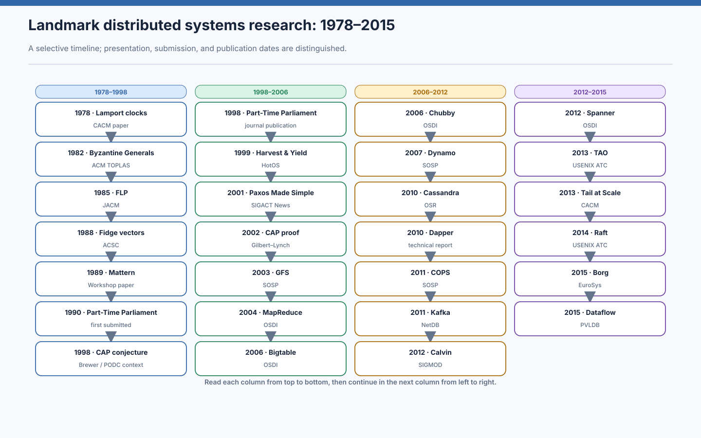

---

# 2. How to Read and Analyze a Research Paper

A useful first pass should take less time than a full technical reading. Read the title, abstract, introduction, diagrams, section headings, evaluation, and conclusion. Write a one-sentence statement of the problem and one sentence describing the contribution. If those cannot be stated clearly, reread the introduction before diving into details.

## 2.1 A four-pass reading process

| Pass | Read | Questions to answer | Output |
|---|---|---|---|
| 1 — Orientation | Abstract, introduction, conclusion, figures | What problem? Why now? What is new? | Three-sentence summary |
| 2 — Model | System model, assumptions, API, design goals | What processes, faults, clocks, data, and workload exist? | Assumption list |
| 3 — Mechanism | Algorithms, protocol, correctness, architecture | How does each important transition happen? | Flow diagram and invariants |
| 4 — Evidence | Evaluation, limitations, related work | What was measured and what remains unproven? | Evidence/limitation matrix |

## 2.2 Read the system model before trusting the result

The model defines the scope of a guarantee. A consensus protocol proven in a crash-fault model does not automatically tolerate malicious replicas. A database consistency statement may apply only to one record or one transaction class. A benchmark may assume no failures during the measurement window. Record assumptions before summarizing results.

Important dimensions include:

- **Timing:** bounded message delay, unknown delay, bounded clock drift, or probabilistic delay assumptions.
- **Failure:** crash-stop, crash-recovery, omission, network partition, Byzantine behavior, or correlated failure.
- **Membership:** fixed participants, reconfiguration, or dynamic join/leave.
- **Storage:** volatile memory, durable local disk, replicated disk, or external object storage.
- **Data semantics:** single key, range, multi-key transaction, append-only log, graph relation, or arbitrary computation.
- **Consistency:** linearizable, serializable, externally consistent, sequential, causal, eventual, or application-defined.

## 2.3 Separate safety from liveness

**Safety** says that something bad never happens. Examples include two correct nodes never deciding different values, a committed log entry never being overwritten, or a transaction not exposing a partially committed state.

**Liveness** says that something good eventually happens. Examples include a correct process eventually deciding, a write eventually becoming visible, or a cluster eventually electing a leader.

A protocol can preserve safety while temporarily making no progress. This distinction is central to FLP, Paxos, Raft, and partition recovery. It is also useful when interpreting production behavior: rejecting writes during a partition may be an intentional safety choice, not necessarily a defect.

## 2.4 Evaluate the evidence, not just the conclusion

| Evidence type | What it can support | What it cannot establish by itself |
|---|---|---|
| Mathematical proof | Correctness under stated assumptions | Correctness of all code and deployment configurations |
| Complexity analysis | Asymptotic message, time, or space growth | Actual latency on a specific network |
| Simulation | Behavior in the modeled scenarios | Real-world behavior outside the simulation model |
| Microbenchmark | Component performance under a narrow workload | End-to-end performance or general scalability |
| End-to-end benchmark | Performance for the specified workload and hardware | Universal superiority |
| Production report | Operational feasibility and observed failure modes | Guaranteed behavior in another organization |
| User study | Relative usability or understandability in the study design | Universal superiority for every audience |

Watch for unfair baselines, different hardware configurations, warm-cache effects, omitted failure cases, averages that hide tail latency, and throughput reported without workload semantics.

## 2.5 Reusable research-paper analysis template

Copy this template for each paper:

```markdown
## Paper: [Title]
- Authors / year / venue:
- DOI / official URL:
- Historical context:
- Problem statement:
- Prior limitations:
- System model and assumptions:
- Design goals and non-goals:
- Core insight:
- Architecture:
- Algorithm / protocol:
- Safety properties:
- Liveness assumptions:
- Mathematical reasoning:
- Evaluation setup:
- Main reported results:
- Limitations and threats to validity:
- Production evidence:
- Later implementation changes:
- Related papers:
- What I would ask the authors:
- Three takeaways:
```

## 2.6 Research paper reading workflow

1. Find the primary version: conference proceedings, journal page, technical report, or author-hosted PDF.
2. Verify title, authors, venue, year, pages, and DOI.
3. Read the abstract and introduction to identify the problem.
4. Extract the system model and non-goals.
5. Reconstruct the key algorithm from its state transitions and messages.
6. Identify the invariant used by the correctness argument.
7. Reproduce one example or calculation by hand.
8. Inspect evaluation methodology, hardware, workload, and baselines.
9. Write limitations separately from the authors' stated goals.
10. Compare the original paper with modern implementations without projecting later features backward.

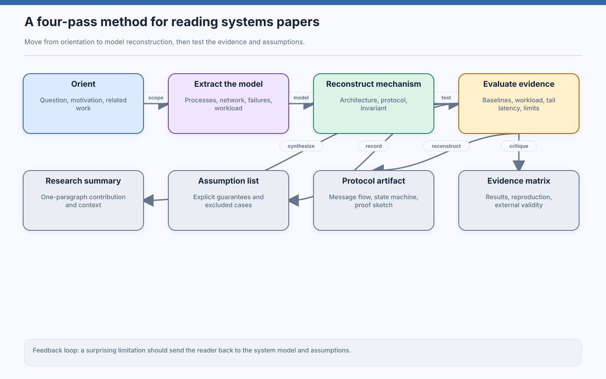

---

# 3. Time, Clocks, and Event Ordering

## 3.1 Lamport — Time, Clocks, and the Ordering of Events

**Paper:** Leslie Lamport, “Time, Clocks, and the Ordering of Events in a Distributed System,” *Communications of the ACM*, 21(7), 558–565, 1978. DOI: [10.1145/359545.359563](https://doi.org/10.1145/359545.359563). [Bibliographic record and paper](https://doi.org/10.1145/359545.359563).

### Historical context and problem

Distributed processes do not share one perfectly synchronized clock. Even when machines expose wall-clock timestamps, clock offset, drift, synchronization error, and message delay make timestamp order an unreliable proof of causality. Lamport's central question was how to define and reason about the order of events when no global clock is available.

### Happened-before relation

Lamport defines a relation written:

\[
a \rightarrow b
\]

It is the smallest relation satisfying:

1. **Same-process order:** if events \(a\) and \(b\) occur in one process and \(a\) occurs first, then \(a \rightarrow b\).
2. **Message order:** sending a message happens before receiving that message.
3. **Transitivity:** if \(a \rightarrow b\) and \(b \rightarrow c\), then \(a \rightarrow c\).

If neither \(a \rightarrow b\) nor \(b \rightarrow a\), the events are **concurrent** in the causal sense. This does not mean their physical execution overlapped at precisely the same instant; it means the modeled system contains no causal path ordering them.

### Lamport logical clocks

Each process \(P_i\) maintains an integer clock \(C_i\). A standard implementation follows these rules:

- Before each local event, increment the local clock.
- When sending a message, attach the current timestamp.
- On receiving a message with timestamp \(t\), set the local clock to \(\max(C_i,t)+1\).

The fundamental property is:

\[
a \rightarrow b \implies L(a) < L(b)
\]

The converse is false. A lower timestamp does not prove that the first event caused the second. Logical clocks preserve causal precedence; they do not reconstruct all concurrency.

### Worked execution

Assume three processes \(P_1,P_2,P_3\), each starting at zero. A send event increments its clock and carries that value.

| Event | Process | Operation | Clock after event |
|---|---|---|---:|
| a | P1 | Local computation | 1 |
| b | P1 | Send m1 to P2 | 2 |
| c | P2 | Receive m1 (timestamp 2) | max(0,2)+1 = 3 |
| d | P2 | Send m2 to P3 | 4 |
| e | P3 | Local computation before m2 arrives | 1 |
| f | P3 | Receive m2 (timestamp 4) | max(1,4)+1 = 5 |
| g | P1 | Independent local event | 3 |

We know \(b\rightarrow c\rightarrow d\rightarrow f\). Event \(e\) occurs before receipt \(f\) in P3, so \(e\rightarrow f\), but it is not necessarily causally related to \(b\). Event \(g\) is not ordered with the P2/P3 chain unless another message or local-process relation connects them.

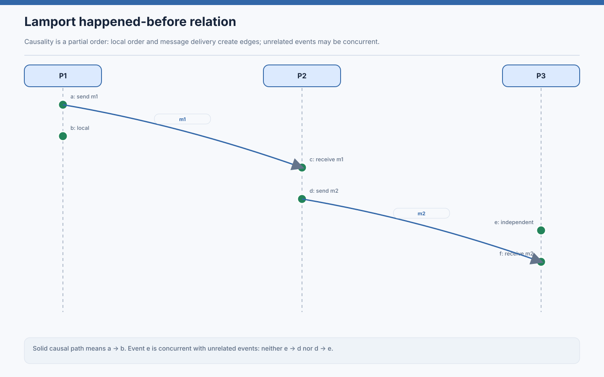
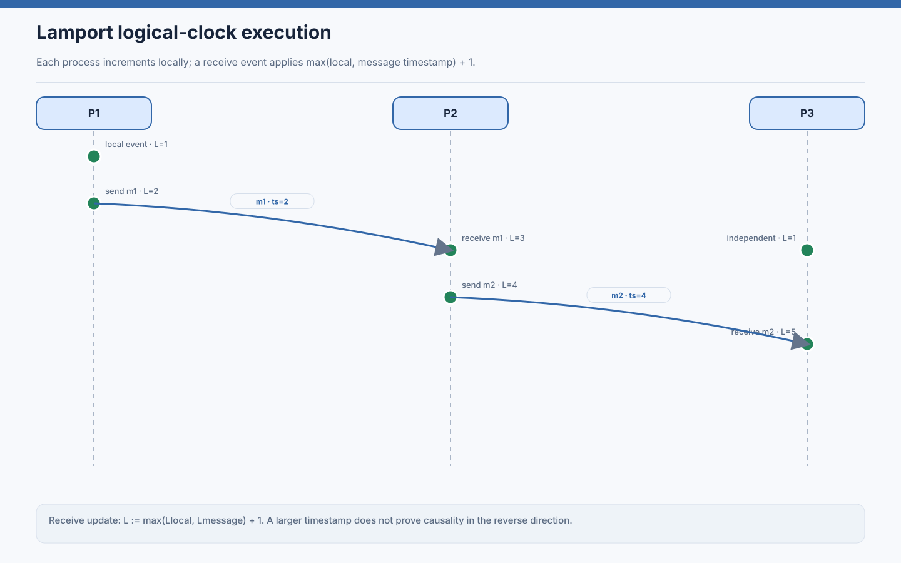

### Total ordering

A deterministic total order can be constructed from the pair `(Lamport timestamp, process identifier)`, compared lexicographically. This gives every event a unique place in one artificial ordering while respecting happened-before. It is useful for deterministic tie-breaking, but it does not turn concurrent events into causally related events.

### Contribution, evaluation, and limitations

The paper's contribution is conceptual and mathematical: a partial order captures causal precedence, and a distributed logical-clock algorithm can extend this order consistently. The paper also discusses physical-clock synchronization, but the logical-clock result is the most widely reused idea. The work is not a consensus protocol, a globally accurate time service, or a way to infer causality from arbitrary timestamps. A Lamport clock is compact, but it cannot identify whether two events are concurrent. It also does not by itself provide a unique history across independent replicas unless a tie-breaking rule is added.

### Influence and connections

The happened-before relation informs causal consistency, distributed snapshots, event ordering, replicated data structures, and reasoning about message-passing protocols. Vector clocks add enough metadata to distinguish causality from concurrency more precisely. Spanner takes a different path for a different requirement: it exposes bounded physical-time uncertainty so that transactions can obtain external consistency. Event sourcing and tracing systems often use logical correlation and causal context, but should not be described as direct implementations of Lamport clocks without evidence.

### Check your understanding

- Why does a message send happen before its receive?
- Give an example where \(L(a)<L(b)\) but neither event causally precedes the other.
- Why can a total order be useful even when it is not a causal order?
- What information is lost when only one integer timestamp is retained?

## 3.2 Vector Clocks and Causal Ordering

Vector clocks are a family of logical timestamp schemes developed in follow-on work, including Fidge's 1988 work on timestamping events and Mattern's 1989 work on virtual time and global states. They extend Lamport's scalar clock idea by maintaining one counter per process in the modeled group.

For three processes, a vector timestamp is \(V=[v_1,v_2,v_3]\). A process increments its own component for each local event. On a receive, it takes the component-wise maximum of its local vector and the message vector, then increments its own component.

For vectors \(A\) and \(B\):

\[
A < B \iff (\forall i, A_i \leq B_i) \land (\exists j, A_j < B_j)
\]

Under the standard vector-clock construction, \(A < B\) means the event represented by A causally precedes the event represented by B. If neither \(A < B\) nor \(B < A\), the events are concurrent.

### Three-process example

Start with all processes at `[0,0,0]`.

1. P1 performs an event: `[1,0,0]`.
2. P1 sends to P2 carrying `[1,0,0]`.
3. P2 receives, merges, and increments its own entry: `[1,1,0]`.
4. Independently, P3 performs an event: `[0,0,1]`.
5. Compare `[1,1,0]` and `[0,0,1]`. Neither dominates the other, so these events are concurrent.
6. P2 later sends its state to P3. P3 merges and increments: `[1,1,2]`. Now `[0,0,1] < [1,1,2]`, which records the dependency.

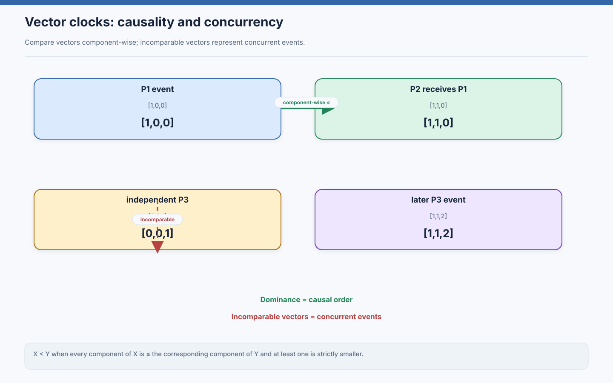

### Cost and limitations

With \(N\) known processes, a full vector has \(O(N)\) components per timestamp. This becomes expensive when replica membership is large or dynamic. Version vectors, dotted version vectors, compressed causal metadata, and bounded or partial tracking schemes address practical costs, but each changes the metadata/precision trade-off. A vector clock is not a wall-clock timestamp and does not provide a total order without additional tie-breaking.

### Connections

- **Dynamo:** uses versioning metadata to detect concurrent updates that application conflict-resolution logic must reconcile.
- **Causal consistency:** allows a read to respect dependency order even if writes propagate asynchronously.
- **COPS:** tracks cross-key causal dependencies and checks them before exposing remote writes.
- **Hybrid logical clocks:** combine physical-time intuition with logical counters to improve timestamp usability without assuming perfectly synchronized clocks.

---

# 4. Impossibility Results and Consensus

## 4.1 FLP — Impossibility of Distributed Consensus with One Faulty Process

**Paper:** Michael J. Fischer, Nancy A. Lynch, and Michael S. Paterson, “Impossibility of Distributed Consensus with One Faulty Process,” *Journal of the ACM*, 32(2), 374–382, 1985. The work was presented earlier at PODC 1983. [Official author-hosted paper](https://groups.csail.mit.edu/tds/papers/Lynch/jacm85.pdf).

### Problem and assumptions

Consensus requires processes to decide values while satisfying properties such as:

- **Agreement:** no two correct processes decide different values.
- **Validity:** a decided value must satisfy the protocol's input-validity condition.
- **Termination:** every correct process eventually decides.

The FLP result considers deterministic protocols in an asynchronous message-passing system. There is no known upper bound on message delay and no reliable clock bound that lets a process distinguish a slow process from a crashed one. At least one process may crash. The theorem shows that no such deterministic protocol can guarantee termination in every admissible execution while preserving the consensus requirements.

### Intuition: indistinguishable executions

Suppose a process has not received a message. It cannot tell whether the sender crashed or whether the message is merely delayed. If it decides based on silence, an execution in which the sender is slow can make that decision unsafe. If it waits forever, an execution in which the sender crashed can prevent termination.

The formal proof uses **configurations** (the global states of processes), **valency** (whether a configuration can lead only to decision 0, only to decision 1, or to either), and carefully selected message-delivery schedules. A bivalent configuration can be kept from becoming irrevocably univalent by an adversarial schedule. This constructs an admissible execution in which the protocol does not decide.

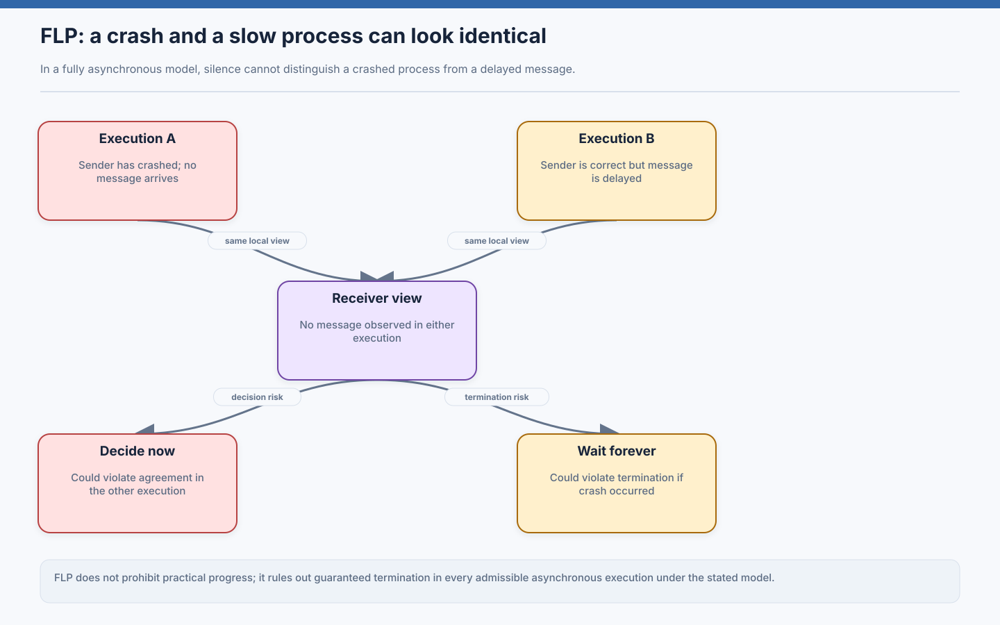
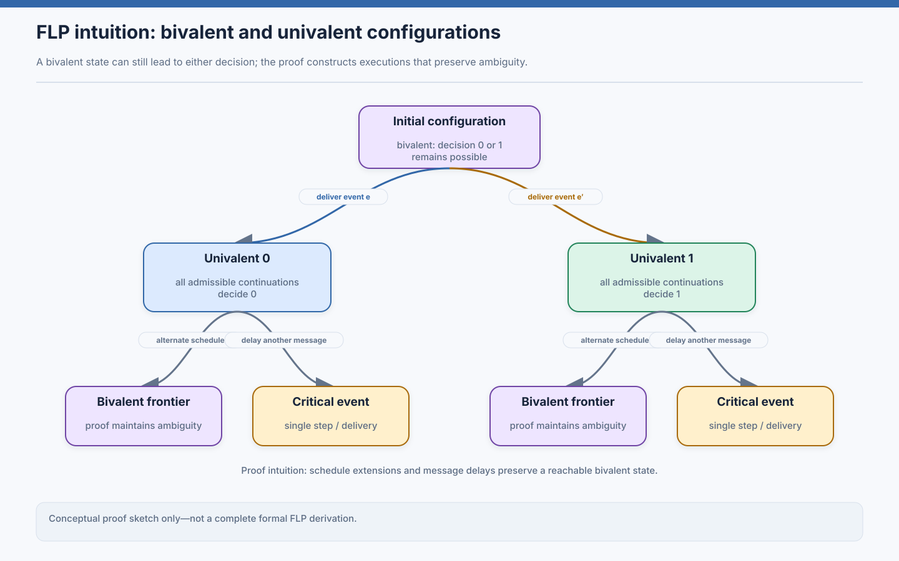

### What FLP does not say

- It does not say consensus is impossible in deployed systems.
- It does not say safety must be abandoned.
- It does not rule out randomized algorithms.
- It does not rule out protocols with partial synchrony or additional failure detectors.
- It does not say all practical runs fail to terminate. It says a worst-case admissible schedule can prevent guaranteed termination under the stated assumptions.

### Practical responses

- **Partial synchrony:** assume that after an unknown stabilization point, communication and processing delays satisfy bounds.
- **Timeouts and failure suspicion:** use timeouts to suspect a leader or peer; suspicion is an operational signal, not proof of a crash.
- **Leader election:** simplify agreement by giving one process temporary authority, with a protocol to preserve safety across leader changes.
- **Randomization:** use random choices to achieve probabilistic termination under appropriate assumptions.
- **Failure detectors:** augment the model with information about suspected failures.

Paxos and Raft preserve safety while making progress when communication eventually behaves well enough for a leader to communicate with a quorum. A timeout can trigger a new term or election, but it cannot logically prove the old leader is dead.

### Limitations and influence

FLP is a theorem about a particular model, not a performance study. Its influence is to force protocol designers to state timing assumptions and separate safety from liveness. Any claim that a consensus implementation “solves FLP” should be treated skeptically: practical systems work under additional assumptions or weaken the liveness requirement in the worst case.

## 4.2 CAP Conjecture and Gilbert–Lynch Proof

**Original conjecture:** Eric Brewer, invited PODC keynote, 2000.  
**Formal treatment:** Seth Gilbert and Nancy Lynch, “Brewer's Conjecture and the Feasibility of Consistent, Available, Partition-Tolerant Web Services,” *ACM SIGACT News*, 33(2), 51–59, 2002. DOI: [10.1145/564585.564601](https://doi.org/10.1145/564585.564601). [Paper](https://www.cs.princeton.edu/courses/archive/spr22/cos418/papers/cap.pdf).

### Definitions in the formal argument

- **Consistency:** the paper formalizes a strong consistency condition equivalent to atomic/linearizable behavior for the service abstraction under study.
- **Availability:** every request received by a non-failing node must eventually receive a response.
- **Partition tolerance:** the system continues to operate despite communication links between groups of nodes being lost.

### Two-replica partition example

Assume replicas A and B both store `balance = 10`.

1. A network partition isolates A from B.
2. A client writes `balance = 20` to A.
3. Another client reads from B while the partition remains.
4. If B must respond using only its local state, it may return 10. That response is available but cannot be linearizable if the write completed before the read began.
5. If B refuses or waits until communication is restored, the system preserves the option of strong consistency but violates the formal availability requirement during the partition.

Thus, for this service model and partition execution, the system cannot guarantee both linearizable consistency and availability.

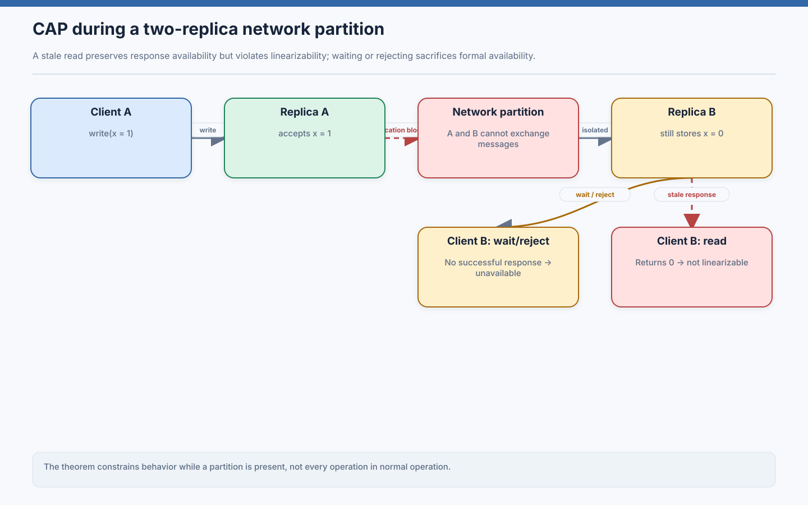
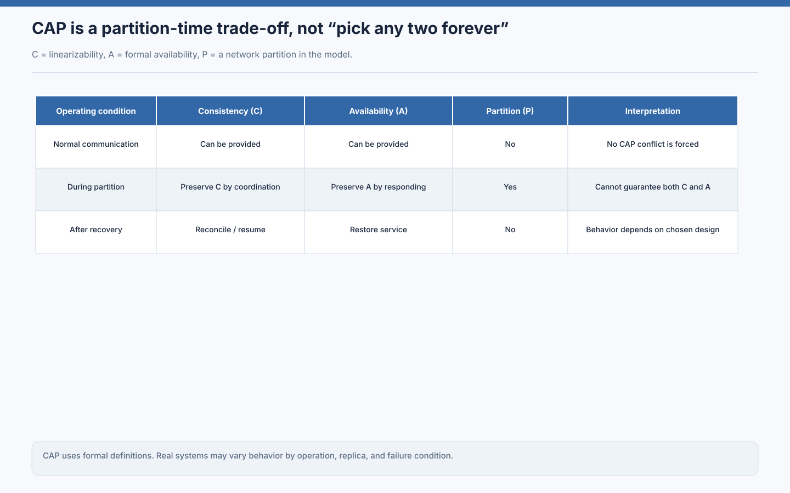

### Correct interpretation

CAP is about behavior **during a partition**, not a permanent selection of two labels for normal operation. A design may be strongly consistent while no partition exists, and its behavior under partition depends on which operations it accepts and from which replicas. Real systems may have per-operation policies, multi-region topology, quorum sizes, leader placement, and degraded modes that do not fit neatly into a single CP/AP slogan.

### CAP and related trade-offs

- A **CP-style** choice may reject operations that cannot be safely ordered during a partition.
- An **AP-style** choice may accept operations locally and reconcile conflicts later, exposing stale or divergent values.
- Some designs are availability-oriented only for selected operations or keys.
- **PACELC** highlights that, else (when there is no partition), systems may trade latency against consistency. This is a useful design lens, not a replacement for defining the actual consistency model.

### CAP's architectural effect

CAP made the cost of network partitions explicit in web-service and database design discussions. It helped popularize the idea that replication choices affect externally visible behavior. However, strong database design needs more precise questions: Is the operation linearizable? Does a read contact a quorum? Which writes are acknowledged? Can concurrent updates conflict? What happens to a minority partition? Is the guarantee per key or across a transaction?

---

# 5. Consensus Algorithms: Paxos and Raft

## 5.1 Paxos Made Simple

**Paper:** Leslie Lamport, “Paxos Made Simple,” *ACM SIGACT News*, 32(4), 51–58, 2001. [Author-hosted paper](https://lamport.azurewebsites.net/pubs/paxos-simple.pdf).  
**Earlier, fuller presentation:** “The Part-Time Parliament,” *ACM Transactions on Computer Systems*, 16(2), 133–169, 1998. DOI: [10.1145/279227.279229](https://doi.org/10.1145/279227.279229). The latter was first submitted in 1990; 1989 is not its journal publication year.

### Motivation and model

Paxos addresses replicated agreement when processes can fail by stopping and messages can be delayed, lost, or reordered. It is commonly introduced as a protocol for selecting one value; practical replicated state machines run a sequence of consensus instances or use Multi-Paxos to agree on log entries.

The roles are logical, not necessarily separate machines:

- **Proposer:** suggests a value with a proposal number.
- **Acceptor:** records promises and accepted proposals.
- **Learner:** discovers which value has been chosen.

A proposal number must be globally unique or ordered so competing proposers can be distinguished. Acceptors retain protocol state durably enough that a restart does not erase promises or accepted values.

### Two phases

**Phase 1 — Prepare / Promise**

1. A proposer selects proposal number `n`.
2. It sends `Prepare(n)` to acceptors.
3. An acceptor that has not promised a higher number records a promise not to accept proposals numbered below `n`.
4. It replies with the highest-numbered proposal it has already accepted, if any.
5. After a quorum of promises, the proposer selects the value from the highest-numbered accepted proposal reported; if none is reported, it may select its own proposed value.

**Phase 2 — Accept / Accepted**

1. The proposer sends `Accept(n, v)` to acceptors.
2. An acceptor accepts if it has not already promised a higher proposal number.
3. Once a quorum accepts the same proposal, the value is chosen.
4. Learners are informed of the chosen value.

The crucial rule is not simply “a majority votes yes.” The prepare phase ensures that a later proposal must preserve any value that may already have been chosen by an intersecting quorum.

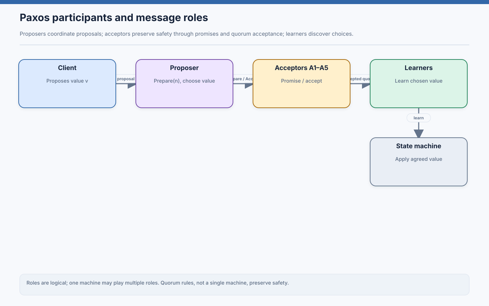
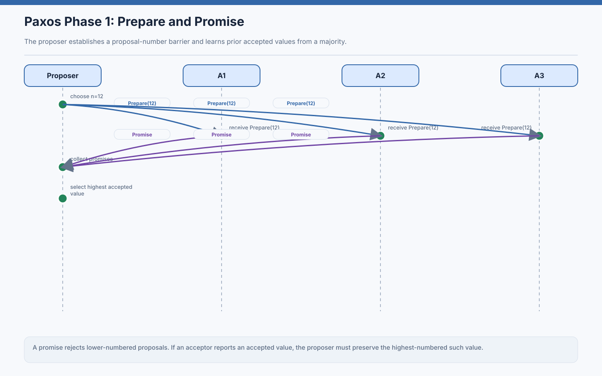
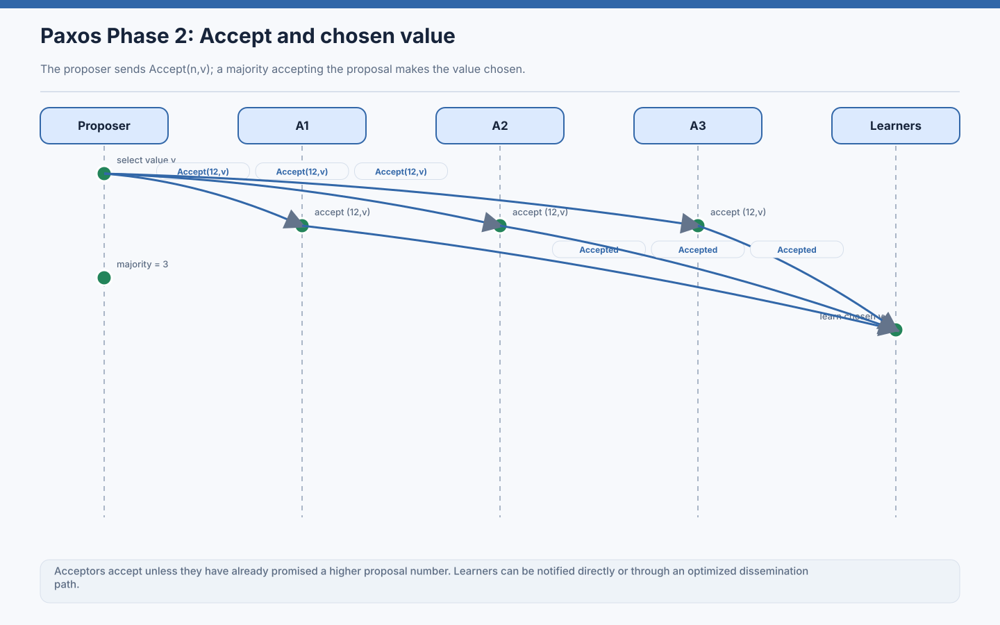
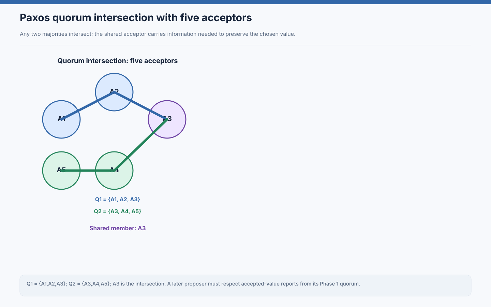

### Five-acceptor example

With \(N=5\) acceptors, a majority quorum is:

\[
Q = \left\lfloor\frac{N}{2}\right\rfloor + 1 = 3
\]

Proposer P1 obtains promises from A1, A2, and A3 for proposal 7. None reports a previously accepted value, so P1 proposes `x`. A1, A2, and A3 accept `(7,x)`, and `x` is chosen. Later, P2 starts proposal 9 and gets promises from A3, A4, and A5. Because A3 reports `(7,x)`, P2 must propose `x`, not a conflicting `y`. The quorums intersect at A3; the promise/accepted-value rule carries the prior decision across the new proposer.

### Safety reasoning

Any two majorities in the same fixed set intersect. A later successful prepare quorum therefore encounters at least one acceptor that participated in an earlier chosen quorum. The protocol's rule requiring a proposer to carry forward the highest-numbered accepted value makes it impossible for a later chosen proposal to conflict with an earlier chosen one. This explanation is an intuition; the full proof handles ordering of proposals and the case where a prior proposal was accepted by only part of a quorum.

### Multi-Paxos and practical issues

Multi-Paxos amortizes the prepare phase by retaining a stable leader and assigning ordered instances to log slots. It introduces engineering questions beyond the simple single-decree protocol: leader recovery, log holes, duplicate requests, membership changes, snapshots, disk persistence, batching, and state-machine application. Implementations may optimize messages and pipeline multiple entries while preserving the safety rules.

### Evaluation and limitations

Paxos is primarily a protocol and correctness contribution rather than a benchmark paper. Its strength is a clean safety argument under crash failures and asynchronous message delivery. The classic presentation is difficult to implement correctly because the protocol state and all failure/recovery cases are subtle. It assumes non-Byzantine participants; authenticated messages alone do not make it Byzantine fault tolerant.

### Connections

Paxos underlies many replicated metadata and coordination designs. Chubby is a production lock-service case study, while Spanner uses Paxos groups for replicated data. Raft offers a different decomposition and presentation for replicated logs. HotStuff and PBFT belong to Byzantine fault models and should not be conflated with crash-fault Paxos.

## 5.2 In Search of an Understandable Consensus Algorithm — Raft

**Paper:** Diego Ongaro and John Ousterhout, “In Search of an Understandable Consensus Algorithm,” *USENIX Annual Technical Conference (ATC)*, 2014. [USENIX paper page and PDF](https://www.usenix.org/conference/atc14/technical-sessions/presentation/ongaro).

### Motivation and design goals

Raft was designed to provide replicated-log consensus with a structure that is easier to understand and implement than the Paxos descriptions that motivated it. The paper emphasizes decomposing consensus into leader election, log replication, and safety, with a stronger leader-centered design that reduces the states an implementer must reason about.

### Roles, terms, and RPCs

A server is a **follower**, **candidate**, or **leader**. Time is divided into monotonically increasing **terms**. Each term has at most one elected leader. A follower that does not hear from a leader within its randomized election timeout can become a candidate and request votes.

- `RequestVote`: asks peers to vote for a candidate. A candidate's log must be sufficiently up to date to receive a vote.
- `AppendEntries`: carries heartbeats or log entries. Followers accept entries when the preceding log index and term match, enabling conflict detection and repair.

### Leader election

1. A follower times out and increments its term.
2. It becomes a candidate and votes for itself.
3. It sends `RequestVote` to peers.
4. A candidate receiving a majority becomes leader.
5. If no candidate obtains a majority, randomized timeouts help reduce repeated split votes.
6. A server seeing a higher term steps down to follower.

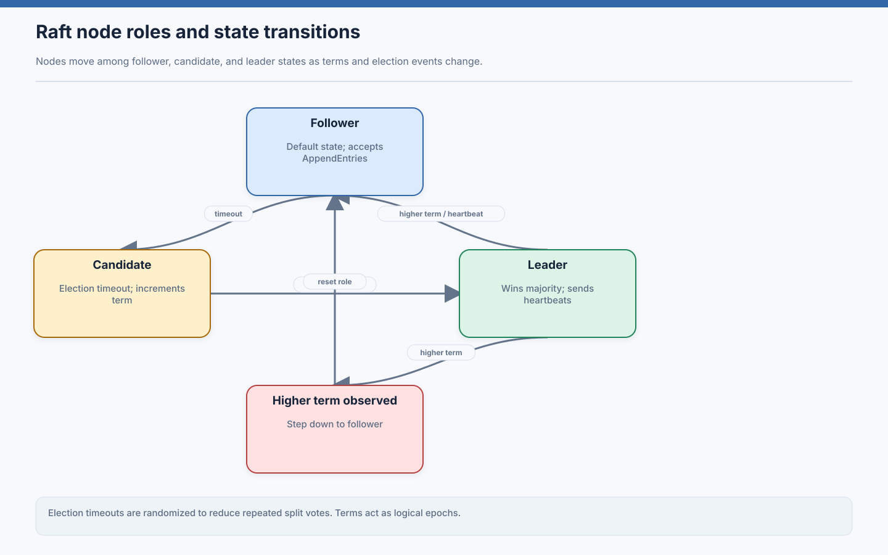
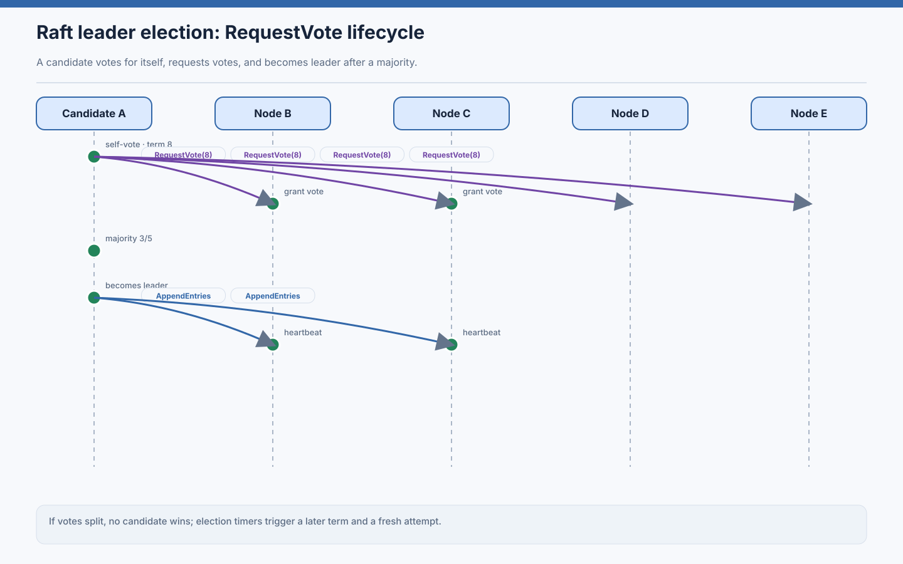

### Log replication

The leader appends a client command to its local log and sends the entry to followers through `AppendEntries`. A follower checks the previous log position and term. If they match, it appends the new entries; if they do not, it rejects and the leader backs up to find a matching prefix. When an entry is replicated on a majority, the leader can commit it subject to Raft's current-term commitment rule. Committed entries are applied to the state machine in order.

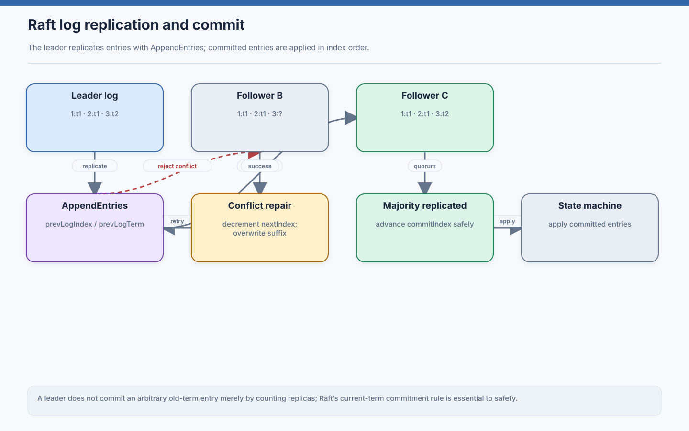
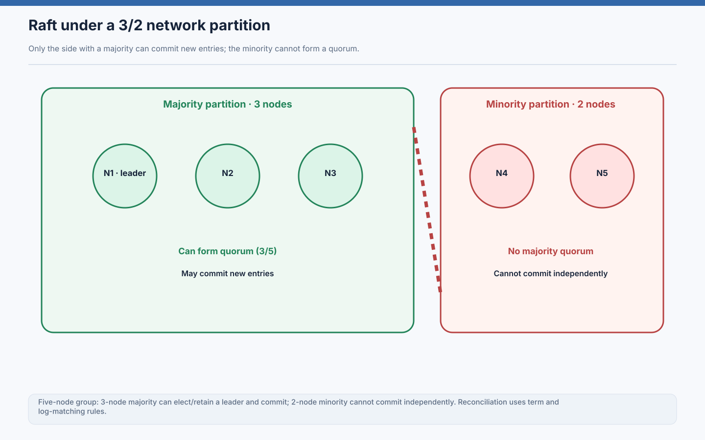

### Core safety properties

- **Election safety:** at most one leader is elected in a given term.
- **Leader append-only:** a leader does not overwrite or delete entries in its own log.
- **Log matching:** entries with the same index and term have the same prefix.
- **Leader completeness:** a leader elected in a later term contains all entries committed in earlier terms.
- **State machine safety:** if a server applies a log entry at a given index, no other server applies a different command at that index.

The paper includes persistent state such as current term, vote, and log entries; volatile state such as commit index and last applied; and leader-maintained replication indexes.

### Membership changes and compaction

Joint consensus changes cluster membership through overlapping majorities: the system transitions through a joint configuration in which decisions require quorums from both old and new configurations. This prevents a membership change from creating disjoint decision quorums. Snapshotting and log compaction bound the storage needed for old log entries while preserving a snapshot of state and the metadata needed to continue replication.

### Evaluation and limits

The paper evaluates understandability with a user study comparing students learning Raft and Paxos, and evaluates performance against other consensus systems in selected workloads. The study supports the authors' claim that Raft was easier for participants to learn under that experimental design; it is not proof that every engineer or every implementation finds it simpler. Raft assumes crash failures rather than Byzantine behavior. Randomized elections improve the chance of progress but do not eliminate the need for eventual communication stability.

### Raft versus Paxos

| Dimension | Paxos family | Raft |
|---|---|---|
| Core abstraction | Agreement on values; Multi-Paxos for log | Replicated log led by one elected leader |
| Leader | Common optimization, not the only presentation | Central design role |
| Teaching structure | Prepare/accept safety reasoning | Election, replication, safety modules |
| Membership | Protocol-specific reconfiguration methods | Joint consensus in the paper |
| Fault model | Usually crash failures | Crash failures |
| Safety | Quorum-based protocol invariants | Term, log, and election invariants |
| Main trade-off | Flexible abstractions, difficult implementation reasoning | Coherent structure, leader-centered operation |

Raft is not “Paxos with different message names.” The two solve closely related replicated-log consensus problems but organize authority, recovery, and reasoning differently.

---

# 6. Google Research Papers

The papers in this section are a connected family of workload-driven designs, not one monolithic architecture. GFS provides a file substrate for large sequential data; MapReduce turns cluster execution into a programming abstraction; Bigtable provides structured key-based storage; Chubby provides coordination; Spanner adds globally distributed transactions and time uncertainty; Dapper supplies request tracing. Their shared lesson is that a successful distributed system makes its workload and failure assumptions explicit.

## 6.1 The Google File System (GFS)

**Paper:** Sanjay Ghemawat, Howard Gobioff, and Shun-Tak Leung, “The Google File System,” *19th ACM Symposium on Operating Systems Principles (SOSP)*, 2003, pp. 20–43. [Google Research publication page](https://research.google/pubs/the-google-file-system/).

### Historical context and problem

The paper targets data-intensive applications running on clusters of inexpensive commodity machines. Conventional file-system assumptions—small files, modest numbers of clients, and relatively reliable storage nodes—did not match the workload described by the authors. Their target included very large files, streaming reads, append-heavy workloads, frequent component failures, and high aggregate throughput.

### Architecture

GFS has three principal components:

- **Master:** manages filesystem namespace and metadata, including file-to-chunk mapping, chunk locations, leases, and replication decisions.
- **Chunkservers:** store file chunks on local disks and serve client reads and writes.
- **Clients:** obtain metadata from the master but transfer file data directly to chunkservers.

The paper's design uses large fixed-size chunks (64 MiB in the described implementation). Large chunks reduce metadata volume and help large sequential I/O, while introducing small-file and hot-chunk considerations.

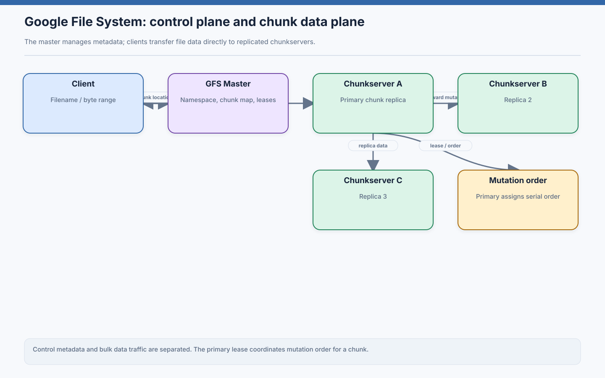
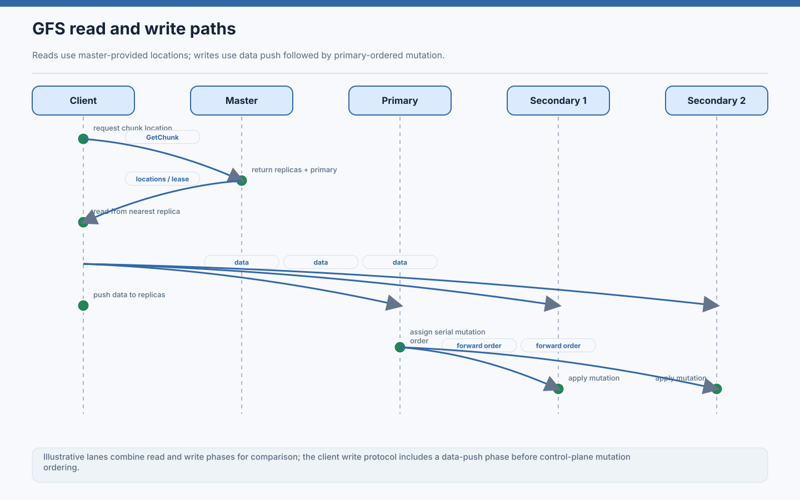

### Read path

1. A client asks the master for the chunk handle and replica locations for a file region.
2. The master returns metadata, not the file contents.
3. The client caches the metadata.
4. The client reads directly from a suitable chunkserver replica using the chunk handle and byte offset.

This keeps the master out of the data path for ordinary reads.

### Write and mutation path

The master grants a lease to one replica, designated as the **primary** for that chunk mutation. The primary establishes a serial order for mutations; secondary replicas apply the mutation in that order. The client pushes data to replicas and then asks the primary to perform the mutation. The primary assigns a serial number, applies the mutation, and forwards the order to secondaries. It replies after the required replica acknowledgements.

The ordering role of the primary is important: the architecture centralizes mutation order for one chunk while distributing data transfer and storage.

### Atomic record append

GFS adds record append semantics for concurrent producers. The client asks the system to append a record; GFS chooses an offset and may append the record more than once if retries occur. The paper's guarantee is at least once for the record append under the described semantics, with padding or duplicate records possible around failures. Applications must tolerate this behavior, often by including record identifiers or handling duplicates.

### Failure handling and integrity

The master monitors chunkservers through heartbeats and metadata exchanges. Replicas are re-created when a chunk falls below its replication target. Checksums help detect data corruption. Garbage collection is used to reclaim obsolete chunks without requiring synchronous deletion from every replica on every namespace operation. The master persists important metadata through an operation log and checkpoints; recovery reconstructs state from durable metadata and chunk reports.

### Evaluation, limitations, and impact

The original paper reports microbenchmarks and experience from deployed GFS clusters, with the emphasis on high aggregate bandwidth and fault tolerance on commodity hardware. It is not a modern object store specification. A single master is a deliberate metadata design point, not a statement that every metadata operation scales without limit. Large chunks are efficient for the intended workload but can create hot spots; the master requires careful metadata sizing and recovery; and append semantics differ from strict POSIX expectations. GFS strongly influenced the design space of HDFS and later distributed storage systems, though their implementations and guarantees are not identical.

**Key insight:** separate metadata coordination from bulk data movement, and design around the workload that actually exists rather than assuming a traditional local-filesystem workload.

## 6.2 MapReduce: Simplified Data Processing on Large Clusters

**Paper:** Jeffrey Dean and Sanjay Ghemawat, “MapReduce: Simplified Data Processing on Large Clusters,” *6th USENIX Symposium on Operating Systems Design and Implementation (OSDI)*, 2004, pp. 137–150. [Google Research page](https://research.google/pubs/mapreduce-simplified-data-processing-on-large-clusters/) · [USENIX paper page](https://www.usenix.org/conference/osdi-04/mapreduce-simplified-data-processing-large-clusters).

### Problem and insight

Large data-processing jobs require partitioning input, scheduling tasks, moving intermediate data, surviving worker failures, and combining results. These tasks make distributed programming difficult. MapReduce provides a restricted functional abstraction—`map` and `reduce`—and moves much of the distributed execution machinery into a runtime.

### Programming model

A map function consumes an input key/value pair and emits zero or more intermediate key/value pairs. The runtime groups intermediate values by key. A reduce function processes each key and its associated values to produce output.

```text
map(k1, v1) -> list(k2, v2)
reduce(k2, list(v2)) -> list(v3)
```

### Word-count example

For each input document, the mapper emits `(word, 1)`. The shuffle groups all values for the same word. The reducer sums the values and emits `(word, total)`.

```text
Input:  "red blue red"
Map:    (red,1), (blue,1), (red,1)
Shuffle:
        red  -> [1,1]
        blue -> [1]
Reduce:
        red  -> 2
        blue -> 1
```

### Runtime and execution lifecycle

1. The input is split into chunks.
2. A master assigns map tasks to workers, preferring data-local placement when possible.
3. Map workers parse input and write intermediate partitions to local disk.
4. The master tracks intermediate-file locations.
5. Reduce workers fetch their partitions, sort/group records by key, and invoke the reduce function.
6. Final output is written to the distributed filesystem.
7. The job completes after all required tasks finish.

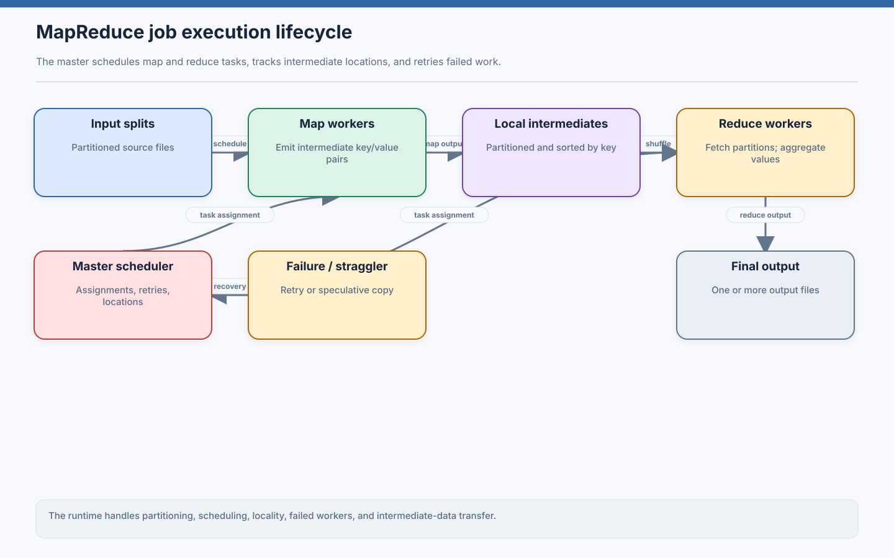
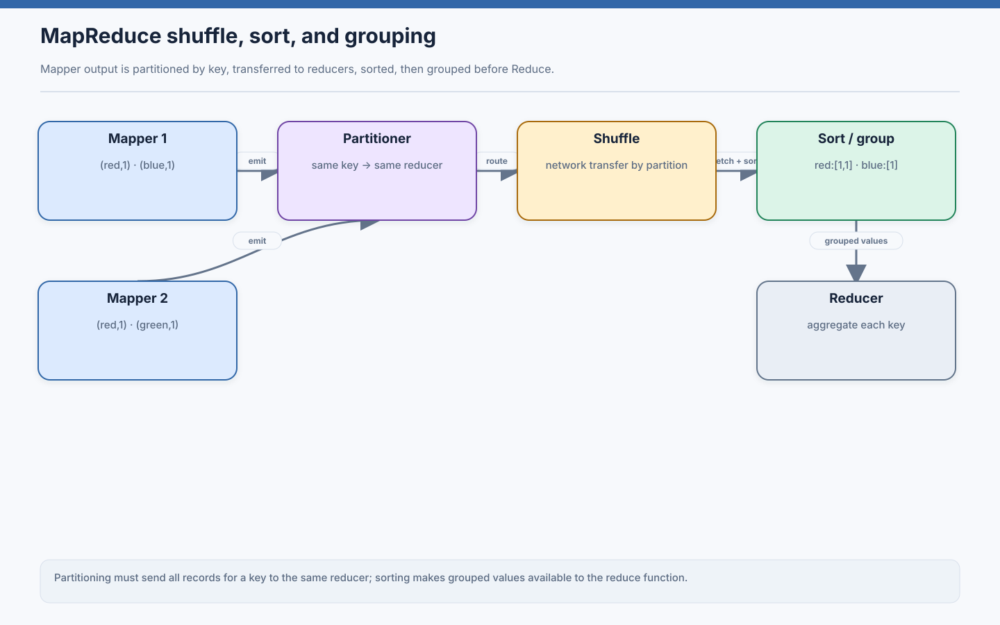

### Fault tolerance and stragglers

If a worker fails, the runtime re-executes its tasks. Since map output is materialized on local disks, output from a failed map worker may need to be regenerated. Reduce tasks can fetch map outputs from their locations. The paper describes **speculative execution**: if a task is unusually slow, another copy may be launched on a different worker; the runtime accepts the first completed copy under the job's task semantics. Speculation mitigates stragglers but consumes extra resources and is not suitable for arbitrary tasks with uncontrolled external side effects.

### Evaluation and limitations

The paper demonstrates that many workloads can be expressed through the abstraction and reports large-cluster experiments processing terabytes of data. It also describes real use within Google. Its core evidence is the usability of the programming model and the runtime's scalability/failure-handling under the evaluated batch workloads. MapReduce naturally fits coarse-grained batch jobs but imposes barriers between map and reduce stages, writes intermediate data to storage, and is less natural for iterative in-memory algorithms or low-latency continuous event processing. Spark, Flink, and Dataflow represent later designs with different execution and state models; they are not interchangeable implementations of the original paper.

**Key insight:** a constrained programming model can make large-scale parallel execution safer by centralizing scheduling, partitioning, retry, and shuffle behavior in a runtime.

## 6.3 Bigtable: A Distributed Storage System for Structured Data

**Paper:** Fay Chang et al., “Bigtable: A Distributed Storage System for Structured Data,” *7th USENIX OSDI*, 2006, pp. 205–218. [Google Research page](https://research.google/pubs/bigtable-a-distributed-storage-system-for-structured-data/) · [USENIX paper page](https://www.usenix.org/conference/osdi-06/bigtable-distributed-storage-system-structured-data).

### Data model

Bigtable describes data as a sparse, distributed, persistent, multidimensional sorted map:

\[
(row\ key, column\ key, timestamp) \rightarrow byte\ string
\]

Rows are ordered lexicographically by row key. A column key consists of a **column family** and an optional **qualifier**. Column families are the unit for access control and storage tuning in the paper's design. Multiple timestamped versions of a cell can be retained, subject to configured garbage-collection policies.

### Architecture

- **Client library:** provides table access and routes operations to tablet servers.
- **Tablet servers:** serve ranges of rows called tablets and split or merge their assignments as load and size change.
- **Master:** assigns tablets, detects server failures, and performs administrative tasks.
- **Chubby:** supports master election, tablet-server location metadata, and selected coordination functions.
- **GFS:** stores persistent files used by Bigtable, including SSTables and commit-log data in the paper's architecture.

A table is partitioned horizontally by row-key ranges. A tablet is a contiguous range; splitting a hot or large tablet makes load distribution more flexible, but row-key design still matters. Poorly chosen monotonically increasing keys can concentrate writes in a narrow range.

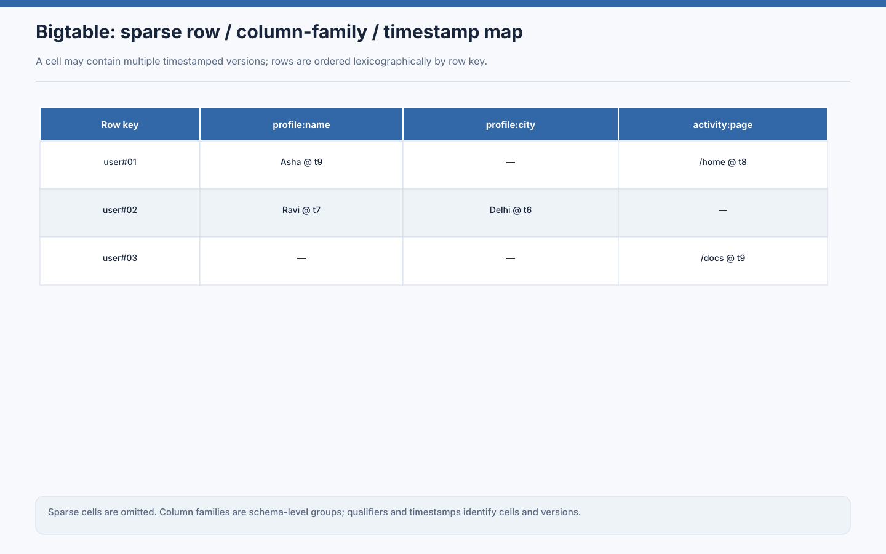
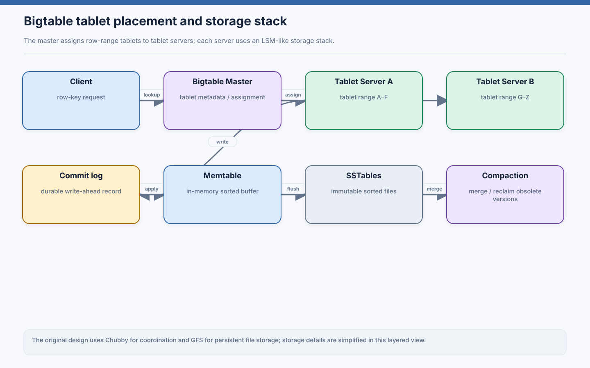

### Read and write paths

A write is first recorded in a commit log and applied to an in-memory **memtable**. When the memtable grows, it is flushed to an immutable SSTable. Reads consult in-memory state and relevant SSTables; filters and indexes reduce unnecessary disk reads. Compaction combines SSTables, removes obsolete versions, and controls file proliferation, but consumes background I/O and CPU.

### Design trade-offs

Bigtable targets huge structured datasets with flexible sparse columns and range scans. It does not provide a general relational query engine or arbitrary multi-row ACID transactions. The row key is central to locality and access patterns. Tablet splitting and balancing support horizontal scale, while Chubby and the master provide control-plane coordination.

### Evaluation and influence

The paper reports use across multiple Google products with varied dataset sizes and latency requirements, and provides measurements of performance and scaling. Its influence is visible in the wide-column family of systems and in HBase's lineage; Cassandra combined a Bigtable-like data model with Dynamo-inspired distribution ideas, but it is not architecturally identical to Bigtable. Modern products branded with similar storage concepts may differ substantially from the paper's implementation.

**Key insight:** choose a data model that makes partitioning and locality explicit, and align row-key design with the operations that dominate the workload.

## 6.4 Spanner: Google's Globally Distributed Database

**Paper:** James C. Corbett et al., “Spanner: Google's Globally-Distributed Database,” *10th USENIX OSDI*, 2012. [Google Research publication page](https://research.google/pubs/spanner-googles-globally-distributed-database-2/).

### Problem and contribution

Spanner addresses globally distributed data with synchronous replication and transactions that provide **external consistency** (the system's strict-serializable ordering respects real-time order of transactions). Earlier geo-replicated systems commonly accepted weaker consistency or higher application complexity to keep writes locally available. Spanner's contribution is a combination of sharded data, Paxos replication groups, distributed transactions, MVCC, and a time API that exposes clock uncertainty.

### Architecture

Spanner distributes data in **directories** and splits, with data replicated across zones or regions in Paxos groups. Tablet-like serving structures handle data ranges; a placement and directory layer supports movement and replication policy. A transaction can involve multiple groups, requiring coordination across the relevant replicas and transaction participants.

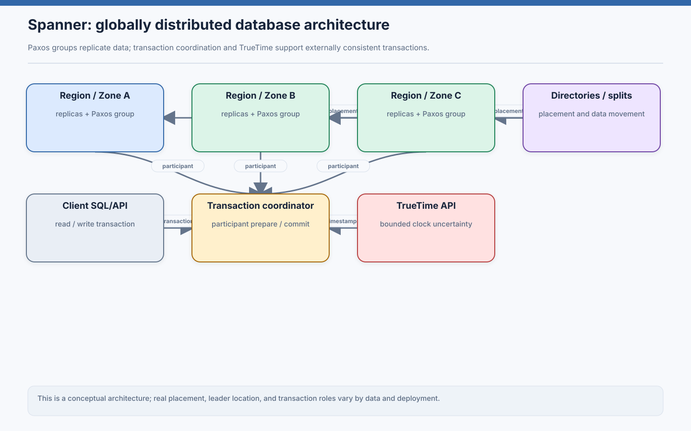

### TrueTime

The TrueTime API returns an interval rather than a single assumed-perfect timestamp:

\[
TT.now() = [earliest, latest]
\]

The actual absolute time is assumed to lie within this interval. Define uncertainty as:

\[
\epsilon = \frac{latest-earliest}{2}
\]

This is a simplified symmetric representation; the essential interface is the uncertainty-bounded interval. Spanner uses infrastructure such as GPS and atomic-clock sources to bound clock uncertainty and monitors the bound.

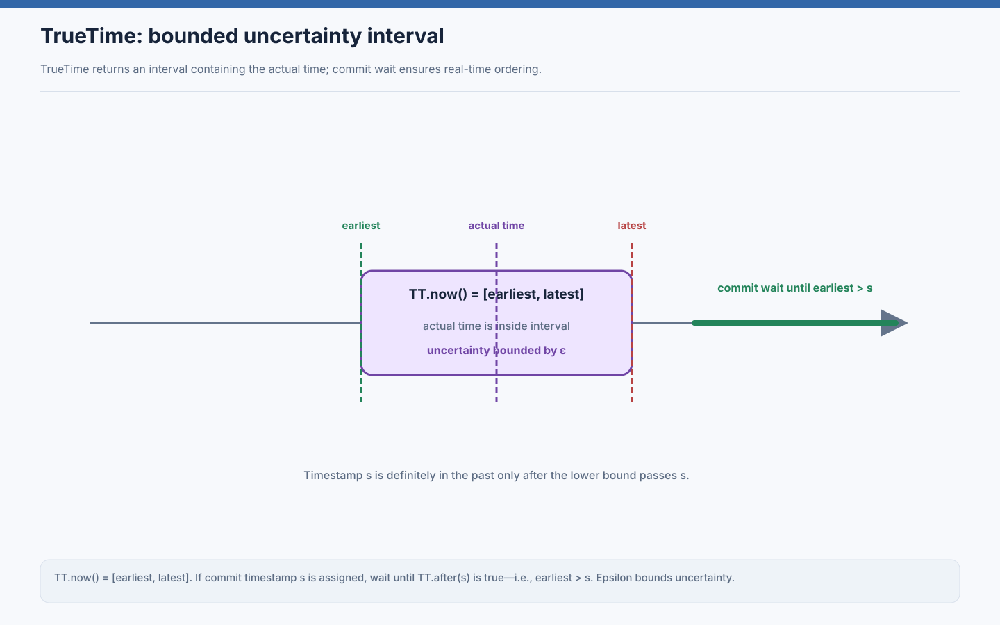

### Commit wait and external consistency

A transaction commit timestamp is selected so it is consistent with the transaction ordering rules. The commit-wait step delays the transaction's externally visible completion until the lower bound of the clock interval is later than the chosen commit timestamp. This ensures that a transaction that completes before another begins cannot be assigned a later timestamp than the second transaction.

Conceptually:

1. Transaction T1 receives commit timestamp `s1`.
2. Spanner waits until `TT.now().earliest > s1`.
3. T1 is considered committed/externally visible after the wait.
4. A transaction T2 that starts after T1 completes must obtain an ordering consistent with that real-time relation.

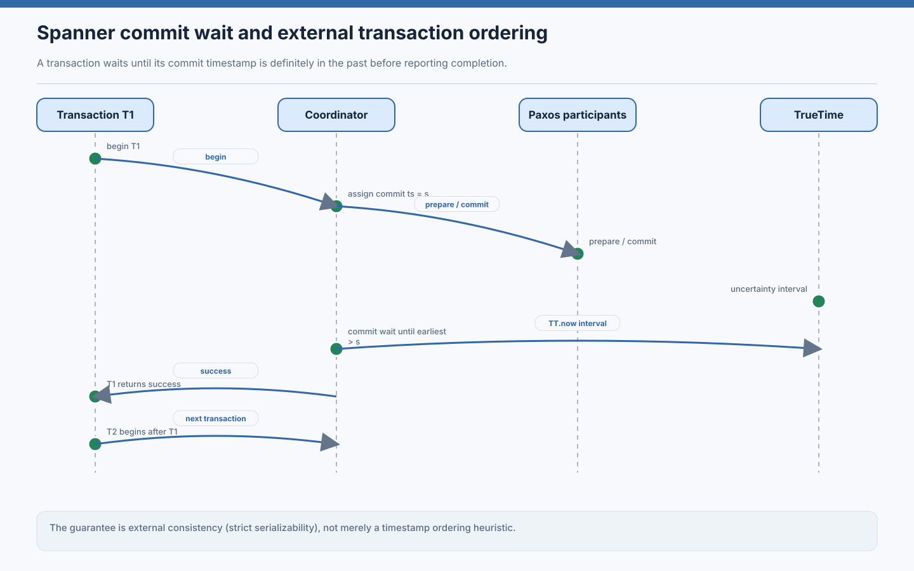

### Transactions and replication

Paxos groups replicate data and transaction state. MVCC supports reads at timestamps, including read-only transactions at a chosen timestamp without acquiring traditional read locks in the same way as write transactions. Distributed transactions use a transaction coordinator and participants, with locking and commit protocol elements; the replication protocol ensures participant state is durable and agreed within a group.

### Evaluation and limitations

The paper reports latency and throughput measurements across configurations and describes the dependence of commit latency on geographic placement and clock uncertainty. A key cost is that synchronous cross-region replication and transaction coordination incur wide-area latency. TrueTime reduces the uncertainty that must be waited out; it is not a magical zero-latency global clock. Applications that do not need external consistency may prefer weaker or local consistency to reduce latency and cost.

### Connections

Spanner connects the time-ordering problem to a production database: Lamport clocks provide causal ordering but not physical-time order; Spanner uses bounded physical-time uncertainty to support real-time transaction ordering. It also shows how Paxos can be used at the replication-group level while a separate transaction protocol coordinates operations across groups.

**Key insight:** globally strong transactional consistency is achievable under explicit clock and replication assumptions, but geographic latency and operational infrastructure are part of the price.

## 6.5 Chubby: The Lock Service for Loosely-Coupled Distributed Systems

**Paper:** Mike Burrows, “The Chubby Lock Service for Loosely-Coupled Distributed Systems,” *7th USENIX OSDI*, 2006, pp. 335–350. [USENIX paper page](https://www.usenix.org/legacy/event/osdi06/tech/burrows.html) · [full text](https://www.usenix.org/legacy/event/osdi06/tech/full_papers/burrows/burrows_html/index.html).

### Motivation

Chubby was designed as a coarse-grained lock service and low-volume reliable store for loosely coupled distributed systems. It provides coordination primitives useful for leader election, master selection, and configuration, rather than acting as a high-throughput data plane. The paper emphasizes availability and reliability over raw lock-operation throughput.

### Design and client model

Clients open handles to files/directories in a filesystem-like namespace. Sessions are maintained over time; clients hold locks through handles and may receive events when state changes. Chubby uses a replicated service and consensus-based state management so that clients observe a coherent control-plane state. A client can cache selected metadata, with notifications and invalidation rules to preserve the service's semantics.

### Sessions, sequencers, and stale actors

A client whose session expires may lose a lock even if the process continues running. A delayed request from that client may arrive after another process has acquired the lock. A lock holder therefore needs more than the belief “I still own the lock.” A **sequencer** carries ordering information about the lock acquisition and can be presented to a protected resource so that stale operations can be rejected. This is a fencing concept: the resource that accepts writes must enforce the token, not merely trust the client's local lock state.

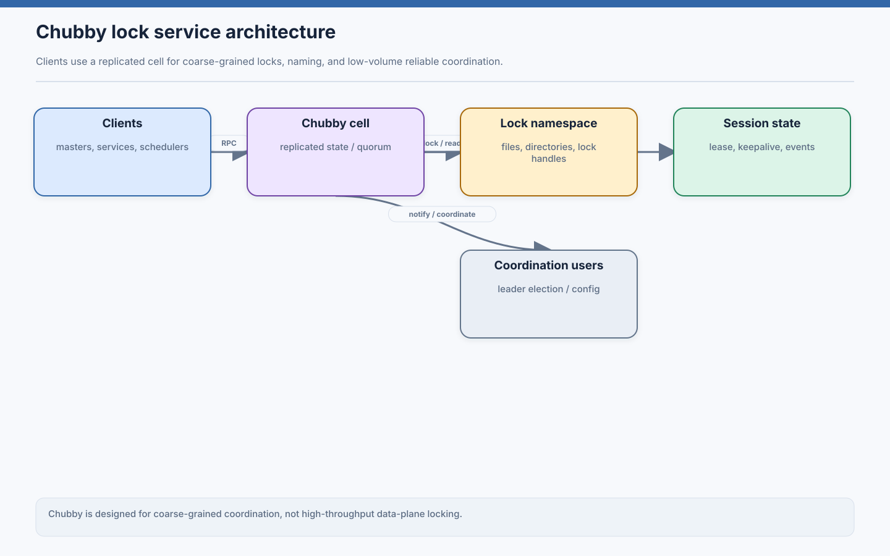
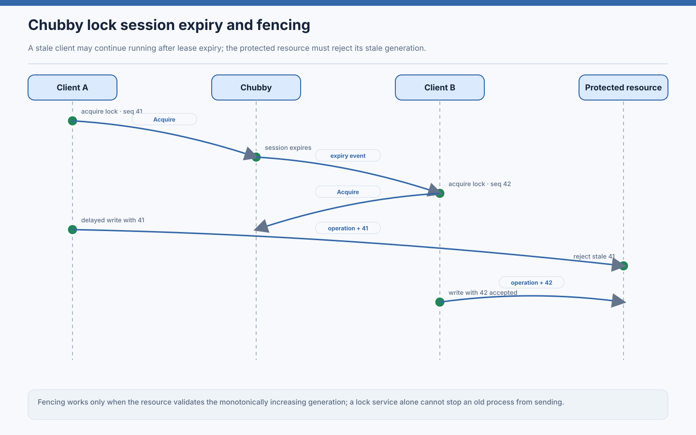

### Why coarse-grained locking?

Lock services add coordination and failure dependencies. Fine-grained locking at very high frequency would create contention and load. Chubby is intended for low-volume metadata coordination, where a small number of reliable locks can simplify large distributed applications. Clients should not use it as a substitute for a database transaction or as an unbounded per-request mutex.

### Evaluation and lessons

The paper describes deployed Chubby cells, concurrency, design trade-offs, and how real usage differed from initial expectations. Its most important contribution is operational: a central coordination service can simplify distributed applications, but its clients must handle sessions, caching, failure, and stale ownership carefully. ZooKeeper and etcd address related coordination needs through different APIs and protocols; they are not clones of Chubby.

## 6.6 Dapper: A Large-Scale Distributed Systems Tracing Infrastructure

**Paper:** Benjamin H. Sigelman et al., “Dapper, a Large-Scale Distributed Systems Tracing Infrastructure,” Google Technical Report, 2010. [Google Research publication page](https://research.google/pubs/dapper-a-large-scale-distributed-systems-tracing-infrastructure/) · [technical report](https://research.google.com/archive/papers/dapper-2010-1.pdf).

### Problem and constraints

A request in a large service may cross many components, machines, teams, and languages. Local logs reveal what one process observed, but they do not automatically reveal the end-to-end request tree or which downstream call caused a latency increase. Dapper set out to provide tracing that was low overhead, transparent to application code where possible, and deployable broadly across a huge infrastructure.

### Trace model

- A **trace** represents work associated with one request or transaction.
- A **span** represents an operation with a start and end time.
- Parent-child relationships reconstruct the call tree.
- Trace and span identifiers allow context to cross process boundaries.
- Annotations attach events and metadata to spans.
- Sampling controls collection volume.

### Instrumentation strategy

Dapper relies on instrumentation in common RPC and threading libraries so that trace context can be propagated without every application author manually instrumenting every call. This reduces adoption cost and helps maintain consistent context propagation. The system records trace data for later collection and analysis. Sampling is an explicit response to the scale and overhead constraints.

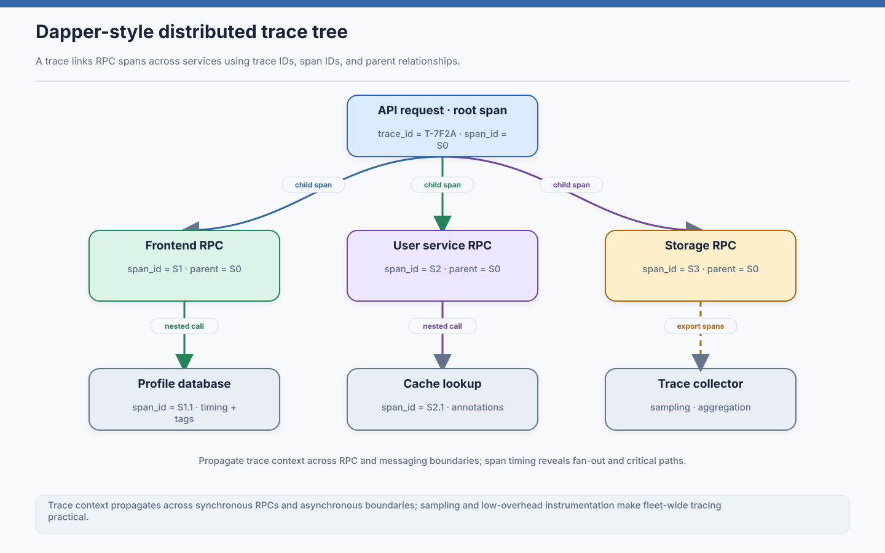

### Evaluation and influence

The paper is an experience report describing a production system used for over two years, with discussion of deployment, overhead goals, sampling, scale, and tools built on top of traces. Its significance lies in the engineering design choices required to make tracing ubiquitous. Dapper shares concepts with earlier tracing systems such as Magpie and X-Trace; it should not be claimed as the only origin of distributed tracing. Its design influenced widely used systems such as Zipkin and Jaeger and the broader trace-context ecosystem that later became standardized through OpenTelemetry.

### Limitations

Sampling means not every request is necessarily retained. Instrumentation can miss context across unsupported boundaries or poorly instrumented libraries. Trace trees represent observed span relationships, not a complete proof of causality or a substitute for metrics, logs, profiles, or domain-level audit trails.

**Key insight:** request context must be propagated at framework boundaries and telemetry collection must be designed around production cost, not added as an afterthought.

---

# 7. Amazon Dynamo

**Paper:** Giuseppe DeCandia et al., “Dynamo: Amazon's Highly Available Key-value Store,” *21st ACM SOSP*, 2007, pp. 205–220. [Amazon Science paper page](https://www.amazon.science/publications/dynamo-amazons-highly-available-key-value-store).

## 7.1 Context and problem

Dynamo was designed for services that need a highly available key-value store and can tolerate application-level reconciliation of concurrent updates. The paper's workload is availability-sensitive: a failed or slow storage node should not necessarily prevent a service from completing a customer request. The authors explicitly choose a design point that favors availability and uses versioning to make conflicts visible rather than silently serializing every write through one global order.

## 7.2 Architecture and mechanisms

- **Consistent hashing:** maps keys and storage nodes onto a ring, allowing data ownership to shift incrementally as nodes join or leave.
- **Virtual nodes:** give each physical node multiple positions on the ring, improving load distribution and allowing capacity-aware assignment.
- **Replication:** each key is stored at a configured number of nodes.
- **Versioning / vector clocks:** track causal relationships among object versions and expose concurrent updates.
- **Sloppy quorum:** permits operations to use reachable nodes other than the key's preferred replica set under failure.
- **Hinted handoff:** a temporary holder stores a hint and later forwards the write to the intended replica.
- **Read repair:** reconciles stale replicas as reads discover differences.
- **Anti-entropy:** uses Merkle-tree comparisons to identify divergent ranges efficiently.
- **Gossip:** disseminates membership and failure information.

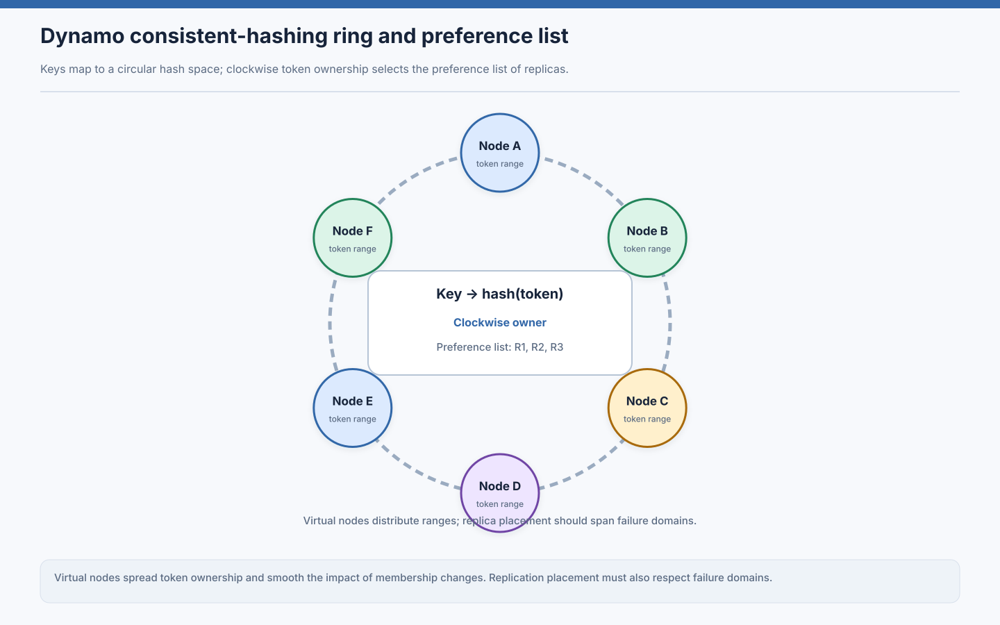

## 7.3 Quorum reasoning

For replication factor \(N\), let \(R\) be the number of replicas consulted for a read and \(W\) the number acknowledging a write. The familiar condition is:

\[
R + W > N
\]

For a fixed replica set with ordinary quorum intersection, this ensures that read and write quorums overlap. Example: \(N=3\), \(R=2\), \(W=2\). Any two-member read set and any two-member write set among the same three replicas share at least one node.

However, the equation alone does **not** prove linearizability. It does not automatically handle stale versions, concurrent writes, sloppy quorum membership, coordinator behavior, or all failure/recovery details. The original Dynamo design uses versioning and application conflict resolution precisely because concurrent histories can exist.

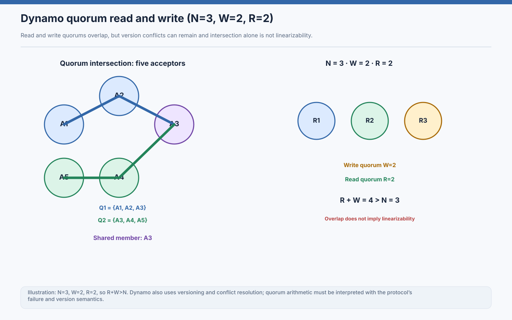
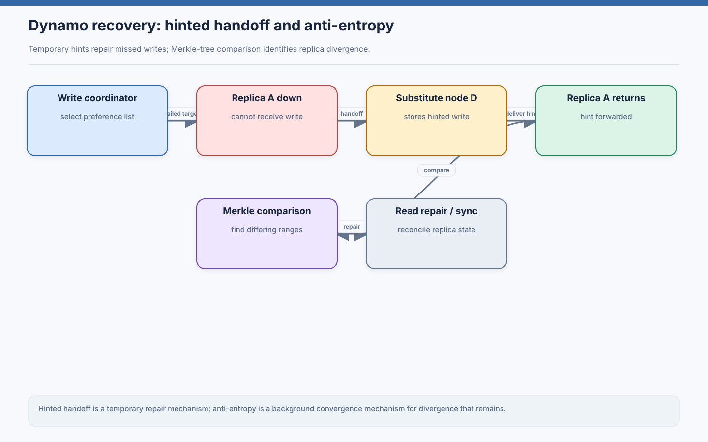

## 7.4 Read/write and conflict lifecycle

A write is routed to a coordinator, which contacts the responsible replica set. The request may succeed when the configured number of acknowledgements arrives. A later read collects versions from replicas; if versions are causally related, a newer version can supersede an older one. If versions are concurrent, the system may return multiple siblings and rely on application reconciliation. The reconciled result is written back so replicas converge.

The design avoids requiring every update to be globally ordered before acknowledging the client. That improves availability but moves some complexity into application data modeling and conflict handling. A shopping cart, for example, may merge concurrent additions more naturally than a bank balance; not every data type has a safe automatic merge operation.

## 7.5 Evaluation, impact, and limitations

The paper evaluates Dynamo's performance and availability-oriented behavior in Amazon's production environment and presents a design for incremental scaling and failure tolerance. Its production report supports the viability of this design for the target application class; it does not show that every workload should sacrifice strong consistency. Conflicts, version metadata, repair traffic, hinted handoff, and membership convergence create operational complexity.

**Dynamo paper versus DynamoDB:** the paper describes an internal system and its design techniques. Amazon DynamoDB is a managed product that has evolved independently; its present API, consistency choices, partitioning, and internal implementation should not be inferred directly from the 2007 paper. The term “Dynamo-inspired” is appropriate for some later systems, but architectural equivalence requires evidence.

---

# 8. Kafka: Distributed Event Streaming

## 8.1 Kafka: A Distributed Messaging System for Log Processing

**Paper:** Jay Kreps, Neha Narkhede, and Jun Rao, “Kafka: A Distributed Messaging System for Log Processing,” NetDB 2011. [Paper PDF](https://cwiki.apache.org/confluence/download/attachments/27822226/Kafka-netdb-06-2011.pdf).

### Motivation

The paper addresses the need to collect and deliver high volumes of log data with low latency for both offline and online consumption. Traditional messaging approaches can impose per-message overhead and complicated broker state. Kafka uses a partitioned, append-only log and simple consumer pull behavior to improve throughput and make consumers independent in their reading progress.

### Architecture

- **Topic:** named stream of records.
- **Partition:** ordered append-only log segment; ordering is guaranteed within a partition, not across all partitions of a topic.
- **Broker:** server hosting partitions.
- **Producer:** publishes records to a topic partition.
- **Consumer:** fetches records and tracks progress through offsets.
- **Consumer group:** coordinates consumption so that partitions are assigned among group members under the relevant protocol/version.

### Write path and read path

A producer chooses a partition (by key or policy) and appends a record to the partition log. Batching and sequential I/O reduce per-record overhead. A consumer pulls records from a broker and advances its offset. Keeping the consumer's position explicit allows consumers to replay data or progress at different rates, subject to retention policy.

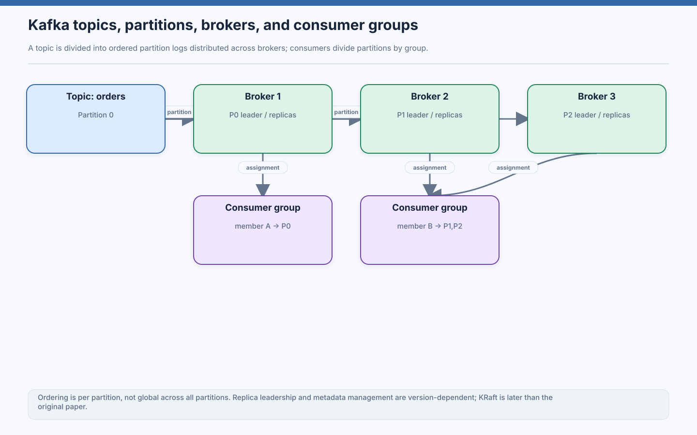
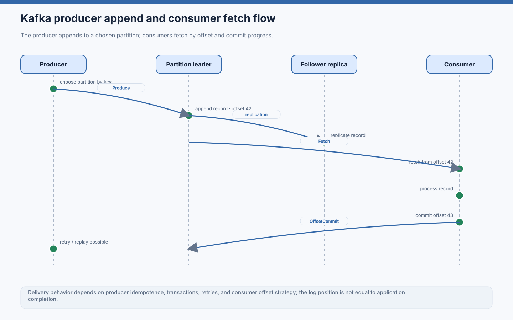

### Trade-offs and semantics

Kafka's append-only log favors throughput and sequential disk access. Parallelism is achieved by partitioning; this also bounds ordering to a partition. Multiple consumers can process a topic at different speeds, but more partitions increase metadata, reassignment, and operational complexity. Delivery semantics depend on producer retries, idempotence, transactions, offset commits, and the version/configuration of the platform. The original 2011 paper should not be retroactively described as containing every modern exactly-once, KRaft, or Kafka Streams feature.

### Evolution beyond the original paper

Later Kafka development added richer replication behavior, producer idempotence, transactions, Kafka Streams, Kafka Connect, log compaction, and KRaft metadata management. These are later engineering and ecosystem developments, not all contributions of the original NetDB paper. KRaft replaces ZooKeeper-based metadata management in newer Kafka deployments; consult the documentation for the precise version being operated.

### Evaluation and impact

The original paper compares Kafka's performance to other messaging systems and reports production use at LinkedIn processing large volumes of data daily. Those results reflect the hardware, workload, and software versions of that period. Its lasting contribution is the distributed log model: durable ordered partitions decouple producers from consumers and provide a common basis for replay, fan-out, and stream processing.

---

# 9. Facebook TAO

**Paper:** Nathan Bronson et al., “TAO: Facebook's Distributed Data Store for the Social Graph,” *USENIX Annual Technical Conference (ATC)*, 2013. [USENIX paper and metadata](https://www.usenix.org/conference/atc13/technical-sessions/presentation/bronson) · [PDF](https://www.usenix.org/system/files/conference/atc13/atc13-bronson.pdf).

## 9.1 Workload and problem

Social applications generate a graph of users, pages, posts, and typed relationships. Common queries are predictable and read-heavy: fetch an object's attributes, list objects related to a user, or retrieve associations in a defined order. A general graph query language is not necessary for every product path; a small, carefully optimized API can serve known high-volume patterns efficiently.

## 9.2 Data model and architecture

TAO models **objects** and **associations**. An object has an identifier and key-value attributes. An association represents a directed, typed relationship between objects and can carry associated metadata. The system exposes a fixed set of graph-oriented operations rather than arbitrary graph traversal.

The published architecture uses MySQL as durable storage and a graph-aware cache hierarchy. It is geographically distributed and organizes regions around leaders and followers. The cache is central: it handles many read operations so that the backing relational storage does not receive every request.

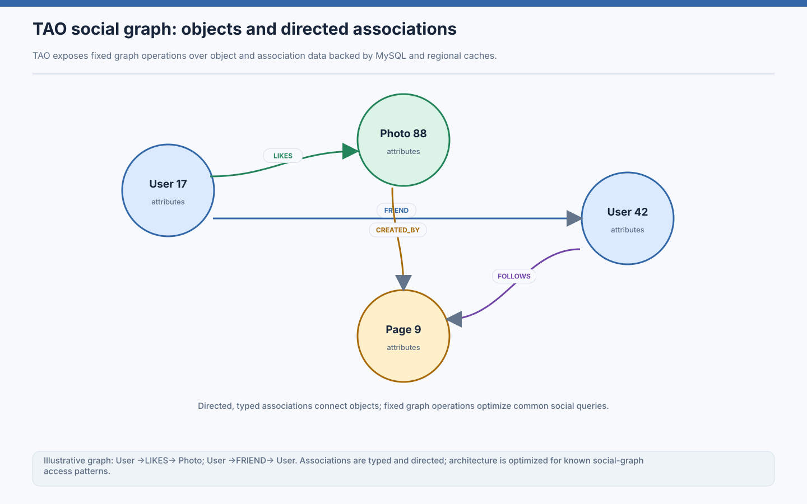
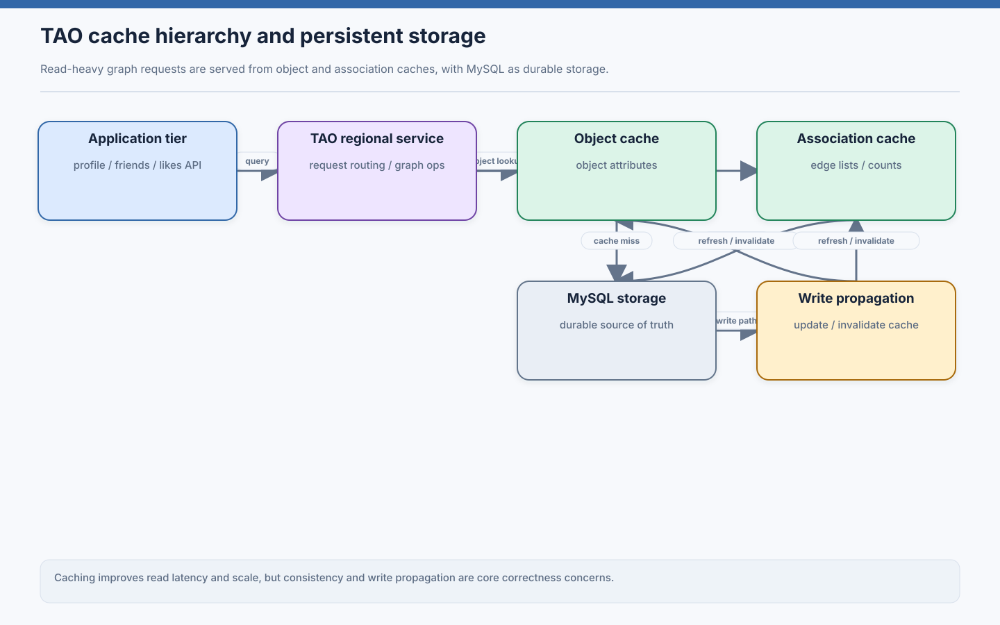

## 9.3 Query examples

- `Object(id)`: retrieve an object's attributes.
- `Assoc(src, type, dst)`: test or retrieve a relationship.
- `AssocRange(src, type, time, limit)`: retrieve a bounded set of associations, such as recent objects related to a user.

These examples illustrate the paper's constrained graph API; they are not intended as exact signatures for every TAO implementation revision.

## 9.4 Consistency and caching

TAO favors read availability and machine efficiency for its target workload over strong consistency. Cache placement and invalidation/propagation behavior are therefore central design concerns. Regional replication separates write leadership from follower reads, and cache update propagation affects how quickly changes become visible. This architecture is tuned to graph queries that can tolerate the paper's stated consistency behavior; it is not a universal replacement for a strongly consistent graph database.

## 9.5 Evaluation and influence

The paper reports a deployed system operating across thousands of machines and serving a graph with many petabytes of data, with very high read volume. These figures belong to the paper's deployment snapshot and workload, not a current service guarantee. TAO's contribution is the combination of a narrow graph model, graph-aware caching, relational durable storage, and geo-distributed operation. It is not a general-purpose graph database, and calling it one obscures the importance of its fixed API and cache hierarchy.

---

# 10. Cassandra Research Papers

## 10.1 Cassandra: A Decentralized Structured Storage System

**Paper:** Avinash Lakshman and Prashant Malik, “Cassandra: A Decentralized Structured Storage System,” *ACM SIGOPS Operating Systems Review*, 44(2), 35–40, 2010. DOI: [10.1145/1773912.1773922](https://doi.org/10.1145/1773912.1773922).

### Architectural lineage

Cassandra combines ideas associated with two influential systems:

- **Dynamo-inspired distribution:** peer-to-peer membership, consistent hashing, replication, gossip, hinted handoff, and tunable consistency.
- **Bigtable-inspired data model and storage concepts:** structured rows/columns and an SSTable-oriented storage approach.

This is an architectural synthesis, not proof that Cassandra is a direct implementation of either paper.

### Distribution and membership

Nodes participate in a ring-based partitioning scheme. Keys map to token ranges, and replicas are selected according to the replication strategy. Gossip spreads membership information. Failure detection estimates which peers are unreachable; it is suspicion based on observed communication, not a perfect failure oracle. A node can be unavailable while merely slow or partitioned.

### Consistency and repair

Cassandra exposes tunable consistency levels, allowing reads and writes to contact different numbers of replicas. Quorum-style combinations can provide intersection properties under the relevant replication and topology assumptions. Eventual convergence depends on repair mechanisms, hinted handoff, read repair (as version-dependent), and anti-entropy repair. A configured consistency level is not a magic switch that makes all operations linearizable across arbitrary topology and failure conditions.

### Storage and request paths

A typical write path appends to a commit log and updates an in-memory memtable. Memtables flush into immutable SSTables. Reads may merge results from multiple SSTables; compaction combines files and removes obsolete data/tombstones when safe. This write-optimized architecture is related to the LSM-tree design. Compaction improves read efficiency and space reclamation but creates write amplification and background resource usage.

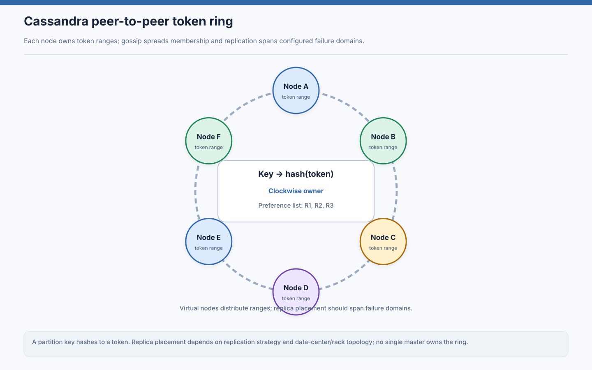
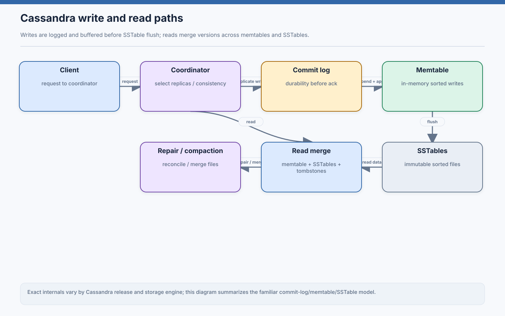

### Evaluation and limitations

The 2010 paper is a short system description focused on the decentralized design and its lineage. It should not be treated as a comprehensive reference for all modern Cassandra features. Modern releases differ in storage engine behavior, repair, consistency options, replication strategies, and operational tooling. The central trade-off remains recognizable: decentralized availability and scalable partitioning come with more complicated consistency, repair, data modeling, and operations than a single-node relational database.

## 10.2 Cassandra Architecture Evolution

Later Cassandra versions have evolved in areas such as storage-engine internals, compaction strategies, repair behavior, virtual-node configuration, topology awareness, and consistency implementation. When analyzing a deployed cluster:

1. Identify the exact release and storage engine.
2. Check the configured partitioner and replication strategy.
3. Inspect keyspace replication factors per data center.
4. Understand the consistency level used by each read and write path.
5. Inspect repair cadence, compaction backlog, tombstone behavior, and hinted handoff.
6. Test failure scenarios using the intended topology, not a simplified single-datacenter diagram.

Do not attribute a modern feature to the 2010 paper unless the paper actually describes it. Conversely, do not assume a modern deployment behaves exactly like the original architecture because it shares the Cassandra name.

---

# 11. Additional Influential Distributed Systems Papers

This section broadens the map beyond the central case studies. These papers are selected because they contribute a distinct concept, model, architecture, or operational lesson. Some are theoretical foundations; others are systems papers or workload-driven engineering reports. The phrase “Scalable Consistency in Scatter” in the planning brief is not treated as a verified bibliographic title; this chapter uses the well-established COPS paper as the clearly identifiable causal-consistency example instead of inventing a citation.

## 11.1 The Part-Time Parliament — Lamport (published 1998)

**Bibliography:** Leslie Lamport, “The Part-Time Parliament,” *ACM Transactions on Computer Systems*, 16(2), 133–169, May 1998. DOI: [10.1145/279227.279229](https://doi.org/10.1145/279227.279229). [Microsoft Research record](https://www.microsoft.com/en-us/research/publication/part-time-parliament/).

**Historical context and problem.** Lamport describes a fault-tolerant replicated record through a parable about a frequently absent parliament. Processes may fail, messages may be delayed, and multiple legislators may attempt to make progress. The paper presents the Paxos protocol as a way to maintain consistent replicas despite intermittent participation.

**Core contribution.** It develops a consensus protocol around ballots, acceptors, and quorum intersection. A majority that has accepted a value constrains the value that a later successful ballot may choose. The protocol is designed to make progress when a sufficiently stable proposer can communicate with a majority, while preserving safety through failures.

**Evaluation and limitations.** This is primarily a protocol and proof paper, not a large benchmark study. Its presentation was intentionally metaphorical, which helped convey the intuition but also made the protocol harder for some readers to extract. “Paxos Made Simple” later offered a more direct presentation. The correct publication chronology is important: the paper was first submitted in 1990 and published in the journal in 1998; it should not be listed as a 1989 journal paper.

**Influence.** The paper is a foundational reference for crash-fault consensus and state-machine replication. It provides historical context for Multi-Paxos, replicated metadata stores, and the motivation behind Raft's presentation choices.

## 11.2 Byzantine Generals — Lamport, Shostak, and Pease (1982)

**Bibliography:** Leslie Lamport, Robert Shostak, and Marshall Pease, “The Byzantine Generals Problem,” *ACM Transactions on Programming Languages and Systems*, 4(3), 382–401, 1982. DOI: [10.1145/357172.357176](https://doi.org/10.1145/357172.357176).

**Problem.** Replicas may send inconsistent or deliberately misleading messages. Agreement must hold among loyal participants even when some participants are traitors. This differs from crash-only protocols, where a failed process simply stops taking steps.

**Core insight.** With oral messages under the paper's assumptions, agreement among loyal participants is possible only when the number of traitors is less than one third of participants. The paper also analyzes unforgeable signed messages, which change the assumptions and solvability conditions. The often-quoted one-third threshold is tied to the synchronous oral-message model and its assumptions; it should not be blindly copied into every BFT system.

**Limitations and influence.** The paper is a model and algorithmic analysis, not a deployment blueprint. Modern BFT systems must additionally reason about authentication, dynamic membership, equivocation, networking, key management, and state-machine execution. The work established a vocabulary and fault model for later Byzantine fault-tolerant replication and blockchain consensus discussions.

## 11.3 Harvest, Yield, and Scalable Tolerant Systems — Fox and Brewer (1999)

**Bibliography:** Armando Fox and Eric A. Brewer, “Harvest, Yield, and Scalable Tolerant Systems,” *7th Workshop on Hot Topics in Operating Systems (HotOS)*, 1999, pp. 174–178. DOI: [10.1109/HOTOS.1999.798396](https://doi.org/10.1109/HOTOS.1999.798396). [Paper PDF](https://s3.amazonaws.com/systemsandpapers/papers/FOX_Brewer_99-Harvest_Yield_and_Scalable_Tolerant_Systems.pdf).

**Problem.** Large services often cannot preserve every result detail while also responding quickly under failures or overload. The paper proposes reasoning about service quality through **harvest** (how complete or fresh a response is) and **yield** (the fraction of requests the service completes).

**Core contribution.** It motivates graceful degradation: a service can remain useful by returning a less complete answer or serving a smaller subset of requests rather than failing completely. The paper provides an operational design vocabulary for availability beyond a binary “up/down” metric.

**Limitations and influence.** Harvest and yield are application-oriented measures, not replacements for formal consistency properties. A degraded answer may be acceptable for a recommendation feed but unsafe for an account balance. The work belongs in the lineage of availability-aware web architecture and is often discussed alongside CAP, while not being the Gilbert–Lynch proof.

## 11.4 Calvin: Fast Distributed Transactions for Partitioned Database Systems — Thomson et al. (2012)

**Bibliography:** Alexander Thomson, Thaddeus Diamond, Shu-Chun Weng, Daniel J. Abadi, Kun Ren, and Philip Shao, “Calvin: Fast Distributed Transactions for Partitioned Database Systems,” *ACM SIGMOD International Conference on Management of Data*, 2012. [Paper PDF](https://dsf.berkeley.edu/cs286/papers/calvin-sigmod2012.pdf).

**Problem.** Distributed transactions across partitions often require coordination protocols, locks, and unpredictable execution order. Systems seeking horizontal scale may weaken transaction support to avoid coordination overhead.

**Core idea.** Calvin separates deterministic transaction ordering from transaction execution. A sequencer establishes a global order of transactions (or an order consistent with the replication protocol); replicas execute that order deterministically. By knowing the transaction order and relevant read/write sets, Calvin can coordinate locks in a way that avoids conventional distributed commit during transaction execution under its design assumptions.

**Architecture.** Transaction input is sequenced and replicated; transaction schedulers coordinate access to partitions; deterministic execution allows replicas to produce consistent state. Replication and scheduling are designed together rather than treating the database as independent nodes that discover transaction order during execution.

**Trade-offs.** Deterministic ordering can reduce coordination on the critical path, but requires knowing transaction operations or their access sets sufficiently early. Contention, unknown reads, nondeterministic application logic, and ordering bottlenecks remain important. The paper's use of “high availability” should not be conflated with CAP's formal availability definition; the authors explicitly discuss their usage.

**Influence.** Calvin is an important alternative point in distributed transaction design: instead of relying only on two-phase commit among independently executing shards, move ordering earlier and make execution deterministic.

## 11.5 The Log-Structured Merge-Tree (LSM-Tree) — O'Neil et al. (1996)

**Bibliography:** Patrick E. O'Neil, Edward Cheng, Dieter Gawlick, and Elizabeth O'Neil, “The Log-Structured Merge-Tree (LSM-Tree),” *Acta Informatica*, 33(4), 351–385, 1996. DOI: [10.1007/S002360050048](https://doi.org/10.1007/S002360050048).

**Problem.** Disk-based indexes optimized for read locality may incur expensive random writes when data updates are frequent. The paper studies a storage organization that defers and batches updates to improve write performance.

**Core idea.** Maintain an in-memory component (often called L0 or a memtable in later implementations) and one or more disk-resident sorted components. Updates are first recorded in a log and memory structure, then flushed as sorted runs. Background merging/compaction combines sorted files and controls their number.

**Trade-offs.** LSM structures turn many random writes into sequential writes and merge operations. Their costs include read amplification (searching multiple components), write amplification (rewriting data during compaction), space amplification, and compaction contention. Bloom filters, indexes, leveled/tiered compaction, and caching are common implementation tools, but exact designs vary.

**Connections.** The LSM idea is relevant to Bigtable-style SSTable storage and later Cassandra/RocksDB/LevelDB-style engines. It is a storage-organization paper, not by itself a distributed consensus or replication protocol.

## 11.6 COPS — Scalable Causal Consistency for Wide-Area Storage (2011)

**Bibliography:** Wyatt Lloyd, Michael J. Freedman, Michael Kaminsky, and David G. Andersen, “Don't Settle for Eventual: Scalable Causal Consistency for Wide-Area Storage with COPS,” *23rd ACM SOSP*, 2011, pp. 401–416. DOI: [10.1145/2043556.2043593](https://doi.org/10.1145/2043556.2043593).

**Problem.** Geo-replicated systems want low-latency local access and high availability, but eventual consistency can expose an application to causally inconsistent views. For example, a client could observe a reply before observing the message that caused it.

**Core contribution.** The paper defines **causal+** consistency: causal consistency with convergent conflict handling. COPS tracks dependencies across keys and checks that dependencies are satisfied in a local cluster before exposing a remotely replicated write. COPS-GT adds get transactions to obtain a causally consistent view of multiple keys without locking or blocking in the manner of a strong distributed transaction.

**Mechanism.** A client write can depend on earlier reads or writes. The system records these dependencies with the update. When the update reaches another cluster, the system checks that the dependency versions are present before making the write visible there. This preserves causal order while allowing asynchronous wide-area replication.

**Evaluation and limitations.** The paper evaluates a prototype and reports low operation latency and scaling behavior for its workloads. Its guarantee is causal consistency, not linearizability or full serializability. Dependency tracking and cross-key checks add metadata and coordination, and conflict convergence depends on the selected policy.

**Connections.** COPS extends the causal reasoning introduced by Lamport and vector clocks and provides a useful contrast with Dynamo's availability-oriented sibling-version model and Spanner's external consistency.

## 11.7 The Tail at Scale — Dean and Barroso (2013)

**Bibliography:** Jeffrey Dean and Luiz André Barroso, “The Tail at Scale,” *Communications of the ACM*, 56(2), 74–80, 2013. DOI: [10.1145/2408776.2408794](https://doi.org/10.1145/2408776.2408794).

**Problem.** At large scale, rare slow components become common at the request level. If an end-to-end request waits for many independent or partially independent subtasks, the probability that at least one subtask is slow can dominate user-visible latency.

**Core ideas.** The paper discusses techniques such as hedged requests (send a duplicate after a delay), tied requests (coordinate duplicate attempts), selective replication, latency-aware scheduling, and reducing interference. These methods trade extra resource consumption for reduced tail latency.

**Illustrative probability.** If each of 100 independent subtasks has probability 0.99 of finishing before a threshold, then the probability all finish before the threshold is \(0.99^{100}\approx0.366\). Thus the probability at least one misses it is about 0.634. This is a teaching calculation; real latencies are neither independent nor identical in general.

**Limitations.** Hedging can amplify load precisely when the system is overloaded. It needs cancellation, idempotence or duplicate suppression, capacity headroom, and an appropriate delay threshold. The paper's lesson is not “always duplicate requests,” but “design the tail as a first-class system property.”

## 11.8 Large-scale Cluster Management at Google with Borg — Verma et al. (2015)

**Bibliography:** Abhishek Verma et al., “Large-scale Cluster Management at Google with Borg,” *10th ACM European Conference on Computer Systems (EuroSys)*, 2015. [Google Research page](https://research.google/pubs/large-scale-cluster-management-at-google-with-borg/).

**Problem.** Large shared clusters run many jobs with varying priorities, resource needs, and availability constraints. Efficient packing alone is insufficient; the scheduler must support admission control, isolation, recovery, resource reclamation, and operational visibility.

**Core contribution.** The paper describes Borg's cluster-management architecture and reports a decade of operational experience. Design features include declarative job specifications, admission control, task packing, overcommitment, resource sharing with isolation, priority classes, and mechanisms to reduce recovery time and correlated failures.

**Evaluation and influence.** The paper provides quantitative analyses of policy decisions and operational experience across large Google clusters. Borg is an important antecedent to Kubernetes and influenced public discussion of cluster management, but Kubernetes is not Borg made open source; the API, architecture, and design constraints differ. The production lesson is that scheduling, resource accounting, and failure recovery form one operational system.

## 11.9 MillWheel — Fault-Tolerant Stream Processing at Internet Scale (2013)

**Bibliography:** Tyler Akidau et al., “MillWheel: Fault-Tolerant Stream Processing at Internet Scale,” *Proceedings of the VLDB Endowment*, 6(11), 734–746, 2013. [Google Research page](https://research.google/pubs/millwheel-fault-tolerant-stream-processing-at-internet-scale/).

**Problem.** Continuous streams require persistent state, low latency, fault tolerance, and time-based aggregation. Batch systems can process bounded input but do not naturally express unbounded event streams with late or out-of-order arrivals.

**Core contribution.** MillWheel gives users a directed computation graph and manages persistent per-key state, record flow, fault tolerance, and logical time. Its programming model makes time-aware aggregation and stateful streaming explicit. The paper includes a production case study and describes how the system handles data and computation progress.

**Important distinction.** Exactly-once or effectively-once processing claims are always scoped to the system's state and delivery/commit protocol. They do not automatically make an arbitrary external side effect (such as sending a payment or email) exactly once unless that side effect is integrated through an idempotent or transactional boundary.

**Influence.** MillWheel is part of the research lineage behind modern stateful stream processors and is closely related to the Dataflow model's explicit treatment of event time, watermarks, windows, and triggers.

## 11.10 The Dataflow Model — Akidau et al. (2015)

**Bibliography:** Tyler Akidau et al., “The Dataflow Model: A Practical Approach to Balancing Correctness, Latency, and Cost in Massive-Scale, Unbounded, Out-of-Order Data Processing,” *Proceedings of the VLDB Endowment*, 8(12), 1792–1803, 2015. [Google Research publication page](https://research.google/pubs/the-dataflow-model-a-practical-approach-to-balancing-correctness-latency-and-cost-in-massive-scale-unbounded-out-of-order-data-processing/).

**Problem.** Unbounded streams arrive out of order. A processor must decide when a time window is ready to emit a result, how to handle late data, whether to revise past results, and how much latency/cost to trade for completeness.

**Core model.** The Dataflow model separates:

- **What:** the computation being performed.
- **Where:** the windowing strategy.
- **When:** the trigger condition for producing output.
- **How:** whether results accumulate, discard, or retract prior contributions.

Event time is distinct from processing time. Watermarks represent the system's estimate of event-time completeness, not a magical guarantee that no earlier event can ever arrive. Triggers let a pipeline produce early, on-time, and late panes according to a chosen policy.

**Trade-offs.** Earlier results lower latency but may be incomplete and later revised. Waiting for more event-time completeness improves correctness but increases latency and state retention. Retaining or revising panes adds cost and downstream complexity. The paper's model is useful for reasoning about semantics independent of one runner implementation.

---

# 12. Cross-Paper Comparison and Research Evolution

The most useful way to study these papers is to connect the problems they solve. A storage engine, a consensus protocol, and a streaming runtime may all use replication, but they expose different guarantees and optimize different bottlenecks.

## 12.1 Evolution of distributed coordination

| Stage | Research contribution | Question answered | What remains outside its scope |
|---|---|---|---|
| Lamport (1978) | Happened-before and logical clocks | How can causal precedence be represented? | Consensus, physical-time precision |
| FLP (1985) | Impossibility under asynchrony and crash | Can deterministic consensus always terminate? | Practical partial-synchrony protocol design |
| Part-Time Parliament / Paxos | Quorum-based agreement | How can one value remain safe despite failures? | Byzantine faults; easy implementation |
| Chubby (2006) | Production coordination service | How can applications obtain reliable coarse-grained locks? | High-throughput data access |
| Raft (2014) | Understandable replicated log | How can the consensus structure be made easier to implement? | Byzantine participants |
| Modern BFT protocols | Agreement with malicious replicas | How can a service tolerate arbitrary faulty replicas? | Public-network Sybil resistance and economic incentives unless separately designed |

Paxos and Raft address crash faults. PBFT and modern BFT protocols address arbitrary or Byzantine behavior under stronger communication/authentication assumptions. Public blockchain consensus adds a separate problem: membership is open or economically selected, so the system needs Sybil resistance and incentive assumptions in addition to agreement among known replicas.

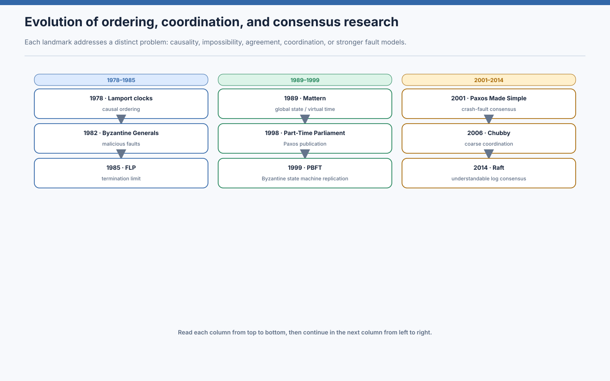

## 12.2 Evolution of distributed storage

| System | Primary abstraction | Partitioning | Replication / consistency emphasis | Typical workload |
|---|---|---|---|---|
| GFS | Large files split into chunks | Chunk placement | Replicated chunks; mutation order per chunk | Large sequential reads and appends |
| Bigtable | Sorted sparse multidimensional map | Row-key tablets | Tablet and storage coordination; row-oriented data layout | Structured key/range access |
| Dynamo | Key-value objects | Consistent-hash ring | High availability, versioning, sloppy quorum | Always-on service state |
| Cassandra | Wide-column structured storage | Token ranges / ring | Decentralized replication and tunable consistency | High-volume partitioned writes/reads |
| Spanner | Relational/structured globally distributed database | Splits and directories | Synchronous replication and external consistency | Global transactions |
| TAO | Objects and typed associations | Region/cache/storage architecture | Read-heavy graph access, availability-oriented behavior | Social graph queries |

A product decision should start with access patterns and semantics, not a popularity ranking. A system optimized for sequential file throughput is not automatically appropriate for point lookups. A system built to expose concurrent versions is not automatically suitable for strict financial transactions. A globally serializable database may impose latency that a feed cache should avoid.

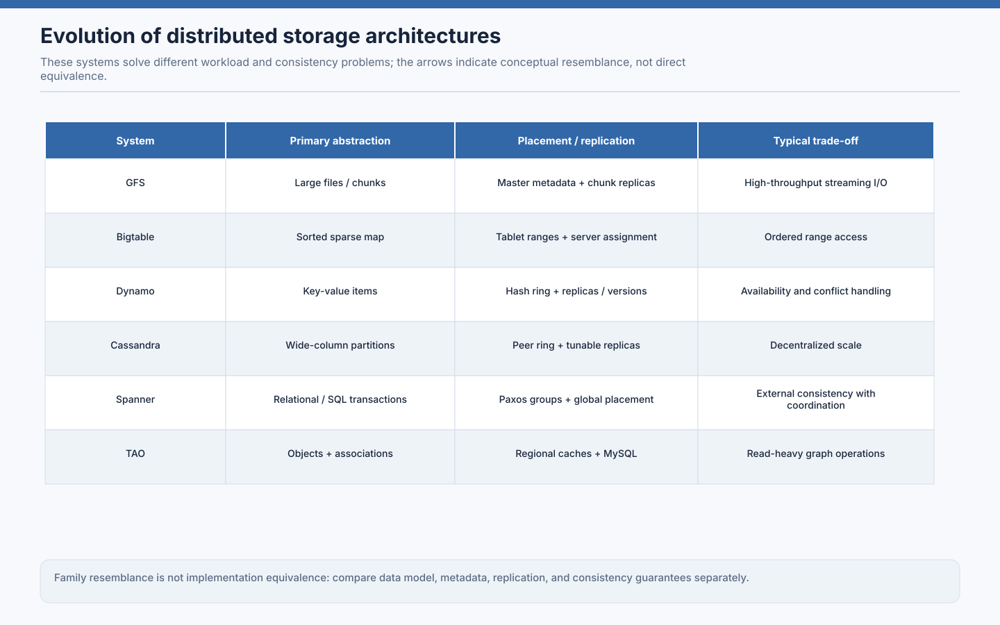

## 12.3 Evolution of large-scale processing

| Model/system | Input shape | Time model | State model | Primary execution style |
|---|---|---|---|---|
| MapReduce | Bounded files | Batch/job time | Usually stage/job scoped | Map, shuffle, reduce barriers |
| Kafka | Unbounded retained log | Offsets and event timestamps as data | Retained partition log | Append and independent consumers |
| MillWheel | Unbounded streams | Logical time and progress tracking | Persistent per-key state | Stateful graph of computations |
| Dataflow | Bounded and unbounded data | Explicit event time, watermarks, triggers | Windowed and keyed state | Unified data-parallel model |
| Spark (later evolution) | Batch and streaming abstractions | Micro-batch and later continuous variants, version-dependent | RDD/DataFrame and stateful operators | DAG execution and caching |

The evolution is not a simple replacement ladder. Batch processing remains appropriate for bounded historical data; logs provide durable event history; streaming systems process ongoing events; and dataflow models make event-time correctness and result revision explicit.

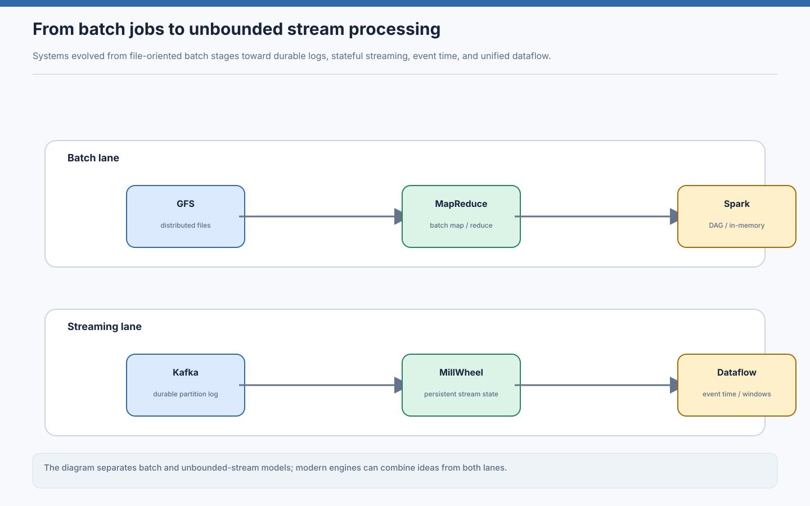

## 12.4 Evolution of distributed observability

Dapper demonstrated that trace context, span relationships, low-overhead instrumentation, sampling, and centralized analysis can work at large production scale. Zipkin and Jaeger are separate implementations that popularized similar trace models in open-source environments. OpenTelemetry is a vendor-neutral set of APIs, SDKs, semantic conventions, and protocols for collecting traces, metrics, and logs; it should not be described as “Dapper renamed.” The concepts overlap, but products, formats, and standardization history differ.

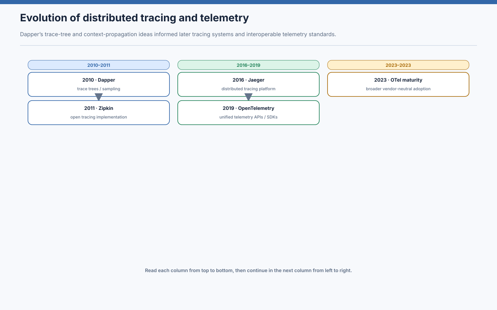

## 12.5 Theory versus production trade-offs

| Theoretical result / mechanism | Production design pressure | Important distinction |
|---|---|---|
| FLP | Timeouts and leader replacement | Timeout is suspicion, not proof of crash |
| CAP | Read/write behavior during partitions | CAP is failure-time behavior, not a permanent two-of-three menu |
| Quorum intersection | Replication and recovery | Intersection preserves safety only with protocol state and assumptions; it is not automatically linearizability |
| Strong consistency | Geographic latency | Synchronous coordination has a wide-area cost |
| Dynamo | Application conflict handling | Availability-oriented semantics are not right for all data |
| Spanner | Clock infrastructure and commit wait | Bounded uncertainty is a resource and an assumption |
| Chubby | Coarse-grained coordination | Lock ownership needs stale-client protection at the resource |
| Kafka | Partition parallelism | Ordering is per partition, not globally across a topic by default |
| Tail-at-scale techniques | Duplicate work and capacity | Hedging can worsen overload without budgets and cancellation |

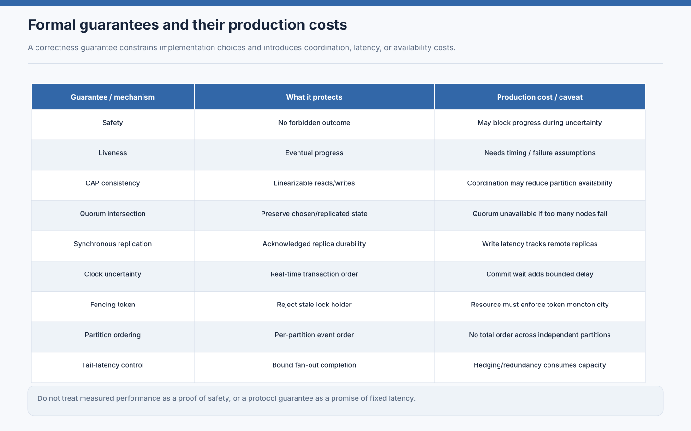
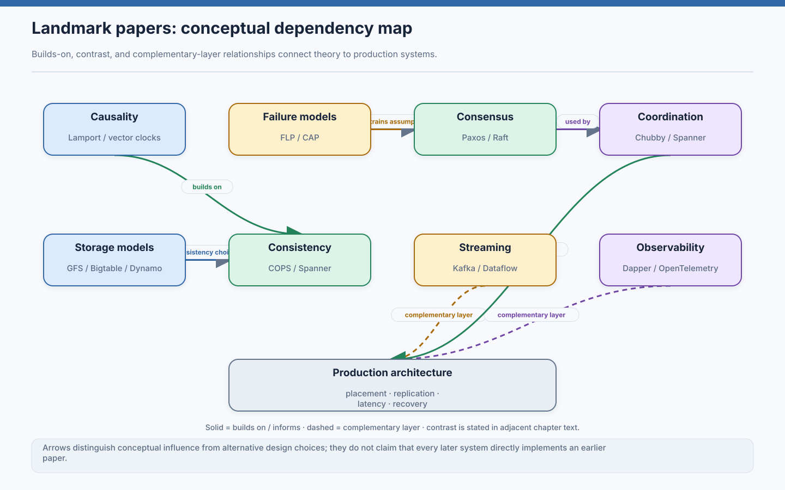

---

# 13. Research Paper Timeline

The timeline distinguishes an initial presentation, a report/submission date, and formal publication where these are different. Years should not be collapsed when the historical record indicates more than one date.

| Year | Milestone | Note |
|---:|---|---|
| 1978 | Lamport, “Time, Clocks, and the Ordering of Events” | CACM journal publication |
| 1982 | Lamport, Shostak, and Pease, “The Byzantine Generals Problem” | TOPLAS journal publication |
| 1983 | FLP consensus result presented at PODC | Journal version appeared in 1985 |
| 1989 | Mattern, “Virtual Time and Global States of Distributed Systems” | Vector/virtual-time research milestone |
| 1990 | Lamport first submitted “The Part-Time Parliament” | Published in TOCS in 1998 |
| 1996 | O'Neil et al., LSM-tree | Acta Informatica |
| 1998 | “The Part-Time Parliament” | TOCS publication; do not label journal publication as 1989 |
| 1999 | Fox and Brewer, “Harvest, Yield, and Scalable Tolerant Systems” | HotOS |
| 2000 | Brewer's CAP conjecture | Invited PODC keynote, not the Gilbert–Lynch proof |
| 2001 | Lamport, “Paxos Made Simple” | SIGACT News |
| 2002 | Gilbert–Lynch CAP formalization | SIGACT News publication |
| 2003 | Google File System | SOSP |
| 2004 | MapReduce | OSDI |
| 2006 | Bigtable | OSDI |
| 2006 | Chubby | OSDI |
| 2007 | Dynamo | SOSP |
| 2010 | Dapper | Google technical report |
| 2010 | Cassandra | ACM SIGOPS Operating Systems Review |
| 2011 | Kafka | NetDB workshop paper |
| 2011 | COPS | SOSP |
| 2012 | Spanner | OSDI |
| 2012 | Calvin | SIGMOD |
| 2013 | TAO | USENIX ATC |
| 2013 | MillWheel | PVLDB |
| 2013 | The Tail at Scale | Communications of the ACM |
| 2014 | Raft | USENIX ATC |
| 2015 | Borg | EuroSys |
| 2015 | Dataflow Model | PVLDB |

**Bibliographic caution:** “The Part-Time Parliament” has often been associated with an earlier report/submission period, but the citable journal item is 1998. Brewer's conjecture was presented in 2000; Gilbert and Lynch's formal paper was published in 2002. FLP is associated with PODC 1983 presentation and 1985 JACM publication.

---

# 14. Research Methodology and Critical Evaluation

## 14.1 Problem relevance and novelty

A paper's contribution may be a new abstraction, a proof, a system design, an evaluation methodology, or a production experience report. Identify precisely which one. A system may combine known primitives in a novel architecture; that can be a substantial contribution even if no individual algorithm is new.

Questions:

- Is the problem important for a real workload or only for an artificial benchmark?
- What prior system is the relevant baseline?
- Is the novelty in semantics, algorithm, architecture, implementation, or operations?
- Does the paper explain why existing approaches are inadequate?
- Are the non-goals explicit?

## 14.2 Theoretical soundness

For a protocol paper, extract the invariant and state transition rules. Check whether the proof depends on a fixed membership set, durable storage, authenticated messages, bounded clock drift, or eventual synchrony. Verify that all failure cases in the theorem match the failure cases claimed in the abstract.

A theorem with a precise scope is more useful than a broad but ambiguous guarantee. Do not infer Byzantine tolerance from crash-fault correctness, or multi-key serializability from per-key linearizability.

## 14.3 Experimental design

Evaluate the workload, hardware, software version, network topology, storage medium, data distribution, cache state, concurrency, and failure injection. A fair comparison should normalize or disclose differences in hardware, tuning, durability settings, consistency guarantees, and batching.

### Useful performance metrics

- Throughput: completed operations per unit time.
- Median latency: middle request latency.
- p95/p99/p99.9 latency: tail behavior.
- Availability: explicitly defined request success behavior over a time window.
- Recovery time: time to restore service or replica health after failure.
- Data loss: acknowledged updates missing after recovery, under the tested failure model.
- Resource efficiency: CPU, memory, disk, network, and storage overhead per unit work.
- Cost: infrastructure required to meet a target workload and SLO.

## 14.4 Common validity threats

| Threat | Why it matters | What to inspect |
|---|---|---|
| Unrepresentative workload | Optimizes for the benchmark rather than production | Key skew, object size, read/write mix, burstiness |
| Weak baseline | Makes new system appear artificially fast | Baseline tuning, feature parity, durability settings |
| Mean-only latency | Hides stragglers | Percentiles and distributions |
| No failure testing | Does not test the fault-tolerance claim | Node loss, partitions, restarts, disk errors |
| Hardware mismatch | Confounds system comparison | CPU, memory, disks, NIC, topology |
| Short benchmark | Misses compaction, cache churn, or rebalancing | Long-running and steady-state behavior |
| Hidden operational costs | Understates total complexity | Repair, rebalancing, backup, upgrades, observability |
| Prototype/production gap | Prototype may omit operational hardening | Deployment evidence, security, recovery procedures |

## 14.5 Research paper evaluation checklist

- [ ] Exact bibliographic details verified from a primary source.
- [ ] Research question can be stated in one sentence.
- [ ] System model and assumptions listed.
- [ ] Failure model identified.
- [ ] Safety and liveness claims separated.
- [ ] API and consistency semantics recorded.
- [ ] Critical algorithm reconstructed independently.
- [ ] Correctness argument or invariant understood.
- [ ] Evaluation workload and testbed captured.
- [ ] Baselines and configuration are fair and explicit.
- [ ] Tail latency and failure behavior inspected.
- [ ] Limitations and threats to validity documented.
- [ ] Later implementation details are not attributed to the original paper.
- [ ] Production influence is supported by a credible source.

---

# 15. Landmark Paper Deep-Dive Exercises

The worked solutions below are teaching exercises. Where an exercise uses simplified values, the assumptions are stated explicitly; do not treat the arithmetic as a complete simulation of a production implementation.

## Exercise 1 — Derive Lamport timestamps

**Relevant paper:** Lamport (1978).  
**Problem:** Three processes P1, P2, and P3 each begin with clock 0. P1 performs a local event, sends a message to P2, and later performs another local event. P2 receives the message, sends a message to P3, and P3 receives it after performing one independent local event. Calculate the timestamps.

**Assumptions:** A local event increments by one; a send increments and attaches its timestamp; a receive sets `max(local, received)+1`.

**Solution:** P1's local event receives 1; its send receives 2. P2 receives at `max(0,2)+1=3`; its send receives 4. P3's independent event receives 1; its receive becomes `max(1,4)+1=5`. The message chain has timestamps 2, 3, 4, 5 in causal order. P3's first event is also before its receive, but it is not causally related to P1's send merely because its timestamp is smaller.

**Expected result:** Causality implies timestamp increase; timestamp increase alone does not prove causality.  
**Common misconception:** A Lamport timestamp is a physical time or fully identifies concurrency.  
**Further reading:** Lamport (1978); Fidge (1988); Mattern (1989).

## Exercise 2 — Explain FLP with a simplified execution

**Relevant paper:** Fischer, Lynch, and Paterson (1985).  
**Problem:** Explain why a process cannot know from silence alone whether another process has crashed or its message is delayed.

**Assumptions:** Deterministic consensus, asynchronous communication, at least one possible crash, no known upper bound on delivery time.

**Solution:** Consider a process waiting for a response. Two executions are indistinguishable to it: one in which the sender crashed, and one in which the sender is correct but its message is delayed. If the waiting process decides in the first execution, the same local view may cause the same decision in the second, potentially violating agreement or validity. If it waits forever, termination fails in the crash execution. FLP turns this intuition into a bivalence argument over admissible schedules.

**Expected result:** No deterministic protocol guarantees termination in every admissible execution under the stated model.  
**Common misconception:** FLP says a practical consensus system never makes progress.  
**Further reading:** FLP (1985); Paxos; Raft.

## Exercise 3 — Demonstrate CAP with two replicas

**Relevant paper:** Gilbert and Lynch (2002).  
**Problem:** A and B hold the same key. A partition separates them. A completes a write of `x=2`; a client then reads from B.

**Assumptions:** A write completed before the read began; B cannot communicate with A; the service must either return a response or wait/reject.

**Solution:** If B returns the old value `x=1`, the history cannot be linearizable because the read started after a completed write. If B refuses to respond until it can establish a safe order, it does not satisfy the formal availability condition for this request. The contradiction is about the partition execution, not all normal operation.

**Expected result:** The service cannot guarantee both linearizability and formal availability during this partition.  
**Common misconception:** Every product permanently chooses exactly two of C, A, and P.  
**Further reading:** Gilbert–Lynch (2002); Abadi's PACELC discussion.

## Exercise 4 — Walk through Paxos with competing proposers

**Relevant paper:** Lamport (2001).  
**Problem:** Five acceptors; proposer P1 has chosen `x` using A1, A2, A3. P2 later obtains promises from A3, A4, A5 using a higher proposal number. What may P2 propose?

**Assumptions:** Majority quorum is 3; acceptors report their highest accepted proposal during prepare; no Byzantine behavior.

**Solution:** The prepare quorum includes A3, which reports the accepted proposal `(n1,x)`. P2 must carry `x` forward as the value for its new proposal, even if P2 initially preferred `y`. A majority in a fixed five-node set intersects another majority, and the prepare rule carries the previous accepted value through that intersection.

**Expected result:** P2 may use a higher proposal number but cannot replace the already chosen value with `y`.  
**Common misconception:** Paxos is simply “first proposer to get three votes wins.”  
**Further reading:** Lamport's Part-Time Parliament and Paxos Made Simple.

## Exercise 5 — Simulate a Raft leader election

**Relevant paper:** Ongaro and Ousterhout (2014).  
**Problem:** A five-node cluster has followers A, B, C, D, and E. A and B time out at nearly the same moment and both become candidates.

**Assumptions:** Each candidate increments term and votes for itself; a candidate requires three votes; randomized election timeouts are used.

**Solution:** A and B may split votes, leaving neither with a majority. Another timeout causes an election in a later term; a candidate can collect votes from three nodes if its log is sufficiently up to date and the nodes have not voted for another candidate in that term. The new leader begins heartbeats and replicates entries. Nodes that observe a higher term step down.

**Expected result:** Split votes delay progress but do not make two leaders valid in one term.  
**Common misconception:** The timeout proves that the previous leader has crashed.  
**Further reading:** Raft paper; etcd Raft implementation documentation.

## Exercise 6 — Explain GFS chunk replication and recovery

**Relevant paper:** Ghemawat et al. (2003).  
**Problem:** A chunk has a target replication factor of three. One chunkserver becomes unavailable.

**Assumptions:** The master detects the missing replica through its monitoring and metadata mechanisms; at least one healthy copy remains.

**Solution:** The master identifies that the chunk is below its target replication count and schedules re-replication from a healthy replica to another chunkserver. The new replica is added to the master's location metadata once validated. Checksums help detect corruption; the master is not in the bulk data path for every read.

**Expected result:** The system restores redundancy asynchronously rather than requiring the client to copy data on every read.  
**Common misconception:** Three replicas mean all reads and writes synchronously pass through the master.  
**Further reading:** GFS paper, especially master, chunkserver, and recovery design.

## Exercise 7 — Trace a MapReduce word-count job

**Relevant paper:** Dean and Ghemawat (2004).  
**Problem:** Count words in two files: `"red blue red"` and `"blue green"`.

**Assumptions:** Map emits `(word,1)`; the shuffle groups by word; reduce sums values.

**Solution:** Map output is `(red,1),(blue,1),(red,1),(blue,1),(green,1)`. Shuffle groups `red:[1,1]`, `blue:[1,1]`, `green:[1]`. Reduce emits `red:2`, `blue:2`, `green:1`. A distributed runtime assigns input splits, stores intermediate partitions, and schedules reducers after map outputs become available.

**Expected result:** The programming model separates per-record mapping from per-key aggregation.  
**Common misconception:** Reduce sees arbitrary input order and can assume a single global worker.  
**Further reading:** OSDI 2004 MapReduce paper.

## Exercise 8 — Model Bigtable row keys and tablets

**Relevant paper:** Chang et al. (2006).  
**Problem:** A table stores web pages keyed by host and URL. Explain how key design affects tablet distribution.

**Assumptions:** Tablets are contiguous row-key ranges ordered lexicographically.

**Solution:** A key beginning with a host prefix can keep related URLs near one another, aiding range scans. But if all new records use a monotonically increasing timestamp prefix, writes may concentrate at the end of the keyspace. The design must balance locality for dominant queries against write distribution. Tablet splitting helps redistribute ranges but does not repair a fundamentally poor key pattern for every workload.

**Expected result:** Row-key design is part of the physical partitioning architecture.  
**Common misconception:** Horizontal partitioning automatically distributes write load evenly.  
**Further reading:** Bigtable paper; HBase row-key design docs for a later system comparison.

## Exercise 9 — Explain TrueTime and external consistency

**Relevant paper:** Corbett et al. (2012).  
**Problem:** A commit timestamp is `s=100`; `TT.now()` returns `[99.7,100.4]` in an illustrative time unit. What must commit wait establish?

**Assumptions:** The interval contains real time; commit wait ends when the earliest possible current time is greater than the assigned timestamp.

**Solution:** At `[99.7,100.4]`, the earliest bound is not greater than 100, so the system must wait. Once the lower bound advances beyond 100, real time is guaranteed to be later than the commit timestamp. This helps preserve the ordering between transactions whose externally observed execution intervals do not overlap.

**Expected result:** An uncertainty interval plus a wait condition can support external consistency; a single unboundedly inaccurate clock read cannot.  
**Common misconception:** TrueTime returns the exact global time.  
**Further reading:** Spanner paper.

## Exercise 10 — Analyze Chubby session expiration and stale clients

**Relevant paper:** Burrows (2006).  
**Problem:** Client A holds a lock, becomes partitioned, and its session expires. Client B acquires the lock. A later sends a delayed write to a protected storage service.

**Assumptions:** A's process is still running; the storage service can validate fencing/sequencer information.

**Solution:** The lock service may have correctly expired A's session and granted a new lock to B, but A may not know that it lost ownership. If the storage system accepts writes based only on A's local belief, stale work can overwrite B's newer state. A must attach a sequencer/fencing value; the resource rejects operations carrying an older generation than the current accepted one.

**Expected result:** A lock service alone cannot protect a resource unless the resource enforces stale-owner rejection.  
**Common misconception:** A lease timeout instantly stops the old process from executing.  
**Further reading:** Chubby paper; fencing-token design discussions.

## Exercise 11 — Calculate Dynamo quorum overlap

**Relevant paper:** DeCandia et al. (2007).  
**Problem:** A fixed replica set has `N=5`, read quorum `R=3`, and write quorum `W=3`.

**Assumptions:** Read and write quorums are selected from the same fixed five replicas; ignore sloppy quorum and concurrent version conflicts for this intersection calculation.

**Solution:** `R+W=6>5`, so every three-replica read quorum intersects every three-replica write quorum in at least one replica. This is an overlap result. It is not, by itself, a proof of linearizability because the returned versions, concurrent writes, coordinator semantics, and recovery behavior also matter.

**Expected result:** Quorum intersection is a useful safety ingredient, not a complete consistency specification.  
**Common misconception:** `R+W>N` always guarantees a latest-value read.  
**Further reading:** Dynamo paper; quorum replication literature.

## Exercise 12 — Trace a Kafka event

**Relevant paper:** Kreps, Narkhede, and Rao (2011).  
**Problem:** A keyed event is published to a topic with four partitions and then processed by a consumer group.

**Assumptions:** The producer's partitioning policy maps the key to partition 2; consumers commit offsets according to their configured behavior.

**Solution:** The producer appends the event to partition 2. The broker assigns an offset within that partition. A consumer group member assigned partition 2 fetches records from its current offset, processes the event, and advances/commits its offset. Events with the same key may remain ordered if the partitioner consistently maps them to the same partition. Events across partitions have no single topic-wide order.

**Expected result:** Partitioning creates parallelism while placing a boundary around ordering.  
**Common misconception:** Kafka gives a total order over all topic records by default.  
**Further reading:** Kafka NetDB paper and version-specific Kafka documentation.

## Exercise 13 — Explain TAO object and association caching

**Relevant paper:** Bronson et al. (2013).  
**Problem:** A social app repeatedly fetches a user's profile and the most recent objects connected by a relationship.

**Assumptions:** Queries fit TAO's fixed graph-oriented API; the workload is read-heavy.

**Solution:** The profile can be fetched as an object; the relationship list can be fetched as typed associations, often in a bounded or time-ordered range. A graph-aware cache stores these query units and mediates access to durable MySQL storage. Regional hierarchy and update propagation help serve reads at scale. Cache correctness and propagation policy determine freshness behavior.

**Expected result:** A narrow API shaped around high-volume graph queries can outperform a generic query interface for its target workload.  
**Common misconception:** TAO is a general Cypher-like graph query engine.  
**Further reading:** TAO paper.

## Exercise 14 — Compare Cassandra and Dynamo replication

**Relevant papers:** DeCandia et al. (2007); Lakshman and Malik (2010).  
**Problem:** Explain two similarities and two distinctions between the systems.

**Assumptions:** Compare the original papers, not every current product version.

**Solution:** Both use decentralized partitioning, replication, failure detection/gossip-style membership, and availability-oriented design choices. Cassandra's original design combines Dynamo-inspired distribution with a Bigtable-inspired structured/wide-column data model and storage organization. Dynamo emphasizes versioned key-value objects and application-level conflict resolution; Cassandra exposes a structured column-family model and tunable consistency. Details vary across versions.

**Expected result:** Similar mechanisms do not imply identical data models or consistency semantics.  
**Common misconception:** Cassandra is simply Dynamo with a SQL-like API.  
**Further reading:** Original Dynamo and Cassandra papers.

## Exercise 15 — Map Dapper to an OpenTelemetry deployment

**Relevant paper:** Sigelman et al. (2010).  
**Problem:** A request crosses an API gateway, service A, Kafka, and service B. Identify the trace context boundaries.

**Assumptions:** Each component is instrumented and can propagate context across its protocol boundary.

**Solution:** The gateway starts or continues a trace and creates a span. It injects trace context into the outbound request. Service A extracts the context, creates a child span, and injects context into the produced message headers. Service B extracts it and creates another span. A trace backend stores spans and reconstructs their parent/causal relationships. Asynchronous messaging may require links or explicit context semantics rather than a simple synchronous parent-child tree.

**Expected result:** Context must cross both RPC and message boundaries; service-local logs alone are insufficient.  
**Common misconception:** A trace ID automatically appears in every process without instrumentation.  
**Further reading:** Dapper paper; OpenTelemetry context propagation specification.

---

# 16. Interview Preparation — 180 Questions and Answers

The answers below are intended as compact but reasoned interview responses. In a live interview, expand the answer with a concrete execution, state model, and trade-off. Questions about original papers refer to the paper's design unless the answer explicitly describes later evolution.

## 16.1 Research paper reading and analysis

**Q1. What makes a distributed systems paper a landmark paper?**  
A landmark paper changes how a problem is modeled, solved, measured, or deployed. Its influence may come from a proof, an algorithm, a reusable abstraction, a practical architecture, or lessons from production. Citation count alone is not sufficient; the work should have a durable conceptual or engineering contribution.

**Q2. How do you distinguish a theoretical contribution from an engineering contribution?**  
A theoretical contribution usually formalizes a model, property, lower bound, or correctness argument. An engineering contribution shows how a system is built and evaluated under practical constraints. Some papers combine both: Spanner, for example, describes architecture and evaluation while explaining how time uncertainty supports external consistency.

**Q3. Why read the system model before the algorithm?**  
Because the model defines which failures and timing behaviors the algorithm must handle. A protocol that assumes crash faults cannot be assumed to tolerate Byzantine replicas. A protocol that relies on eventual synchrony may preserve safety during arbitrary delay but only make progress after the network stabilizes.

**Q4. What is the difference between safety and liveness?**  
Safety means a forbidden event never occurs, such as two replicas committing conflicting values. Liveness means the system eventually makes progress, such as a correct node eventually deciding. A system can preserve safety by waiting during uncertainty, but that may reduce liveness or availability.

**Q5. How should you evaluate a paper's benchmark claims?**  
Inspect workload, hardware, software version, data size, key skew, concurrency, durability settings, baselines, warm-up, and failure conditions. Compare tail latency as well as average latency. A benchmark supports conclusions only for its tested setup; it is not a universal proof of superiority.

**Q6. What is a threat to external validity in a systems paper?**  
It is a reason the result may not generalize beyond the study environment. Examples include a narrow workload, one hardware generation, no network partitions, a small cluster, or a prototype that omits operational tasks such as repair and upgrades.

**Q7. Why are non-goals important?**  
Non-goals prevent readers from attributing guarantees that the system was not designed to provide. If a paper targets large sequential reads, it may deliberately sacrifice small random-write performance. Knowing the non-goals helps decide whether the architecture fits another application.

**Q8. How can a paper's influence be assessed responsibly?**  
Look for follow-on papers that explicitly cite or extend it, implementation documentation that identifies the design lineage, and evidence of deployment or standardization. Avoid attributing direct influence merely because two systems share a common mechanism such as hashing or replication.

**Q9. What should a one-page paper summary contain?**  
Include the problem, system model, core idea, correctness or semantics, architecture, evaluation setup, main result, limitations, and related work. A useful summary also names one assumption that would matter when deploying the idea in a different environment.

## 16.2 Lamport clocks and causality

**Q10. What is the happened-before relation?**  
It is a partial order over events generated by process-local order, message send-before-receive, and transitivity. It captures causal precedence. If two events are not ordered by the relation, they are concurrent in the causal model.

**Q11. What is the key property of a Lamport clock?**  
If event `a` happens before event `b`, then `L(a) < L(b)`. The converse does not necessarily hold. A Lamport timestamp can preserve causal order but cannot determine concurrency precisely.

**Q12. Why do Lamport clocks not require synchronized physical clocks?**  
They are counters updated by local events and message exchanges. Their purpose is to preserve logical ordering constraints, not to report civil or UTC time. As a result, they can operate without a globally synchronized wall clock.

**Q13. How can Lamport timestamps create a total order?**  
Compare timestamps and break ties using a stable process identifier. This yields a deterministic total order that respects happened-before. It is useful for tie-breaking but does not mean concurrent events became causally related.

**Q14. What problem do vector clocks solve that Lamport clocks do not?**  
Vector clocks can distinguish causal order from concurrency under the standard process model. If one vector is component-wise less than another, the corresponding event causally precedes the other; if neither dominates, the events are concurrent. The cost is metadata proportional to tracked membership.

**Q15. How are vector clocks merged on message receipt?**  
The receiving process takes the component-wise maximum of its local vector and the message vector, then increments its own component. This carries forward all known causal history and records the receive event.

**Q16. Why can vector clocks be expensive at large scale?**  
A full vector has one component per tracked process or replica. With large or dynamic membership, every version can carry substantial metadata, and membership changes complicate interpretation. Version vectors and compressed causal metadata reduce cost but may alter precision or complexity.

**Q17. How does causality relate to conflict resolution in Dynamo?**  
Dynamo uses version metadata to distinguish causally related versions from concurrent versions. A later causally dependent version can supersede an earlier one, while concurrent siblings may need application-level reconciliation. This exposes conflicts instead of silently imposing one global order.

**Q18. Why is external consistency different from causal ordering?**  
Causal ordering preserves dependency relationships. External consistency additionally respects real-time order for non-overlapping transactions and is a stronger transaction-level guarantee. Spanner uses bounded physical-time uncertainty and commit wait to support it under its architecture assumptions.

## 16.3 FLP impossibility and CAP

**Q19. What exactly does the FLP result establish?**  
No deterministic consensus protocol in a fully asynchronous message-passing system can guarantee termination in every admissible execution if even one process may crash, while satisfying the consensus properties. It is a worst-case liveness impossibility under a precise model.

**Q20. Does FLP mean a Raft cluster can never elect a leader?**  
No. Raft uses timeouts and randomized election intervals, and practical networks usually have periods of sufficiently stable communication. FLP says termination cannot be guaranteed under every asynchronous schedule, not that ordinary executions cannot progress.

**Q21. Why can't a timeout prove a node has crashed?**  
In an asynchronous model, a slow or partitioned node is indistinguishable from a crashed node based only on missing messages. A timeout is a suspicion mechanism that enables recovery policy; it is not a logical proof of failure.

**Q22. What is a bivalent configuration?**  
A configuration is bivalent if future admissible executions can lead to either decision value. FLP shows that an adversarial message schedule can keep the system from being forced into a single decision value, yielding an execution with no termination.

**Q23. What are the three CAP properties?**  
Consistency is formalized as a strong, linearizable-style service property; availability requires every request to a non-failing node to eventually receive a response; partition tolerance means the system continues to operate despite lost communication between groups. The conflict appears during a partition.

**Q24. Why is “pick any two” an inaccurate CAP summary?**  
Because it suggests a permanent system classification and ignores that the theorem constrains behavior during a partition. In normal operation, a system may provide strong consistency and high availability. During a partition, it must choose which requests it can safely complete or reject.

**Q25. What is the difference between CAP availability and an uptime SLA?**  
CAP availability is a formal per-request response guarantee under the model, whereas an SLA is an operational percentage over a time window with exclusions and measurement rules. A system can have excellent uptime while not satisfying CAP's formal availability definition during a partition.

**Q26. What does PACELC add to the CAP discussion?**  
PACELC says that if there is a partition, a system trades availability against consistency; else, during normal operation, it often trades latency against consistency. It draws attention to the routine latency cost of coordination, not only the exceptional partition case.

**Q27. When might a service choose availability over strong consistency?**  
A social feed, shopping cart, or recommendation cache may accept stale or concurrent updates if it improves responsiveness and the application can merge or reconcile them. Account balances, inventory reservation, or payment state usually require stronger transactional safeguards.

## 16.4 Paxos

**Q28. What problem does Paxos solve?**  
Paxos solves consensus among non-Byzantine processes that may crash and communicate asynchronously. In a replicated state machine, repeated consensus instances or Multi-Paxos can establish a common ordered log of commands.

**Q29. What are the proposer, acceptor, and learner roles?**  
The proposer suggests a value with a proposal number; acceptors promise and accept proposals; learners discover which value has been chosen. These are protocol roles and can be co-located on the same physical nodes.

**Q30. Why does Paxos need proposal numbers?**  
Proposal numbers distinguish competing attempts and establish an order among them. A higher proposal can supersede a lower one, but it must preserve any value that may already have been chosen through the prepare/accepted-value rule.

**Q31. What does Phase 1 accomplish?**  
Prepare requests cause acceptors to promise not to accept lower-numbered proposals and report any prior accepted proposal. The proposer uses these responses to select a value consistent with earlier potentially chosen values.

**Q32. What does Phase 2 accomplish?**  
The proposer sends an accept request for its selected proposal/value. If a quorum accepts it, the value is chosen. Learners can then be informed, and the decision can be applied to the replicated state machine.

**Q33. Why are intersecting quorums central to Paxos?**  
Any two majorities in a fixed membership set intersect. The prepare quorum therefore encounters information from a prior chosen quorum. Combined with the rule to carry forward the highest accepted value, this intersection preserves the single-decision safety property.

**Q34. Does `N=5` always mean Paxos tolerates two crash failures?**  
For a simple majority-based fixed-membership quorum, three acceptors form a majority, so two can be unavailable while three remain. This assumes the remaining nodes can communicate and protocol state is durable; it does not imply liveness under arbitrary partitions or Byzantine faults.

**Q35. What is Multi-Paxos?**  
Multi-Paxos reuses a stable leader's prepare authority across multiple log slots, reducing repeated phase-one work. Practical systems add batching, pipelining, recovery, snapshots, and membership management while preserving the underlying safety rules.

**Q36. Why is Paxos considered difficult to implement?**  
The simple safety rule is compact, but correct implementations must handle proposer competition, restart persistence, message reordering, partial acceptance, leader changes, log gaps, and reconfiguration. Omitting one edge case can violate safety after a rare failure sequence.

## 16.5 Raft

**Q37. Why did Raft's authors emphasize understandability?**  
They argued that consensus had to be understood and implemented correctly by engineers, not only proven abstractly. Raft separates leader election, log replication, and safety and restricts protocol states to make reasoning easier.

**Q38. What is a Raft term?**  
A term is a monotonically increasing logical epoch. It helps servers reject stale leaders and votes. Each server persists its current term and voting state so restarts do not permit contradictory elections in one term.

**Q39. Why are election timeouts randomized?**  
Randomization reduces repeated split votes by making it less likely that multiple followers start elections simultaneously. It improves liveness probability under a stable network but is not a correctness substitute for quorum voting.

**Q40. What does RequestVote check?**  
A voter grants a vote only once per term and only to a candidate whose log is sufficiently up to date under Raft's last-term/last-index comparison. This prevents an out-of-date candidate from becoming leader and losing committed entries.

**Q41. How does AppendEntries repair a follower's log?**  
The leader includes the index and term preceding new entries. If the follower's entry at that position does not match, it rejects the request. The leader adjusts its next index and retries until it finds a matching prefix, then replaces conflicting uncommitted suffix entries.

**Q42. Why does Raft have a special current-term commit rule?**  
A leader cannot safely conclude that an older-term entry is committed merely because it appears on a majority. Once a current-term entry is committed by a majority, preceding entries become committed through the log-order and leader-completeness properties.

**Q43. What is joint consensus?**  
It is a membership-change protocol in which the cluster temporarily operates under a joint configuration. Decisions require overlapping majorities from old and new membership sets, preventing a transition from creating two disjoint quorums that could elect different leaders or commit conflicting logs.

**Q44. How are Raft snapshots used?**  
A snapshot stores the state machine's compacted state and metadata such as the last included index and term. It allows old log entries to be discarded after their effects are safely represented, reducing storage and transfer costs for lagging followers.

**Q45. Does Raft tolerate Byzantine nodes?**  
No. The Raft paper assumes crash faults and non-Byzantine protocol behavior. A node that intentionally sends inconsistent messages or forges state requires a Byzantine fault-tolerant protocol and appropriate authentication assumptions.

## 16.6 GFS

**Q46. Why did GFS use large chunks?**  
Large chunks reduce master metadata and make large streaming reads efficient. They also allow clients to maintain chunk-location caches and transfer data directly to chunkservers. The trade-offs include hot chunks and inefficiency for some small-file or random-access patterns.

**Q47. What is the master's role in GFS?**  
The master manages namespace and metadata, maps files to chunks, tracks chunk locations, grants leases, and coordinates re-replication. It is deliberately kept out of the ordinary bulk data path so chunkservers serve file data directly.

**Q48. What is a GFS primary replica?**  
For a chunk mutation, the master grants a lease to one replica designated primary. The primary assigns a serial order to mutations and propagates that order to secondary replicas, helping replicas apply mutations consistently.

**Q49. How does GFS recover from a chunkserver failure?**  
The master detects missing replicas through heartbeats and metadata exchange. If a chunk falls below its target replication level, it schedules copying from an available replica to another chunkserver. Recovery is asynchronous and coordinated by metadata management.

**Q50. Why is record append different from ordinary write?**  
Record append allows multiple clients to append without choosing an offset in advance. Under the paper's semantics, retries can lead to duplicate record data or padding. Applications must tolerate the operation's at-least-once behavior rather than assuming exactly one clean append.

**Q51. What do checksums contribute?**  
Checksums help detect corruption in stored chunks, including errors that replication alone may not detect if bad data is copied. They provide an integrity check at a defined chunk/block granularity; they do not by themselves repair corrupted data.

**Q52. Why is the GFS master not necessarily a scalability contradiction?**  
The master holds metadata while clients move bulk file contents directly between clients and chunkservers. For the workload and scale described, a centralized metadata role simplified coordination. It still creates metadata capacity and recovery constraints that the design must manage.

**Q53. How is HDFS related to GFS?**  
HDFS was influenced by the GFS design and addresses similar large-file storage needs. However, HDFS is a separate implementation with its own protocols, metadata behavior, and operational evolution. It is inaccurate to treat the two as identical systems.

**Q54. Which workloads fit GFS-style storage best?**  
Large files, high-throughput sequential reads, large-scale data processing, and append-heavy files fit the design well. Workloads dominated by small random updates or strict POSIX-like semantics may need other storage systems or an application layer.

## 16.7 MapReduce

**Q55. What is the MapReduce abstraction?**  
Map transforms input key/value pairs into intermediate pairs; reduce combines values grouped by intermediate key. The runtime handles input partitioning, scheduling, shuffle, worker failures, and output management, letting application authors focus on transformations.

**Q56. What does shuffle and sort do?**  
It transfers intermediate map output to reducers, partitions records by key, and groups/sorts them so each reducer processes values for a key. It is a major network and disk cost in classic MapReduce jobs.

**Q57. Why does MapReduce use data locality?**  
Moving computation near input data can reduce network traffic and improve throughput. The scheduler prefers workers that hold or are near the relevant input blocks, while still balancing capacity and failure recovery.

**Q58. What are stragglers?**  
Stragglers are tasks that take much longer than peers, often due to hardware variance, contention, or skew. Because a job waits for its slowest required tasks, a few stragglers can dominate end-to-end completion time.

**Q59. How does speculative execution help?**  
The runtime launches a duplicate attempt for a task that appears unusually slow and accepts one successful completion. This reduces waiting for a slow worker but consumes extra capacity and is safe only when task side effects are controlled by the runtime or are idempotent.

**Q60. Why is MapReduce less natural for iterative machine learning?**  
Classic MapReduce writes intermediate results between stages and uses job barriers. Iterative algorithms repeatedly reuse state, so materializing each iteration can cause substantial I/O and scheduling overhead. In-memory DAG engines can be better suited to that workload.

**Q61. Is Spark just a faster MapReduce?**  
No. Spark's execution model, APIs, DAG scheduling, data abstractions, and memory management differ. It addresses many workloads that are awkward in classic MapReduce, but performance depends on workload, memory pressure, shuffle, and runtime version.

**Q62. What does MapReduce's fault tolerance cover?**  
The runtime re-executes tasks when workers fail and tracks map-output locations. This addresses process/machine failures during batch execution. It does not automatically make arbitrary external side effects exactly once; applications must keep side effects out of retried tasks or make them idempotent.

**Q63. What was the core systems contribution of the paper?**  
It combined a simple functional programming model with a cluster runtime that automatically handled partitioning, scheduling, shuffle, and common failures. The paper's contribution was as much an operational abstraction as the map/reduce functions themselves.

## 16.8 Bigtable and LSM storage

**Q64. What is Bigtable's data model?**  
It is a sparse, sorted, multidimensional map indexed by row key, column key, and timestamp. A column key includes a family and qualifier. The model supports flexible schemas and range access over ordered row keys.

**Q65. What is a tablet?**  
A tablet is a contiguous range of a table's row-key space. Tablet servers serve these ranges; splitting and reassignment provide a mechanism to distribute data and load across machines.

**Q66. Why does row-key design matter?**  
Row keys determine ordering and therefore range locality and partition boundaries. Poor key distributions can create hot tablets or prevent related records from being fetched efficiently. Schema design and partition design are closely connected.

**Q67. What is an SSTable?**  
An SSTable is an immutable, sorted file of key/value data. Immutable sorted files support sequential writing and efficient indexed reads; multiple files must be searched or merged, so compaction and filtering matter.

**Q68. Why does an LSM-tree help write-heavy workloads?**  
Updates are buffered in memory and flushed as sorted sequential files rather than forcing random in-place updates for every operation. Background merges consolidate the files, shifting some write cost into compaction.

**Q69. What is write amplification?**  
Write amplification is the ratio of bytes written to storage to the logical bytes written by the application. LSM compaction can rewrite the same data across levels, increasing physical writes even while improving sequential I/O behavior.

**Q70. What is read amplification?**  
Read amplification occurs when a read must consult multiple files, levels, or indexes to find the requested key. Bloom filters, block indexes, caching, and compaction strategies reduce the number of unnecessary reads.

**Q71. How does Bigtable use Chubby?**  
The paper uses Chubby for coordination such as master election and tablet-server location/assignment information. This keeps some control-plane coordination separate from the tablet servers' data-serving path.

**Q72. Is Cassandra the same as Bigtable?**  
No. Cassandra combines a Bigtable-inspired structured data model/storage approach with Dynamo-inspired decentralized partitioning and replication. The original systems have distinct architectures, failure behavior, and consistency semantics.

## 16.9 Spanner and TrueTime

**Q73. What is external consistency?**  
External consistency (strict serializability) requires transactions to be serializable and to respect real-time order: if one transaction completes before another begins, the first must appear earlier in the serial order. It is stronger than merely preserving causal dependencies.

**Q74. Why does Spanner expose a time interval?**  
A physical clock is not perfectly accurate. TrueTime exposes an interval guaranteed to contain absolute time, making uncertainty explicit. The system can then use the interval bounds in commit ordering rather than pretending a timestamp is exact.

**Q75. What is commit wait?**  
After choosing a commit timestamp, Spanner waits until the earliest possible current time is later than that timestamp. This ensures the commit timestamp is safely in the past before the transaction is treated as externally complete.

**Q76. Why is TrueTime not just NTP?**  
The paper's guarantee relies on a bounded uncertainty interval and specific clock infrastructure/monitoring, not a generic best-effort time synchronization estimate. NTP may improve clock alignment, but that alone does not reproduce TrueTime's error-bound API and commit protocol.

**Q77. What role does Paxos play in Spanner?**  
Paxos replicates data within groups. Transactions may span multiple groups and need additional coordination. Replication consensus and distributed transaction commit solve related but distinct layers of the problem.

**Q78. Why can Spanner have high write latency across regions?**  
Synchronous replication, transaction coordination, and commit wait depend on network round trips and clock uncertainty. Wide-area latency is unavoidable for operations that require globally coordinated guarantees across distant replicas.

**Q79. Does Spanner make every read globally expensive?**  
No. The architecture supports read-only transactions at selected timestamps and reads from replicas under safe timestamp rules. Cost depends on read mode, data placement, freshness requirement, and replica state.

**Q80. What is the primary trade-off of Spanner's design?**  
It provides powerful global transaction semantics at the cost of infrastructure complexity and coordination latency. Workloads that need strict global semantics may justify this; workloads that tolerate staleness may prefer a lower-latency model.

**Q81. Can ordinary distributed databases copy Spanner's consistency by adding timestamps?**  
No. Timestamps alone are insufficient. The system needs a defensible uncertainty bound, commit protocol, MVCC rules, replication coordination, and correctness reasoning that tie the physical-time API to transaction visibility.

## 16.10 Chubby and coordination

**Q82. Why did Google build Chubby instead of using fine-grained locks everywhere?**  
Chubby targets coarse-grained control-plane coordination and low-volume reliable storage. Its goal is to simplify master election and configuration tasks, not to serialize every high-throughput data operation. Coarse-grained use reduces lock-service contention and dependency.

**Q83. What is a Chubby session?**  
A session represents a client's continued relationship with the lock service. It is maintained through communication and can expire when the service determines the client has not kept the session alive. Session expiration can invalidate locks even if a client process continues running.

**Q84. What is the stale-client problem?**  
A client may become disconnected, lose a lease or session, then continue executing with outdated beliefs about lock ownership. Its delayed operations can arrive after another client has acquired the lock. Protected resources need fencing/sequencer validation.

**Q85. What does a fencing token protect against?**  
It lets a resource reject operations from an older lock generation after a newer owner has acquired the lock. The resource must remember and enforce the highest valid generation; merely issuing a token without checking it does not provide protection.

**Q86. Why is a distributed lock not equivalent to a database transaction?**  
A lock grants coordination authority over a named resource, but it does not automatically make multiple data updates atomic or durable. Transactions need isolation, commit, recovery, and atomicity semantics in the data system itself.

**Q87. Why does Chubby use a filesystem-like namespace?**  
The namespace provides a familiar representation for small pieces of coordination data, locking, and event notification. The paper's design uses this as a simple API for distributed coordination rather than a high-throughput general-purpose filesystem.

**Q88. How does Chubby relate to ZooKeeper and etcd?**  
They address related coordination tasks such as leader election, configuration, and distributed metadata. Their APIs, data models, and protocol implementations differ. Chubby is an important production predecessor, but the others should be studied from their own specifications and papers.

**Q89. What is a common coordination anti-pattern?**  
Using a central lock service on every request in a high-throughput data path. It creates contention and a critical dependency. Prefer partitioned ownership, local concurrency control, or transactional primitives designed for the data path, reserving coordination services for coarse control-plane work.

## 16.11 Dynamo

**Q90. Why did Dynamo favor availability?**  
The target workloads required customer-facing operations to complete despite individual storage-node failures. Dynamo used replication, sloppy quorum, hinted handoff, and versioning so a service could accept updates under failures and reconcile later.

**Q91. What is consistent hashing?**  
It maps keys and nodes into an ordered hash space, commonly visualized as a ring. A key is assigned to the next eligible node(s). Adding or removing a node moves a subset of keys rather than requiring all data to be repartitioned.

**Q92. Why use virtual nodes?**  
Virtual nodes give each physical machine multiple positions in the ring, improving load distribution and making capacity balancing more flexible. They also make placement and movement more complex and can increase metadata and repair operations.

**Q93. What is sloppy quorum?**  
When preferred replicas are unavailable, the coordinator may accept writes on reachable substitute nodes to preserve availability. This changes the actual participants, so simple fixed-replica quorum-intersection reasoning no longer fully describes the operation.

**Q94. What is hinted handoff?**  
A substitute node stores a write along with a hint identifying the intended replica. When the intended replica recovers, the substitute forwards the update. It is a temporary repair mechanism, not a replacement for full anti-entropy repair.

**Q95. Why does Dynamo use vector clocks/versioning?**  
They help detect whether object versions are causally related or concurrent. If concurrent, the store can return sibling versions rather than arbitrarily discarding one. Application-specific merge logic then reconciles state.

**Q96. What do Merkle trees contribute to anti-entropy?**  
They summarize data ranges hierarchically. Replicas can compare hashes of large ranges and descend only into differing subranges, reducing the cost of finding divergence compared with transferring all records.

**Q97. Does `R+W>N` prove linearizability in Dynamo?**  
No. It expresses an overlap condition for fixed replica sets. Linearizability additionally requires appropriate operation ordering and version semantics; Dynamo's design permits concurrent versions and uses sloppy quorum, so the equation alone is not enough.

**Q98. How is the Dynamo paper different from DynamoDB?**  
The Dynamo paper describes an internal 2007 key-value system and its mechanisms. DynamoDB is a managed database product that evolved with distinct public APIs and implementation details. Treating the paper as the current DynamoDB specification is incorrect.

## 16.12 Kafka

**Q99. Why does Kafka use an append-only log?**  
An append-only log supports sequential I/O, high throughput, durable retention, and consumer replay. Consumers can track offsets independently, enabling different applications to process the same stream at different rates.

**Q100. Where does Kafka guarantee ordering?**  
Ordering is provided within a partition. There is no default global order across all partitions of a topic. A consistent key-to-partition mapping helps preserve per-key order by directing related events to the same partition.

**Q101. What is a consumer offset?**  
An offset identifies a position in a partition log. A consumer uses it to know where to resume. Offset commit timing determines whether a crash can cause reprocessing or skipped work relative to the consumer's side effects.

**Q102. What is the danger of committing an offset before processing?**  
If the consumer crashes after committing but before completing the side effect, the record may not be processed again, causing loss from the application's point of view. Committing after processing avoids that order but can cause duplicates if the side effect succeeds and the commit fails.

**Q103. How can consumers handle duplicates?**  
Use idempotent processing keyed by event ID, transactional state updates, deduplication storage, or an outbox/inbox pattern. The exact solution depends on the side effect boundary; broker delivery guarantees do not automatically extend to an unrelated external service.

**Q104. Why partition a topic?**  
Partitions provide parallelism and distribute load across brokers and consumers. More partitions can increase throughput potential but also increase metadata, rebalancing, file handles, leader management, and operational complexity.

**Q105. What was the original Kafka paper focused on?**  
It focused on a distributed messaging system for log processing, including high-volume collection, low latency, append-only logs, and consumer pull behavior. Later features such as KRaft, transactions, Kafka Streams, and modern idempotent producer semantics must be attributed to later evolution.

**Q106. What is log compaction?**  
Log compaction retains the latest value for each key within a partition according to policy, allowing a log to represent current keyed state while preserving the append-log model. It is different from time/size-based deletion retention and can be useful for changelog topics.

**Q107. What is KRaft?**  
KRaft is Kafka's metadata quorum architecture that uses a Raft-inspired consensus protocol rather than ZooKeeper for cluster metadata in newer Kafka versions. It is later Kafka evolution and should not be attributed to the 2011 paper.

## 16.13 TAO

**Q108. What workload motivated TAO?**  
A read-heavy social graph with objects and typed relationships, where common query patterns are known and repeated at enormous scale. A narrow API tailored to those patterns can be optimized more effectively than a general-purpose graph query language for every request.

**Q109. What are objects and associations in TAO?**  
Objects represent entities with attributes; associations represent directed, typed relationships between objects, potentially with metadata. This model maps common social graph operations to a small number of bounded query forms.

**Q110. Why is the cache hierarchy central to TAO?**  
Most operations are reads, and a graph-aware cache can absorb repeated object and association queries. It reduces load on durable MySQL storage and helps meet the target latency and throughput. Cache consistency and write propagation are therefore central architectural concerns.

**Q111. Is TAO a general graph database?**  
No. It exposes a fixed set of graph-oriented operations tailored to its workload. It is not intended for arbitrary graph traversal or a general graph query language. This restriction helps it optimize the operations it supports.

**Q112. What role does MySQL play?**  
In the paper's design, MySQL is the durable storage substrate while TAO mediates graph operations and provides graph-aware caching and distributed access. The paper does not describe replacing the relational database with a graph-native persistent engine.

**Q113. Why are regional leaders and followers useful?**  
They help organize geo-distributed read/write behavior. A leader region handles authoritative updates while follower regions serve reads according to the system's propagation/consistency rules. This can improve read locality but means freshness is tied to replication and cache-update behavior.

**Q114. What is TAO's primary trade-off?**  
It optimizes availability, per-machine efficiency, and read throughput for a fixed graph workload rather than offering strong consistency and general-purpose query flexibility. It is a workload-specific architecture.

**Q115. How would you decide whether TAO-like architecture fits a new service?**  
Identify stable, repeated graph query shapes; measure read/write ratio and freshness needs; choose object/association APIs; define cache invalidation and regional consistency; retain a durable source of truth; and check whether arbitrary traversals or multi-object transactions are required. If they are, a TAO-like fixed API may be insufficient.

**Q116. Why should production numbers from the TAO paper be treated cautiously?**  
They describe a particular Facebook deployment snapshot and its workload, not a general benchmark or a current service SLO. The architectural lesson is more transferable than a raw peak request rate.

## 16.14 Cassandra

**Q117. What two design lineages are visible in Cassandra?**  
The distribution and availability mechanisms are Dynamo-inspired, while the structured wide-column model and SSTable-oriented storage are Bigtable-inspired. The integration into a peer-to-peer system is the important distinction.

**Q118. How does Cassandra partition data?**  
A partition key is mapped to a token/range using a partitioner, and replicas are selected according to the keyspace replication strategy. This provides horizontal distribution but makes partition-key choice central to data locality and load balance.

**Q119. What does gossip do?**  
Gossip lets nodes exchange membership and state information incrementally. It helps nodes converge on cluster topology and availability observations. It is not a centralized oracle, and failure suspicion can be wrong during slowdowns or partitions.

**Q120. Why is Cassandra called eventually consistent?**  
Its replication model can allow replicas to diverge temporarily, while repair and propagation mechanisms aim to bring them into convergence. Tunable consistency levels allow clients to choose acknowledgement/read policies, but semantics still depend on topology, operation type, and implementation version.

**Q121. What is a memtable?**  
A memtable is an in-memory sorted structure that buffers writes. A write is also recorded in a commit log for durability. When the memtable fills, it is flushed to an immutable SSTable.

**Q122. What is compaction in Cassandra?**  
Compaction merges SSTables, consolidates versions, and can remove obsolete data or tombstones when safe. It reduces read amplification but consumes I/O, CPU, and temporary disk space and can create operational pressure if it falls behind.

**Q123. Why are tombstones operationally important?**  
Deletes are propagated as tombstones so replicas can learn that data was removed. If tombstones are purged before all relevant replicas have been repaired or observed them, deleted data may reappear. Their retention and repair assumptions must be managed carefully.

**Q124. What are tunable consistency levels?**  
They specify how many replicas must respond for a read or write at a chosen scope, such as one replica, a quorum, or all replicas in a data center. They provide workload flexibility but do not make all consistency levels equivalent.

**Q125. Why must Cassandra version be stated in a system design answer?**  
Storage engines, repair, topology, consistency behavior, and operational tools have evolved. A statement about the 2010 paper may be wrong for a current cluster, and a feature in a modern release should not be attributed to the original paper.

## 16.15 Distributed storage comparisons

**Q126. When would you choose GFS-like storage over Bigtable-like storage?**  
Choose a file/chunk abstraction for huge sequential files and bulk streaming. Choose a Bigtable-like sorted key model for structured records, row-key range scans, and cell-version semantics. The choice follows access patterns rather than a generic “scale” requirement.

**Q127. Dynamo versus Spanner: what is the central semantic difference?**  
Dynamo prioritizes high availability and exposes concurrent versions for application reconciliation; Spanner provides globally distributed transactions with external consistency using synchronous replication and TrueTime. Their latency and application complexity trade-offs are fundamentally different.

**Q128. Bigtable versus Cassandra: what is the relationship?**  
Both use structured wide-column concepts, but Bigtable's original architecture includes a master and Chubby coordination with tablet servers, while Cassandra's original design is decentralized and Dynamo-inspired. Similar data models do not make the replication protocols identical.

**Q129. Why might a key-value store be better than a relational database?**  
If operations are simple key lookups/updates, partitioning is explicit, and relational joins/transactions are unnecessary, a key-value store can offer a simpler and scalable data path. If multi-row constraints, ad hoc querying, and rich transactions matter, a relational model may reduce application complexity.

**Q130. What is the difference between partitioning and replication?**  
Partitioning splits the dataset across nodes so each node owns a subset. Replication keeps copies of the same partition on multiple nodes for fault tolerance and read scaling. A system usually needs both, but they solve different problems.

**Q131. Why does replication not eliminate data loss?**  
Replicas can share correlated failures, acknowledge writes before they are durable, replicate corruption, or all be affected by a bad application command. Durability depends on acknowledgement semantics, failure-domain placement, backups, and recovery procedures.

**Q132. How can a storage system maintain consistency across replicas?**  
Options include leader-based ordering, quorum protocols, synchronous replication, causal metadata, conflict-free operations, and application-level reconciliation. Each approach has different timing, availability, and data-model assumptions.

**Q133. What is anti-entropy?**  
Anti-entropy is background comparison and repair among replicas. It discovers divergence and propagates missing or newer data. It complements foreground operations such as read repair and hinted handoff, which may not cover every missed update.

**Q134. How do hot keys affect distributed storage?**  
A hot key concentrates requests on the replicas responsible for that key, creating a bottleneck even if overall data is evenly partitioned. Mitigations include caching, key splitting, write sharding, replication for reads, or changing the access pattern; each can complicate ordering and aggregation.

## 16.16 Distributed processing evolution

**Q135. What changed between MapReduce and streaming systems?**  
MapReduce is primarily a bounded batch-job model with stage barriers. Streaming systems process unbounded data continuously, preserve state, reason about event-time progress, and handle late or out-of-order events. The workloads and correctness questions differ.

**Q136. Why is Kafka a log rather than just a queue?**  
A retained partition log allows independent consumers to read at their own offsets and replay historical records. A traditional work queue often removes or hides items after consumption; Kafka's log decouples retention from an individual consumer's progress.

**Q137. What is the difference between processing time and event time?**  
Processing time is when the system processes a record; event time is when the event is considered to have occurred in the domain. Network delay and retries can make their ordering differ. Event-time windows are needed when correctness depends on the event's timestamp rather than arrival time.

**Q138. What is a watermark?**  
A watermark is the system's estimate that event-time processing has progressed to a given time, subject to the system's guarantees and source assumptions. It guides window completion and triggers, but does not prove that no earlier event can ever arrive.

**Q139. Why are triggers needed in Dataflow?**  
A window may receive late data indefinitely, so a single “finished” moment is not always useful. Triggers define when to emit early, on-time, and late results, balancing latency, completeness, and cost. Accumulation mode determines how successive panes relate.

**Q140. What contribution did MillWheel make?**  
It described a fault-tolerant streaming framework with persistent per-key state, logical time, and continuous computation graphs. Its importance lies in system-managed state and progress semantics for internet-scale streams.

**Q141. What is the role of Borg in the research landscape?**  
Borg is a production cluster manager case study covering scheduling, packing, overcommitment, priority, resource isolation, and recovery. It shows that cluster management is an integrated control plane, not only a bin-packing algorithm.

**Q142. Why is data locality still important in distributed computing?**  
Moving bytes across a network can cost more than moving computation to the data, especially for large datasets. Data locality reduces network traffic and improves throughput, though it must be balanced with load distribution and resource contention.

**Q143. What is a common challenge shared by batch and streaming systems?**  
Both must partition work, manage state, tolerate failures, and recover from partial execution. Streaming adds unbounded input, event-time progress, late data, and continuous output semantics, making state recovery and exactly-once boundaries especially subtle.

## 16.17 Observability research

**Q144. What is the main contribution of Dapper?**  
Dapper describes a low-overhead production distributed tracing infrastructure with transparent propagation through common libraries, sampling, and large-scale trace collection. It reports the engineering choices needed to make tracing widely deployable.

**Q145. What is a trace versus a span?**  
A trace represents the work associated with a request or logical operation across components. A span represents one timed operation within the trace and carries identifiers, timing, attributes, and relationship metadata.

**Q146. Why propagate trace context?**  
Without context propagation, spans from different processes cannot reliably be correlated into one end-to-end request. RPC clients, servers, message producers, and consumers must inject and extract context at boundaries.

**Q147. Why does Dapper use sampling?**  
Collecting every span from every request at large scale can create excessive storage, network, and processing costs. Sampling limits volume while retaining enough traces for performance analysis. It also means an individual trace may not be retained.

**Q148. Is a trace tree a complete causal proof?**  
No. It reconstructs relationships recorded by instrumentation. Missing propagation, async work, message queues, retries, and clock differences can make relationships incomplete or misleading. Trace data is operational evidence, not a formal execution proof.

**Q149. How do Zipkin and Jaeger relate to Dapper?**  
They are tracing systems that use related trace/span concepts and are often described as part of the ecosystem influenced by Dapper and earlier tracing work. They are separate implementations with their own data models and evolution.

**Q150. What is OpenTelemetry?**  
OpenTelemetry is a vendor-neutral observability framework of APIs, SDKs, semantic conventions, and protocols for traces, metrics, and logs. It standardizes instrumentation and data exchange; it is not itself a tracing backend or a direct copy of Dapper.

**Q151. Why should trace context cross message queues?**  
A message may be processed much later and by another service. Propagating trace context or a span link preserves correlation across asynchronous boundaries and helps connect producer work to consumer processing.

**Q152. How can sampling distort incident analysis?**  
Rare failures may be underrepresented if sampling is uniform and unaware of errors. Tail-based or error-aware sampling can retain more valuable traces but costs additional buffering and processing. The sampling strategy should align with debugging and SLO needs.

## 16.18 Advanced research synthesis

**Q153. How do Lamport clocks, vector clocks, and TrueTime differ?**  
Lamport clocks preserve a scalar logical order consistent with causality; vector clocks can detect concurrency within tracked membership; TrueTime exposes bounded physical-time uncertainty and is used by Spanner for external consistency. They solve related but distinct ordering problems.

**Q154. How do Paxos and Spanner relate?**  
Spanner uses Paxos groups to replicate data and transaction state. Paxos provides agreement within replica groups; Spanner's transaction layer and TrueTime API provide additional cross-group atomicity and external consistency. Consensus alone is not the whole database design.

**Q155. How do CAP and Dynamo relate?**  
CAP formalizes a limit during network partition. Dynamo is a concrete availability-oriented design that uses versioning, sloppy quorum, and reconciliation to keep operations available under certain failures. Dynamo illustrates one design point; it does not define CAP itself.

**Q156. How do COPS and Dynamo differ in their consistency strategies?**  
Dynamo exposes concurrent versions and relies on application conflict resolution for some conflicts. COPS explicitly tracks causal dependencies and prevents a remote write from becoming visible before its dependencies are satisfied, providing causal+ consistency. Both favor wide-area availability compared with globally serialized transactions, but their semantics differ.

**Q157. What is the relationship between GFS, MapReduce, and Bigtable?**  
They address complementary layers: GFS stores large files, MapReduce executes batch computations across a cluster, and Bigtable stores structured sorted data. The papers emerged from a shared engineering environment and show how storage and computation abstractions can be designed for related workloads.

**Q158. Why is Chubby a control-plane system?**  
It coordinates infrequent but important operations such as leadership, configuration, and lock ownership. It is not designed to carry every application read/write. Separating control-plane coordination from bulk data paths improves scalability and keeps the lock service's workload manageable.

**Q159. How does TAO differ from a generic graph database?**  
TAO uses a fixed graph API and graph-aware cache hierarchy tuned for social-graph access patterns. A generic graph database may support arbitrary traversals and richer query plans. TAO trades query flexibility for high efficiency on a known set of operations.

**Q160. Why is LSM storage relevant to distributed systems research?**  
Distributed storage systems still depend on local storage-engine efficiency. LSM trees turn write patterns into sequential flushes and background compaction, affecting throughput, read amplification, repair traffic, and operational health. The storage engine is part of the distributed system's performance profile.

**Q161. How do MapReduce and Kafka differ in data lifecycle?**  
MapReduce treats input as a bounded job and produces stage outputs. Kafka retains an ordered partition log for independent consumers, enabling replay and multiple processing timelines. One is a batch execution model; the other is a durable event-stream substrate.

**Q162. What does the Tail at Scale add to architecture discussions?**  
It demonstrates that rare per-component delays can dominate end-to-end latency when a request fans out. Designers must measure tail percentiles and consider hedging, replication, and latency-aware scheduling, while accounting for the extra load those techniques generate.

## 16.19 Research critique and paper comparison

**Q163. What is a fair way to compare Dynamo and Spanner?**  
Compare semantics first, then latency, availability, and workload. Dynamo aims at highly available key-value operations with concurrent version reconciliation; Spanner aims at globally distributed external consistency and transactions. A throughput comparison is misleading unless durability and consistency semantics are equivalent.

**Q164. Why should “production at scale” claims be contextualized?**  
A paper may report a deployment snapshot with a specific hardware generation, workload mix, and organization. The number demonstrates feasibility in that context but does not guarantee equivalent performance elsewhere. Explain what the authors measured and what was not measured.

**Q165. How do you distinguish a paper's claim from a later system feature?**  
Use the publication date and original architecture sections as the boundary. Attribute a feature to later evolution only when supported by later documentation or papers. For example, Kafka's KRaft metadata quorum should not be presented as a feature of its 2011 paper.

**Q166. What is a weak benchmark comparison?**  
One that compares systems with different durability, consistency, hardware, data sizes, and tuning while reporting only throughput. Such results may reflect configuration differences rather than architectural superiority. A good paper explains the testbed and workload sufficiently for interpretation.

**Q167. Why do averages hide important distributed-systems behavior?**  
Averages can be dominated by common fast requests and hide rare delays. Fan-out systems are sensitive to tail latency because a request waits for multiple components. Percentiles and distributions reveal whether a system meets latency objectives for most users.

**Q168. What questions would you ask after reading a protocol proof?**  
Ask whether the model includes crashes, partitions, reconfiguration, restart persistence, and Byzantine behavior; identify which messages may be delayed or duplicated; determine which state must be durable; and verify that the implementation preserves the proof's invariants.

**Q169. Why is “eventual consistency” not a complete consistency specification?**  
It does not specify convergence conditions, conflict resolution, read-your-writes, monotonic reads, causal order, or behavior during partitions. Systems should name the exact guarantees provided rather than using eventual consistency as a catch-all.

**Q170. What is the difference between a system model and an evaluation workload?**  
The system model defines the correctness environment, participants, and failures. The evaluation workload defines what operations the implementation is measured against. A system may be correct under a broad model but evaluated on a narrow workload, or vice versa.

**Q171. Why should a paper's negative results matter?**  
A limitation or failed design option identifies boundaries where the architecture is unsuitable. Negative findings help avoid repeating expensive experiments and show the trade-offs behind the final design. They are often as useful as the reported speedup.

## 16.20 Senior-level architecture and system design

**Q172. Design a global metadata service. Which papers would guide you?**  
Use Paxos or Raft for crash-fault replicated state, Chubby for coarse coordination lessons, and FLP to state liveness assumptions. Define membership, durability, quorum, read semantics, fencing, snapshots, and recovery. Decide whether global writes need one ordered log or can be partitioned by metadata key.

**Q173. Design a social graph read service. What would you borrow from TAO?**  
Start from a narrow set of dominant graph queries, model objects and typed associations, and build caches around those query forms. Keep durable storage separate from cache-serving nodes, define regional leader/follower behavior, and document freshness and invalidation semantics. Do not assume arbitrary traversals are supported.

**Q174. Design a geo-distributed transactional database. What is the Spanner lesson?**  
Define external consistency explicitly, then design replication groups, transaction coordination, MVCC, timestamp assignment, and clock uncertainty handling together. Quantify the latency cost of synchronous replication and commit wait. Do not copy TrueTime's guarantee without a defensible time-error bound.

**Q175. Design a highly available shopping-cart store. What would Dynamo suggest?**  
Use partitioned replicated key-value storage with availability-aware writes and version metadata. Define an application merge operation for concurrent cart additions/removals and idempotent request identifiers. Be cautious: the same conflict model is not appropriate for a bank balance or inventory decrement without stronger safeguards.

**Q176. Design a streaming analytics platform. Which research ideas apply?**  
Kafka can provide durable partitioned logs; MillWheel and Dataflow inform persistent state, event time, watermarks, windowing, and triggers. Define replay, ordering scope, late-data behavior, state recovery, deduplication, and output side-effect semantics before choosing a processing engine.

**Q177. Design an observability system for microservices. What does Dapper teach?**  
Propagate trace context through shared RPC and messaging libraries, instrument common framework boundaries, sample under an explicit cost budget, and centralize trace analysis. Combine traces with metrics and logs; design for asynchronous spans, retries, and sampling gaps.

**Q178. A cluster has high median latency but poor p99. Which paper helps?**  
The Tail at Scale provides a useful lens. Identify fan-out, stragglers, queuing, and correlated slowdown. Consider hedged requests or selective replication only after checking idempotence, cancellation, and capacity headroom, since duplicate work can amplify overload.

**Q179. A partitioned cluster must serve all local reads. How do you reason about correctness?**  
Specify the consistency model and partition behavior first. CAP explains that linearizability and formal availability cannot both be guaranteed for all requests in a partition. Decide which reads can be stale, whether writes are accepted, how conflicts are resolved, and what happens during reconciliation.

**Q180. How would you present a research-informed system design in an interview?**  
State workload and semantics, define failure assumptions, sketch data and control planes, explain one critical protocol, identify safety and liveness, quantify bottlenecks, and describe recovery. Cite papers as sources of design ideas, but explain why their assumptions fit or do not fit the proposed service.

---

# 17. Common Misinterpretations and Research Reading Mistakes

The following mistakes appear frequently in interviews, architecture reviews, and secondary summaries. The correction is not merely terminological: each misconception can lead to an incorrect system design.

1. **Treating CAP as a permanent choice of two out of three.**  
   **Why it occurs:** the slogan is easier to remember than the formal model. **Correct interpretation:** CAP constrains linearizable consistency and formal availability during a partition. **Implication:** define partition-time read/write behavior instead of labeling a database “CP” or “AP” without qualification.

2. **Confusing Lamport timestamp order with causality.**  
   **Why it occurs:** logical timestamps always increase along causal paths. **Correct interpretation:** lower Lamport time does not prove happened-before. **Implication:** use vector or dependency metadata when concurrency detection matters.

3. **Assuming a scalar logical clock detects concurrent events.**  
   **Why it occurs:** one timestamp is easy to compare. **Correct interpretation:** scalar clocks preserve causal precedence but cannot distinguish all concurrent histories. **Implication:** do not base conflict detection solely on Lamport timestamps.

4. **Treating FLP as proof that practical consensus cannot work.**  
   **Why it occurs:** the word “impossibility” is read without model assumptions. **Correct interpretation:** guaranteed termination in every asynchronous execution is impossible for deterministic consensus with one crash. **Implication:** document timing assumptions and distinguish safety from liveness.

5. **Believing a timeout proves a process crashed.**  
   **Why it occurs:** operational systems use timeout-based suspicion. **Correct interpretation:** an arbitrarily delayed process is indistinguishable from a crashed one in an asynchronous model. **Implication:** recovery protocols must tolerate false suspicions.

6. **Treating Paxos and Raft as identical protocols.**  
   **Why it occurs:** both solve crash-fault replicated-log consensus. **Correct interpretation:** they use different abstractions and organize election, log replication, and recovery differently. **Implication:** reason from the actual protocol and implementation, not a generic “majority consensus” label.

7. **Describing Paxos as simple majority voting.**  
   **Why it occurs:** quorums are the visible mechanism. **Correct interpretation:** prepare promises and accepted-value carry-forward preserve safety across competing proposers. **Implication:** a voting count alone is not an implementation.

8. **Assuming Raft's leader is always alive because it was elected.**  
   **Why it occurs:** the leader role appears stable. **Correct interpretation:** followers may suspect a failed leader and start a later term; network delay can cause false suspicions. **Implication:** handle terms, stale leaders, and quorum loss.

9. **Assuming crash-fault consensus tolerates malicious replicas.**  
   **Why it occurs:** both models discuss faulty nodes. **Correct interpretation:** Byzantine nodes may equivocate or send contradictory messages. **Implication:** use BFT protocols with the appropriate authentication and fault assumptions.

10. **Confusing GFS with HDFS.**  
    **Why it occurs:** both use chunk/block-based distributed file storage and have historical lineage. **Correct interpretation:** they are distinct systems with different implementations and operational evolution. **Implication:** cite GFS for design influence, not as an HDFS specification.

11. **Assuming GFS's master handles all file data traffic.**  
    **Why it occurs:** the master is the central metadata component. **Correct interpretation:** clients obtain metadata from the master and transfer bulk data directly to chunkservers. **Implication:** distinguish metadata and data planes.

12. **Assuming GFS record append is exactly once.**  
    **Why it occurs:** “atomic record append” sounds like one unique append. **Correct interpretation:** the paper's retry semantics can produce duplicate records or padding. **Implication:** application records need identifiers or duplicate handling.

13. **Treating MapReduce and Spark as interchangeable.**  
    **Why it occurs:** both run distributed data-parallel jobs. **Correct interpretation:** classic MapReduce uses map/shuffle/reduce stages and materializes intermediate outputs; Spark uses a different DAG and data abstraction. **Implication:** choose based on iterative, stateful, and latency requirements.

14. **Assuming speculative execution is safe for every task.**  
    **Why it occurs:** launching duplicate attempts seems like a generic speedup. **Correct interpretation:** duplicate execution can repeat side effects. **Implication:** tasks must be idempotent or their outputs and effects must be controlled by the runtime.

15. **Treating Bigtable as a relational database.**  
    **Why it occurs:** its rows and columns resemble tables. **Correct interpretation:** it is a sparse sorted map with a row-key-centric data model, not a general relational query engine. **Implication:** data layout must be designed around key access patterns.

16. **Assuming Bigtable and Cassandra share the same architecture.**  
    **Why it occurs:** both are wide-column systems. **Correct interpretation:** Cassandra combines Bigtable-inspired data modeling with Dynamo-inspired decentralized distribution. **Implication:** don't transplant consistency or master/metadata assumptions between them.

17. **Believing Cassandra automatically distributes writes evenly.**  
    **Why it occurs:** token ranges appear balanced. **Correct interpretation:** hot partition keys and skewed workloads can overload individual partitions/nodes. **Implication:** model key frequency and partition size, not just token count.

18. **Confusing the original Dynamo design with DynamoDB.**  
    **Why it occurs:** the names share a lineage. **Correct interpretation:** Dynamo is a 2007 paper describing an internal system; DynamoDB is a later managed product with its own evolving API and semantics. **Implication:** use current product documentation for product guarantees.

19. **Assuming Dynamo guarantees linearizability because R+W>N.**  
    **Why it occurs:** quorum intersection is mistaken for a complete correctness proof. **Correct interpretation:** Dynamo permits concurrent versions and sloppy quorums; version semantics and repair matter. **Implication:** specify the consistency model and failure case, not only the quorum equation.

20. **Assuming all Dynamo conflicts can be merged automatically.**  
    **Why it occurs:** many simple values have obvious reconciliation. **Correct interpretation:** merge semantics depend on the application domain. **Implication:** a cart can merge additions differently from a bank balance or inventory count.

21. **Treating Spanner's TrueTime as an exact global clock.**  
    **Why it occurs:** timestamps are used for transaction ordering. **Correct interpretation:** TrueTime returns an uncertainty interval. **Implication:** commit wait and the uncertainty bound are essential to the guarantee.

22. **Assuming ordinary NTP synchronization reproduces TrueTime.**  
    **Why it occurs:** both synchronize clocks. **Correct interpretation:** Spanner relies on a bounded uncertainty API and clock infrastructure/monitoring with explicit assumptions. **Implication:** wall-clock synchronization alone does not justify external consistency.

23. **Assuming Paxos replication alone provides Spanner's transaction semantics.**  
    **Why it occurs:** Paxos is a prominent Spanner component. **Correct interpretation:** Spanner combines replicated groups with MVCC, transaction coordination, and TrueTime. **Implication:** separate replication consensus from distributed transaction ordering.

24. **Treating Chubby as a high-throughput distributed database.**  
    **Why it occurs:** it exposes a filesystem-like namespace and lock state. **Correct interpretation:** it targets coarse-grained locks and low-volume reliable coordination. **Implication:** keep it out of the per-request data path.

25. **Assuming a distributed lock stops a stale process.**  
    **Why it occurs:** lock release is equated with process termination. **Correct interpretation:** a partitioned client can continue running after its session expires. **Implication:** the protected resource must validate fencing/sequencer values.

26. **Ignoring clock and session assumptions in lock protocols.**  
    **Why it occurs:** locks are treated like local mutexes. **Correct interpretation:** leases and sessions depend on distributed communication and expiry rules. **Implication:** design for delayed messages, pauses, failover, and stale ownership.

27. **Treating Dapper as identical to OpenTelemetry.**  
    **Why it occurs:** both use traces and spans. **Correct interpretation:** Dapper is a Google production tracing infrastructure paper; OpenTelemetry is a later vendor-neutral instrumentation and telemetry standard ecosystem. **Implication:** discuss shared concepts without claiming identity.

28. **Assuming a trace proves every causal relationship.**  
    **Why it occurs:** parent-child spans look like a complete execution tree. **Correct interpretation:** missing instrumentation, async boundaries, retries, and sampled-out spans create gaps. **Implication:** combine tracing with logs, metrics, and domain events.

29. **Assuming Kafka guarantees global ordering across partitions.**  
    **Why it occurs:** a topic is treated as one queue. **Correct interpretation:** order is per partition. **Implication:** key-related events together when their order matters, and manage cross-partition dependencies explicitly.

30. **Attributing modern Kafka KRaft to the 2011 paper.**  
    **Why it occurs:** later architecture is projected backward. **Correct interpretation:** KRaft is a later metadata-quorum evolution. **Implication:** distinguish historical contributions from current implementation documentation.

31. **Assuming exactly-once broker semantics guarantee exactly-once business effects.**  
    **Why it occurs:** transaction labels hide external side-effect boundaries. **Correct interpretation:** an external payment API or email service needs idempotency or a transactional integration. **Implication:** define exactly-once relative to the state boundary being committed.

32. **Treating TAO as a general-purpose graph database.**  
    **Why it occurs:** it stores objects and edges. **Correct interpretation:** TAO uses a fixed graph API and is optimized for social graph access patterns. **Implication:** its cache/data model may not fit arbitrary graph traversal.

33. **Assuming TAO's cache is merely a generic memcache layer.**  
    **Why it occurs:** cache is a familiar component. **Correct interpretation:** TAO's caching is graph-aware and organized around objects and associations. **Implication:** query granularity and invalidation semantics are part of the architecture.

34. **Ignoring the LSM-tree's compaction cost.**  
    **Why it occurs:** write throughput is emphasized. **Correct interpretation:** LSM designs trade write amplification, read amplification, space amplification, and background I/O. **Implication:** capacity-plan compaction and tombstone behavior.

35. **Treating a watermark as proof that no earlier event can arrive.**  
    **Why it occurs:** it is interpreted as an exact global frontier. **Correct interpretation:** a watermark is a progress estimate/contract under source assumptions. **Implication:** design late-data handling and triggers.

36. **Comparing benchmark throughput without normalizing semantics.**  
    **Why it occurs:** one number is easy to compare. **Correct interpretation:** durability, consistency, replication, batching, and hardware settings change the cost. **Implication:** compare equivalent guarantees and disclose testbeds.

37. **Ignoring tail latency because median latency is low.**  
    **Why it occurs:** averages and medians are easy metrics. **Correct interpretation:** fan-out requests are sensitive to slow components. **Implication:** inspect p95/p99 and use hedging only with capacity protection.

38. **Treating an academic prototype as a production-ready service.**  
    **Why it occurs:** a working evaluation is mistaken for operational completeness. **Correct interpretation:** production needs upgrades, backup, security, observability, capacity controls, and incident recovery. **Implication:** evaluate operational evidence separately.

39. **Assuming a paper's results hold for current hardware and software versions.**  
    **Why it occurs:** paper results are cited timelessly. **Correct interpretation:** results reflect a historical workload, system version, and hardware. **Implication:** reproduce or re-evaluate for current deployment constraints.

40. **Confusing design goals with proven guarantees.**  
    **Why it occurs:** abstracts use ambitious terms. **Correct interpretation:** a goal is an intention; a guarantee requires a precise spec or proof, and performance needs measurement. **Implication:** map every claim to evidence and assumptions.

---

# 18. Revision and Quick Reference

## 18.1 One-page summary of the landmark ideas

| Paper / idea | Remember this | Do not overclaim |
|---|---|---|
| Lamport clocks | Happened-before is a partial order; scalar clocks preserve causality | Timestamp order does not prove causality |
| Vector clocks | Component-wise ordering can detect concurrency | Metadata is not free at scale |
| FLP | Deterministic consensus cannot guarantee termination under all fully asynchronous schedules with one crash | Practical consensus cannot work |
| CAP | Linearizable consistency and formal availability conflict during a partition | A permanent two-of-three rule |
| Paxos | Prepare/promise plus accept and quorum intersection preserve one chosen value | Majority voting alone is enough |
| Raft | Leader election, log replication, and safety form a coherent replicated-log protocol | It tolerates Byzantine nodes |
| GFS | Separate metadata from bulk data; use chunk replication for large files | Master carries all file bytes |
| MapReduce | Runtime-managed partition, map, shuffle, reduce, retry | Fits every iterative/streaming workload |
| Bigtable | Sorted sparse map; row-key ranges are tablets | Relational SQL database |
| Spanner | TrueTime uncertainty plus replication and transactions supports external consistency | Exact global clock without latency |
| Chubby | Coarse-grained locks and reliable coordination | High-throughput data store or lock that kills stale clients |
| Dapper | Context propagation, spans, sampling, low overhead | Complete proof of causality |
| Dynamo | Availability-oriented key-value store with versioning and repair | Linearizable database by quorum equation alone |
| Kafka | Durable partitioned append-only log | Global topic ordering |
| TAO | Graph-specific API and cache hierarchy for social graph | General graph query engine |
| Cassandra | Dynamo-like distribution plus structured wide-column storage | Identical to Bigtable or Dynamo |
| Calvin | Deterministic order can reduce distributed transaction coordination | Coordination disappears for all workloads |
| COPS | Cross-key causal checks support causal+ consistency | Linearizable global transactions |
| Tail at Scale | Fan-out amplifies tail latency | Hedging is free |
| Borg | Scheduling, isolation, admission, and recovery are one cluster manager | Kubernetes is the same implementation |
| MillWheel/Dataflow | Persistent stream state, event time, windows, watermarks, triggers | Exactly-once all external side effects |

## 18.2 Paper-to-concept mapping

| Concept | Start with | Then compare |
|---|---|---|
| Causality | Lamport (1978) | Fidge (1988), Mattern (1989), COPS |
| Consensus impossibility | FLP (1985) | Paxos, Raft, BFT |
| Quorums | Paxos | Dynamo, Raft membership, BFT quorum assumptions |
| Partition trade-offs | Brewer / Gilbert–Lynch | Dynamo, Spanner, PACELC |
| Large-file storage | GFS | HDFS as a later related system |
| Structured sorted storage | Bigtable | Cassandra, HBase, LSM systems |
| Global transactions | Spanner | Calvin |
| Coordination service | Chubby | ZooKeeper, etcd |
| Event log | Kafka | Stream processors |
| Causal geo-replication | COPS | Dynamo, Spanner |
| Social graph | TAO | Graph databases and cache hierarchy designs |
| Trace instrumentation | Dapper | Zipkin, Jaeger, OpenTelemetry |

## 18.3 Consensus comparison cheat sheet

| Property | Paxos / Multi-Paxos | Raft | PBFT-style protocols |
|---|---|---|---|
| Fault model | Crash | Crash | Byzantine up to configured threshold |
| Typical quorum intuition | Majority of acceptors | Majority of servers | For classical partially synchronous BFT, commonly \(n\geq3f+1\) |
| Leadership | Proposer/leader; Multi-Paxos stable leader | Explicit elected leader | Primary/leader with view change |
| Main abstraction | Agreement on values / replicated log | Replicated log | Byzantine state-machine replication |
| Security assumption | Non-Byzantine nodes | Non-Byzantine nodes | Authentication and bounded faulty membership |
| Main challenge | Subtle proof-to-implementation mapping | Election/log recovery and membership | Message overhead, view change, identity and fault assumptions |

## 18.4 Storage comparison cheat sheet

| Dimension | GFS | Bigtable | Dynamo | Spanner | TAO |
|---|---|---|---|---|---|
| Data abstraction | File chunks | Sorted sparse map | Key-value object | Globally distributed database | Objects + associations |
| Core partitioning | Files/chunks | Row-key tablets | Consistent-hash ring | Splits/directories | Graph/cache/storage regions |
| Consistency emphasis | Mutation order within chunk | Structured row/table semantics | Availability + version reconciliation | External consistency | Availability/read-heavy access |
| Main bottleneck concern | Chunk hot spots, metadata | Key distribution, tablet load | Conflicts, repair, quorum | Geographic coordination latency | Cache freshness and propagation |

## 18.5 Important equations

**Lamport clock condition**

\[
a\rightarrow b \implies L(a)<L(b)
\]

**Vector-clock partial order**

\[
A<B \iff (\forall i, A_i\leq B_i)\land(\exists j,A_j<B_j)
\]

**Majority quorum size**

\[
Q=\left\lfloor\frac{N}{2}\right\rfloor+1
\]

**Dynamo-style fixed-set quorum intersection condition**

\[
R+W>N
\]

**Illustrative fan-out success probability under independence**

\[
P(\text{all finish before }t)=p^k
\]

where \(p\) is the per-subtask probability of finishing by time \(t\) and \(k\) is the number of required subtasks. Independence is a simplifying assumption, not a general property of distributed systems.

## 18.6 Top 30 influential ideas to remember

1. Causality is a partial order, not a wall-clock sort.
2. A scalar logical clock preserves causal order but does not reveal concurrency.
3. Vector clocks trade metadata for concurrency information.
4. Silence cannot reliably distinguish crash from delay in an asynchronous model.
5. Safety and liveness are separate properties.
6. Consensus needs assumptions under which progress can eventually occur.
7. Majority intersection is the basis of many crash-fault quorum arguments.
8. Consensus correctness depends on persistent protocol state.
9. Leader election is not proof that the old leader crashed.
10. Network partition behavior is an application-visible product decision.
11. CAP is a partition-time limitation, not a permanent slogan.
12. Workload shape determines useful storage abstractions.
13. Metadata and bulk data paths can be separated.
14. Large chunks reduce metadata but can create hot spots.
15. MapReduce makes distributed execution a runtime responsibility.
16. Stragglers can determine batch-job completion time.
17. Row-key design is physical data placement design.
18. LSM trees exchange write amplification for more sequential I/O.
19. Globally strong transactions require cross-replica coordination.
20. Bounded clock uncertainty can be used in transaction ordering.
21. Locks do not stop stale clients; resources need fencing.
22. Causal consistency is stronger than eventual convergence but weaker than linearizability.
23. Availability-oriented replication requires explicit conflict semantics.
24. A retained log decouples producers and consumers.
25. Ordering scope must be stated, often per partition.
26. Domain-specific APIs can outperform general interfaces for fixed workloads.
27. Caching consistency is a correctness problem, not only a performance problem.
28. Event time differs from processing time.
29. Tail latency becomes more visible as request fan-out grows.
30. Observability context must propagate across process and messaging boundaries.

---

# 19. Glossary

The definitions below use the meanings relevant to the papers in this chapter. A term can have broader meanings in other subfields.

| Term | Definition |
|---|---|
| **Acceptor** | In Paxos, a participant that records promises and accepted proposals. |
| **Anti-entropy** | Background replica comparison and repair used to discover and reconcile divergent data. |
| **Append-only log** | A data structure in which new records are added to the end rather than updated in place; Kafka uses partition logs. |
| **Association** | In TAO, a typed, directed relationship between two objects, potentially with metadata. |
| **Asynchronous system** | A model with no known upper bound on message delay or process-step duration. |
| **Availability (CAP)** | In Gilbert–Lynch's formalization, every request to a non-failing node eventually receives a response. |
| **Bivalent configuration** | An FLP configuration from which admissible executions can still lead to either decision value. |
| **Broker** | A server that stores or routes messages; in Kafka it hosts topic partitions. |
| **Causal consistency** | A consistency model in which causally related operations are observed in causal order. |
| **Causal dependency** | A prior operation whose effect must be visible before a dependent operation is exposed. |
| **Causal order** | The partial order induced by local process order and message send/receive relationships. |
| **CAP theorem** | A formal limitation showing that linearizable consistency and formal availability cannot both be guaranteed during a network partition in the stated model. |
| **Candidate** | A Raft node that has started an election and requests votes for a term. |
| **Chubby** | Google's coarse-grained distributed lock service and low-volume reliable coordination store. |
| **Chunk** | A large fixed-size region of a file stored and replicated by a GFS chunkserver. |
| **Chunkserver** | A GFS machine/service that stores file chunks and serves client data requests. |
| **Clock drift** | The rate at which a physical clock deviates from an ideal reference clock. |
| **Commit index** | In Raft, the highest log index known to be committed and safe to apply to the state machine. |
| **Commit wait** | Spanner's delay after timestamp assignment until the TrueTime lower bound is later than the commit timestamp. |
| **Compaction** | Merging sorted storage files, removing obsolete versions when safe, and managing read/write amplification. |
| **Consistency** | A family of guarantees about which values or operation histories clients may observe; the exact model must be named. |
| **Consumer** | A process that reads records from a message stream or log. |
| **Consumer group** | A set of Kafka consumers coordinated to divide partition consumption. |
| **Convergent conflict handling** | A rule that ensures replicas eventually resolve conflicting concurrent updates to a common state. |
| **Crash failure** | A failure in which a process stops taking steps; crash-recovery models allow it to restart. |
| **Data locality** | Scheduling computation near the data it must read to reduce network transfer. |
| **Directory (Spanner)** | A unit used in Spanner's data placement and movement architecture. |
| **Distributed log** | A replicated, ordered sequence of records, often partitioned to provide parallelism. |
| **External consistency** | Transactional consistency that respects real-time order of non-overlapping transactions; commonly equated with strict serializability. |
| **Failure detector** | An abstraction that provides suspicions or information about process failures, with guarantees defined by the model. |
| **Fencing token** | A monotonically increasing generation value that lets a protected resource reject operations from stale lock holders. |
| **FLP impossibility** | The result that deterministic consensus cannot guarantee termination in every fully asynchronous execution with one possible crash failure. |
| **Follower** | A Raft node that responds to leader messages and does not currently coordinate the replicated log. |
| **GFS** | Google File System, a distributed file system designed for large data-intensive workloads on commodity machines. |
| **Gossip** | A peer-to-peer information dissemination technique in which nodes exchange state with selected peers. |
| **Graph-aware cache** | A cache organized around graph objects and associations or graph query patterns rather than generic opaque keys. |
| **Harvest** | In the Fox–Brewer availability framework, a measure of response completeness or quality. |
| **Heartbeat** | A periodic message used to indicate liveness or refresh membership/session state. |
| **Hinted handoff** | Temporary storage of a replica's write on another node, with later forwarding to the intended replica. |
| **Hot key** | A key receiving disproportionately high request volume and concentrating load on its responsible replicas. |
| **Hybrid logical clock (HLC)** | A timestamp scheme combining physical-time information with a logical counter to preserve ordering under clock uncertainty. |
| **Idempotence** | A property where repeating an operation has the same effect as performing it once. |
| **Leader completeness** | A Raft safety property requiring a newly elected leader to contain all entries committed in earlier terms. |
| **Leader election** | A protocol by which a group selects a node to coordinate operations for an epoch or term. |
| **Lease** | A time-bounded grant of authority; its safety depends on clock and expiry assumptions and may require fencing. |
| **Linearizability** | A consistency condition under which operations appear to occur atomically at points between invocation and response, respecting real-time precedence. |
| **Liveness** | A property that something good eventually happens, such as a decision or completed request. |
| **Logical clock** | A counter or timestamp updated according to events and messages to represent logical ordering rather than physical time. |
| **Log append** | Adding a new record to the end of a log, usually preserving its order within a partition. |
| **Log compaction (Kafka)** | A retention policy that preserves the latest value for each key rather than simply retaining all records by age/size. |
| **Map** | The MapReduce function that transforms an input key/value pair into intermediate key/value pairs. |
| **MapReduce** | A batch-processing model and runtime that partitions input, schedules map/reduce tasks, shuffles data, and handles worker failures. |
| **Master** | A control-plane process that manages metadata or assigns work in systems such as GFS, Bigtable, and MapReduce. |
| **Memtable** | An in-memory sorted structure that buffers writes before flushing to immutable storage files. |
| **Merkle tree** | A hash tree that supports efficient comparison of large datasets or ranges. |
| **Message delay** | Time between message send and receive; in asynchronous models it may have no known upper bound. |
| **Metadata** | Data that describes the location, ownership, version, or structure of other data. |
| **Multi-Paxos** | A practical Paxos family pattern that reuses a stable leader's prepare authority across multiple log slots. |
| **Multi-version concurrency control (MVCC)** | A database technique that retains multiple versions so transactions can read snapshots at selected timestamps. |
| **Network partition** | A communication failure that divides nodes into groups unable to exchange messages across the partition. |
| **Node** | A process, machine, or logical participant in a distributed system; the exact meaning depends on the model. |
| **Object (TAO)** | An entity with attributes in TAO's social-graph data model. |
| **Offset** | A position within a Kafka partition log used by producers/brokers/consumers to identify records. |
| **Omission failure** | A failure in which a process or communication channel fails to send or deliver an expected message. |
| **Partitioning** | Dividing a dataset or workload among nodes so each owns a subset. |
| **Paxos** | A quorum-based consensus protocol family for choosing values despite crash failures and message delays. |
| **Peer-to-peer ring** | A decentralized topology in which nodes own ranges in a logical circular hash space. |
| **Physical clock** | A clock intended to approximate real-world elapsed time, such as UTC. |
| **Primary (GFS)** | The replica holding a lease and assigning mutation order for a chunk. |
| **Producer** | A process that appends records to a messaging system such as Kafka. |
| **Proposal number** | In Paxos, an ordered identifier for a proposal that distinguishes competing proposers. |
| **Quorum** | A subset of replicas sufficient for a protocol action; correctness depends on quorum intersection and protocol rules. |
| **Raft** | A crash-fault consensus algorithm for replicated logs with explicit leader election and log replication. |
| **Read repair** | A mechanism that updates stale replicas when a read detects divergent versions. |
| **Record append** | A GFS operation that appends a record without requiring the client to choose an exact file offset. |
| **Replication** | Keeping multiple copies of data or state on separate nodes for fault tolerance, read scaling, or geographic placement. |
| **Replica** | One copy or participant representing replicated data/state. |
| **RequestVote** | The Raft RPC by which candidates request votes from other servers. |
| **Row key** | The primary ordered key for a Bigtable row; it determines range locality and tablet placement. |
| **Sampling** | Selecting a subset of events or requests for telemetry collection to control overhead. |
| **Safety** | A property that a forbidden event never occurs. |
| **Sequencer** | In Chubby-style coordination, metadata associated with lock acquisition that can help a resource reject stale operations. |
| **Session** | A maintained client relationship with a coordination service, subject to expiration and liveness rules. |
| **Shard** | A partition of a dataset or service responsibility. |
| **Shuffle** | The MapReduce stage that routes and groups intermediate values by key for reducers. |
| **Sloppy quorum** | A quorum-like write/read policy that can use substitute reachable nodes when preferred replicas are unavailable. |
| **Snapshot** | A compact representation of state at a particular log index or time, often used for recovery and compaction. |
| **Span** | A timed operation within a distributed trace, related to other spans through parent/child or link metadata. |
| **Spanner** | Google's globally distributed database using synchronous replication, transactions, MVCC, and TrueTime. |
| **Split** | A division of a data range or tablet into smaller partitions for balancing and scale. |
| **SSTable** | An immutable sorted string table used by storage engines such as Bigtable-inspired and LSM-based systems. |
| **State machine replication** | A technique in which replicas execute the same deterministic commands in the same order to maintain equivalent state. |
| **Strict serializability** | Serializability plus real-time ordering of non-overlapping transactions; closely related to external consistency. |
| **Tablet** | A contiguous row-key range used as a unit of Bigtable partitioning and assignment. |
| **Tablet server** | A Bigtable server that hosts and serves tablets. |
| **Tail latency** | Latency near the slow end of a distribution, commonly measured using high percentiles such as p99 or p99.9. |
| **Task** | A unit of work scheduled by a batch runtime or cluster manager. |
| **Term** | A monotonically increasing epoch in Raft used to identify elections and leader authority. |
| **Throughput** | The amount of work completed per unit time, under a specified workload and correctness setting. |
| **Timestamp** | A value used to label an event, version, or transaction; it may represent logical order or physical time. |
| **Tombstone** | A deletion marker replicated through storage so other replicas can learn that an item was deleted. |
| **Trace** | A collection of related spans representing a request or logical operation across components. |
| **Transaction** | A group of operations treated under defined atomicity, isolation, and durability semantics. |
| **TrueTime** | Spanner's API that returns an interval guaranteed to contain absolute time under its clock assumptions. |
| **Univalent configuration** | An FLP configuration from which only one decision value is possible in admissible executions. |
| **Vector clock** | A vector-valued logical timestamp used to represent causal history and detect concurrency under tracked membership. |
| **Virtual node** | A logical position on a consistent-hash ring assigned to a physical storage node. |
| **Watermark** | A stream processor's estimate/contract about event-time progress, used to drive windowing and triggers. |
| **Wide-column store** | A database model with flexible columns grouped into families or similar structures, often partitioned by row/key. |
| **Write amplification** | Physical storage writes divided by logical application writes, often increased by compaction. |
| **Yield** | In Fox–Brewer's availability framework, the fraction of requests that the service completes. |

---

# 20. SVG Diagram Plan

This is the Phase 1 diagram specification. **No SVG files are generated in this phase.** Each placeholder is intended to become a relative Markdown image reference during Phase 2. All diagrams should share a consistent visual language: neutral light background, dark readable text, restrained color coding, rounded component boxes, solid arrows for request/data flow, dashed arrows for asynchronous replication or control signals, and explicit legends where colors or line styles carry meaning. Use scalable text and avoid tiny labels.

| # | Exact SVG filename | Purpose and placement | Components, arrows, labels, and technical details |
|---:|---|---|---|
| 1 | `diagrams/19-01-distributed-systems-research-timeline.svg` | Show the historical arc; place at the end of §1. | Horizontal timeline from 1978 through 2015; nodes for Lamport, Byzantine Generals, FLP, Mattern, Part-Time Parliament submission/publication, CAP, Paxos, GFS, MapReduce, Bigtable, Chubby, Dynamo, Dapper, Cassandra, Kafka, COPS, Spanner, Calvin, TAO, Raft, Borg, Dataflow. Distinguish first presentation/submission from formal publication where dates differ.
| 2 | `diagrams/19-02-how-to-read-a-research-paper.svg` | Visualize the four-pass reading method; place in §2. | Four connected stages: orient, extract model, reconstruct mechanism, evaluate evidence. Add outputs: summary, assumption list, protocol flow/invariant, evidence matrix. Add a loop from limitations back to assumptions.
| 3 | `diagrams/19-03-lamport-happened-before-relation.svg` | Explain partial order; place after §3.1 definition. | Three process lifelines P1/P2/P3; vertical event order; send/receive arrows; solid causal path; independent concurrent events; annotate `a → b` and no relation between concurrent events.
| 4 | `diagrams/19-04-lamport-logical-clock-execution.svg` | Show timestamp calculation; place after worked table in §3.1. | P1/P2/P3 lifelines with event markers and timestamps 1–5; send `m1` timestamp 2, receive merge `max(local,received)+1`, send `m2`, P3 independent event, receive timestamp 5. Include clock update rule.
| 5 | `diagrams/19-05-vector-clock-comparison.svg` | Show causal and concurrent vector comparison; place in §3.2. | Three process lifelines; vectors `[1,0,0]`, `[1,1,0]`, `[0,0,1]`, `[1,1,2]`; component-wise comparison arrows; label dominance as causal and incomparable pair as concurrent.
| 6 | `diagrams/19-06-flp-consensus-problem.svg` | Explain the indistinguishable delayed/crashed process situation; place in §4.1. | Two execution columns: sender crashed vs sender slow; same receiver-local view with no message; decision/wait branching; annotate agreement/termination tension under asynchrony.
| 7 | `diagrams/19-07-bivalent-univalent-configurations.svg` | Depict FLP bivalence intuition; place in §4.1. | Configuration graph with initial bivalent node, possible 0/1 decision paths, message-delivery transitions, critical event keeping a reachable bivalent state; label this as proof intuition rather than full formal derivation.
| 8 | `diagrams/19-08-cap-theorem-network-partition.svg` | Show the two-replica CAP scenario; place in §4.2. | Client A→Replica A write; partition boundary; client B→Replica B read; show stale response violates linearizability and wait/reject violates formal availability. Label partition-time behavior.
| 9 | `diagrams/19-09-cap-consistency-availability-tradeoff.svg` | Correct the “pick two” oversimplification; place in §4.2. | Matrix or split-panel showing normal operation vs partition; label C as linearizability, A as formal response guarantee, P as network partition. Highlight that the theorem constrains behavior during P, not permanent system classification.
| 10 | `diagrams/19-10-paxos-participant-architecture.svg` | Introduce protocol roles; place at start of §5.1. | Clients, proposer, acceptors A1–A5, learners; arrows for Prepare, Promise, Accept, Accepted, Learn; note roles may be co-located.
| 11 | `diagrams/19-11-paxos-prepare-phase.svg` | Explain Phase 1; place under §5.1 Phase 1. | Proposer sends `Prepare(n)` to acceptors; acceptors store promise and return highest accepted proposal; highlight quorum response and selection rule.
| 12 | `diagrams/19-12-paxos-accept-phase.svg` | Explain Phase 2; place under §5.1 Phase 2. | Proposer sends `Accept(n,v)`; acceptors accept if no higher promise; majority accept leads to chosen value; learners notified.
| 13 | `diagrams/19-13-paxos-quorum-intersection.svg` | Visualize intersecting majorities; place after five-acceptor example. | Five acceptor circles; quorum Q1 `{A1,A2,A3}` and Q2 `{A3,A4,A5}`; highlight A3 intersection; show prior accepted value propagates to later proposer.
| 14 | `diagrams/19-14-raft-node-roles-state-transitions.svg` | Explain Raft roles; place at start of §5.2. | Follower, Candidate, Leader state boxes; arrows for timeout, majority votes, higher term, AppendEntries/heartbeat; annotate term and election timeout.
| 15 | `diagrams/19-15-raft-leader-election.svg` | Show RequestVote lifecycle; place under Raft leader election. | Five node lifelines; candidate self-vote; RequestVote arrows; votes; majority threshold three; winner sends heartbeat; split-vote retry path.
| 16 | `diagrams/19-16-raft-log-replication.svg` | Explain log agreement; place under log replication. | Leader log and follower logs with index/term; AppendEntries prevLogIndex/prevLogTerm, conflict rejection, nextIndex backtracking, majority replication, commitIndex and state-machine apply.
| 17 | `diagrams/19-17-raft-network-partition.svg` | Show leader and quorum behavior; place under Raft partition example. | Five nodes split 3/2; current leader on majority side can commit; minority side cannot form quorum; term changes and eventual reconciliation; emphasize no conflicting committed entries.
| 18 | `diagrams/19-18-gfs-architecture.svg` | Introduce GFS architecture; place at §6.1 architecture. | Client, single master metadata plane, chunkservers with three replicas, lease/primary designation; control-plane metadata arrows separated from direct client data arrows.
| 19 | `diagrams/19-19-gfs-read-write-flow.svg` | Compare read and mutation paths; place under §6.1. | Two swimlanes: read asks master for locations then reads chunkserver; write pushes data then primary assigns mutation order and forwards to secondaries. Label lease and serial order.
| 20 | `diagrams/19-20-mapreduce-execution-lifecycle.svg` | Show entire job; place under §6.2 lifecycle. | Input splits, map workers, intermediate local files, master location tracking, reduce workers, final output. Include retry/speculative execution branch.
| 21 | `diagrams/19-21-mapreduce-shuffle-sort.svg` | Make shuffle grouping concrete; place under §6.2. | Mappers emit key-value pairs; partitioner routes by key; shuffle arrows to reducers; sort/group values; reducer emits output. Use red/blue word-count example.
| 22 | `diagrams/19-22-bigtable-data-model.svg` | Visualize row/column/timestamp map; place under §6.3 data model. | Grid of rows and column families/qualifiers; multiple timestamp versions in one cell; highlight sparse cells and lexicographic row ordering.
| 23 | `diagrams/19-23-bigtable-tablet-architecture.svg` | Show tablet distribution and storage stack; place under §6.3 architecture. | Client, master, Chubby, multiple tablet servers; row-key ranges/tablets; memtable, commit log, SSTables, compaction; GFS backing storage.
| 24 | `diagrams/19-24-spanner-architecture.svg` | Show globally distributed architecture; place under §6.4. | Regions/zones, Paxos groups, replicas, splits/directories, transaction coordinator, TrueTime API; separate replication and transaction coordination arrows.
| 25 | `diagrams/19-25-truetime-uncertainty-interval.svg` | Explain bounded clock uncertainty; place after §6.4 TrueTime equation. | Horizontal time axis; earliest and latest bounds; actual time somewhere in interval; commit timestamp; wait until earliest bound passes timestamp. Label epsilon.
| 26 | `diagrams/19-26-spanner-distributed-transaction-timeline.svg` | Explain transaction ordering; place under §6.4 commit wait. | T1 begin/commit timestamp, participant prepare/commit, commit wait interval, external completion; T2 starts after T1 completion and receives a later serial timestamp.
| 27 | `diagrams/19-27-chubby-architecture.svg` | Show coordination system boundary; place under §6.5. | Clients, Chubby replicas/cell, lock namespace, session state, consensus/quorum, notifications; control-plane use by masters and services.
| 28 | `diagrams/19-28-chubby-lock-session-lifecycle.svg` | Demonstrate stale-client protection; place under §6.5 sessions/sequencers. | Client A obtains lock/sequencer, session expires, B obtains newer generation, A sends delayed request, resource rejects stale token. Label fencing enforcement at resource.
| 29 | `diagrams/19-29-dapper-distributed-trace-tree.svg` | Show request trace model; place under §6.6. | API request root span, child RPC spans, downstream service spans, async/message span or link; trace ID, span ID, parent ID, timestamps, annotations, sampling collector.
| 30 | `diagrams/19-30-dynamo-consistent-hashing-ring.svg` | Explain partition placement; place under §7.2. | Circular hash space, physical nodes, virtual-node tokens, key positions, preference list of replicas, node-addition movement. Label clockwise ownership.
| 31 | `diagrams/19-31-dynamo-quorum-read-write.svg` | Show quorum intersection; place under §7.3. | N=3 example, write contacts W=2 and read contacts R=2, overlapping replica; second panel notes siblings/concurrent versions and that intersection alone is not linearizability.
| 32 | `diagrams/19-32-dynamo-hinted-handoff-anti-entropy.svg` | Explain recovery mechanisms; place under §7.4. | Preferred replica unavailable; substitute stores hinted write; intended replica returns and receives hint; Merkle tree comparison finds remaining divergence; read repair path.
| 33 | `diagrams/19-33-kafka-broker-partition-architecture.svg` | Show broker/topic topology; place under §8 architecture. | Topic with partitions 0..n across brokers; replicas/leader-follower depiction appropriate to period or clearly labeled as later architecture; consumer group assignments; offsets per partition.
| 34 | `diagrams/19-34-kafka-producer-consumer-flow.svg` | Explain append/fetch semantics; place under §8 read/write path. | Producer with key/partition choice; broker append and offset; consumer fetch and process; commit offset; replay/reprocessing branch; per-partition ordering label.
| 35 | `diagrams/19-35-tao-object-association-architecture.svg` | Show graph data model; place under §9.2. | Object nodes with attributes; directed typed association edges; leader/follower regions; TAO service; MySQL persistent storage. Label fixed operations and graph API.
| 36 | `diagrams/19-36-tao-cache-hierarchy.svg` | Show cache and durable store; place under §9.2. | Web/application tier, TAO regional cache layers, object/association cache, MySQL storage; read hit/miss arrows and write propagation/invalidation arrows.
| 37 | `diagrams/19-37-cassandra-peer-to-peer-ring.svg` | Show decentralized partitioning; place under §10.1. | Nodes on token ring, partition key hash, replica placement, data centers/racks as separate failure domains; gossip arrows and ownership ranges.
| 38 | `diagrams/19-38-cassandra-read-write-path.svg` | Explain write and read storage paths; place under §10.1. | Client to coordinator; replicas; commit log, memtable, SSTable flush; read merge and compaction; hint/repair paths. Label version-dependent details carefully.
| 39 | `diagrams/19-39-evolution-of-distributed-storage-architectures.svg` | Synthesize GFS/Bigtable/Dynamo/Cassandra/Spanner/TAO; place in §12.2. | Architecture columns showing file chunks, row tablets, hash ring, peer ring, global transaction groups, object-association cache; arrows show conceptual family resemblances rather than unqualified direct inheritance.
| 40 | `diagrams/19-40-evolution-of-consensus-research.svg` | Synthesize ordering/consensus work; place in §12.1. | Timeline/graph from Lamport causality to FLP, Paxos, Chubby, Raft, and BFT; label the distinct problems each addresses and mark crash vs Byzantine model boundaries.
| 41 | `diagrams/19-41-evolution-of-large-scale-data-processing.svg` | Show batch-to-stream evolution; place in §12.3. | GFS files, MapReduce batch stages, Kafka durable log, MillWheel persistent state, Dataflow event-time/window model, Spark later DAG engine; use separate lanes for batch and unbounded streams.
| 42 | `diagrams/19-42-evolution-of-distributed-observability.svg` | Show tracing ecosystem evolution; place in §12.4. | Dapper concepts, Zipkin, Jaeger, OpenTelemetry; arrows labeled “influence/shared model/standardization” rather than implying direct product identity; include trace context and telemetry export.
| 43 | `diagrams/19-43-theoretical-guarantees-vs-production-tradeoffs.svg` | Connect formal guarantees to operational behavior; place in §12.5. | Two-column matrix: safety/liveness, CAP, quorum, sync replication, clock uncertainty, lock fencing, partition ordering, tail latency; arrows from theorem/mechanism to design cost.
| 44 | `diagrams/19-44-landmark-papers-concept-dependency-map.svg` | Provide a final concept map; place at the end of §12 or as the concluding overview in §20. | Nodes for causality, failure models, consensus, quorum intersection, replication, consistency, distributed transactions, storage models, streaming, scheduling, and observability. Edges show conceptual dependencies and contrasts: Lamport→vector clocks/COPS; FLP→Paxos/Raft assumptions; Paxos→Chubby/Spanner replication; GFS→MapReduce/Bigtable substrate; Kafka→stream processors; Dapper→tracing ecosystem. Use distinct edge styles for “builds on,” “contrasts with,” and “complementary layer.”

## 20.1 Placeholder inventory

The following comments are already embedded at the relevant locations in this Markdown file. Phase 2 should replace each comment with the corresponding relative image reference, for example:

```markdown

```

Do not replace SVGs with Mermaid. Preserve the textual explanations and the diagram specification table after integration.

---

# 21. References and Further Reading

The following list prioritizes original papers, official proceedings, author-hosted copies, and publisher records. Links are provided for bibliographic verification and further study. A link to an abstract or metadata page is not necessarily an open full-text copy.

## Foundational time, causality, and consensus

1. Leslie Lamport. “Time, Clocks, and the Ordering of Events in a Distributed System.” *Communications of the ACM*, 21(7), 558–565, 1978. [DOI: 10.1145/359545.359563](https://doi.org/10.1145/359545.359563).
2. Friedemann Mattern. “Virtual Time and Global States of Distributed Systems.” In *Proceedings of the Workshop on Parallel and Distributed Algorithms*, 1989, pp. 215–226. [ETH Zurich publication record](https://vs.inf.ethz.ch/publ/bibtex.html?file=papers%2FVirtTimeGlobStates).
3. Colin J. Fidge. “Timestamps in Message-Passing Systems That Preserve the Partial Ordering.” *Proceedings of the 11th Australian Computer Science Conference*, 1988, pp. 56–66. [Author paper copy hosted by UC Irvine](https://ics.uci.edu/~cs230/reading/1.pdf).
4. Leslie Lamport, Robert Shostak, and Marshall Pease. “The Byzantine Generals Problem.” *ACM Transactions on Programming Languages and Systems*, 4(3), 382–401, 1982. [DOI: 10.1145/357172.357176](https://doi.org/10.1145/357172.357176).
5. Michael J. Fischer, Nancy A. Lynch, and Michael S. Paterson. “Impossibility of Distributed Consensus with One Faulty Process.” *Journal of the ACM*, 32(2), 374–382, 1985. [Author-hosted PDF](https://groups.csail.mit.edu/tds/papers/Lynch/jacm85.pdf).
6. Leslie Lamport. “The Part-Time Parliament.” *ACM Transactions on Computer Systems*, 16(2), 133–169, 1998. [DOI: 10.1145/279227.279229](https://doi.org/10.1145/279227.279229).
7. Leslie Lamport. “Paxos Made Simple.” *ACM SIGACT News*, 32(4), 51–58, 2001. DOI: [10.1145/568425.568433](https://doi.org/10.1145/568425.568433) · [Author-hosted PDF](https://lamport.azurewebsites.net/pubs/paxos-simple.pdf).
8. Seth Gilbert and Nancy Lynch. “Brewer's Conjecture and the Feasibility of Consistent, Available, Partition-Tolerant Web Services.” *ACM SIGACT News*, 33(2), 51–59, 2002. [DOI: 10.1145/564585.564601](https://doi.org/10.1145/564585.564601) · [PDF](https://www.cs.princeton.edu/courses/archive/spr22/cos418/papers/cap.pdf).
9. Diego Ongaro and John Ousterhout. “In Search of an Understandable Consensus Algorithm.” *USENIX ATC*, 2014. [USENIX paper page](https://www.usenix.org/conference/atc14/technical-sessions/presentation/ongaro).

## Distributed storage, databases, and transactions

10. Sanjay Ghemawat, Howard Gobioff, and Shun-Tak Leung. “The Google File System.” *ACM SOSP*, 2003, pp. 20–43. [Google Research page](https://research.google/pubs/the-google-file-system/).
11. Jeffrey Dean and Sanjay Ghemawat. “MapReduce: Simplified Data Processing on Large Clusters.” *USENIX OSDI*, 2004, pp. 137–150. [Google Research page](https://research.google/pubs/mapreduce-simplified-data-processing-on-large-clusters/) · [USENIX page](https://www.usenix.org/conference/osdi-04/mapreduce-simplified-data-processing-large-clusters).
12. Fay Chang et al. “Bigtable: A Distributed Storage System for Structured Data.” *USENIX OSDI*, 2006, pp. 205–218. [Google Research page](https://research.google/pubs/bigtable-a-distributed-storage-system-for-structured-data/).
13. Mike Burrows. “The Chubby Lock Service for Loosely-Coupled Distributed Systems.” *USENIX OSDI*, 2006, pp. 335–350. [USENIX paper page](https://www.usenix.org/legacy/event/osdi06/tech/burrows.html) · [full text](https://www.usenix.org/legacy/event/osdi06/tech/full_papers/burrows/burrows_html/index.html).
14. Giuseppe DeCandia et al. “Dynamo: Amazon's Highly Available Key-value Store.” *ACM SOSP*, 2007, pp. 205–220. [Amazon Science publication page](https://www.amazon.science/publications/dynamo-amazons-highly-available-key-value-store).
15. Avinash Lakshman and Prashant Malik. “Cassandra: A Decentralized Structured Storage System.” *ACM SIGOPS Operating Systems Review*, 44(2), 35–40, 2010. [DOI: 10.1145/1773912.1773922](https://doi.org/10.1145/1773912.1773922).
16. James C. Corbett et al. “Spanner: Google's Globally-Distributed Database.” *USENIX OSDI*, 2012. [Google Research page](https://research.google/pubs/spanner-googles-globally-distributed-database-2/).
17. Alexander Thomson et al. “Calvin: Fast Distributed Transactions for Partitioned Database Systems.” *ACM SIGMOD*, 2012. [Paper PDF](https://dsf.berkeley.edu/cs286/papers/calvin-sigmod2012.pdf).
18. Patrick E. O'Neil, Edward Cheng, Dieter Gawlick, and Elizabeth O'Neil. “The Log-Structured Merge-Tree (LSM-Tree).” *Acta Informatica*, 33(4), 351–385, 1996. [DOI: 10.1007/S002360050048](https://doi.org/10.1007/S002360050048).
19. Nathan Bronson et al. “TAO: Facebook's Distributed Data Store for the Social Graph.” *USENIX ATC*, 2013. [USENIX page](https://www.usenix.org/conference/atc13/technical-sessions/presentation/bronson) · [PDF](https://www.usenix.org/system/files/conference/atc13/atc13-bronson.pdf).
20. Wyatt Lloyd et al. “Don't Settle for Eventual: Scalable Causal Consistency for Wide-Area Storage with COPS.” *ACM SOSP*, 2011, pp. 401–416. [DOI: 10.1145/2043556.2043593](https://doi.org/10.1145/2043556.2043593).

## Messaging, computation, and operations

21. Jay Kreps, Neha Narkhede, and Jun Rao. “Kafka: A Distributed Messaging System for Log Processing.” NetDB, 2011. [Paper PDF](https://cwiki.apache.org/confluence/download/attachments/27822226/Kafka-netdb-06-2011.pdf).
22. Armando Fox and Eric A. Brewer. “Harvest, Yield, and Scalable Tolerant Systems.” *HotOS*, 1999, pp. 174–178. [DOI: 10.1109/HOTOS.1999.798396](https://doi.org/10.1109/HOTOS.1999.798396).
23. Benjamin H. Sigelman et al. “Dapper, a Large-Scale Distributed Systems Tracing Infrastructure.” Google Technical Report, 2010. [Google Research page](https://research.google/pubs/dapper-a-large-scale-distributed-systems-tracing-infrastructure/) · [PDF](https://research.google.com/archive/papers/dapper-2010-1.pdf).
24. Jeffrey Dean and Luiz André Barroso. “The Tail at Scale.” *Communications of the ACM*, 56(2), 74–80, 2013. [DOI: 10.1145/2408776.2408794](https://doi.org/10.1145/2408776.2408794).
25. Abhishek Verma et al. “Large-scale Cluster Management at Google with Borg.” *ACM EuroSys*, 2015. [Google Research page](https://research.google/pubs/large-scale-cluster-management-at-google-with-borg/).
26. Tyler Akidau et al. “MillWheel: Fault-Tolerant Stream Processing at Internet Scale.” *Proceedings of the VLDB Endowment*, 6(11), 734–746, 2013. [Google Research page](https://research.google/pubs/millwheel-fault-tolerant-stream-processing-at-internet-scale/).
27. Tyler Akidau et al. “The Dataflow Model: A Practical Approach to Balancing Correctness, Latency, and Cost in Massive-Scale, Unbounded, Out-of-Order Data Processing.” *Proceedings of the VLDB Endowment*, 8(12), 1792–1803, 2015. [Google Research page](https://research.google/pubs/the-dataflow-model-a-practical-approach-to-balancing-correctness-latency-and-cost-in-massive-scale-unbounded-out-of-order-data-processing/).

## Additional official documentation for later implementations

These documents explain current or later platform behavior. They are not substitutes for the original research papers:

- [Apache Kafka documentation](https://kafka.apache.org/documentation/)
- [Apache Cassandra documentation](https://cassandra.apache.org/doc/latest/)
- [etcd documentation](https://etcd.io/docs/)
- [OpenTelemetry documentation](https://opentelemetry.io/docs/)
- [Apache Hadoop HDFS documentation](https://hadoop.apache.org/docs/stable/hadoop-project-dist/hadoop-hdfs/HdfsDesign.html)
- [Apache Spark documentation](https://spark.apache.org/docs/latest/)

---

## Chapter Completion Checklist

- [x] Research introduction and methodology.
- [x] Lamport clocks and vector clocks.
- [x] FLP and CAP with assumptions and limits.
- [x] Paxos and Raft with protocol steps.
- [x] GFS, MapReduce, Bigtable, Spanner, Chubby, and Dapper.
- [x] Dynamo, Kafka, TAO, and Cassandra.
- [x] Additional papers: Part-Time Parliament, Byzantine Generals, Harvest/Yield, Calvin, LSM-tree, COPS, Tail at Scale, Borg, MillWheel, and Dataflow.
- [x] Cross-paper synthesis and timeline.
- [x] Research evaluation checklist.
- [x] 15 worked deep-dive exercises.
- [x] 180 interview questions with answers.
- [x] 40 common misinterpretations.
- [x] Glossary exceeding 100 terms.
- [x] 44 SVG diagram specifications and corresponding named placeholders.
- [x] Primary-paper and further-reading references.
- [x] No actual SVG files generated in Phase 1.
